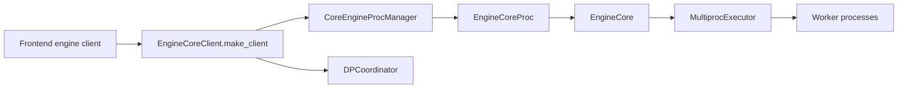
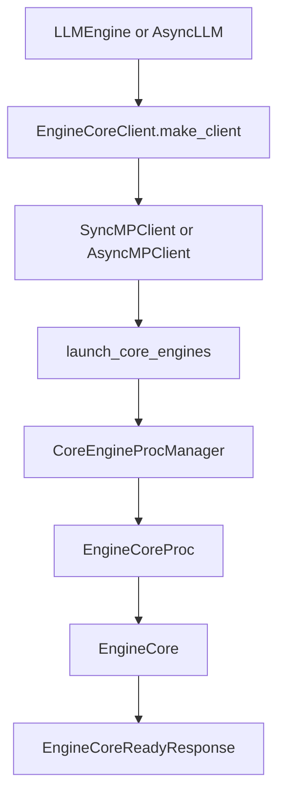
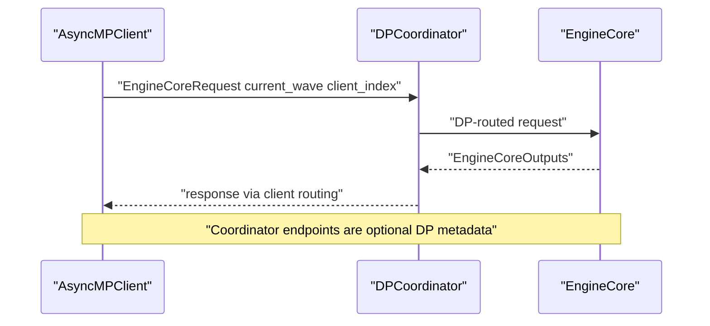
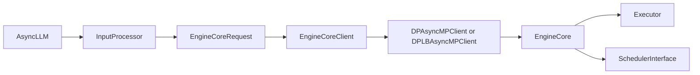

<!-- source: DeepWiki mcp.deepwiki.com · repo vllm-project/vllm · page 9.3 Multi-Process Engine Management · fetched 2026-10-28 -->

# Multi-Process Engine Management

Relevant source files

The following files were used as context for generating this wiki page:

- [tests/distributed/test_multiproc_executor.py](tests/distributed/test_multiproc_executor.py)
- [tests/distributed/test_ray_v2_executor.py](tests/distributed/test_ray_v2_executor.py)
- [tests/entrypoints/launchers/api_server/test_api_server_process_manager.py](tests/entrypoints/launchers/api_server/test_api_server_process_manager.py)
- [tests/entrypoints/serve/utils/test_api_utils.py](tests/entrypoints/serve/utils/test_api_utils.py)
- [tests/model_executor/model_loader/runai_streamer_loader/conftest.py](tests/model_executor/model_loader/runai_streamer_loader/conftest.py)
- [tests/model_executor/model_loader/tensorizer_loader/conftest.py](tests/model_executor/model_loader/tensorizer_loader/conftest.py)
- [tests/test_ray_env_utils.py](tests/test_ray_env_utils.py)
- [tests/utils_/test_network_utils.py](tests/utils_/test_network_utils.py)
- [tests/utils_/test_ray_utils.py](tests/utils_/test_ray_utils.py)
- [tests/v1/distributed/test_async_llm_dp.py](tests/v1/distributed/test_async_llm_dp.py)
- [tests/v1/engine/test_core_engine_actor_manager.py](tests/v1/engine/test_core_engine_actor_manager.py)
- [tests/v1/engine/test_dp_world_group_port.py](tests/v1/engine/test_dp_world_group_port.py)
- [tests/v1/engine/test_engine_core.py](tests/v1/engine/test_engine_core.py)
- [tests/v1/engine/test_engine_core_client.py](tests/v1/engine/test_engine_core_client.py)
- [tests/v1/engine/test_startup_watch_processes.py](tests/v1/engine/test_startup_watch_processes.py)
- [tests/v1/executor/test_multiproc_executor.py](tests/v1/executor/test_multiproc_executor.py)
- [vllm/engine/protocol.py](vllm/engine/protocol.py)
- [vllm/entrypoints/cli/serve.py](vllm/entrypoints/cli/serve.py)
- [vllm/entrypoints/llm.py](vllm/entrypoints/llm.py)
- [vllm/entrypoints/serve/utils/api_utils.py](vllm/entrypoints/serve/utils/api_utils.py)
- [vllm/utils/network_utils.py](vllm/utils/network_utils.py)
- [vllm/v1/core/sched/interface.py](vllm/v1/core/sched/interface.py)
- [vllm/v1/engine/__init__.py](vllm/v1/engine/__init__.py)
- [vllm/v1/engine/async_llm.py](vllm/v1/engine/async_llm.py)
- [vllm/v1/engine/coordinator.py](vllm/v1/engine/coordinator.py)
- [vllm/v1/engine/core.py](vllm/v1/engine/core.py)
- [vllm/v1/engine/core_client.py](vllm/v1/engine/core_client.py)
- [vllm/v1/engine/llm_engine.py](vllm/v1/engine/llm_engine.py)
- [vllm/v1/engine/utils.py](vllm/v1/engine/utils.py)
- [vllm/v1/executor/multiproc_executor.py](vllm/v1/executor/multiproc_executor.py)
- [vllm/v1/executor/ray_env_utils.py](vllm/v1/executor/ray_env_utils.py)
- [vllm/v1/executor/ray_executor_v2.py](vllm/v1/executor/ray_executor_v2.py)
- [vllm/v1/executor/uniproc_executor.py](vllm/v1/executor/uniproc_executor.py)
- [vllm/v1/utils.py](vllm/v1/utils.py)

## Purpose and scope

This page describes how vLLM connects frontend clients to engine-core processes, how local worker processes and Ray-related infrastructure fit into execution, and how data-parallel (DP) clients and coordination support request routing. It focuses on the V1 engine process and client boundaries, request-wave metadata, and the load-balancing modes visible in the supplied implementation. [vllm/v1/engine/core_client.py:83-173]()

Sources: `[vllm/v1/engine/core_client.py:83-173]()`

---

## Overview

The V1 architecture separates the frontend-facing `EngineCoreClient` from `EngineCore`, which owns the model executor, KV-cache initialization, and scheduler. `EngineCoreClient.make_client` selects an in-process or multiprocess client; for multiprocess operation, it chooses a synchronous client or an async client, with DP-specific async clients selected when `data_parallel_size > 1`. [vllm/v1/engine/core_client.py:83-136]()[vllm/v1/engine/core_client.py:138-173]()[vllm/v1/engine/core.py:117-184]()

| Code entity | Role in multi-process management |
|---|---|
| `EngineCoreClient` | Abstract interface for transferring requests and outputs between clients and the engine core. Its documented implementations include `InprocClient`, `SyncMPClient`, and `AsyncMPClient`. [vllm/v1/engine/core_client.py:83-91]() |
| `EngineCore` | Engine inner loop; creates the executor, initializes KV caches, and constructs the scheduler. [vllm/v1/engine/core.py:117-127]()[vllm/v1/engine/core.py:145-184]() |
| `EngineCoreRequest` | Serialized request structure; carries DP rank, client index, and wave metadata among other request fields. [vllm/v1/engine/__init__.py:113-146]() |
| `CoreEngine` | Tracks one engine per DP rank through startup handshake states `NEW`, `CONNECTED`, and `READY`. [vllm/v1/engine/utils.py:70-84]() |
| `EngineZmqAddresses` | Describes frontend request/response endpoints and optional DP coordinator endpoints. [vllm/v1/engine/utils.py:94-110]() |
| `MultiprocExecutor` | Initializes and manages local worker processes for model execution. [vllm/v1/executor/multiproc_executor.py:111-136]()[vllm/v1/executor/multiproc_executor.py:144-182]() |
| `DPCoordinator` | Coordinator type imported by the engine client and engine utilities; its detailed implementation is not included in the supplied file contents. [vllm/v1/engine/core_client.py:54-64]()[vllm/v1/engine/utils.py:32-36]() |

Sources: `[vllm/v1/engine/core_client.py:83-173]()`, `[vllm/v1/engine/core.py:117-184]()`, `[vllm/v1/engine/__init__.py:113-146]()`, `[vllm/v1/engine/utils.py:70-110]()`, `[vllm/v1/executor/multiproc_executor.py:111-182]()`

### Natural-language responsibilities mapped to code entities

The following diagram maps the process-management concepts used on this page to the named classes and methods visible in the code. [vllm/v1/engine/core_client.py:83-173]()[vllm/v1/engine/utils.py:70-110]()[vllm/v1/executor/multiproc_executor.py:111-182]()

Sources: `[vllm/v1/engine/core_client.py:83-173]()`, `[vllm/v1/engine/utils.py:70-110]()`, `[vllm/v1/executor/multiproc_executor.py:111-182]()`

---

## Engine Process Spawning and Management

`EngineCoreClient` is the frontend-side selection point for engine-core execution mode. `make_client` rejects asyncio without multiprocessing, chooses `AsyncMPClient` or `SyncMPClient` for multiprocess operation, and otherwise constructs `InprocClient`. For async multiprocess clients, the factory selects a DP-aware client when the configured DP size is greater than one. [vllm/v1/engine/core_client.py:97-136]()[vllm/v1/engine/core_client.py:138-173]()

The process and endpoint types in `vllm.v1.engine.utils` describe the management boundary:

- `CoreEngine` represents one engine per DP rank and tracks its handshake state. [vllm/v1/engine/utils.py:70-84]()
- `EngineZmqAddresses` holds the frontend input and output addresses, with optional coordinator input/output addresses and an optional frontend stats-publishing address. [vllm/v1/engine/utils.py:94-110]()
- `EngineHandshakeMetadata` packages those addresses with a serialized parallel-configuration mapping for startup. [vllm/v1/engine/utils.py:133-142]()
- `get_engine_process_shutdown_timeout` preserves an outer process timeout except for the documented ROCm case where both request and process timeouts are zero. [vllm/v1/engine/utils.py:47-67]()

The provided excerpts identify `CoreEngineProcManager`, `launch_core_engines`, and `EngineCoreProc` as process-management entities, but do not show their spawning or handshake call bodies. Accordingly, the diagram below shows the visible conceptual relationship, not an asserted call sequence beyond the client factory and engine-core boundary. [vllm/v1/engine/core_client.py:54-64]()[vllm/v1/engine/utils.py:32-36]()

### Diagram: client, process manager, and engine-core entities

Sources: `[vllm/v1/engine/core_client.py:83-173]()`, `[vllm/v1/engine/utils.py:32-36]()`, `[vllm/v1/engine/__init__.py:73-110]()`

Sources: `[vllm/v1/engine/core_client.py:83-173]()`, `[vllm/v1/engine/utils.py:32-36]()`, `[vllm/v1/engine/__init__.py:73-110]()`

### Local worker processes

`MultiprocExecutor` manages local worker processes beneath the engine core. During initialization, it checks that `world_size` equals the product of tensor-, pipeline-, and prefill-context-parallel sizes. It derives a local process count using `local_world_size` and local DP size, prepares worker environment variables, and creates a multiprocessing context. [vllm/v1/executor/multiproc_executor.py:111-143]()[vllm/v1/executor/multiproc_executor.py:172-182]()

For the leader node within a DP rank, the executor creates a shared-memory `MessageQueue` and exports its handle for scheduler-output distribution. The supplied excerpt also shows that executor initialization tracks failure state and installs a weak-reference finalizer for shutdown. [vllm/v1/executor/multiproc_executor.py:118-124]()[vllm/v1/executor/multiproc_executor.py:144-172]()

Sources: `[vllm/v1/executor/multiproc_executor.py:111-182]()`

---

## Ray Integration and Distributed Actor Management

The supplied utility code has Ray-specific support in the engine process-management layer. It imports Ray environment helpers and placement-group types, and defines helpers that reason about Ray node resources and placement bundles. [vllm/v1/engine/utils.py:19-39]()

`_make_control_bundle` constructs a CPU control bundle with node affinity. `_dp_nodes_master_first` orders available Ray nodes with the DP master first and asserts that the master node is present and unique. These helpers show how Ray resources are used to support DP placement and control-plane placement; the supplied excerpts do not include the complete actor-launch implementation. [vllm/v1/engine/utils.py:144-181]()

The engine-client utilities import `CoreEngineActorManager` alongside `CoreEngineProcManager` and `launch_core_engines`, indicating that actor- and process-based engine management share the client-side startup utilities. The actor manager implementation itself is not shown in the provided excerpts. [vllm/v1/engine/core_client.py:54-64]()

| Ray-related entity | Visible responsibility |
|---|---|
| `_make_control_bundle` | Builds a CPU control bundle pinned to a node IP. [vllm/v1/engine/utils.py:144-149]() |
| `_dp_nodes_master_first` | Orders Ray nodes with the DP master first and validates the node set. [vllm/v1/engine/utils.py:159-181]() |
| `get_env_vars_to_copy` | Ray environment helper imported by engine utilities. [vllm/v1/engine/utils.py:19-24]() |
| `CoreEngineActorManager` | Actor-manager symbol imported by client startup utilities; implementation details are outside the supplied excerpt. [vllm/v1/engine/core_client.py:58-64]() |

Sources: `[vllm/v1/engine/utils.py:19-39]()`, `[vllm/v1/engine/utils.py:144-181]()`, `[vllm/v1/engine/core_client.py:54-64]()`

### Diagram: Ray placement concepts mapped to utility entities

Sources: `[vllm/v1/engine/utils.py:144-181]()`, `[vllm/v1/engine/core_client.py:54-64]()`

---

## Request Wave Coordination and DP Coordinator

### Data-parallel request metadata

`EngineCoreRequest` includes `data_parallel_rank`, `client_index`, and `current_wave`. The `current_wave` field documents a race condition: a request may arrive before the notification that a prior wave finished, so the request carries the wave it is expected to belong to. `client_index` supports returning outputs to the same frontend client when the frontend is scaled out. [vllm/v1/engine/__init__.py:113-146]()

`EngineCoreReadyResponse` exposes DP and coordinator startup information, including the DP rank and optional coordinator input and output addresses. `EngineZmqAddresses` similarly models optional coordinator endpoints alongside frontend request and response endpoints. [vllm/v1/engine/__init__.py:73-110]()[vllm/v1/engine/utils.py:94-110]()

### `DPCoordinator` boundary

`DPCoordinator` is imported by both `core_client.py` and `utils.py`; `EngineZmqAddresses` reserves coordinator input and output addresses, and the ready response can return those addresses to a client. This establishes the coordinator’s place in the DP communication topology. The coordinator’s routing algorithm, wave-state transitions, and socket implementation are not shown in the supplied file contents and are therefore not specified here. [vllm/v1/engine/core_client.py:54-64]()[vllm/v1/engine/utils.py:32-36]()[vllm/v1/engine/utils.py:94-110]()[vllm/v1/engine/__init__.py:73-110]()

### Diagram: request wave and coordinator metadata

Sources: `[vllm/v1/engine/__init__.py:73-110]()`, `[vllm/v1/engine/__init__.py:113-146]()`, `[vllm/v1/engine/utils.py:94-110]()`, `[vllm/v1/engine/core_client.py:54-64]()`

Sources: `[vllm/v1/engine/__init__.py:73-110]()`, `[vllm/v1/engine/__init__.py:113-146]()`, `[vllm/v1/engine/utils.py:94-110]()`, `[vllm/v1/engine/core_client.py:54-64]()`

---

## Data Parallel Load Balancing Strategies

`EngineCoreClient.make_async_mp_client` selects between two DP client modes when `data_parallel_size > 1`:

- With `data_parallel_external_lb` enabled, it constructs `DPAsyncMPClient`, described in the code comment as a client per DP rank for external load balancing. [vllm/v1/engine/core_client.py:149-164]()
- Otherwise, it constructs `DPLBAsyncMPClient`, described as an internal load balancer whose client balances across DP ranks. [vllm/v1/engine/core_client.py:158-169]()
- For DP size one, it constructs the regular `AsyncMPClient`. [vllm/v1/engine/core_client.py:149-173]()

The CLI chooses API-server counts based on the selected load-balancing mode. Its documented defaults include one server for external LB, the local DP size for hybrid LB, and the full DP size for internal LB; it also rejects selecting more than one of the external, hybrid, and multi-port modes. [vllm/entrypoints/cli/serve.py:79-105]()[vllm/entrypoints/cli/serve.py:107-136]()

The request structure provides fields used to preserve DP and frontend routing context: `data_parallel_rank` identifies a DP target, `client_index` identifies the frontend client, and `current_wave` carries wave membership information. The supplied excerpts do not show the complete request-selection policy inside `DPLBAsyncMPClient`, so no particular in-flight-count algorithm is asserted here. [vllm/v1/engine/__init__.py:113-146]()

| Mode | Client selection | API-server default behavior shown |
|---|---|---|
| Internal DP LB | `DPLBAsyncMPClient` when DP size is greater than one and external LB is disabled. [vllm/v1/engine/core_client.py:158-169]() | Defaults to full `data_parallel_size`. [vllm/entrypoints/cli/serve.py:107-129]() |
| External DP LB | `DPAsyncMPClient` when `data_parallel_external_lb` is enabled. [vllm/v1/engine/core_client.py:158-164]() | Defaults to one API server. [vllm/entrypoints/cli/serve.py:107-116]() |
| Hybrid DP LB | CLI mode with local-rank-oriented server count. [vllm/entrypoints/cli/serve.py:87-105]() | Defaults to `data_parallel_size_local` (or one). [vllm/entrypoints/cli/serve.py:113-123]() |
| Single DP rank | `AsyncMPClient` when DP size is one. [vllm/v1/engine/core_client.py:149-173]() | Not a multi-rank load-balancing mode. [vllm/v1/engine/core_client.py:149-173]() |

Sources: `[vllm/v1/engine/core_client.py:149-173]()`, `[vllm/entrypoints/cli/serve.py:79-136]()`, `[vllm/v1/engine/__init__.py:113-146]()`

---

## Request and process data flow

At the frontend boundary, `AsyncLLM` owns an `InputProcessor` that converts user input into engine requests, and obtains an `EngineCoreClient` for communicating with the engine. [vllm/v1/engine/async_llm.py:93-111]()[vllm/v1/engine/async_llm.py:167-173]()

The request type includes routing and coordination metadata; the client factory chooses a transport/client variant; the engine core initializes its executor and scheduler. This diagram connects those code entities without implying implementation details absent from the supplied excerpts. [vllm/v1/engine/__init__.py:113-146]()[vllm/v1/engine/core_client.py:97-173]()[vllm/v1/engine/core.py:145-184]()

### Diagram: frontend request to execution entities

Sources: `[vllm/v1/engine/async_llm.py:93-111]()`, `[vllm/v1/engine/async_llm.py:167-173]()`, `[vllm/v1/engine/__init__.py:113-146]()`, `[vllm/v1/engine/core_client.py:97-173]()`, `[vllm/v1/engine/core.py:145-184]()`

---

## References

- `EngineCore` construction and scheduler setup: `[vllm/v1/engine/core.py:117-184]()`
- Client selection and DP client modes: `[vllm/v1/engine/core_client.py:83-173]()`
- Engine process metadata and Ray placement helpers: `[vllm/v1/engine/utils.py:70-110]()`, `[vllm/v1/engine/utils.py:133-181]()`
- Local worker-process executor initialization: `[vllm/v1/executor/multiproc_executor.py:111-182]()`
- Request routing and wave fields: `[vllm/v1/engine/__init__.py:113-146]()`
- CLI load-balancing mode defaults: `[vllm/entrypoints/cli/serve.py:79-156]()`

Sources: `[vllm/v1/engine/core.py:117-184]()`, `[vllm/v1/engine/core_client.py:83-173]()`, `[vllm/v1/engine/utils.py:70-181]()`, `[vllm/v1/executor/multiproc_executor.py:111-182]()`, `[vllm/v1/engine/__init__.py:113-146]()`, `[vllm/entrypoints/cli/serve.py:79-156]()`

---

