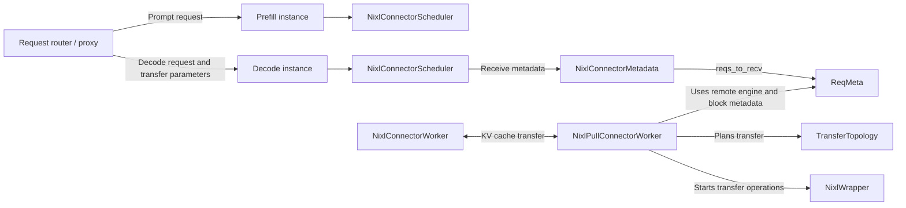
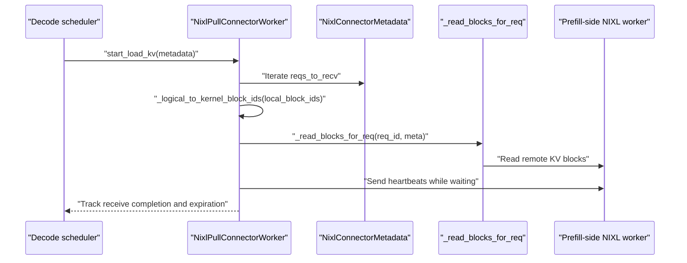
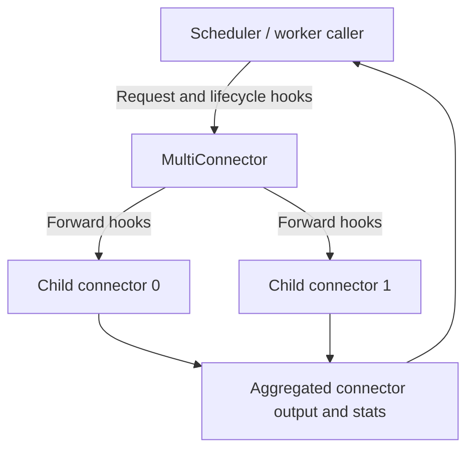
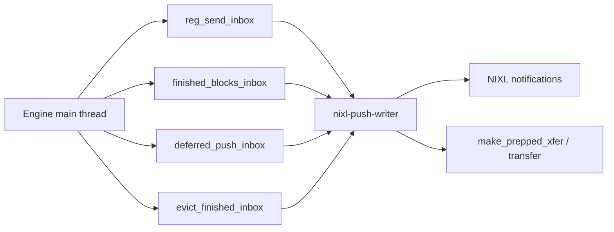
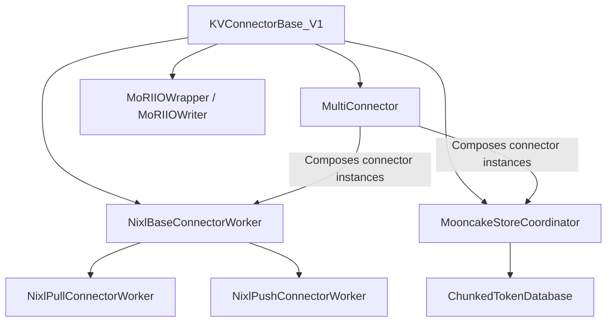

<!-- source: DeepWiki mcp.deepwiki.com · repo vllm-project/vllm · page 9.4 KV Cache Transfer and Disaggregated Serving · fetched 2026-10-28 -->

# KV Cache Transfer and Disaggregated Serving

Relevant source files

The following files were used as context for generating this wiki page:

- [docs/design/nixl_kv_push_connector.md](docs/design/nixl_kv_push_connector.md)
- [docs/features/disagg_prefill.md](docs/features/disagg_prefill.md)
- [docs/features/mooncake_connector_usage.md](docs/features/mooncake_connector_usage.md)
- [docs/features/mooncake_store_connector_usage.md](docs/features/mooncake_store_connector_usage.md)
- [docs/features/moriio_connector_usage.md](docs/features/moriio_connector_usage.md)
- [docs/features/nixl_connector_compatibility.md](docs/features/nixl_connector_compatibility.md)
- [docs/features/nixl_connector_usage.md](docs/features/nixl_connector_usage.md)
- [examples/disaggregated/disaggregated_serving/moriio_toy_proxy_server.py](examples/disaggregated/disaggregated_serving/moriio_toy_proxy_server.py)
- [tests/v1/kv_connector/mooncake_integration/test_accuracy_rocm.py](tests/v1/kv_connector/mooncake_integration/test_accuracy_rocm.py)
- [tests/v1/kv_connector/moriio_integration/__init__.py](tests/v1/kv_connector/moriio_integration/__init__.py)
- [tests/v1/kv_connector/moriio_integration/moriio_wide_dummy.py](tests/v1/kv_connector/moriio_integration/moriio_wide_dummy.py)
- [tests/v1/kv_connector/moriio_integration/test_write_dummy_e2e_rocm.py](tests/v1/kv_connector/moriio_integration/test_write_dummy_e2e_rocm.py)
- [tests/v1/kv_connector/nixl_integration/__init__.py](tests/v1/kv_connector/nixl_integration/__init__.py)
- [tests/v1/kv_connector/nixl_integration/config_sweep_spec_decode_test.sh](tests/v1/kv_connector/nixl_integration/config_sweep_spec_decode_test.sh)
- [tests/v1/kv_connector/nixl_integration/run_xpu_disagg_accuracy_test.sh](tests/v1/kv_connector/nixl_integration/run_xpu_disagg_accuracy_test.sh)
- [tests/v1/kv_connector/nixl_integration/spec_decode_acceptance_test.sh](tests/v1/kv_connector/nixl_integration/spec_decode_acceptance_test.sh)
- [tests/v1/kv_connector/nixl_integration/test_accuracy_rocm.py](tests/v1/kv_connector/nixl_integration/test_accuracy_rocm.py)
- [tests/v1/kv_connector/nixl_integration/test_spec_decode_acceptance.py](tests/v1/kv_connector/nixl_integration/test_spec_decode_acceptance.py)
- [tests/v1/kv_connector/rocm_pd_accuracy_utils.py](tests/v1/kv_connector/rocm_pd_accuracy_utils.py)
- [tests/v1/kv_connector/unit/test_cache_pollution_prevention.py](tests/v1/kv_connector/unit/test_cache_pollution_prevention.py)
- [tests/v1/kv_connector/unit/test_error_propagation.py](tests/v1/kv_connector/unit/test_error_propagation.py)
- [tests/v1/kv_connector/unit/test_flexkv_connector.py](tests/v1/kv_connector/unit/test_flexkv_connector.py)
- [tests/v1/kv_connector/unit/test_invalid_blocks_correctness.py](tests/v1/kv_connector/unit/test_invalid_blocks_correctness.py)
- [tests/v1/kv_connector/unit/test_kv_connector_lifecycle.py](tests/v1/kv_connector/unit/test_kv_connector_lifecycle.py)
- [tests/v1/kv_connector/unit/test_kv_load_failure_recovery.py](tests/v1/kv_connector/unit/test_kv_load_failure_recovery.py)
- [tests/v1/kv_connector/unit/test_lmcache_connector.py](tests/v1/kv_connector/unit/test_lmcache_connector.py)
- [tests/v1/kv_connector/unit/test_lmcache_integration.py](tests/v1/kv_connector/unit/test_lmcache_integration.py)
- [tests/v1/kv_connector/unit/test_mooncake_connector.py](tests/v1/kv_connector/unit/test_mooncake_connector.py)
- [tests/v1/kv_connector/unit/test_mooncake_connector_hma.py](tests/v1/kv_connector/unit/test_mooncake_connector_hma.py)
- [tests/v1/kv_connector/unit/test_mooncake_connector_hybrid_mamba.py](tests/v1/kv_connector/unit/test_mooncake_connector_hybrid_mamba.py)
- [tests/v1/kv_connector/unit/test_mooncake_stats.py](tests/v1/kv_connector/unit/test_mooncake_stats.py)
- [tests/v1/kv_connector/unit/test_mooncake_store_connector.py](tests/v1/kv_connector/unit/test_mooncake_store_connector.py)
- [tests/v1/kv_connector/unit/test_mooncake_store_coordinator.py](tests/v1/kv_connector/unit/test_mooncake_store_coordinator.py)
- [tests/v1/kv_connector/unit/test_mooncake_store_hma_e2e.py](tests/v1/kv_connector/unit/test_mooncake_store_hma_e2e.py)
- [tests/v1/kv_connector/unit/test_mooncake_store_layout.py](tests/v1/kv_connector/unit/test_mooncake_store_layout.py)
- [tests/v1/kv_connector/unit/test_mooncake_store_scheduler.py](tests/v1/kv_connector/unit/test_mooncake_store_scheduler.py)
- [tests/v1/kv_connector/unit/test_mooncake_store_worker.py](tests/v1/kv_connector/unit/test_mooncake_store_worker.py)
- [tests/v1/kv_connector/unit/test_moriio_connector.py](tests/v1/kv_connector/unit/test_moriio_connector.py)
- [tests/v1/kv_connector/unit/test_moriio_hetero_tp_write.py](tests/v1/kv_connector/unit/test_moriio_hetero_tp_write.py)
- [tests/v1/kv_connector/unit/test_moriio_hma_scheduler.py](tests/v1/kv_connector/unit/test_moriio_hma_scheduler.py)
- [tests/v1/kv_connector/unit/test_moriio_kv_layout.py](tests/v1/kv_connector/unit/test_moriio_kv_layout.py)
- [tests/v1/kv_connector/unit/test_moriio_routing.py](tests/v1/kv_connector/unit/test_moriio_routing.py)
- [tests/v1/kv_connector/unit/test_moriio_tp_ack.py](tests/v1/kv_connector/unit/test_moriio_tp_ack.py)
- [tests/v1/kv_connector/unit/test_moriio_tp_mapping.py](tests/v1/kv_connector/unit/test_moriio_tp_mapping.py)
- [tests/v1/kv_connector/unit/test_moriio_transfer_completion.py](tests/v1/kv_connector/unit/test_moriio_transfer_completion.py)
- [tests/v1/kv_connector/unit/test_moriio_write_done_routing.py](tests/v1/kv_connector/unit/test_moriio_write_done_routing.py)
- [tests/v1/kv_connector/unit/test_multi_connector.py](tests/v1/kv_connector/unit/test_multi_connector.py)
- [tests/v1/kv_connector/unit/test_nixl_connector.py](tests/v1/kv_connector/unit/test_nixl_connector.py)
- [tests/v1/kv_connector/unit/test_nixl_connector_hma.py](tests/v1/kv_connector/unit/test_nixl_connector_hma.py)
- [tests/v1/kv_connector/unit/test_nixl_desc_geometry.py](tests/v1/kv_connector/unit/test_nixl_desc_geometry.py)
- [tests/v1/kv_connector/unit/test_nixl_push_connector.py](tests/v1/kv_connector/unit/test_nixl_push_connector.py)
- [tests/v1/kv_connector/unit/test_nixl_simple_cpu_offload.py](tests/v1/kv_connector/unit/test_nixl_simple_cpu_offload.py)
- [tests/v1/kv_connector/unit/test_remote_prefill_lifecycle.py](tests/v1/kv_connector/unit/test_remote_prefill_lifecycle.py)
- [tests/v1/kv_connector/unit/test_scheduler_kv_connector_override.py](tests/v1/kv_connector/unit/test_scheduler_kv_connector_override.py)
- [tests/v1/kv_connector/unit/test_tp_mapping.py](tests/v1/kv_connector/unit/test_tp_mapping.py)
- [tests/v1/kv_connector/unit/utils.py](tests/v1/kv_connector/unit/utils.py)
- [vllm/distributed/kv_transfer/kv_connector/factory.py](vllm/distributed/kv_transfer/kv_connector/factory.py)
- [vllm/distributed/kv_transfer/kv_connector/utils.py](vllm/distributed/kv_transfer/kv_connector/utils.py)
- [vllm/distributed/kv_transfer/kv_connector/v1/base.py](vllm/distributed/kv_transfer/kv_connector/v1/base.py)
- [vllm/distributed/kv_transfer/kv_connector/v1/mooncake/mooncake_connector.py](vllm/distributed/kv_transfer/kv_connector/v1/mooncake/mooncake_connector.py)
- [vllm/distributed/kv_transfer/kv_connector/v1/mooncake/mooncake_utils.py](vllm/distributed/kv_transfer/kv_connector/v1/mooncake/mooncake_utils.py)
- [vllm/distributed/kv_transfer/kv_connector/v1/mooncake/store/connector.py](vllm/distributed/kv_transfer/kv_connector/v1/mooncake/store/connector.py)
- [vllm/distributed/kv_transfer/kv_connector/v1/mooncake/store/coordinator.py](vllm/distributed/kv_transfer/kv_connector/v1/mooncake/store/coordinator.py)
- [vllm/distributed/kv_transfer/kv_connector/v1/mooncake/store/data.py](vllm/distributed/kv_transfer/kv_connector/v1/mooncake/store/data.py)
- [vllm/distributed/kv_transfer/kv_connector/v1/mooncake/store/protocol.py](vllm/distributed/kv_transfer/kv_connector/v1/mooncake/store/protocol.py)
- [vllm/distributed/kv_transfer/kv_connector/v1/mooncake/store/scheduler.py](vllm/distributed/kv_transfer/kv_connector/v1/mooncake/store/scheduler.py)
- [vllm/distributed/kv_transfer/kv_connector/v1/mooncake/store/worker.py](vllm/distributed/kv_transfer/kv_connector/v1/mooncake/store/worker.py)
- [vllm/distributed/kv_transfer/kv_connector/v1/moriio/moriio_common.py](vllm/distributed/kv_transfer/kv_connector/v1/moriio/moriio_common.py)
- [vllm/distributed/kv_transfer/kv_connector/v1/moriio/moriio_connector.py](vllm/distributed/kv_transfer/kv_connector/v1/moriio/moriio_connector.py)
- [vllm/distributed/kv_transfer/kv_connector/v1/moriio/moriio_engine.py](vllm/distributed/kv_transfer/kv_connector/v1/moriio/moriio_engine.py)
- [vllm/distributed/kv_transfer/kv_connector/v1/moriio/moriio_layout.py](vllm/distributed/kv_transfer/kv_connector/v1/moriio/moriio_layout.py)
- [vllm/distributed/kv_transfer/kv_connector/v1/multi_connector.py](vllm/distributed/kv_transfer/kv_connector/v1/multi_connector.py)
- [vllm/distributed/kv_transfer/kv_connector/v1/nixl/__init__.py](vllm/distributed/kv_transfer/kv_connector/v1/nixl/__init__.py)
- [vllm/distributed/kv_transfer/kv_connector/v1/nixl/base_scheduler.py](vllm/distributed/kv_transfer/kv_connector/v1/nixl/base_scheduler.py)
- [vllm/distributed/kv_transfer/kv_connector/v1/nixl/base_worker.py](vllm/distributed/kv_transfer/kv_connector/v1/nixl/base_worker.py)
- [vllm/distributed/kv_transfer/kv_connector/v1/nixl/connector.py](vllm/distributed/kv_transfer/kv_connector/v1/nixl/connector.py)
- [vllm/distributed/kv_transfer/kv_connector/v1/nixl/metadata.py](vllm/distributed/kv_transfer/kv_connector/v1/nixl/metadata.py)
- [vllm/distributed/kv_transfer/kv_connector/v1/nixl/pull_scheduler.py](vllm/distributed/kv_transfer/kv_connector/v1/nixl/pull_scheduler.py)
- [vllm/distributed/kv_transfer/kv_connector/v1/nixl/pull_worker.py](vllm/distributed/kv_transfer/kv_connector/v1/nixl/pull_worker.py)
- [vllm/distributed/kv_transfer/kv_connector/v1/nixl/push_scheduler.py](vllm/distributed/kv_transfer/kv_connector/v1/nixl/push_scheduler.py)
- [vllm/distributed/kv_transfer/kv_connector/v1/nixl/push_worker.py](vllm/distributed/kv_transfer/kv_connector/v1/nixl/push_worker.py)
- [vllm/distributed/kv_transfer/kv_connector/v1/nixl/stats.py](vllm/distributed/kv_transfer/kv_connector/v1/nixl/stats.py)
- [vllm/distributed/kv_transfer/kv_connector/v1/nixl/tp_mapping.py](vllm/distributed/kv_transfer/kv_connector/v1/nixl/tp_mapping.py)
- [vllm/distributed/kv_transfer/kv_connector/v1/nixl/utils.py](vllm/distributed/kv_transfer/kv_connector/v1/nixl/utils.py)
- [vllm/distributed/kv_transfer/kv_connector/v1/nixl/worker.py](vllm/distributed/kv_transfer/kv_connector/v1/nixl/worker.py)
- [vllm/distributed/kv_transfer/kv_connector/v1/ssm_conv_transfer_utils.py](vllm/distributed/kv_transfer/kv_connector/v1/ssm_conv_transfer_utils.py)
- [vllm/distributed/kv_transfer/kv_transfer_state.py](vllm/distributed/kv_transfer/kv_transfer_state.py)
- [vllm/distributed/nixl_utils.py](vllm/distributed/nixl_utils.py)

## Purpose and scope

This page documents vLLM’s v1 KV connector interface and the connector implementations and data flows relevant to KV transfer and prefill–decode disaggregation. It covers scheduler/worker responsibilities, `MultiConnector`, encoder-cache transfer context, NIXL, LMCache, Mooncake, MoRIIO, `hf3fs`, `flexkv`, and connector metrics. KV block allocation and CPU/disk KV tiering are separate topics; see [KV Cache Management and Prefix Caching](3.4) and [KV Offloading and Tiering](9.5). [vllm/distributed/kv_transfer/kv_connector/v1/base.py:171-608]()

Sources: [vllm/distributed/kv_transfer/kv_connector/v1/base.py:171-608]()

---

## Disaggregated serving concept

Disaggregated serving runs prompt prefill and token decode on separate vLLM instances. A prefill-side instance computes KV state for prompt tokens; a decode-side instance obtains that state and continues generation. Connector metadata and request transfer parameters coordinate the work, while a connector worker performs the actual cache movement. The NIXL pull path, for example, processes receive metadata in `start_load_kv`, maps local logical blocks to physical cache blocks, and initiates reads for requests with remote metadata. [vllm/distributed/kv_transfer/kv_connector/v1/nixl/pull_worker.py:36-81]()

### Natural-language components mapped to code entities

This diagram associates prefill/decode roles with the NIXL scheduler, worker, and metadata entities used in the transfer path. [vllm/distributed/kv_transfer/kv_connector/v1/nixl/pull_worker.py:36-81]() [vllm/distributed/kv_transfer/kv_connector/v1/nixl/base_worker.py:25-62]()

**Diagram: NIXL pull transfer entities**

Sources: [vllm/distributed/kv_transfer/kv_connector/v1/nixl/pull_worker.py:36-81](), [vllm/distributed/kv_transfer/kv_connector/v1/nixl/base_worker.py:25-62]()

### Pull transfer lifecycle

`NixlPullConnectorWorker.start_load_kv` iterates `metadata.reqs_to_recv`, converts local logical block IDs to kernel-facing physical IDs, and calls `_read_blocks_for_req`. Requests may be tracked in `_recving_metadata` when the scheduler is awaiting KV or local blocks are present. The worker also drains `_ready_requests`, handles requests that should not be processed, tracks request expiration, and sends heartbeats to keep remote blocks alive while requests wait in the decode scheduler. [vllm/distributed/kv_transfer/kv_connector/v1/nixl/pull_worker.py:36-125]()

**Diagram: Pull-side request processing**

Sources: [vllm/distributed/kv_transfer/kv_connector/v1/nixl/pull_worker.py:36-125]()

---

## Connector interface: `KVConnectorBase_V1`

The v1 connector interface separates scheduler-side request and metadata management from worker-side cache registration and transfer operations. The base interface includes hooks for matched external tokens, allocation updates, connector metadata construction, request completion, cache loading and saving, and transfer completion reporting. [vllm/distributed/kv_transfer/kv_connector/v1/base.py:171-608]()

### Connector roles

`KVConnectorRole` distinguishes scheduler-side and worker-side connector instances. The `MultiConnector` tests construct it with `KVConnectorRole.WORKER`, and test connectors implement worker hooks such as `start_load_kv`, `wait_for_layer_load`, `save_kv_layer`, and `wait_for_save`. [vllm/distributed/kv_transfer/kv_connector/v1/base.py:35-50]() [tests/v1/kv_connector/unit/test_multi_connector.py:58-100]()

| Role | Responsibility |
|---|---|
| `KVConnectorRole.SCHEDULER` | Coordinate request state, allocation updates, and connector metadata. |
| `KVConnectorRole.WORKER` | Register cache buffers and carry out worker-side load/save operations. |

Sources: [vllm/distributed/kv_transfer/kv_connector/v1/base.py:35-50](), [tests/v1/kv_connector/unit/test_multi_connector.py:58-100]()

### Scheduler-side lifecycle

The scheduler-side contract coordinates external-cache lookup and request lifecycle with the scheduler’s allocation decisions. `get_num_new_matched_tokens` reports externally available tokens; `update_state_after_alloc` can retain request-specific transfer state after allocation; `build_connector_meta` produces metadata for worker processing; and completion hooks allow connectors to report whether blocks must remain held or provide transfer parameters. [vllm/distributed/kv_transfer/kv_connector/v1/base.py:215-281]()

Sources: [vllm/distributed/kv_transfer/kv_connector/v1/base.py:215-281]()

### Worker-side lifecycle

Worker hooks register cache storage and coordinate asynchronous transfer around model execution. The base API includes cache registration, load initiation and layer synchronization, save operations, and reporting of finished sends and receives. [vllm/distributed/kv_transfer/kv_connector/v1/base.py:291-376]()

Sources: [vllm/distributed/kv_transfer/kv_connector/v1/base.py:291-376]()

### Configuration and connector construction

`KVTransferConfig` carries connector configuration, including the connector name, role, optional module path, and extra configuration. The test utilities show configuration being assembled with `KVTransferConfig` and a `VllmConfig`; `KVConnectorFactory` is used to register and construct connector classes. [tests/v1/kv_connector/unit/utils.py:112-179]() [tests/v1/kv_connector/unit/test_multi_connector.py:13-38]()

Sources: [tests/v1/kv_connector/unit/utils.py:112-179](), [tests/v1/kv_connector/unit/test_multi_connector.py:13-38]()

---

## `MultiConnector`

`MultiConnector` composes connector instances behind the v1 connector interface. Its tests verify that it forwards lifecycle notifications to every connector—for example, `register_finished_partial_tail` is invoked on each child—and that the connector serving a request determines which child’s matched tokens are used. [tests/v1/kv_connector/unit/test_multi_connector.py:157-174]() [tests/v1/kv_connector/unit/test_multi_connector.py:206-212]()

The test setup configures `MultiConnector` with a `connectors` list containing child connector configurations, then constructs it for the worker role. This makes it possible to combine connector implementations without changing the scheduler or worker’s outer connector interface. [tests/v1/kv_connector/unit/test_multi_connector.py:177-203]()

**Diagram: `MultiConnector` delegation**

Sources: [tests/v1/kv_connector/unit/test_multi_connector.py:157-174](), [tests/v1/kv_connector/unit/test_multi_connector.py:177-212]()

### Multi-connector statistics

The connector tests import `MultiKVConnectorStats` and `MultiKVConnectorPromMetrics`, as well as the base `KVConnectorStats` and `KVConnectorLogging` types. These types provide the named aggregation and metrics integration points for multi-connector operation. [tests/v1/kv_connector/unit/test_multi_connector.py:23-38]()

Sources: [tests/v1/kv_connector/unit/test_multi_connector.py:23-38]()

---

## NIXL connector

NIXL provides a worker implementation for transferring cache data between engines. `NixlBaseConnectorWorker` contains shared pull/push worker logic, including transfer descriptor construction and cache-region handling; the pull and push implementations specialize it for READ and WRITE transfer modes. The base worker imports `NixlWrapper`, transfer topology types, NIXL metadata, and KV-cache specifications. [vllm/distributed/kv_transfer/kv_connector/v1/nixl/base_worker.py:25-62]() [vllm/distributed/kv_transfer/kv_connector/v1/nixl/base_worker.py:128-149]()

### Descriptor and layout planning

`_compute_desc_ids` calculates NIXL descriptor IDs from block IDs and destination geometry. It accounts for SSM regions, block-size ratios, transfer-layer routing, and region group counts. When layer-name routing is active, it emits descriptors in transfer-layer order; otherwise it follows the attention-oriented descriptor path. [vllm/distributed/kv_transfer/kv_connector/v1/nixl/base_worker.py:140-195]()

The worker’s imports also identify the relevant compatibility and layout machinery: `compute_nixl_compatibility_hash`, `TPMapping`, attention/SSM spec predicates, and cache post-processing utilities. [vllm/distributed/kv_transfer/kv_connector/v1/nixl/base_worker.py:25-62]()

Sources: [vllm/distributed/kv_transfer/kv_connector/v1/nixl/base_worker.py:25-62](), [vllm/distributed/kv_transfer/kv_connector/v1/nixl/base_worker.py:140-195]()

### Pull and push modes

`NixlPullConnectorWorker.start_load_kv` initiates non-blocking reads and processes receive metadata. [vllm/distributed/kv_transfer/kv_connector/v1/nixl/pull_worker.py:36-81]()

`NixlPushConnectorWorker` specializes the base worker with `_TRANSFER_MODE = "push"` and owns a `nixl-push-writer` thread. Its queues carry decode-side registrations, prefill-side finished blocks, completion notifications, deferred pushes, and eviction requests between the engine main thread and writer thread. [vllm/distributed/kv_transfer/kv_connector/v1/nixl/push_worker.py:81-137]()

The push writer matches decode registrations with completed prefill blocks and issues WRITE transfers. The module documents that the engine thread supplies work through queues, while the writer handles NIXL notifications and transfer operations. [vllm/distributed/kv_transfer/kv_connector/v1/nixl/push_worker.py:3-31]()

**Diagram: NIXL push coordination**

Sources: [vllm/distributed/kv_transfer/kv_connector/v1/nixl/push_worker.py:3-31](), [vllm/distributed/kv_transfer/kv_connector/v1/nixl/push_worker.py:101-137]()

### Transfer compatibility and topology

NIXL workers use `TransferTopology` and TP mapping helpers to translate between local and remote cache layouts. The shared worker imports include `compute_tp_mapping`, and the descriptor code accounts for physical blocks per logical block, group IDs, region counts, and SSM-specific regions. [vllm/distributed/kv_transfer/kv_connector/v1/nixl/base_worker.py:25-62]() [vllm/distributed/kv_transfer/kv_connector/v1/nixl/base_worker.py:140-195]()

The tests exercise NIXL connector metadata and topology using differing physical-block ratios and tensor-parallel layouts, including tests that ensure allocation padding does not shift the valid token ranges. [tests/v1/kv_connector/unit/test_nixl_connector_hma.py:114-179]()

Sources: [vllm/distributed/kv_transfer/kv_connector/v1/nixl/base_worker.py:25-62](), [tests/v1/kv_connector/unit/test_nixl_connector_hma.py:114-179]()

---

## Mooncake connectors

The repository contains both a transfer-engine connector and a store-oriented connector.

### Mooncake transfer-engine connector

`mooncake_connector.py` defines the transfer-engine connector surface and its transfer-region representation. `TransferRegion` records layer identity, base address, block lengths, cache group, shared groups, and row offsets. Region expansion validates matching metadata lengths and builds the regions used for transfer. [vllm/distributed/kv_transfer/kv_connector/v1/mooncake/mooncake_connector.py:33-40]() [vllm/distributed/kv_transfer/kv_connector/v1/mooncake/mooncake_connector.py:109-193]()

The module attempts to import Mooncake’s `TransferEngine`; if that dependency is unavailable, the connector logs a warning and sets the engine reference to `None`. [vllm/distributed/kv_transfer/kv_connector/v1/mooncake/mooncake_connector.py:84-92]()

Sources: [vllm/distributed/kv_transfer/kv_connector/v1/mooncake/mooncake_connector.py:33-40](), [vllm/distributed/kv_transfer/kv_connector/v1/mooncake/mooncake_connector.py:84-92](), [vllm/distributed/kv_transfer/kv_connector/v1/mooncake/mooncake_connector.py:109-193]()

### Mooncake store connector

The store worker integrates `MooncakeStoreCoordinator`, chunked token databases, store layouts, and sending/receiving worker threads. The module describes its responsibilities as including store-worker logic, transfer threads, a lookup server, and Mooncake distributed-store integration. [vllm/distributed/kv_transfer/kv_connector/v1/mooncake/store/worker.py:7-11]() [vllm/distributed/kv_transfer/kv_connector/v1/mooncake/store/worker.py:37-68]()

The store worker defines helpers to resolve the store tensor-parallel size from connector configuration. It can use an explicit `store_tp_size` or, when enabled, calculate a least common multiple from configured prefill TP sizes. [vllm/distributed/kv_transfer/kv_connector/v1/mooncake/store/worker.py:99-113]()

The store worker also includes helpers for disk-offload staging: it estimates aligned buffer use and splits GET work into batches constrained by usable and hard buffer budgets. [vllm/distributed/kv_transfer/kv_connector/v1/mooncake/store/worker.py:138-179]()

Sources: [vllm/distributed/kv_transfer/kv_connector/v1/mooncake/store/worker.py:7-11](), [vllm/distributed/kv_transfer/kv_connector/v1/mooncake/store/worker.py:37-68](), [vllm/distributed/kv_transfer/kv_connector/v1/mooncake/store/worker.py:99-113](), [vllm/distributed/kv_transfer/kv_connector/v1/mooncake/store/worker.py:138-179]()

---

## MoRIIO connector

`MoRIIOConnector` is implemented in `moriio_connector.py` and integrates the MoRIIO IO engine, transfer metadata, layout calculations, TP mapping, and heartbeat support. The module treats MoRIIO as an optional dependency: it imports `mori.io` components when available and exposes `is_moriio_available()` to report availability. [vllm/distributed/kv_transfer/kv_connector/v1/moriio/moriio_connector.py:20-84]() [vllm/distributed/kv_transfer/kv_connector/v1/moriio/moriio_connector.py:137-152]()

The implementation includes heterogeneous tensor-parallel mapping through `get_moriio_remote_tp_rank`. It validates positive TP sizes and rank bounds, and requires the larger TP size to be divisible by the smaller for heterogeneous mapping. `validate_moriio_heterogeneous_tp_kv_heads` permits MLA or equal TP sizes; otherwise it checks that the configuration satisfies the implementation’s replicated-KV-head constraints. [vllm/distributed/kv_transfer/kv_connector/v1/moriio/moriio_connector.py:165-207]()

The connector imports `MoRIIOWrapper`, `MoRIIOWriter`, layout functions for attention and Mamba state, and transfer-acknowledgment types. These are the named implementation areas to consult when tracing its memory registration, transfer geometry, or acknowledgment behavior. [vllm/distributed/kv_transfer/kv_connector/v1/moriio/moriio_connector.py:32-94]()

Sources: [vllm/distributed/kv_transfer/kv_connector/v1/moriio/moriio_connector.py:20-84](), [vllm/distributed/kv_transfer/kv_connector/v1/moriio/moriio_connector.py:137-152](), [vllm/distributed/kv_transfer/kv_connector/v1/moriio/moriio_connector.py:165-207]()

---

## LMCache, `hf3fs`, and `flexkv`

The supplied source excerpts identify LMCache multiprocessing support through the `LMCacheMPConnector` path, and list `hf3fs` and `flexkv` among the connector cluster’s additional files. The excerpts do not expose the implementation details or configuration contracts for these connectors, so this page does not infer their storage semantics or transfer protocols. For implementation details, consult the connector modules and their associated usage documentation in the repository. [tests/v1/kv_connector/unit/test_multi_connector.py:17-38]()

Sources: [tests/v1/kv_connector/unit/test_multi_connector.py:17-38](), [vllm/distributed/kv_transfer/kv_connector/v1/base.py:171-608]()

---

## Encoder cache transfer and hybrid cache considerations

The v1 connector interface is used for KV cache transfer, while the scheduler test utilities separately track `EncoderCacheManager` state and verify that cached and freed encoder entries are cleaned up. That test evidence establishes encoder-cache state as a scheduler-managed concern, but the provided connector excerpts do not show a specific encoder-cache transfer protocol. [tests/v1/kv_connector/unit/utils.py:68-85]()

Hybrid cache layouts require careful region and block mapping. NIXL’s base worker explicitly counts SSM regions when building descriptor IDs; the code comments describe multiple convolutional sub-projections plus an SSM temporal region per SSM layer. MoRIIO likewise imports Mamba layout and offset helpers for its transfer geometry. [vllm/distributed/kv_transfer/kv_connector/v1/nixl/base_worker.py:150-163]() [vllm/distributed/kv_transfer/kv_connector/v1/moriio/moriio_connector.py:67-84]()

Sources: [tests/v1/kv_connector/unit/utils.py:68-85](), [vllm/distributed/kv_transfer/kv_connector/v1/nixl/base_worker.py:150-163](), [vllm/distributed/kv_transfer/kv_connector/v1/moriio/moriio_connector.py:67-84]()

---

## Metrics and observability

Connector statistics are defined through `KVConnectorStats`. The multi-connector test imports `MultiKVConnectorStats` and `MultiKVConnectorPromMetrics`, while the NIXL tests import `NixlKVConnectorStats`. The Mooncake store worker imports `MooncakeStoreConnectorStats`. These types identify the base and connector-specific statistics integration points. [tests/v1/kv_connector/unit/test_multi_connector.py:23-38]() [tests/v1/kv_connector/unit/test_nixl_connector.py:34-50]() [vllm/distributed/kv_transfer/kv_connector/v1/mooncake/store/worker.py:91-93]()

| Statistics type | Role evidenced by the supplied sources |
|---|---|
| `KVConnectorStats` | Base statistics type used by connector tests. |
| `MultiKVConnectorStats` | Statistics type associated with multi-connector operation. |
| `MultiKVConnectorPromMetrics` | Prometheus metrics integration point named by the multi-connector tests. |
| `NixlKVConnectorStats` | NIXL-specific statistics type used in NIXL connector tests. |
| `MooncakeStoreConnectorStats` | Store-worker statistics type imported by the Mooncake store worker. |

Sources: [tests/v1/kv_connector/unit/test_multi_connector.py:23-38](), [tests/v1/kv_connector/unit/test_nixl_connector.py:34-50](), [vllm/distributed/kv_transfer/kv_connector/v1/mooncake/store/worker.py:91-93]()

---

## Testing and operational boundaries

The NIXL unit tests use a fake wrapper because the NIXL package may not be installed in the test environment; the fake provides mock descriptor registration, handshake metadata, and transfer state. [tests/v1/kv_connector/unit/test_nixl_connector.py:134-215]()

The NIXL push tests describe the scheduler/worker lifecycle they cover: decode-side registration staging, prefill-side finished-block staging, metadata construction, pending-work reporting, completion handling, and eviction processing. [tests/v1/kv_connector/unit/test_nixl_push_connector.py:3-18]()

The Mooncake store worker tests construct sending and receiving threads with token databases, coordinators, and store mocks, providing test coverage points for the store’s worker-side operations. [tests/v1/kv_connector/unit/test_mooncake_store_worker.py:93-211]()

Sources: [tests/v1/kv_connector/unit/test_nixl_connector.py:134-215](), [tests/v1/kv_connector/unit/test_nixl_push_connector.py:3-18](), [tests/v1/kv_connector/unit/test_mooncake_store_worker.py:93-211]()

---

## Summary: connector entities and data flow

The diagram links the common connector interface to composition and selected transport implementations. The named entities are grounded in the connector tests and implementation excerpts: `KVConnectorBase_V1`, `MultiConnector`, `NixlBaseConnectorWorker`, `NixlPullConnectorWorker`, `NixlPushConnectorWorker`, `MooncakeStoreCoordinator`, and MoRIIO’s writer and layout helpers. [tests/v1/kv_connector/unit/test_multi_connector.py:17-38]() [vllm/distributed/kv_transfer/kv_connector/v1/nixl/base_worker.py:128-149]() [vllm/distributed/kv_transfer/kv_connector/v1/nixl/pull_worker.py:36-49]() [vllm/distributed/kv_transfer/kv_connector/v1/nixl/push_worker.py:81-95]() [vllm/distributed/kv_transfer/kv_connector/v1/mooncake/store/worker.py:37-58]() [vllm/distributed/kv_transfer/kv_connector/v1/moriio/moriio_connector.py:60-90]()

**Diagram: interface, composition, and transport entities**

Sources: [tests/v1/kv_connector/unit/test_multi_connector.py:17-38](), [vllm/distributed/kv_transfer/kv_connector/v1/nixl/base_worker.py:128-149](), [vllm/distributed/kv_transfer/kv_connector/v1/nixl/pull_worker.py:36-49](), [vllm/distributed/kv_transfer/kv_connector/v1/nixl/push_worker.py:81-95](), [vllm/distributed/kv_transfer/kv_connector/v1/mooncake/store/worker.py:37-58](), [vllm/distributed/kv_transfer/kv_connector/v1/moriio/moriio_connector.py:60-90]()

---

## References

- Connector interface: [vllm/distributed/kv_transfer/kv_connector/v1/base.py:171-608]()
- NIXL base worker and descriptor mapping: [vllm/distributed/kv_transfer/kv_connector/v1/nixl/base_worker.py:128-195]()
- NIXL pull worker: [vllm/distributed/kv_transfer/kv_connector/v1/nixl/pull_worker.py:36-147]()
- NIXL push worker: [vllm/distributed/kv_transfer/kv_connector/v1/nixl/push_worker.py:3-31]()
- NIXL connector tests: [tests/v1/kv_connector/unit/test_nixl_connector.py:134-215]()
- NIXL push lifecycle tests: [tests/v1/kv_connector/unit/test_nixl_push_connector.py:3-18]()
- Multi-connector tests: [tests/v1/kv_connector/unit/test_multi_connector.py:17-38]()
- Mooncake transfer-engine connector: [vllm/distributed/kv_transfer/kv_connector/v1/mooncake/mooncake_connector.py:33-40]()
- Mooncake store worker: [vllm/distributed/kv_transfer/kv_connector/v1/mooncake/store/worker.py:7-11]()
- MoRIIO connector: [vllm/distributed/kv_transfer/kv_connector/v1/moriio/moriio_connector.py:20-84]()
- Connector test configuration helpers: [tests/v1/kv_connector/unit/utils.py:112-179]()

Sources: [vllm/distributed/kv_transfer/kv_connector/v1/base.py:171-608](), [vllm/distributed/kv_transfer/kv_connector/v1/nixl/base_worker.py:128-195](), [vllm/distributed/kv_transfer/kv_connector/v1/nixl/pull_worker.py:36-147](), [vllm/distributed/kv_transfer/kv_connector/v1/nixl/push_worker.py:3-31](), [tests/v1/kv_connector/unit/test_multi_connector.py:17-38]()

---

