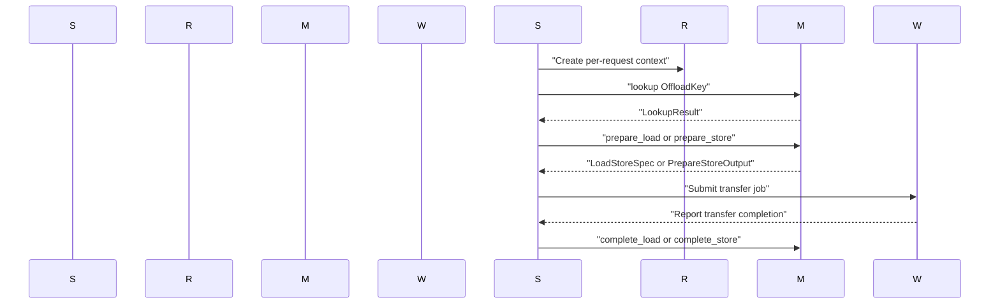

<!-- source: DeepWiki mcp.deepwiki.com · repo vllm-project/vllm · page 9.5 KV Offloading and Tiering · fetched 2026-10-28 -->

# KV Offloading and Tiering

<details>
<summary>Relevant source files</summary>

The following files were used as context for generating this wiki page:

- [.buildkite/scripts/install-kv-offload.sh](.buildkite/scripts/install-kv-offload.sh)
- [benchmarks/kernels/bench_cp_gather_fp8.py](benchmarks/kernels/bench_cp_gather_fp8.py)
- [benchmarks/kernels/benchmark_cp_gather.py](benchmarks/kernels/benchmark_cp_gather.py)
- [csrc/cache_kernels.cu](csrc/cache_kernels.cu)
- [docs/features/kv_offloading_usage.md](docs/features/kv_offloading_usage.md)
- [tests/kernels/test_cp_gather_fp8.py](tests/kernels/test_cp_gather_fp8.py)
- [tests/v1/kv_connector/extract_hidden_states_integration/test_extraction.py](tests/v1/kv_connector/extract_hidden_states_integration/test_extraction.py)
- [tests/v1/kv_connector/unit/offloading_connector/test_config.py](tests/v1/kv_connector/unit/offloading_connector/test_config.py)
- [tests/v1/kv_connector/unit/offloading_connector/test_events.py](tests/v1/kv_connector/unit/offloading_connector/test_events.py)
- [tests/v1/kv_connector/unit/offloading_connector/test_metrics.py](tests/v1/kv_connector/unit/offloading_connector/test_metrics.py)
- [tests/v1/kv_connector/unit/offloading_connector/test_scheduler.py](tests/v1/kv_connector/unit/offloading_connector/test_scheduler.py)
- [tests/v1/kv_connector/unit/offloading_connector/test_worker.py](tests/v1/kv_connector/unit/offloading_connector/test_worker.py)
- [tests/v1/kv_connector/unit/offloading_connector/test_worker_metadata.py](tests/v1/kv_connector/unit/offloading_connector/test_worker_metadata.py)
- [tests/v1/kv_connector/unit/offloading_connector/utils.py](tests/v1/kv_connector/unit/offloading_connector/utils.py)
- [tests/v1/kv_connector/unit/test_bidirectional_kv_transfer.py](tests/v1/kv_connector/unit/test_bidirectional_kv_transfer.py)
- [tests/v1/kv_connector/unit/test_config.py](tests/v1/kv_connector/unit/test_config.py)
- [tests/v1/kv_connector/unit/test_example_connector.py](tests/v1/kv_connector/unit/test_example_connector.py)
- [tests/v1/kv_connector/unit/test_offloading_connector.py](tests/v1/kv_connector/unit/test_offloading_connector.py)
- [tests/v1/kv_connector/unit/test_simple_cpu_offload_connector.py](tests/v1/kv_connector/unit/test_simple_cpu_offload_connector.py)
- [tests/v1/kv_offload/__init__.py](tests/v1/kv_offload/__init__.py)
- [tests/v1/kv_offload/cpu/test_canonical_layout.py](tests/v1/kv_offload/cpu/test_canonical_layout.py)
- [tests/v1/kv_offload/cpu/test_gpu_worker.py](tests/v1/kv_offload/cpu/test_gpu_worker.py)
- [tests/v1/kv_offload/cpu/test_manager.py](tests/v1/kv_offload/cpu/test_manager.py)
- [tests/v1/kv_offload/cpu/test_shared_offload_region.py](tests/v1/kv_offload/cpu/test_shared_offload_region.py)
- [tests/v1/kv_offload/test_factory.py](tests/v1/kv_offload/test_factory.py)
- [tests/v1/kv_offload/test_file_mapper.py](tests/v1/kv_offload/test_file_mapper.py)
- [tests/v1/kv_offload/tiering/__init__.py](tests/v1/kv_offload/tiering/__init__.py)
- [tests/v1/kv_offload/tiering/p2p/conftest.py](tests/v1/kv_offload/tiering/p2p/conftest.py)
- [tests/v1/kv_offload/tiering/p2p/p2p_connector_proxy.py](tests/v1/kv_offload/tiering/p2p/p2p_connector_proxy.py)
- [tests/v1/kv_offload/tiering/p2p/run_accuracy_test.sh](tests/v1/kv_offload/tiering/p2p/run_accuracy_test.sh)
- [tests/v1/kv_offload/tiering/p2p/test_data_transport.py](tests/v1/kv_offload/tiering/p2p/test_data_transport.py)
- [tests/v1/kv_offload/tiering/p2p/test_manager.py](tests/v1/kv_offload/tiering/p2p/test_manager.py)
- [tests/v1/kv_offload/tiering/p2p/test_sessions.py](tests/v1/kv_offload/tiering/p2p/test_sessions.py)
- [tests/v1/kv_offload/tiering/test_factory.py](tests/v1/kv_offload/tiering/test_factory.py)
- [tests/v1/kv_offload/tiering/test_fs_tier.py](tests/v1/kv_offload/tiering/test_fs_tier.py)
- [tests/v1/kv_offload/tiering/test_kvcr_tier.py](tests/v1/kv_offload/tiering/test_kvcr_tier.py)
- [tests/v1/kv_offload/tiering/test_obj_tier.py](tests/v1/kv_offload/tiering/test_obj_tier.py)
- [tests/v1/kv_offload/tiering/test_tiering_offloading.py](tests/v1/kv_offload/tiering/test_tiering_offloading.py)
- [tests/v1/simple_kv_offload/__init__.py](tests/v1/simple_kv_offload/__init__.py)
- [tests/v1/simple_kv_offload/test_hip_mem_ops.py](tests/v1/simple_kv_offload/test_hip_mem_ops.py)
- [tests/v1/simple_kv_offload/test_integration.py](tests/v1/simple_kv_offload/test_integration.py)
- [tests/v1/simple_kv_offload/test_kv_events.py](tests/v1/simple_kv_offload/test_kv_events.py)
- [tests/v1/simple_kv_offload/test_scheduler.py](tests/v1/simple_kv_offload/test_scheduler.py)
- [tests/v1/simple_kv_offload/test_worker.py](tests/v1/simple_kv_offload/test_worker.py)
- [tests/v1/spec_decode/test_ngram_gpu.py](tests/v1/spec_decode/test_ngram_gpu.py)
- [tests/v1/worker/test_gpu_kv_connector.py](tests/v1/worker/test_gpu_kv_connector.py)
- [vllm/distributed/device_communicators/cuda_wrapper.py](vllm/distributed/device_communicators/cuda_wrapper.py)
- [vllm/distributed/kv_transfer/kv_connector/v1/__init__.py](vllm/distributed/kv_transfer/kv_connector/v1/__init__.py)
- [vllm/distributed/kv_transfer/kv_connector/v1/example_connector.py](vllm/distributed/kv_transfer/kv_connector/v1/example_connector.py)
- [vllm/distributed/kv_transfer/kv_connector/v1/lmcache_connector.py](vllm/distributed/kv_transfer/kv_connector/v1/lmcache_connector.py)
- [vllm/distributed/kv_transfer/kv_connector/v1/lmcache_integration/__init__.py](vllm/distributed/kv_transfer/kv_connector/v1/lmcache_integration/__init__.py)
- [vllm/distributed/kv_transfer/kv_connector/v1/lmcache_integration/multi_process_adapter.py](vllm/distributed/kv_transfer/kv_connector/v1/lmcache_integration/multi_process_adapter.py)
- [vllm/distributed/kv_transfer/kv_connector/v1/lmcache_integration/vllm_v1_adapter.py](vllm/distributed/kv_transfer/kv_connector/v1/lmcache_integration/vllm_v1_adapter.py)
- [vllm/distributed/kv_transfer/kv_connector/v1/lmcache_mp_connector.py](vllm/distributed/kv_transfer/kv_connector/v1/lmcache_mp_connector.py)
- [vllm/distributed/kv_transfer/kv_connector/v1/offloading/canonical_mapping.py](vllm/distributed/kv_transfer/kv_connector/v1/offloading/canonical_mapping.py)
- [vllm/distributed/kv_transfer/kv_connector/v1/offloading/common.py](vllm/distributed/kv_transfer/kv_connector/v1/offloading/common.py)
- [vllm/distributed/kv_transfer/kv_connector/v1/offloading/config.py](vllm/distributed/kv_transfer/kv_connector/v1/offloading/config.py)
- [vllm/distributed/kv_transfer/kv_connector/v1/offloading/events.py](vllm/distributed/kv_transfer/kv_connector/v1/offloading/events.py)
- [vllm/distributed/kv_transfer/kv_connector/v1/offloading/metrics.py](vllm/distributed/kv_transfer/kv_connector/v1/offloading/metrics.py)
- [vllm/distributed/kv_transfer/kv_connector/v1/offloading/scheduler.py](vllm/distributed/kv_transfer/kv_connector/v1/offloading/scheduler.py)
- [vllm/distributed/kv_transfer/kv_connector/v1/offloading/worker.py](vllm/distributed/kv_transfer/kv_connector/v1/offloading/worker.py)
- [vllm/distributed/kv_transfer/kv_connector/v1/offloading_connector.py](vllm/distributed/kv_transfer/kv_connector/v1/offloading_connector.py)
- [vllm/distributed/kv_transfer/kv_connector/v1/simple_cpu_offload_connector.py](vllm/distributed/kv_transfer/kv_connector/v1/simple_cpu_offload_connector.py)
- [vllm/v1/kv_offload/base.py](vllm/v1/kv_offload/base.py)
- [vllm/v1/kv_offload/config.py](vllm/v1/kv_offload/config.py)
- [vllm/v1/kv_offload/cpu/common.py](vllm/v1/kv_offload/cpu/common.py)
- [vllm/v1/kv_offload/cpu/gpu_worker.py](vllm/v1/kv_offload/cpu/gpu_worker.py)
- [vllm/v1/kv_offload/cpu/host_register.py](vllm/v1/kv_offload/cpu/host_register.py)
- [vllm/v1/kv_offload/cpu/manager.py](vllm/v1/kv_offload/cpu/manager.py)
- [vllm/v1/kv_offload/cpu/policies/arc.py](vllm/v1/kv_offload/cpu/policies/arc.py)
- [vllm/v1/kv_offload/cpu/policies/base.py](vllm/v1/kv_offload/cpu/policies/base.py)
- [vllm/v1/kv_offload/cpu/policies/lru.py](vllm/v1/kv_offload/cpu/policies/lru.py)
- [vllm/v1/kv_offload/cpu/shared_offload_region.py](vllm/v1/kv_offload/cpu/shared_offload_region.py)
- [vllm/v1/kv_offload/cpu/spec.py](vllm/v1/kv_offload/cpu/spec.py)
- [vllm/v1/kv_offload/factory.py](vllm/v1/kv_offload/factory.py)
- [vllm/v1/kv_offload/file_mapper.py](vllm/v1/kv_offload/file_mapper.py)
- [vllm/v1/kv_offload/tiering/base.py](vllm/v1/kv_offload/tiering/base.py)
- [vllm/v1/kv_offload/tiering/example/manager.py](vllm/v1/kv_offload/tiering/example/manager.py)
- [vllm/v1/kv_offload/tiering/factory.py](vllm/v1/kv_offload/tiering/factory.py)
- [vllm/v1/kv_offload/tiering/fs/manager.py](vllm/v1/kv_offload/tiering/fs/manager.py)
- [vllm/v1/kv_offload/tiering/fs/thread_pool.py](vllm/v1/kv_offload/tiering/fs/thread_pool.py)
- [vllm/v1/kv_offload/tiering/kvcr/__init__.py](vllm/v1/kv_offload/tiering/kvcr/__init__.py)
- [vllm/v1/kv_offload/tiering/kvcr/manager.py](vllm/v1/kv_offload/tiering/kvcr/manager.py)
- [vllm/v1/kv_offload/tiering/manager.py](vllm/v1/kv_offload/tiering/manager.py)
- [vllm/v1/kv_offload/tiering/obj/manager.py](vllm/v1/kv_offload/tiering/obj/manager.py)
- [vllm/v1/kv_offload/tiering/p2p/data/base.py](vllm/v1/kv_offload/tiering/p2p/data/base.py)
- [vllm/v1/kv_offload/tiering/p2p/data/nixl.py](vllm/v1/kv_offload/tiering/p2p/data/nixl.py)
- [vllm/v1/kv_offload/tiering/p2p/manager.py](vllm/v1/kv_offload/tiering/p2p/manager.py)
- [vllm/v1/kv_offload/tiering/p2p/session/__init__.py](vllm/v1/kv_offload/tiering/p2p/session/__init__.py)
- [vllm/v1/kv_offload/tiering/p2p/session/client.py](vllm/v1/kv_offload/tiering/p2p/session/client.py)
- [vllm/v1/kv_offload/tiering/p2p/session/protocol.py](vllm/v1/kv_offload/tiering/p2p/session/protocol.py)
- [vllm/v1/kv_offload/tiering/p2p/session/server.py](vllm/v1/kv_offload/tiering/p2p/session/server.py)
- [vllm/v1/kv_offload/tiering/p2p/session/session.py](vllm/v1/kv_offload/tiering/p2p/session/session.py)
- [vllm/v1/kv_offload/tiering/spec.py](vllm/v1/kv_offload/tiering/spec.py)
- [vllm/v1/simple_kv_offload/__init__.py](vllm/v1/simple_kv_offload/__init__.py)
- [vllm/v1/simple_kv_offload/copy_backend.py](vllm/v1/simple_kv_offload/copy_backend.py)
- [vllm/v1/simple_kv_offload/cuda_mem_ops.py](vllm/v1/simple_kv_offload/cuda_mem_ops.py)
- [vllm/v1/simple_kv_offload/disk_backend.py](vllm/v1/simple_kv_offload/disk_backend.py)
- [vllm/v1/simple_kv_offload/manager.py](vllm/v1/simple_kv_offload/manager.py)
- [vllm/v1/simple_kv_offload/worker.py](vllm/v1/simple_kv_offload/worker.py)
- [vllm/v1/worker/gpu/kv_connector.py](vllm/v1/worker/gpu/kv_connector.py)
- [vllm/v1/worker/gpu/spec_decode/ngram/speculator.py](vllm/v1/worker/gpu/spec_decode/ngram/speculator.py)
- [vllm/v1/worker/kv_connector_model_runner_mixin.py](vllm/v1/worker/kv_connector_model_runner_mixin.py)

</details>


## Purpose and scope

This page describes vLLM’s KV offloading subsystem: how the offloading scheduler and managers coordinate block lookup and transfer, how CPU and multi-tier specifications configure storage, how `simple_kv_offload` provides a separate CPU/disk path, and how cache policies govern retention. The focus is the V1 offloading implementation and the code entities that connect it to scheduler and worker roles. [vllm/v1/kv_offload/base.py:3-3]() [vllm/distributed/kv_transfer/kv_connector/v1/offloading/scheduler.py:45-63]() [vllm/v1/simple_kv_offload/manager.py:141-155]()

Sources: [vllm/v1/kv_offload/base.py:3-3]() [vllm/distributed/kv_transfer/kv_connector/v1/offloading/scheduler.py:45-63]() [vllm/v1/simple_kv_offload/manager.py:141-155]()

---

## Overview of KV Offloading

KV offloading extends the available cache capacity by tracking KV blocks outside GPU memory. The V1 manager abstraction models storage media as `Medium.CPU` or `Medium.STORAGE`, and locality as `Locality.LOCAL` or `Locality.REMOTE`; a request can use `TierFilter` to restrict which tiers participate in loads. [vllm/v1/kv_offload/base.py:48-88]()

An offloaded block is identified by an `OffloadKey`: a block hash with a four-byte, big-endian KV cache group index appended. `make_offload_key()` constructs it, while `get_offload_block_hash()` and `get_offload_group_idx()` decode it. [vllm/v1/kv_offload/base.py:24-42]()

The subsystem separates scheduler-side decisions from worker-side data movement. `OffloadingManager` owns metadata and provides lookup, load/store preparation and completion, and access tracking; a `LoadStoreSpec` carries information needed to execute a transfer. The offloading scheduler imports these abstractions along with its request, group, and transfer-job state. [vllm/v1/kv_offload/base.py:153-198]() [vllm/distributed/kv_transfer/kv_connector/v1/offloading/scheduler.py:15-20]()

### System architecture and code mapping

This diagram maps the scheduler’s transfer coordination to the manager abstractions and the CPU and tiering implementations. The manager and spec entities are defined in the cited files; the diagram shows their roles in the subsystem rather than asserting a specific call sequence. [vllm/distributed/kv_transfer/kv_connector/v1/offloading/scheduler.py:15-24]() [vllm/distributed/kv_transfer/kv_connector/v1/offloading/scheduler.py:45-63]() [vllm/v1/kv_offload/base.py:153-198]() [vllm/v1/kv_offload/cpu/manager.py:49-80]() [vllm/v1/kv_offload/tiering/manager.py:114-165]()

**Diagram: Scheduler and manager code entities**

```mermaid
graph TD
    subgraph "Scheduler coordination"
        OCS["OffloadingConnectorScheduler"] --> "TransferJobStatus"
        OCS --> "OffloadingConnectorMetadata"
        OCS --> "OffloadingManager"
    end

    subgraph "Manager and specification layer"
        "OffloadingManager" --> "CPUOffloadingManager"
        "CPUOffloadingManager" --> "CachePolicyFactory"
        "OffloadingManager" --> "TieringOffloadingManager"
        "TieringOffloadingManager" --> "CPUPrimaryTierOffloadingManager"
        "TieringOffloadingManager" --> "SecondaryTierManager"
    end

    subgraph "Request and key model"
        "ReqContext" --> "OffloadKey"
        "make_offload_key" --> "OffloadKey"
        "LoadStoreSpec" --> "TransferJobStatus"
    end
```

Sources: [vllm/distributed/kv_transfer/kv_connector/v1/offloading/scheduler.py:15-24]() [vllm/distributed/kv_transfer/kv_connector/v1/offloading/scheduler.py:45-63]() [vllm/v1/kv_offload/base.py:24-42]() [vllm/v1/kv_offload/base.py:153-198]() [vllm/v1/kv_offload/cpu/manager.py:49-80]() [vllm/v1/kv_offload/tiering/manager.py:114-165]()

### Key abstractions

| Entity | Role |
|---|---|
| `OffloadKey` | Byte-string identity for a block and its KV cache group. [vllm/v1/kv_offload/base.py:24-42]() |
| `ReqContext` | Per-request context, including transfer parameters, KV hints, allowed load tiers, request-local state, and token positions for offload keys. [vllm/v1/kv_offload/base.py:91-119]() |
| `LookupResult` | Lookup outcome enum: `MISS`, `HIT`, `HIT_PENDING`, or `RETRY`. [vllm/v1/kv_offload/base.py:121-128]() |
| `OffloadPolicy` | Selects `CHUNK_LEVEL` or `REQUEST_LEVEL` store behavior. [vllm/v1/kv_offload/base.py:130-142]() |
| `PrepareStoreOutput` | Carries keys selected for storage, the store specification, and keys evicted to make room. [vllm/v1/kv_offload/base.py:153-164]() |
| `OffloadingEvent` | Describes stored or removed keys and their medium, locality, ownership, and removal metadata. [vllm/v1/kv_offload/base.py:166-178]() |

Sources: [vllm/v1/kv_offload/base.py:24-42]() [vllm/v1/kv_offload/base.py:91-142]() [vllm/v1/kv_offload/base.py:153-178]()

---

## Offloading Connector and Scheduler

### Scheduler responsibilities

`OffloadingConnectorScheduler` is the scheduler-side component for offloading. Its module imports the connector metadata types, the manager interface and key helpers, KV cache group specifications, and vLLM scheduler outputs. This places offload planning alongside the ordinary scheduler’s request and cache state. [vllm/distributed/kv_transfer/kv_connector/v1/offloading/scheduler.py:11-63]()

The scheduler tracks an individual transfer job with `TransferJobStatus`. Its fields include the request ID, a pending-worker count, the set of offload keys, whether the job is a store, and block IDs whose fencing is deferred or already active. This state lets the scheduler account for worker completion and protect source blocks while transfers are outstanding. [vllm/distributed/kv_transfer/kv_connector/v1/offloading/scheduler.py:72-87]()

Per-group scheduling parameters are represented by `GroupOffloadConfig`. It captures the cache group index, token and hash sizing, the group’s KV cache spec, and the single-type cache manager class. It also records whether the group needs a copy-on-write source or is an EAGLE/MTP draft attention group. For sliding-window groups, `load_window_size_in_chunks()` adjusts the lookup window for right-edge padding and retained tokens. [vllm/distributed/kv_transfer/kv_connector/v1/offloading/scheduler.py:89-127]()

The scheduler also derives a group’s sliding-window extent with `get_sliding_window_size_in_chunks()`: sliding-window and chunked-local attention use chunk-based windows, Mamba uses one state, and full attention has no bounded window. `resolve_mamba_align_size()` checks Mamba groups configured for aligned cache mode and requires their offloaded chunk sizes to agree. [vllm/distributed/kv_transfer/kv_connector/v1/offloading/scheduler.py:130-174]()

Sources: [vllm/distributed/kv_transfer/kv_connector/v1/offloading/scheduler.py:11-63]() [vllm/distributed/kv_transfer/kv_connector/v1/offloading/scheduler.py:72-127]() [vllm/distributed/kv_transfer/kv_connector/v1/offloading/scheduler.py:130-174]()

### Request keys, tier filters, and scheduling state

`ReqContext` provides the per-request data used by managers. Besides request ID and optional KV transfer parameters and hints, it carries a `load_tier_filter`. Its typed scratch-state map allows a tier to parse request parameters once and reuse the parsed value, and its key-position map records end-token positions so managers can reconstruct prefix order even if store calls arrive out of order. [vllm/v1/kv_offload/base.py:91-119]()

`TierMatcher` matches a medium and locality; `TierFilter` contains matchers and exposes `allows()`. `TierFilter.ALL` is initialized with an unconstrained matcher. The lookup result enum distinguishes a ready hit from a pending hit and a retry condition, as well as a miss. [vllm/v1/kv_offload/base.py:48-88]() [vllm/v1/kv_offload/base.py:121-128]()

**Diagram: Request context and scheduler transfer state**



Sources: [vllm/v1/kv_offload/base.py:91-128]() [vllm/v1/kv_offload/base.py:153-164]() [vllm/distributed/kv_transfer/kv_connector/v1/offloading/scheduler.py:72-87]()

---

## KV Offload Managers and Specifications

### `OffloadingManager` interface

The base module describes `OffloadingManager` as the scheduler-side owner of offloaded-block tracking and addresses. Its operations include checking a block with `lookup()`, preparing and completing loads and stores, and recording use with `touch()`. Prepared loads protect blocks from eviction while the transfer is pending; `touch()` can update recency even when a GPU prefix-cache hit means no read is required. [vllm/v1/kv_offload/base.py:180-198]()

The shared transfer types are deliberately lightweight: `LoadStoreSpec` encapsulates information required for a worker to load, and `PrepareStoreOutput` returns the chosen keys, transfer specification, and eviction results. `OffloadingEvent` represents storage and removal notifications with medium and locality fields. [vllm/v1/kv_offload/base.py:153-178]()

Sources: [vllm/v1/kv_offload/base.py:153-198]()

### `CPUOffloadingManager`

`CPUOffloadingManager` implements `OffloadingManager` using a fixed-size pool of CPU chunks. It resolves a policy through `CachePolicyFactory`, keeps a free list for reused chunk IDs, tracks allocated and evictable chunks, and tracks write-pending chunks. The policy is responsible for policy-specific chunk organization and eviction; the manager retains shared responsibilities such as reference tracking, event emission, pool management, and the prepare/complete operation skeleton. [vllm/v1/kv_offload/cpu/manager.py:49-95]()

When a store needs capacity, `_allocate_chunks()` allocates fresh chunk IDs while available and reuses IDs from `_free_list` for the remainder. `_get_load_store_spec()` converts the selected chunk records into a `CPULoadStoreSpec` containing chunk IDs. [vllm/v1/kv_offload/cpu/manager.py:97-126]()

With `store_threshold >= 2`, the manager maintains an ordered key-count tracker. `_record_accesses()` increments counts for known keys, moves them to the most-recent end, and bounds the tracker at `max_tracker_size`. The manager also maintains request-scoped cache access state, grouped by KV cache group. [vllm/v1/kv_offload/cpu/manager.py:128-179]()

Sources: [vllm/v1/kv_offload/cpu/manager.py:49-95]() [vllm/v1/kv_offload/cpu/manager.py:97-126]() [vllm/v1/kv_offload/cpu/manager.py:128-179]()

### `CPUOffloadingSpec`

`CPUOffloadingSpec` requires `cpu_bytes_to_use` in its extra configuration. It calculates chunk capacity from the worker’s KV bytes per block, the number of blocks per chunk, and the configured parallel world size. Chunk sizes are rounded up to `BLOCK_SIZE_ALIGNMENT`; the usable chunk count is then derived from the configured CPU bytes. [vllm/v1/kv_offload/cpu/spec.py:47-48]() [vllm/v1/kv_offload/cpu/spec.py:97-130]()

The spec reads `eviction_policy` (defaulting to `"lru"`) and an optional `cache_policy_module_path`. Its lazy `get_manager()` path reads `store_threshold` and `max_tracker_size`, then constructs the `CPUOffloadingManager` with the selected policy and capacity. It also defines CPU cache usage, read/write pinning, and allocation-size metrics; skipped-store metrics are added when the configured threshold is at least two. [vllm/v1/kv_offload/cpu/spec.py:50-95]() [vllm/v1/kv_offload/cpu/spec.py:132-164]()

Sources: [vllm/v1/kv_offload/cpu/spec.py:47-48]() [vllm/v1/kv_offload/cpu/spec.py:50-95]() [vllm/v1/kv_offload/cpu/spec.py:97-164]()

---

## Tiering Backends

### Tiering manager model

`TieringOffloadingManager` coordinates a CPU primary tier and zero or more secondary tiers. The design described in the manager module has four central rules: writes to the primary tier are cascaded to secondary tiers; the primary tier is the GPU-accessible gateway; secondary-tier data must be promoted to the primary tier before GPU use; and a retry result can signal that a promotion is in progress. The primary manager’s read preparation increments reference protection until the corresponding completion operation. [vllm/v1/kv_offload/tiering/manager.py:3-20]()

`CPUPrimaryTierOffloadingManager` extends `CPUOffloadingManager` and exposes aliases for secondary-tier transfers: `prepare_write` and `complete_write` map to primary store operations, while `complete_read` maps to primary load completion. Its `prepare_read()` pins chunks for CPU-to-secondary reads without recording those internal cascade reads as request access. It exposes the primary KV buffer as a memory view over `SharedOffloadRegion`. [vllm/v1/kv_offload/tiering/manager.py:114-165]()

`TieringOffloadingSpec` configures the primary CPU tier and secondary tiers. Its documented extra configuration includes required `cpu_bytes_to_use`, optional chunk `block_size`, primary `eviction_policy`, optional `cache_policy_module_path`, and a `secondary_tiers` list. Each secondary entry names a tier `type`, may provide a `module_path` for an out-of-tree tier, and passes additional parameters to the tier constructor. [vllm/v1/kv_offload/tiering/spec.py:3-27]() [vllm/v1/kv_offload/tiering/spec.py:87-97]()

Sources: [vllm/v1/kv_offload/tiering/manager.py:3-20]() [vllm/v1/kv_offload/tiering/manager.py:114-165]() [vllm/v1/kv_offload/tiering/spec.py:3-27]() [vllm/v1/kv_offload/tiering/spec.py:87-97]()

### Tier configuration and backend discovery

The spec documentation lists `"fs"`, `"p2p"`, and `"obj"` as example built-in secondary tier types, and allows external `SecondaryTierManager` implementations to be loaded using a `module_path`. The tiering package also imports `SecondaryTierFactory` as its tier-construction registry. [vllm/v1/kv_offload/tiering/spec.py:18-27]() [vllm/v1/kv_offload/tiering/spec.py:72-82]()

The available files in this subsystem include filesystem, object, and peer-to-peer manager implementations. This page does not infer their storage protocols or transfer details beyond the tiering manager’s documented primary-gateway and promotion model. The provided spec documentation does not identify a `"kvcr"` type, so its configuration and implementation are not described here. [vllm/v1/kv_offload/tiering/spec.py:18-27]() [vllm/v1/kv_offload/tiering/spec.py:72-82]()

| Tier type | Configuration-level identification |
|---|---|
| Filesystem | `type: "fs"` is listed as a secondary-tier example. [vllm/v1/kv_offload/tiering/spec.py:18-22]() |
| Peer-to-peer | `type: "p2p"` is listed as a secondary-tier example. [vllm/v1/kv_offload/tiering/spec.py:18-22]() |
| Object storage | `type: "obj"` is listed as a secondary-tier example. [vllm/v1/kv_offload/tiering/spec.py:18-22]() |
| `kvcr` | Not identified by the provided spec documentation. [vllm/v1/kv_offload/tiering/spec.py:18-27]() |

Sources: [vllm/v1/kv_offload/tiering/spec.py:18-27]() [vllm/v1/kv_offload/tiering/spec.py:72-82]()

### Tiering data path

A secondary tier does not access GPU memory directly. For GPU consumption, secondary data is promoted into the CPU primary tier; for stores, primary-tier data is cascaded to secondary tiers. The manager’s `PendingPromotion` records request context, keys, and primary chunk IDs while a promotion is awaiting a load submission. [vllm/v1/kv_offload/tiering/manager.py:3-20]() [vllm/v1/kv_offload/tiering/manager.py:91-98]()

**Diagram: Primary tier as the transfer gateway**

```mermaid
flowchart LR
    "GPU" --> "CPUPrimaryTierOffloadingManager"
    "CPUPrimaryTierOffloadingManager" --> "SecondaryTierManager"
    "SecondaryTierManager" --> "CPUPrimaryTierOffloadingManager"
    "CPUPrimaryTierOffloadingManager" --> "GPU"

    "TieringOffloadingSpec" --> "TieringOffloadingManager"
    "TieringOffloadingManager" --> "CPUPrimaryTierOffloadingManager"
    "TieringOffloadingManager" --> "SecondaryTierFactory"
```

Sources: [vllm/v1/kv_offload/tiering/manager.py:3-20]() [vllm/v1/kv_offload/tiering/manager.py:91-98]() [vllm/v1/kv_offload/tiering/manager.py:114-165]() [vllm/v1/kv_offload/tiering/spec.py:72-97]()

---

## Simple KV Offload (`SimpleCPUOffloadScheduler`)

`SimpleCPUOffloadScheduler` is the scheduler-side manager for `SimpleCPUOffloadConnector`. Its constructor accepts CPU capacity, scheduler and hash block sizes, a lazy-offload flag, disk capacity, page-cache usage, and an optional CPU-block count. When disk capacity is positive, the scheduler uses it as the offload capacity and labels the KV event medium as storage; otherwise, it uses CPU capacity and the CPU event medium. [vllm/v1/simple_kv_offload/manager.py:3-3]() [vllm/v1/simple_kv_offload/manager.py:141-180]()

The scheduler derives a CPU `KVCacheConfig` from the GPU cache configuration and creates a KV cache coordinator. It identifies a full-attention group for prefix-cache matching. Per-request state types in the manager retain transfer metadata, load completion state, and—when eager-mode store state is used—block IDs and per-group store cursors. [vllm/v1/simple_kv_offload/manager.py:83-108]() [vllm/v1/simple_kv_offload/manager.py:171-194]()

The visible manager definitions show `TransferMeta` carrying GPU and CPU block IDs, while `BlockStoreMeta` snapshots block metadata for later `BlockStored` event emission after the request is no longer available. `BoundaryStoreStats` tracks counts for published and stored boundary hand-offs and several declined or skipped conditions. [vllm/v1/simple_kv_offload/manager.py:67-88]() [vllm/v1/simple_kv_offload/manager.py:118-138]()

**Diagram: `simple_kv_offload` code entities**

```mermaid
flowchart TD
    "VllmConfig" --> "SimpleCPUOffloadScheduler"
    "KVCacheConfig" --> "SimpleCPUOffloadScheduler"
    "SimpleCPUOffloadScheduler" --> "cpu_kv_cache_config"
    "SimpleCPUOffloadScheduler" --> "KVCacheCoordinator"
    "SimpleCPUOffloadScheduler" --> "TransferMeta"
    "TransferMeta" --> "gpu_block_ids"
    "TransferMeta" --> "cpu_block_ids"
    "BlockStoreMeta" --> "BlockStored"
    "BoundaryStoreStats" --> "SimpleCPUOffloadConnector.get_boundary_store_stats"
```

Sources: [vllm/v1/simple_kv_offload/manager.py:67-88]() [vllm/v1/simple_kv_offload/manager.py:118-138]() [vllm/v1/simple_kv_offload/manager.py:141-194]()

---

## Eviction Policies

`CPUOffloadingManager` delegates policy-specific organization and eviction decisions to a `CachePolicy` implementation resolved by `CachePolicyFactory`. Its manager-level responsibilities include chunk-pool management, reference counting, event emission, and the common store/load preparation skeleton. The manager documentation identifies built-in `"lru"` and `"arc"` policies and describes support for registered or out-of-tree policies. [vllm/v1/kv_offload/cpu/manager.py:49-80]()

`CPUOffloadingSpec` selects the primary cache policy with the `eviction_policy` extra-config field, defaulting to `"lru"`, and can specify `cache_policy_module_path` for an out-of-tree policy. `TieringOffloadingSpec` exposes the same configuration concepts for its CPU primary tier. [vllm/v1/kv_offload/cpu/spec.py:132-164]() [vllm/v1/kv_offload/tiering/spec.py:8-17]()

When the store-reuse threshold is enabled, the manager tracks key offer counts in an `OrderedDict`, updates recency for already tracked keys, and caps tracker size. This is store admission tracking; it is separate from the policy’s eviction decisions. [vllm/v1/kv_offload/cpu/manager.py:86-95]() [vllm/v1/kv_offload/cpu/manager.py:128-147]()

| Setting or mechanism | Effect |
|---|---|
| `eviction_policy` | Selects the policy name; defaults to `"lru"` in `CPUOffloadingSpec`. [vllm/v1/kv_offload/cpu/spec.py:132-140]() |
| `cache_policy_module_path` | Optional import path for an out-of-tree policy. [vllm/v1/kv_offload/cpu/spec.py:138-141]() |
| `store_threshold` | Controls access-count filtering; thresholds of at least two enable the manager’s count tracker, and the spec documents the threshold as the number of offers before a chunk is eligible for CPU offloading. [vllm/v1/kv_offload/cpu/manager.py:86-95]() [vllm/v1/kv_offload/cpu/spec.py:150-160]() |
| In-flight protection | Manager state tracks evictable chunks and chunks with a pending write; load preparation protects blocks from eviction until completion. [vllm/v1/kv_offload/cpu/manager.py:81-84]() [vllm/v1/kv_offload/base.py:180-198]() |

Sources: [vllm/v1/kv_offload/cpu/manager.py:49-95]() [vllm/v1/kv_offload/cpu/manager.py:128-147]() [vllm/v1/kv_offload/cpu/spec.py:132-164]() [vllm/v1/kv_offload/tiering/spec.py:8-17]()

---

