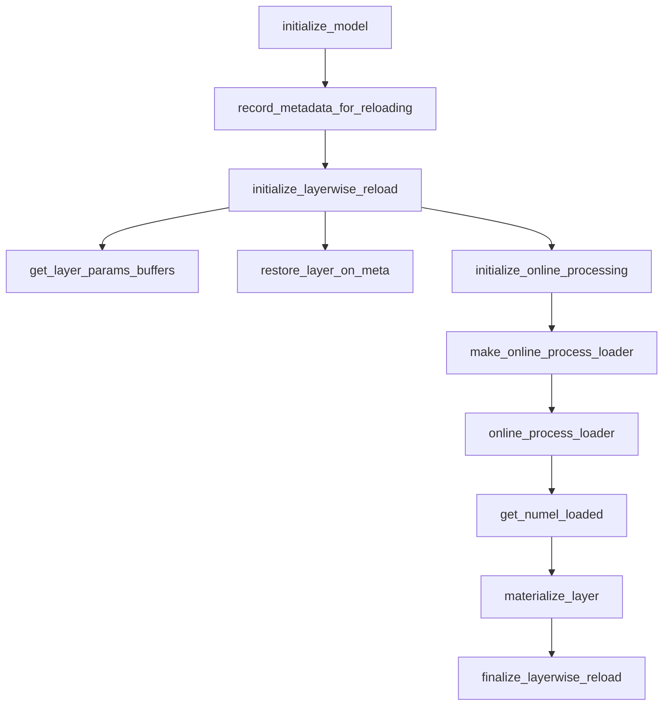
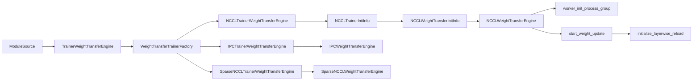
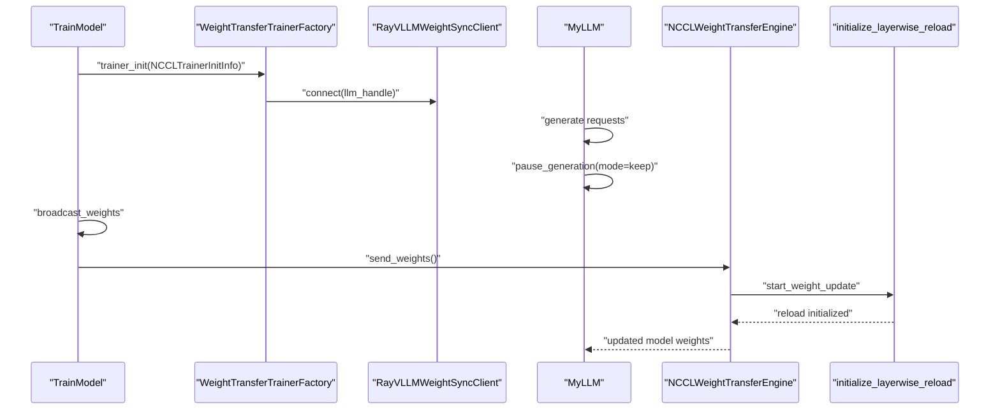

<!-- source: DeepWiki mcp.deepwiki.com · repo vllm-project/vllm · page 9.6 Weight Transfer and RL Integration · fetched 2026-10-28 -->

# Weight Transfer and RL Integration

Relevant source files

The following files were used as context for generating this wiki page:

- [docs/training/async_rl.md](docs/training/async_rl.md)
- [docs/training/weight_transfer/README.md](docs/training/weight_transfer/README.md)
- [docs/training/weight_transfer/base.md](docs/training/weight_transfer/base.md)
- [docs/training/weight_transfer/ipc.md](docs/training/weight_transfer/ipc.md)
- [docs/training/weight_transfer/nccl.md](docs/training/weight_transfer/nccl.md)
- [examples/rl/rlhf_async_new_apis.py](examples/rl/rlhf_async_new_apis.py)
- [examples/rl/rlhf_http_ipc.py](examples/rl/rlhf_http_ipc.py)
- [examples/rl/rlhf_http_nccl.py](examples/rl/rlhf_http_nccl.py)
- [examples/rl/rlhf_ipc_fsdp_ep.py](examples/rl/rlhf_ipc_fsdp_ep.py)
- [examples/rl/rlhf_nccl_fsdp_ep.py](examples/rl/rlhf_nccl_fsdp_ep.py)
- [examples/rl/rlhf_sparse_nccl.py](examples/rl/rlhf_sparse_nccl.py)
- [tests/distributed/test_packed_tensor.py](tests/distributed/test_packed_tensor.py)
- [tests/distributed/test_weight_transfer.py](tests/distributed/test_weight_transfer.py)
- [tests/model_executor/model_loader/instanttensor_loader/test_weight_utils.py](tests/model_executor/model_loader/instanttensor_loader/test_weight_utils.py)
- [tests/model_executor/model_loader/test_ep_weight_filter.py](tests/model_executor/model_loader/test_ep_weight_filter.py)
- [tests/model_executor/model_loader/test_gpt_oss_weight_loading.py](tests/model_executor/model_loader/test_gpt_oss_weight_loading.py)
- [tests/model_executor/model_loader/test_mm_encoder_only_weight_filter.py](tests/model_executor/model_loader/test_mm_encoder_only_weight_filter.py)
- [tests/model_executor/model_loader/test_registry.py](tests/model_executor/model_loader/test_registry.py)
- [tests/model_executor/model_loader/test_reload.py](tests/model_executor/model_loader/test_reload.py)
- [tests/model_executor/test_weight_utils.py](tests/model_executor/test_weight_utils.py)
- [tests/v1/e2e/general/test_sharded_sampling.py](tests/v1/e2e/general/test_sharded_sampling.py)
- [tests/v1/e2e/spec_decode/test_sharded_sampling.py](tests/v1/e2e/spec_decode/test_sharded_sampling.py)
- [vllm/config/load.py](vllm/config/load.py)
- [vllm/config/weight_transfer.py](vllm/config/weight_transfer.py)
- [vllm/distributed/weight_transfer/__init__.py](vllm/distributed/weight_transfer/__init__.py)
- [vllm/distributed/weight_transfer/base.py](vllm/distributed/weight_transfer/base.py)
- [vllm/distributed/weight_transfer/factory.py](vllm/distributed/weight_transfer/factory.py)
- [vllm/distributed/weight_transfer/ipc_engine.py](vllm/distributed/weight_transfer/ipc_engine.py)
- [vllm/distributed/weight_transfer/nccl_engine.py](vllm/distributed/weight_transfer/nccl_engine.py)
- [vllm/distributed/weight_transfer/packed_tensor.py](vllm/distributed/weight_transfer/packed_tensor.py)
- [vllm/distributed/weight_transfer/sparse_nccl_engine.py](vllm/distributed/weight_transfer/sparse_nccl_engine.py)
- [vllm/model_executor/layers/quantization/base_config.py](vllm/model_executor/layers/quantization/base_config.py)
- [vllm/model_executor/model_loader/__init__.py](vllm/model_executor/model_loader/__init__.py)
- [vllm/model_executor/model_loader/default_loader.py](vllm/model_executor/model_loader/default_loader.py)
- [vllm/model_executor/model_loader/dummy_loader.py](vllm/model_executor/model_loader/dummy_loader.py)
- [vllm/model_executor/model_loader/ep_weight_filter.py](vllm/model_executor/model_loader/ep_weight_filter.py)
- [vllm/model_executor/model_loader/reload/__init__.py](vllm/model_executor/model_loader/reload/__init__.py)
- [vllm/model_executor/model_loader/reload/layerwise.py](vllm/model_executor/model_loader/reload/layerwise.py)
- [vllm/model_executor/model_loader/reload/meta.py](vllm/model_executor/model_loader/reload/meta.py)
- [vllm/model_executor/model_loader/reload/types.py](vllm/model_executor/model_loader/reload/types.py)
- [vllm/model_executor/model_loader/reload/utils.py](vllm/model_executor/model_loader/reload/utils.py)
- [vllm/model_executor/model_loader/utils.py](vllm/model_executor/model_loader/utils.py)
- [vllm/model_executor/model_loader/weight_utils.py](vllm/model_executor/model_loader/weight_utils.py)
- [vllm/model_executor/models/gpt_oss.py](vllm/model_executor/models/gpt_oss.py)

## Purpose and scope

This page describes vLLM’s weight-transfer engines for updating inference weights, the layerwise reload mechanism that applies incoming weights, and how these pieces fit into RL and training workflows. The available implementation details cover the reload lifecycle, the dense NCCL engine, and an asynchronous RL example; IPC and sparse NCCL are identified through the backend test suite and are described only to the extent supported by the supplied code excerpts. [vllm/model_executor/model_loader/reload/layerwise.py:70-119]() [vllm/distributed/weight_transfer/nccl_engine.py:116-172]() [examples/rl/rlhf_async_new_apis.py:3-33]() [tests/distributed/test_weight_transfer.py:45-69]()

Sources: `vllm/model_executor/model_loader/reload/layerwise.py`, `vllm/distributed/weight_transfer/nccl_engine.py`, `examples/rl/rlhf_async_new_apis.py`, `tests/distributed/test_weight_transfer.py`

---

## Layerwise Reload System

Layerwise reload provides a lifecycle for receiving new weights into an existing model. Before a reload, the model records tensor metadata. Reload initialization saves the current tensors, restores parameters and buffers on the meta device, and wraps parameter weight loaders. As weights arrive, the wrapped loaders defer processing until the layer’s expected weights have been loaded; the layer can then be materialized, loaded, post-processed, and copied back into its original tensor storage. [vllm/model_executor/model_loader/reload/layerwise.py:70-119]()

The metadata capture and restoration helpers preserve tensor structure while reducing the need to keep a second live copy of the model weights. `to_meta_tensor` converts a tensor to the meta device while retaining its class and attributes; `materialize_meta_tensor` allocates an empty strided tensor with matching size, stride, and dtype. [vllm/model_executor/model_loader/reload/meta.py:41-61]()

### Key Classes and Functions

| Entity | Role |
|---|---|
| `LAYERWISE_INFO` | Weak-key mapping from modules to `LayerReloadingInfo`; weak keys allow modules to be released with the model. [vllm/model_executor/model_loader/reload/layerwise.py:44-54]() |
| `record_metadata_for_reloading` | Captures per-module parameter and buffer metadata and records the restore device. It must run before reload initialization. [vllm/model_executor/model_loader/reload/layerwise.py:70-80]() |
| `initialize_layerwise_reload` | Saves the current layer tensors, restores layer state on meta, and initializes wrapped weight loading. [vllm/model_executor/model_loader/reload/layerwise.py:82-118]() |
| `initialize_online_processing` | Initializes per-layer loaded-element tracking and wraps parameter loaders. [vllm/model_executor/model_loader/reload/layerwise.py:120-145]() |
| `make_online_process_loader` | Creates a loader wrapper that defers processing while a layer is still receiving weights. [vllm/model_executor/model_loader/reload/layerwise.py:147-172]() |
| `capture_layer_to_meta` | Captures parameters and buffers as meta tensors, excluding configured skip tensors and alias buffers. [vllm/model_executor/model_loader/reload/meta.py:97-117]() |
| `restore_layer_on_meta` | Replaces eligible layer parameters and buffers with their metadata-backed meta representations. [vllm/model_executor/model_loader/reload/meta.py:120-143]() |
| `materialize_layer` | Allocates real tensors for eligible meta tensors on the recorded restore device. [vllm/model_executor/model_loader/reload/meta.py:145-154]() |
| `CopyCounter` / `get_numel_loaded` | Tracks elements copied by weight-loader calls, including copies involving tensor views. [vllm/model_executor/model_loader/reload/meta.py:156-198]() |

Model initialization records reload metadata for both the new-style and compatibility model-construction paths. [vllm/model_executor/model_loader/utils.py:73-103]() [vllm/model_executor/model_loader/utils.py:114-136]()

Sources: `vllm/model_executor/model_loader/reload/layerwise.py`, `vllm/model_executor/model_loader/reload/meta.py`, `vllm/model_executor/model_loader/utils.py`

### Layerwise Reload Lifecycle

The diagram maps the reload workflow’s descriptive stages to the functions and state used by the implementation. The finalization path is part of the documented lifecycle, but its implementation is not included in the supplied excerpt. [vllm/model_executor/model_loader/reload/layerwise.py:70-119]() [tests/model_executor/model_loader/test_reload.py:24-38]()

**Diagram: Layerwise reload stages and code entities**

Sources: `vllm/model_executor/model_loader/utils.py`, `vllm/model_executor/model_loader/reload/layerwise.py`, `vllm/model_executor/model_loader/reload/meta.py`, `tests/model_executor/model_loader/test_reload.py`

---

## Weight Transfer Engines

The weight-transfer package exposes backend-specific trainer and worker engine types. The supplied test imports identify the dense NCCL, IPC, and sparse NCCL engine classes, their initialization/update-info types, and the trainer-side classes. [tests/distributed/test_weight_transfer.py:45-69]()

### Core Abstractions

The test suite imports shared interfaces including `WeightTransferEngine`, `TrainerInitInfo`, `WeightTransferInitRequest`, `WeightTransferUpdateRequest`, `WeightSource`, `ParamMeta`, `ModuleSource`, `VLLMWeightSyncClient`, `RayVLLMWeightSyncClient`, and the engine factories. These names indicate the boundary between transfer transport, weight sources, and client/factory setup; the supplied excerpts do not include the definitions of those shared interfaces. [tests/distributed/test_weight_transfer.py:27-43]()

The dense NCCL update metadata contains parallel lists of parameter names, dtype names, and shapes. Its validation requires the lists to have matching lengths. The class documentation specifies that empty lists can reuse metadata from the previous update on the same model. [vllm/distributed/weight_transfer/nccl_engine.py:83-113]()

### Transport Backends

| Backend | Code entities evidenced in the supplied files | Supported description |
|---|---|---|
| Dense NCCL | `NCCLWeightTransferEngine`, `NCCLTrainerWeightTransferEngine`, `NCCLTrainerInitInfo`, `NCCLWeightTransferInitInfo`, `NCCLWeightTransferUpdateInfo` [vllm/distributed/weight_transfer/nccl_engine.py:41-49]() | The worker engine initializes a process group using trainer-supplied initialization information. Its documentation describes NCCL broadcasts of dense checkpoint-format weights from trainer rank 0 to inference workers, followed by model `load_weights` through the layerwise reload lifecycle. [vllm/distributed/weight_transfer/nccl_engine.py:116-164]() |
| IPC | `IPCWeightTransferEngine`, `IPCTrainerWeightTransferEngine`, `IPCWeightTransferInitInfo`, `IPCWeightTransferUpdateInfo` [tests/distributed/test_weight_transfer.py:45-50]() | These engine and message types are imported by the backend test suite. The supplied IPC implementation contents are not included, so transport mechanics are not specified here. |
| Sparse NCCL | `SparseNCCLWeightTransferEngine`, `SparseNCCLTrainerWeightTransferEngine`, `SparseNCCLTrainerInitInfo`, `SparseNCCLWeightTransferUpdateInfo`, `SparseWeightPatch` [tests/distributed/test_weight_transfer.py:63-69]() | These engine and update types are imported by the backend test suite. The supplied sparse-engine implementation contents are not included, so patch encoding and transfer behavior are not specified here. |

The dense NCCL initialization information carries the rendezvous address and port, world size, and packed-transfer settings. The trainer-side dataclass documents the trainer as NCCL rank 0 and the `world_size` as the full trainer-plus-worker group size. [vllm/distributed/weight_transfer/nccl_engine.py:52-80]() The worker records the packed settings from the initialization payload and uses `worker_init_process_group` to initialize its communicator. [vllm/distributed/weight_transfer/nccl_engine.py:148-164]()

The dense NCCL engine’s `start_weight_update` method initializes layerwise reload for the incoming weights. [vllm/distributed/weight_transfer/nccl_engine.py:166-172]() Its engine documentation states that received weights are loaded through the model’s `load_weights` path and the layerwise reload lifecycle. [vllm/distributed/weight_transfer/nccl_engine.py:116-125]()

Sources: `vllm/distributed/weight_transfer/nccl_engine.py`, `tests/distributed/test_weight_transfer.py`

### Trainer-to-Worker Code Map

This diagram maps the general roles—trainer, inference worker, and transfer backend—to names used in the code. The NCCL path is shown in detail where the supplied engine excerpt supports it; IPC and sparse NCCL are shown as registered/tested engine entities without implying unprovided transport internals. [vllm/distributed/weight_transfer/nccl_engine.py:52-80]() [vllm/distributed/weight_transfer/nccl_engine.py:116-172]() [tests/distributed/test_weight_transfer.py:45-69]()

**Diagram: Training and inference roles mapped to backend entities**

Sources: `vllm/distributed/weight_transfer/nccl_engine.py`, `tests/distributed/test_weight_transfer.py`

---

## RLHF and Training Workflows Integration

The asynchronous RL example separates the training model and inference engine onto distinct GPUs using Ray. It initializes the training model in a Ray actor, constructs a vLLM `AsyncLLMEngine` for inference, establishes an NCCL transfer channel, and sends trainer weights to the inference engine. [examples/rl/rlhf_async_new_apis.py:3-9]() [examples/rl/rlhf_async_new_apis.py:18-33]()

### Execution Workflow

1. **Initialize training and inference.** The example loads a Transformers model in the `TrainModel` Ray actor and configures a separate `AsyncLLMEngine` for inference. [examples/rl/rlhf_async_new_apis.py:68-80]() [examples/rl/rlhf_async_new_apis.py:104-120]()
2. **Establish the transfer channel.** `TrainModel.init_weight_transfer` builds the trainer-side engine with `WeightTransferTrainerFactory.trainer_init`, `NCCLTrainerInitInfo`, `RayVLLMWeightSyncClient`, and `ModuleSource`. [examples/rl/rlhf_async_new_apis.py:122-134]()
3. **Generate and pause.** `MyLLM.do_generate` tracks output tokens and sets a pause flag once the configured threshold is reached; `pause_after_n_tokens` then pauses generation in `keep` mode. [examples/rl/rlhf_async_new_apis.py:83-102]()
4. **Send updated weights.** `TrainModel.broadcast_weights` calls `self.engine.send_weights()`. [examples/rl/rlhf_async_new_apis.py:136-139]()
5. **Apply weights on workers.** In the dense NCCL worker engine, `start_weight_update` initializes layerwise reload before incoming checkpoint weights are loaded. [vllm/distributed/weight_transfer/nccl_engine.py:166-172]()
6. **Validate the swap.** The example’s stated workflow labels the new weights and compares post-swap generation against a fresh vLLM instance loaded directly with the training model. [examples/rl/rlhf_async_new_apis.py:23-33]()

### Diagram: Async RL weight synchronization

This diagram connects the example’s natural-language workflow to its Ray actor, client, factory, and engine names. [examples/rl/rlhf_async_new_apis.py:68-80]() [examples/rl/rlhf_async_new_apis.py:104-139]() [vllm/distributed/weight_transfer/nccl_engine.py:148-172]()

**Diagram: Async RL workflow mapped to implementation entities**

Sources: `examples/rl/rlhf_async_new_apis.py`, `vllm/distributed/weight_transfer/nccl_engine.py`

The example also enables batch invariance for deterministic generation and describes it as required for its validation phase. Its documented hardware requirement for this mode is NVIDIA compute capability 9.0 or higher; the script includes a platform-specific environment-variable branch for ROCm versus NVIDIA. [examples/rl/rlhf_async_new_apis.py:11-17]() [examples/rl/rlhf_async_new_apis.py:153-163]()

Sources: `examples/rl/rlhf_async_new_apis.py`

---

