# Page: Overview

# Overview

<details>
<summary>Relevant source files</summary>

The following files were used as context for generating this wiki page:

- [.buildkite/image_build/image_build.yaml](.buildkite/image_build/image_build.yaml)
- [README.md](README.md)
- [docker/Dockerfile.cpu](docker/Dockerfile.cpu)
- [docker/Dockerfile.xpu](docker/Dockerfile.xpu)
- [docker/entrypoints/test_vllm_nonroot_entrypoint.sh](docker/entrypoints/test_vllm_nonroot_entrypoint.sh)
- [docker/entrypoints/vllm-nonroot-entrypoint.sh](docker/entrypoints/vllm-nonroot-entrypoint.sh)
- [docs/assets/models/pooling_models/cheat_sheet.svg](docs/assets/models/pooling_models/cheat_sheet.svg)
- [docs/assets/models/pooling_models/pooling_types.svg](docs/assets/models/pooling_models/pooling_types.svg)
- [docs/assets/models/pooling_models/score_types.svg](docs/assets/models/pooling_models/score_types.svg)
- [docs/benchmarking/README.md](docs/benchmarking/README.md)
- [docs/configuration/README.md](docs/configuration/README.md)
- [docs/configuration/serve_args.md](docs/configuration/serve_args.md)
- [docs/deployment/docker.md](docs/deployment/docker.md)
- [docs/features/structured_outputs.md](docs/features/structured_outputs.md)
- [docs/getting_started/installation/README.md](docs/getting_started/installation/README.md)
- [docs/getting_started/installation/gpu.apple.inc.md](docs/getting_started/installation/gpu.apple.inc.md)
- [docs/getting_started/installation/gpu.md](docs/getting_started/installation/gpu.md)
- [docs/getting_started/installation/gpu.rocm.inc.md](docs/getting_started/installation/gpu.rocm.inc.md)
- [docs/getting_started/installation/gpu.xpu.inc.md](docs/getting_started/installation/gpu.xpu.inc.md)
- [docs/getting_started/quickstart.md](docs/getting_started/quickstart.md)
- [docs/models/generative_models.md](docs/models/generative_models.md)
- [docs/models/supported_models.md](docs/models/supported_models.md)
- [docs/usage/troubleshooting.md](docs/usage/troubleshooting.md)
- [requirements/xpu.txt](requirements/xpu.txt)
- [tests/config/test_model_arch_config.py](tests/config/test_model_arch_config.py)
- [tests/cuda/test_cuda_compatibility_path.py](tests/cuda/test_cuda_compatibility_path.py)
- [tests/engine/test_arg_utils.py](tests/engine/test_arg_utils.py)
- [tests/entrypoints/launchers/api_server/test_api_server_process_manager.py](tests/entrypoints/launchers/api_server/test_api_server_process_manager.py)
- [tests/entrypoints/serve/utils/test_api_utils.py](tests/entrypoints/serve/utils/test_api_utils.py)
- [tests/models/multimodal/generation/test_common.py](tests/models/multimodal/generation/test_common.py)
- [tests/models/multimodal/generation/vlm_utils/model_utils.py](tests/models/multimodal/generation/vlm_utils/model_utils.py)
- [tests/models/registry.py](tests/models/registry.py)
- [tests/test_config.py](tests/test_config.py)
- [tests/v1/distributed/test_async_llm_dp.py](tests/v1/distributed/test_async_llm_dp.py)
- [tests/v1/engine/test_core_engine_actor_manager.py](tests/v1/engine/test_core_engine_actor_manager.py)
- [tests/v1/engine/test_dp_world_group_port.py](tests/v1/engine/test_dp_world_group_port.py)
- [tests/v1/engine/test_engine_core.py](tests/v1/engine/test_engine_core.py)
- [tests/v1/engine/test_engine_core_client.py](tests/v1/engine/test_engine_core_client.py)
- [tests/v1/engine/test_startup_watch_processes.py](tests/v1/engine/test_startup_watch_processes.py)
- [vllm/config/cache.py](vllm/config/cache.py)
- [vllm/config/model.py](vllm/config/model.py)
- [vllm/config/model_arch.py](vllm/config/model_arch.py)
- [vllm/config/parallel.py](vllm/config/parallel.py)
- [vllm/config/speculative.py](vllm/config/speculative.py)
- [vllm/config/vllm.py](vllm/config/vllm.py)
- [vllm/engine/arg_utils.py](vllm/engine/arg_utils.py)
- [vllm/engine/protocol.py](vllm/engine/protocol.py)
- [vllm/entrypoints/cli/serve.py](vllm/entrypoints/cli/serve.py)
- [vllm/entrypoints/llm.py](vllm/entrypoints/llm.py)
- [vllm/entrypoints/serve/utils/api_utils.py](vllm/entrypoints/serve/utils/api_utils.py)
- [vllm/model_executor/models/config.py](vllm/model_executor/models/config.py)
- [vllm/model_executor/models/registry.py](vllm/model_executor/models/registry.py)
- [vllm/models/inkling/common/mm_preprocess.py](vllm/models/inkling/common/mm_preprocess.py)
- [vllm/transformers_utils/config.py](vllm/transformers_utils/config.py)
- [vllm/transformers_utils/configs/__init__.py](vllm/transformers_utils/configs/__init__.py)
- [vllm/transformers_utils/model_arch_config_convertor.py](vllm/transformers_utils/model_arch_config_convertor.py)
- [vllm/transformers_utils/processors/__init__.py](vllm/transformers_utils/processors/__init__.py)
- [vllm/v1/core/sched/interface.py](vllm/v1/core/sched/interface.py)
- [vllm/v1/engine/__init__.py](vllm/v1/engine/__init__.py)
- [vllm/v1/engine/async_llm.py](vllm/v1/engine/async_llm.py)
- [vllm/v1/engine/coordinator.py](vllm/v1/engine/coordinator.py)
- [vllm/v1/engine/core.py](vllm/v1/engine/core.py)
- [vllm/v1/engine/core_client.py](vllm/v1/engine/core_client.py)
- [vllm/v1/engine/llm_engine.py](vllm/v1/engine/llm_engine.py)
- [vllm/v1/engine/utils.py](vllm/v1/engine/utils.py)
- [vllm/v1/spec_decode/llm_base_proposer.py](vllm/v1/spec_decode/llm_base_proposer.py)
- [vllm/v1/utils.py](vllm/v1/utils.py)

</details>


## Purpose and scope

This page introduces vLLM’s major components, the V1 engine’s high-level request path, and the repository areas an engineer will encounter. It is an orientation page; detailed installation, usage, and deployment guidance is covered by the child pages. The V1 engine’s `EngineCore` coordinates model execution, KV-cache initialization, and scheduler setup [vllm/v1/engine/core.py:117-184](). `VllmConfig` brings together configuration for model, cache, compilation, parallel execution, scheduling, and other subsystems [vllm/config/vllm.py:30-57]().

Sources: [vllm/v1/engine/core.py:117-184](), [vllm/config/vllm.py:30-57]()

## What is vLLM

vLLM is an inference and serving codebase for generative and pooling models. Its supported-model documentation describes both native vLLM implementations and a Transformers modeling backend, and lists language, embedding, vision-language, and audio-language use cases [docs/models/supported_models.md:3-24](). At a high level, the system combines configuration, request processing, scheduling, KV-cache management, and model execution; the V1 `EngineCore` initializes the executor and cache before constructing its scheduler [vllm/v1/engine/core.py:145-184]().

The configuration includes optimization levels `O0` through `O3`; the documented descriptions distinguish no optimization, quick optimizations, and fuller CUDA-graph optimizations [vllm/config/vllm.py:128-141](). For details on installation and hardware prerequisites, see [Getting Started and Installation](#1.1). For example workflows, see [Examples and Usage Patterns](#1.2), and for per-model deployment guidance, see [Model Recipes and Deployment Guides](#1.3).

Sources: [docs/models/supported_models.md:3-24](), [vllm/v1/engine/core.py:145-184](), [vllm/config/vllm.py:128-141]()

## System Architecture

V1 separates the user-facing engine client from the `EngineCore` inner loop. `AsyncLLM` builds a renderer and `InputProcessor`, while `EngineCore` owns the executor, initializes KV caches, and constructs the scheduler [vllm/v1/engine/async_llm.py:93-111](), [vllm/v1/engine/async_llm.py:167-171](), [vllm/v1/engine/core.py:117-184](). The client can also be configured with externally launched engine addresses, which reflects the client/core boundary without requiring a particular process arrangement [vllm/v1/engine/async_llm.py:120-125]().

### High-level system components

**Diagram: vLLM concepts mapped to code entities**

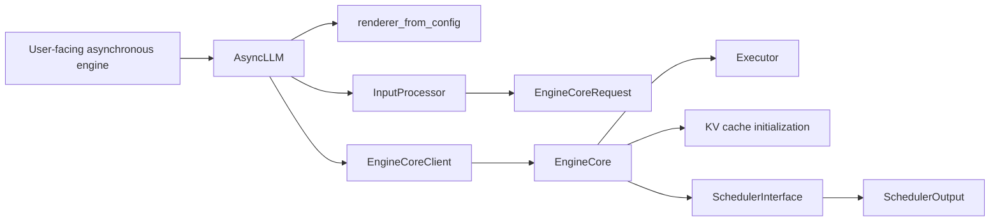

Sources: [vllm/v1/engine/async_llm.py:93-111](), [vllm/v1/engine/async_llm.py:167-171](), [vllm/v1/engine/async_llm.py:56-64](), [vllm/v1/engine/core.py:117-184]()

**Diagram: configuration concepts mapped to code entities**

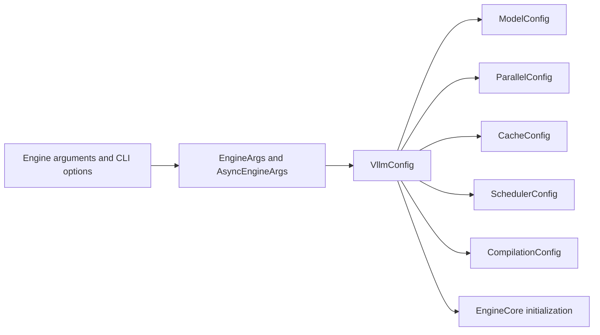

`arg_utils.py` imports the configuration types used by the argument layer, including `VllmConfig`, `ModelConfig`, `ParallelConfig`, `CacheConfig`, `SchedulerConfig`, and `CompilationConfig` [vllm/engine/arg_utils.py:36-73](). The `VllmConfig` module imports these subsystem configurations [vllm/config/vllm.py:30-57](), and `EngineCore` receives a `VllmConfig` at initialization [vllm/v1/engine/core.py:120-146]().

Sources: [vllm/engine/arg_utils.py:36-73](), [vllm/config/vllm.py:30-57](), [vllm/v1/engine/core.py:120-146]()

### Layered architecture overview

| Area | Role at a glance | Representative code entities |
|---|---|---|
| User-facing engine | Exposes asynchronous inference through an engine client | `AsyncLLM` [vllm/v1/engine/async_llm.py:93-111]() |
| Input preparation | Creates a renderer and converts engine inputs toward core requests | `renderer_from_config`, `InputProcessor` [vllm/v1/engine/async_llm.py:167-171]() |
| Engine coordination | Owns the executor and brings up cache and scheduling components | `EngineCore`, `Executor`, `SchedulerInterface` [vllm/v1/engine/core.py:117-184]() |
| Configuration | Collects subsystem settings used by engine initialization | `VllmConfig`, `ModelConfig`, `ParallelConfig`, `CompilationConfig` [vllm/config/vllm.py:30-57]() |
| Model support | Maps Hugging Face architectures to vLLM implementations and exposes capability queries | `_TEXT_GENERATION_MODELS`, model interfaces [vllm/model_executor/models/registry.py:46-73]() |

Sources: [vllm/v1/engine/async_llm.py:93-111](), [vllm/v1/engine/async_llm.py:167-171](), [vllm/v1/engine/core.py:117-184](), [vllm/config/vllm.py:30-57](), [vllm/model_executor/models/registry.py:46-73]()

## Repository Layout

The repository’s top-level areas include `vllm/`, `rust/`, `csrc/`, `tests/`, `examples/`, and `recipes/`. At a high level, `vllm/` contains the Python package, including configuration, engine, and model-support code; `tests/` includes model registry and configuration tests [vllm/config/vllm.py:30-57](), [vllm/v1/engine/core.py:117-184](), [vllm/model_executor/models/registry.py:73-100](), [tests/models/registry.py:16-39](), [tests/test_config.py:20-50](). The other top-level areas provide useful entry points for Rust frontend work, native extensions, examples, and deployment recipes; their detailed contents are outside this page’s scope.

For installation and platform-specific setup, see [Getting Started and Installation](#1.1). For the examples tree, see [Examples and Usage Patterns](#1.2). For the recipes tree and sweep tooling, see [Model Recipes and Deployment Guides](#1.3).

Sources: [vllm/config/vllm.py:30-57](), [vllm/v1/engine/core.py:117-184](), [vllm/model_executor/models/registry.py:73-100](), [tests/models/registry.py:16-39](), [tests/test_config.py:20-50]()

## Request Processing Flow

The following diagram summarizes the principal request-path concepts. `AsyncLLM` creates its renderer and `InputProcessor`; `EngineCore` initializes the executor and KV caches, then selects and constructs a scheduler [vllm/v1/engine/async_llm.py:167-171](), [vllm/v1/engine/core.py:145-184](). This is a high-level orientation, not a complete account of all message and output-processing steps.

**Diagram: V1 request-path concepts mapped to code entities**

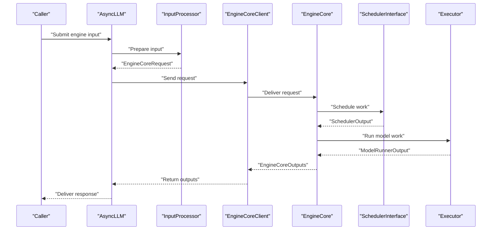

Sources: [vllm/v1/engine/async_llm.py:56-64](), [vllm/v1/engine/async_llm.py:93-111](), [vllm/v1/engine/async_llm.py:167-171](), [vllm/v1/engine/core.py:117-184]()

## Getting Started and Installation

For pip wheels, source builds, Docker installation, quickstart guidance, hardware requirements, and platform-specific installation instructions, see [Getting Started and Installation](#1.1).

Sources: [README.md:1-1]()

## Examples and Usage Patterns

For a tour of `examples/`—including offline inference, serving, disaggregated serving, pooling, weight transfer, speech-to-text, tool calling, and observability—see [Examples and Usage Patterns](#1.2).

Sources: [README.md:1-1]()

## Model Recipes and Deployment Guides

For the `recipes/models/` tree, recipe tooling, and the relationship between deployment recipes, supported models, and benchmarks, see [Model Recipes and Deployment Guides](#1.3).

Sources: [docs/models/supported_models.md:8-18]()

This page is the high-level entry point to vLLM’s codebase. Its child pages cover installation, examples, and model deployment recipes; the remaining wiki sections expand on configuration, engine internals, GPU execution, model support, serving, optimizations, distributed execution, platforms, builds, and testing. vLLM’s model registry maps architecture names to implementations, while the supported-model documentation distinguishes native implementations from the Transformers modeling backend [vllm/model_executor/models/registry.py:73-100](), [docs/models/supported_models.md:8-24]().

Sources: [vllm/model_executor/models/registry.py:73-100](), [docs/models/supported_models.md:8-24]()

---

# Page: Getting Started and Installation

# Getting Started and Installation

<details>
<summary>Relevant source files</summary>

The following files were used as context for generating this wiki page:

- [.buildkite/ci_config_intel.yaml](.buildkite/ci_config_intel.yaml)
- [.buildkite/image_build/image_build.sh](.buildkite/image_build/image_build.sh)
- [.buildkite/image_build/image_build.yaml](.buildkite/image_build/image_build.yaml)
- [.buildkite/image_build/image_build_arm64.sh](.buildkite/image_build/image_build_arm64.sh)
- [.buildkite/image_build/image_build_cpu.sh](.buildkite/image_build/image_build_cpu.sh)
- [.buildkite/image_build/image_build_cpu_arm64.sh](.buildkite/image_build/image_build_cpu_arm64.sh)
- [.buildkite/image_build/image_build_hpu.sh](.buildkite/image_build/image_build_hpu.sh)
- [.buildkite/image_build/image_build_torch_nightly.sh](.buildkite/image_build/image_build_torch_nightly.sh)
- [.buildkite/image_build/image_build_xpu.sh](.buildkite/image_build/image_build_xpu.sh)
- [.buildkite/image_build/zstd.hcl](.buildkite/image_build/zstd.hcl)
- [.buildkite/release-pipeline.yaml](.buildkite/release-pipeline.yaml)
- [.buildkite/scripts/annotate-image-build.sh](.buildkite/scripts/annotate-image-build.sh)
- [.buildkite/scripts/docker-build-metadata-args.sh](.buildkite/scripts/docker-build-metadata-args.sh)
- [.buildkite/scripts/hardware_ci/run-intel-test.sh](.buildkite/scripts/hardware_ci/run-intel-test.sh)
- [.buildkite/scripts/publish-release-images.sh](.buildkite/scripts/publish-release-images.sh)
- [.buildkite/scripts/publish-zstd-image.sh](.buildkite/scripts/publish-zstd-image.sh)
- [.buildkite/scripts/push-nightly-builds-cpu.sh](.buildkite/scripts/push-nightly-builds-cpu.sh)
- [.buildkite/scripts/upload-release-wheels-pypi.sh](.buildkite/scripts/upload-release-wheels-pypi.sh)
- [.buildkite/scripts/xpu/push-nightly-builds-xpu.sh](.buildkite/scripts/xpu/push-nightly-builds-xpu.sh)
- [README.md](README.md)
- [docker/Dockerfile](docker/Dockerfile)
- [docker/Dockerfile.cpu](docker/Dockerfile.cpu)
- [docker/Dockerfile.xpu](docker/Dockerfile.xpu)
- [docker/docker-bake.hcl](docker/docker-bake.hcl)
- [docker/entrypoints/test_vllm_nonroot_entrypoint.sh](docker/entrypoints/test_vllm_nonroot_entrypoint.sh)
- [docker/entrypoints/vllm-nonroot-entrypoint.sh](docker/entrypoints/vllm-nonroot-entrypoint.sh)
- [docker/versions.json](docker/versions.json)
- [docs/assets/contributing/dockerfile-stages-dependency.png](docs/assets/contributing/dockerfile-stages-dependency.png)
- [docs/assets/models/pooling_models/cheat_sheet.svg](docs/assets/models/pooling_models/cheat_sheet.svg)
- [docs/assets/models/pooling_models/pooling_types.svg](docs/assets/models/pooling_models/pooling_types.svg)
- [docs/assets/models/pooling_models/score_types.svg](docs/assets/models/pooling_models/score_types.svg)
- [docs/benchmarking/README.md](docs/benchmarking/README.md)
- [docs/configuration/README.md](docs/configuration/README.md)
- [docs/configuration/serve_args.md](docs/configuration/serve_args.md)
- [docs/contributing/dockerfile/dockerfile.md](docs/contributing/dockerfile/dockerfile.md)
- [docs/deployment/docker.md](docs/deployment/docker.md)
- [docs/features/structured_outputs.md](docs/features/structured_outputs.md)
- [docs/getting_started/installation/README.md](docs/getting_started/installation/README.md)
- [docs/getting_started/installation/gpu.apple.inc.md](docs/getting_started/installation/gpu.apple.inc.md)
- [docs/getting_started/installation/gpu.cuda.inc.md](docs/getting_started/installation/gpu.cuda.inc.md)
- [docs/getting_started/installation/gpu.md](docs/getting_started/installation/gpu.md)
- [docs/getting_started/installation/gpu.rocm.inc.md](docs/getting_started/installation/gpu.rocm.inc.md)
- [docs/getting_started/installation/gpu.xpu.inc.md](docs/getting_started/installation/gpu.xpu.inc.md)
- [docs/getting_started/quickstart.md](docs/getting_started/quickstart.md)
- [docs/models/generative_models.md](docs/models/generative_models.md)
- [docs/usage/troubleshooting.md](docs/usage/troubleshooting.md)
- [requirements/common.txt](requirements/common.txt)
- [requirements/cuda.txt](requirements/cuda.txt)
- [requirements/rocm.txt](requirements/rocm.txt)
- [requirements/rubin-prerelease.txt](requirements/rubin-prerelease.txt)
- [requirements/test/cpu.txt](requirements/test/cpu.txt)
- [requirements/test/cuda.in](requirements/test/cuda.in)
- [requirements/test/cuda.txt](requirements/test/cuda.txt)
- [requirements/test/nightly-torch.txt](requirements/test/nightly-torch.txt)
- [requirements/test/rocm.in](requirements/test/rocm.in)
- [requirements/test/rocm.txt](requirements/test/rocm.txt)
- [requirements/test/xpu.in](requirements/test/xpu.in)
- [requirements/test/xpu.txt](requirements/test/xpu.txt)
- [requirements/xpu.txt](requirements/xpu.txt)
- [setup.py](setup.py)
- [tests/cuda/test_cuda_compatibility_path.py](tests/cuda/test_cuda_compatibility_path.py)
- [tests/evals/gpt_oss/configs/gpt-oss-20b-sm120.yaml](tests/evals/gpt_oss/configs/gpt-oss-20b-sm120.yaml)
- [tests/evals/gpt_oss/configs/models-spark.txt](tests/evals/gpt_oss/configs/models-spark.txt)
- [tests/samplers/conftest.py](tests/samplers/conftest.py)
- [tools/build_nixl_with_torch215_for_rubin.py](tools/build_nixl_with_torch215_for_rubin.py)
- [tools/build_triton_from_source.sh](tools/build_triton_from_source.sh)
- [tools/ci/kernel_symbol_map.py](tools/ci/kernel_symbol_map.py)
- [tools/flashinfer-build.sh](tools/flashinfer-build.sh)
- [tools/install_triton_from_source.sh](tools/install_triton_from_source.sh)
- [tools/pre_commit/update-dockerfile-graph.sh](tools/pre_commit/update-dockerfile-graph.sh)

</details>


## Purpose and Scope

This page describes the installation options represented in the supplied build and dependency files: platform-specific Python dependencies, source-build configuration, and Docker build inputs. It also identifies what those files do—and do not—establish about hardware requirements, quickstart usage, and platform-specific instructions. [setup.py:61-121](), [requirements/common.txt:1-59](), [requirements/cuda.txt:1-33](), [requirements/xpu.txt:1-23](), [docker/Dockerfile:25-46](), [docker/Dockerfile.cpu:1-18]()

Sources: `setup.py`, `requirements/common.txt`, `requirements/cuda.txt`, `requirements/xpu.txt`, `docker/Dockerfile`, `docker/Dockerfile.cpu`

## Hardware Requirements and Platform Matrix

The installation configuration distinguishes CUDA, ROCm, XPU, and CPU targets. On Linux, `setup.py` detects the target from the installed PyTorch build when `VLLM_TARGET_DEVICE` is unset: it checks HIP, XPU, and CUDA in that order, and otherwise selects CPU. On macOS, it changes a non-CPU target to CPU; on other operating systems it warns that support may be incomplete and selects the `empty` target. [setup.py:99-121]()

| Target | Evidence in the supplied files | Installation considerations |
|---|---|---|
| CUDA | `requirements/cuda.txt` includes a pinned PyTorch stack and CUDA-oriented packages, including `flashinfer-python`, `apache-tvm-ffi`, and NVIDIA CUTLASS DSL packages. [requirements/cuda.txt:1-33]() | Use the CUDA-specific dependency set; the supplied file does not specify minimum GPU compute capability. |
| ROCm | `setup.py` recognizes a HIP-enabled PyTorch installation as `rocm`. [setup.py:110-115]() | A ROCm requirements file is referenced elsewhere in the repository listing, but its contents are not included here. |
| XPU | `requirements/xpu.txt` selects an XPU Triton wheel, PyTorch’s XPU index, and XPU-specific packages. [requirements/xpu.txt:1-23]() | XPU runtime components are also installed in `docker/Dockerfile.xpu`. [docker/Dockerfile.xpu:42-86]() |
| CPU | `setup.py` selects CPU when no GPU backend is detected; the CPU Dockerfile documents `linux/amd64` and `linux/arm64` as supported build platforms. [setup.py:110-121](), [docker/Dockerfile.cpu:1-18]() | The supplied CPU Dockerfile provisions compilers and system packages for its build environment. [docker/Dockerfile.cpu:87-128]() |
| macOS | `setup.py` forces the target to CPU when running on macOS and a non-CPU target was selected. [setup.py:99-101]() | The available release-pipeline excerpt shows a macOS arm64 CPU wheel build job. [.buildkite/release-pipeline.yaml:76-92]() |

The files provided do not establish GPU memory requirements, supported GPU compute-capability floors, or detailed ROCm and Apple installation procedures. Consult the platform installation documentation for those details; those document contents were not supplied for this page.

Sources: `setup.py`, `requirements/cuda.txt`, `requirements/xpu.txt`, `docker/Dockerfile.xpu`, `docker/Dockerfile.cpu`, `.buildkite/release-pipeline.yaml`

## Installation Paths

### 1. Pre-Compiled Wheels and Platform Dependencies

The requirements files divide dependencies into a shared set and device-specific sets. `requirements/common.txt` contains shared Python dependencies, including Transformers, FastAPI, tokenizers, and multimodal-related libraries. The CUDA requirements include the common file and specify CUDA-targeted dependencies and PyTorch versions. The XPU requirements likewise include common dependencies, then add XPU package indexes, Triton, and PyTorch XPU packages. [requirements/common.txt:1-59](), [requirements/cuda.txt:1-33](), [requirements/xpu.txt:1-23]()

The provided files show how platform dependency sets are composed, but do not include the platform installation documentation or wheel-install commands. In particular, no specific `uv` or `pip` command, wheel index URL, or stable-versus-nightly installation procedure can be verified from the supplied file contents.

Sources: `requirements/common.txt`, `requirements/cuda.txt`, `requirements/xpu.txt`

### 2. Building from Source

`setup.py` loads `vllm/envs.py` directly to determine `VLLM_TARGET_DEVICE` before the package is installed. It also loads `tools/build_rust.py`, reads the precompiled-extension settings, and provides helpers to detect whether the required Rust extension modules are already present. The build configuration defines `CMakeExtension` for CMake-backed native extensions. [setup.py:38-66](), [setup.py:69-92](), [setup.py:202-208]()

Platform selection affects which target the build uses. Linux builds infer the device from the installed PyTorch runtime unless `VLLM_TARGET_DEVICE` is set; the target can therefore be selected explicitly or inferred as ROCm, XPU, CUDA, or CPU. macOS selects CPU, and unsupported operating systems receive a warning and use the `empty` target. [setup.py:99-121]()

The supplied `setup.py` excerpt establishes the target-detection and extension-build entry points, but does not show the complete build commands or all compilation steps. The supplied Dockerfile excerpts show that Docker wheel-build flows install platform dependencies, copy source into the build stage, and use `setup.py`-detected precompiled Rust artifacts in the XPU build. [docker/Dockerfile.xpu:142-165]()

#### Source-build selection flow

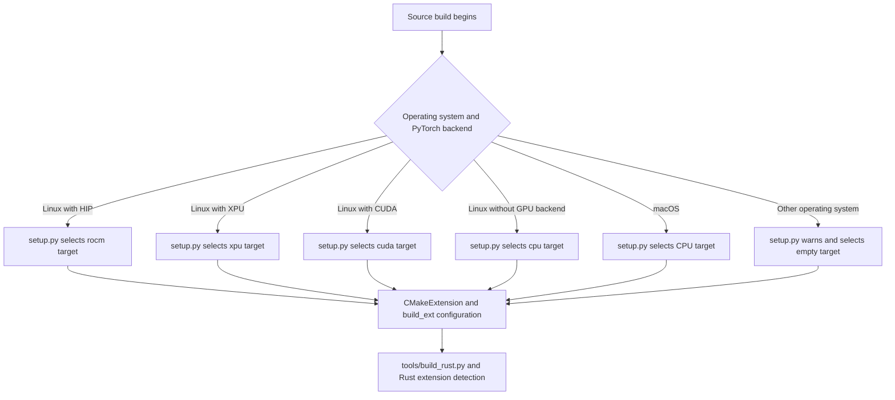

Sources: `setup.py:38-66`, `setup.py:69-121`, `setup.py:202-208`

#### Source-build implementation map

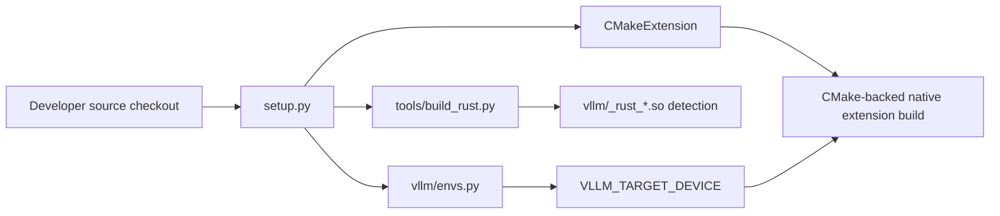

Sources: `setup.py:38-66`, `setup.py:69-92`, `setup.py:202-208`

### 3. Containerized Deployment (Docker)

The CUDA-oriented `docker/Dockerfile` uses build arguments to set CUDA, Python, Ubuntu, NCCL, and image defaults. It parameterizes the build and final base images, and includes arguments for package indexes and optional KV-connector and NIXL builds. Its initial `base` stage configures the `uv` environment and installs build tools. [docker/Dockerfile:25-46](), [docker/Dockerfile:66-98](), [docker/Dockerfile:100-156]()

The CPU Dockerfile documents `vllm-openai`, `vllm-test`, and `vllm-dev` build targets, with support for `linux/amd64` and `linux/arm64`. Its shared base provisions compilers, `uv`, and a virtual environment. The excerpt also describes optional `sccache` configuration. [docker/Dockerfile.cpu:1-18](), [docker/Dockerfile.cpu:21-53](), [docker/Dockerfile.cpu:80-128]()

The XPU Dockerfile builds the Rust frontend in separate stages, prepares an Ubuntu-based XPU environment, installs Intel graphics and compute-runtime packages, and defines a `vllm-build` stage that installs XPU requirements and copies Rust build artifacts into the source tree. [docker/Dockerfile.xpu:1-40](), [docker/Dockerfile.xpu:42-86](), [docker/Dockerfile.xpu:142-165]()

The supplied Dockerfile excerpts do not establish image registry names, published image tags, or complete `docker build` and `docker run` commands. Refer to the deployment documentation for supported image names and runtime instructions; its contents were not supplied here.

#### Docker build and artifact flow

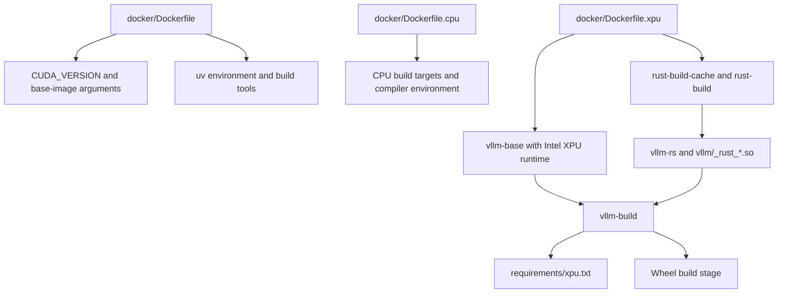

Sources: `docker/Dockerfile:25-46`, `docker/Dockerfile:100-156`, `docker/Dockerfile.cpu:1-18`, `docker/Dockerfile.cpu:80-128`, `docker/Dockerfile.xpu:1-40`, `docker/Dockerfile.xpu:42-86`, `docker/Dockerfile.xpu:142-165`

## Dependency Management and Package Variants

Dependency files use a shared base plus platform-specific requirements. The CUDA and XPU files explicitly include `requirements/common.txt`; the CUDA file pins PyTorch-related packages and adds CUDA-oriented dependencies, while the XPU file configures XPU-specific package indexes and dependencies. [requirements/common.txt:1-59](), [requirements/cuda.txt:1-33](), [requirements/xpu.txt:1-23]()

| Requirements file | Role demonstrated by the supplied contents |
|---|---|
| `requirements/common.txt` | Shared runtime dependencies, including model, API, tokenizer, multimodal, and observability libraries. [requirements/common.txt:1-59]() |
| `requirements/cuda.txt` | Common dependencies plus CUDA-targeted PyTorch and kernel-related packages. [requirements/cuda.txt:1-33]() |
| `requirements/xpu.txt` | Common dependencies plus XPU indexes, Triton, PyTorch XPU packages, and XPU-specific packages. [requirements/xpu.txt:1-23]() |
| `requirements/rocm.txt` | Referenced in the supplied repository file listing, but its contents are not available here. |
| `requirements/cpu.txt` | Referenced in the supplied repository file listing, but its contents are not available here. |

The Docker CUDA build arguments are documented as the source of truth for pinned Docker versions, with `docker/versions.json` described as generated for `docker buildx bake`. The supplied `versions.json` records defaults including CUDA 13.0.3, Python 3.12, Ubuntu 24.04, and NCCL 2.30.7. [docker/Dockerfile:9-22](), [docker/Dockerfile:25-34](), [docker/versions.json:1-23]()

#### Dependency and platform mapping

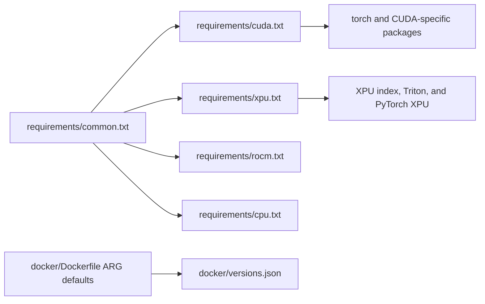

Sources: `requirements/common.txt:1-60`, `requirements/cuda.txt:1-34`, `requirements/xpu.txt:1-24`, `docker/Dockerfile:9-22`, `docker/Dockerfile:25-34`, `docker/versions.json:1-23`

## Quickstart Example

A quickstart command and Python inference example are not present in the supplied file contents. The repository listing includes `docs/getting_started/quickstart.md`, but its contents were not provided, so this page does not reproduce or infer its instructions. The supplied Dockerfile comment does identify the CUDA Dockerfile as intended to construct an image usable for the OpenAI-compatible server. [docker/Dockerfile:1-6]()

Sources: `docker/Dockerfile`

## Summary

- The supplied dependency files demonstrate shared, CUDA-specific, and XPU-specific requirement sets. [requirements/common.txt:1-59](), [requirements/cuda.txt:1-33](), [requirements/xpu.txt:1-23]()
- `setup.py` selects a build target using platform and PyTorch backend detection, and configures CMake-backed extensions and Rust extension detection. [setup.py:38-66](), [setup.py:69-121](), [setup.py:202-208]()
- The provided Dockerfiles illustrate CUDA, CPU, and XPU build-environment configuration; the excerpts do not establish published image names or full deployment commands. [docker/Dockerfile:25-46](), [docker/Dockerfile.cpu:1-18](), [docker/Dockerfile.xpu:1-40]()
- Detailed hardware thresholds and quickstart instructions require the corresponding documentation contents, which were not supplied for this page.

Sources: `setup.py`, `requirements/common.txt`, `requirements/cuda.txt`, `requirements/xpu.txt`, `docker/Dockerfile`, `docker/Dockerfile.cpu`, `docker/Dockerfile.xpu`

---

## Mapping Natural Language Systems to Code Entities

The diagrams below map installation concepts to the concrete configuration and build entities shown in the supplied files. They are intended as code-navigation aids, not as a complete description of undocumented wheel-install commands or runtime deployment procedures. [setup.py:38-66](), [setup.py:69-121](), [docker/Dockerfile:25-46](), [docker/Dockerfile.xpu:142-165]()

Sources: `setup.py`, `docker/Dockerfile`, `docker/Dockerfile.xpu`

### Installation concepts and setup entities

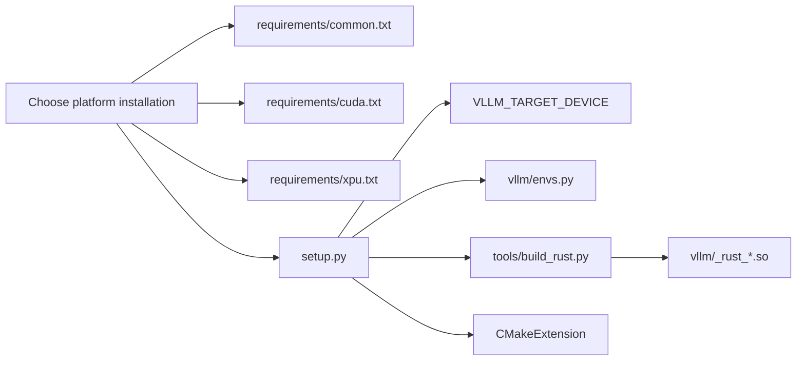

Sources: `requirements/common.txt:1-60`, `requirements/cuda.txt:1-34`, `requirements/xpu.txt:1-24`, `setup.py:38-66`, `setup.py:69-92`, `setup.py:99-121`, `setup.py:202-208`

### Container build concepts and Docker entities

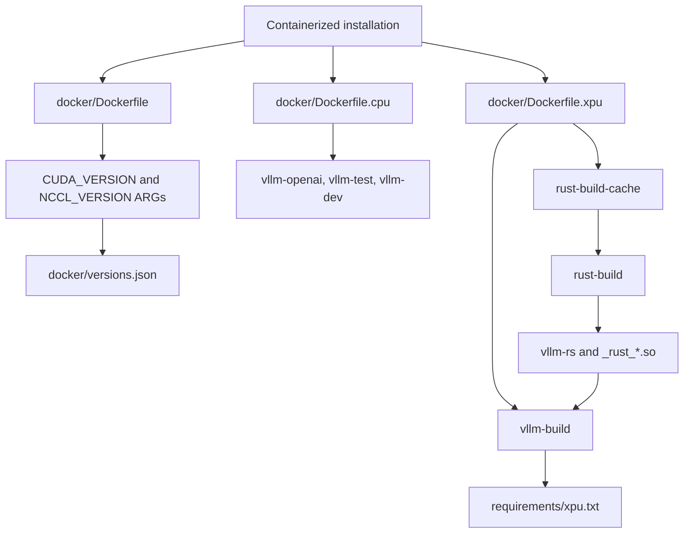

Sources: `docker/Dockerfile:25-46`, `docker/versions.json:1-23`, `docker/Dockerfile.cpu:1-18`, `docker/Dockerfile.xpu:1-40`, `docker/Dockerfile.xpu:142-165`, `requirements/xpu.txt:1-24`

---

# Page: Examples and Usage Patterns

# Examples and Usage Patterns

<details>
<summary>Relevant source files</summary>

The following files were used as context for generating this wiki page:

- [docs/models/pooling_models/README.md](docs/models/pooling_models/README.md)
- [docs/models/pooling_models/reward.md](docs/models/pooling_models/reward.md)
- [docs/models/pooling_models/scoring.md](docs/models/pooling_models/scoring.md)
- [docs/models/pooling_models/specific_models.md](docs/models/pooling_models/specific_models.md)
- [docs/models/pooling_models/token_embed.md](docs/models/pooling_models/token_embed.md)
- [docs/training/async_rl.md](docs/training/async_rl.md)
- [docs/training/weight_transfer/README.md](docs/training/weight_transfer/README.md)
- [docs/training/weight_transfer/base.md](docs/training/weight_transfer/base.md)
- [docs/training/weight_transfer/ipc.md](docs/training/weight_transfer/ipc.md)
- [docs/training/weight_transfer/nccl.md](docs/training/weight_transfer/nccl.md)
- [examples/rl/rlhf_http_ipc.py](examples/rl/rlhf_http_ipc.py)
- [examples/rl/rlhf_http_nccl.py](examples/rl/rlhf_http_nccl.py)
- [examples/rl/rlhf_ipc_fsdp_ep.py](examples/rl/rlhf_ipc_fsdp_ep.py)
- [examples/rl/rlhf_sparse_nccl.py](examples/rl/rlhf_sparse_nccl.py)
- [tests/distributed/test_packed_tensor.py](tests/distributed/test_packed_tensor.py)
- [tests/distributed/test_weight_transfer.py](tests/distributed/test_weight_transfer.py)
- [tests/entrypoints/launchers/api_server/test_api_server_process_manager.py](tests/entrypoints/launchers/api_server/test_api_server_process_manager.py)
- [tests/entrypoints/pooling/scoring/test_bi_encoder_online.py](tests/entrypoints/pooling/scoring/test_bi_encoder_online.py)
- [tests/entrypoints/pooling/scoring/test_cross_encoder_offline.py](tests/entrypoints/pooling/scoring/test_cross_encoder_offline.py)
- [tests/entrypoints/pooling/scoring/test_cross_encoder_online.py](tests/entrypoints/pooling/scoring/test_cross_encoder_online.py)
- [tests/entrypoints/pooling/scoring/test_cross_encoder_online_vision.py](tests/entrypoints/pooling/scoring/test_cross_encoder_online_vision.py)
- [tests/entrypoints/pooling/scoring/test_io_processor_unit.py](tests/entrypoints/pooling/scoring/test_io_processor_unit.py)
- [tests/entrypoints/pooling/scoring/test_jina_ranking_io_processor_unit.py](tests/entrypoints/pooling/scoring/test_jina_ranking_io_processor_unit.py)
- [tests/entrypoints/pooling/scoring/test_late_interaction_online_vision.py](tests/entrypoints/pooling/scoring/test_late_interaction_online_vision.py)
- [tests/entrypoints/pooling/scoring/test_utils.py](tests/entrypoints/pooling/scoring/test_utils.py)
- [tests/entrypoints/serve/utils/test_api_utils.py](tests/entrypoints/serve/utils/test_api_utils.py)
- [tests/models/language/pooling_mteb_test/test_nemotron.py](tests/models/language/pooling_mteb_test/test_nemotron.py)
- [tests/models/multimodal/pooling/test_colultravbert.py](tests/models/multimodal/pooling/test_colultravbert.py)
- [tests/v1/core/test_kv_sharing.py](tests/v1/core/test_kv_sharing.py)
- [tests/v1/distributed/test_async_llm_dp.py](tests/v1/distributed/test_async_llm_dp.py)
- [tests/v1/engine/test_core_engine_actor_manager.py](tests/v1/engine/test_core_engine_actor_manager.py)
- [tests/v1/engine/test_dp_world_group_port.py](tests/v1/engine/test_dp_world_group_port.py)
- [tests/v1/engine/test_engine_core.py](tests/v1/engine/test_engine_core.py)
- [tests/v1/engine/test_engine_core_client.py](tests/v1/engine/test_engine_core_client.py)
- [tests/v1/engine/test_startup_watch_processes.py](tests/v1/engine/test_startup_watch_processes.py)
- [vllm/config/weight_transfer.py](vllm/config/weight_transfer.py)
- [vllm/distributed/weight_transfer/__init__.py](vllm/distributed/weight_transfer/__init__.py)
- [vllm/distributed/weight_transfer/base.py](vllm/distributed/weight_transfer/base.py)
- [vllm/distributed/weight_transfer/factory.py](vllm/distributed/weight_transfer/factory.py)
- [vllm/distributed/weight_transfer/ipc_engine.py](vllm/distributed/weight_transfer/ipc_engine.py)
- [vllm/distributed/weight_transfer/nccl_engine.py](vllm/distributed/weight_transfer/nccl_engine.py)
- [vllm/distributed/weight_transfer/packed_tensor.py](vllm/distributed/weight_transfer/packed_tensor.py)
- [vllm/distributed/weight_transfer/sparse_nccl_engine.py](vllm/distributed/weight_transfer/sparse_nccl_engine.py)
- [vllm/engine/protocol.py](vllm/engine/protocol.py)
- [vllm/entrypoints/cli/serve.py](vllm/entrypoints/cli/serve.py)
- [vllm/entrypoints/llm.py](vllm/entrypoints/llm.py)
- [vllm/entrypoints/pooling/offline.py](vllm/entrypoints/pooling/offline.py)
- [vllm/entrypoints/pooling/scoring/io_processor.py](vllm/entrypoints/pooling/scoring/io_processor.py)
- [vllm/entrypoints/pooling/scoring/protocol.py](vllm/entrypoints/pooling/scoring/protocol.py)
- [vllm/entrypoints/pooling/scoring/utils.py](vllm/entrypoints/pooling/scoring/utils.py)
- [vllm/entrypoints/serve/utils/api_utils.py](vllm/entrypoints/serve/utils/api_utils.py)
- [vllm/model_executor/models/colultravbert.py](vllm/model_executor/models/colultravbert.py)
- [vllm/transformers_utils/configs/colultravbert.py](vllm/transformers_utils/configs/colultravbert.py)
- [vllm/v1/core/sched/interface.py](vllm/v1/core/sched/interface.py)
- [vllm/v1/engine/__init__.py](vllm/v1/engine/__init__.py)
- [vllm/v1/engine/async_llm.py](vllm/v1/engine/async_llm.py)
- [vllm/v1/engine/coordinator.py](vllm/v1/engine/coordinator.py)
- [vllm/v1/engine/core.py](vllm/v1/engine/core.py)
- [vllm/v1/engine/core_client.py](vllm/v1/engine/core_client.py)
- [vllm/v1/engine/llm_engine.py](vllm/v1/engine/llm_engine.py)
- [vllm/v1/engine/utils.py](vllm/v1/engine/utils.py)
- [vllm/v1/utils.py](vllm/v1/utils.py)

</details>


## Purpose and Scope

This section provides a comprehensive technical tour of the `examples/` directory and key usage patterns in the vLLM codebase. It bridges user workflows such as batch offline inference, online API serving, disaggregated prefill-decode serving, pooling/embedding, RL weight transfer, speech-to-text, tool calling, and observability dashboards with their corresponding code entities, classes, and data flows.

---

## 1. Offline Inference

Offline inference supports high-throughput, batch processing of prompts without running a persistent API server. It uses the synchronous `LLM` engine interface to manage GPU resources, batching, and token generation.

- Inputs support multimodal data including images, audio, and video via prompt dictionaries containing `multi_modal_data` fields compatible with `vllm.inputs.MultiModalDataDict`.
- Multi-modal data can include raw PIL images, URLs, or precomputed embeddings.
- Examples instantiate an `LLM` object with a model and then call `.generate()` with prompt text and multimodal attachments.

Example snippet:

```python
from vllm import LLM
import PIL.Image

llm = LLM(model="llava-hf/llava-1.5-7b-hf")
image = PIL.Image.open("example.jpg")

outputs = llm.generate({
    "prompt": "USER: <image>\nWhat is in the image?\nASSISTANT:",
    "multi_modal_data": {"image": image},
})

for output in outputs:
    print(output.outputs[0].text)
```

This uses the offline engine's batching, GPU execution, and handles multimodal prompt parsing internally.

Sources: [docs/features/multimodal_inputs.md:16-69]()

---

## 2. Online Serving and OpenAI-Compatible API

vLLM supports an asynchronous FastAPI-based online serving application exposing APIs compatible with OpenAI endpoints:

- Endpoints include `/v1/chat/completions`, `/v1/completions`, `/v1/embeddings`, plus multimodal and pooling routers.
- The server runs an `AsyncLLM` backed by a pool of `EngineCore` workers.
- Requests are processed asynchronously with streaming token responses delivered via Server-Sent Events (SSE).

Invoke:

```bash
vllm serve Qwen/Qwen3-0.6B --port 8000 --max-model-len 2048 --tensor-parallel-size 1
```

Internal key classes:

- `AsyncLLM` [vllm/v1/engine/async_llm.py:93-111]() manages the engine lifecycle and concurrency. It uses `EngineCoreClient` [vllm/v1/engine/async_llm.py:58]() to communicate with the `EngineCore`.
- `EngineCore` [vllm/v1/engine/core.py:117-127]() executes requests on GPUs.
- FastAPI route registration binds HTTP routes to engine handlers in files like `vllm/entrypoints/cli/serve.py` [vllm/entrypoints/cli/serve.py:19]().

Sources: [vllm/entrypoints/cli/serve.py:19](), [vllm/v1/engine/async_llm.py:93-111](), [vllm/v1/engine/async_llm.py:58](), [vllm/v1/engine/core.py:117-127]()

---

## 3. Disaggregated Serving (Prefill-Decode Split)

Disaggregated serving separates the prompt "prefill" (key-value cache computation) and token "decode" (auto-regressive generation) phases across distinct GPU sets. This architecture mitigates GPU memory bottlenecks and balances throughput.

### Data Flow

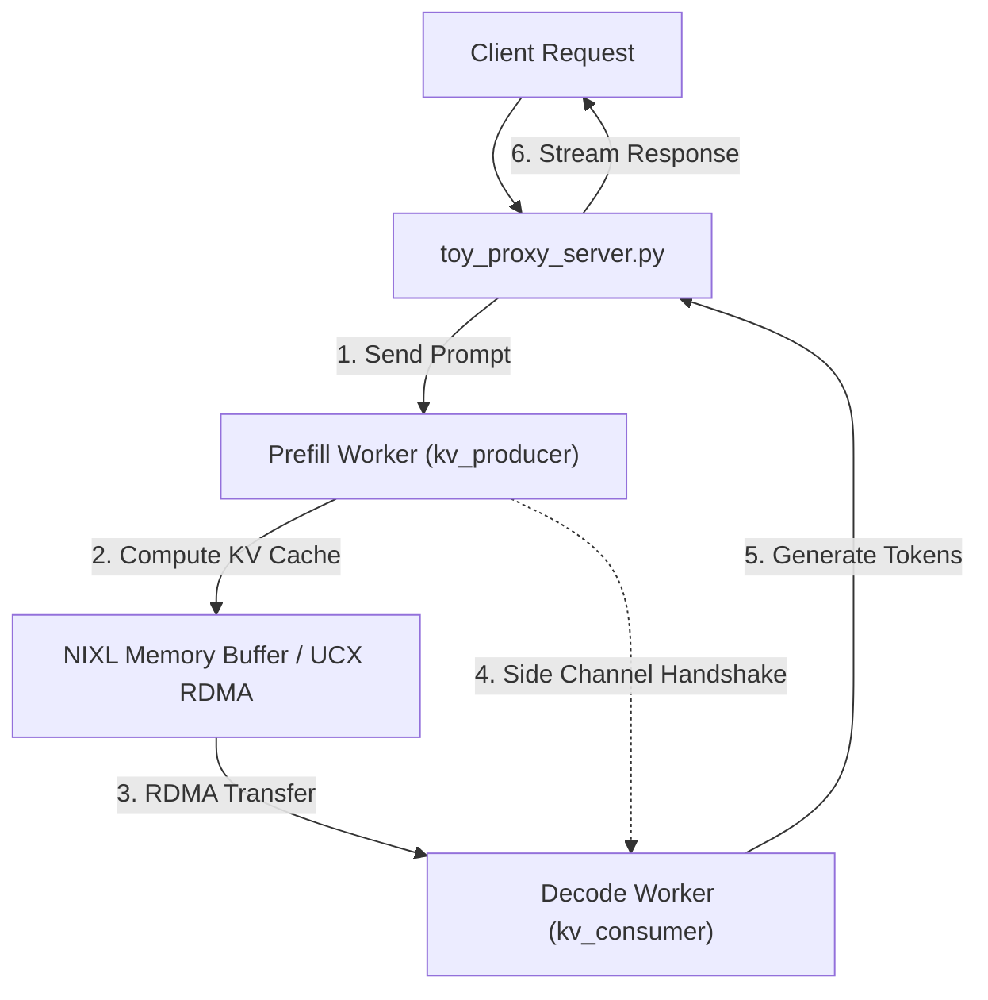

#### Configuration

Producer and consumer are configured with matching KV transfer settings, e.g.:

```bash
# Prefill worker command
vllm serve Qwen/Qwen3-0.6B --port 8100 --kv-transfer-config '{"kv_connector":"NixlConnector","kv_role":"kv_producer"}'

# Decode worker command
vllm serve Qwen/Qwen3-0.6B --port 8200 --kv-transfer-config '{"kv_connector":"NixlConnector","kv_role":"kv_consumer"}'
```

This sets up a zero-copy, RDMA-based KV cache transfer over UCX or NIXL, enabling memory sharing for KV decoded states.

Sources: [docs/features/nixl_connector_usage.md:1-124](), [tests/v1/kv_connector/nixl_integration/run_accuracy_test.sh:40-64]()

---

### Simple CPU Offload Connector

The `SimpleCPUOffloadConnector` provides a basic mechanism for offloading KV cache blocks to CPU memory or disk. This is primarily used for prefix caching to reduce GPU memory footprint for frequently used prefixes.

#### Architecture

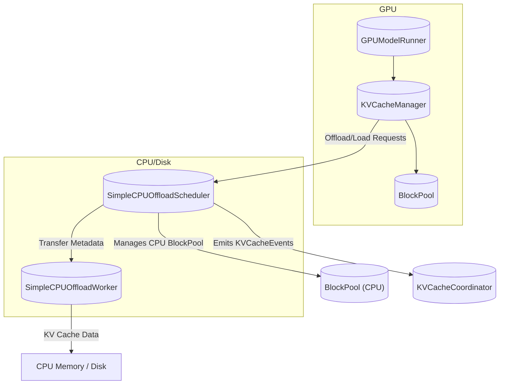

#### Implementation Details

The `SimpleCPUOffloadConnector` acts as the entry point, initializing either a `SimpleCPUOffloadScheduler` or a `SimpleCPUOffloadWorker`.
The `SimpleCPUOffloadScheduler` is responsible for:
- Deriving a CPU `KVCacheConfig` from the GPU configuration.
- Managing a `BlockPool` for CPU-resident KV cache blocks.
- Tracking `BlockStoreMeta` for events.
- Handling `_StoreAdmission` logic for offloading decisions.
- Emitting `KVCacheEvent`s for observability.

The `SimpleCPUOffloadWorker` (not fully shown in provided content) would handle the actual data transfer and storage on the CPU/disk.

Sources: [vllm/v1/simple_kv_offload/manager.py:1-198](), [vllm/distributed/kv_transfer/kv_connector/v1/simple_cpu_offload_connector.py:1-180](), [tests/v1/simple_kv_offload/test_scheduler.py:1-219]()

---

## 4. Pooling and Embedding Models

vLLM supports specialized pooling models for embedding generation, sequence classification, and reranking use cases.

- Use `PoolerConfig` and `PoolingParams` [vllm/pooling_params.py:1-100]() to specify the pooling strategy (e.g., CLS, LAST, MEAN, token-wise).
- Pooler runners extract fixed-size embeddings or classification logits.
- Supported tasks include embedding, classification, token classification, and scoring in retrieval pipelines.

Example usage:

```python
from vllm import LLM, PoolingParams

llm = LLM(model="BAAI/bge-large-en-v1.5", task="embed")
prompts = ["vLLM is a high-throughput LLM serving engine."]
results = llm.embed(prompts)

for r in results:
    print(r.outputs.embedding)
```

Pooling models work by applying sequence-wise or token-wise aggregation layers on model last hidden states, returning vectors suitable for similarity search or classification. The `ScoringIOProcessor` [vllm/entrypoints/pooling/scoring/io_processor.py:98-110]() is a key component for handling input and output for scoring models.

Sources: [vllm/multimodal/parse.py:163-200](), [docs/models/pooling_models/README.md:1-98](), [vllm/pooling_params.py:1-100](), [vllm/entrypoints/pooling/scoring/io_processor.py:98-110]()

---

## 5. RL Weight Transfer and Training Integration

vLLM supports hot weight transfer integration with RLHF and training frameworks enabling weight swapping without restarting inference engines.

### Weight Transfer Architecture

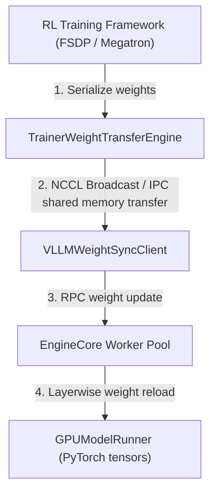

Key points:

- Implements backends for NCCL, shared memory IPC, and sparse weight transfers.
- `WeightTransferConfig` [vllm/config/weight_transfer.py:9-15]() specifies the backend (`"nccl"`, `"ipc"`, `"sparse_nccl"`, etc.).
- `TrainerWeightTransferEngine` [vllm/distributed/weight_transfer/base.py:36-40]() manages serialization and broadcasting.
- `VLLMWeightSyncClient` [vllm/distributed/weight_transfer/base.py:18-29]() receives weight updates and applies them on inference workers.
- Layerwise reload adapts model weights incrementally to maintain stability.

Example factory usage:

```python
from vllm.distributed.weight_transfer import WeightTransferEngineFactory

transfer_engine = WeightTransferEngineFactory.create_engine(vllm_config)
transfer_engine.poll_and_apply_updates()
```

#### NCCL Weight Transfer

The `NCCLWeightTransferEngine` [vllm/distributed/weight_transfer/nccl_engine.py:1-178]() uses NCCL for collective communication.
- `NCCLTrainerInitInfo` [vllm/distributed/weight_transfer/nccl_engine.py:18-24]() contains rendezvous information (`master_address`, `master_port`, `world_size`) and wire parameters (`packed`, `packed_buffer_size_bytes`, `packed_num_buffers`).
- `NCCLWeightTransferUpdateInfo` [vllm/distributed/weight_transfer/nccl_engine.py:27-31]() carries metadata (`names`, `dtype_names`, `shapes`) for the weights being updated.
- The `init_transfer_engine` method initializes the NCCL process group.
- `start_weight_update` and `finish_weight_update` manage the layerwise reload lifecycle.
- `receive_weights` performs the actual NCCL broadcast.

#### IPC Weight Transfer

The `IPCWeightTransferEngine` [vllm/distributed/weight_transfer/ipc_engine.py:1-174]() uses CUDA IPC for shared memory communication.
- `IPCTrainerInitInfo` [vllm/distributed/weight_transfer/ipc_engine.py:18-21]() specifies the `packed` mode and `packed_buffer_size_bytes`.
- `IPCWeightTransferUpdateInfo` [vllm/distributed/weight_transfer/ipc_engine.py:24-27]() includes `ipc_handles` (or `ipc_handles_pickled` for HTTP transport) and `tensor_sizes` for packed transfers.
- `init_transfer_engine` records the `packed` setting.
- `start_weight_update` and `finish_weight_update` manage layerwise reload.
- The `receive_weights` method (not fully shown) would reconstruct tensors from IPC handles.

Sources: [tests/distributed/test_weight_transfer.py:20-68](), [vllm/distributed/weight_transfer/base.py:36-40](), [vllm/distributed/weight_transfer/base.py:18-29](), [vllm/distributed/weight_transfer/ipc_engine.py:1-174](), [vllm/distributed/weight_transfer/ipc_engine.py:18-21](), [vllm/distributed/weight_transfer/ipc_engine.py:24-27](), [vllm/distributed/weight_transfer/nccl_engine.py:1-178](), [vllm/distributed/weight_transfer/nccl_engine.py:18-24](), [vllm/distributed/weight_transfer/nccl_engine.py:27-31](), [vllm/config/weight_transfer.py:9-15](), [examples/rl/rlhf_http_ipc.py](), [examples/rl/rlhf_http_nccl.py](), [examples/rl/rlhf_sparse_nccl.py](), [examples/rl/rlhf_ipc_fsdp_ep.py](), [examples/rl/rlhf_m2n.py]()

---

## 6. Speech-to-Text and Multimodal Integration

vLLM handles multimodal inputs including audio for speech-to-text transcription, images, and video through a unified ingestion pipeline.

- `MediaConnector` manages remote data retrieval, domain allowlists, download size limits, and format decoding.
- Audio inputs can be speech transcripts handled by whisper-like models.
- Multi-modal data is integrated into generation requests using `multi_modal_data` payloads.

Example:

```python
from vllm import LLM
from vllm.assets.audio import AudioAsset  # utility for audio loading

llm = LLM(model="openai/whisper-large-v3")
audio_asset = AudioAsset("winning_ticket")

outputs = llm.generate({
    "prompt": "<|startoftranscript|><|transcribe|><|notimestamps|><|endoftext|>",
    "multi_modal_data": {"audio": audio_asset.audio_and_sample_rate},
})
```

The connector enforces security against SSRF by `--allowed-media-domains` and file size constraints, and delegates decoded content to Hugging Face processors.

Sources: [vllm/multimodal/media/connector.py:35-181](), [docs/features/multimodal_inputs.md:10-15](), [vllm/multimodal/parse.py:163-200]()

---

## 7. Tool Calling and Structured Output

vLLM supports advanced tool/function calling and structured output generation directly within the OpenAI-compatible `/v1/chat/completions` API.

- The request processing pipeline parses and validates tool call schemas.
- `parse_chat_messages` normalizes messages, tools, and inserts required special tokens.
- Grammar-backed structured outputs enable JSON-schema constrained generation.

This functionality is tested in compliance with OpenAI schema conformance checks. The `before_generate_case` hook [tests/entrypoints/openai/test_openai_schema.py:80-117]() in the `test_openai_schema.py` ensures that `tool_calls` generated by Schemathesis have the correct `"type": "function"` and do not contain invalid `"custom"` fields.

Sources: [tests/entrypoints/openai/test_openai_schema.py:80-117](), [vllm/entrypoints/chat_utils.py:1-48]()

---

## 8. Observability and Benchmarking Dashboards

vLLM exposes Prometheus-compatible metrics and structured logs:

- Metrics include request latency, Time-To-First-Token (TTFT), Time Per Output Token (TPOT), KV cache utilization, and request queue lengths.
- Benchmarks such as `benchmark_serving.py` and `benchmark_serving_multi_turn.py` enable performance evaluation.

Use `vllm bench serve` to run throughput benchmarks against deployed models:

```bash
python benchmarks/multi_turn/benchmark_serving_multi_turn.py \
  --url http://localhost:8000/v1 \
  --model Qwen/Qwen3-0.6B \
  --num-clients 50 \
  --max-turns 5
```

#### Metrics Overview

vLLM provides a rich set of metrics for monitoring and capacity planning, primarily exposed via a Prometheus-compatible `/metrics` endpoint. These metrics are categorized into server-level (Gauges, Counters) and request-level (Histograms).

Key metrics include:
- `vllm:num_requests_running`: Number of requests currently in the RUNNING state.
- `vllm:kv_cache_usage_perc`: Fraction of used KV cache blocks.
- `vllm:prefix_cache_queries`, `vllm:prefix_cache_hits`: Counters for prefix cache activity.
- `vllm:prompt_tokens_total`, `vllm:generation_tokens_total`: Total tokens processed.
- `vllm:request_success_total`: Number of finished requests by reason.
- `vllm:request_prompt_tokens`, `vllm:request_generation_tokens`: Histograms for token counts.
- `vllm:time_to_first_token_seconds`: Histogram for TTFT.
- `vllm:inter_token_latency_seconds`: Histogram for inter-token latency.
- `vllm:request_time_per_output_token_seconds`: Histogram for per-request TPOT.
- `vllm:e2e_request_latency_seconds`: Histogram for end-to-end latency.

A reference Grafana dashboard is provided in `examples/observability/prometheus_grafana/README.md` and `examples/observability/prometheus_grafana/grafana.json` to visualize these metrics. The dashboard highlights critical metrics such as `vllm:e2e_request_latency_seconds_bucket`, `vllm:inter_token_latency_seconds`, and `vllm:kv_cache_usage_perc`.

The Prometheus client library `prometheus_client` is used for metric collection. Metrics are collected in the API server process, with multiprocess mode used when `--api-server-count > 1` for scale-out.

Sources: [benchmarks/multi_turn/benchmark_serving_multi_turn.py:47-70](), [vllm/benchmarks/serve.py:1-191](), [docs/design/metrics.md:1-106](), [docs/usage/metrics.md]()

---

# Diagrams Bridging Natural Language and Code Entity Spaces

### Disaggregated Serving Architecture — Code Entities

```mermaid
graph TD
    "ClientRequest" --> "toy_proxy_server.py"
    "toy_proxy_server.py" --> "PrefillWorker"["AsyncLLM (kv_producer)"]
    "PrefillWorker" --> "NixlMemoryBuffer"["KVBuffer (NIXL/UCX)"]
    "NixlMemoryBuffer" --> "DecodeWorker"["AsyncLLM (kv_consumer)"]
    "PrefillWorker" -.->|Handshake| "DecodeWorker"
    "DecodeWorker" --> "toy_proxy_server.py"
    "toy_proxy_server.py" --> "ClientResponse"
```
Sources: [vllm/v1/engine/async_llm.py:93-111]()

### RL Weight Transfer Pipeline — Code Entities

```mermaid
graph TD
    "RLTrainer" --> "WeightTransferTrainerEngine"["TrainerWeightTransferEngine (RLHF)"]
    "WeightTransferTrainerEngine" -->|NCCL Broadcast or IPC| "VLLMWeightSyncClient"
    "VLLMWeightSyncClient" --> "EngineCore"["EngineCore Worker Pool"]
    "EngineCore" --> "GPUModelRunner"["GPUModelRunner (PyTorch Tensor Model)"]
    "GPUModelRunner" --> "InferenceResults"
```
Sources: [vllm/distributed/weight_transfer/base.py:36-40](), [vllm/distributed/weight_transfer/base.py:18-29](), [vllm/v1/engine/core.py:117-127]()

---

# Summary Table of Example Categories and Key Code Entities

| Example Category | Key Code Entities | Example Dir/Files |
|---|---|---|
| Offline Inference | `LLM` [vllm/entrypoints/llm.py:62-64](), `SamplingParams` [vllm/sampling_params.py:1-100]() | `examples/generate/multimodal/vision_language_offline.py`, `examples/basic/offline_inference/basic.py` |
| Online Serving | `AsyncLLM` [vllm/v1/engine/async_llm.py:93-111](), `EngineCore` [vllm/v1/engine/core.py:117-127](), FastAPI routers | `vllm/entrypoints/cli/serve.py` |
| Disaggregated Serving | `kv_connector.NixlConnector`, `SimpleCPUOffloadConnector` | `examples/scale_out/`, `docs/features/nixl_connector_usage.md` |
| Pooling & Embedding Models | `PoolerConfig`, `PoolingParams` [vllm/pooling_params.py:1-100](), `ScoringIOProcessor` [vllm/entrypoints/pooling/scoring/io_processor.py:98-110]() | `examples/pooling/` |
| RL Weight Transfer | `WeightTransferTrainerEngine` [vllm/distributed/weight_transfer/base.py:36-40](), `VLLMWeightSyncClient` [vllm/distributed/weight_transfer/base.py:18-29](), `WeightTransferConfig` [vllm/config/weight_transfer.py:9-15]() | `examples/rl/rlhf_http_ipc.py`, `examples/rl/rlhf_http_nccl.py` |
| Speech-to-Text & Multimodal | `MediaConnector`, `AudioAsset` | `examples/multimodal/`, `examples/speech_to_text/` |
| Tool Calling & Structured Output | `parse_chat_messages`, `/v1/chat/completions` API | `tests/entrypoints/openai/test_openai_schema.py` |
| Observability & Benchmarking | `benchmarks/benchmark_serving.py`, `benchmarks/serve.py`, Prometheus metrics | `benchmarks/`, `examples/observability/prometheus_grafana/` |

---

This comprehensive tour exemplifies how vLLM’s examples and code modules map closely to its architectural components and usage scenarios, from batch inference and multimodal pipelines to scalable serving and RL integration.

Sources:
[vllm/benchmarks/serve.py:1-191](),
[tests/entrypoints/openai/test_openai_schema.py:32-49, 80-117](),
[docs/features/nixl_connector_usage.md:1-124](),
[tests/v1/kv_connector/nixl_integration/run_accuracy_test.sh:40-64](),
[vllm/multimodal/media/connector.py:35-181](),
[vllm/multimodal/parse.py:163-200](),
[vllm/distributed/weight_transfer/base.py:27-105](),
[vllm/distributed/weight_transfer/ipc_engine.py:1-174](),
[vllm/distributed/weight_transfer/nccl_engine.py:1-178](),
[vllm/config/weight_transfer.py:9-15](),
[benchmarks/multi_turn/benchmark_serving_multi_turn.py:47-70](),
[vllm/v1/simple_kv_offload/manager.py:1-198](),
[vllm/distributed/kv_transfer/kv_connector/v1/simple_cpu_offload_connector.py:1-180](),
[tests/v1/simple_kv_offload/test_scheduler.py:1-219](),
[docs/design/metrics.md:1-106](),
[docs/usage/metrics.md](),
[vllm/entrypoints/llm.py:62-64](),
[vllm/sampling_params.py:1-100](),
[vllm/v1/engine/async_llm.py:93-111](),
[vllm/v1/engine/core.py:117-127](),
[vllm/entrypoints/cli/serve.py:19](),
[vllm/v1/engine/async_llm.py:58](),
[vllm/pooling_params.py:1-100](),
[vllm/entrypoints/pooling/scoring/io_processor.py:98-110](),
[vllm/distributed/weight_transfer/base.py:36-40](),
[vllm/distributed/weight_transfer/base.py:18-29](),
[vllm/distributed/weight_transfer/ipc_engine.py:18-21](),
[vllm/distributed/weight_transfer/ipc_engine.py:24-27](),
[vllm/distributed/weight_transfer/nccl_engine.py:18-24](),
[vllm/distributed/weight_transfer/nccl_engine.py:27-31]()

---

# Page: Model Recipes and Deployment Guides

# Model Recipes and Deployment Guides

<details>
<summary>Relevant source files</summary>

The following files were used as context for generating this wiki page:

- [benchmarks/backend_request_func.py](benchmarks/backend_request_func.py)
- [docs/assets/benchmarking/latency-metrics-speculative-decoding-dark.svg](docs/assets/benchmarking/latency-metrics-speculative-decoding-dark.svg)
- [docs/assets/benchmarking/latency-metrics-speculative-decoding-light.svg](docs/assets/benchmarking/latency-metrics-speculative-decoding-light.svg)
- [docs/benchmarking/cli.md](docs/benchmarking/cli.md)
- [docs/models/supported_models.md](docs/models/supported_models.md)
- [tests/benchmarks/test_audio_dataset.py](tests/benchmarks/test_audio_dataset.py)
- [tests/benchmarks/test_custom_dataset_seed.py](tests/benchmarks/test_custom_dataset_seed.py)
- [tests/benchmarks/test_custom_image_dataset.py](tests/benchmarks/test_custom_image_dataset.py)
- [tests/benchmarks/test_endpoint_request_func_timing.py](tests/benchmarks/test_endpoint_request_func_timing.py)
- [tests/benchmarks/test_random_dataset.py](tests/benchmarks/test_random_dataset.py)
- [tests/benchmarks/test_random_multimodal_dataset_video.py](tests/benchmarks/test_random_multimodal_dataset_video.py)
- [tests/benchmarks/test_serve_cli.py](tests/benchmarks/test_serve_cli.py)
- [tests/benchmarks/test_skip_tokenizer_init.py](tests/benchmarks/test_skip_tokenizer_init.py)
- [tests/config/test_model_arch_config.py](tests/config/test_model_arch_config.py)
- [tests/engine/test_arg_utils.py](tests/engine/test_arg_utils.py)
- [tests/models/multimodal/generation/test_common.py](tests/models/multimodal/generation/test_common.py)
- [tests/models/multimodal/generation/vlm_utils/model_utils.py](tests/models/multimodal/generation/vlm_utils/model_utils.py)
- [tests/models/registry.py](tests/models/registry.py)
- [tests/test_config.py](tests/test_config.py)
- [vllm/benchmarks/datasets/__init__.py](vllm/benchmarks/datasets/__init__.py)
- [vllm/benchmarks/datasets/create_txt_slices_dataset.py](vllm/benchmarks/datasets/create_txt_slices_dataset.py)
- [vllm/benchmarks/datasets/datasets.py](vllm/benchmarks/datasets/datasets.py)
- [vllm/benchmarks/lib/endpoint_request_func.py](vllm/benchmarks/lib/endpoint_request_func.py)
- [vllm/benchmarks/serve.py](vllm/benchmarks/serve.py)
- [vllm/config/cache.py](vllm/config/cache.py)
- [vllm/config/model.py](vllm/config/model.py)
- [vllm/config/model_arch.py](vllm/config/model_arch.py)
- [vllm/config/parallel.py](vllm/config/parallel.py)
- [vllm/config/speculative.py](vllm/config/speculative.py)
- [vllm/config/vllm.py](vllm/config/vllm.py)
- [vllm/engine/arg_utils.py](vllm/engine/arg_utils.py)
- [vllm/model_executor/models/config.py](vllm/model_executor/models/config.py)
- [vllm/model_executor/models/registry.py](vllm/model_executor/models/registry.py)
- [vllm/models/inkling/common/mm_preprocess.py](vllm/models/inkling/common/mm_preprocess.py)
- [vllm/transformers_utils/config.py](vllm/transformers_utils/config.py)
- [vllm/transformers_utils/configs/__init__.py](vllm/transformers_utils/configs/__init__.py)
- [vllm/transformers_utils/model_arch_config_convertor.py](vllm/transformers_utils/model_arch_config_convertor.py)
- [vllm/transformers_utils/processors/__init__.py](vllm/transformers_utils/processors/__init__.py)
- [vllm/transformers_utils/processors/moondream3.py](vllm/transformers_utils/processors/moondream3.py)
- [vllm/v1/spec_decode/llm_base_proposer.py](vllm/v1/spec_decode/llm_base_proposer.py)

</details>


## Purpose and scope

This page explains how to distinguish model deployment recipes from vLLM’s model-support and test registries, and how those concepts connect to configuration and benchmarking. The available code references establish the support, configuration, and test-registry side of that relationship; they do not expose the contents or implementation details of `recipes/models/` or `tools/recipes`, so this page does not infer their individual files, commands, or sweep behavior.

Sources: [docs/models/supported_models.md:1-26](); [tests/models/registry.py:16-120](); [vllm/config/model.py:150-180]()

## How recipes fit into model support

A deployment recipe is best understood as model-specific guidance, not as the definition of whether vLLM supports an architecture. The supported-model documentation lists implemented architectures and example models; it identifies native implementations under `vllm/model_executor/models` and separately describes the Transformers modeling backend. A model may therefore be usable through a native implementation or through that backend, subject to the relevant compatibility conditions. [docs/models/supported_models.md:3-24]()

The implementation registry maps Hugging Face architecture names to module and class names. For example, `DeepseekV32ForCausalLM` maps to `vllm.models.deepseek_v32`, while `Qwen4ExpForCausalLM` maps to `vllm.models.qwen4_exp`. Those entries identify implementation routing; they are not deployment recipes. [vllm/model_executor/models/registry.py:73-124]()

| Concern | What it represents | Code reference |
|---|---|---|
| Deployment guidance | Model- or deployment-specific operational guidance. Details of the recipe files are not available in the supplied references. | — |
| Documented support | Architecture lists and supported-model guidance. | [docs/models/supported_models.md:3-24]() |
| Native implementation routing | Mapping from architecture names to implementation modules and classes. | [vllm/model_executor/models/registry.py:73-124]() |
| Test examples and test parameters | Model examples and per-architecture settings used by model tests. | [tests/models/registry.py:16-120]() |
| Runtime model configuration | Model name/path, runner, tokenizer, implementation selection, and related options. | [vllm/config/model.py:86-109](); [vllm/config/model.py:150-180]() |

Sources: [docs/models/supported_models.md:3-24](); [vllm/model_executor/models/registry.py:73-124](); [tests/models/registry.py:16-120](); [vllm/config/model.py:86-109](); [vllm/config/model.py:150-180]()

## From model names to implementation entities

The registry creates a searchable bridge between the architecture name found in a checkpoint and the vLLM class/module responsible for that architecture. The entries shown below are examples from `_TEXT_GENERATION_MODELS`; the registry also imports model interfaces and base-interface helpers used for capability queries. [vllm/model_executor/models/registry.py:46-71]()

**Diagram: Architecture identifiers and registered implementations**

```mermaid
flowchart LR
    "Checkpoint architecture" --> "DeepseekV32ForCausalLM"
    "DeepseekV32ForCausalLM" --> "vllm.models.deepseek_v32"
    "vllm.models.deepseek_v32" --> "DeepseekV32ForCausalLM implementation"

    "Checkpoint architecture" --> "Qwen4ExpForCausalLM"
    "Qwen4ExpForCausalLM" --> "vllm.models.qwen4_exp"
    "vllm.models.qwen4_exp" --> "Qwen4ExpForCausalLM implementation"

    "Checkpoint architecture" --> "Gemma4ForCausalLM"
    "Gemma4ForCausalLM" --> "gemma4"
    "gemma4" --> "Gemma4ForCausalLM implementation"
```

Sources: [vllm/model_executor/models/registry.py:73-124]()

At runtime, `ModelConfig` represents the selected model and its loading-related choices. Its `model` field is a model name or path; `runner` selects a runner type, and `tokenizer` and `tokenizer_mode` describe tokenizer selection. `model_impl` includes `auto`, `vllm`, `transformers`, and `terratorch`. These settings belong to configuration, rather than to the architecture-to-class mapping itself. [vllm/config/model.py:86-109](); [vllm/config/model.py:150-180]()

**Diagram: Deployment vocabulary mapped to configuration and registry entities**

```mermaid
flowchart LR
    "Model or checkpoint" --> "ModelConfig.model"
    "Requested implementation" --> "ModelConfig.model_impl"
    "Requested runner" --> "ModelConfig.runner"
    "Tokenizer selection" --> "ModelConfig.tokenizer"
    "Tokenizer mode" --> "ModelConfig.tokenizer_mode"

    "Checkpoint architecture name" --> "_TEXT_GENERATION_MODELS"
    "_TEXT_GENERATION_MODELS" --> "module and class mapping"
    "ModelConfig" --> "model loading and runtime setup"
    "module and class mapping" --> "native model implementation"
```

Sources: [vllm/config/model.py:86-109](); [vllm/config/model.py:150-180](); [vllm/model_executor/models/registry.py:73-124]()

## Test registry: examples are not recipes

`tests/models/registry.py` defines the frozen dataclass `_HfExamplesInfo` for model-test metadata. Its fields include a default model, extra model examples, tokenizer choices, speculative-decoding settings, Transformers version bounds, data type, eager-execution choice, prefix-caching choice, model-length and batch limits, revision, and remote-code trust settings. These are test inputs and constraints; they should not be treated as deployment instructions or as a complete inventory of supported model implementations. [tests/models/registry.py:16-120]()

The registry’s version-checking helper can return without action when no version bounds are declared; otherwise it checks the installed Transformers version against the configured bounds and can error, skip, or return a message depending on `on_fail`. This is part of test eligibility handling, not a deployment-time support guarantee. [tests/models/registry.py:122-180]()

| Test metadata | Purpose indicated by the registry |
|---|---|
| `default`, `extras` | Select default and additional model examples for an architecture. [tests/models/registry.py:16-23]() |
| `tokenizer`, `tokenizer_mode` | Specify tokenizer choices for tests. [tests/models/registry.py:24-28]() |
| `speculative_model`, `speculative_method` | Specify speculative-decoding test inputs. [tests/models/registry.py:30-39]() |
| `min_transformers_version`, `max_transformers_version` | Declare supported version bounds for test execution. [tests/models/registry.py:41-55]() |
| `dtype`, `enforce_eager`, `enable_prefix_caching` | Configure model-test execution. [tests/models/registry.py:64-80]() |
| `max_model_len`, `max_num_batched_tokens`, `max_num_seqs` | Bound resources or workload sizes for tests. [tests/models/registry.py:96-119]() |
| `trust_remote_code`, `hf_overrides`, `revision` | Specify model-loading inputs for tests. [tests/models/registry.py:90-111]() |

Sources: [tests/models/registry.py:16-120](); [tests/models/registry.py:122-180]()

## Support paths: native and Transformers backend

The support documentation distinguishes native vLLM implementations from the Transformers modeling backend. Native implementations are located under `vllm/model_executor/models`. The Transformers backend supports stated modality, architecture, and attention categories, and can be selected with `model_impl="transformers"` for offline inference or `--model-impl transformers` for online serving. [docs/models/supported_models.md:8-24](); [docs/models/supported_models.md:35-45]()

For custom Transformers models, the documentation lists compatibility requirements including a suitable model directory and `config.json` with `auto_map.AutoModel`. It also specifies requirements for attention modules, including routing through `ALL_ATTENTION_FUNCTIONS` and a unique `layer_idx`; for MoE models it describes the expected `experts` structure and forward arguments. [docs/models/supported_models.md:50-92]()

| Support route | How it is identified | Reference |
|---|---|---|
| Native vLLM model | Architecture-to-module/class entry in the model registry. | [vllm/model_executor/models/registry.py:73-124]() |
| Transformers modeling backend | Backend documented for supported modality, architecture, and attention categories; selectable through `model_impl`. | [docs/models/supported_models.md:16-24](); [docs/models/supported_models.md:35-45]() |
| Compatible custom Transformers model | `trust_remote_code=True` for Hub models, or a local model directory, with the documented Transformers-backend requirements. | [docs/models/supported_models.md:50-67]() |

Sources: [vllm/model_executor/models/registry.py:73-124](); [docs/models/supported_models.md:16-24](); [docs/models/supported_models.md:35-45](); [docs/models/supported_models.md:50-92]()

## Model-specific configuration and validation

Model support can include configuration checks and adjustments beyond registry lookup. `VerifyAndUpdateConfig` defines hooks for validating or updating `VllmConfig` and `ModelConfig`; model-specific subclasses override these hooks. For example, `AliceAIForCausalLMConfig` validates checkpoint settings and rejects selected unsupported configurations, while `DeepseekV32ForCausalLM` checks for a DeepSeek V3.2 configuration marker and adjusts a `bfloat16` cache dtype to `auto`. [vllm/model_executor/models/config.py:18-26](); [vllm/model_executor/models/config.py:28-86]()

This is one reason a recipe should be read as deployment guidance rather than as a replacement for code-defined support constraints: a model’s usable configuration may depend on model-specific validation, hardware, parallelism, cache settings, or other runtime configuration. The examples here establish that model-specific validation and configuration mutation exist; they do not provide a comprehensive list of recipe requirements. [vllm/model_executor/models/config.py:28-86](); [vllm/config/parallel.py:136-169](); [vllm/config/cache.py:178-198]()

**Diagram: Configuration path and model-specific validation hooks**

```mermaid
flowchart LR
    "Deployment model selection" --> "EngineArgs and CLI configuration"
    "EngineArgs and CLI configuration" --> "ModelConfig"
    "ModelConfig" --> "architecture lookup"
    "architecture lookup" --> "_TEXT_GENERATION_MODELS"
    "ModelConfig" --> "VerifyAndUpdateConfig.verify_and_update_model_config"
    "VllmConfig" --> "VerifyAndUpdateConfig.verify_and_update_config"
    "model-specific validation" --> "validated runtime configuration"
    "ParallelConfig" --> "validated runtime configuration"
    "CacheConfig" --> "validated runtime configuration"
```

Sources: [vllm/engine/arg_utils.py:36-73](); [vllm/config/model.py:150-180](); [vllm/model_executor/models/registry.py:73-124](); [vllm/model_executor/models/config.py:18-26](); [vllm/config/parallel.py:136-169](); [vllm/config/cache.py:178-198]()

## Recipes and benchmark or test evidence

A deployment recommendation and a benchmark result answer different questions. The support documentation establishes which implementation routes are described, while `_HfExamplesInfo` establishes which model examples and constraints are used in model tests. The available benchmark-related reference list includes `vllm/benchmarks/serve.py` and `docs/benchmarking/cli.md`, but their contents were not supplied here; consequently, this page cannot document their exact command-line options, metrics, dataset flow, or sweep orchestration. [docs/models/supported_models.md:3-24](); [tests/models/registry.py:16-120]()

Use the following distinctions when interpreting model evidence:

| Evidence | What it can establish | What it does not establish by itself |
|---|---|---|
| Supported-model documentation | Documented implementation categories and model-support guidance. [docs/models/supported_models.md:3-24]() | A particular deployment’s performance or readiness. |
| Model implementation registry | Architecture-to-module/class routing. [vllm/model_executor/models/registry.py:73-124]() | Test coverage, deployment settings, or benchmark outcomes. |
| Test model registry | Example model identifiers and test parameters. [tests/models/registry.py:16-120]() | Production-safe settings or performance guarantees. |
| Benchmark documentation or tooling | The relevant benchmark procedure, when its implementation and instructions are consulted. | Not detailed here because the supplied benchmark-file contents are absent. |

Sources: [docs/models/supported_models.md:3-24](); [vllm/model_executor/models/registry.py:73-124](); [tests/models/registry.py:16-120]()

## Practical reading workflow

1. Identify the checkpoint architecture and locate its mapping in `vllm/model_executor/models/registry.py`; the mapping associates architecture strings with implementation modules and classes. [vllm/model_executor/models/registry.py:73-124]()
2. Check `docs/models/supported_models.md` to distinguish native support from the Transformers modeling backend and to review the documented compatibility conditions. [docs/models/supported_models.md:8-26]()
3. Review model-test metadata in `tests/models/registry.py` for example checkpoints, version bounds, and execution constraints; do not interpret those fields as a deployment recipe. [tests/models/registry.py:16-120]()
4. Inspect `ModelConfig` fields relevant to the intended run, including model, runner, tokenizer, tokenizer mode, and model implementation. [vllm/config/model.py:86-109](); [vllm/config/model.py:150-180]()
5. Check model-specific configuration hooks and general runtime configuration before applying deployment guidance. [vllm/model_executor/models/config.py:18-86](); [vllm/config/parallel.py:136-169](); [vllm/config/cache.py:178-198]()
6. Consult the actual recipe and benchmark tooling files for operational commands and performance methodology. Their contents are outside the references available for this page.

Sources: [vllm/model_executor/models/registry.py:73-124](); [docs/models/supported_models.md:8-26](); [tests/models/registry.py:16-120](); [vllm/config/model.py:86-109](); [vllm/config/model.py:150-180](); [vllm/model_executor/models/config.py:18-86](); [vllm/config/parallel.py:136-169](); [vllm/config/cache.py:178-198]()

---

# Page: Configuration and Initialization

# Configuration and Initialization

<details>
<summary>Relevant source files</summary>

The following files were used as context for generating this wiki page:

- [docs/models/supported_models.md](docs/models/supported_models.md)
- [tests/config/test_model_arch_config.py](tests/config/test_model_arch_config.py)
- [tests/engine/test_arg_utils.py](tests/engine/test_arg_utils.py)
- [tests/models/multimodal/generation/test_common.py](tests/models/multimodal/generation/test_common.py)
- [tests/models/multimodal/generation/vlm_utils/model_utils.py](tests/models/multimodal/generation/vlm_utils/model_utils.py)
- [tests/models/registry.py](tests/models/registry.py)
- [tests/test_config.py](tests/test_config.py)
- [vllm/config/cache.py](vllm/config/cache.py)
- [vllm/config/model.py](vllm/config/model.py)
- [vllm/config/model_arch.py](vllm/config/model_arch.py)
- [vllm/config/parallel.py](vllm/config/parallel.py)
- [vllm/config/speculative.py](vllm/config/speculative.py)
- [vllm/config/vllm.py](vllm/config/vllm.py)
- [vllm/engine/arg_utils.py](vllm/engine/arg_utils.py)
- [vllm/model_executor/models/config.py](vllm/model_executor/models/config.py)
- [vllm/model_executor/models/registry.py](vllm/model_executor/models/registry.py)
- [vllm/models/inkling/common/mm_preprocess.py](vllm/models/inkling/common/mm_preprocess.py)
- [vllm/transformers_utils/config.py](vllm/transformers_utils/config.py)
- [vllm/transformers_utils/configs/__init__.py](vllm/transformers_utils/configs/__init__.py)
- [vllm/transformers_utils/model_arch_config_convertor.py](vllm/transformers_utils/model_arch_config_convertor.py)
- [vllm/transformers_utils/processors/__init__.py](vllm/transformers_utils/processors/__init__.py)
- [vllm/v1/spec_decode/llm_base_proposer.py](vllm/v1/spec_decode/llm_base_proposer.py)

</details>


## Purpose and Scope

This page gives a high-level map of vLLM’s configuration system: how inputs relate to the root `VllmConfig`, how configuration is divided among specialized objects, and where compilation and environment settings fit. It is a parent page; detailed option references and behavior belong in the child pages.

- [Argument Parsing and EngineArgs](#2.1) — `EngineArgs`, `AsyncEngineArgs`, CLI parsing, and conversion to configuration objects.
- [VllmConfig and Specialized Configuration Objects](#2.2) — The configuration hierarchy and relationships among its specialized objects.
- [Environment Variables System](#2.3) — `VLLM_*` variables and their effects.
- [Compilation Configuration and Optimization Levels](#2.4) — `CompilationConfig`, optimization levels, compilation, CUDA graphs, fusion, and the vLLM IR op framework.

Sources: [vllm/config/vllm.py:30-57](), [vllm/engine/arg_utils.py:36-72]()

---

## Configuration Architecture Overview

Configuration is organized around `VllmConfig` and specialized configuration types. The root configuration module imports types for areas including model, parallel execution, cache, scheduling, compilation, and device selection. `EngineArgs`-related parsing code imports these types, providing the connection between user-facing arguments and the configuration schema. For details about parsing and assembly, see [Argument Parsing and EngineArgs](#2.1) and [VllmConfig and Specialized Configuration Objects](#2.2).

Environment settings are also read through `vllm.envs`; the root configuration module uses this module in configuration-dependent logic. Compilation choices are represented by `CompilationConfig`, while `OptimizationLevel` names the O0–O3 optimization levels. See [Environment Variables System](#2.3) and [Compilation Configuration and Optimization Levels](#2.4) for details.

Sources: [vllm/config/vllm.py:23-57](), [vllm/config/vllm.py:128-143](), [vllm/engine/arg_utils.py:36-72]()

**Diagram: Configuration concepts and code entities**

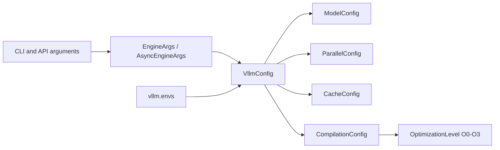

Sources: [vllm/engine/arg_utils.py:36-72](), [vllm/config/vllm.py:23-57](), [vllm/config/vllm.py:128-143](), [vllm/config/model.py:150-165](), [vllm/config/parallel.py:136-149](), [vllm/config/cache.py:178-186]()

---

## 2.1 Argument Parsing and EngineArgs

`vllm/engine/arg_utils.py` imports the configuration types used by the argument layer, including `ModelConfig`, `ParallelConfig`, `CompilationConfig`, and `VllmConfig`. This places argument handling at the boundary between user inputs and the typed configuration system. The parsing and conversion details are covered in [Argument Parsing and EngineArgs](#2.1).

Sources: [vllm/engine/arg_utils.py:36-72]()

---

## 2.2 VllmConfig and Specialized Configuration Objects

The configuration system uses specialized objects for distinct concerns. For example, `ModelConfig` represents model settings, `ParallelConfig` represents distributed-execution settings, and `CacheConfig` represents KV-cache settings. The root configuration module imports these alongside `SchedulerConfig`, `CompilationConfig`, and other configuration types. See [VllmConfig and Specialized Configuration Objects](#2.2) for the hierarchy and relationships.

| Configuration type | Configuration area |
|---|---|
| `ModelConfig` | Model identity and model-related settings |
| `ParallelConfig` | Distributed-execution settings |
| `CacheConfig` | KV-cache settings |
| `SchedulerConfig` | Scheduling settings |
| `CompilationConfig` | Compilation settings |
| `PoolerConfig` | Pooling settings |
| `MultiModalConfig` | Multimodal settings |

Sources: [vllm/config/vllm.py:30-57](), [vllm/config/model.py:150-165](), [vllm/config/parallel.py:136-149](), [vllm/config/cache.py:178-186](), [vllm/engine/arg_utils.py:36-72]()

**Diagram: Configuration types and their code entities**

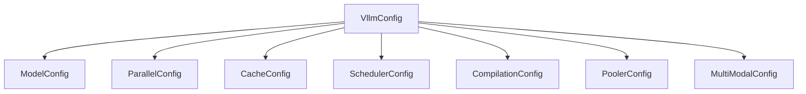

Sources: [vllm/config/vllm.py:30-57](), [vllm/config/model.py:150-165](), [vllm/config/parallel.py:136-149](), [vllm/config/cache.py:178-186](), [vllm/engine/arg_utils.py:36-72]()

---

## 2.3 Environment Variables System

The configuration code imports `vllm.envs` and consults it in runtime-dependent decisions. For example, `VLLM_BATCH_INVARIANT` is checked when deciding whether to enable an all-reduce/RMSNorm fusion path. This page does not enumerate variables; see [Environment Variables System](#2.3) for the reference and behavior details.

Sources: [vllm/config/vllm.py:23-24](), [vllm/config/vllm.py:175-190]()

---

## 2.4 Compilation Configuration and Optimization Levels

`CompilationConfig` is one of the specialized configuration types. The root configuration module defines `OptimizationLevel` with four values: O0 disables compilation and CUDA graphs; O1 enables quick optimizations; O2 adds full and piecewise CUDA graphs; O3 is currently described as equivalent to O2. The compilation child page covers the associated mechanisms and options in detail.

Sources: [vllm/config/vllm.py:30-34](), [vllm/config/vllm.py:128-141]()

---

This overview maps the major configuration areas to their code entities. For implementation details, continue to the child pages on argument parsing, configuration objects, environment variables, and compilation. Sources: [vllm/config/vllm.py:23-57](), [vllm/engine/arg_utils.py:36-72]()

---

# Page: Argument Parsing and EngineArgs

# Argument Parsing and EngineArgs

<details>
<summary>Relevant source files</summary>

The following files were used as context for generating this wiki page:

- [docs/models/supported_models.md](docs/models/supported_models.md)
- [tests/config/test_model_arch_config.py](tests/config/test_model_arch_config.py)
- [tests/engine/test_arg_utils.py](tests/engine/test_arg_utils.py)
- [tests/models/multimodal/generation/test_common.py](tests/models/multimodal/generation/test_common.py)
- [tests/models/multimodal/generation/vlm_utils/model_utils.py](tests/models/multimodal/generation/vlm_utils/model_utils.py)
- [tests/models/registry.py](tests/models/registry.py)
- [tests/test_config.py](tests/test_config.py)
- [vllm/config/cache.py](vllm/config/cache.py)
- [vllm/config/model.py](vllm/config/model.py)
- [vllm/config/model_arch.py](vllm/config/model_arch.py)
- [vllm/config/parallel.py](vllm/config/parallel.py)
- [vllm/config/speculative.py](vllm/config/speculative.py)
- [vllm/config/vllm.py](vllm/config/vllm.py)
- [vllm/engine/arg_utils.py](vllm/engine/arg_utils.py)
- [vllm/model_executor/models/config.py](vllm/model_executor/models/config.py)
- [vllm/model_executor/models/registry.py](vllm/model_executor/models/registry.py)
- [vllm/models/inkling/common/mm_preprocess.py](vllm/models/inkling/common/mm_preprocess.py)
- [vllm/transformers_utils/config.py](vllm/transformers_utils/config.py)
- [vllm/transformers_utils/configs/__init__.py](vllm/transformers_utils/configs/__init__.py)
- [vllm/transformers_utils/model_arch_config_convertor.py](vllm/transformers_utils/model_arch_config_convertor.py)
- [vllm/transformers_utils/processors/__init__.py](vllm/transformers_utils/processors/__init__.py)
- [vllm/v1/spec_decode/llm_base_proposer.py](vllm/v1/spec_decode/llm_base_proposer.py)

</details>


## Purpose and Scope

This page details the argument parsing and configuration assembly system used in vLLM, emphasizing the `EngineArgs` dataclass and related mechanisms. It covers how command-line and Python API inputs are parsed, validated, and transformed into internal configuration dataclasses culminating in the unified `VllmConfig` used by the engine.

Key components include:

- The `EngineArgs` dataclass and its asynchronous extension `AsyncEngineArgs`.
- CLI argument parsing with automatic type inference and registration.
- Conversion from parsed arguments to configuration objects (`ModelConfig`, `SchedulerConfig`, etc.).
- Integration with the asynchronous serving API through `AsyncLLM`.

For related configuration details, see the pages on [VllmConfig and Specialized Configuration Objects](2.2) and [Environment Variables System](2.3).

Sources: `[vllm/engine/arg_utils.py:360-1467]()`, `[vllm/config/vllm.py:121-160]()`

---

## System Overview

The argument parsing system in vLLM forms a bridge from user inputs—either via CLI or direct Python API usage—towards the internal configuration driving the engine. Its key components are:

1.  **Input sources**: Arguments may come from CLI flags, Python API calls, or default values.
2.  **Parsing layer**: `FlexibleArgumentParser` handles CLI input, invoking `EngineArgs` to materialize configuration objects.
3.  **Type inference**: The system infers appropriate argument types, supported choices, and defaults from annotations on dataclasses.
4.  **Configuration assembly**: Using the parsed inputs, `EngineArgs.create_engine_config()` assembles specialized objects (`ModelConfig`, `ParallelConfig`, etc.) and returns the comprehensive `VllmConfig`.

This pipeline ensures robust, user-friendly configuration handling with layered validation and extensibility.

### Argument Parsing Pipeline Diagram

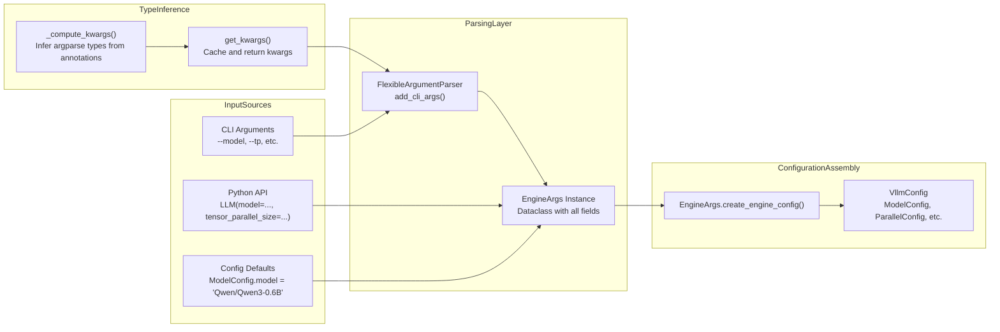

Sources: `[vllm/engine/arg_utils.py:360-615]()`, `[vllm/utils/argparse_utils.py:113-200]()`, `[vllm/config/vllm.py:121-160]()`

---

## EngineArgs Dataclass

The core of the argument parsing framework is the `EngineArgs` dataclass. It is a comprehensive container aggregating all user-configurable parameters spanning multiple configuration categories.

### Characteristics

| Aspect | Details |
| :----- | :------ |
| Location | `vllm/engine/arg_utils.py:362-615` |
| Type | Python dataclass |
| Field count | ~150 fields covering model, parallelism, cache, scheduler, observability, compilation, and more |
| Initialization behavior | Post-init converts dict fields to Pydantic configuration objects, loads plugins, and resolves offline models |

### Field Organization and Mapping

The fields in `EngineArgs` correspond closely to specialized configuration dataclasses. This gives a clear mapping from CLI or API argument spaces to the internal configuration domain:

```mermaid
graph TD
    EngineArgs["EngineArgs Dataclass"]
    
    EngineArgs --> ModelFields["ModelConfig Fields<br/>model, dtype, max_model_len, quantization"]
    EngineArgs --> ParallelFields["ParallelConfig Fields<br/>tensor_parallel_size, pipeline_parallel_size"]
    EngineArgs --> CacheFields["CacheConfig Fields<br/>gpu_memory_utilization, block_size"]
    EngineArgs --> SchedulerFields["SchedulerConfig Fields<br/>max_num_batched_tokens, max_num_seqs"]
    EngineArgs --> CompilationFields["CompilationConfig Fields<br/>compilation_config, cudagraph_capture_sizes"]
    EngineArgs --> LoadFields["LoadConfig Fields<br/>download_dir, load_format"]
    EngineArgs --> ObservabilityFields["ObservabilityConfig Fields<br/>otlp_traces_endpoint, kv_cache_metrics"]
```

Each field or group of fields corresponds to a logical config object, which `EngineArgs` helps instantiate.

Sources: `[vllm/engine/arg_utils.py:362-615]()`, `[vllm/config/model.py:124-183]()`, `[vllm/config/cache.py:44-130]()`

---

## Post-Initialization Processing in EngineArgs

The `__post_init__()` method of `EngineArgs` performs several important tasks upon instantiation:

1.  **Conversion of dictionary fields into validated Pydantic configuration objects:**

    To allow flexible JSON-like or dict input for nested configuration fields from CLI or API, `__post_init__()` uses pydantic's `TypeAdapter` to validate and convert dicts into proper config instances. This ensures consistency even when the user provides JSON strings or dicts at the CLI.

2.  **Plugin loading:**

    General plugins are loaded by calling `load_general_plugins()`, which may add or modify config-related behavior dynamically.

3.  **Offline model path resolution:**

    When the environment variable `HF_HUB_OFFLINE=1` is set, `__post_init__()` calls `get_model_path()` to translate remote model ids into local cached paths. This helps with offline deployment and reproducibility by ensuring that model identifiers point to local files.

### `__post_init__()` Workflow Diagram

```mermaid
sequenceDiagram
    participant User
    participant EngineArgs
    participant Plugins
    participant HFHub
    
    User->>EngineArgs: __init__(model="meta-llama/Llama-2-7b")
    EngineArgs->>EngineArgs: __post_init__()
    EngineArgs->>EngineArgs: Convert dict configs to Pydantic objects
    EngineArgs->>Plugins: load_general_plugins()
    EngineArgs->>HFHub: Check HF_HUB_OFFLINE
    alt Offline Mode
        EngineArgs->>EngineArgs: get_model_path(model, revision)
        EngineArgs->>EngineArgs: Update model field with local path
    end
    EngineArgs->>User: Return ready EngineArgs instance
```

Sources: `[vllm/engine/arg_utils.py:618-658]()`, `[vllm/transformers_utils/repo_utils.py:113-115]()`

---

## CLI Argument Registration

The static method `EngineArgs.add_cli_args()` enables the seamless integration of all vLLM engine arguments into the CLI parser (`FlexibleArgumentParser`).

### Grouped Arguments for Clarity

Arguments are grouped logically matching configuration domains. Each group helps users discover related options easily.

```mermaid
graph TD
    Parser["FlexibleArgumentParser"]
    
    Parser --> ModelGroup["ModelConfig Group<br/>--model, --dtype, --quantization<br/>--max-model-len, --tokenizer"]
    Parser --> LoadGroup["LoadConfig Group<br/>--load-format, --download-dir"]
    Parser --> AttentionGroup["AttentionConfig Group<br/>--attention-backend"]
    Parser --> StructuredOutputsGroup["StructuredOutputsConfig Group<br/>--reasoning-parser"]
    Parser --> ParallelGroup["ParallelConfig Group<br/>--tp, --pp, --dp<br/>--distributed-executor-backend"]
    Parser --> SchedulerGroup["SchedulerConfig Group<br/>--max-num-batched-tokens<br/>--max-num-seqs, --policy"]
    Parser --> CacheGroup["CacheConfig Group<br/>--gpu-memory-utilization<br/>--block-size, --kv-cache-dtype"]
    Parser --> MultiModalGroup["MultiModalConfig Group<br/>--limit-mm-per-prompt<br/>--mm-processor-kwargs"]
    Parser --> LoRAGroup["LoRAConfig Group<br/>--enable-lora, --max-loras<br/>--max-lora-rank"]
    Parser --> CompilationGroup["CompilationConfig Group<br/>--compilation-config<br/>JSON or -cc.key=value"]
    Parser --> ObservabilityGroup["ObservabilityConfig Group<br/>--otlp-traces-endpoint<br/>--kv-cache-metrics"]
```

### Special Argument Handling

Several CLI args have custom parsing or semantics beyond automatic inference:

| Argument | Special Handling | Location |
| :------- | :--------------- | :------- |
| `--hf-token` | Accepts bool or str; supports flag (const=True) variant | `[vllm/engine/arg_utils.py:723-730]()` |
| `--max-model-len` | Parsed with `human_readable_int_or_auto()` to accept integers or "auto" | `[vllm/utils/argparse_utils.py:129-131]()` |
| `--compilation-config` | Accepts JSON string or shorthand `-cc.key=value` parsed into dict | `[vllm/engine/arg_utils.py:1128-1136]()` |
| `--data-parallel-*` args | Support for external load balancer mode's distributed executor configuration | `[vllm/engine/arg_utils.py:851-897]()` |

Sources: `[vllm/engine/arg_utils.py:660-1162]()`

---

## Type Inference and Argument Generation

To automate CLI argument definitions, the system infers argument types and options from Python type annotations in `EngineArgs` and related configs.

This mechanism enables consistent argument typing, choices, optional types, and complex structures.

### Annotation to Argument Parsing Logic Diagram

```mermaid
graph TD
    Field["Dataclass Field<br/>dtype: ModelDType"]
    GetTypeHints["get_type_hints(field.type)<br/>Extract all type components"]
    TypeHints["Set of Type Hints<br/>{Literal, str, None}"]
    
    Field --> GetTypeHints
    GetTypeHints --> TypeHints
    
    TypeHints --> CheckBool{Contains bool?}
    CheckBool -->|Yes| BoolAction["action=BooleanOptionalAction"]
    
    TypeHints --> CheckLiteral{Contains Literal?}
    CheckLiteral -->|Yes| LiteralKwargs["literal_to_kwargs()<br/>type + choices/metavar"]
    
    TypeHints --> CheckCollection{Contains tuple/list/set?}
    CheckCollection -->|Yes| CollectionKwargs["collection_to_kwargs()<br/>type + nargs"]
    
    TypeHints --> CheckDataclass{Contains dataclass?}
    CheckDataclass -->|Yes| DataclassParser["parse_dataclass()<br/>TypeAdapter.validate_json"]
    
    TypeHints --> CheckInt{Contains int?}
    CheckInt -->|Yes| IntHandler{Special int field?}
    IntHandler -->|max_model_len| HumanReadableAuto["human_readable_int_or_auto"]
    IntHandler -->|max_num_batched_tokens| HumanReadable["human_readable_int"]
    IntHandler -->|Other| StandardInt["type=int"]
    
    TypeHints --> CheckNone{Contains None?}
    CheckNone -->|Yes| OptionalType["optional_type(base_type)"]
```

### Common Type Annotation to CLI Argument Mapping

| Python Type Annotation | Argparse Configuration | Example CLI Argument |
| :--------------------- | :--------------------- | :------------------- |
| `bool` | `action=BooleanOptionalAction` | `--enable-lora / --no-enable-lora` |
| `Literal["a", "b"]` | `type=str`, `choices=["a", "b"]` | `--policy fcfs/priority` |
| `Literal[...] \| str` | `type=str`, `metavar=[...]` (accepts literals or custom) | flexible options with documented choices |
| `list[int]` | `type=int`, `nargs="+"` | `--cudagraph-capture-sizes 1 2 4` |
| `tuple[int, int]` | `type=int`, `nargs=2` | fixed-length multi-value options |
| `int \| None` | custom `optional_type(int)` parser | accepts integer or "None" string |

Sources: `[vllm/engine/arg_utils.py:132-346]()`

---

## Configuration Object Creation with create_engine_config()

A critical utility in `EngineArgs` is `create_engine_config()`, which from the parsed and stored fields produces a complete `VllmConfig` instance. This method merges user inputs, applies model-specific overrides, performs validation, and returns a ready-to-use configuration object.

### Configuration Assembly Sequence

```mermaid
sequenceDiagram
    participant EngineArgs
    participant ModelConfig
    participant ParallelConfig
    participant CacheConfig
    participant SchedulerConfig
    participant VllmConfig
    
    EngineArgs->>ModelConfig: Instantiate with model args
    Note over ModelConfig: Calls get_config() to load HF config and merges scheduler pooling overrides
    
    EngineArgs->>ParallelConfig: Instantiate with parallel args
    Note over ParallelConfig: Validate tensor/pipeline/data/expert parallelism sizes
    
    EngineArgs->>CacheConfig: Instantiate with cache args
    Note over CacheConfig: Configure block size, gpu memory utilization, cache dtype
    
    EngineArgs->>SchedulerConfig: Instantiate with scheduler args
    Note over SchedulerConfig: Set max tokens, sequences, scheduling policies
    
    EngineArgs->>VllmConfig: Compose all configs
    VllmConfig->>VllmConfig: Runs __post_init__ for cross-validation and optimization
    
    VllmConfig->>EngineArgs: Return fully configured VllmConfig
```

### Highlights

-   **ModelConfig construction** includes loading HuggingFace model config via `get_config()` and performing pooling task detection to adjust scheduler defaults `[vllm/engine/arg_utils.py:1164-1225]()`.

-   **CacheConfig** is constructed with attention to KV cache block sizes and GPU memory utilization thresholds, utilizing helper methods to interpret layout names into enum values `[vllm/engine/arg_utils.py:1232-1250]()`.

-   **ParallelConfig** verifies consistency of parallelism sizes (tensor, pipeline, data, expert) with error checking for invalid combinations.

Sources: `[vllm/engine/arg_utils.py:1164-1413]()`, `[vllm/config/vllm.py:121-160]()`, `[vllm/config/model.py:124-183]()`

---

## AsyncEngineArgs and Serving APIs

For asynchronous and online serving scenarios, `AsyncEngineArgs` extends `EngineArgs` to include asynchronous-specific arguments such as worker counts, multiprocessing method, and RPC settings.

-   The `AsyncEngineArgs` dataclass includes fields for API worker management and supports configuration for multi-process serving. `[vllm/engine/arg_utils.py:1416-1436]()`

-   When environment variable `VLLM_WORKER_MULTIPROC_METHOD` equals `"forkserver"`, the API server pre-imports the `vllm.v1.engine.async_llm` module during forkserver startup. This speeds up spawning of worker processes by doing expensive imports once at the forkserver level. `[vllm/env_override.py:157-160]()`

### AsyncLLM Data Flow in Serving

`AsyncLLM` is the primary async interface to the V1 engine. It uses the `InputProcessor` to transform client inputs into engine requests and communicates with the engine backend via `EngineCoreClient`.

```mermaid
graph TD
    API["API Request (EngineInput)"]
    AsyncLLM["AsyncLLM"]
    InputProc["InputProcessor"]
    CoreClient["EngineCoreClient"]
    OutputProc["OutputProcessor"]
    
    API --> AsyncLLM
    AsyncLLM --> InputProc
    InputProc --> CoreClient
    CoreClient --> OutputProc
    OutputProc --> AsyncLLM
    AsyncLLM --> API
```

Sources: `[vllm/engine/arg_utils.py:1416-1436]()`, `[vllm/env_override.py:157-160]()`, `[vllm/v1/engine/async_llm.py:72-180]()`, `[vllm/v1/engine/input_processor.py:38-90]()`

---

## Architecture-Specific Overrides for ModelConfig

Some model architectures require special adjustments to `ModelConfig` or related flags that influence engine behavior. These overrides are applied during argument parsing or config assembly.

Examples include:

| Architecture | Override Description | Source |
| :----------- | :------------------- | :----- |
| `DeepseekV32ForCausalLM` | Forces `cache_dtype="auto"` if `bfloat16` is requested to avoid unsupported dtypes. | `[vllm/model_executor/models/config.py:73-86]()` |
| `GlmMoeDsaForCausalLM` | Sets `comm_backend="a2a"` and enables `q_replicate` for model parallelism | `[vllm/model_executor/models/config.py:89-116]()` |
| `UnlimitedOCRForCausalLM` | Auto-selects high-efficiency FA4 backend or falls back to Triton; disables prefix caching for correctness | `[vllm/model_executor/models/config.py:160-175]()` |
| `Qwen3OmniMoeForConditionalGeneration` | Requires a standalone DSpark draft checkpoint with specific architecture and block size matching `num_speculative_tokens`. | `[vllm/config/speculative.py:149-183]()` |

These architecture-specific rules ensure compatibility and performance optimizations for specialized model variants.

Sources: `[vllm/config/model.py:1-2659]()`, `[vllm/config/speculative.py:149-183]()`, `[vllm/model_executor/models/config.py:73-175]()`

---

## Summary Table: Key Classes and Functions

| Symbol | Type | Purpose | Location |
| :----- | :--- | :------ | :------- |
| `EngineArgs` | `dataclass` | Aggregates all engine arguments | `[vllm/engine/arg_utils.py:362-615]()` |
| `AsyncEngineArgs` | `dataclass` | Async-specific engine argument extension | `[vllm/engine/arg_utils.py:1416-1436]()` |
| `add_cli_args()` | static method | Register all CLI arguments | `[vllm/engine/arg_utils.py:660-1162]()` |
| `create_engine_config()` | method | Produce a validated `VllmConfig` from args | `[vllm/engine/arg_utils.py:1164-1413]()` |
| `AsyncLLM` | class | Async interface for V1 engine | `[vllm/v1/engine/async_llm.py:72-180]()` |
| `VllmConfig` | class | Final assembled engine configuration | `[vllm/config/vllm.py:121-160]()` |
| `FlexibleArgumentParser` | class | Extended `argparse.ArgumentParser` supporting flexible parsing | `[vllm/utils/argparse_utils.py:113-200]()` |

Sources: `[vllm/engine/arg_utils.py:1-1467]()`, `[vllm/config/vllm.py:1-160]()`, `[vllm/v1/engine/async_llm.py:1-180]()`

---

This completes the detailed technical overview of vLLM's argument parsing system, centered on the `EngineArgs` dataclass, CLI interface, and configuration object assembly.

---

# Page: VllmConfig and Specialized Configuration Objects

# VllmConfig and Specialized Configuration Objects

<details>
<summary>Relevant source files</summary>

The following files were used as context for generating this wiki page:

- [docs/models/supported_models.md](docs/models/supported_models.md)
- [tests/config/test_model_arch_config.py](tests/config/test_model_arch_config.py)
- [tests/config/test_multimodal_config.py](tests/config/test_multimodal_config.py)
- [tests/engine/test_arg_utils.py](tests/engine/test_arg_utils.py)
- [tests/models/multimodal/generation/test_common.py](tests/models/multimodal/generation/test_common.py)
- [tests/models/multimodal/generation/vlm_utils/model_utils.py](tests/models/multimodal/generation/vlm_utils/model_utils.py)
- [tests/models/multimodal/processing/test_mllama4.py](tests/models/multimodal/processing/test_mllama4.py)
- [tests/models/registry.py](tests/models/registry.py)
- [tests/models/utils.py](tests/models/utils.py)
- [tests/multimodal/test_cache.py](tests/multimodal/test_cache.py)
- [tests/multimodal/test_hasher.py](tests/multimodal/test_hasher.py)
- [tests/multimodal/test_inputs.py](tests/multimodal/test_inputs.py)
- [tests/multimodal/test_utils.py](tests/multimodal/test_utils.py)
- [tests/test_config.py](tests/test_config.py)
- [tests/v1/core/test_encoder_cache_manager.py](tests/v1/core/test_encoder_cache_manager.py)
- [tests/v1/core/test_output.py](tests/v1/core/test_output.py)
- [tests/v1/worker/test_gpu_model_runner_mm_gather.py](tests/v1/worker/test_gpu_model_runner_mm_gather.py)
- [vllm/config/cache.py](vllm/config/cache.py)
- [vllm/config/ec_manager_config.py](vllm/config/ec_manager_config.py)
- [vllm/config/model.py](vllm/config/model.py)
- [vllm/config/model_arch.py](vllm/config/model_arch.py)
- [vllm/config/multimodal.py](vllm/config/multimodal.py)
- [vllm/config/parallel.py](vllm/config/parallel.py)
- [vllm/config/speculative.py](vllm/config/speculative.py)
- [vllm/config/vllm.py](vllm/config/vllm.py)
- [vllm/engine/arg_utils.py](vllm/engine/arg_utils.py)
- [vllm/model_executor/models/config.py](vllm/model_executor/models/config.py)
- [vllm/model_executor/models/registry.py](vllm/model_executor/models/registry.py)
- [vllm/models/inkling/common/mm_preprocess.py](vllm/models/inkling/common/mm_preprocess.py)
- [vllm/multimodal/hasher.py](vllm/multimodal/hasher.py)
- [vllm/multimodal/inputs.py](vllm/multimodal/inputs.py)
- [vllm/multimodal/utils.py](vllm/multimodal/utils.py)
- [vllm/transformers_utils/config.py](vllm/transformers_utils/config.py)
- [vllm/transformers_utils/configs/__init__.py](vllm/transformers_utils/configs/__init__.py)
- [vllm/transformers_utils/model_arch_config_convertor.py](vllm/transformers_utils/model_arch_config_convertor.py)
- [vllm/transformers_utils/processors/__init__.py](vllm/transformers_utils/processors/__init__.py)
- [vllm/v1/core/encoder_cache_manager.py](vllm/v1/core/encoder_cache_manager.py)
- [vllm/v1/core/sched/output.py](vllm/v1/core/sched/output.py)
- [vllm/v1/spec_decode/llm_base_proposer.py](vllm/v1/spec_decode/llm_base_proposer.py)

</details>


## Purpose and Scope

This page documents the configuration architecture of vLLM, centered around the `VllmConfig` root object and its specialized sub-configurations. It covers the structure, key fields, and validation logic of `ModelConfig`, `ParallelConfig`, `CacheConfig`, `SchedulerConfig`, `PoolerConfig`, `MultiModalConfig`, and other specialized objects located in `vllm/config/`.

For the CLI/YAML argument parsing pipeline that constructs these objects, see [2.1. Argument Parsing and EngineArgs](). For environment variables that supplement configuration, see [2.3. Environment Variables System](). For `CompilationConfig` and `torch.compile` integration, see [2.4. Compilation Configuration and Optimization Levels]().

Sources: [vllm/config/vllm.py:1-54](), [vllm/engine/arg_utils.py:36-69]()

---

## Package Layout

All configuration classes are defined within the `vllm/config/` directory and re-exported through `vllm/config/__init__.py`. vLLM uses a custom `@config` decorator (defined in `vllm/config/utils.py`) that applies Pydantic validation to Python dataclasses, allowing for strict type checking and range validation (e.g., `ge`, `le`).

| File | Primary Class(es) |
|---|---|
| `vllm/config/vllm.py` | `VllmConfig`, `OptimizationLevel`, `PerformanceMode` |
| `vllm/config/model.py` | `ModelConfig` |
| `vllm/config/cache.py` | `CacheConfig` |
| `vllm/config/parallel.py` | `ParallelConfig`, `EPLBConfig` |
| `vllm/config/scheduler.py` | `SchedulerConfig` |
| `vllm/config/pooler.py` | `PoolerConfig` |
| `vllm/config/multimodal.py` | `MultiModalConfig` |
| `vllm/config/compilation.py` | `CompilationConfig`, `PassConfig`, `CompilationMode`, `CUDAGraphMode` |
| `vllm/config/attention.py` | `AttentionConfig` |
| `vllm/config/load.py` | `LoadConfig` |
| `vllm/config/lora.py` | `LoRAConfig` |
| `vllm/config/speculative.py` | `SpeculativeConfig` |
| `vllm/config/kernel.py` | `KernelConfig` |
| `vllm/config/kv_events.py` | `KVEventsConfig` |

Sources: [vllm/config/vllm.py:30-53](), [vllm/config/utils.py:52-52]()

---

## VllmConfig — Root Container

`VllmConfig` is the central configuration object passed throughout the engine, workers, and execution pipeline. It aggregates all specialized configuration objects as typed fields.

### VllmConfig Composition — Mapping Concepts to Code Entities

```mermaid
graph TD
    VC["VllmConfig<br/>vllm/config/vllm.py"]

    VC --> MC["ModelConfig<br/>vllm/config/model.py"]
    VC --> CC["CacheConfig<br/>vllm/config/cache.py"]
    VC --> PC["ParallelConfig<br/>vllm/config/parallel.py"]
    VC --> SC["SchedulerConfig<br/>vllm/config/scheduler.py"]
    VC --> AC["AttentionConfig<br/>vllm/config/attention.py"]
    VC --> CPC["CompilationConfig<br/>vllm/config/compilation.py"]
    VC --> LC["LoadConfig<br/>vllm/config/load.py"]
    VC --> KC["KernelConfig<br/>vllm/config/kernel.py"]
    VC --> DC["DeviceConfig<br/>vllm/config/device.py"]
    VC --> PLC["PoolerConfig<br/>vllm/config/pooler.py"]
    VC --> MMC["MultiModalConfig<br/>vllm/config/multimodal.py"]

    VC -.-> LRC["LoRAConfig<br/>vllm/config/lora.py"]
    VC -.-> SPC["SpeculativeConfig<br/>vllm/config/speculative.py"]
    VC -.-> KVTC["KVTransferConfig<br/>vllm/config/kv_transfer.py"]
    VC -.-> SOC["StructuredOutputsConfig<br/>vllm/config/structured_outputs.py"]
    VC -.-> KVE["KVEventsConfig<br/>vllm/config/kv_events.py"]
    VC -.-> OFC["OffloadConfig<br/>vllm/config/offload.py"]
    VC -.-> OBC["ObservabilityConfig<br/>vllm/config/observability.py"]
    VC -.-> PFC["ProfilerConfig<br/>vllm/config/profiler.py"]
    VC -.-> REC["ReasoningConfig<br/>vllm/config/reasoning.py"]
    VC -.-> WTC["WeightTransferConfig<br/>vllm/config/weight_transfer.py"]
    VC -.-> ECT["ECTransferConfig<br/>vllm/config/ec_transfer.py"]
```

Sources: [vllm/config/vllm.py:246-329]()

### Key Fields on VllmConfig

| Field | Type | Default | Description |
|---|---|---|---|
| `model_config` | `ModelConfig` | *required* | Model identity and tokenizer settings, architecture info. |
| `cache_config` | `CacheConfig` | `CacheConfig()` | KV cache block allocation and memory limits. |
| `parallel_config` | `ParallelConfig` | `ParallelConfig()` | Distributed execution topology and parallelism parameters. |
| `scheduler_config` | `SchedulerConfig` | factory | Scheduling policies, batching and token budget settings. |
| `pooler_config` | `PoolerConfig` | `None` | Configuration for pooling, embeddings, classification tasks. |
| `multimodal_config`| `MultiModalConfig` | `None` | Multi-modal encoder limits, caching, and IPC. |
| `compilation_config`| `CompilationConfig` | `CompilationConfig()` | `torch.compile` modes, CUDA graph modes, and custom passes. |
| `optimization_level`| `OptimizationLevel` | `O2` | Preset convenience for compilation and CUDA graph behavior. |
| `performance_mode` | `PerformanceMode` | `"balanced"` | Latency vs throughput trade-off strategies. |
| `seed` | `int | None` | `None` | Optional random seed to ensure deterministic runs. |

Sources: [vllm/config/vllm.py:246-329](), [vllm/config/vllm.py:130-142]()

---

## Specialized Configuration Objects

### ModelConfig

`ModelConfig` manages all model-specific metadata, including model identity, architecture detection, tokenizer mode, dtype, and runner type. 

Key considerations:
- The `model` field identifies the HF model repo or local directory.
- `tokenizer_mode` controls tokenizer backend selection (e.g., "auto", "hf", "slow", "mistral", "deepseek_v32", "kimi_k3", "cohere").
- Torch device dtype (`dtype`) can be "auto" or explicit types like `float16`.
- `max_model_len` is lazily derived from Hugging Face config if unset.
- Supports specialized runners, e.g., `generate`, `pooling`, or `draft`.
- Supports trusting remote code (e.g., transformers auto model code).

`ModelConfig` also interfaces with model architecture-specific logic to adjust config during initialization.

| Field | Type | Default | Description |
|---|---|---|---|
| `model` | `str` | `"Qwen/Qwen3-0.6B"` | HF repo ID or local path for model. |
| `tokenizer_mode` | `TokenizerMode` | `"auto"` | Tokenizer backend mode (e.g., HF fast, mistral, deepseek...). |
| `dtype` | `ModelDType` | `"auto"` | Weight and activation dtype. |
| `max_model_len` | `int | None` | Maximum model context length, auto-derived if None. |
| `runner` | `RunnerOption` | `"auto"` | Runner type, e.g., `"generate"`, `"pooling"`, `"draft"`. |
| `trust_remote_code` | `bool` | `False` | Allow loading custom code from HF repos. |

Sources: [vllm/config/model.py:124-186](), [vllm/transformers_utils/config.py:34-44](), [vllm/config/model.py:144-164]()

---

### CacheConfig

`CacheConfig` controls key-value (KV) cache organization and memory utilization.

Highlights:
- `block_size` sets the token granularity block size (default often 16).
- Memory utilization fraction for GPU KV cache.
- Cache dtype options include FP16, FP8, NVFP4, INT8 per-token-head.
- Prefix caching (shared prompt segments) can be enabled.
- Support for specialized cache modes (e.g., Mamba caching).

| Field | Type | Default | Description |
|---|---|---|---|
| `block_size` | `int` | *varies* | Token block size for KV caching (usually 16). |
| `gpu_memory_utilization` | `float` | `0.92` | Fraction of GPU memory reserved for KV cache. |
| `cache_dtype` | `CacheDType` | `"auto"` | Data type of KV cache tensors. |
| `enable_prefix_caching` | `bool` | `True` | Enables prompt prefix caching. |
| `mamba_cache_mode` | `MambaCacheMode` | `"none"` | Mode for Mamba-style cached kernels. |

Sources: [vllm/config/cache.py:44-143]()

---

### ParallelConfig

`ParallelConfig` describes the parallelism topology for distributed execution.

Supports:
- Pipeline Parallelism (PP)
- Tensor Parallelism (TP)
- Data Parallelism (DP)
- Expert Parallelism (EP)

Configures group sizes, network parameters, backends, and specialized load balancing.

| Field | Type | Default | Description |
|---|---|---|---|
| `pipeline_parallel_size` | `int` | `1` | Number of pipeline stages. |
| `tensor_parallel_size` | `int` | `1` | Number of tensor parallel shards per stage. |
| `data_parallel_size` | `int` | `1` | Number of data parallel replicas. |
| `enable_expert_parallel` | `bool` | `False` | Enable sharded MoE experts across ranks. |
| `all2all_backend` | `All2AllBackend` | `"allgather_reducescatter"` | Backend for all-to-all comms. |
| `eplb_config` | `EPLBConfig` | Factory | Expert parallel load balancing parameters. |

Sources: [vllm/config/parallel.py:119-175]()

---

### SchedulerConfig

`SchedulerConfig` controls batching, token budgets, and scheduling policies.

Main settings:
- Maximum concurrent requests (`max_num_seqs`)
- Maximum batched tokens per iteration (`max_num_batched_tokens`)
- Chunked prefill support to split large prompts
- Scheduling policy (e.g., "fcfs" or "priority")

| Field | Type | Default | Description |
|---|---|---|---|
| `max_num_batched_tokens` | `int` | `2048` | Max tokens per scheduling iteration. |
| `max_num_seqs` | `int` | `128` | Max concurrent sequences in batch. |
| `enable_chunked_prefill` | `bool` | `True` | Enable splitting large prompts into chunks. |
| `policy` | `SchedulerPolicy` | `"fcfs"` | Scheduling policy (first come first served or priority). |

Sources: [vllm/config/scheduler.py:26-155]()

---

### PoolerConfig

`PoolerConfig` manages pooling model settings.

Includes:
- Pooling type selection: embedding or classification
- Whether pooling is sequence-wise or token-wise
- Classification head and score types
- Batch sizing for pooling workload

It configures the pooling runner and is linked with the `ModelConfig` when running embeddings or classification tasks.

Sources: [vllm/config/pooler.py:1-50](), [vllm/config/model.py:24-24]()

---

### MultiModalConfig

`MultiModalConfig` configures multi-modal model input and encoder limits.

Features:
- Limits for vision (images/videos) and audio encoder processing
- Settings on cache types for multi-modal encoders (`mm_cache_type`)
- Tensor IPC flags and devices for multimodal processor stages
- Controls if chunked multi-modal input is disabled (platform-specific)

This config is crucial for supporting vision-language, audio, and multi-media inputs in vLLM.

Sources: [vllm/config/multimodal.py:1-60](), [vllm/config/model.py:16-23]()

---

## CompilationConfig and PassConfig

The `CompilationConfig` controls the `torch.compile` backend and CUDA graph capture modes, influencing performance optimizations.

### Important Enums and Classes:

- `CompilationMode` - Enum controlling compilation strategies:

  | Mode | Description |
  |---|---|
  | `NONE` | No compilation, fully eager. |
  | `STOCK_TORCH_COMPILE` | Standard `torch.compile` pipeline. |
  | `DYNAMO_TRACE_ONCE` | Single trace with Dynamo to avoid recompilation. |
  | `VLLM_COMPILE` | Custom Inductor backend with caching and shape specialization. |

- `CUDAGraphMode` - Enum controlling CUDA graph mode:

  | Mode | Description |
  |---|---|
  | `NONE` | No CUDA graph capture. |
  | `PIECEWISE` | Piecewise CUDA graphs. |
  | `FULL` | Full CUDA graph capture. |
  | `FULL_DECODE_ONLY` | Full CUDA graph for decode, none for prefill. |
  | `FULL_AND_PIECEWISE` | Full CUDA graph for decode, piecewise for prefill. |

- `PassConfig` - Flags for custom Inductor passes, e.g., fusing RMSNorm and quant ops, sequence parallelism, async allreduce fusion, and ROCm-specific fusions.

Sources: [vllm/config/compilation.py:37-149](), [vllm/config/compilation.py:65-68]()

---

## VllmConfig Initialization and Validation

The `VllmConfig` class contains a comprehensive `__post_init__` method acting as a central validation and cross-configuration consistency check.

### Cross-Entity Validation and Data Flow

```mermaid
graph TD
    INIT["VllmConfig.__post_init__<br/>vllm/config/vllm.py"]

    INIT --> PLAT["Platform.check_and_update_config()<br/>vllm/platforms/"]
    INIT --> MV["ModelConfig.verify_with_parallel_config()<br/>vllm/config/model.py"]
    INIT --> CV["CacheConfig.verify_with_parallel_config()<br/>vllm/config/cache.py"]
    INIT --> LV["LoRAConfig.verify_with_model_config()<br/>vllm/config/lora.py"]

    INIT --> OPT["_apply_optimization_level_defaults()<br/>vllm/config/vllm.py"]
    OPT --> COMP["Update CompilationConfig based on OptimizationLevel"]

    INIT --> AS["Resolve async_scheduling flag"]
    AS --> |"If True"| DP["Disable NCCL DP sync"]

    INIT --> MS["Model-Specific Config Updates<br/>vllm/model_executor/models/config.py"]
```

Key validation points include:
- Platform-specific constraints and updates.
- Validation of model configuration given parallelism setup.
- Cache configuration adjustments.
- LoRA config verification, if applicable.
- Applying presets and fusion settings based on selected optimization level.
- Adjusting synchronization and NCCL behavior if async scheduling is enabled.
- Applying architecture-specific config updates via a registry of model-specific callbacks.

Sources: [vllm/config/vllm.py:652-780]()

---

### Model-Specific Configuration Updates

The `_apply_model_specific_config_updates` method applies architecture-specific logic to augment or tweak config.

- It iterates over registered model config verifiers that handle distinct architectures.
- Allows cross-cutting modifications like disabling chunked multi-modal input for specific platforms/models.
- Ensures compatibility flags and hints propagate appropriately.

This mechanism helps maintain consistent and validated configuration for numerous supported model families.

Sources: [vllm/config/vllm.py:760-766](), [vllm/model_executor/models/config.py:18-41]()

---

### Optimization Level Presets

`OptimizationLevel` is an `IntEnum` controlling preset optimizations for compilation and CUDA graph usage.

| Level | Description | Typical CUDA Graph Mode | Fusion Passes Enabled |
|---|---|---|---|
| `O0` | No optimization. no compilation, no cudagraphs, no other optimization, just starting up immediately | `NONE` | All fusions disabled |
| `O1` | Quick optimizations. Dynamo+Inductor compilation and Piecewise cudagraphs | `PIECEWISE` | Norm and activation fusion enabled |
| `O2` | Full optimizations. -O1 as well as Full and Piecewise cudagraphs. | `FULL_AND_PIECEWISE` | All fusion passes including allreduce enabled |
| `O3` | Currently the same as -O2s. | `FULL_AND_PIECEWISE` | All fusion passes |

Applying these presets sets appropriate fields in `CompilationConfig.PassConfig` and `CUDAGraphMode` automatically.

Sources: [vllm/config/vllm.py:130-142](), [vllm/config/vllm.py:206-240]()

---

### Configuration Hashing

`VllmConfig` provides a `compute_hash()` method to create a unique hash fingerprint of the configuration state for caching compiled artifacts.

- Excludes ephemeral or runtime-only fields (like `seed` or `served_model_name`) which do not affect model execution or compilation.
- Uses `get_hash_factors` utility to collect relevant serializable aspects recursively.
- The hash supports caching of compiled code (e.g., Triton kernels, CUDA graphs, JIT cache).

This method ensures fast and safe reuse of compiled components across runs with identical configurations.

Sources: [vllm/config/vllm.py:330-432](), [vllm/config/utils.py:18-19]()

---

# Summary

The `VllmConfig` and its specialized sub-configs form the core configuration framework for vLLM, organizing model parameters, distributed parallelism, caching strategies, scheduling policies, multi-modal support, and compilation settings. The design emphasizes strong validation, ease of extension for new model architectures, and performance tuning presets. Understanding these objects and their relationships is essential for users and developers configuring and extending vLLM deployments and engines.

---

# References

- `VllmConfig` and related configs: [vllm/config/vllm.py:100-329]()
- `ModelConfig`: [vllm/config/model.py:124-186]()
- `ParallelConfig`: [vllm/config/parallel.py:119-175]()
- `CacheConfig`: [vllm/config/cache.py:44-143]()
- `SchedulerConfig`: [vllm/config/scheduler.py:26-155]()
- `PoolerConfig`: [vllm/config/pooler.py:1-50]()
- `MultiModalConfig`: [vllm/config/multimodal.py:1-60]()
- `CompilationConfig` and `PassConfig`: [vllm/config/compilation.py:37-149]()
- Model-specific verification: [vllm/model_executor/models/config.py:18-41]()

---

# Page: Environment Variables System

# Environment Variables System

<details>
<summary>Relevant source files</summary>

The following files were used as context for generating this wiki page:

- [csrc/core/scalar_type.hpp](csrc/core/scalar_type.hpp)
- [tests/kernels/quantization/test_mxfp4_kernel_selection.py](tests/kernels/quantization/test_mxfp4_kernel_selection.py)
- [tests/kernels/quantization/test_mxfp6_kernel_selection.py](tests/kernels/quantization/test_mxfp6_kernel_selection.py)
- [tests/kernels/quantization/test_rocm_fp8.py](tests/kernels/quantization/test_rocm_fp8.py)
- [tests/kernels/quantization/test_rocm_mxfp4.py](tests/kernels/quantization/test_rocm_mxfp4.py)
- [vllm/_aiter_ops.py](vllm/_aiter_ops.py)
- [vllm/envs.py](vllm/envs.py)
- [vllm/model_executor/kernels/linear/mxfp4/aiter.py](vllm/model_executor/kernels/linear/mxfp4/aiter.py)
- [vllm/model_executor/kernels/linear/mxfp4/base.py](vllm/model_executor/kernels/linear/mxfp4/base.py)
- [vllm/model_executor/kernels/linear/mxfp4/emulation.py](vllm/model_executor/kernels/linear/mxfp4/emulation.py)
- [vllm/model_executor/kernels/linear/mxfp4/flashinfer.py](vllm/model_executor/kernels/linear/mxfp4/flashinfer.py)
- [vllm/model_executor/kernels/linear/mxfp4/marlin.py](vllm/model_executor/kernels/linear/mxfp4/marlin.py)
- [vllm/model_executor/kernels/linear/mxfp4/xpu.py](vllm/model_executor/kernels/linear/mxfp4/xpu.py)
- [vllm/model_executor/kernels/linear/mxfp6/base.py](vllm/model_executor/kernels/linear/mxfp6/base.py)
- [vllm/model_executor/kernels/linear/mxfp6/emulation.py](vllm/model_executor/kernels/linear/mxfp6/emulation.py)
- [vllm/model_executor/layers/quantization/compressed_tensors/schemes/compressed_tensors_w4a4_mxfp4.py](vllm/model_executor/layers/quantization/compressed_tensors/schemes/compressed_tensors_w4a4_mxfp4.py)

</details>


This page documents `vllm/envs.py`, vLLM's centralized environment variable registry [vllm/envs.py:1-13](). It covers the module's structure, the access mechanism, helper utilities, and a detailed technical reference of `VLLM_*` variables. For information on how these variables feed into strongly-typed configuration objects at engine startup, see [VllmConfig and Specialized Configuration Objects](2.2). For compilation-specific settings, see [Compilation Configuration and Optimization Levels](2.4).

---

## Overview

`vllm/envs.py` serves as the single authoritative source for all environment variable definitions in vLLM. Instead of direct `os.environ.get(...)` calls scattered throughout the codebase, all environment variables are declared in one module with explicit types, default values, validation, and occasionally runtime logic. The variables are accessed through a module-level `__getattr__` proxy that evaluates a callable from the `environment_variables` dictionary upon each access. This ensures that any changes to the environment at runtime are captured immediately without requiring import-time fixes.

Typical usage pattern:

```python
import vllm.envs as envs

# Lazy-evaluated access
if envs.VLLM_ROCM_USE_AITER:
    ...

timeout = envs.VLLM_ENGINE_ITERATION_TIMEOUT_S
```

This lazy evaluation pattern means no environment values are cached globally unless caching is explicitly enabled (e.g., for performance reasons).

Sources: [vllm/envs.py:1-13]()

---

## Module Structure

The module has three main structural layers that cooperate to provide a flexible, typed environment variable access system:

```mermaid
graph TD
    subgraph "vllm/envs.py Structure"
        TypeChecking["TYPE_CHECKING block\n(lines 14-156)"] --> |"Static Analysis Only"| Pyright["Pyright / Mypy"]
        Helpers["Helper functions\n(lines 250-463)"] --> |"Provides Validation Logic"| EnvDict["environment_variables dict\n(lines 473-1004)"]
        EnvDict --> |"Maps Name to Lambda"| ModuleAttr["Module __getattr__\n(runtime interceptor)"]
        ModuleAttr --> |"Lazy Evaluation"| EngineCode["Engine/Worker Code"]
    end
```

- **TYPE_CHECKING Block**: Within a `if TYPE_CHECKING:` block in lines 14-156, all environment variables are declared as typed Python variables with default values. This block is **not executed at runtime** but improves IDE/editor static analysis and type checking support.

- **Helper Functions**: A rich set of helper functions (lines 250-463) perform parsing, validation, and normalization of environment variable input such as converting strings to bool/int, validating against enumerations, parsing lists, etc.

- **`environment_variables` Dict**: The dictionary starting around line 473 maps variable names (e.g. `"VLLM_TARGET_DEVICE"`) to callables (usually lambdas) that read `os.environ`, apply the helper functions, and return typed/validated values.

- **Module `__getattr__`**: This intercepts attribute access on `vllm.envs` and delegates lookup to the `environment_variables` dictionary, invoking the lambda for lazy evaluation.

Sources: [vllm/envs.py:14-156](), [vllm/envs.py:250-463](), [vllm/envs.py:473-1014]()

---

## Helper Utilities

The module defines utilities to reduce code duplication and ensure consistent environment variable parsing:

| Function | Lines | Purpose |
|----------|----------------|------------------------------------------------------------|
| `maybe_convert_int(s)` | 264-267 | Converts string to int or returns None if input is None. |
| `maybe_convert_bool(s)` | 270-273 | Converts string like `"0"`, `"1"`, `"true"`, `"false"` to Python bool. |
| `env_with_choices(env_var, choices, default)` | 298-340 | Reads an env var string and validates it against allowed string choices. |
| `env_list_with_choices(env_var, choices, default)` | 343-395 | Reads a comma-separated string list from env var and validates each item. |
| `get_vllm_port()` | 416-442 | Returns the `VLLM_PORT` as an integer port, with special detection for Kubernetes service URLs causing common misconfigurations. |

These helpers allow concise, robust environment variable parsing within the `environment_variables` dictionary.

Sources: [vllm/envs.py:250-463]()

---

## Platform-Specific Overrides

Several environment variables play critical roles in the platform abstraction and optimization layers of vLLM. These variables influence platform detection, kernel dispatch, and backend usage.

```mermaid
graph TD
    subgraph "Environment Variable Space"
        P1["VLLM_TARGET_DEVICE"] --> CurrentPlatform["current_platform (vllm.platforms.interface)"]
        P2["VLLM_MAIN_CUDA_VERSION"] --> CurrentPlatform
        C1["VLLM_CPU_KVCACHE_SPACE"] --> CpuPlatformVar["CpuPlatform Vars"]
        C2["VLLM_CPU_OMP_THREADS_BIND"] --> InitDist["Distributed Setup"]
        C3["VLLM_ZENTORCH_WEIGHT_PREPACK"] --> ZenPlatformVar["ZenCpuPlatform Var"]
        R1["VLLM_ROCM_USE_AITER"] --> AiterOps["ROCm AITER Ops"]
        R2["VLLM_ROCM_USE_AITER_MLA"] --> AiterOps
        R3["VLLM_ROCM_USE_AITER_LINEAR"] --> AiterOps
        R4["VLLM_ROCM_USE_AITER_MOE"] --> AiterOps
    end

    subgraph "Code Entity Space"
        CpuPlatformVar --> CpuPlatformClass["vllm.platforms.cpu.CpuPlatform"]
        ZenPlatformVar --> ZenPlatformClass["vllm.platforms.zen_cpu.ZenCpuPlatform"]
        CurrentPlatform --> PlatformInterface["vllm.platforms.interface.Platform"]
        AiterOps --> AiterOpsModule["vllm._aiter_ops.rocm_aiter_ops"]
    end
```

### CPU Backend Variables

- `VLLM_CPU_KVCACHE_SPACE` determines KV cache size for the CPU backend if not explicitly configured elsewhere [vllm/envs.py:53]().
- `VLLM_CPU_OMP_THREADS_BIND` controls thread binding strategy for CPU OpenMP threads [vllm/envs.py:54]().
- `VLLM_ZENTORCH_WEIGHT_PREPACK` (default: `True`) controls weight prepacking in AMD Zen-specific CPU backend acceleration [vllm/envs.py:58]().

These variables are read by the `CpuPlatform` class and CPU worker initialization logic to tune memory and threading behavior for CPU execution [vllm/platforms/cpu.py:98-175]().

### ROCm and AITER

- `VLLM_ROCM_USE_AITER` is the master ON/OFF flag for ROCm AITER kernel usage [vllm/envs.py:137]().
- Sub-flags `VLLM_ROCM_USE_AITER_MOE`, `VLLM_ROCM_USE_AITER_MLA`, `VLLM_ROCM_USE_AITER_LINEAR` enable AITER support for MoE, MLA, and linear attention kernels respectively. Most default to `True` [vllm/envs.py:137-147]().
- `VLLM_ROCM_USE_AITER_CUSTOM_AR` (default: `True`) enables AITER custom all-reduce [vllm/envs.py:138]().
- `VLLM_ROCM_USE_AITER_LINEAR_HIPBMM` (default: `False`) enables AITER linear HIPBMM [vllm/envs.py:140]().
- `VLLM_ROCM_AITER_MOE_DISPATCH_POLICY` (default: `0`) sets the dispatch policy for AITER MoE [vllm/envs.py:142]().
- `VLLM_ROCM_USE_AITER_MOE_A4W4_DSV4` (default: `None`) enables AITER MoE A4W4 DSV4 [vllm/envs.py:143]().
- `VLLM_ROCM_USE_AITER_MOE_SITUV2` (default: `"auto"`) sets the SITUV2 policy for AITER MoE [vllm/envs.py:144]().
- `VLLM_ROCM_USE_AITER_RMSNORM` (default: `True`) enables AITER RMSNorm [vllm/envs.py:145]().
- `VLLM_ROCM_AITER_MLA_ASM_PADDING` (default: `"auto"`) sets ASM padding for AITER MLA [vllm/envs.py:147]().
- `VLLM_ROCM_AITER_MLA_DCP_VERIFY` (default: `"auto"`) sets DCP verify for AITER MLA [vllm/envs.py:148]().
- `VLLM_ROCM_USE_AITER_MHA` (default: `True`) enables AITER MHA [vllm/envs.py:149]().
- `VLLM_ROCM_USE_AITER_TRITON_SPARSE_MLA` (default: `False`) enables AITER Triton sparse MLA [vllm/envs.py:150]().
- `VLLM_ROCM_USE_AITER_TRITON_ROPE` (default: `False`) enables AITER Triton RoPE [vllm/envs.py:151]().
- `VLLM_ROCM_USE_AITER_FP8BMM` (default: `False`) enables AITER FP8 BMM [vllm/envs.py:152]().
- `VLLM_ROCM_USE_AITER_FP4BMM` (default: `False`) enables AITER FP4 BMM [vllm/envs.py:153]().
- `VLLM_ROCM_USE_AITER_UNIFIED_ATTENTION` (default: `False`) enables AITER unified attention [vllm/envs.py:154]().
- `VLLM_ROCM_USE_AITER_FUSION_SHARED_EXPERTS` (default: `False`) enables AITER fusion shared experts [vllm/envs.py:155]().
- `VLLM_ROCM_USE_AITER_TRITON_GEMM` (default: `True`) enables AITER Triton GEMM [vllm/envs.py:156]().

The ROCm AITER ops module (`vllm._aiter_ops`) inspects these flags to decide whether to promote HIP runtime symbols globally and to control usage of specialized JIT-compiled kernels [vllm/_aiter_ops.py:194-199](). AITer usage is limited to AMD ROCm platforms supporting CDNA 3+ architecture; this is checked in `is_aiter_found_and_supported()` [vllm/_aiter_ops.py:202-204]().

Sources: [vllm/envs.py:53-58, 137-156](), [vllm/_aiter_ops.py:194-199, 202-204](), [vllm/platforms/rocm.py:15-19]()

---

## Quantization and Kernel Dispatch

The environment system controls enabling and selection of quantized and optimized kernel backends, directly influencing performance and precision trade-offs.

```mermaid
graph TD
    subgraph "Variable Space"
        E4["VLLM_USE_FLASHINFER_SAMPLER"] --> FIS_ENV["FlashInfer Sampler"]
        E5["VLLM_ROCM_USE_AITER_MOE"] --> AITER_MOE_ENV["AITer MoE"]
        E14["VLLM_USE_TRITON_AWQ"] --> TRITON_AWQ_ENV["Triton AWQ"]
        E15["VLLM_GDN_DECODE_KERNEL"] --> GDN_ENV["GDN Kernel"]
        E16["VLLM_ROCM_USE_AITER_UNIFIED_ATTENTION"] --> AITER_UNIFIED_ENV["AITer Unified Attention"]
    end

    subgraph "Code Entity Space"
        FIS_ENV --> EnvSampler["vllm.envs.VLLM_USE_FLASHINFER_SAMPLER"]
        AITER_MOE_ENV --> EnvMoe["vllm.envs.VLLM_ROCM_USE_AITER_MOE"]
        TRITON_AWQ_ENV --> EnvAwq["vllm.envs.VLLM_USE_TRITON_AWQ"]
        GDN_ENV --> EnvGdn["vllm.envs.VLLM_GDN_DECODE_KERNEL"]
        AITER_UNIFIED_ENV --> UnifiedBackend["vllm.v1.attention.backends.rocm_aiter_unified_attn.RocmAiterUnifiedAttentionBackend"]
        GDN_ENV --> GdnLogic["vllm.model_executor.layers.mamba.gdn.qwen_gdn_linear_attn._resolve_gdn_prefill_backend"]
    end
```

- `VLLM_USE_FLASHINFER_SAMPLER` (default: `True`) controls whether FlashInfer is used as the sampling backend [vllm/envs.py:51]().
- `VLLM_USE_TRITON_AWQ` enables Triton AWQ quantization kernels [vllm/envs.py:123]().
- `VLLM_ROCM_USE_AITER_MOE` toggles MoE kernels from AITER on ROCm [vllm/envs.py:141]().
- `VLLM_GDN_DECODE_KERNEL` selects `"cuda"` or `"triton"` for Qwen GDN linear attention decoding [vllm/envs.py:131]().
- `VLLM_ROCM_USE_AITER_UNIFIED_ATTENTION` enables a specialized unified attention backend on ROCm [vllm/envs.py:154]().
- `VLLM_MXFP4_EMULATION_DEQUANT_AT_LOAD` (default: `False`) controls whether MXFP4 weights are dequantized at load time for emulation [vllm/envs.py:134](). This is used by `EmulationMxfp4LinearKernel` [vllm/model_executor/kernels/linear/mxfp4/emulation.py:104]().
- `VLLM_MXFP8_EMULATION_DEQUANT_AT_LOAD` (default: `True`) controls whether MXFP8 weights are dequantized at load time for emulation [vllm/envs.py:135]().

These environment flags are critical in the kernel selection logic of the model executor and attention backend modules, influencing which CUDA/ROCm kernels are loaded and executed during inference.

Sources: [vllm/envs.py:51-156](), [vllm/model_executor/kernels/linear/mxfp4/emulation.py:104]()

---

## Variable Reference by Category

### Quantization and Kernels

| Variable | Type | Default | Purpose |
|---|---|---|---|
| `VLLM_USE_FLASHINFER_SAMPLER` | bool | True | Enable/disable FlashInfer as sampler backend. |
| `VLLM_USE_TRITON_AWQ` | bool | False | Use Triton-based AWQ quantization kernels. |
| `VLLM_TRITON_FORCE_FIRST_CONFIG` | bool | False | Force Triton to use first autotune config for AWQ kernels. |
| `VLLM_GDN_DECODE_KERNEL` | str | `"cuda"` | Choose between `"cuda"` or `"triton"` for GDN decoding. |
| `VLLM_MXFP8_EMULATION_DEQUANT_AT_LOAD` | bool | True | Dequantize MXFP8 weights at load for emulation. |
| `VLLM_MXFP4_EMULATION_DEQUANT_AT_LOAD` | bool | False | Dequantize MXFP4 weights at load for emulation. |
| `VLLM_ROCM_USE_AITER` | bool | False | Enable AITER kernels on ROCm platform. |
| `VLLM_ROCM_USE_AITER_CUSTOM_AR` | bool | True | Enable AITER custom all-reduce on ROCm. |
| `VLLM_ROCM_USE_AITER_LINEAR` | bool | True | Enable AITER linear kernels on ROCm. |
| `VLLM_ROCM_USE_AITER_LINEAR_HIPBMM` | bool | False | Enable AITER linear HIPBMM on ROCm. |
| `VLLM_ROCM_USE_AITER_MOE` | bool | True | Enable AITER MoE kernels on ROCm platform. |
| `VLLM_ROCM_AITER_MOE_DISPATCH_POLICY` | int | 0 | Set dispatch policy for AITER MoE. |
| `VLLM_ROCM_USE_AITER_MOE_A4W4_DSV4` | bool | None | Enable AITER MoE A4W4 DSV4. |
| `VLLM_ROCM_USE_AITER_MOE_SITUV2` | Literal | `"auto"` | Set SITUV2 policy for AITER MoE. |
| `VLLM_ROCM_USE_AITER_RMSNORM` | bool | True | Enable AITER RMSNorm on ROCm. |
| `VLLM_ROCM_USE_AITER_MLA` | bool | True | Enable AITER Multi-Latent Attention kernels on ROCm. |
| `VLLM_ROCM_AITER_MLA_ASM_PADDING` | Literal | `"auto"` | Set ASM padding for AITER MLA. |
| `VLLM_ROCM_AITER_MLA_DCP_VERIFY` | Literal | `"auto"` | Set DCP verify for AITER MLA. |
| `VLLM_ROCM_USE_AITER_MHA` | bool | True | Enable AITER MHA on ROCm. |
| `VLLM_ROCM_USE_AITER_TRITON_SPARSE_MLA` | bool | False | Enable AITER Triton sparse MLA on ROCm. |
| `VLLM_ROCM_USE_AITER_TRITON_ROPE` | bool | False | Enable AITER Triton RoPE on ROCm. |
| `VLLM_ROCM_USE_AITER_FP8BMM` | bool | False | Enable AITER FP8 BMM on ROCm. |
| `VLLM_ROCM_USE_AITER_FP4BMM` | bool | False | Enable AITER FP4 BMM on ROCm. |
| `VLLM_ROCM_USE_AITER_UNIFIED_ATTENTION` | bool | False | Enable AITER unified attention on ROCm. |
| `VLLM_ROCM_USE_AITER_FUSION_SHARED_EXPERTS` | bool | False | Enable AITER fusion shared experts on ROCm. |
| `VLLM_ROCM_USE_AITER_TRITON_GEMM` | bool | True | Enable AITER Triton GEMM on ROCm. |

Sources: [vllm/envs.py:51-156]()

### Distributed and Execution

| Variable | Type | Default | Purpose |
|---|---|---|---|
| `VLLM_WORKER_MULTIPROC_METHOD` | string | `"fork"` | Process start method: `"fork"` or `"spawn"`. |
| `VLLM_ENGINE_READY_TIMEOUT_S` | int | 600 | Timeout in seconds waiting for engine readiness after start. |
| `VLLM_CHAT_TEMPLATE_RENDER_TIMEOUT` | float | 30.0 | Timeout for chat template rendering. |
| `VLLM_DISABLE_PYNCCL` | bool | False | Disable PyTorch NCCL wrappers in favor of custom NCCL. |
| `VLLM_SKIP_P2P_CHECK` | bool | False | Skip peer-to-peer GPU accessibility checks. |
| `VLLM_USE_RAY_COMPILED_DAG_CHANNEL_TYPE` | Literal | `"auto"` | Channel type for Ray compiled DAG. |
| `VLLM_USE_RAY_COMPILED_DAG_OVERLAP_COMM` | bool | False | Overlap communication in Ray compiled DAG. |
| `VLLM_USE_RAY_WRAPPED_PP_COMM` | bool | True | Use Ray wrapped PP communication. |
| `VLLM_XPU_PP_MICROBATCH` | bool | True | Enable XPU PP microbatch. |
| `VLLM_USE_RAY_V2_EXECUTOR_BACKEND` | bool | False | Use Ray V2 executor backend. |
| `VLLM_DISTRIBUTED_USE_SPLIT_GROUP` | bool | False | Use split group for distributed execution. |
| `VLLM_XLA_USE_SPMD` | bool | False | Use SPMD for XLA. |
| `VLLM_KEEP_ALIVE_ON_ENGINE_DEATH` | bool | False | Keep alive on engine death. |
| `VLLM_HTTP_TIMEOUT_KEEP_ALIVE` | int | 5 | HTTP keep-alive timeout in seconds. |
| `VLLM_MAX_N_SEQUENCES` | int | 16384 | Maximum number of sequences. |
| `VLLM_MAX_COMPLETION_PROMPTS` | int | 1024 | Maximum number of completion prompts. |
| `VLLM_MAX_STOP_STRINGS` | int | 4 | Maximum number of stop strings. |
| `VLLM_MAX_NUM_BAD_WORDS` | int | 128 | Maximum number of bad words. |
| `VLLM_MAX_BAD_WORDS_TOTAL_TOKENS` | int | 1024 | Maximum total tokens for bad words. |
| `VLLM_PLUGINS` | list[str] | None | List of plugins to load. |
| `VLLM_ALLOW_RUNTIME_LORA_UPDATING` | bool | False | Allow runtime LoRA updating. |
| `VLLM_DISABLED_KERNELS` | list[str] | [] | List of disabled kernels. |
| `VLLM_USE_HW_AGNOSTIC` | bool | False | Use hardware agnostic mode. |
| `VLLM_ENABLE_FLA_PACKED_RECURRENT_DECODE` | bool | True | Enable FLA packed recurrent decode. |
| `VLLM_USE_OINK_OPS` | bool | False | Use OINK ops. |

Sources: [vllm/envs.py:27-136]()

### Logging and Debugging

| Variable | Type | Default | Purpose |
|---|---|---|---|
| `VLLM_CONFIGURE_LOGGING` | bool | True | Enable/disable vLLM's default logging configuration. |
| `VLLM_LOGGING_LEVEL` | string | `"INFO"` | Log severity level used by vLLM loggers. |
| `VLLM_LOGGING_PREFIX` | string | `""` | Prefix for log messages. |
| `VLLM_LOGGING_STREAM` | string | `"ext://sys.stdout"` | Stream for logging output. |
| `VLLM_LOGGING_CONFIG_PATH` | string | None | Path to a custom logging configuration file. |
| `VLLM_LOGGING_COLOR` | string | `"auto"` | Enable/disable colored logging output. |
| `NO_COLOR` | bool | False | Standard environment variable to disable colored output. |
| `FORCE_COLOR` | bool | False | Standard environment variable to force colored output. |
| `VLLM_DEBUG_LOG_API_SERVER_RESPONSE` | bool | False | Dump full API server response bodies to logs. |
| `VLLM_LOG_STATS_INTERVAL` | float | 10.0 | Interval in seconds to log engine runtime stats. |
| `VLLM_TRACE_FUNCTION` | int | 0 | Enable function tracing. |
| `VLLM_GPU_SYNC_CHECK` | string | None | Enable GPU synchronization error checking ("warn", "error"). |
| `VERBOSE` | bool | False | Enable verbose output. |

Sources: [vllm/envs.py:29-109]()

### Network and Port Resolution

```mermaid
graph TD
    subgraph "Initialization"
        H1["VLLM_HOST_IP"] --> S1["vllm.envs.VLLM_HOST_IP"]
        P1["VLLM_PORT"] --> F1["get_vllm_port()"]
    end

    subgraph "Code Logic"
        F1 --> S2["vllm.envs.VLLM_PORT"]
    end
```

The `VLLM_HOST_IP` and `VLLM_PORT` variables define network endpoint access for API serving or client connection setup. `get_vllm_port()` parses the `VLLM_PORT` environment variable in a robust manner.

### Kubernetes Service Discovery Issue

The `get_vllm_port()` function explicitly detects if `VLLM_PORT` contains a URL scheme (e.g. `"tcp://..."`) which happens in Kubernetes when a service named `vllm` unintentionally replaces the `VLLM_PORT` env var with a URL string. This triggers a clear `ValueError` with an explanation directing users to rename the service to avoid clashing environment variables [vllm/envs.py:416-442]().

Sources: [vllm/envs.py:15-16](), [vllm/envs.py:416-442]()

### Caching and Assets

| Variable | Type | Default | Purpose |
|---|---|---|---|
| `VLLM_CACHE_ROOT` | str | `~/.cache/vllm` | Root directory for vLLM caches. |
| `VLLM_CONFIG_ROOT` | str | `~/.config/vllm` | Root directory for vLLM configurations. |
| `VLLM_ASSETS_CACHE` | str | `VLLM_CACHE_ROOT/assets` | Cache directory for assets. |
| `VLLM_ASSETS_CACHE_MODEL_CLEAN` | bool | False | Clean model assets cache. |
| `VLLM_MEDIA_CACHE` | str | `""` | Cache directory for media files. |
| `VLLM_MEDIA_CACHE_MAX_SIZE_MB` | int | 5120 | Maximum size of media cache in MB. |
| `VLLM_MEDIA_CACHE_TTL_HOURS` | float | 24 | Time-to-live for media cache entries in hours. |
| `VLLM_LORA_RESOLVER_CACHE_DIR` | str | None | Cache directory for LoRA resolver. |
| `VLLM_XLA_CACHE_PATH` | str | `VLLM_CACHE_ROOT/xla_cache` | Cache path for XLA. |

Sources: [vllm/envs.py:34-78]()

### Media Fetching

| Variable | Type | Default | Purpose |
|---|---|---|---|
| `VLLM_IMAGE_FETCH_TIMEOUT` | int | 5 | Timeout for fetching images in seconds. |
| `VLLM_VIDEO_FETCH_TIMEOUT` | int | 30 | Timeout for fetching videos in seconds. |
| `VLLM_AUDIO_FETCH_TIMEOUT` | int | 10 | Timeout for fetching audio in seconds. |
| `VLLM_MEDIA_FETCH_MAX_RETRIES` | int | 3 | Maximum retries for media fetching. |
| `VLLM_MAX_MEDIA_DOWNLOAD_SIZE_MB` | int | 256 | Maximum media download size in MB. |
| `VLLM_MEDIA_URL_ALLOW_REDIRECTS` | bool | True | Allow URL redirects for media fetching. |
| `VLLM_MEDIA_LOADING_THREAD_COUNT` | int | 8 | Number of threads for media loading. |
| `VLLM_MAX_AUDIO_CLIP_FILESIZE_MB` | int | 25 | Maximum audio clip file size in MB. |
| `VLLM_MAX_AUDIO_DECODE_DURATION_S` | int | 600 | Maximum audio decode duration in seconds. |
| `VLLM_MAX_AUDIO_DECODE_BYTES` | int | 268435456 | Maximum audio decode bytes. |
| `VLLM_MAX_AUDIO_PREPROCESS_WORKERS` | int | `max(1, min(os.cpu_count() or 1, 2))` | Maximum audio preprocess workers. |
| `VLLM_MAX_EMBED_DECODE_BYTES` | int | 2147483648 | Maximum embed decode bytes. |
| `VLLM_MAX_IMAGE_PIXELS` | int | 178956970 | Maximum image pixels. |
| `VLLM_VIDEO_LOADER_BACKEND` | str | `"opencv"` | Video loader backend. |
| `VLLM_MEDIA_CONNECTOR` | str | `"http"` | Media connector type. |

Sources: [vllm/envs.py:73-90]()

### Compilation and Build

| Variable | Type | Default | Purpose |
|---|---|---|---|
| `MAX_JOBS` | str | None | Maximum number of parallel jobs for compilation. |
| `NVCC_THREADS` | str | None | Number of threads for NVCC. |
| `VLLM_USE_PRECOMPILED` | bool | False | Use precompiled binaries. |
| `VLLM_USE_PRECOMPILED_RUST` | bool | False | Use precompiled Rust binaries. |
| `VLLM_SKIP_PRECOMPILED_VERSION_SUFFIX` | bool | False | Skip version suffix for precompiled binaries. |
| `VLLM_DOCKER_BUILD_CONTEXT` | bool | False | Indicate if building within a Docker context. |
| `VLLM_BUILD_COMMIT` | str | `"unknown"` | Git commit hash of the build. |
| `VLLM_BUILD_PIPELINE` | str | `"local"` | Build pipeline identifier. |
| `VLLM_BUILD_URL` | str | `""` | URL of the build. |
| `VLLM_IMAGE_TAG` | str | `""` | Docker image tag. |
| `CMAKE_BUILD_TYPE` | Literal | None | CMake build type (`"Debug"`, `"Release"`, `"RelWithDebInfo"`). |
| `VLLM_USE_AOT_COMPILE` | bool | False | Use AOT compilation. |
| `VLLM_USE_BYTECODE_HOOK` | bool | True | Use bytecode hook. |
| `VLLM_FORCE_AOT_LOAD` | bool | False | Force AOT load. |
| `VLLM_USE_MEGA_AOT_ARTIFACT` | bool | False | Use mega AOT artifact. |

Sources: [vllm/envs.py:95-123]()

### Other

| Variable | Type | Default | Purpose |
|---|---|---|---|
| `VLLM_HOST_IP` | str | `""` | Host IP address. |
| `VLLM_PORT` | int | None | Port number. |
| `VLLM_RPC_BASE_PATH` | str | `tempfile.gettempdir()` | Base path for RPC. |
| `VLLM_USE_MODELSCOPE` | bool | False | Use ModelScope. |
| `VLLM_USE_FASTOKENS` | bool | False | Use FastTokens. |
| `VLLM_RINGBUFFER_WARNING_INTERVAL` | int | 60 | Ring buffer warning interval. |
| `VLLM_NCCL_SO_PATH` | str | None | Path to NCCL shared library. |
| `LD_LIBRARY_PATH` | str | None | LD_LIBRARY_PATH environment variable. |
| `VLLM_ROCM_SLEEP_MEM_CHUNK_SIZE` | int | 256 | ROCm sleep memory chunk size. |
| `LOCAL_RANK` | int | 0 | Local rank for distributed training. |
| `CUDA_VISIBLE_DEVICES` | str | None | CUDA_VISIBLE_DEVICES environment variable. |
| `VLLM_API_KEY` | str | None | API key. |
| `S3_ACCESS_KEY_ID` | str | None | S3 access key ID. |
| `S3_SECRET_ACCESS_KEY` | str | None | S3 secret access key. |
| `S3_ENDPOINT_URL` | str | None | S3 endpoint URL. |
| `VLLM_MODEL_REDIRECT_PATH` | str | None | Model redirect path. |
| `VLLM_USAGE_STATS_SERVER` | str | `"https://stats.vllm.ai"` | Usage statistics server URL. |
| `VLLM_NO_USAGE_STATS` | bool | False | Disable usage statistics. |
| `VLLM_DO_NOT_TRACK` | bool | False | Do not track usage. |
| `VLLM_USAGE_SOURCE` | str | `"production"` | Usage source. |
| `VLLM_PP_LAYER_PARTITION` | str | None | PP layer partition. |
| `VLLM_CPU_NUM_OF_RESERVED_CPU` | int | None | Number of reserved CPUs for CPU backend. |
| `VLLM_CPU_CI_ENV` | bool | False | CPU CI environment. |
| `VLLM_CPU_ATTN_SPLIT_KV` | bool | True | CPU attention split KV. |
| `VLLM_CPU_INT4_W4A8` | bool | True | CPU INT4 W4A8. |
| `VLLM_SPARSE_INDEXER_MAX_LOGITS_MB` | int | 512 | Sparse indexer max logits MB. |
| `VLLM_ADAPTIVE_VERIFICATION_PROFILE_CONTEXT_LEN` | int | 8192 | Adaptive verification profile context length. |
| `VLLM_TARGET_DEVICE` | str | `"cuda"` | Target device for execution. |
| `VLLM_MAIN_CUDA_VERSION` | str | `"13.0"` | Main CUDA version. |
| `VLLM_FLOAT32_MATMUL_PRECISION` | Literal | `"highest"` | Float32 matmul precision. |
| `VLLM_BATCH_INVARIANT` | bool | False | Enable batch invariant mode. |
| `VLLM_TRITON_USE_TD` | bool | None | Use Triton TD. |
| `VLLM_ALLOW_LONG_MAX_MODEL_LEN` | bool | False | Allow long max model length. |
| `VLLM_LORA_RESOLVER_HF_REPO_LIST` | str | None | Hugging Face repository list for LoRA resolver. |

Sources: [vllm/envs.py:14-119]()

---

# Summary

The **Environment Variables System** implemented in `vllm/envs.py` provides a strongly typed, lazily evaluated, single-source-of-truth mechanism for variables prefixed with `VLLM_` that control system behavior. This design supports runtime introspection, robustness, and clear mapping between natural language environment variable names and technical implementations in the codebase.

Two diagrams in particular link natural variable names to key code entities that consume them:

1. **Platform Environment Logic Flow**

```mermaid
graph TD
    subgraph "Environment Variable Space"
        P1["VLLM_TARGET_DEVICE"] --> CurrentPlatform["current_platform"]
        P2["VLLM_MAIN_CUDA_VERSION"] --> CurrentPlatform
        C1["VLLM_CPU_KVCACHE_SPACE"] --> CpuPlatformVar["CP"]
        C2["VLLM_CPU_OMP_THREADS_BIND"] --> InitDist["init_dist"]
        C3["VLLM_ZENTORCH_WEIGHT_PREPACK"] --> ZenPlatformVar["ZP"]
        R1["VLLM_ROCM_USE_AITER"] --> AiterOps["aiter_ops"]
        R2["VLLM_ROCM_USE_AITER_MLA"] --> AiterOps
        R3["VLLM_ROCM_USE_AITER_LINEAR"] --> AiterOps
        R4["VLLM_ROCM_USE_AITER_MOE"] --> AiterOps
    end

    subgraph "Code Entity Space"
        CpuPlatformVar --> CpuPlatformClass["vllm.platforms.cpu.CpuPlatform"]
        ZenPlatformVar --> ZenPlatformClass["vllm.platforms.zen_cpu.ZenCpuPlatform"]
        CurrentPlatform --> PlatformInterface["vllm.platforms.interface.Platform"]
        AiterOps --> AiterOpsModule["vllm._aiter_ops.rocm_aiter_ops"]
    end
```

2. **Kernel Backend Selection Entity Association**

```mermaid
graph TD
    subgraph "Environment Variable Space"
        E4["VLLM_USE_FLASHINFER_SAMPLER"] --> FIS_ENV["FIS_ENV"]
        E5["VLLM_ROCM_USE_AITER_MOE"] --> AITER_MOE_ENV["AITER_MOE_ENV"]
        E14["VLLM_USE_TRITON_AWQ"] --> TRITON_AWQ_ENV["TRITON_AWQ_ENV"]
        E15["VLLM_GDN_DECODE_KERNEL"] --> GDN_ENV["GDN_ENV"]
        E16["VLLM_ROCM_USE_AITER_UNIFIED_ATTENTION"] --> AITER_UNIFIED_ENV["AITER_UNIFIED_ENV"]
    end

    subgraph "Code Entity Space"
        FIS_ENV --> EnvSampler["vllm.envs.VLLM_USE_FLASHINFER_SAMPLER"]
        AITER_MOE_ENV --> EnvMoe["vllm.envs.VLLM_ROCM_USE_AITER_MOE"]
TRITON_AWQ_ENV --> EnvAwq["vllm.envs.VLLM_USE_TRITON_AWQ"]
        GDN_ENV --> EnvGdn["vllm.envs.VLLM_GDN_DECODE_KERNEL"]
        AITER_UNIFIED_ENV --> UnifiedBackend["vllm.v1.attention.backends.rocm_aiter_unified_attn.RocmAiterUnifiedAttentionBackend"]
        GDN_ENV --> GdnLogic["vllm.model_executor.layers.mamba.gdn.qwen_gdn_linear_attn._resolve_gdn_prefill_backend"]
    end
```

Understanding and correctly setting these environment variables is crucial for customizing runtime behaviors such as device selection, memory allocation policies, kernel dispatch, logging verbosity, distributed execution, and more. The centralized module design in `vllm/envs.py` ensures consistency, ease of discovery, and strong typing across the extensive and multi-platform vLLM codebase.

Sources:
[vllm/envs.py:1-156, 250-463, 473-1014](),
[vllm/_aiter_ops.py:194-199, 202-204](),
[vllm/platforms/interface.py:134-197](),
[vllm/platforms/cpu.py:98-175](),
[vllm/platforms/rocm.py:15-148]()

---

# Page: Compilation Configuration and Optimization Levels

# Compilation Configuration and Optimization Levels

<details>
<summary>Relevant source files</summary>

The following files were used as context for generating this wiki page:

- [docs/design/debug_vllm_compile.md](docs/design/debug_vllm_compile.md)
- [docs/design/fusions.md](docs/design/fusions.md)
- [docs/design/torch_compile.md](docs/design/torch_compile.md)
- [tests/compile/h100/__init__.py](tests/compile/h100/__init__.py)
- [tests/compile/h100/test_startup.py](tests/compile/h100/test_startup.py)
- [tests/compile/passes/ir/test_clone_cleanup.py](tests/compile/passes/ir/test_clone_cleanup.py)
- [tests/compile/passes/ir/test_inplace_functionalization.py](tests/compile/passes/ir/test_inplace_functionalization.py)
- [tests/compile/passes/test_double_aiter_rms_quant_fusion.py](tests/compile/passes/test_double_aiter_rms_quant_fusion.py)
- [tests/compile/passes/test_fuse_act_padding.py](tests/compile/passes/test_fuse_act_padding.py)
- [tests/compile/passes/test_fuse_mla_dual_rms_norm.py](tests/compile/passes/test_fuse_mla_dual_rms_norm.py)
- [tests/compile/passes/test_fusion.py](tests/compile/passes/test_fusion.py)
- [tests/compile/passes/test_fusion_attn.py](tests/compile/passes/test_fusion_attn.py)
- [tests/compile/passes/test_mla_attn_quant_fusion.py](tests/compile/passes/test_mla_attn_quant_fusion.py)
- [tests/compile/passes/test_qk_norm_rope_fusion.py](tests/compile/passes/test_qk_norm_rope_fusion.py)
- [tests/compile/passes/test_silu_mul_quant_fusion.py](tests/compile/passes/test_silu_mul_quant_fusion.py)
- [tests/compile/passes/test_split_coalescing.py](tests/compile/passes/test_split_coalescing.py)
- [tests/compile/test_aot_compile.py](tests/compile/test_aot_compile.py)
- [tests/compile/test_codegen.py](tests/compile/test_codegen.py)
- [tests/compile/test_compile_ranges.py](tests/compile/test_compile_ranges.py)
- [tests/compile/test_compiler_interface.py](tests/compile/test_compiler_interface.py)
- [tests/compile/test_config.py](tests/compile/test_config.py)
- [tests/compile/test_graph_partition.py](tests/compile/test_graph_partition.py)
- [tests/compile/test_inductor_fallback_allow_list_patch.py](tests/compile/test_inductor_fallback_allow_list_patch.py)
- [tests/compile/test_structured_logging.py](tests/compile/test_structured_logging.py)
- [tests/kernels/mamba/test_gdn_output_projection.py](tests/kernels/mamba/test_gdn_output_projection.py)
- [tests/test_force_first_config.py](tests/test_force_first_config.py)
- [vllm/compilation/backends.py](vllm/compilation/backends.py)
- [vllm/compilation/caching.py](vllm/compilation/caching.py)
- [vllm/compilation/codegen.py](vllm/compilation/codegen.py)
- [vllm/compilation/compiler_interface.py](vllm/compilation/compiler_interface.py)
- [vllm/compilation/counter.py](vllm/compilation/counter.py)
- [vllm/compilation/decorators.py](vllm/compilation/decorators.py)
- [vllm/compilation/monitor.py](vllm/compilation/monitor.py)
- [vllm/compilation/passes/fusion/act_quant_fusion.py](vllm/compilation/passes/fusion/act_quant_fusion.py)
- [vllm/compilation/passes/fusion/attn_quant_fusion.py](vllm/compilation/passes/fusion/attn_quant_fusion.py)
- [vllm/compilation/passes/fusion/matcher_utils.py](vllm/compilation/passes/fusion/matcher_utils.py)
- [vllm/compilation/passes/fusion/mla_attn_quant_fusion.py](vllm/compilation/passes/fusion/mla_attn_quant_fusion.py)
- [vllm/compilation/passes/fusion/qk_norm_rope_fusion.py](vllm/compilation/passes/fusion/qk_norm_rope_fusion.py)
- [vllm/compilation/passes/fusion/rms_quant_fusion.py](vllm/compilation/passes/fusion/rms_quant_fusion.py)
- [vllm/compilation/passes/fusion/rocm_aiter_fusion.py](vllm/compilation/passes/fusion/rocm_aiter_fusion.py)
- [vllm/compilation/passes/ir/clone_elimination.py](vllm/compilation/passes/ir/clone_elimination.py)
- [vllm/compilation/passes/pass_manager.py](vllm/compilation/passes/pass_manager.py)
- [vllm/compilation/passes/utility/fix_functionalization.py](vllm/compilation/passes/utility/fix_functionalization.py)
- [vllm/compilation/passes/utility/split_coalescing.py](vllm/compilation/passes/utility/split_coalescing.py)
- [vllm/compilation/passes/vllm_inductor_pass.py](vllm/compilation/passes/vllm_inductor_pass.py)
- [vllm/compilation/piecewise_backend.py](vllm/compilation/piecewise_backend.py)
- [vllm/compilation/wrapper.py](vllm/compilation/wrapper.py)
- [vllm/config/compilation.py](vllm/config/compilation.py)
- [vllm/env_override.py](vllm/env_override.py)
- [vllm/model_executor/custom_op.py](vllm/model_executor/custom_op.py)
- [vllm/model_executor/layers/layernorm.py](vllm/model_executor/layers/layernorm.py)
- [vllm/triton_utils/force_first_config.py](vllm/triton_utils/force_first_config.py)

</details>


## Purpose and scope

This page explains the compilation controls shown in the supplied source: `CompilationMode`, `CUDAGraphMode`, `PassConfig`, compiler selection and caching, Inductor graph passes, and the use of vLLM IR operations in model layers. It also distinguishes those controls from optimization-level presets: the supplied source excerpts do not show the definitions or mappings for `O0`–`O3`, so their exact settings cannot be established here. [vllm/config/compilation.py:37-180]()

Sources: [vllm/config/compilation.py:37-180]()

## Overview

Compilation configuration connects a model’s compilation behavior to compiler selection, graph partitioning, custom passes, and CUDA graph modes. `CompilationMode` names the compilation approach; `CUDAGraphMode` describes graph-capture choices; and `PassConfig` holds flags for custom Inductor passes. `CompilerManager` uses the configured backend to create a compiler and maintains a cache indexed by runtime shape, graph index, and backend name. [vllm/config/compilation.py:37-110](), [vllm/compilation/backends.py:97-160]()

### Configuration and implementation map

```mermaid
flowchart LR
    subgraph "Configuration"
        "CompilationConfig" --> "CompilationMode"
        "CompilationConfig" --> "CUDAGraphMode"
        "CompilationConfig" --> "PassConfig"
        "CompilationConfig" --> "backend"
    end
    subgraph "Compilation"
        "make_compiler" --> "CompilerInterface"
        "CompilerManager" --> "make_compiler"
        "CompilerManager" --> "compile_context"
        "compile_context" --> "pass_context"
        "compile_context" --> "inductor_partition_rule_context"
    end
    "backend" --> "make_compiler"
    "PassConfig" --> "PostGradPassManager"
    "CompilerInterface" --> "CompilerManager"
```

Sources: [vllm/config/compilation.py:37-180](), [vllm/compilation/backends.py:97-174](), [vllm/compilation/passes/pass_manager.py:88-139]()

## Compilation configuration

### Compilation modes

`CompilationMode` is an integer enum for the compilation approach used with `torch.compile`. Its members are `NONE`, `STOCK_TORCH_COMPILE`, `DYNAMO_TRACE_ONCE`, and `VLLM_COMPILE`. The enum describes the modes; the supplied excerpt does not show the complete configuration defaults or the code that applies every mode at runtime. [vllm/config/compilation.py:37-51]()

| Mode | Value | Meaning stated by the enum |
|---|---:|---|
| `NONE` | 0 | No `torch.compile`; eager PyTorch execution. |
| `STOCK_TORCH_COMPILE` | 1 | Standard `torch.compile` pipeline. |
| `DYNAMO_TRACE_ONCE` | 2 | Single Dynamo trace through the model, avoiding recompilation. |
| `VLLM_COMPILE` | 3 | Custom vLLM Inductor-based backend with caching, piecewise compilation, shape specialization, and custom passes. |

Sources: [vllm/config/compilation.py:37-51]()

### `CompilationConfig`, `PassConfig`, and compilation context

`PassConfig` is deliberately separate from general `CompilationConfig`: its documentation explains that custom Inductor passes should not all access the full configuration, because the `PassManager` itself is a config property and unrestricted access could create a cycle. The documentation also notes that `VllmConfig` post-initialization performs further setup for `PassConfig`. [vllm/config/compilation.py:113-125]()

The shown `PassConfig` flags cover several fusion families and cleanup behavior. These include norm-plus-quant, activation-plus-quant, attention-plus-quant, allreduce-plus-RMSNorm, Q/K norm-plus-RoPE, and MLA KV-cache/RoPE fusion. ROCm/AITER-related options include activation padding, paired MLA RMSNorms, RoPE with KV-cache updates, and a combined QK-norm/RoPE/KV-cache fusion. `eliminate_noops` defaults to enabled in the shown definition. [vllm/config/compilation.py:127-159]()

`CompilerManager.compile_context` scopes pass configuration to compilation. It enters `pass_context(compile_range)` and, when `use_inductor_graph_partition` is enabled, also enters `inductor_partition_rule_context` using the configured `splitting_ops`. [vllm/compilation/backends.py:162-174]()

Sources: [vllm/config/compilation.py:113-180](), [vllm/compilation/backends.py:162-174]()

### Optimization levels `O0`–`O3`

The supplied excerpts do not include the definition of optimization-level presets or code mapping `O0`, `O1`, `O2`, and `O3` to `CompilationConfig` values. Therefore, this page does not assign specific modes, CUDA graph settings, or fusion flags to those labels. The directly evidenced controls are the compilation modes, CUDA graph modes, and pass flags described in this page. [vllm/config/compilation.py:37-180]()

When documenting or changing an optimization-level preset, verify its definition and mapping in the relevant configuration source rather than inferring it from the enum names. The available source establishes that `CompilationMode` and `CUDAGraphMode` are separate controls; it does not establish that an optimization level is equivalent to any one of them. [vllm/config/compilation.py:37-110]()

Sources: [vllm/config/compilation.py:37-180]()

## CUDA graph modes

`CUDAGraphMode` defines three concrete runtime modes: `NONE`, `PIECEWISE`, and `FULL`. It also defines composite modes, `FULL_DECODE_ONLY` and `FULL_AND_PIECEWISE`, whose tuple values describe separate decode and mixed-routine modes. Helper methods expose the concrete mode for each routine and test whether a composite contains a requested mode. [vllm/config/compilation.py:53-110]()

| Mode | Runtime interpretation from the enum |
|---|---|
| `NONE` | No CUDA graph mode. |
| `PIECEWISE` | Piecewise graph mode. |
| `FULL` | Full graph mode. |
| `FULL_DECODE_ONLY` | `FULL` for decode and `NONE` for the other routine. |
| `FULL_AND_PIECEWISE` | `FULL` for decode and `PIECEWISE` for the other routine. |

The helpers support dispatch and normalization: `decode_mode()` and `mixed_mode()` select the corresponding concrete value for composite modes; `has_mode()` checks membership; `requires_piecewise_compilation()` tests for piecewise capture; and `without_piecewise()` removes the piecewise component while preserving full decode capture where applicable. `max_cudagraph_mode()` and `has_full_cudagraphs()` query the strongest configured mode. [vllm/config/compilation.py:65-110]()

### CUDA graph mode model

```mermaid
flowchart TB
    subgraph "ConcreteRuntimeModes"
        "NONE"
        "PIECEWISE"
        "FULL"
    end
    subgraph "CompositeConfigurationModes"
        "FULL_DECODE_ONLY"
        "FULL_AND_PIECEWISE"
    end
    "FULL_DECODE_ONLY" --> "decode_mode"
    "FULL_DECODE_ONLY" --> "mixed_mode"
    "FULL_AND_PIECEWISE" --> "decode_mode"
    "FULL_AND_PIECEWISE" --> "mixed_mode"
    "decode_mode" --> "FULL"
    "decode_mode" --> "FULL"
    "mixed_mode" --> "NONE"
    "mixed_mode" --> "PIECEWISE"
```

Sources: [vllm/config/compilation.py:53-110]()

The runtime-mode set is explicitly limited to `NONE`, `PIECEWISE`, and `FULL`; composite modes are configuration choices, not additional concrete runtime modes. `is_valid_runtime_mode()` checks membership in that set. [vllm/config/compilation.py:99-105]()

Sources: [vllm/config/compilation.py:99-110]()

## `torch.compile` integration and compiler selection

### Compiler construction

`make_compiler` selects a compiler implementation from `CompilationConfig.backend`. For `"inductor"`, it chooses `InductorStandaloneAdaptor` only when standalone compilation is requested and `torch._inductor.standalone_compile` exists; otherwise it chooses `InductorAdaptor`. For `"eager"`, it returns `EagerAdaptor`. Other backend strings are resolved through the current platform’s compile-backend qualified name and checked against `CompilerInterface`. [vllm/compilation/backends.py:97-126]()

`CompilerInterface` defines the compiler contract: initialize a cache, compute a configuration-specific hash, compile an FX `GraphModule` for a `compile_range`, and load a compiled callable from a handle. Its interface documentation describes `compile_range` as a range of inputs, with inference batch size (number of tokens) as the currently supported variable. [vllm/compilation/compiler_interface.py:45-126]()

### `CompilerManager` and compile cache

`CompilerManager` owns the configured compiler and a cache whose documented key is `(runtime_shape, graph_index, backend_name)`. Its constructor calls `make_compiler`, stores the `CompilationConfig`, and initializes cache and loaded-artifact state. The manager also provides `compute_hash`, compilation-context setup, and cache initialization methods. [vllm/compilation/backends.py:129-160]()

The compiler cache can be made model-local: `initialize_inductor_cache` creates an `inductor_cache` subdirectory and points `TORCHINDUCTOR_CACHE_DIR` at it. It similarly selects a model-local Triton cache unless the caller has supplied a distinct cache directory. [vllm/compilation/compiler_interface.py:29-42]()

### Compilation data flow

```mermaid
flowchart LR
    "CompilationConfig.backend" --> "make_compiler"
    "make_compiler" --> "InductorAdaptor"
    "make_compiler" --> "InductorStandaloneAdaptor"
    "make_compiler" --> "EagerAdaptor"
    "make_compiler" --> "CompilerInterface"
    "CompilerManager" --> "compile_context"
    "compile_context" --> "pass_context"
    "compile_context" --> "inductor_partition_rule_context"
    "CompilerManager" --> "cache"
    "cache" --> "runtime_shape_graph_index_backend_name"
    "CompilerInterface.compile" --> "compiled_callable"
    "CompilerInterface.compile" --> "artifact_handle"
    "artifact_handle" --> "CompilerInterface.load"
```

Sources: [vllm/compilation/backends.py:97-174](), [vllm/compilation/compiler_interface.py:29-126]()

### `support_torch_compile`

`support_torch_compile` is a decorator for adding compilation support to a module’s `forward` method. Its parameters include `dynamic_arg_dims`, `mark_unbacked_dims`, an `enable_if` callback, `is_encoder`, and `use_aot_compile`. The documented dynamic-dimension behavior allows dimensions to be specified explicitly or inferred from annotations; `enable_if` receives a `VllmConfig` and decides whether compilation is enabled for the decorated class. [vllm/compilation/decorators.py:85-129](), [vllm/compilation/decorators.py:130-190]()

`should_torch_compile_mm_encoder` is an example of a compilation predicate: it returns `vllm_config.compilation_config.compile_mm_encoder`. The decorator also provides `ignore_torch_compile` for excluding a class’s own forward method while preserving compilation of eligible submodules. [vllm/compilation/decorators.py:56-77]()

Sources: [vllm/compilation/decorators.py:56-77](), [vllm/compilation/decorators.py:85-190]()

## Fusion passes and graph transformation

### `PostGradPassManager`

`PostGradPassManager` is a custom graph pass manager for post-gradient passes. Its documented ordering is: constructor-provided passes, default passes, configured post-grad custom passes (if present), then functionalization repair. In the shown execution method, it runs applicable passes for the active compile range, performs cleanup, lowers vLLM IR, eliminates clones, cleans up again, and runs functionalization repair last. [vllm/compilation/passes/pass_manager.py:88-137]()

During `configure`, the pass manager reads `config.compilation_config.pass_config` and the model configuration. It conditionally registers passes based on configured flags and platform capabilities. For example, it adds `NoOpEliminationPass` when `eliminate_noops` is enabled, and chooses the ROCm AITER or CUDA allreduce fusion pass according to the active backend. [vllm/compilation/passes/pass_manager.py:139-171]()

### Pass ordering

```mermaid
flowchart LR
    "configured_passes" --> "applicable_for_compile_range"
    "applicable_for_compile_range" --> "PostCleanupPass"
    "PostCleanupPass" --> "VllmIRLoweringPass"
    "VllmIRLoweringPass" --> "UnsafeCloneEliminationPass"
    "UnsafeCloneEliminationPass" --> "PostCleanupPass_again"
    "PostCleanupPass_again" --> "FixFunctionalizationPass"
    "PostGradPassManager" --> "log_match_summary"
```

Sources: [vllm/compilation/passes/pass_manager.py:88-137]()

### Example: ROCm AITER RMSNorm and quantization

The ROCm AITER fusion implementation registers a pattern containing `torch.ops.vllm_ir.rms_norm` followed by quantization, then replaces the matched pattern with a fused AITER operation obtained from `rocm_aiter_ops.get_rmsnorm_fused_dynamic_quant_op()`. The fused replacement returns the quantized result and scale. [vllm/compilation/passes/fusion/rocm_aiter_fusion.py:49-119]()

A related pattern matches `torch.ops.vllm_ir.fused_add_rms_norm` followed by quantization and replaces it with a fused add–RMSNorm–dynamic-quantization operation. These examples illustrate the graph-rewrite approach: identify a sequence of IR/custom operations, then replace it with a platform-specific fused operation. [vllm/compilation/passes/fusion/rocm_aiter_fusion.py:122-181]()

Sources: [vllm/compilation/passes/fusion/rocm_aiter_fusion.py:49-119](), [vllm/compilation/passes/fusion/rocm_aiter_fusion.py:122-181]()

## vLLM IR operation framework

### Layer-level use of IR operations

`RMSNorm` in `vllm/model_executor/layers/layernorm.py` demonstrates a model layer calling vLLM IR operations. Its native forward path calls `ir.ops.rms_norm` when there is no residual, and `ir.ops.fused_add_rms_norm.maybe_inplace` when a residual is supplied. `GemmaRMSNorm` uses the same IR operation family after adjusting its weight according to Gemma’s normalization convention. [vllm/model_executor/layers/layernorm.py:37-99](), [vllm/model_executor/layers/layernorm.py:143-175]()

The `RMSNorm` CUDA method selects a batch-invariant implementation when `VLLM_BATCH_INVARIANT` is enabled; otherwise it delegates to the native path. Its XPU method has a specific batch-invariant residual path that invokes the native implementation registered for `ir.ops.fused_add_rms_norm`. [vllm/model_executor/layers/layernorm.py:101-135]()

The supplied excerpts demonstrate IR operation calls and subsequent graph lowering, but do not include the IR registry definition or the complete implementation-selection rules. Accordingly, the diagram below shows the evidenced relationship—model-layer calls, IR operation nodes, and the lowering pass—without claiming details about registry internals. [vllm/model_executor/layers/layernorm.py:79-135](), [vllm/compilation/passes/pass_manager.py:117-135]()

### From model layer to compiler pass

```mermaid
flowchart LR
    "RMSNorm.forward_native" --> "ir.ops.rms_norm"
    "RMSNorm.forward_native" --> "ir.ops.fused_add_rms_norm.maybe_inplace"
    "GemmaRMSNorm.forward_native" --> "ir.ops.rms_norm"
    "GemmaRMSNorm.forward_native" --> "ir.ops.fused_add_rms_norm"
    "ir.ops.rms_norm" --> "torch.ops.vllm_ir.rms_norm"
    "torch.ops.vllm_ir.rms_norm" --> "RocmAiterRMSNormDynamicQuantPattern"
    "PostGradPassManager" --> "VllmIRLoweringPass"
```

Sources: [vllm/model_executor/layers/layernorm.py:79-99](), [vllm/model_executor/layers/layernorm.py:165-175](), [vllm/compilation/passes/fusion/rocm_aiter_fusion.py:90-119](), [vllm/compilation/passes/pass_manager.py:117-135]()

### IR operations as fusion boundaries and targets

Fusion matchers use IR operation names such as `torch.ops.vllm_ir.rms_norm` and `torch.ops.vllm_ir.fused_add_rms_norm` as pattern components. The pass manager runs `VllmIRLoweringPass` after its initial cleanup, then performs clone elimination and another cleanup. This ordering lets fusion passes operate on graph patterns before the lowering and cleanup stages shown in the manager. [vllm/compilation/passes/fusion/rocm_aiter_fusion.py:90-119](), [vllm/compilation/passes/fusion/rocm_aiter_fusion.py:143-181](), [vllm/compilation/passes/pass_manager.py:117-131]()

Sources: [vllm/compilation/passes/fusion/rocm_aiter_fusion.py:90-119](), [vllm/compilation/passes/fusion/rocm_aiter_fusion.py:143-181](), [vllm/compilation/passes/pass_manager.py:117-131]()

## Configuration validation and tests

The compilation configuration tests exercise custom-op syntax and reject contradictory enable/disable settings. They also parameterize CUDA graph modes and check expected numbers of captured graphs for `NONE`, `FULL_DECODE_ONLY`, `PIECEWISE`, and `FULL_AND_PIECEWISE`. These tests provide concrete coverage of graph-mode configuration, but the shown excerpt does not establish the complete configuration defaults or optimization-level mappings. [tests/compile/test_config.py:118-147](), [tests/compile/test_config.py:178-191]()

Sources: [tests/compile/test_config.py:118-147](), [tests/compile/test_config.py:178-191]()

---

# Page: Engine Architecture

# Engine Architecture

<details>
<summary>Relevant source files</summary>

The following files were used as context for generating this wiki page:

- [tests/entrypoints/launchers/api_server/test_api_server_process_manager.py](tests/entrypoints/launchers/api_server/test_api_server_process_manager.py)
- [tests/entrypoints/serve/utils/test_api_utils.py](tests/entrypoints/serve/utils/test_api_utils.py)
- [tests/v1/distributed/test_async_llm_dp.py](tests/v1/distributed/test_async_llm_dp.py)
- [tests/v1/engine/test_core_engine_actor_manager.py](tests/v1/engine/test_core_engine_actor_manager.py)
- [tests/v1/engine/test_dp_world_group_port.py](tests/v1/engine/test_dp_world_group_port.py)
- [tests/v1/engine/test_engine_core.py](tests/v1/engine/test_engine_core.py)
- [tests/v1/engine/test_engine_core_client.py](tests/v1/engine/test_engine_core_client.py)
- [tests/v1/engine/test_startup_watch_processes.py](tests/v1/engine/test_startup_watch_processes.py)
- [vllm/engine/protocol.py](vllm/engine/protocol.py)
- [vllm/entrypoints/cli/serve.py](vllm/entrypoints/cli/serve.py)
- [vllm/entrypoints/llm.py](vllm/entrypoints/llm.py)
- [vllm/entrypoints/serve/utils/api_utils.py](vllm/entrypoints/serve/utils/api_utils.py)
- [vllm/v1/core/sched/interface.py](vllm/v1/core/sched/interface.py)
- [vllm/v1/engine/__init__.py](vllm/v1/engine/__init__.py)
- [vllm/v1/engine/async_llm.py](vllm/v1/engine/async_llm.py)
- [vllm/v1/engine/coordinator.py](vllm/v1/engine/coordinator.py)
- [vllm/v1/engine/core.py](vllm/v1/engine/core.py)
- [vllm/v1/engine/core_client.py](vllm/v1/engine/core_client.py)
- [vllm/v1/engine/llm_engine.py](vllm/v1/engine/llm_engine.py)
- [vllm/v1/engine/utils.py](vllm/v1/engine/utils.py)
- [vllm/v1/utils.py](vllm/v1/utils.py)

</details>


This page provides a high-level overview of the core engine components in the vLLM v1 inference engine. It describes central abstractions such as the `EngineCore` that runs the inner model execution loop, various client API layers, the request lifecycle and scheduling mechanism, KV cache management including prefix caching, input and output processing logic, and observability features. Each subsection introduces key concepts and their interactions, linking to child pages for detailed technical documentation.

Sources: [vllm/v1/engine/core.py:105-170](), [vllm/v1/engine/core_client.py:78-87]()

---

## 3.1. EngineCore and Client APIs

The `EngineCore` component is the core inference engine that manages model execution and scheduling. It encapsulates the scheduler, resource allocation, and model runner orchestration [vllm/v1/engine/core.py:141-187](). It runs in a dedicated process (`EngineCoreProc`) when multiprocessing is enabled [vllm/v1/engine/core_client.py:55]().

Client-facing APIs (`LLM` for synchronous offline inference and `AsyncLLM` for asynchronous online serving) communicate with the engine core through an abstract client interface called `EngineCoreClient` [vllm/v1/engine/core_client.py:80-87](). Depending on deployment scenario, this client can be implemented as an in-process direct call (`InprocClient`) or an asynchronous multiprocess client (`AsyncMPClient`, `SyncMPClient`) using ZeroMQ (ZMQ) for IPC [vllm/v1/engine/core_client.py:117-134](). The `AsyncLLM` class, for instance, uses `EngineCoreClient` to interact with the underlying engine [vllm/v1/engine/async_llm.py:93-96]().

The engine core handles requests asynchronously and streams outputs back to clients. It interacts with other subsystems such as KV cache managers and schedulers (covered later) to efficiently multiplex multiple inference requests.

```mermaid
classDiagram
    direction LR
    class LLM {
        +generate()
    }
    class AsyncLLM {
        +generate()
    }
    class EngineCoreClient {
        <<abstract>>
        +add_request(EngineCoreRequest)
        +get_output() EngineCoreOutputs
        +make_client()
    }
    class AsyncMPClient {
        -ZmqAsyncioSocket socket
    }
    class InprocClient {
        -EngineCore engine
    }
    class EngineCore {
        -SchedulerInterface scheduler
        -Executor model_executor
        +step()
    }
    class EngineCoreProc {
        +run_engine_core()
    }

    LLM --|> EngineCoreClient : "uses"
    AsyncLLM --|> EngineCoreClient : "uses"
    EngineCoreClient <|-- AsyncMPClient : "implements"
    EngineCoreClient <|-- InprocClient : "implements"
    AsyncMPClient ..> EngineCoreProc : "ZMQ IPC/TCP"
    EngineCoreProc --> EngineCore : "wraps"
    InprocClient --> EngineCore : "direct"
```

Sources: [vllm/v1/engine/core.py:141-187](), [vllm/v1/engine/core_client.py:80-87](), [vllm/v1/engine/core_client.py:117-134](), [vllm/v1/engine/async_llm.py:93-96](), [vllm/v1/engine/core_client.py:55]()

---

## 3.2. Request Lifecycle and State Management

Incoming requests, originating as raw prompts or tokenized inputs, are converted by the `InputProcessor` into `EngineCoreRequest` objects compatible with the engine core [vllm/v1/engine/async_llm.py:169-170](). An `EngineCoreRequest` encapsulates all necessary information for processing, including prompt token IDs, sampling parameters, and multimodal features [vllm/v1/engine/__init__.py:115-163]().

Each request is tracked via a `Request` object that maintains dynamic execution state, including request status transitions (waiting, running, finished), token generation progress, and prefill chunking [vllm/v1/engine/__init__.py:103-104](). This enables granular control and monitoring over the lifecycle of individual requests within the engine.

The engine core schedules these requests according to global concurrency and token budget limits, efficiently multiplexing them through shared GPU resources.

For a comprehensive understanding of the request processing pipeline and state transitions, refer to the child page on [Request Lifecycle and State Management](#3.2).

Sources: [vllm/v1/engine/__init__.py:115-163](), [vllm/v1/engine/async_llm.py:169-170](), [vllm/v1/engine/__init__.py:103-104]()

---

## 3.3. Scheduler and Resource Allocation

The `Scheduler` governs request scheduling and resource allocation according to configurable policies. It maintains separate waiting and running queues, applies constraints such as maximum concurrently running sequences and token budgets, and supports chunked prefill for efficient prompt handling [vllm/v1/engine/core.py:168-177](). The `SchedulerInterface` defines the contract for scheduling operations [vllm/v1/core/sched/interface.py:1-10]().

It outputs detailed scheduling decisions (`SchedulerOutput`) indicating which requests and tokens to process in a given iteration [vllm/v1/utils.py:35-36](). This output guides the worker group in executing model forward passes.

The scheduler integrates with connectors for KV cache transfer (e.g., for disaggregated serving) and handles preemption scenarios to maximize GPU utilization.

Both synchronous and asynchronous scheduler implementations exist to support different execution models.

For full technical details, see [Scheduler and Resource Allocation](#3.3).

Sources: [vllm/v1/engine/core.py:168-177](), [vllm/v1/utils.py:35-36](), [vllm/v1/core/sched/interface.py:1-10]()

---

## 3.4. KV Cache Management and Prefix Caching

The KV cache subsystem manages intermediate key-value cache blocks that store hidden states for efficient autoregressive decoding. `KVCacheManager` and `SingleTypeKVCacheManager` allocate and recycle these blocks in coordination with a `BlockPool`, tracking references per request and block usage [vllm/v1/core/kv_cache_utils.py:50-59](). The `KVCacheConfig` defines the configuration for the KV cache [vllm/v1/kv_cache_interface.py:1-10]().

Prefix caching hashes token content blocks (`BlockHash`) to enable reuse of cached key-value states across requests sharing common prefix tokens, drastically reducing latency on repeated prompt patterns [vllm/v1/core/kv_cache_utils.py:50-56](). Blocks are identified with combined hash and group ID keys for efficient lookup.

Additionally, KV event publishing facilitates observability and sync with distributed connectors managing remote KV cache offloading or sharing. The `KVEventsConfig` specifies how KV events are published [vllm/config/kv_events.py:1-10]().

For an in-depth explanation, see [KV Cache Management and Prefix Caching](#3.4).

Sources: [vllm/v1/core/kv_cache_utils.py:50-56](), [vllm/v1/core/kv_cache_utils.py:50-59](), [vllm/v1/kv_cache_interface.py:1-10](), [vllm/config/kv_events.py:1-10]()

---

## 3.5. Input and Output Processing

`InputProcessor` handles prompt tokenization, validation, and multimodal feature extraction to prepare `EngineCoreRequest` objects for the engine [vllm/v1/engine/async_llm.py:169-170](). It supports complex prompt types, LoRA adapters, and configuration-based parameter normalization.

On the output side, `OutputProcessor` converts raw model outputs into user-facing formats (`RequestOutput`), including streaming token generation, detokenization, logprob calculation, and structured output handling. It supports multiple rendering backends and manages output chunking and partial results streaming [vllm/v1/engine/async_llm.py:160-162](), [vllm/v1/engine/llm_engine.py:103-109](). The `BaseRenderer` abstract class defines the interface for rendering outputs [vllm/renderers/__init__.py:1-10]().

This subsystem provides the interface boundary where raw engine internals meet application-level results.

See [Input and Output Processing](#3.5) for more details.

Sources: [vllm/v1/engine/async_llm.py:169-170](), [vllm/v1/engine/async_llm.py:160-162](), [vllm/v1/engine/llm_engine.py:103-109](), [vllm/renderers/__init__.py:1-10]()

---

## 3.6. Metrics and Observability

The engine integrates comprehensive metrics and tracing for monitoring inference performance and reliability. Components such as `StatLoggerManager` and plugins collect iteration statistics, scheduler metrics, and KV cache usage snapshots [vllm/v1/engine/async_llm.py:146-157](), [vllm/v1/engine/llm_engine.py:126-135]().

OpenTelemetry tracing is initialized conditionally to capture detailed spans during inference and streaming [vllm/v1/engine/async_llm.py:149-152](). These observability features support Prometheus export, runtime diagnostics, and performance tuning.

For detailed instrumentation infrastructure, see [Metrics and Observability](#3.6).

Sources: [vllm/v1/engine/async_llm.py:146-157](), [vllm/v1/engine/llm_engine.py:126-135](), [vllm/v1/engine/async_llm.py:149-152]()

---

This parent page links to child pages that provide technical deep dives into each core subsystem mentioned here, enabling contributors and advanced users to explore the engine internals on-demand.

---

# Page: EngineCore and Client APIs

# EngineCore and Client APIs

<details>
<summary>Relevant source files</summary>

The following files were used as context for generating this wiki page:

- [tests/entrypoints/launchers/api_server/test_api_server_process_manager.py](tests/entrypoints/launchers/api_server/test_api_server_process_manager.py)
- [tests/entrypoints/serve/utils/test_api_utils.py](tests/entrypoints/serve/utils/test_api_utils.py)
- [tests/v1/distributed/test_async_llm_dp.py](tests/v1/distributed/test_async_llm_dp.py)
- [tests/v1/engine/test_core_engine_actor_manager.py](tests/v1/engine/test_core_engine_actor_manager.py)
- [tests/v1/engine/test_dp_world_group_port.py](tests/v1/engine/test_dp_world_group_port.py)
- [tests/v1/engine/test_engine_core.py](tests/v1/engine/test_engine_core.py)
- [tests/v1/engine/test_engine_core_client.py](tests/v1/engine/test_engine_core_client.py)
- [tests/v1/engine/test_startup_watch_processes.py](tests/v1/engine/test_startup_watch_processes.py)
- [vllm/engine/protocol.py](vllm/engine/protocol.py)
- [vllm/entrypoints/cli/serve.py](vllm/entrypoints/cli/serve.py)
- [vllm/entrypoints/llm.py](vllm/entrypoints/llm.py)
- [vllm/entrypoints/serve/utils/api_utils.py](vllm/entrypoints/serve/utils/api_utils.py)
- [vllm/v1/core/sched/interface.py](vllm/v1/core/sched/interface.py)
- [vllm/v1/engine/__init__.py](vllm/v1/engine/__init__.py)
- [vllm/v1/engine/async_llm.py](vllm/v1/engine/async_llm.py)
- [vllm/v1/engine/coordinator.py](vllm/v1/engine/coordinator.py)
- [vllm/v1/engine/core.py](vllm/v1/engine/core.py)
- [vllm/v1/engine/core_client.py](vllm/v1/engine/core_client.py)
- [vllm/v1/engine/llm_engine.py](vllm/v1/engine/llm_engine.py)
- [vllm/v1/engine/utils.py](vllm/v1/engine/utils.py)
- [vllm/v1/utils.py](vllm/v1/utils.py)

</details>


## Purpose and Scope

This document explains the design and implementation of **EngineCore** and the **EngineCoreClient** abstraction, which are foundational to vLLM's V1 engine. The `EngineCore` is the central execution engine responsible for scheduling requests, managing KV cache, invoking the model executor, and producing outputs. The `EngineCoreClient` interface abstracts various IPC strategies enabling the engine core to run either embedded in-process or as a separate background process communicating over ZeroMQ or multiprocessing queues.

This page also describes the synchronous and asynchronous LLM interfaces (`LLM` and `AsyncLLM`), which act as user-facing clients built atop the `EngineCoreClient` layer. Key IPC mechanisms and process management strategies underlying these layers are detailed.

For extensive information on configuration, scheduling, and execution pipelines, refer to related child pages.

Sources: [vllm/v1/engine/core.py:105-184](), [vllm/v1/engine/core_client.py:79-166](), [vllm/v1/engine/async_llm.py:77-168](), [vllm/v1/engine/llm_engine.py:48-117]()

---

## Architecture Overview

The architecture separates concerns into a **Frontend Client Layer** and the **EngineCore Layer**, connected via the `EngineCoreClient` abstraction.

```mermaid
graph TB
    subgraph "Frontend Client Layer (vllm/entrypoints/)"
        LLM["LLM<br/>vllm/entrypoints/llm.py"]
        AsyncLLM["AsyncLLM<br/>vllm/v1/engine/async_llm.py"]
        LLMEngine["LLMEngine<br/>vllm/v1/engine/llm_engine.py"]
    end

    subgraph "EngineCoreClient Abstraction (vllm/v1/engine/core_client.py)"
        InprocClient["InprocClient<br/>Direct Calls (In-proc)"]
        SyncMPClient["SyncMPClient<br/>Sync ZMQ IPC"]
        AsyncMPClient["AsyncMPClient<br/>Async ZMQ IPC"]
        DPLBAsyncMPClient["DPLBAsyncMPClient<br/>Data Parallel Load-Balancing"]
    end

    subgraph "EngineCore Layer (vllm/v1/engine/core.py)"
        EngineCore["EngineCore<br/>Scheduling & Orchestration"]
        EngineCoreProc["EngineCoreProc<br/>Multiprocess Wrapper + ZMQ"]
    end

    subgraph "Core Components"
        Scheduler["SchedulerInterface<br/>vllm/v1/core/sched/interface.py"]
        Executor["Executor<br/>vllm/v1/executor/"]
        InputProcessor["InputProcessor<br/>vllm/v1/engine/input_processor.py"]
    end

    LLM --> InprocClient
    LLM --> SyncMPClient
    AsyncLLM --> AsyncMPClient
    AsyncLLM --> DPLBAsyncMPClient
    LLMEngine --> InprocClient
    LLMEngine --> SyncMPClient

    InprocClient -.-> EngineCore
    SyncMPClient --> EngineCoreProc
    AsyncMPClient --> EngineCoreProc
    DPLBAsyncMPClient --> EngineCoreProc

    EngineCoreProc --> EngineCore
    EngineCore --> Scheduler
    EngineCore --> Executor
    EngineCore --> InputProcessor
```

**Explanation:**

- The **Frontend Client Layer** provides user-facing APIs: `LLM` (synchronous), `AsyncLLM` (async), and `LLMEngine` (legacy sync).
- `EngineCoreClient` abstracts how the frontend communicates with the core engine:
  - `InprocClient`: direct in-process calls for debugging and simple cases.
  - `SyncMPClient`: synchronous IPC using ZeroMQ for multiprocessing.
  - `AsyncMPClient`: asynchronous IPC with asyncio + ZeroMQ for API servers.
  - `DPLBAsyncMPClient`: supports data parallel load balancing across multiple engines.
- The **EngineCore Layer** runs in one or more processes:
  - `EngineCoreProc` wraps `EngineCore` in a subprocess with ZMQ communication hooks.
  - `EngineCore` manages request scheduling, model invocation, output generation.
- Core components include the `SchedulerInterface` for scheduling, `Executor` for model execution, and `InputProcessor` for request preprocessing.

Sources: [vllm/v1/engine/core.py:105-184](), [vllm/v1/engine/core_client.py:79-166](), [vllm/v1/engine/async_llm.py:77-168](), [vllm/v1/engine/llm_engine.py:48-117](), [vllm/v1/engine/input_processor.py:35-76]()

---

## EngineCore: Core Scheduling and Execution

### Overview

`EngineCore` is the main orchestrator of vLLM V1 engine’s inner loop. It is responsible for:

- Managing request queues, priorities, and concurrency.
- Coordinating with the `SchedulerInterface` to select and batch requests for model execution.
- Invoking forward passes on the configured `Executor` (model runner).
- Managing the KV cache (key-value memory cache for transformer layers).
- Aggregating outputs and producing `EngineCoreOutputs` for the frontend.
- Supporting advanced features like speculative decoding and multimodal processing.

### Class and Key Components

| Component | Role | Reference |
| :------------------------ | :---------------------------------------------------------------- | :-------------------------------------------- |
| **EngineCore** | Scheduling, batching, execution loop of inference requests | `vllm/v1/engine/core.py:105-184` |
| **Executor** | Executes efficient model forward passes (multi-GPU capable) | `vllm/v1/executor/` |
| **Scheduler** | Manages request queues, priorities, block allocations | `vllm/v1/core/sched/interface.py` |
| **StructuredOutputManager** | Manages structured output tasks and formatting | [vllm/v1/engine/core.py:154]() |
| **MultiModalReceiverCache** | Manages multimodal feature caching for models supporting it | [vllm/v1/engine/core.py:34-37]() |

### Initialization Flow

The constructor of `EngineCore` performs several critical setup steps:

1. Loads general plugins required at engine and scheduler level [vllm/v1/engine/core.py:124-126]().
2. Instantiates the configured `Executor` class responsible for forward passes [vllm/v1/engine/core.py:141]().
3. Profiles GPU memory and initializes KV cache configurations [vllm/v1/engine/core.py:152]().
4. Instantiates the `Scheduler` with relevant configurations and KV cache layouts [vllm/v1/engine/core.py:169-177]().
5. Sets up structured output and multi-modal caching managers [vllm/v1/engine/core.py:154]().
6. Configures speculative decoding flags and prepares the executor for advanced aggregation if enabled [vllm/v1/engine/core.py:178-186]().

```mermaid
sequenceDiagram
    participant ENGINE as EngineCore.__init__
    participant EXEC as Executor.__init__
    participant KV as KVCacheConfig Initialization
    participant SCH as SchedulerInterface.__init__

    ENGINE->>EXEC: Instantiate executor_class(vllm_config)
    ENGINE->>KV: Initialize and profile KV caches
    Note over ENGINE, KV: GPU memory allocation, block size resolution
    ENGINE->>SCH: Instantiate SchedulerInterface with KV config and params
    Note over ENGINE, SCH: Scheduler ready for multi-modal and speculative features
```

Sources: [vllm/v1/engine/core.py:105-184]()

### Execution Loop

`EngineCore` exposes core step functions such as `step()` that encapsulate:

- Running the scheduler to select a batch of requests.
- Preparing input batches and gathering necessary KV cache blocks.
- Invoking the model executor to perform forward passes.
- Collecting outputs, including generated tokens, pooling embeddings, and handling request finishes.
- Returning `EngineCoreOutputs` to the frontend client.

This loop supports multiplexing and batch-aware scheduling, speculative decoding, and efficient resource utilization.

Sources: [vllm/v1/engine/core.py:438-586]()

---

## EngineCoreClient Abstraction

### Purpose and Interface

`EngineCoreClient` is an abstract base class specifying a unified interface for clients to communicate with the `EngineCore`. It shields frontend components from the details of the engine’s execution context—whether in-process or in separate background processes—and abstracts concurrency and IPC mechanisms.

Key abstract methods include:

- `add_request(request: EngineCoreRequest)`: Submits a request to the engine [vllm/v1/engine/core_client.py:181-183]().
- `get_output() -> EngineCoreOutputs`: Retrieves outputs emitted by the engine core [vllm/v1/engine/core_client.py:175-177]().
- `shutdown(timeout: float | None)`: Gracefully shuts down the client and engine [vllm/v1/engine/core_client.py:172-173]().
- Profiling hooks, reset functions for multimodal and prefix caches [vllm/v1/engine/core_client.py:184-200]().
- Sleep and wake-up controls for engine lifecycle management.

### Client Variants and Deployment Strategies

| Client Class | Concurrency Model | Typical Usage | Reference |
| :------------------------ | :--------------------------------------------- | :-------------------------------- | :----------------------------------- |
| **InprocClient** | In-process direct method calls | Legacy or debugging synchronous use | [vllm/v1/engine/core_client.py:133]() |
| **SyncMPClient** | Multiprocessing + synchronous ZMQ-based IPC | Sync batch serving | [vllm/v1/engine/core_client.py:126-131]() |
| **AsyncMPClient** | Multiprocessing + asyncio + async ZMQ IPC | Async FastAPI serving | [vllm/v1/engine/core_client.py:163-166]() |
| **DPLBAsyncMPClient** | Multiprocessing + asyncio + DP load balancing | Multi-GPU data parallel serving | [vllm/v1/engine/core_client.py:159-162]() |

The `EngineCoreClient.make_client()` static factory method selects and returns an appropriate client instance based on multiprocessing and asyncio mode flags as well as the data parallel size and load balancing configuration [vllm/v1/engine/core_client.py:95-133]().

### Client Instantiation Logic

```mermaid
flowchart TD
    Start[Start Client Creation] -->|multiprocess_mode=False, asyncio=False| InprocClient[InprocClient]
    Start -->|multiprocess_mode=True, asyncio=False| SyncMPClient[SyncMPClient]
    Start -->|multiprocess_mode=True, asyncio=True| CheckDataParallelSize

    CheckDataParallelSize -->|dp_size=1| AsyncMPClient[AsyncMPClient]
    CheckDataParallelSize -->|dp_size>1 and external_lb=True| DPAsyncMPClient[DPAsyncMPClient]
    CheckDataParallelSize -->|dp_size>1 and internal_lb=True| DPLBAsyncMPClient[DPLBAsyncMPClient]
```

### Client Communication with EngineCore

- `InprocClient` calls `EngineCore` methods synchronously within the same process.
- Multiprocess clients communicate with the `EngineCoreProc` subprocess via ZeroMQ sockets, sending serialized requests and receiving outputs.

Sources: [vllm/v1/engine/core_client.py:79-166]()

---

## LLM and AsyncLLM Interfaces

### LLM (`vllm/entrypoints/llm.py`)

The `LLM` class provides a synchronous user-facing interface for text generation and pooling. It manages:

- Tokenization and detokenization.
- Conversion between user requests and engine-compatible `EngineCoreRequest`s.
- Request submission and output retrieval via `EngineCoreClient`.
- Supports both in-process and synchronous multi-process deployments.

Sources: [vllm/entrypoints/llm.py:63-73]()

### AsyncLLM (`vllm/v1/engine/async_llm.py`)

`AsyncLLM` is an asynchronous wrapper around the engine with streaming generation support. Features include:

- Instantiating an async multiprocessing client (`AsyncMPClient`) that talks over ZMQ [vllm/v1/engine/async_llm.py:169-170]().
- Using `InputProcessor` to convert from higher-level prompt and sampling parameters into `EngineCoreRequest` [vllm/v1/engine/async_llm.py:161]().
- Using `OutputProcessor` to parse and yield streamable generation outputs to users [vllm/v1/engine/async_llm.py:172-175]().
- Integration with OpenTelemetry tracing, usage logging, and multimodal registry [vllm/v1/engine/async_llm.py:140-143]().
- Admission control and request queuing for overload protection [vllm/v1/engine/async_llm.py:163-168]().

```mermaid
sequenceDiagram
    participant User as User Code
    participant AsyncLLM
    participant CoreClient as AsyncMPClient
    participant EngineProc as EngineCoreProc
    participant EngineCore
    participant Executor

    User->>AsyncLLM: generate request (prompt + params)
    AsyncLLM->>AsyncLLM: input_processor.process_inputs()
    AsyncLLM->>CoreClient: add_request(EngineCoreRequest)
    CoreClient->>EngineProc: send EngineCoreRequest over ZMQ IPC
    EngineProc->>EngineCore: receive and process request in step loop
    EngineCore->>Executor: invoke model forward pass
    EngineCore->>EngineProc: return EngineCoreOutputs
    EngineProc->>CoreClient: send outputs over ZMQ
    CoreClient->>AsyncLLM: receive EngineCoreOutputs
    AsyncLLM->>User: yield streamed RequestOutputs
```

Sources: [vllm/v1/engine/async_llm.py:77-168](), [vllm/v1/engine/core_client.py:133-166](), [vllm/v1/engine/input_processor.py:30-60](), [vllm/v1/engine/output_processor.py]()

---

## IPC Mechanisms and Process Management

### ZeroMQ (ZMQ) Communication

For multiprocessing setups, ZeroMQ is the primary communication layer between frontend clients and engine core processes:

- Frontend serializes `EngineCoreRequest` objects with `msgspec` and pushes them to EngineCore via ZMQ request sockets [vllm/v1/engine/core_client.py:18-20]().
- EngineCore emits `EngineCoreOutputs` responses asynchronously over ZMQ response sockets back to frontend clients [vllm/v1/engine/core_client.py:43-44]().
- ZMQ sockets use IPC or TCP endpoints depending on configuration [vllm/v1/engine/utils.py:162-164]().

`EngineCoreProc` encapsulates the engine core execution in a dedicated process bridging the IPC.

### Process Management

The class `CoreEngineProcManager` manages creation, monitoring, and lifecycle of engine core processes [vllm/v1/engine/utils.py:57-61](). It handles:

- Starting engine core subprocesses with proper multiprocessing context [vllm/v1/engine/utils.py:61]().
- Handshake address setup for ZMQ communication [vllm/v1/engine/utils.py:133-142]().
- Graceful shutdown sequences to drain inflight requests [vllm/v1/engine/utils.py:47-67]().
- Handling asynchronous readiness notifications and failures.

```mermaid
graph TD
    subgraph "Frontend Process (API Server)"
        Client["AsyncMPClient / SyncMPClient<br/>vllm/v1/engine/core_client.py"]
        OutputProcessor["OutputProcessor<br/>vllm/v1/engine/output_processor.py"]
    end

    subgraph "EngineProcess"
        EngineCoreProc["EngineCoreProc<br/>vllm/v1/engine/core.py"]
        EngineCore["EngineCore<br/>vllm/v1/engine/core.py"]
        Executor["Executor<br/>vllm/v1/executor/"]
    end

    Client -- "EngineCoreRequest via ZMQ" --> EngineCoreProc
    EngineCoreProc -- "EngineCoreOutputs via ZMQ" --> Client
    EngineCoreProc --> EngineCore
    EngineCore --> Executor
```

Sources: [vllm/v1/engine/core_client.py:42-69](), [vllm/v1/engine/utils.py:144-191](), [vllm/v1/engine/core.py:105-184]()

---

## Data Parallel Coordination and Scaling

When data parallelism is enabled (`data_parallel_size > 1`), the vLLM engine supports multiple engine core instances serving requests cooperatively:

- `DPCoordinator` orchestrates request waves and concurrency across DP ranks [vllm/v1/engine/coordinator.py]().
- `DPLBAsyncMPClient` provides client-side load balancing and request routing across multiple engine core processes [vllm/v1/engine/core_client.py:159-162]().
- Affinity and sticky routing ensure session-level consistency for late interaction and embedding queries [vllm/v1/pool/late_interaction.py:67-68]().
- Internal or external load balancing modes are supported, configurable via `ParallelConfig` [vllm/config/parallel.py]().

```mermaid
flowchart TB
    subgraph "Client-side Load Balancer"
        UserRequest
        DPLBAsyncMPClient
    end

    subgraph "Engine Cores"
        EngineCoreProc0["EngineCoreProc DP Rank 0"]
        EngineCoreProc1["EngineCoreProc DP Rank 1"]
        EngineCoreProcN["EngineCoreProc DP Rank N"]
    end

    UserRequest --> DPLBAsyncMPClient
    DPLBAsyncMPClient -->|Routes request| EngineCoreProc0
    DPLBAsyncMPClient -->|Routes request| EngineCoreProc1
    DPLBAsyncMPClient -->|Routes request| EngineCoreProcN
```

Sources: [vllm/v1/engine/core_client.py:51-60, 159-162](), [vllm/v1/pool/late_interaction.py:67-68]()

---

## Key Data Structures

### EngineCoreRequest

`EngineCoreRequest` is a `msgspec.Struct` representing requests from frontend clients to the engine core. It enables efficient serialization with msgpack.

| Field | Type | Description |
| :------------------------ | :------------------------------------ | :---------------------------------------------------- |
| `request_id` | `str` | Unique engine-internal request identifier |
| `prompt_token_ids` | `list[int] \| None` | Tokenized prompt or None if using prompt_embeds |
| `mm_features` | `list[MultiModalFeatureSpec] \| None` | Multimodal input features |
| `sampling_params` | `SamplingParams \| None` | Sampling/generation parameters for this request |
| `pooling_params` | `PoolingParams \| None` | Pooling or embedding task parameters |
| `arrival_time` | `float` | Timestamp request arrived |
| `lora_request` | `LoRARequest \| None` | Optional LoRA adapter request |
| `cache_salt` | `str \| None` | Optional cache salt for cache key variability |
| `data_parallel_rank` | `int \| None` | DP rank for affinity |
| `prompt_embeds` | `torch.Tensor \| None` | Optional prompt embeddings instead of tokens |
| `prompt_is_token_ids` | `list[bool] \| None` | Per-position mask indicating token vs embed |
| `client_index` | `int` | Client index for scaled frontends |
| `current_wave` | `int` | DP wave sequencing metadata |
| `priority` | `int` | Priority for request scheduling |
| `trace_headers` | `Mapping[str,str] \| None` | Distributed trace propagation headers |
| `resumable` | `bool` | Whether the request supports resuming |
| `external_req_id` | `str \| None` | User-provided alternative ID for request correlation |
| `reasoning_ended` | `bool \| None` | Reasoning state indication |
| `reasoning_parser_kwargs` | `dict[str, Any] \| None` | Parsing behavior configurations for reasoning |
| `abort_immediately` | `bool` | Mark to abort immediately on admission |
| `session_id` | `str \| None` | Session identifier for affinity |
| `kv_hints` | `KvHintsEnvelope \| None` | Optional hints for KV cache prefill optimizations |

This unified request format facilitates heterogeneous task support including text generation, pooling tasks, and multimodal prompts.

Sources: [vllm/v1/engine/__init__.py:109-170]()

### EngineCoreOutputs

`EngineCoreOutputs` encapsulate the aggregated output data produced by the engine in response to requests.

This includes:
- Newly generated token IDs per request iteration.
- Finish reasons indicating why generation stopped.
- Pooling outputs such as embeddings or classification results.
- Utility outputs for auxiliary engine operations.

`FinishReason` is an enum representing completion causes: stop tokens, length limit reached, abort, errors, or hallucination detection [vllm/v1/engine/__init__.py:47-70]().

Sources: [vllm/v1/engine/__init__.py:47-213]()

---

## Summary

This section covered:

- **EngineCore**: The inner loop that schedules, manages KV cache, and performs model inference.
- **EngineCoreClient**: The abstraction layer enabling flexible deployment as in-process or multiprocess clients communicating over ZeroMQ.
- **User APIs (LLM and AsyncLLM)**: Provide synchronous and asynchronous interfaces built atop EngineCoreClient with streaming, multimodal, and tracing support.
- **IPC and Process Management**: Use of ZMQ sockets, multiprocessing, and process lifecycle management for robust engine orchestration.
- **Data Parallel Coordination**: Client-side load balancing, wave synchronization, and DP affinity mechanisms.
- **Key Data Structures**: Efficiently serialized messages representing requests and outputs.

This architecture forms the scalable and modular foundation of vLLM V1 engine's core serving capabilities.

---

Sources:
- [vllm/v1/engine/core.py:105-184]()
- [vllm/v1/engine/core_client.py:79-166]()
- [vllm/v1/engine/async_llm.py:77-168]()
- [vllm/v1/engine/llm_engine.py:48-117]()
- [vllm/v1/engine/input_processor.py:30-76]()
- [vllm/v1/engine/__init__.py:109-170]()
- [vllm/v1/engine/utils.py:144-191]()

---

# Page: Request Lifecycle and State Management

# Request Lifecycle and State Management

<details>
<summary>Relevant source files</summary>

The following files were used as context for generating this wiki page:

- [rust/src/chat/src/renderer/deepseek_v32/tests.rs](rust/src/chat/src/renderer/deepseek_v32/tests.rs)
- [rust/src/chat/src/renderer/deepseek_v4/tests.rs](rust/src/chat/src/renderer/deepseek_v4/tests.rs)
- [rust/src/chat/src/renderer/selection.rs](rust/src/chat/src/renderer/selection.rs)
- [rust/src/chat/src/renderer/test_utils.rs](rust/src/chat/src/renderer/test_utils.rs)
- [tests/entrypoints/launchers/api_server/test_api_server_process_manager.py](tests/entrypoints/launchers/api_server/test_api_server_process_manager.py)
- [tests/entrypoints/serve/utils/test_api_utils.py](tests/entrypoints/serve/utils/test_api_utils.py)
- [tests/test_request_input_bounds.py](tests/test_request_input_bounds.py)
- [tests/tokenizers_/fixtures/deepseek_v4/test_input_5.json](tests/tokenizers_/fixtures/deepseek_v4/test_input_5.json)
- [tests/tokenizers_/fixtures/deepseek_v4/test_output_1.txt](tests/tokenizers_/fixtures/deepseek_v4/test_output_1.txt)
- [tests/tokenizers_/fixtures/deepseek_v4/test_output_5.txt](tests/tokenizers_/fixtures/deepseek_v4/test_output_5.txt)
- [tests/tokenizers_/test_deepseek_v4.py](tests/tokenizers_/test_deepseek_v4.py)
- [tests/tokenizers_/test_hf.py](tests/tokenizers_/test_hf.py)
- [tests/v1/distributed/test_async_llm_dp.py](tests/v1/distributed/test_async_llm_dp.py)
- [tests/v1/engine/test_core_engine_actor_manager.py](tests/v1/engine/test_core_engine_actor_manager.py)
- [tests/v1/engine/test_dp_world_group_port.py](tests/v1/engine/test_dp_world_group_port.py)
- [tests/v1/engine/test_engine_core.py](tests/v1/engine/test_engine_core.py)
- [tests/v1/engine/test_engine_core_client.py](tests/v1/engine/test_engine_core_client.py)
- [tests/v1/engine/test_startup_watch_processes.py](tests/v1/engine/test_startup_watch_processes.py)
- [vllm/engine/protocol.py](vllm/engine/protocol.py)
- [vllm/entrypoints/cli/serve.py](vllm/entrypoints/cli/serve.py)
- [vllm/entrypoints/llm.py](vllm/entrypoints/llm.py)
- [vllm/entrypoints/serve/utils/api_utils.py](vllm/entrypoints/serve/utils/api_utils.py)
- [vllm/renderers/deepseek_v4.py](vllm/renderers/deepseek_v4.py)
- [vllm/tokenizers/deepseek_v32.py](vllm/tokenizers/deepseek_v32.py)
- [vllm/tokenizers/deepseek_v32_encoding.py](vllm/tokenizers/deepseek_v32_encoding.py)
- [vllm/tokenizers/deepseek_v4.py](vllm/tokenizers/deepseek_v4.py)
- [vllm/tokenizers/deepseek_v4_encoding.py](vllm/tokenizers/deepseek_v4_encoding.py)
- [vllm/tokenizers/hf.py](vllm/tokenizers/hf.py)
- [vllm/v1/core/sched/interface.py](vllm/v1/core/sched/interface.py)
- [vllm/v1/engine/__init__.py](vllm/v1/engine/__init__.py)
- [vllm/v1/engine/async_llm.py](vllm/v1/engine/async_llm.py)
- [vllm/v1/engine/coordinator.py](vllm/v1/engine/coordinator.py)
- [vllm/v1/engine/core.py](vllm/v1/engine/core.py)
- [vllm/v1/engine/core_client.py](vllm/v1/engine/core_client.py)
- [vllm/v1/engine/input_processor.py](vllm/v1/engine/input_processor.py)
- [vllm/v1/engine/llm_engine.py](vllm/v1/engine/llm_engine.py)
- [vllm/v1/engine/utils.py](vllm/v1/engine/utils.py)
- [vllm/v1/utils.py](vllm/v1/utils.py)

</details>


## Purpose and Scope

This page describes how requests are represented and routed through the vLLM V1 engine, from frontend input processing to engine-core submission and output handling. It focuses on the `EngineCoreRequest` transport object, the visible `EngineCore` setup, the `InputProcessor` boundary, and the client interfaces. The supplied source excerpts do not include the `Request` definition, scheduler implementation, or output-processor implementation; consequently, this page does not assert their internal fields or state-transition behavior.

Sources: [vllm/v1/engine/__init__.py:113-173](), [vllm/v1/engine/core.py:117-184](), [vllm/v1/engine/input_processor.py:41-84](), [vllm/v1/engine/core_client.py:83-105]()

## Request Representation

### `EngineCoreRequest`

`EngineCoreRequest` is a `msgspec.Struct` used to pass request data to the engine core. Its required fields include the request ID, prompt token IDs, multimodal feature specifications, generation or pooling parameters, arrival time, LoRA request, cache salt, and optional data-parallel rank. Optional fields cover prompt embeddings, mixed token-ID/embedding positions, client routing, request wave and priority, tracing headers, resumability, external request ID, reasoning-parser data, immediate-abort handling, session ID, and KV hints. [vllm/v1/engine/__init__.py:113-165]()

The `params` property returns `sampling_params` when present; otherwise, it asserts that `pooling_params` is present and returns that. Thus, the transport representation supports generation and pooling requests through one request type, while keeping the parameter fields distinct. [vllm/v1/engine/__init__.py:167-173]()

`EngineCoreRequest` is configured with `array_like=True`, `omit_defaults=True`, and `gc=False`. These are part of the struct declaration; the supplied excerpts do not specify further serialization or performance implications. [vllm/v1/engine/__init__.py:113-118]()

| Field group | Fields | Role documented by the source |
|---|---|---|
| Identity and timing | `request_id`, `external_req_id`, `arrival_time` | Request identity, caller-provided identity, and arrival timestamp. [vllm/v1/engine/__init__.py:119-125](), [vllm/v1/engine/__init__.py:149-153]() |
| Prompt | `prompt_token_ids`, `mm_features`, `prompt_embeds`, `prompt_is_token_ids` | Token, multimodal, embedding, and mixed-mode prompt representation. [vllm/v1/engine/__init__.py:119-121](), [vllm/v1/engine/__init__.py:128-134]() |
| Task parameters | `sampling_params`, `pooling_params` | Generation or pooling request parameters; `params` selects the populated variant. [vllm/v1/engine/__init__.py:122-123](), [vllm/v1/engine/__init__.py:167-173]() |
| Routing and scheduling metadata | `client_index`, `current_wave`, `priority`, `data_parallel_rank` | Client routing, data-parallel wave/rank association, and priority. [vllm/v1/engine/__init__.py:127-128](), [vllm/v1/engine/__init__.py:136-144]() |
| Optional execution context | `lora_request`, `cache_salt`, `trace_headers`, `resumable`, `session_id`, `kv_hints` | Adapter, cache, tracing, resumability, session, and KV-related metadata. [vllm/v1/engine/__init__.py:124-147](), [vllm/v1/engine/__init__.py:164-165]() |
| Special handling | `abort_immediately`, `reasoning_ended`, `reasoning_parser_kwargs` | Immediate-abort cleanup and reasoning-parser state. [vllm/v1/engine/__init__.py:155-162]() |

Sources: [vllm/v1/engine/__init__.py:113-173]()

### `Request` and the Engine-Core Boundary

`EngineCore` imports both `Request` and `RequestStatus` from `vllm.v1.request`, establishing those types as engine-core dependencies. The provided source excerpt does not include their definitions or the code that constructs a `Request` from an `EngineCoreRequest`; therefore, the detailed internal request fields and conversion behavior cannot be specified from the available content. [vllm/v1/engine/core.py:101-104]()

The distinction supported by the available code is that `EngineCoreRequest` is the typed request data object exchanged at the engine boundary, while `Request` and `RequestStatus` are separately named core-side types. [vllm/v1/engine/__init__.py:113-173](), [vllm/v1/engine/core.py:101-104]()

Sources: [vllm/v1/engine/__init__.py:113-173](), [vllm/v1/engine/core.py:101-104]()

## Request Lifecycle Pipeline

### Frontend Input Processing

`AsyncLLM` creates a renderer from configuration and constructs an `InputProcessor` with that renderer. The source comments identify the processor’s role as converting `EngineInput` to `EngineCoreRequest`. [vllm/v1/engine/async_llm.py:167-171]()

`InputProcessor` stores relevant configuration, initializes a renderer if one was not provided, and exposes `process_inputs_async` by wrapping `process_inputs` in the renderer’s executor. The comments explain that raw-prompt preprocessing, including tokenization and multimodal processing, is blocking, so async callers run it on the renderer thread pool to keep the event loop responsive. [vllm/v1/engine/input_processor.py:41-84]()

The processor also validates request parameters against the supported tasks. For sampling parameters, it checks for generation-capable tasks and invokes `SamplingParams.verify` with model, speculative-decoding, structured-output, and tokenizer context. [vllm/v1/engine/input_processor.py:138-162]()

### Client and Engine-Core Handoff

The `EngineClient` protocol defines `generate` and `encode` operations and accepts request inputs, request IDs, parameters, and optional metadata such as LoRA, tracing headers, priority, data-parallel rank, session ID, and KV hints. [vllm/engine/protocol.py:43-49](), [vllm/engine/protocol.py:93-130]()

`EngineCoreClient` is an abstraction for pushing requests to and pulling outputs from `EngineCore`. Its factory selects an in-process client, a synchronous multiprocess client, or an asynchronous multiprocess client according to the multiprocessing and asyncio mode flags. Asyncio without multiprocessing is rejected. [vllm/v1/engine/core_client.py:83-91](), [vllm/v1/engine/core_client.py:97-136]()

The client interface exposes `add_request(EngineCoreRequest)` and `get_output()`. These define the request-submission and output-retrieval boundary; the supplied excerpts do not show the concrete serialization/send and receive implementations. [vllm/v1/engine/core_client.py:175-185]()

### Code-Entity Map: Frontend to Engine Core

This diagram maps the named request-processing concepts to the code entities visible in the provided source excerpts. The arrows represent the documented component roles and interfaces, not an assertion about unshown call sites.

```mermaid
flowchart LR
    EngineInput["EngineInput"] --> InputProcessor["InputProcessor"]
    Renderer["renderer_from_config"]
    AsyncLLM["AsyncLLM"]
    AsyncLLM --> Renderer
    AsyncLLM --> InputProcessor
    InputProcessor --> EngineCoreRequest["EngineCoreRequest"]
    EngineClient["EngineClient.generate"]
    EngineClient --> EngineCoreRequest
    EngineCoreClient["EngineCoreClient.add_request"]
    EngineCoreRequest --> EngineCoreClient
    EngineCore["EngineCore"]
    EngineCoreClient --> EngineCore
    EngineCore --> SchedulerInterface["SchedulerInterface"]
```

Sources: [vllm/v1/engine/async_llm.py:167-171](), [vllm/v1/engine/input_processor.py:41-84](), [vllm/engine/protocol.py:93-130](), [vllm/v1/engine/core_client.py:83-105](), [vllm/v1/engine/core_client.py:175-185](), [vllm/v1/engine/core.py:65-66](), [vllm/v1/engine/core.py:162-184]()

## Engine-Core Initialization and Processing Boundary

`EngineCore` is documented as the inner loop of the engine. Its initializer creates the model executor, initializes KV caches, creates a `StructuredOutputManager`, resolves the scheduler class from `scheduler_config`, computes cache block sizes, and instantiates the scheduler through the `SchedulerInterface` type. [vllm/v1/engine/core.py:117-127](), [vllm/v1/engine/core.py:145-160](), [vllm/v1/engine/core.py:162-184]()

This shows the core’s principal runtime dependencies: executor, KV-cache configuration, structured-output manager, scheduler configuration, and scheduler. The supplied excerpt ends during initialization and does not show the engine iteration loop, request admission method, model execution call, or scheduler update path. [vllm/v1/engine/core.py:145-188]()

### Code-Entity Map: Engine Setup

```mermaid
flowchart TD
    VllmConfig["VllmConfig"] --> EngineCore["EngineCore"]
    EngineCore --> ExecutorClass["executor_class"]
    ExecutorClass --> ModelExecutor["model_executor"]
    EngineCore --> InitializeKvCaches["_initialize_kv_caches"]
    InitializeKvCaches --> KVCacheConfig["kv_cache_config"]
    EngineCore --> StructuredOutputManager["StructuredOutputManager"]
    EngineCore --> SchedulerConfig["scheduler_config.get_scheduler_cls"]
    SchedulerConfig --> Scheduler["SchedulerInterface implementation"]
    KVCacheConfig --> Scheduler
    StructuredOutputManager --> Scheduler
    EngineCore --> RequestTypes["Request and RequestStatus"]
    EngineCore --> RequestBoundary["EngineCoreRequest"]
```

Sources: [vllm/v1/engine/core.py:101-104](), [vllm/v1/engine/core.py:117-127](), [vllm/v1/engine/core.py:145-160](), [vllm/v1/engine/core.py:162-184]()

## State Management

### Request Status and Engine Events

`EngineCore` imports `RequestStatus` alongside `Request`, but the provided source content does not include the enum members, transition rules, or the scheduler code that changes request status. Accordingly, this page does not enumerate a request state machine or attribute particular transitions to specific causes. [vllm/v1/engine/core.py:101-104]()

The available engine-level event types are distinct from `RequestStatus`: `EngineCoreEventType` defines `QUEUED`, `SCHEDULED`, and `PREEMPTED`, and `EngineCoreEvent` stores an event type with a monotonic timestamp. The source notes that these timestamps are intended for calculating intervals between engine-core events and should not be compared with timestamps from other processes. [vllm/v1/engine/__init__.py:176-193]()

`FinishReason` is a separate enum defining `STOP`, `LENGTH`, `ABORT`, `ERROR`, and `REPETITION`. Its string representation maps each integer value to the corresponding externally meaningful finish-reason string. These finish reasons describe completion outcomes, not the full internal request-state machine. [vllm/v1/engine/__init__.py:35-37](), [vllm/v1/engine/__init__.py:49-70]()

### Event and Completion Concepts

| Concept | Values or fields | Meaning established by the source |
|---|---|---|
| Engine-core event | `QUEUED`, `SCHEDULED`, `PREEMPTED` | Timestamped event types associated with a request. [vllm/v1/engine/__init__.py:176-193]() |
| Event timestamp | `timestamp` | Monotonic timestamp used to calculate intervals between engine-core events. [vllm/v1/engine/__init__.py:184-193]() |
| Finish reason | `STOP`, `LENGTH`, `ABORT`, `ERROR`, `REPETITION` | Completion outcome values and their string representation. [vllm/v1/engine/__init__.py:35-37](), [vllm/v1/engine/__init__.py:49-70]() |
| Pause mode | `abort`, `wait`, `keep` | Engine pause behavior: abort in-flight requests, wait for completion, or retain requests for later resumption. [vllm/v1/engine/__init__.py:29-33]() |

Sources: [vllm/v1/engine/__init__.py:29-70](), [vllm/v1/engine/__init__.py:176-193](), [vllm/v1/engine/core.py:101-104]()

### Engine Event Sequence

The following diagram shows the event names declared by the code. It is not a complete request state machine: the provided source does not specify event-emission call sites, transition guards, or the relationship between these events and `RequestStatus`.

```mermaid
stateDiagram-v2
    [*] --> QUEUED: "EngineCoreEventType"
    QUEUED --> SCHEDULED: "EngineCoreEventType"
    SCHEDULED --> PREEMPTED: "EngineCoreEventType"
    SCHEDULED --> FINISHED: "FinishReason"
    PREEMPTED --> SCHEDULED: "Not specified by supplied source"
    FINISHED --> [*]
```

Sources: [vllm/v1/engine/__init__.py:49-70](), [vllm/v1/engine/__init__.py:176-193]()

## Request Submission and Client Routing

`EngineCoreRequest.client_index` identifies the frontend client associated with the request; the field comment says it is used to ensure the request’s outputs are sent back to the same client when scaling out the frontend. `current_wave` identifies the expected data-parallel request wave and documents the race condition it is intended to cover. [vllm/v1/engine/__init__.py:136-143]()

`EngineCoreClient.make_client` selects a client implementation based on execution mode. For multiprocess asyncio mode it uses `make_async_mp_client`; for multiprocess synchronous mode it creates `SyncMPClient`; otherwise it creates `InprocClient`. The async multiprocess factory further selects data-parallel client variants when `data_parallel_size > 1`. [vllm/v1/engine/core_client.py:97-136](), [vllm/v1/engine/core_client.py:138-173]()

The API-facing `EngineClient` also defines `abort`, `check_admission`, and request-generation interfaces. The protocol describes admission checks as a way to reject overload before a streaming response starts, and `abort` accepts one request ID or an iterable of IDs. [vllm/engine/protocol.py:75-91](), [vllm/engine/protocol.py:132-141]()

Sources: [vllm/v1/engine/__init__.py:136-143](), [vllm/v1/engine/core_client.py:97-136](), [vllm/v1/engine/core_client.py:138-173](), [vllm/engine/protocol.py:75-91](), [vllm/engine/protocol.py:132-141]()

## Output and Completion Boundary

The core-client interface exposes `get_output()` returning `EngineCoreOutputs`, while the engine request module imports `EngineCoreOutput` and `EngineCoreOutputs` as engine output types. The supplied excerpts do not show how engine output records are constructed, transmitted, or converted into user-facing output objects. [vllm/v1/engine/core_client.py:175-185](), [vllm/v1/engine/core.py:68-82]()

`AsyncLLM` imports `OutputProcessor`, `RequestOutputCollector`, and `StreamingInputOutputCollector`; `LLMEngine` constructs an `OutputProcessor` using the renderer tokenizer, configured stream interval, logging flag, and tracing state. The detailed output-processing behavior is outside the supplied excerpts. [vllm/v1/engine/async_llm.py:60-65](), [vllm/v1/engine/llm_engine.py:98-109]()

Sources: [vllm/v1/engine/core_client.py:175-185](), [vllm/v1/engine/core.py:68-82](), [vllm/v1/engine/async_llm.py:60-65](), [vllm/v1/engine/llm_engine.py:98-109]()

## Implementation Notes and Boundaries

- `InputProcessor` is the frontend conversion boundary: it is responsible for converting engine inputs into `EngineCoreRequest` objects, and its async wrapper runs blocking preprocessing on the renderer executor. [vllm/v1/engine/async_llm.py:167-171](), [vllm/v1/engine/input_processor.py:79-84]()
- `EngineCoreRequest` carries both model-input data and routing/context metadata; its `params` property provides a unified accessor for generation or pooling parameters. [vllm/v1/engine/__init__.py:119-173]()
- `EngineCoreClient` abstracts the transport arrangement and exposes request submission and output retrieval. The chosen implementation depends on multiprocessing and asyncio mode. [vllm/v1/engine/core_client.py:83-105](), [vllm/v1/engine/core_client.py:120-136](), [vllm/v1/engine/core_client.py:175-185]()
- The available excerpts establish that `EngineCore` owns the executor, KV-cache initialization, structured-output manager, and scheduler setup, but do not expose the per-iteration request lifecycle or the internal `Request` state transitions. [vllm/v1/engine/core.py:145-184](), [vllm/v1/engine/core.py:101-104]()

Sources: [vllm/v1/engine/__init__.py:113-193](), [vllm/v1/engine/input_processor.py:41-84](), [vllm/v1/engine/core_client.py:83-105](), [vllm/v1/engine/core.py:101-104](), [vllm/v1/engine/core.py:145-184]()

# End of 3.2 Request Lifecycle and State Management

---

# Page: Scheduler and Resource Allocation

# Scheduler and Resource Allocation

<details>
<summary>Relevant source files</summary>

The following files were used as context for generating this wiki page:

- [docs/features/automatic_prefix_caching.md](docs/features/automatic_prefix_caching.md)
- [docs/features/speculative_decoding/dynamic_speculative_decoding.md](docs/features/speculative_decoding/dynamic_speculative_decoding.md)
- [tests/config/test_config_utils.py](tests/config/test_config_utils.py)
- [tests/v1/core/prefix_cache/test_mamba_eagle_resume_checkpoint.py](tests/v1/core/prefix_cache/test_mamba_eagle_resume_checkpoint.py)
- [tests/v1/core/prefix_cache/test_partial_prefix_cache_hits.py](tests/v1/core/prefix_cache/test_partial_prefix_cache_hits.py)
- [tests/v1/core/test_async_scheduler.py](tests/v1/core/test_async_scheduler.py)
- [tests/v1/core/test_contiguous_kv_packing.py](tests/v1/core/test_contiguous_kv_packing.py)
- [tests/v1/core/test_deferred_block_free.py](tests/v1/core/test_deferred_block_free.py)
- [tests/v1/core/test_kv_cache_utils.py](tests/v1/core/test_kv_cache_utils.py)
- [tests/v1/core/test_mamba_align_chunk_split.py](tests/v1/core/test_mamba_align_chunk_split.py)
- [tests/v1/core/test_prefix_caching.py](tests/v1/core/test_prefix_caching.py)
- [tests/v1/core/test_scheduler.py](tests/v1/core/test_scheduler.py)
- [tests/v1/core/test_single_type_kv_cache_manager.py](tests/v1/core/test_single_type_kv_cache_manager.py)
- [tests/v1/core/utils.py](tests/v1/core/utils.py)
- [tests/v1/e2e/general/test_pooling_chunked_prefill.py](tests/v1/e2e/general/test_pooling_chunked_prefill.py)
- [tests/v1/spec_decode/test_dynamic_sd.py](tests/v1/spec_decode/test_dynamic_sd.py)
- [tests/v1/spec_decode/test_ngram.py](tests/v1/spec_decode/test_ngram.py)
- [vllm/config/scheduler.py](vllm/config/scheduler.py)
- [vllm/config/utils.py](vllm/config/utils.py)
- [vllm/v1/core/kv_cache_coordinator.py](vllm/v1/core/kv_cache_coordinator.py)
- [vllm/v1/core/kv_cache_manager.py](vllm/v1/core/kv_cache_manager.py)
- [vllm/v1/core/kv_cache_utils.py](vllm/v1/core/kv_cache_utils.py)
- [vllm/v1/core/sched/scheduler.py](vllm/v1/core/sched/scheduler.py)
- [vllm/v1/core/single_type_kv_cache_manager.py](vllm/v1/core/single_type_kv_cache_manager.py)
- [vllm/v1/kv_cache_interface.py](vllm/v1/kv_cache_interface.py)

</details>


## Purpose and Scope

This page describes the vLLM V1 scheduler’s configuration and its resource-allocation boundaries: request admission limits, per-iteration token budgets, KV-cache management, and the async scheduler variant. The available source excerpts show the `Scheduler` constructor and configuration fields, but not the scheduler’s full scheduling loop or the `AsyncScheduler` implementation. Accordingly, this page distinguishes documented configuration and interfaces from implementation details that cannot be established from the provided excerpts. [vllm/v1/core/sched/scheduler.py:84-159]()[vllm/config/scheduler.py:20-90]()

Sources: [vllm/v1/core/sched/scheduler.py:84-159](), [vllm/config/scheduler.py:20-90]()

---

## Scheduler Architecture Overview

`Scheduler` implements `SchedulerInterface`. Its constructor accepts the engine configuration, KV-cache configuration, structured-output manager, block-size parameters, multimodal registry, and options for finished-request tracking and statistics. It retains scheduler, cache, LoRA, model, parallelism, and observability configuration needed to coordinate scheduling. [vllm/v1/core/sched/scheduler.py:84-115]()

At initialization, the scheduler derives three distinct limits:

- `max_num_running_reqs` comes from `SchedulerConfig.max_num_seqs`.
- `max_num_active_reqs` comes from `max_num_active_seqs`, falling back to `max_num_running_reqs`.
- `max_num_scheduled_tokens` comes from `max_num_scheduled_tokens`, falling back to `max_num_batched_tokens`. [vllm/v1/core/sched/scheduler.py:128-141]()

These limits serve different purposes: `max_num_seqs` sizes model-runner capacity and is also the default admission limit; `max_num_active_seqs` can reduce the number of admitted `RUNNING` requests without reducing runner capacity; and the token limits constrain work issued per iteration. [vllm/config/scheduler.py:48-77]()

### Scheduler and Resource-Allocation Entities

```mermaid
flowchart LR
    Config["SchedulerConfig"]
    EngineConfig["VllmConfig"]
    Scheduler["Scheduler"]
    Request["Request"]
    CacheManager["KVCacheManager"]
    CacheBlocks["KVCacheBlocks"]
    ScheduleResult["SchedulerOutput"]
    Config -->|"limits and policy"| EngineConfig
    EngineConfig -->|"scheduler_config and cache_config"| Scheduler
    Scheduler -->|"coordinates"| Request
    Scheduler -->|"cache allocation boundary"| CacheManager
    CacheManager -->|"allocation result"| CacheBlocks
    Scheduler -->|"per-step result type"| ScheduleResult
```

Sources: [vllm/config/scheduler.py:24-77](), [vllm/v1/core/sched/scheduler.py:84-141](), [vllm/v1/core/sched/output.py:42-49](), [vllm/v1/core/kv_cache_manager.py:34-54]()

### Natural-Language Concepts Mapped to Code Entities

| Concept | Code entity | Role |
|---|---|---|
| Scheduler implementation | `Scheduler` | Implements `SchedulerInterface` and receives engine/cache configuration. [vllm/v1/core/sched/scheduler.py:84-103]() |
| Per-iteration token ceiling | `max_num_scheduled_tokens` | Scheduler limit, with a fallback to `max_num_batched_tokens`. [vllm/v1/core/sched/scheduler.py:137-141]() |
| Runner sequence capacity | `max_num_seqs` / `max_num_running_reqs` | Configured sequence capacity and its scheduler-side value. [vllm/config/scheduler.py:62-77]()[vllm/v1/core/sched/scheduler.py:128-136]() |
| Active-request admission limit | `max_num_active_seqs` / `max_num_active_reqs` | Optional admission cap, defaulting to runner sequence capacity. [vllm/config/scheduler.py:69-77]()[vllm/v1/core/sched/scheduler.py:130-136]() |
| KV block allocation result | `KVCacheBlocks` | Interface object that keeps the scheduler independent of the manager’s internal block representation. [vllm/v1/core/kv_cache_manager.py:34-54]() |
| Per-step scheduling result | `SchedulerOutput` | Output type imported and used by the scheduler subsystem. [vllm/v1/core/sched/scheduler.py:42-49]() |

Sources: [vllm/config/scheduler.py:48-77](), [vllm/v1/core/sched/scheduler.py:84-141](), [vllm/v1/core/kv_cache_manager.py:34-54](), [vllm/v1/core/sched/scheduler.py:42-49]()

---

## Request Queuing System

The scheduler imports `RequestQueue`, `SchedulingPolicy`, and `create_request_queue` from `request_queue.py`. The supplied scheduler excerpt does not include the initialization or manipulation of these queue objects, so queue ordering and transitions are not detailed here. [vllm/v1/core/sched/scheduler.py:50-54]()

The configuration defines the available policy names as `fcfs` and `priority`. These are configuration-level choices; the supplied excerpts do not show the queue implementation or the exact ordering behavior for either policy. [vllm/config/scheduler.py:20-21]()

### Policy Names and Queue Interface

```mermaid
flowchart LR
    Policy["SchedulerPolicy"]
    FCFS["fcfs"]
    Priority["priority"]
    Factory["create_request_queue"]
    Queue["RequestQueue"]
    Policy --> FCFS
    Policy --> Priority
    FCFS --> Factory
    Priority --> Factory
    Factory --> Queue
```

Sources: [vllm/config/scheduler.py:20-21](), [vllm/v1/core/sched/scheduler.py:50-54]()

---

## Scheduling Algorithm Detail

The scheduler’s `schedule()` method is not present in the supplied implementation excerpt. Therefore, this section documents the configured scheduling constraints and the types exposed at the scheduler boundary rather than asserting the order of scheduling phases or specific scheduling-loop behavior. The scheduler module imports `SchedulerOutput` and `Request`, and its constructor derives the request and token limits described above. [vllm/v1/core/sched/scheduler.py:42-49]()[vllm/v1/core/sched/scheduler.py:73-79]()[vllm/v1/core/sched/scheduler.py:128-141]()

### Configuration That Bounds Scheduling

| Configuration | Meaning documented by its definition |
|---|---|
| `max_num_batched_tokens` | Maximum number of tokens processable in one iteration. [vllm/config/scheduler.py:48-53]() |
| `max_num_scheduled_tokens` | Maximum number of tokens the scheduler may issue in one iteration; defaults to `max_num_batched_tokens`. [vllm/config/scheduler.py:55-60]() |
| `max_num_seqs` | Maximum number of sequences processed in one iteration; also sizes runner capacity. [vllm/config/scheduler.py:62-77]() |
| `max_num_active_seqs` | Optional maximum number of requests admitted into `RUNNING`; must not exceed `max_num_seqs`. [vllm/config/scheduler.py:69-77]() |
| `enable_chunked_prefill` | Enables prefill requests to be chunked according to remaining `max_num_batched_tokens`. [vllm/config/scheduler.py:134-140]() |
| `long_prefill_token_threshold` | For chunked prefill, identifies long prompts and caps their prefill chunk; zero disables the cap. [vllm/config/scheduler.py:79-84]() |
| `long_prefill_token_threshold_adaptive` | Floors the effective threshold at a fair share of the token budget when the threshold is nonzero. [vllm/config/scheduler.py:86-90]() |

### Configuration-to-Scheduler Data Flow

```mermaid
flowchart TD
    SchedulerConfig["SchedulerConfig"]
    SeqLimit["max_num_seqs"]
    ActiveLimit["max_num_active_seqs"]
    BatchLimit["max_num_batched_tokens"]
    ScheduledLimit["max_num_scheduled_tokens"]
    Scheduler["Scheduler.__init__"]
    RunningLimit["max_num_running_reqs"]
    AdmissionLimit["max_num_active_reqs"]
    TokenBudget["max_num_scheduled_tokens"]
    SchedulerConfig --> SeqLimit
    SchedulerConfig --> ActiveLimit
    SchedulerConfig --> BatchLimit
    SchedulerConfig --> ScheduledLimit
    SeqLimit -->|"fallback"| RunningLimit
    ActiveLimit -->|"optional override"| AdmissionLimit
    RunningLimit -->|"default"| AdmissionLimit
    ScheduledLimit -->|"optional override"| TokenBudget
    BatchLimit -->|"default"| TokenBudget
    RunningLimit --> Scheduler
    AdmissionLimit --> Scheduler
    TokenBudget --> Scheduler
```

Sources: [vllm/config/scheduler.py:48-77](), [vllm/v1/core/sched/scheduler.py:128-141]()

---

## Resource Constraints and Budgets

The scheduler combines request-count and token-count limits with KV-cache and multimodal resource management. It stores `kv_cache_config`, model and parallel configuration, and initializes its KV-cache metrics collector only when KV-cache metrics are enabled. It also records the configured maximum model length. [vllm/v1/core/sched/scheduler.py:96-115]()[vllm/v1/core/sched/scheduler.py:145-149]()

The scheduler’s sampled-token reservation is model-dependent: `num_sampled_tokens_per_step` is zero for pooling and diffusion models and one otherwise. The source comment explains that pooling and diffusion do not append a sampled token after prefill, so they do not reserve that context slot while scheduling. [vllm/v1/core/sched/scheduler.py:150-159]()

`SchedulerConfig` also defines multimodal encoder-related budget fields. The configuration describes `max_num_encoder_input_tokens` as a V1 multimodal encoder compute budget and `encoder_cache_size` as a multimodal encoder cache size; the supplied excerpt states these are not currently configurable. [vllm/config/scheduler.py:142-156]()

Sources: [vllm/v1/core/sched/scheduler.py:96-115](), [vllm/v1/core/sched/scheduler.py:145-159](), [vllm/config/scheduler.py:142-156]()

---

## KV Cache Slot Allocation

`KVCacheManager` is the boundary between the scheduler and KV-cache allocation. Its `KVCacheBlocks` result type represents allocated blocks grouped by KV-cache group, and its documentation identifies this object as the interface that hides the manager’s internal data structures from the scheduler. [vllm/v1/core/kv_cache_manager.py:34-54]()

The scheduler module imports `KVCacheManager` and `KVCacheBlocks`, and the manager constructs a KV-cache coordinator from the cache configuration and parameters including model length, in-flight token capacity, cache enablement, and scheduler/hash block sizes. [vllm/v1/core/sched/scheduler.py:34-40]()[vllm/v1/core/kv_cache_manager.py:131-180]()

`KVCacheCoordinator` creates a `BlockPool` and per-group `SingleTypeKVCacheManager` instances. The latter tracks blocks allocated to requests and uses a block pool for allocation and cache handling. [vllm/v1/core/kv_cache_coordinator.py:89-125]()[vllm/v1/core/kv_cache_coordinator.py:157-167]()[vllm/v1/core/single_type_kv_cache_manager.py:49-52]()[vllm/v1/core/single_type_kv_cache_manager.py:69-126]()

### KV Cache Allocation Boundary

```mermaid
flowchart LR
    Scheduler["Scheduler"]
    Manager["KVCacheManager"]
    Coordinator["KVCacheCoordinator"]
    Pool["BlockPool"]
    TypeManagers["SingleTypeKVCacheManager instances"]
    Result["KVCacheBlocks"]
    Scheduler -->|"uses cache manager"| Manager
    Manager -->|"constructs"| Coordinator
    Coordinator -->|"owns"| Pool
    Coordinator -->|"creates per-group managers"| TypeManagers
    Manager -->|"allocation interface"| Result
    Result -->|"grouped block IDs"| Scheduler
```

Sources: [vllm/v1/core/sched/scheduler.py:34-40](), [vllm/v1/core/kv_cache_manager.py:34-54](), [vllm/v1/core/kv_cache_manager.py:131-180](), [vllm/v1/core/kv_cache_coordinator.py:89-125](), [vllm/v1/core/kv_cache_coordinator.py:157-167](), [vllm/v1/core/single_type_kv_cache_manager.py:49-52](), [vllm/v1/core/single_type_kv_cache_manager.py:69-126]()

---

## Preemption Strategy

The supplied excerpt does not include the scheduler’s preemption implementation, so it does not establish which request is selected, when a request is requeued, or the exact cache-release sequence. Those details should be documented from the relevant scheduler implementation rather than inferred from configuration.

The available cache-manager interface does establish that `KVCacheBlocks` is the allocation-result abstraction; it does not, in the shown lines, specify preemption behavior. [vllm/v1/core/kv_cache_manager.py:34-54]()

Sources: [vllm/v1/core/kv_cache_manager.py:34-54]()

---

## Special Scheduling Cases

### Chunked Prefill

`enable_chunked_prefill` controls whether prefill requests can be chunked according to the remaining `max_num_batched_tokens` budget. `long_prefill_token_threshold` identifies long prompts for chunk limiting; zero disables the cap, and the documented cap is not applied when the request is the only one in the batch. [vllm/config/scheduler.py:79-84]()[vllm/config/scheduler.py:134-140]()

When `long_prefill_token_threshold_adaptive` is enabled, the effective threshold is floored at a fair share of the token budget across queued and running requests. This option applies only when the threshold is nonzero. [vllm/config/scheduler.py:86-90]()

### Mamba Block Alignment

The supplied scheduler excerpt imports Mamba cache specifications and Mamba prefill-checkpoint helpers, but it does not show the scheduler’s chunk-alignment implementation. The exact alignment procedure is therefore outside the evidence available for this page. [vllm/v1/core/sched/scheduler.py:57-62]()

### Speculative-Decoding Token Reservation

The scheduler constructor derives `num_sampled_tokens_per_step` based on the model runner type and diffusion setting. The supplied lines do not show the broader speculative-decoding scheduling path or how draft tokens affect per-request allocation. [vllm/v1/core/sched/scheduler.py:150-159]()

### Distributed KV Transfer

The scheduler imports KV-connector interfaces, connector factories, and connector metadata types. This establishes that the scheduler module integrates with KV-transfer components, but the supplied excerpt does not show connector call sites or transfer scheduling behavior. [vllm/v1/core/sched/scheduler.py:13-28]()

Sources: [vllm/config/scheduler.py:79-90](), [vllm/config/scheduler.py:134-140](), [vllm/v1/core/sched/scheduler.py:13-28](), [vllm/v1/core/sched/scheduler.py:57-62](), [vllm/v1/core/sched/scheduler.py:150-159]()

---

## AsyncScheduler

The available sources establish that `AsyncScheduler` is a distinct scheduler class and that `SchedulerConfig` includes an `async_scheduling` option. The test utility imports both `AsyncScheduler` and `Scheduler`, and its scheduler factory accepts an `async_scheduling` argument. The provided excerpts do not include the implementation of `AsyncScheduler` or the factory’s selection logic, so its in-flight batch behavior and synchronization details cannot be stated here. [tests/v1/core/utils.py:31-32]()[tests/v1/core/utils.py:58-92]()

### Async Scheduling: Configuration and Code Entities

```mermaid
flowchart LR
    AsyncOption["async_scheduling"]
    SchedulerConfig["SchedulerConfig"]
    Factory["create_scheduler"]
    Scheduler["Scheduler"]
    AsyncScheduler["AsyncScheduler"]
    TestModule["tests/v1/core/test_async_scheduler.py"]
    AsyncOption -->|"configuration input"| Factory
    SchedulerConfig -->|"scheduler settings"| Factory
    Factory -->|"scheduler type returned"| Scheduler
    Factory -->|"scheduler type returned"| AsyncScheduler
    TestModule -->|"tests async variant"| AsyncScheduler
```

Sources: [tests/v1/core/utils.py:31-32](), [tests/v1/core/utils.py:58-92](), [tests/v1/core/test_async_scheduler.py:1-1]()

Sources: [tests/v1/core/utils.py:31-32](), [tests/v1/core/utils.py:58-92](), [tests/v1/core/test_async_scheduler.py:1-1]()

---

## Summary

The documented scheduler interface is governed by independent sequence-admission and token-budget limits. `max_num_seqs` sets runner capacity and the default active-request limit; `max_num_active_seqs` can lower admission independently; and `max_num_scheduled_tokens` defaults to the per-iteration `max_num_batched_tokens` limit. [vllm/config/scheduler.py:48-77]()[vllm/v1/core/sched/scheduler.py:128-141]()

KV-cache allocation is mediated through `KVCacheManager` and its `KVCacheBlocks` result abstraction, with a coordinator and per-cache-group managers underneath. The async variant is identifiable in the test utilities, but its operational semantics are not present in the supplied implementation excerpts. [vllm/v1/core/kv_cache_manager.py:34-54]()[vllm/v1/core/kv_cache_manager.py:131-180]()[vllm/v1/core/kv_cache_coordinator.py:89-125]()[tests/v1/core/utils.py:31-32]()

Sources: [vllm/config/scheduler.py:48-90](), [vllm/v1/core/sched/scheduler.py:128-159](), [vllm/v1/core/kv_cache_manager.py:34-54](), [vllm/v1/core/kv_cache_manager.py:131-180](), [vllm/v1/core/kv_cache_coordinator.py:89-125](), [tests/v1/core/utils.py:31-32]()

---

# Page: KV Cache Management and Prefix Caching

# KV Cache Management and Prefix Caching

<details>
<summary>Relevant source files</summary>

The following files were used as context for generating this wiki page:

- [docs/features/automatic_prefix_caching.md](docs/features/automatic_prefix_caching.md)
- [docs/features/speculative_decoding/dynamic_speculative_decoding.md](docs/features/speculative_decoding/dynamic_speculative_decoding.md)
- [tests/config/test_config_utils.py](tests/config/test_config_utils.py)
- [tests/v1/core/prefix_cache/test_mamba_eagle_resume_checkpoint.py](tests/v1/core/prefix_cache/test_mamba_eagle_resume_checkpoint.py)
- [tests/v1/core/prefix_cache/test_partial_prefix_cache_hits.py](tests/v1/core/prefix_cache/test_partial_prefix_cache_hits.py)
- [tests/v1/core/test_async_scheduler.py](tests/v1/core/test_async_scheduler.py)
- [tests/v1/core/test_contiguous_kv_packing.py](tests/v1/core/test_contiguous_kv_packing.py)
- [tests/v1/core/test_deferred_block_free.py](tests/v1/core/test_deferred_block_free.py)
- [tests/v1/core/test_kv_cache_utils.py](tests/v1/core/test_kv_cache_utils.py)
- [tests/v1/core/test_mamba_align_chunk_split.py](tests/v1/core/test_mamba_align_chunk_split.py)
- [tests/v1/core/test_prefix_caching.py](tests/v1/core/test_prefix_caching.py)
- [tests/v1/core/test_scheduler.py](tests/v1/core/test_scheduler.py)
- [tests/v1/core/test_single_type_kv_cache_manager.py](tests/v1/core/test_single_type_kv_cache_manager.py)
- [tests/v1/core/utils.py](tests/v1/core/utils.py)
- [tests/v1/e2e/general/test_pooling_chunked_prefill.py](tests/v1/e2e/general/test_pooling_chunked_prefill.py)
- [tests/v1/spec_decode/test_dynamic_sd.py](tests/v1/spec_decode/test_dynamic_sd.py)
- [tests/v1/spec_decode/test_ngram.py](tests/v1/spec_decode/test_ngram.py)
- [vllm/config/scheduler.py](vllm/config/scheduler.py)
- [vllm/config/utils.py](vllm/config/utils.py)
- [vllm/v1/core/kv_cache_coordinator.py](vllm/v1/core/kv_cache_coordinator.py)
- [vllm/v1/core/kv_cache_manager.py](vllm/v1/core/kv_cache_manager.py)
- [vllm/v1/core/kv_cache_utils.py](vllm/v1/core/kv_cache_utils.py)
- [vllm/v1/core/sched/scheduler.py](vllm/v1/core/sched/scheduler.py)
- [vllm/v1/core/single_type_kv_cache_manager.py](vllm/v1/core/single_type_kv_cache_manager.py)
- [vllm/v1/kv_cache_interface.py](vllm/v1/kv_cache_interface.py)

</details>


## Purpose and Scope

This section describes the V1 KV cache subsystem: how `KVCacheManager` connects the scheduler to cache coordination, how cache groups and block metadata are represented, how prefix hashes support cache lookup, and where KV cache event publishing fits into scheduler initialization. The available source excerpts expose the main types and setup paths, but not the implementations of `BlockPool`’s allocation and event-emission methods; those details are therefore not inferred here. [vllm/v1/core/kv_cache_manager.py:34-54](), [vllm/v1/core/kv_cache_manager.py:131-180](), [vllm/v1/core/kv_cache_coordinator.py:89-125](), [vllm/v1/core/kv_cache_utils.py:44-79](), [vllm/v1/core/sched/scheduler.py:20-27]()

Sources: [vllm/v1/core/kv_cache_manager.py:34-54](), [vllm/v1/core/kv_cache_manager.py:131-180](), [vllm/v1/core/kv_cache_coordinator.py:89-125](), [vllm/v1/core/kv_cache_utils.py:44-79](), [vllm/v1/core/sched/scheduler.py:20-27]()

---

## Core Concepts

### Blocks and Block Size

`KVCacheBlock` is the block-level metadata type. Its block ID identifies a block, `ref_cnt` records references, and its optional hash fields represent cached prefix metadata. The hash is associated with a full cached block; `_block_hash_num_tokens` records the prefix-token boundary represented by that hash and also allows partial entries to end inside a cache block. [vllm/v1/core/kv_cache_utils.py:161-179]()

A `KVCacheBlocks` value is the allocation result exposed by `KVCacheManager`. Its outer tuple is indexed by KV cache group, and each inner sequence contains that group’s blocks. The grouping avoids assuming that all cache groups always have the same number of blocks. [vllm/v1/core/kv_cache_manager.py:34-54]()

Cache-group block sizes and scheduler granularity are related but distinct. `SingleTypeKVCacheManager` receives both a `scheduler_block_size` and a cache specification; its actual `block_size` is derived from the specification and, where applicable, decode context parallelism. The coordinator validates that the scheduler block size is divisible by the hash block size and every group’s block size. [vllm/v1/core/single_type_kv_cache_manager.py:69-110](), [vllm/v1/core/kv_cache_coordinator.py:109-116]()

| Entity | Role |
|---|---|
| `KVCacheBlock` | Block ID, reference count, optional hash key, and hashed-token boundary. [vllm/v1/core/kv_cache_utils.py:161-179]() |
| `KVCacheBlocks` | Group-indexed allocation result returned across the manager/scheduler boundary. [vllm/v1/core/kv_cache_manager.py:34-54]() |
| `scheduler_block_size` | Scheduling alignment shared across cache groups; validated against group and hash block sizes. [vllm/v1/core/kv_cache_coordinator.py:109-116]() |
| `hash_block_size` | Hashing granularity passed to `BlockPool` by the coordinator. [vllm/v1/core/kv_cache_coordinator.py:119-125]() |

Sources: [vllm/v1/core/kv_cache_utils.py:161-179](), [vllm/v1/core/kv_cache_manager.py:34-54](), [vllm/v1/core/single_type_kv_cache_manager.py:69-110](), [vllm/v1/core/kv_cache_coordinator.py:109-125]()

---

### Automatic Prefix Caching (APC) Overview

Prefix caching identifies reusable KV state by hashing blocks of request content. `BlockHash` is a distinct type for a block hash; `BlockHashWithGroupId` is a compact key that combines a hash with a cache-group ID. The group ID is encoded as four big-endian bytes appended to the hash, and helper functions recover either component. [vllm/v1/core/kv_cache_utils.py:44-79]()

The coordinator constructs a `BlockPool` with the configured number of GPU blocks, caching flag, hash block size, event-enable flag, and optional metrics collector. It then creates one `SingleTypeKVCacheManager` for each cache group, passing the shared pool and group-specific settings. [vllm/v1/core/kv_cache_coordinator.py:119-125](), [vllm/v1/core/kv_cache_coordinator.py:157-167]()

This establishes the design boundary: the coordinator and per-type managers organize requests and groups, while the shared pool is the common block-resource dependency. The excerpts supplied here do not include the pool’s lookup or allocation method bodies, so APC lookup order and eviction details are not specified in this page. [vllm/v1/core/kv_cache_coordinator.py:119-125](), [vllm/v1/core/kv_cache_coordinator.py:157-167]()

Sources: [vllm/v1/core/kv_cache_utils.py:44-79](), [vllm/v1/core/kv_cache_coordinator.py:119-125](), [vllm/v1/core/kv_cache_coordinator.py:157-167]()

---

### Block Hashing and Seed Initialization

The `NONE_HASH` value is the initial hash seed for the first block in a prefix sequence. `init_none_hash` resolves the seed and hashes it using the selected hash function. [vllm/v1/core/kv_cache_utils.py:90-108](), [vllm/v1/core/kv_cache_utils.py:117-130](), [vllm/v1/core/kv_cache_utils.py:146-159]()

Seed selection follows these rules:

- If `PYTHONHASHSEED` is set, `resolve_none_hash_seed` uses that value. [vllm/v1/core/kv_cache_utils.py:117-130]()
- Otherwise, cryptographic hash functions use the fixed default seed, `"vllm-none-hash"`, to make hashes reproducible across processes. [vllm/v1/core/kv_cache_utils.py:90-108](), [vllm/v1/core/kv_cache_utils.py:117-130]()
- The listed non-cryptographic functions, `xxhash` and `xxhash_cbor`, use a random per-process seed unless `PYTHONHASHSEED` is set. The initializer warns that this makes hashes non-reproducible across processes by default. [vllm/v1/core/kv_cache_utils.py:110-111](), [vllm/v1/core/kv_cache_utils.py:146-158]()

The hash utilities also provide `maybe_convert_block_hash`, which can represent a hash as an integer when `VLLM_KV_EVENTS_USE_INT_BLOCK_HASHES` is enabled. [vllm/v1/core/kv_cache_utils.py:82-86]()

Sources: [vllm/v1/core/kv_cache_utils.py:82-111](), [vllm/v1/core/kv_cache_utils.py:117-159]()

---

## Architecture Overview: Mapping System Roles to Code Entities

### Diagram: Request Scheduling to Cache Management Entities

```mermaid
graph TB
    subgraph "NaturalLanguageSpace"
        RequestScheduling["Request scheduling"]
        CacheGroupCoordination["Cache-group coordination"]
        BlockResourceHandling["Block resource handling"]
    end

    subgraph "CodeEntitySpace"
        Scheduler["Scheduler"]
        Manager["KVCacheManager"]
        Coordinator["KVCacheCoordinator"]
        HybridCoordinator["HybridKVCacheCoordinator"]
        SingleTypeManager["SingleTypeKVCacheManager"]
        Pool["BlockPool"]
        Blocks["KVCacheBlock"]
    end

    RequestScheduling --> Scheduler
    Scheduler --> Manager
    Manager --> Coordinator
    Coordinator --> HybridCoordinator
    Coordinator --> SingleTypeManager
    SingleTypeManager --> Pool
    Pool --> Blocks
    BlockResourceHandling --> Pool
    CacheGroupCoordination --> Coordinator
```

This diagram maps the subsystem roles to code entities. `Scheduler` creates and uses `KVCacheManager`; the manager obtains a coordinator through `get_kv_cache_coordinator`; the coordinator constructs a shared `BlockPool` and per-group managers. The available excerpt defines `HybridKVCacheCoordinator` as an imported coordinator option, while the coordinator base shows pool and per-type-manager construction. [vllm/v1/core/sched/scheduler.py:34-40](), [vllm/v1/core/kv_cache_manager.py:12-15](), [vllm/v1/core/kv_cache_manager.py:167-180](), [vllm/v1/core/kv_cache_coordinator.py:89-125](), [vllm/v1/core/kv_cache_coordinator.py:157-167]()

Sources: [vllm/v1/core/sched/scheduler.py:34-40](), [vllm/v1/core/kv_cache_manager.py:12-15](), [vllm/v1/core/kv_cache_manager.py:167-180](), [vllm/v1/core/kv_cache_coordinator.py:89-125](), [vllm/v1/core/kv_cache_coordinator.py:157-167]()

### Diagram: Prefix Hash Concepts to Cache-Key Entities

```mermaid
graph LR
    subgraph "NaturalLanguageSpace"
        Prefix["Reusable token prefix"]
        GroupSpecificIdentity["Cache-group-specific identity"]
        Seed["Initial hash seed"]
    end

    subgraph "CodeEntitySpace"
        BlockHash["BlockHash"]
        GroupKey["BlockHashWithGroupId"]
        PackFunction["make_block_hash_with_group_id"]
        ExtractHash["get_block_hash"]
        ExtractGroup["get_group_id"]
        NoneHash["NONE_HASH"]
        InitSeed["init_none_hash"]
    end

    Prefix --> BlockHash
    BlockHash --> PackFunction
    GroupSpecificIdentity --> PackFunction
    PackFunction --> GroupKey
    GroupKey --> ExtractHash
    GroupKey --> ExtractGroup
    Seed --> InitSeed
    InitSeed --> NoneHash
    NoneHash --> BlockHash
```

`BlockHashWithGroupId` represents a block hash plus a cache-group ID. `make_block_hash_with_group_id` creates that key, while `get_block_hash` and `get_group_id` extract its components. `init_none_hash` initializes the root hash value used for a prefix block sequence. [vllm/v1/core/kv_cache_utils.py:44-79](), [vllm/v1/core/kv_cache_utils.py:90-108](), [vllm/v1/core/kv_cache_utils.py:146-159]()

Sources: [vllm/v1/core/kv_cache_utils.py:44-79](), [vllm/v1/core/kv_cache_utils.py:90-108](), [vllm/v1/core/kv_cache_utils.py:146-159]()

---

## Key Components

### KVCacheManager and KVCacheBlocks

`KVCacheManager` is initialized with a `KVCacheConfig`, model length, scheduler and hash block sizes, caching and event flags, optional context-parallel sizes, optional metrics, and other cache settings. It stores the principal cache flags and creates its coordinator through `get_kv_cache_coordinator`. [vllm/v1/core/kv_cache_manager.py:131-180]()

`KVCacheBlocks` is the interface between the manager and scheduler. Its `get_block_ids` method converts the group-indexed block objects into group-indexed integer IDs; callers may select groups and optionally receive `None` when all selected groups are empty. It also exposes helpers for finding unhashed block IDs and creating an empty result. [vllm/v1/core/kv_cache_manager.py:34-54](), [vllm/v1/core/kv_cache_manager.py:81-128]()

The manager creates `PrefixCacheStats` when `log_stats` is enabled and passes the optional metrics collector to the coordinator. [vllm/v1/core/kv_cache_manager.py:157-180]()

Sources: [vllm/v1/core/kv_cache_manager.py:34-54](), [vllm/v1/core/kv_cache_manager.py:81-128](), [vllm/v1/core/kv_cache_manager.py:131-180]()

---

### KVCacheCoordinator and SingleTypeKVCacheManager

`KVCacheCoordinator` coordinates cache groups and owns the shared `BlockPool`. Its constructor validates scheduling/hash/group block-size alignment, creates the pool, determines relevant EAGLE group IDs, and builds a tuple of per-group managers using `get_manager_for_kv_cache_spec`. [vllm/v1/core/kv_cache_coordinator.py:89-125](), [vllm/v1/core/kv_cache_coordinator.py:127-167]()

`SingleTypeKVCacheManager` is the abstract base for managing one KV cache/attention type. Its initializer receives the cache specification, shared pool, caching flag, group ID, scheduler block size, and optional parallelism and allocation settings. It keeps request-to-block mappings and tracks cached-block counts for running requests. [vllm/v1/core/single_type_kv_cache_manager.py:49-55](), [vllm/v1/core/single_type_kv_cache_manager.py:69-80](), [vllm/v1/core/single_type_kv_cache_manager.py:102-135]()

The base manager also declares bookkeeping for partial-hit requests and pending CoW copies. The supplied excerpt establishes these state fields, but does not show the methods that schedule or execute the copies. [vllm/v1/core/single_type_kv_cache_manager.py:145-148]()

Sources: [vllm/v1/core/kv_cache_coordinator.py:89-167](), [vllm/v1/core/single_type_kv_cache_manager.py:49-55](), [vllm/v1/core/single_type_kv_cache_manager.py:69-80](), [vllm/v1/core/single_type_kv_cache_manager.py:102-148]()

---

### BlockPool and BlockHashToBlockMap

The coordinator instantiates `BlockPool` with the total GPU block count and cache-related options. Per-type managers receive that pool, making it the shared resource passed across cache groups. [vllm/v1/core/kv_cache_coordinator.py:119-125](), [vllm/v1/core/kv_cache_coordinator.py:157-167]()

`BlockHashToBlockMap` is referenced by the prefix-caching tests as a type associated with `BlockPool`. The supplied excerpts do not include its implementation, so this page does not assert its eviction policy, complexity, or internal map behavior. [tests/v1/core/test_prefix_caching.py:41-53]()

Sources: [vllm/v1/core/kv_cache_coordinator.py:119-125](), [vllm/v1/core/kv_cache_coordinator.py:157-167](), [tests/v1/core/test_prefix_caching.py:41-53]()

---

## Block Allocation Flow and Strategies

### Block Allocation Process Overview

The exposed setup path starts at scheduler initialization: `Scheduler` imports and constructs `KVCacheManager`, which creates a coordinator; the coordinator creates a shared pool and group-specific managers. The excerpts provided do not show the `allocate_slots` call path or the implementations that determine allocation success, so the diagram below describes construction and dependency flow rather than a per-request allocation transaction. [vllm/v1/core/sched/scheduler.py:34-40](), [vllm/v1/core/kv_cache_manager.py:131-180](), [vllm/v1/core/kv_cache_coordinator.py:119-125](), [vllm/v1/core/kv_cache_coordinator.py:157-167]()

**Diagram: Cache Manager Construction and Shared Pool Wiring**

```mermaid
sequenceDiagram
    participant Scheduler as "Scheduler"
    participant Manager as "KVCacheManager"
    participant Coordinator as "KVCacheCoordinator"
    participant Pool as "BlockPool"
    participant GroupManager as "SingleTypeKVCacheManager"

    Scheduler->>Manager: "initialize with KVCacheConfig"
    Manager->>Coordinator: "get_kv_cache_coordinator"
    Coordinator->>Pool: "construct shared pool"
    Coordinator->>GroupManager: "get_manager_for_kv_cache_spec"
    GroupManager-->>Coordinator: "manager for cache group"
    Pool-->>GroupManager: "shared block resource"
```

The coordinator’s constructor receives cache configuration and alignment settings, constructs the `BlockPool`, and then creates one manager per cache group. `KVCacheManager` obtains the coordinator and retains it as its coordination boundary. [vllm/v1/core/kv_cache_manager.py:167-180](), [vllm/v1/core/kv_cache_coordinator.py:94-125](), [vllm/v1/core/kv_cache_coordinator.py:157-167]()

Sources: [vllm/v1/core/kv_cache_manager.py:167-180](), [vllm/v1/core/kv_cache_coordinator.py:94-125](), [vllm/v1/core/kv_cache_coordinator.py:157-167]()

### Group-Specific Allocation Configuration

Allocation behavior is parameterized per `SingleTypeKVCacheManager`. Its initializer records the cache specification, group ID, scheduler block size, and effective block size. The optional `max_admission_blocks_per_request` is documented for recycling-aware specifications such as sliding-window and chunked-local attention; the default of `None` is described as appropriate for full-attention-style specifications that retain every block until request completion. [vllm/v1/core/single_type_kv_cache_manager.py:69-110]()

For cache groups using DCP-sharded specifications, the manager derives its effective block size by multiplying the spec block size by the decode context parallel world size; otherwise it uses a world size of one for that calculation. [vllm/v1/core/single_type_kv_cache_manager.py:102-110]()

The coordinator also validates prefix-cache retention settings. Retention sparsifies sliding-window and Mamba checkpoints, while full-attention and chunked-local groups cache densely and ignore the setting. When a nonzero retention interval is used, it must be nonnegative and divisible by `scheduler_block_size`. [vllm/v1/core/kv_cache_coordinator.py:33-62]()

Sources: [vllm/v1/core/single_type_kv_cache_manager.py:69-110](), [vllm/v1/core/kv_cache_coordinator.py:33-62]()

---

### Partial Prefix Hits and Copy-on-Write (CoW)

`SingleTypeKVCacheManager` keeps `_partial_hit_reqs` and `_pending_cow_copies` fields for partial-hit copy-on-write bookkeeping. The source describes these as populated by fine-grained managers, including full attention and Mamba “align” configurations. [vllm/v1/core/single_type_kv_cache_manager.py:145-148]()

The available excerpt does not show the methods that populate the fields, perform copies, or update block ownership. Consequently, the safe conclusion from the shown code is that the manager has explicit state for partial-hit CoW; copy timing and execution details require the corresponding method implementations. [vllm/v1/core/single_type_kv_cache_manager.py:145-148]()

Sources: [vllm/v1/core/single_type_kv_cache_manager.py:145-148]()

---

## KV Event Publishing and Distributed Synchronization

### Scheduler and Coordinator Event Configuration

`Scheduler` imports `EventPublisherFactory` and `KVEventBatch`, stores `kv_events_config`, and enables its `enable_kv_cache_events` flag only when a configuration exists and that setting is enabled. [vllm/v1/core/sched/scheduler.py:20-21](), [vllm/v1/core/sched/scheduler.py:96-103](), [vllm/v1/core/sched/scheduler.py:146-149]()

The scheduler also imports `BlockStored`, `KVCacheEvent`, and the coordinator module imports event-related types indirectly through cache configuration and initialization. In the shown coordinator constructor, the event-enable flag is passed into `BlockPool`; the supplied excerpts do not show event creation, publisher invocation, batching, or delivery behavior. [vllm/v1/core/kv_cache_manager.py:9-10](), [vllm/v1/core/kv_cache_coordinator.py:94-125]()

**Diagram: Event Configuration Path to Cache Pool**

```mermaid
graph LR
    subgraph "NaturalLanguageSpace"
        EventConfiguration["KV event configuration"]
        EventPublishing["KV cache event publishing"]
        CacheResources["Cache resource layer"]
    end

    subgraph "CodeEntitySpace"
        SchedulerConfig["Scheduler.kv_events_config"]
        EventEnabled["Scheduler.enable_kv_cache_events"]
        PublisherFactory["EventPublisherFactory"]
        EventBatch["KVEventBatch"]
        Manager["KVCacheManager.enable_kv_cache_events"]
        Coordinator["KVCacheCoordinator"]
        Pool["BlockPool"]
    end

    EventConfiguration --> SchedulerConfig
    SchedulerConfig --> EventEnabled
    EventPublishing --> PublisherFactory
    EventPublishing --> EventBatch
    EventEnabled --> Manager
    Manager --> Coordinator
    Coordinator --> Pool
    CacheResources --> Pool
```

The diagram captures the visible wiring only: scheduler configuration determines the scheduler’s event-enabled flag, and the coordinator receives an event-enable argument when constructing `BlockPool`. `EventPublisherFactory` and `KVEventBatch` are imported by the scheduler, but their use is outside the supplied excerpt. [vllm/v1/core/sched/scheduler.py:20-21](), [vllm/v1/core/sched/scheduler.py:96-103](), [vllm/v1/core/sched/scheduler.py:146-149](), [vllm/v1/core/kv_cache_coordinator.py:119-125]()

Sources: [vllm/v1/core/sched/scheduler.py:20-21](), [vllm/v1/core/sched/scheduler.py:96-103](), [vllm/v1/core/sched/scheduler.py:146-149](), [vllm/v1/core/kv_cache_coordinator.py:119-125]()

---

## Summary

- `KVCacheManager` is the scheduler-facing manager and creates a coordinator from the cache configuration and runtime cache settings. [vllm/v1/core/kv_cache_manager.py:131-180]()
- `KVCacheCoordinator` constructs a shared `BlockPool` and creates type-specific managers for cache groups. [vllm/v1/core/kv_cache_coordinator.py:119-125](), [vllm/v1/core/kv_cache_coordinator.py:157-167]()
- `KVCacheBlocks` exposes allocations in group-indexed form, while `KVCacheBlock` carries block identity, reference-count, and hash metadata. [vllm/v1/core/kv_cache_manager.py:34-54](), [vllm/v1/core/kv_cache_utils.py:161-179]()
- Prefix identity uses `BlockHash` and group-qualified `BlockHashWithGroupId` keys; `init_none_hash` controls the root seed and its reproducibility. [vllm/v1/core/kv_cache_utils.py:44-79](), [vllm/v1/core/kv_cache_utils.py:90-108](), [vllm/v1/core/kv_cache_utils.py:146-159]()
- Scheduler event configuration is passed through cache initialization to `BlockPool`; event emission and publication internals are not shown in the supplied excerpts. [vllm/v1/core/sched/scheduler.py:146-149](), [vllm/v1/core/kv_cache_coordinator.py:119-125]()

Sources: [vllm/v1/core/kv_cache_manager.py:34-54](), [vllm/v1/core/kv_cache_manager.py:131-180](), [vllm/v1/core/kv_cache_coordinator.py:119-125](), [vllm/v1/core/kv_cache_coordinator.py:157-167](), [vllm/v1/core/kv_cache_utils.py:44-79](), [vllm/v1/core/kv_cache_utils.py:90-108](), [vllm/v1/core/kv_cache_utils.py:146-179](), [vllm/v1/core/sched/scheduler.py:146-149]()

---

## References for Further Exploration

- Scheduler integration: [3.3 Scheduler and Resource Allocation](3.3).
- GPU execution and block-table consumption: [4.1 GPUModelRunner](4.1).
- KV transfer and disaggregated serving: [9.4 KV Cache Transfer and Disaggregated Serving](9.4).

Sources: [vllm/v1/core/sched/scheduler.py:34-40](), [vllm/v1/core/kv_cache_manager.py:131-180]()

---

# Page: Input and Output Processing

# Input and Output Processing

<details>
<summary>Relevant source files</summary>

The following files were used as context for generating this wiki page:

- [rust/src/chat/src/renderer/deepseek_v32/tests.rs](rust/src/chat/src/renderer/deepseek_v32/tests.rs)
- [rust/src/chat/src/renderer/deepseek_v4/tests.rs](rust/src/chat/src/renderer/deepseek_v4/tests.rs)
- [rust/src/chat/src/renderer/selection.rs](rust/src/chat/src/renderer/selection.rs)
- [rust/src/chat/src/renderer/test_utils.rs](rust/src/chat/src/renderer/test_utils.rs)
- [tests/detokenizer/test_check_stop_strings.py](tests/detokenizer/test_check_stop_strings.py)
- [tests/detokenizer/test_min_tokens.py](tests/detokenizer/test_min_tokens.py)
- [tests/detokenizer/test_stop_string_while_stop_model_terminates.py](tests/detokenizer/test_stop_string_while_stop_model_terminates.py)
- [tests/distributed/aux_output_connector/test_store.py](tests/distributed/aux_output_connector/test_store.py)
- [tests/distributed/test_pipeline_parallel.py](tests/distributed/test_pipeline_parallel.py)
- [tests/entrypoints/openai/test_render_token_offsets.py](tests/entrypoints/openai/test_render_token_offsets.py)
- [tests/models/multimodal/generation/vlm_utils/core.py](tests/models/multimodal/generation/vlm_utils/core.py)
- [tests/models/test_initialization.py](tests/models/test_initialization.py)
- [tests/models/test_qwen3_5_mtp_config.py](tests/models/test_qwen3_5_mtp_config.py)
- [tests/models/test_registry.py](tests/models/test_registry.py)
- [tests/multimodal/test_registry.py](tests/multimodal/test_registry.py)
- [tests/renderers/test_completions.py](tests/renderers/test_completions.py)
- [tests/renderers/test_hf.py](tests/renderers/test_hf.py)
- [tests/renderers/test_mistral.py](tests/renderers/test_mistral.py)
- [tests/renderers/test_multimodal_hashes.py](tests/renderers/test_multimodal_hashes.py)
- [tests/renderers/test_process_multi_modal_uuids.py](tests/renderers/test_process_multi_modal_uuids.py)
- [tests/renderers/test_token_offsets.py](tests/renderers/test_token_offsets.py)
- [tests/renderers/test_warmup.py](tests/renderers/test_warmup.py)
- [tests/test_request_input_bounds.py](tests/test_request_input_bounds.py)
- [tests/tokenizers_/fixtures/deepseek_v4/test_input_5.json](tests/tokenizers_/fixtures/deepseek_v4/test_input_5.json)
- [tests/tokenizers_/fixtures/deepseek_v4/test_output_1.txt](tests/tokenizers_/fixtures/deepseek_v4/test_output_1.txt)
- [tests/tokenizers_/fixtures/deepseek_v4/test_output_5.txt](tests/tokenizers_/fixtures/deepseek_v4/test_output_5.txt)
- [tests/tokenizers_/test_deepseek_v4.py](tests/tokenizers_/test_deepseek_v4.py)
- [tests/tokenizers_/test_hf.py](tests/tokenizers_/test_hf.py)
- [tests/v1/core/test_prefix_replay.py](tests/v1/core/test_prefix_replay.py)
- [tests/v1/engine/test_output_processor.py](tests/v1/engine/test_output_processor.py)
- [tests/v1/test_outputs.py](tests/v1/test_outputs.py)
- [vllm/distributed/aux_output_connector/connector.py](vllm/distributed/aux_output_connector/connector.py)
- [vllm/distributed/aux_output_connector/store.py](vllm/distributed/aux_output_connector/store.py)
- [vllm/inputs/engine.py](vllm/inputs/engine.py)
- [vllm/inputs/llm.py](vllm/inputs/llm.py)
- [vllm/multimodal/registry.py](vllm/multimodal/registry.py)
- [vllm/outputs.py](vllm/outputs.py)
- [vllm/renderers/base.py](vllm/renderers/base.py)
- [vllm/renderers/deepseek_v32.py](vllm/renderers/deepseek_v32.py)
- [vllm/renderers/deepseek_v4.py](vllm/renderers/deepseek_v4.py)
- [vllm/renderers/hf.py](vllm/renderers/hf.py)
- [vllm/renderers/mistral.py](vllm/renderers/mistral.py)
- [vllm/renderers/params.py](vllm/renderers/params.py)
- [vllm/renderers/registry.py](vllm/renderers/registry.py)
- [vllm/renderers/terratorch.py](vllm/renderers/terratorch.py)
- [vllm/tokenizers/deepseek_v32.py](vllm/tokenizers/deepseek_v32.py)
- [vllm/tokenizers/deepseek_v32_encoding.py](vllm/tokenizers/deepseek_v32_encoding.py)
- [vllm/tokenizers/deepseek_v4.py](vllm/tokenizers/deepseek_v4.py)
- [vllm/tokenizers/deepseek_v4_encoding.py](vllm/tokenizers/deepseek_v4_encoding.py)
- [vllm/tokenizers/hf.py](vllm/tokenizers/hf.py)
- [vllm/v1/engine/detokenizer.py](vllm/v1/engine/detokenizer.py)
- [vllm/v1/engine/input_processor.py](vllm/v1/engine/input_processor.py)
- [vllm/v1/engine/output_processor.py](vllm/v1/engine/output_processor.py)
- [vllm/v1/outputs.py](vllm/v1/outputs.py)
- [vllm/v1/worker/gpu/async_utils.py](vllm/v1/worker/gpu/async_utils.py)
- [vllm/v1/worker/gpu/sample/output.py](vllm/v1/worker/gpu/sample/output.py)
- [vllm/v1/worker/gpu/spec_decode/utils.py](vllm/v1/worker/gpu/spec_decode/utils.py)

</details>


## Purpose and Scope

This page describes how vLLM prepares requests for the engine and turns engine outputs into user-facing results. It covers the `InputProcessor`, renderer configuration and prompt handling, per-request output state, logprob data representation, and asynchronous collection of streamed responses. [vllm/v1/engine/input_processor.py:41-84](), [vllm/v1/engine/output_processor.py:53-93]()

The input path connects prompt parsing and rendering to `EngineCoreRequest` construction; the output path processes engine outputs into completion or pooling results and makes those results available to consuming tasks. [vllm/v1/engine/input_processor.py:12-36](), [vllm/v1/engine/output_processor.py:14-44]()

Sources: [vllm/v1/engine/input_processor.py:12-84](), [vllm/v1/engine/output_processor.py:14-93]()

---

## Input Rendering and Multimodal Preprocessing

Input processing turns user prompts into engine-facing representations. `InputProcessor` owns the active renderer and model-related configuration, while the renderer handles prompt operations such as tokenization and multimodal preprocessing. [vllm/v1/engine/input_processor.py:41-84](), [vllm/renderers/base.py:106-172]()

### `InputProcessor`

`InputProcessor` is initialized with a `VllmConfig`, an optional `BaseRenderer`, and a multimodal registry. It retains configuration objects used during admission and validation, including model, cache, LoRA, scheduler, speculative decoding, structured outputs, observability, and diffusion configuration. [vllm/v1/engine/input_processor.py:41-66]()

If no renderer is supplied, `InputProcessor` obtains one through `renderer_from_config`. It exposes the renderer’s tokenizer and provides `process_inputs_async`, an asynchronous wrapper around input processing that uses the renderer’s executor so blocking preprocessing does not run directly on the caller’s event loop. [vllm/v1/engine/input_processor.py:66-92]()

For models that support multimodal inputs, initialization creates a `MultiModalBudget` using the configured multimodal registry. It records the encoder cache size and whether prompt-length checks should be skipped, then resets the budget’s cache. [vllm/v1/engine/input_processor.py:68-78]()

Before processing a request, parameter validation distinguishes generation parameters from pooling parameters. For generation, it checks that the model supports a generation task and calls `SamplingParams.verify` with model, speculative decoding, structured output, and tokenizer context. [vllm/v1/engine/input_processor.py:138-162]()

`InputProcessor` also builds a validator for custom logits-processor parameters. The selected validator depends on whether the V2 model runner is enabled; for the V2 pooling runner with no configured custom processors, it uses a no-op validator. [vllm/v1/engine/input_processor.py:93-113]()

### Renderer Classes and Configuration

`BaseRenderer` is the abstract renderer base. It stores the vLLM and model configuration, API process rank, and tokenizer; it also manages cleanup resources and executor-backed operations. [vllm/renderers/base.py:106-119]()

The base renderer uses a configurable thread pool for blocking tokenizer work and a separate single-worker executor for multimodal processing. It wraps tokenization, decoding, multimodal processing, cache clearing, and prompt-embedding loading in asynchronous helpers. [vllm/renderers/base.py:140-172]()

`HfRenderer` implements Hugging Face-oriented rendering. It imports chat utilities for loading templates and parsing messages, and multimodal processing utilities for locating and replacing prompt placeholders. [vllm/renderers/hf.py:15-55]()

`ChatParams` controls chat formatting and multimodal preparation options. Its fields include the chat template, content format, template kwargs, media I/O kwargs, multimodal processor kwargs, tool choice, and response format. `with_defaults` combines request values with defaults, and `get_apply_chat_template_kwargs` builds the arguments for applying a tokenizer chat template. [vllm/renderers/params.py:79-142]()

`TokenizeParams` configures tokenization limits and transformations. Its documented fields include total and output token limits, padding and truncation controls, truncation side, lowercasing, special-token behavior, optional character-offset return, and whether the prompt must retain its original text for later detokenization. [vllm/renderers/params.py:144-200]()

### Multimodal Prompt Embedding Handling

`HfRenderer` registers the prompt-embedding placeholder as a tokenizer special token and caches its token ID in a weak-key dictionary keyed by tokenizer object. It checks that the placeholder encodes to exactly one token before caching the ID. [vllm/renderers/hf.py:80-128]()

For each prompt-embedding tensor, `_build_prompt_embeds_updates` creates a `PromptReplacement` that expands one placeholder token into a span whose length matches the tensor’s first dimension. `_expand_prompt_embeds_placeholders` applies those replacements to the token IDs. [vllm/renderers/hf.py:131-163]()

`_build_prompt_embeds_positions` finds the expanded placeholder spans and checks that the number of spans matches the number of embedding tensors. The subsequent helper `_build_mixed_prompt_embeds` is declared to build a prompt-embedding tensor and an `is_token_ids` mask aligned with token IDs. [vllm/renderers/hf.py:166-196]()

### Input Data Flow

**Diagram: Prompt admission from user input to engine request**

```mermaid
graph LR
    UserPrompt["User prompt or chat messages"] --> ParsePrompt["parse_model_prompt"]
    ParsePrompt --> InputProcessor["InputProcessor"]
    InputProcessor --> Renderer["renderer_from_config / BaseRenderer"]
    Renderer --> Tokenize["tokenization and multimodal processing"]
    Tokenize --> EngineRequest["EngineCoreRequest"]
```

The diagram maps user-facing prompt concepts to the code entities visible in the input processor and renderer imports. `InputProcessor` creates or accepts a renderer, and the input-processing module imports both `parse_model_prompt` and `EngineCoreRequest`. [vllm/v1/engine/input_processor.py:26-36](), [vllm/v1/engine/input_processor.py:41-84]()

Sources: [vllm/v1/engine/input_processor.py:26-113](), [vllm/renderers/base.py:106-172](), [vllm/renderers/hf.py:15-55](), [vllm/renderers/hf.py:80-196](), [vllm/renderers/params.py:79-200]()

---

## Output Processing and Detokenization

The output-processing subsystem maintains request-local state and converts engine results into public response objects. The output processor module imports `IncrementalDetokenizer` and `LogprobsProcessor`, and its request state holds references to both when supplied. [vllm/v1/engine/output_processor.py:32-44](), [vllm/v1/engine/output_processor.py:183-197]()

### `RequestState`

`RequestState` is initialized with request identifiers, parallel-sampling metadata, LoRA information, output kind, prompt data, a logprobs processor, a detokenizer, and a token limit parameter. These fields provide request-local context for producing outputs. [vllm/v1/engine/output_processor.py:183-197]()

### Incremental Detokenization

`OutputProcessor` uses `IncrementalDetokenizer` as a per-request output component, and output-processing tests exercise incremental decoding over successive engine outputs for both delta and final-only output kinds. [vllm/v1/engine/output_processor.py:32-35](), [tests/v1/engine/test_output_processor.py:124-179]()

The tests also verify that delta output can have no newly emitted text while accumulated logprob data exists; in that case the completion’s logprobs are empty for the current delta. [tests/v1/engine/test_output_processor.py:56-78]()

### Public Output Objects

`CompletionOutput` represents one completion sequence. Its fields include generated text and token IDs, cumulative logprob, optional per-token logprobs, finish and stop reasons, LoRA information, sampling masks, speculative-decoding metrics, and weight-version spans. [vllm/outputs.py:58-101]()

`RequestOutput` represents the request-level result and carries prompt information, prompt logprobs, one or more completion outputs, a finished flag, and optional metrics and cache or transfer metadata. [vllm/outputs.py:137-181]()

`RequestError` represents a request-level error that does not mark the engine unhealthy. Its `to_exception` method maps validation errors, retryable errors, and other generation errors to their respective exception types. [vllm/outputs.py:22-35]()

### Engine Output to Request Output

**Diagram: Engine output processing and response construction**

```mermaid
graph LR
    EngineCoreOutput["EngineCoreOutput"] --> OutputProcessor["OutputProcessor"]
    OutputProcessor --> RequestState["RequestState"]
    RequestState --> IncrementalDetokenizer["IncrementalDetokenizer"]
    RequestState --> LogprobsProcessor["LogprobsProcessor"]
    OutputProcessor --> RequestOutput["RequestOutput"]
    RequestOutput --> CompletionOutput["CompletionOutput"]
```

`OutputProcessor`’s module imports the engine output types, `IncrementalDetokenizer`, and `LogprobsProcessor`; `RequestState` accepts the detokenizer and logprobs processor as constructor inputs. The public completion and request output types are defined in `vllm/outputs.py`. [vllm/v1/engine/output_processor.py:14-44](), [vllm/v1/engine/output_processor.py:183-197](), [vllm/outputs.py:58-101](), [vllm/outputs.py:137-181]()

Sources: [vllm/v1/engine/output_processor.py:14-44](), [vllm/v1/engine/output_processor.py:183-197](), [tests/v1/engine/test_output_processor.py:56-78](), [tests/v1/engine/test_output_processor.py:124-179](), [vllm/outputs.py:22-35](), [vllm/outputs.py:58-101](), [vllm/outputs.py:137-181]()

---

## Logprobs Processing and Representation

The output path uses `LogprobsProcessor` as request-local state, while the worker-to-engine output structures represent logprobs as tensors or NumPy arrays before they are converted into public response data. [vllm/v1/engine/output_processor.py:32-35](), [vllm/v1/engine/output_processor.py:183-197]()

`LogprobsTensors` carries token IDs, logprob values, selected token ranks, and optional generated-token boundaries. Its conversion methods can copy the data to CPU non-blockingly and produce a `LogprobsLists` representation. [vllm/v1/outputs.py:89-128]()

`LogprobsLists` stores the corresponding arrays and can slice the flattened data for one request and a requested number of positions. The optional cumulative generated-token boundaries support requests whose generated-token counts differ. [vllm/v1/outputs.py:34-57]()

The GPU async-output wrapper copies sampler logprob tensors to CPU non-blockingly when present. It also copies prompt logprobs and prompt token-ID logprobs from the model-runner output. [vllm/v1/worker/gpu/async_utils.py:115-161]()

At the public output layer, `CompletionOutput.logprobs` carries optional sample logprobs, while `RequestOutput.prompt_logprobs` carries optional prompt logprobs. [vllm/outputs.py:58-92](), [vllm/outputs.py:137-152]()

### Logprobs Data Flow

**Diagram: Worker logprob data to public completion output**

```mermaid
graph LR
    SamplerOutput["SamplerOutput.logprobs_tensors"] --> AsyncOutput["AsyncOutput"]
    AsyncOutput --> LogprobsTensors["LogprobsTensors"]
    LogprobsTensors --> LogprobsLists["LogprobsLists"]
    LogprobsLists --> LogprobsProcessor["LogprobsProcessor"]
    LogprobsProcessor --> CompletionOutput["CompletionOutput.logprobs"]
```

`AsyncOutput` copies `SamplerOutput.logprobs_tensors` to CPU when present. `LogprobsTensors` supplies conversion to `LogprobsLists`, and the output processor imports `LogprobsProcessor` for request-local processing. [vllm/v1/worker/gpu/async_utils.py:115-145](), [vllm/v1/outputs.py:89-128](), [vllm/v1/engine/output_processor.py:32-35](), [vllm/outputs.py:58-92]()

Sources: [vllm/v1/engine/output_processor.py:32-35](), [vllm/v1/engine/output_processor.py:183-197](), [vllm/v1/outputs.py:34-57](), [vllm/v1/outputs.py:89-128](), [vllm/v1/worker/gpu/async_utils.py:115-161](), [vllm/outputs.py:58-92](), [vllm/outputs.py:137-152]()

---

## Streaming Response Generation

`RequestOutputCollector` buffers outputs for an individual request and hands them to an asyncio consumer. Its `put` operation is non-blocking; `get` waits for an output, clears the stored value, and raises it if the stored value is an exception. [vllm/v1/engine/output_processor.py:53-93]()

For delta output, the collector enables aggregation. When a producer gets ahead of the consumer, successive `RequestOutput` instances are merged using `RequestOutput.add`, with the aggregation behavior selected by the output kind. Pooling outputs replace the stored pooling output. [vllm/v1/engine/output_processor.py:61-84]()

`StreamingInputOutputCollector` specializes collection for streaming-input requests. It maintains a backlog and avoids merging across input-chunk boundaries, identified by a completion finishing while the overall request remains unfinished. [vllm/v1/engine/output_processor.py:116-160]()

Collectors can cancel an associated input-stream task when closed; their finalizer also schedules cancellation if the collector is discarded while a task remains attached. [vllm/v1/engine/output_processor.py:105-113]()

### Streaming Data Flow

**Diagram: Per-request output buffering and async consumption**

```mermaid
graph LR
    OutputProcessor["OutputProcessor"] --> RequestOutputCollector["RequestOutputCollector.put"]
    RequestOutputCollector -->|"ready event"| AsyncConsumer["async get"]
    RequestOutputCollector -->|"delta aggregation"| MergedOutput["RequestOutput.add"]
    RequestOutputCollector -->|"streaming input"| StreamingCollector["StreamingInputOutputCollector"]
    StreamingCollector --> Backlog["chunk-aware backlog"]
    AsyncConsumer --> ClientResult["RequestOutput or PoolingRequestOutput"]
```

The collector exposes non-blocking `put`, waiting and non-blocking retrieval methods, and a readiness event. Its streaming-input subclass uses a backlog to retain outputs across chunk boundaries. [vllm/v1/engine/output_processor.py:53-103](), [vllm/v1/engine/output_processor.py:116-160]()

Sources: [vllm/v1/engine/output_processor.py:53-113](), [vllm/v1/engine/output_processor.py:116-160]()

---

## Input and Output Processing: Code Entity Map

This diagram bridges user-facing language—prompts, generated text, and streaming responses—to the concrete classes and functions that appear in the code. [vllm/v1/engine/input_processor.py:26-84](), [vllm/renderers/base.py:106-172](), [vllm/v1/engine/output_processor.py:32-44](), [vllm/v1/engine/output_processor.py:53-93]()

**Diagram: Natural-language concepts mapped to code entities**

```mermaid
graph LR
    Prompt["Prompt"] --> ParsePrompt["parse_model_prompt"]
    ParsePrompt --> InputProcessor["InputProcessor"]
    InputProcessor --> RendererFactory["renderer_from_config"]
    RendererFactory --> BaseRenderer["BaseRenderer"]
    BaseRenderer --> HfRenderer["HfRenderer"]
    HfRenderer --> TokenizeParams["TokenizeParams"]
    HfRenderer --> ChatParams["ChatParams"]
    InputProcessor --> EngineCoreRequest["EngineCoreRequest"]
    EngineCoreOutput["EngineCoreOutput"] --> OutputProcessor["OutputProcessor"]
    OutputProcessor --> RequestState["RequestState"]
    RequestState --> IncrementalDetokenizer["IncrementalDetokenizer"]
    RequestState --> LogprobsProcessor["LogprobsProcessor"]
    OutputProcessor --> RequestOutputCollector["RequestOutputCollector"]
    RequestOutputCollector --> RequestOutput["RequestOutput"]
    RequestOutput --> CompletionOutput["CompletionOutput"]
```

`InputProcessor` imports the prompt parser, renderer factory, and `EngineCoreRequest`; renderer classes and parameter objects are defined in the renderer modules. The output processor imports engine output types and output-processing helpers, while `RequestOutput` and `CompletionOutput` are public result types. [vllm/v1/engine/input_processor.py:26-36](), [vllm/v1/engine/input_processor.py:41-84](), [vllm/renderers/base.py:106-172](), [vllm/renderers/hf.py:42-55](), [vllm/renderers/params.py:79-200](), [vllm/v1/engine/output_processor.py:14-44](), [vllm/v1/engine/output_processor.py:53-93](), [vllm/outputs.py:58-101](), [vllm/outputs.py:137-181]()

Sources: [vllm/v1/engine/input_processor.py:26-84](), [vllm/renderers/base.py:106-172](), [vllm/renderers/hf.py:42-55](), [vllm/renderers/params.py:79-200](), [vllm/v1/engine/output_processor.py:14-93](), [vllm/outputs.py:58-101](), [vllm/outputs.py:137-181]()

---

## Summary

`InputProcessor` binds configuration, validation, multimodal budgeting, and a renderer into the request-preparation path. Renderers provide tokenization and multimodal processing support, with `HfRenderer` handling chat utilities and prompt-embedding placeholder expansion. [vllm/v1/engine/input_processor.py:41-113](), [vllm/renderers/base.py:106-172](), [vllm/renderers/hf.py:42-55](), [vllm/renderers/hf.py:105-196]()

On output, request-local state connects incremental detokenization and logprob processing to completion results. `RequestOutputCollector` provides asynchronous buffering, with delta aggregation and a chunk-aware variant for streaming-input requests. [vllm/v1/engine/output_processor.py:32-44](), [vllm/v1/engine/output_processor.py:53-160](), [vllm/outputs.py:58-101](), [vllm/outputs.py:137-181]()

Sources: [vllm/v1/engine/input_processor.py:41-113](), [vllm/renderers/base.py:106-172](), [vllm/renderers/hf.py:42-55](), [vllm/renderers/hf.py:105-196](), [vllm/v1/engine/output_processor.py:32-160](), [vllm/outputs.py:58-101](), [vllm/outputs.py:137-181]()

---

# Page: Metrics and Observability

# Metrics and Observability

<details>
<summary>Relevant source files</summary>

The following files were used as context for generating this wiki page:

- [docs/design/endpoint_plugins.md](docs/design/endpoint_plugins.md)
- [docs/mkdocs/gen_files/generate_argparse.py](docs/mkdocs/gen_files/generate_argparse.py)
- [examples/features/openai_batch/README.md](examples/features/openai_batch/README.md)
- [tests/entrypoints/cohere/test_registry_and_args.py](tests/entrypoints/cohere/test_registry_and_args.py)
- [tests/entrypoints/launchers/api_server/test_api_server_process_manager.py](tests/entrypoints/launchers/api_server/test_api_server_process_manager.py)
- [tests/entrypoints/launchers/render/__init__.py](tests/entrypoints/launchers/render/__init__.py)
- [tests/entrypoints/launchers/render/test_app_state.py](tests/entrypoints/launchers/render/test_app_state.py)
- [tests/entrypoints/launchers/test_balanced_accepts.py](tests/entrypoints/launchers/test_balanced_accepts.py)
- [tests/entrypoints/launchers/test_run_batch.py](tests/entrypoints/launchers/test_run_batch.py)
- [tests/entrypoints/openai/test_render_parity.py](tests/entrypoints/openai/test_render_parity.py)
- [tests/entrypoints/serve/utils/test_api_utils.py](tests/entrypoints/serve/utils/test_api_utils.py)
- [tests/plugins/vllm_add_dummy_endpoint_plugin/setup.py](tests/plugins/vllm_add_dummy_endpoint_plugin/setup.py)
- [tests/plugins/vllm_add_dummy_endpoint_plugin/vllm_add_dummy_endpoint_plugin/__init__.py](tests/plugins/vllm_add_dummy_endpoint_plugin/vllm_add_dummy_endpoint_plugin/__init__.py)
- [tests/plugins_tests/test_endpoint_plugins.py](tests/plugins_tests/test_endpoint_plugins.py)
- [tests/v1/distributed/test_async_llm_dp.py](tests/v1/distributed/test_async_llm_dp.py)
- [tests/v1/engine/test_core_engine_actor_manager.py](tests/v1/engine/test_core_engine_actor_manager.py)
- [tests/v1/engine/test_dp_world_group_port.py](tests/v1/engine/test_dp_world_group_port.py)
- [tests/v1/engine/test_engine_core.py](tests/v1/engine/test_engine_core.py)
- [tests/v1/engine/test_engine_core_client.py](tests/v1/engine/test_engine_core_client.py)
- [tests/v1/engine/test_startup_watch_processes.py](tests/v1/engine/test_startup_watch_processes.py)
- [vllm/engine/protocol.py](vllm/engine/protocol.py)
- [vllm/entrypoints/cli/benchmark/main.py](vllm/entrypoints/cli/benchmark/main.py)
- [vllm/entrypoints/cli/launch.py](vllm/entrypoints/cli/launch.py)
- [vllm/entrypoints/cli/main.py](vllm/entrypoints/cli/main.py)
- [vllm/entrypoints/cli/run_batch.py](vllm/entrypoints/cli/run_batch.py)
- [vllm/entrypoints/cli/serve.py](vllm/entrypoints/cli/serve.py)
- [vllm/entrypoints/launchers/api_server/app_state.py](vllm/entrypoints/launchers/api_server/app_state.py)
- [vllm/entrypoints/launchers/api_server/entry.py](vllm/entrypoints/launchers/api_server/entry.py)
- [vllm/entrypoints/launchers/app.py](vllm/entrypoints/launchers/app.py)
- [vllm/entrypoints/launchers/launcher.py](vllm/entrypoints/launchers/launcher.py)
- [vllm/entrypoints/launchers/render/app_state.py](vllm/entrypoints/launchers/render/app_state.py)
- [vllm/entrypoints/launchers/render/entry.py](vllm/entrypoints/launchers/render/entry.py)
- [vllm/entrypoints/launchers/run_batch.py](vllm/entrypoints/launchers/run_batch.py)
- [vllm/entrypoints/llm.py](vllm/entrypoints/llm.py)
- [vllm/entrypoints/openai/api_server.py](vllm/entrypoints/openai/api_server.py)
- [vllm/entrypoints/serve/utils/api_utils.py](vllm/entrypoints/serve/utils/api_utils.py)
- [vllm/plugins/__init__.py](vllm/plugins/__init__.py)
- [vllm/plugins/endpoint_plugins/__init__.py](vllm/plugins/endpoint_plugins/__init__.py)
- [vllm/plugins/endpoint_plugins/interface.py](vllm/plugins/endpoint_plugins/interface.py)
- [vllm/v1/core/sched/interface.py](vllm/v1/core/sched/interface.py)
- [vllm/v1/engine/__init__.py](vllm/v1/engine/__init__.py)
- [vllm/v1/engine/async_llm.py](vllm/v1/engine/async_llm.py)
- [vllm/v1/engine/coordinator.py](vllm/v1/engine/coordinator.py)
- [vllm/v1/engine/core.py](vllm/v1/engine/core.py)
- [vllm/v1/engine/core_client.py](vllm/v1/engine/core_client.py)
- [vllm/v1/engine/llm_engine.py](vllm/v1/engine/llm_engine.py)
- [vllm/v1/engine/utils.py](vllm/v1/engine/utils.py)
- [vllm/v1/utils.py](vllm/v1/utils.py)

</details>


## Purpose and scope

This page describes the observability interfaces visible in the provided code: engine statistics and logger initialization, tracing setup, profiling interfaces, and the Prometheus lifecycle hooks. It focuses on how the engine-facing code connects to those interfaces; details of individual metric definitions and exporter implementations are not included in the supplied file contents. [vllm/v1/engine/async_llm.py:70-76](), [vllm/v1/engine/llm_engine.py:43-46]()

Sources: [vllm/v1/engine/async_llm.py:70-76](), [vllm/v1/engine/llm_engine.py:43-46]()

---

## Architecture Overview

The engine-facing observability path has two distinct parts:

- **Statistics:** `AsyncLLM` and `LLMEngine` reference `IterationStats` and initialize a `StatLoggerManager` when logging is enabled. The async engine also enables logging when custom logger factories are present, even if `log_stats=False`. [vllm/v1/engine/async_llm.py:155-165](), [vllm/v1/engine/llm_engine.py:126-134]()
- **Tracing and profiling:** Both engine wrappers initialize a tracer when `observability_config.otlp_traces_endpoint` is set. The engine client protocol exposes tracing status and profiling operations. [vllm/v1/engine/async_llm.py:147-151](), [vllm/v1/engine/llm_engine.py:71-75](), [vllm/engine/protocol.py:157-180]()

The sources provided do not show the metric definitions, logger implementations, scrape route, or the engine-step code that creates and forwards each statistics object. The diagram therefore depicts the observable connections supported by the supplied code, rather than an exhaustive metrics data path.

**Diagram: Engine observability entry points**

```mermaid
flowchart LR
    AsyncLLM["AsyncLLM"]
    LLMEngine["LLMEngine"]
    VllmConfig["VllmConfig.observability_config"]
    init_tracer["init_tracer"]
    IterationStats["IterationStats"]
    StatLoggerManager["StatLoggerManager"]
    StatLoggerFactory["StatLoggerFactory"]
    EngineClient["EngineClient"]
    PrometheusShutdown["shutdown_prometheus"]

    AsyncLLM --> VllmConfig
    LLMEngine --> VllmConfig
    VllmConfig -->|"otlp_traces_endpoint configured"| init_tracer
    AsyncLLM --> IterationStats
    LLMEngine --> IterationStats
    AsyncLLM --> StatLoggerManager
    LLMEngine --> StatLoggerManager
    StatLoggerFactory --> StatLoggerManager
    EngineClient -->|"tracing and profiling interface"| AsyncLLM
    AsyncLLM --> PrometheusShutdown
```

Sources: [vllm/v1/engine/async_llm.py:45-76](), [vllm/v1/engine/async_llm.py:147-165](), [vllm/v1/engine/llm_engine.py:34-46](), [vllm/v1/engine/llm_engine.py:71-75](), [vllm/v1/engine/llm_engine.py:126-134](), [vllm/engine/protocol.py:157-180]()

---

## StatLoggerManager Initialization

`AsyncLLM` accepts `stat_loggers`, combines them with factories returned by `load_stat_logger_plugin_factories()`, and enables stats logging when either `log_stats` is true or at least one custom factory is found. If custom loggers exist while `log_stats=False`, it logs that custom logging is enabled without default stat loggers. [vllm/v1/engine/async_llm.py:96-110](), [vllm/v1/engine/async_llm.py:155-165]()

`LLMEngine` accepts optional `stat_loggers` and creates a `StatLoggerManager` when `self.log_stats` is true. It passes the config, custom loggers, default-logger setting, and aggregation setting to the manager, then calls `log_engine_initialized()`. The supplied excerpt does not show the manager’s internal logger selection or record/log scheduling. [vllm/v1/engine/llm_engine.py:57-67](), [vllm/v1/engine/llm_engine.py:126-134]()

| Engine-facing symbol | Role shown in the supplied code |
|---|---|
| `StatLoggerFactory` | Type used for custom logger factories accepted by the engine wrappers. [vllm/v1/engine/async_llm.py:70-73](), [vllm/v1/engine/llm_engine.py:43-45]() |
| `load_stat_logger_plugin_factories()` | Supplies additional factories in `AsyncLLM`. [vllm/v1/engine/async_llm.py:155-157]() |
| `StatLoggerManager` | Manager initialized by `LLMEngine` when stats logging is enabled. [vllm/v1/engine/llm_engine.py:126-134]() |
| `log_engine_initialized()` | Initialization notification issued by `LLMEngine` to the manager. [vllm/v1/engine/llm_engine.py:126-134]() |

**Diagram: Logger factory path from engine setup to manager**

```mermaid
flowchart TD
    AsyncLLM["AsyncLLM.__init__"]
    custom["stat_loggers"]
    plugins["load_stat_logger_plugin_factories"]
    has_custom["has_custom_loggers"]
    enabled["self.log_stats"]
    LLMEngine["LLMEngine.__init__"]
    manager["StatLoggerManager"]
    initialized["log_engine_initialized"]

    AsyncLLM --> custom
    AsyncLLM --> plugins
    custom --> has_custom
    plugins --> has_custom
    has_custom --> enabled
    enabled -->|"logging enabled"| manager
    LLMEngine -->|"self.log_stats true"| manager
    manager --> initialized
```

Sources: [vllm/v1/engine/async_llm.py:96-110](), [vllm/v1/engine/async_llm.py:155-165](), [vllm/v1/engine/llm_engine.py:57-67](), [vllm/v1/engine/llm_engine.py:126-134]()

---

## Statistics Interfaces

`IterationStats` is imported by both `AsyncLLM` and `LLMEngine`. `EngineCore` imports `SchedulerIterationDetails` and `SchedulerStats`. The supplied excerpts establish these statistics types as engine-facing dependencies, but do not include their definitions or show how fields are populated, aggregated, or exported. [vllm/v1/engine/async_llm.py:70-76](), [vllm/v1/engine/llm_engine.py:43-46](), [vllm/v1/engine/core.py:101-106]()

| Symbol | Where it appears in the supplied code | What can be established |
|---|---|---|
| `IterationStats` | Imported in `AsyncLLM` and `LLMEngine`. | Used as a metrics statistics type at the engine-wrapper layer. [vllm/v1/engine/async_llm.py:70-76](), [vllm/v1/engine/llm_engine.py:43-46]() |
| `SchedulerStats` | Imported by `EngineCore` and the engine message module. | Used as a scheduler statistics type in the engine code. [vllm/v1/engine/core.py:101-106](), [vllm/v1/engine/__init__.py:21-25]() |
| `SchedulerIterationDetails` | Imported by `EngineCore`. | A scheduler iteration-details type referenced by the core. [vllm/v1/engine/core.py:101-106]() |

The available files do not substantiate specific field lists, metric names, latency formulas, collection intervals, or reset behavior. Those details should be documented from the definitions and call sites in the metrics and output-processing modules.

Sources: [vllm/v1/engine/async_llm.py:70-76](), [vllm/v1/engine/llm_engine.py:43-46](), [vllm/v1/engine/core.py:101-106](), [vllm/v1/engine/__init__.py:21-25]()

---

## Logger Interfaces and Plugin Factories

The async engine imports `StatLoggerFactory`, `StatLoggerManager`, and `load_stat_logger_plugin_factories()` from `vllm.v1.metrics.loggers`. It merges the explicit factories with the plugin-provided factories before deciding whether logging should be enabled. [vllm/v1/engine/async_llm.py:70-73](), [vllm/v1/engine/async_llm.py:155-165]()

The legacy `LLMEngine` wrapper accepts a list of custom logger factories and passes it to `StatLoggerManager`. The excerpt does not show the logger base class, plugin discovery mechanism, validation rules, or individual logger implementations. [vllm/v1/engine/llm_engine.py:57-67](), [vllm/v1/engine/llm_engine.py:126-134]()

Sources: [vllm/v1/engine/async_llm.py:70-73](), [vllm/v1/engine/async_llm.py:155-165](), [vllm/v1/engine/llm_engine.py:57-67](), [vllm/v1/engine/llm_engine.py:126-134]()

---

## Prometheus Lifecycle and Monitoring Interfaces

The supplied `AsyncLLM` excerpt imports `shutdown_prometheus` from `vllm.v1.metrics.prometheus`; the excerpt does not show its call site or the Prometheus server and metric registration implementation. [vllm/v1/engine/async_llm.py:70-76]()

The `serve` CLI imports `setup_multiprocess_prometheus`, establishing a separate multiprocess setup hook in the serving entry point. The provided lines do not show where it is called or what address, registry, or metric aggregation behavior it configures. [vllm/entrypoints/cli/serve.py:27-34]()

| Symbol | Source location | Supported conclusion |
|---|---|---|
| `shutdown_prometheus` | Imported by `AsyncLLM`. | The async engine module has a Prometheus shutdown hook available. [vllm/v1/engine/async_llm.py:70-76]() |
| `setup_multiprocess_prometheus` | Imported by the `serve` CLI. | The serving CLI has a multiprocess Prometheus setup hook available. [vllm/entrypoints/cli/serve.py:27-34]() |

No Prometheus route or endpoint path can be confirmed from the supplied code excerpts. In particular, these excerpts do not establish a `/metrics` route, metric names, types, labels, or scrape configuration.

Sources: [vllm/v1/engine/async_llm.py:70-76](), [vllm/entrypoints/cli/serve.py:27-34]()

---

## Tracing

Both engine wrappers read `vllm_config.observability_config.otlp_traces_endpoint` and call `init_tracer("vllm.llm_engine", tracing_endpoint)` when that endpoint is not `None`. `AsyncLLM` also imports `log_tracing_disabled_warning`; its use is not shown in the supplied lines. [vllm/v1/engine/async_llm.py:45-52](), [vllm/v1/engine/async_llm.py:143-151](), [vllm/v1/engine/llm_engine.py:34-35](), [vllm/v1/engine/llm_engine.py:68-75]()

`EngineCoreRequest` carries optional `trace_headers`, and the `EngineClient.generate()` protocol accepts optional trace headers. This establishes a request-level tracing context field and an engine-client API parameter, but the supplied excerpts do not show how headers are propagated into spans. [vllm/v1/engine/__init__.py:113-147](), [vllm/engine/protocol.py:93-115]()

`EngineClient` also defines `is_tracing_enabled()`, making tracing status part of the client protocol. The implementation is not included in the supplied protocol excerpt. [vllm/engine/protocol.py:157-161]()

**Diagram: Tracing configuration and request context**

```mermaid
flowchart LR
    VllmConfig["VllmConfig.observability_config"]
    endpoint["otlp_traces_endpoint"]
    AsyncLLM["AsyncLLM.__init__"]
    LLMEngine["LLMEngine.__init__"]
    init_tracer["init_tracer"]
    generate["EngineClient.generate"]
    headers["trace_headers"]
    request["EngineCoreRequest.trace_headers"]
    status["EngineClient.is_tracing_enabled"]

    VllmConfig --> endpoint
    endpoint -->|"not None"| AsyncLLM
    endpoint -->|"not None"| LLMEngine
    AsyncLLM --> init_tracer
    LLMEngine --> init_tracer
    generate --> headers
    headers --> request
    status --> AsyncLLM
```

Sources: [vllm/v1/engine/async_llm.py:143-151](), [vllm/v1/engine/llm_engine.py:68-75](), [vllm/v1/engine/__init__.py:113-147](), [vllm/engine/protocol.py:93-115](), [vllm/engine/protocol.py:157-161]()

---

## Profiling Interfaces

The `EngineClient` protocol exposes `start_profile()` and `stop_profile()`. `start_profile()` accepts an optional profile prefix and per-session overrides for delay and maximum iterations. [vllm/engine/protocol.py:168-181]()

`AsyncLLM` imports `TorchProfilerWrapper` and `create_frontend_profiler`, and accepts an optional profiler wrapper in its initializer. `EngineCoreClient` also exposes a `profile()` method with start/stop, prefix, delay, and iteration-bound parameters. The supplied excerpts show these interfaces, not the profiler implementation or the data format and destination of generated profiles. [vllm/v1/engine/async_llm.py:43-46](), [vllm/v1/engine/async_llm.py:96-110](), [vllm/v1/engine/core_client.py:187-194]()

Sources: [vllm/engine/protocol.py:168-181](), [vllm/v1/engine/async_llm.py:43-46](), [vllm/v1/engine/async_llm.py:96-110](), [vllm/v1/engine/core_client.py:187-194]()

---

## Monitoring Interfaces and Data Flow

The engine-facing monitoring surface consists of the statistics types imported by engine components, logger factories accepted by engine wrappers, tracing configuration and request headers, and profile controls exposed through the client protocol. The provided code does not show an HTTP metrics route or a complete runtime flow from scheduler iteration through stats recording to an external backend. [vllm/v1/engine/core.py:101-106](), [vllm/v1/engine/async_llm.py:70-76](), [vllm/v1/engine/async_llm.py:155-165](), [vllm/engine/protocol.py:157-181]()

**Diagram: Natural-language monitoring concepts mapped to code entities**

```mermaid
flowchart LR
    stats["Runtime statistics"]
    iteration["IterationStats"]
    scheduler["SchedulerStats"]
    details["SchedulerIterationDetails"]
    loggers["Custom and managed stat loggers"]
    factory["StatLoggerFactory"]
    manager["StatLoggerManager"]
    trace["Distributed request tracing"]
    headers["EngineCoreRequest.trace_headers"]
    tracer["init_tracer"]
    profile["Engine profiling controls"]
    client["EngineClient.start_profile"]
    coreclient["EngineCoreClient.profile"]

    stats --> iteration
    stats --> scheduler
    scheduler --> details
    loggers --> factory
    factory --> manager
    trace --> headers
    trace --> tracer
    profile --> client
    profile --> coreclient
```

Sources: [vllm/v1/engine/async_llm.py:70-76](), [vllm/v1/engine/async_llm.py:147-165](), [vllm/v1/engine/core.py:101-106](), [vllm/v1/engine/__init__.py:113-147](), [vllm/v1/engine/llm_engine.py:43-46](), [vllm/engine/protocol.py:157-181](), [vllm/v1/engine/core_client.py:187-194]()

---

## Summary

The supplied code establishes the engine-facing observability hooks: statistics types are imported by engine components; logger factories and `StatLoggerManager` are wired into engine initialization; a configured OTLP trace endpoint triggers `init_tracer`; request trace headers are represented in the request and client APIs; and profiling is exposed through engine-client methods. [vllm/v1/engine/core.py:101-106](), [vllm/v1/engine/async_llm.py:143-165](), [vllm/v1/engine/llm_engine.py:71-75](), [vllm/v1/engine/__init__.py:113-147](), [vllm/engine/protocol.py:157-181]()

Metric schemas, logger implementations, Prometheus registration and routes, latency calculations, and KV-event publishing behavior require source definitions not included in the supplied file contents and are therefore not specified here.

Sources: [vllm/v1/engine/core.py:101-106](), [vllm/v1/engine/async_llm.py:143-165](), [vllm/v1/engine/llm_engine.py:71-75](), [vllm/v1/engine/__init__.py:113-147](), [vllm/engine/protocol.py:157-181]()

---

# Page: Model Execution on GPU

# Model Execution on GPU

<details>
<summary>Relevant source files</summary>

The following files were used as context for generating this wiki page:

- [tests/lora/test_gemma4_tp.py](tests/lora/test_gemma4_tp.py)
- [tests/model_executor/test_mamba_triton_warmup.py](tests/model_executor/test_mamba_triton_warmup.py)
- [tests/model_executor/test_qwen_triton_warmup.py](tests/model_executor/test_qwen_triton_warmup.py)
- [tests/model_executor/test_qwen_vl_triton_warmup.py](tests/model_executor/test_qwen_vl_triton_warmup.py)
- [tests/v1/cudagraph/test_cudagraph_manager.py](tests/v1/cudagraph/test_cudagraph_manager.py)
- [tests/v1/spec_decode/test_dynamic_sd_cug.py](tests/v1/spec_decode/test_dynamic_sd_cug.py)
- [tests/v1/spec_decode/test_eagle_draft_attn_metadata.py](tests/v1/spec_decode/test_eagle_draft_attn_metadata.py)
- [tests/v1/worker/test_gpu_batch_ordering.py](tests/v1/worker/test_gpu_batch_ordering.py)
- [tests/v1/worker/test_gpu_model_runner.py](tests/v1/worker/test_gpu_model_runner.py)
- [tests/v1/worker/test_gpu_model_runner_v2.py](tests/v1/worker/test_gpu_model_runner_v2.py)
- [tests/v1/worker/test_gpu_model_runner_v2_cudagraph_profiling.py](tests/v1/worker/test_gpu_model_runner_v2_cudagraph_profiling.py)
- [tests/v1/worker/test_gpu_model_runner_v2_eplb.py](tests/v1/worker/test_gpu_model_runner_v2_eplb.py)
- [tests/v1/worker/test_gpu_pcp_manager.py](tests/v1/worker/test_gpu_pcp_manager.py)
- [tests/v1/worker/test_gpu_ubatch_slicing.py](tests/v1/worker/test_gpu_ubatch_slicing.py)
- [tests/v1/worker/test_kv_block_zeroer.py](tests/v1/worker/test_kv_block_zeroer.py)
- [tests/v1/worker/test_workspace.py](tests/v1/worker/test_workspace.py)
- [vllm/model_executor/models/diffusion_gemma.py](vllm/model_executor/models/diffusion_gemma.py)
- [vllm/model_executor/warmup/mamba_triton_warmup.py](vllm/model_executor/warmup/mamba_triton_warmup.py)
- [vllm/model_executor/warmup/qwen_triton_warmup.py](vllm/model_executor/warmup/qwen_triton_warmup.py)
- [vllm/model_executor/warmup/qwen_vl_triton_warmup.py](vllm/model_executor/warmup/qwen_vl_triton_warmup.py)
- [vllm/third_party/flash_linear_attention/ops/layernorm_guard.py](vllm/third_party/flash_linear_attention/ops/layernorm_guard.py)
- [vllm/v1/attention/ops/pcp.py](vllm/v1/attention/ops/pcp.py)
- [vllm/v1/worker/cp_utils.py](vllm/v1/worker/cp_utils.py)
- [vllm/v1/worker/gpu/attn_utils.py](vllm/v1/worker/gpu/attn_utils.py)
- [vllm/v1/worker/gpu/cp_utils.py](vllm/v1/worker/gpu/cp_utils.py)
- [vllm/v1/worker/gpu/cudagraph_utils.py](vllm/v1/worker/gpu/cudagraph_utils.py)
- [vllm/v1/worker/gpu/dp_utils.py](vllm/v1/worker/gpu/dp_utils.py)
- [vllm/v1/worker/gpu/eplb_utils.py](vllm/v1/worker/gpu/eplb_utils.py)
- [vllm/v1/worker/gpu/input_batch.py](vllm/v1/worker/gpu/input_batch.py)
- [vllm/v1/worker/gpu/mm/lora.py](vllm/v1/worker/gpu/mm/lora.py)
- [vllm/v1/worker/gpu/model_runner.py](vllm/v1/worker/gpu/model_runner.py)
- [vllm/v1/worker/gpu/model_states/__init__.py](vllm/v1/worker/gpu/model_states/__init__.py)
- [vllm/v1/worker/gpu/model_states/default.py](vllm/v1/worker/gpu/model_states/default.py)
- [vllm/v1/worker/gpu/model_states/encoder_decoder.py](vllm/v1/worker/gpu/model_states/encoder_decoder.py)
- [vllm/v1/worker/gpu/model_states/encoder_only.py](vllm/v1/worker/gpu/model_states/encoder_only.py)
- [vllm/v1/worker/gpu/model_states/interface.py](vllm/v1/worker/gpu/model_states/interface.py)
- [vllm/v1/worker/gpu/pcp_manager.py](vllm/v1/worker/gpu/pcp_manager.py)
- [vllm/v1/worker/gpu/spec_decode/dflash/cudagraph.py](vllm/v1/worker/gpu/spec_decode/dflash/cudagraph.py)
- [vllm/v1/worker/gpu/spec_decode/dflash/speculator.py](vllm/v1/worker/gpu/spec_decode/dflash/speculator.py)
- [vllm/v1/worker/gpu/spec_decode/eagle/speculator.py](vllm/v1/worker/gpu/spec_decode/eagle/speculator.py)
- [vllm/v1/worker/gpu/spec_decode/extract_hidden_states.py](vllm/v1/worker/gpu/spec_decode/extract_hidden_states.py)
- [vllm/v1/worker/gpu/spec_decode/multi_module_mtp/speculator.py](vllm/v1/worker/gpu/spec_decode/multi_module_mtp/speculator.py)
- [vllm/v1/worker/gpu/spec_decode/speculator.py](vllm/v1/worker/gpu/spec_decode/speculator.py)
- [vllm/v1/worker/gpu/spec_decode/standalone_ar/speculator.py](vllm/v1/worker/gpu/spec_decode/standalone_ar/speculator.py)
- [vllm/v1/worker/gpu/spec_decode/target_dependent_ar/speculator.py](vllm/v1/worker/gpu/spec_decode/target_dependent_ar/speculator.py)
- [vllm/v1/worker/gpu/states.py](vllm/v1/worker/gpu/states.py)
- [vllm/v1/worker/gpu/ubatch_utils.py](vllm/v1/worker/gpu/ubatch_utils.py)
- [vllm/v1/worker/gpu_model_runner.py](vllm/v1/worker/gpu_model_runner.py)
- [vllm/v1/worker/utils.py](vllm/v1/worker/utils.py)

</details>


## Purpose and Scope

This page gives a high-level map of GPU model execution in vLLM: how worker-side execution connects scheduled batches to model computation and outputs. It introduces `GPUModelRunner`, `Worker`, and the main execution stages, then links to child pages for implementation detail. The stable runner file explicitly aims to keep shared logic minimal and move model-specific behavior elsewhere. [vllm/v1/worker/gpu/model_runner.py:3-16]()

Sources: [vllm/v1/worker/gpu/model_runner.py:3-16]()

## Architecture Overview

GPU execution sits between the engine’s scheduling decisions and the model’s device-side computation. The runner prepares batch inputs and execution metadata, coordinates the forward pass and related cache work, and returns model outputs. Worker and executor concerns—such as device setup and process coordination—form the surrounding execution layer. [vllm/v1/worker/gpu_model_runner.py:143-169]()

### GPU Execution Entity Map: Natural Language to Code Entities

```mermaid
graph TB
    subgraph "Execution orchestration"
        "Worker" --> "GPUModelRunner"
    end

    subgraph "Batch preparation"
        "SchedulerOutput" --> "InputBatch"
        "InputBuffers" --> "InputBatch"
        "InputBatch" --> "BlockTables"
    end

    subgraph "GPU computation"
        "GPUModelRunner" --> "ModelState"
        "GPUModelRunner" --> "Attention metadata"
        "GPUModelRunner" --> "KV cache"
        "GPUModelRunner" --> "Sampler"
        "GPUModelRunner" --> "ModelRunnerOutput"
    end

    "InputBatch" --> "GPUModelRunner"
    "BlockTables" --> "GPUModelRunner"
```

The diagram connects execution concepts to code names: `Worker` and `GPUModelRunner` are imported together in the runner tests; `InputBatch` and its device buffers are defined in `input_batch.py`; and the runner’s imports identify model-state, attention, sampling, cache, and output components. [tests/v1/worker/test_gpu_model_runner.py:73-76](), [vllm/v1/worker/gpu/input_batch.py:19-40](), [vllm/v1/worker/gpu_model_runner.py:123-169]()

Sources: [tests/v1/worker/test_gpu_model_runner.py:73-76](), [vllm/v1/worker/gpu/input_batch.py:19-40](), [vllm/v1/worker/gpu_model_runner.py:123-169]()

| Concept | Code entity | Role in the overview |
|---|---|---|
| GPU execution coordinator | `GPUModelRunner` | Coordinates per-step execution; see [GPUModelRunner](#4.1). [tests/v1/worker/test_gpu_model_runner.py:73-76]() |
| Device worker | `Worker` | Worker-side entry into GPU execution; see [Worker and Executor Architecture](#4.2). [tests/v1/worker/test_gpu_model_runner.py:73-76]() |
| Per-step batch | `InputBatch` | Carries request mappings, token inputs, sequence metadata, and execution flags. [vllm/v1/worker/gpu/input_batch.py:38-116]() |
| Attention and cache setup | `get_kv_cache_spec`, `init_attn_backend`, `init_kv_cache` | Names used by GPU attention utilities for cache specifications and backend/cache initialization. [vllm/v1/worker/gpu/attn_utils.py:139-156]() |
| Captured execution dispatch | `BatchExecutionDescriptor`, `CudaGraphManager` | Describes execution shape and CUDA graph capture/dispatch coordination. [vllm/v1/worker/gpu/cudagraph_utils.py:70-96](), [vllm/v1/worker/gpu/cudagraph_utils.py:150-170]() |
| Model result | `ModelRunnerOutput`, `SamplerOutput` | Output types imported by the runner. [vllm/v1/worker/gpu_model_runner.py:157-169]() |

Sources: [tests/v1/worker/test_gpu_model_runner.py:73-76](), [vllm/v1/worker/gpu/input_batch.py:38-116](), [vllm/v1/worker/gpu/attn_utils.py:139-156](), [vllm/v1/worker/gpu/cudagraph_utils.py:70-96](), [vllm/v1/worker/gpu/cudagraph_utils.py:150-170](), [vllm/v1/worker/gpu_model_runner.py:157-169]()

## 4.1. GPUModelRunner

`GPUModelRunner` is the central coordination point for a GPU execution step. Its dependencies show the breadth of that role: it works with `InputBatch`, attention and KV-cache utilities, model states, CUDA graph support, sampling, speculative decoding, and result types. The separate `vllm/v1/worker/gpu/model_runner.py` describes a shared runner path intended to contain only behavior common across model types. [vllm/v1/worker/gpu_model_runner.py:123-169](), [vllm/v1/worker/gpu/model_runner.py:3-16]()

Execution can include generative or pooling paths and multimodal inputs; the runner imports corresponding interfaces and components. The details of forward-pass coordination, model states, CUDA graphs, block tables, and pooling or multimodal subcomponents belong in the child page. [vllm/v1/worker/gpu_model_runner.py:70-107](), [vllm/v1/worker/gpu_model_runner.py:157-171]()

For details, see [GPUModelRunner](#4.1).

Sources: [vllm/v1/worker/gpu_model_runner.py:70-107](), [vllm/v1/worker/gpu_model_runner.py:123-169](), [vllm/v1/worker/gpu_model_runner.py:157-171](), [vllm/v1/worker/gpu/model_runner.py:3-16]()

## 4.2. Worker and Executor Architecture

A `Worker` provides the worker-side context for GPU execution; the runner tests import `Worker` alongside `GPUModelRunner`, establishing their place in the GPU worker architecture. The supplied code excerpts do not show worker initialization or executor implementations, so device setup, memory profiling, and executor coordination are covered by the child page rather than detailed here. [tests/v1/worker/test_gpu_model_runner.py:73-76]()

For details, see [Worker and Executor Architecture](#4.2).

Sources: [tests/v1/worker/test_gpu_model_runner.py:73-76]()

## 4.3. InputBatch and Request State Management

`InputBatch` is the runner-facing representation of a batch. It contains request identifiers and mappings, scheduled-token counts, sequence and query metadata, token IDs and positions, padding information, and logit indices. `InputBuffers` provides reusable device buffers for several of these inputs. [vllm/v1/worker/gpu/input_batch.py:19-36](), [vllm/v1/worker/gpu/input_batch.py:38-116]()

This batch representation connects request state to GPU execution; the runner also imports `RequestState` and `BlockTables`. See the child page for how these state structures are maintained and updated across steps. [vllm/v1/worker/gpu_model_runner.py:105-105](), [vllm/v1/worker/gpu_model_runner.py:177-177]()

For details, see [InputBatch and Request State Management](#4.3).

Sources: [vllm/v1/worker/gpu/input_batch.py:19-36](), [vllm/v1/worker/gpu/input_batch.py:38-116](), [vllm/v1/worker/gpu_model_runner.py:105-105](), [vllm/v1/worker/gpu_model_runner.py:177-177]()

## 4.4. Sampling and Token Generation

Sampling follows model computation in the GPU execution path. The runner imports `Sampler`, logits-processing utilities, sampling metadata, and output types, indicating that token selection and associated processing are coordinated as part of execution. [vllm/v1/worker/gpu_model_runner.py:157-169](), [vllm/v1/worker/gpu_model_runner.py:172-176]()

For details on sampling parameters, logits processors, constraints, token selection, and logprobs, see [Sampling and Token Generation](#4.4).

Sources: [vllm/v1/worker/gpu_model_runner.py:157-169](), [vllm/v1/worker/gpu_model_runner.py:172-176]()

## 4.5. Speculative Decoding

Speculative decoding adds proposal and verification work to the target-model execution path. The runner imports speculator initialization and rejection-sampling components; the shared speculator interface includes proposal inputs such as hidden states and draft-token counts. [vllm/v1/worker/gpu_model_runner.py:157-170](), [vllm/v1/worker/gpu/spec_decode/speculator.py:61-103]()

For details on supported methods, draft-token handling, verification, and acceptance, see [Speculative Decoding](#4.5).

Sources: [vllm/v1/worker/gpu_model_runner.py:157-170](), [vllm/v1/worker/gpu/spec_decode/speculator.py:61-103]()

## 4.6. Determinism and Batch Invariance

Batch shape and execution mode are explicit parts of CUDA graph dispatch: `BatchExecutionDescriptor` records properties such as token and request counts, graph mode, and microbatch count. These mechanisms concern execution compatibility and performance; see the child page for determinism and batch-invariance guarantees. [vllm/v1/worker/gpu/cudagraph_utils.py:70-96]()

For details, see [Determinism and Batch Invariance](#4.6).

Sources: [vllm/v1/worker/gpu/cudagraph_utils.py:70-96]()

### GPU Model Execution Pipeline Overview

```mermaid
flowchart LR
    "SchedulerOutput" --> "InputBatch"
    "InputBatch" --> "Prepare inputs"
    "Prepare inputs" --> "Attention metadata and KV cache"
    "Attention metadata and KV cache" --> "Model forward"
    "Model forward" --> "Logits processing"
    "Logits processing" --> "Sampler"
    "Sampler" --> "Optional speculative proposal and verification"
    "Optional speculative proposal and verification" --> "ModelRunnerOutput"
```

This is a conceptual pipeline, not a literal call graph. The code excerpts show `SchedulerOutput` and `InputBatch` as runner dependencies, attention and cache setup utilities, and sampling, speculative-decoding, and output types as execution components. [vllm/v1/worker/gpu/model_runner.py:72-83](), [vllm/v1/worker/gpu/input_batch.py:38-116](), [vllm/v1/worker/gpu/attn_utils.py:139-156](), [vllm/v1/worker/gpu_model_runner.py:157-176]()

Sources: [vllm/v1/worker/gpu/model_runner.py:72-83](), [vllm/v1/worker/gpu/input_batch.py:38-116](), [vllm/v1/worker/gpu/attn_utils.py:139-156](), [vllm/v1/worker/gpu_model_runner.py:157-176]()

## Summary

GPU execution connects worker-side orchestration to batched model computation. `InputBatch` supplies request and token metadata; the runner coordinates attention/cache setup, model execution, sampling, and optional speculative decoding, then works with model-runner output types. The child pages provide the implementation-level detail for each part of this pipeline. [vllm/v1/worker/gpu/input_batch.py:38-116](), [vllm/v1/worker/gpu_model_runner.py:123-169](), [vllm/v1/worker/gpu_model_runner.py:172-176]()

Sources: [vllm/v1/worker/gpu/input_batch.py:38-116](), [vllm/v1/worker/gpu_model_runner.py:123-169](), [vllm/v1/worker/gpu_model_runner.py:172-176]()

---

# Page: GPUModelRunner

# GPUModelRunner

<details>
<summary>Relevant source files</summary>

The following files were used as context for generating this wiki page:

- [examples/rl/rlhf_http_ipc_no_vllm.py](examples/rl/rlhf_http_ipc_no_vllm.py)
- [examples/rl/rlhf_http_nccl_no_vllm.py](examples/rl/rlhf_http_nccl_no_vllm.py)
- [tests/distributed/test_shm_broadcast.py](tests/distributed/test_shm_broadcast.py)
- [tests/kernels/core/test_uva.py](tests/kernels/core/test_uva.py)
- [tests/lora/test_gemma4_tp.py](tests/lora/test_gemma4_tp.py)
- [tests/model_executor/test_mamba_triton_warmup.py](tests/model_executor/test_mamba_triton_warmup.py)
- [tests/model_executor/test_qwen_triton_warmup.py](tests/model_executor/test_qwen_triton_warmup.py)
- [tests/model_executor/test_qwen_vl_triton_warmup.py](tests/model_executor/test_qwen_vl_triton_warmup.py)
- [tests/utils_/test_torch_utils.py](tests/utils_/test_torch_utils.py)
- [tests/v1/cudagraph/test_cudagraph_manager.py](tests/v1/cudagraph/test_cudagraph_manager.py)
- [tests/v1/executor/test_multiproc_executor_timeout.py](tests/v1/executor/test_multiproc_executor_timeout.py)
- [tests/v1/spec_decode/test_dynamic_sd_cug.py](tests/v1/spec_decode/test_dynamic_sd_cug.py)
- [tests/v1/spec_decode/test_eagle_draft_attn_metadata.py](tests/v1/spec_decode/test_eagle_draft_attn_metadata.py)
- [tests/v1/worker/test_gpu_batch_ordering.py](tests/v1/worker/test_gpu_batch_ordering.py)
- [tests/v1/worker/test_gpu_block_table.py](tests/v1/worker/test_gpu_block_table.py)
- [tests/v1/worker/test_gpu_model_runner.py](tests/v1/worker/test_gpu_model_runner.py)
- [tests/v1/worker/test_gpu_model_runner_v2.py](tests/v1/worker/test_gpu_model_runner_v2.py)
- [tests/v1/worker/test_gpu_model_runner_v2_cudagraph_profiling.py](tests/v1/worker/test_gpu_model_runner_v2_cudagraph_profiling.py)
- [tests/v1/worker/test_gpu_model_runner_v2_eplb.py](tests/v1/worker/test_gpu_model_runner_v2_eplb.py)
- [tests/v1/worker/test_gpu_pcp_manager.py](tests/v1/worker/test_gpu_pcp_manager.py)
- [tests/v1/worker/test_gpu_ubatch_slicing.py](tests/v1/worker/test_gpu_ubatch_slicing.py)
- [tests/v1/worker/test_gpu_warmup_blocks.py](tests/v1/worker/test_gpu_warmup_blocks.py)
- [tests/v1/worker/test_kv_block_zeroer.py](tests/v1/worker/test_kv_block_zeroer.py)
- [tests/v1/worker/test_mixed_warmup_gate.py](tests/v1/worker/test_mixed_warmup_gate.py)
- [tests/v1/worker/test_workspace.py](tests/v1/worker/test_workspace.py)
- [tools/pre_commit/check_forbidden_imports.py](tools/pre_commit/check_forbidden_imports.py)
- [vllm/distributed/device_communicators/shm_broadcast.py](vllm/distributed/device_communicators/shm_broadcast.py)
- [vllm/distributed/device_communicators/shm_tensor_arena.py](vllm/distributed/device_communicators/shm_tensor_arena.py)
- [vllm/model_executor/models/diffusion_gemma.py](vllm/model_executor/models/diffusion_gemma.py)
- [vllm/model_executor/warmup/mamba_triton_warmup.py](vllm/model_executor/warmup/mamba_triton_warmup.py)
- [vllm/model_executor/warmup/qwen_triton_warmup.py](vllm/model_executor/warmup/qwen_triton_warmup.py)
- [vllm/model_executor/warmup/qwen_vl_triton_warmup.py](vllm/model_executor/warmup/qwen_vl_triton_warmup.py)
- [vllm/third_party/flash_linear_attention/ops/layernorm_guard.py](vllm/third_party/flash_linear_attention/ops/layernorm_guard.py)
- [vllm/utils/torch_utils.py](vllm/utils/torch_utils.py)
- [vllm/v1/attention/ops/pcp.py](vllm/v1/attention/ops/pcp.py)
- [vllm/v1/worker/cp_utils.py](vllm/v1/worker/cp_utils.py)
- [vllm/v1/worker/cpu/__init__.py](vllm/v1/worker/cpu/__init__.py)
- [vllm/v1/worker/cpu/buffer_utils.py](vllm/v1/worker/cpu/buffer_utils.py)
- [vllm/v1/worker/cpu/model_runner.py](vllm/v1/worker/cpu/model_runner.py)
- [vllm/v1/worker/gpu/attn_utils.py](vllm/v1/worker/gpu/attn_utils.py)
- [vllm/v1/worker/gpu/block_table.py](vllm/v1/worker/gpu/block_table.py)
- [vllm/v1/worker/gpu/buffer_utils.py](vllm/v1/worker/gpu/buffer_utils.py)
- [vllm/v1/worker/gpu/cp_utils.py](vllm/v1/worker/gpu/cp_utils.py)
- [vllm/v1/worker/gpu/cudagraph_utils.py](vllm/v1/worker/gpu/cudagraph_utils.py)
- [vllm/v1/worker/gpu/dp_utils.py](vllm/v1/worker/gpu/dp_utils.py)
- [vllm/v1/worker/gpu/eplb_utils.py](vllm/v1/worker/gpu/eplb_utils.py)
- [vllm/v1/worker/gpu/input_batch.py](vllm/v1/worker/gpu/input_batch.py)
- [vllm/v1/worker/gpu/mm/lora.py](vllm/v1/worker/gpu/mm/lora.py)
- [vllm/v1/worker/gpu/model_runner.py](vllm/v1/worker/gpu/model_runner.py)
- [vllm/v1/worker/gpu/model_states/__init__.py](vllm/v1/worker/gpu/model_states/__init__.py)
- [vllm/v1/worker/gpu/model_states/default.py](vllm/v1/worker/gpu/model_states/default.py)
- [vllm/v1/worker/gpu/model_states/encoder_decoder.py](vllm/v1/worker/gpu/model_states/encoder_decoder.py)
- [vllm/v1/worker/gpu/model_states/encoder_only.py](vllm/v1/worker/gpu/model_states/encoder_only.py)
- [vllm/v1/worker/gpu/model_states/interface.py](vllm/v1/worker/gpu/model_states/interface.py)
- [vllm/v1/worker/gpu/pcp_manager.py](vllm/v1/worker/gpu/pcp_manager.py)
- [vllm/v1/worker/gpu/spec_decode/dflash/cudagraph.py](vllm/v1/worker/gpu/spec_decode/dflash/cudagraph.py)
- [vllm/v1/worker/gpu/spec_decode/dflash/speculator.py](vllm/v1/worker/gpu/spec_decode/dflash/speculator.py)
- [vllm/v1/worker/gpu/spec_decode/eagle/speculator.py](vllm/v1/worker/gpu/spec_decode/eagle/speculator.py)
- [vllm/v1/worker/gpu/spec_decode/extract_hidden_states.py](vllm/v1/worker/gpu/spec_decode/extract_hidden_states.py)
- [vllm/v1/worker/gpu/spec_decode/multi_module_mtp/speculator.py](vllm/v1/worker/gpu/spec_decode/multi_module_mtp/speculator.py)
- [vllm/v1/worker/gpu/spec_decode/speculator.py](vllm/v1/worker/gpu/spec_decode/speculator.py)
- [vllm/v1/worker/gpu/spec_decode/standalone_ar/speculator.py](vllm/v1/worker/gpu/spec_decode/standalone_ar/speculator.py)
- [vllm/v1/worker/gpu/spec_decode/target_dependent_ar/speculator.py](vllm/v1/worker/gpu/spec_decode/target_dependent_ar/speculator.py)
- [vllm/v1/worker/gpu/states.py](vllm/v1/worker/gpu/states.py)
- [vllm/v1/worker/gpu/ubatch_utils.py](vllm/v1/worker/gpu/ubatch_utils.py)
- [vllm/v1/worker/gpu/warmup.py](vllm/v1/worker/gpu/warmup.py)
- [vllm/v1/worker/gpu_model_runner.py](vllm/v1/worker/gpu_model_runner.py)
- [vllm/v1/worker/utils.py](vllm/v1/worker/utils.py)

</details>


## Purpose and Scope

`GPUModelRunner` coordinates GPU-side model execution: preparing batches, invoking model-forward and attention infrastructure, managing KV-cache-related state, and routing outputs into sampling or pooling paths. The V1 GPU runner imports dedicated components for these responsibilities, including `InputBatch`, `BlockTables`, `Sampler`, `PoolingRunner`, model-state initialization, and CUDA-graph management. [vllm/v1/worker/gpu/model_runner.py:98-155]()

This page covers the stable runner and Model Runner V2, their execution-state interfaces, batch and block-table data flow, CUDA-graph descriptors, and sampling, pooling, multimodal, and speculative-decoding components. The provided file contents include only the opening portion of `model_runner.py`; they do not include the stable runner’s implementation or the V2 runner’s method bodies. Accordingly, details below are limited to behavior evidenced in the supplied source excerpts. [vllm/v1/worker/gpu/model_runner.py:1-17]()

Sources: [vllm/v1/worker/gpu/model_runner.py:1-17](), [vllm/v1/worker/gpu/model_runner.py:98-155]()

## Architecture and Core Components

The V2 runner is `vllm/v1/worker/gpu/model_runner.py`. Its module-level style guide says the runner is shared across text and multimodal, generative and embedding, public and private models; it directs model-specific behavior to model-specific files and emphasizes keeping this shared path minimal. [vllm/v1/worker/gpu/model_runner.py:3-17]()

The imports expose the principal subsystems coordinated by the runner: batch preparation and request state, attention and KV cache setup, CUDA graphs, sampling, pooling, multimodal encoder caching, pipeline parallel handling, and speculative decoding. These imports establish the component boundaries, but do not by themselves establish every runtime call sequence. [vllm/v1/worker/gpu/model_runner.py:98-177]()

### Key responsibilities and component map

| Concern | Code entities | Evidence |
|---|---|---|
| Batch inputs | `InputBuffers`, `InputBatch`, `prepare_prefill_inputs`, `combine_sampled_and_draft_tokens` | [vllm/v1/worker/gpu/model_runner.py:120-130](), [vllm/v1/worker/gpu/input_batch.py:19-35](), [vllm/v1/worker/gpu/input_batch.py:38-124]() |
| Attention and KV cache | `init_attn_backend`, `init_kv_cache`, `get_kv_cache_spec`, `BlockTables` | [vllm/v1/worker/gpu/model_runner.py:98-105](), [vllm/v1/worker/gpu/attn_utils.py:139-156]() |
| CUDA graphs | `ModelCudaGraphManager`, `BatchExecutionDescriptor`, `CudaGraphManager` | [vllm/v1/worker/gpu/model_runner.py:108-115](), [vllm/v1/worker/gpu/cudagraph_utils.py:70-86](), [vllm/v1/worker/gpu/cudagraph_utils.py:150-175]() |
| Per-request state | `RequestState`, `init_model_state`, `ModelState` | [vllm/v1/worker/gpu/model_runner.py:144-145](), [vllm/v1/worker/gpu/model_runner.py:177-177](), [vllm/v1/worker/gpu/cudagraph_utils.py:53-54]() |
| Generation sampling | `Sampler`, `SamplerOutput`, `PromptLogprobsWorker` | [vllm/v1/worker/gpu/model_runner.py:147-155]() |
| Pooling | `PoolingRunner`, `AsyncPoolingOutput` | [vllm/v1/worker/gpu/model_runner.py:93-96](), [vllm/v1/worker/gpu/model_runner.py:144-145]() |
| Multimodal | `EncoderCache`, `MultiModalBudget`, `MULTIMODAL_REGISTRY` | [vllm/v1/worker/gpu/model_runner.py:62-65](), [vllm/v1/worker/gpu/model_runner.py:142-143]() |
| Speculative decoding | `DraftModelSpeculator`, `RejectionSampler`, `AdaptiveVerificationManager` | [vllm/v1/worker/gpu/model_runner.py:157-172]() |

Sources: [vllm/v1/worker/gpu/model_runner.py:62-65](), [vllm/v1/worker/gpu/model_runner.py:98-177](), [vllm/v1/worker/gpu/input_batch.py:19-124](), [vllm/v1/worker/gpu/attn_utils.py:139-156](), [vllm/v1/worker/gpu/cudagraph_utils.py:70-86](), [vllm/v1/worker/gpu/cudagraph_utils.py:150-175]()

### Natural-language responsibilities to code entities

The diagram associates the execution concepts with symbols and files present in the supplied source. Arrows indicate component relationships suggested by the imports and type references, not a complete method-call trace. [vllm/v1/worker/gpu/model_runner.py:98-177]()

**Diagram: V2 GPU execution responsibilities and code entities**

```mermaid
flowchart LR
    Scheduler["SchedulerOutput"] --> Runner["GPUModelRunner"]
    Runner --> Batch["InputBatch"]
    Batch --> Buffers["InputBuffers"]
    Runner --> Blocks["BlockTables"]
    Runner --> Attention["init_attn_backend"]
    Attention --> Cache["init_kv_cache"]
    Runner --> Graph["ModelCudaGraphManager"]
    Graph --> Descriptor["BatchExecutionDescriptor"]
    Runner --> State["RequestState"]
    Runner --> ModelState["init_model_state"]
    Runner --> Sampler["Sampler"]
    Sampler --> Output["SamplerOutput"]
    Runner --> Pool["PoolingRunner"]
    Runner --> Encoder["EncoderCache"]
    Runner --> Speculator["DraftModelSpeculator"]
```

Sources: [vllm/v1/worker/gpu/model_runner.py:98-177](), [vllm/v1/worker/gpu/cudagraph_utils.py:70-86]()

### Stable runner and Model Runner V2

The supplied source identifies `vllm/v1/worker/gpu/model_runner.py` as the shared V2 implementation and documents the design constraint that common runner code should remain minimal, with model-specific behavior elsewhere. [vllm/v1/worker/gpu/model_runner.py:3-17]()

The stable runner path, `vllm/v1/worker/gpu_model_runner.py`, appears in the supplied test imports, which also import `GPUModelRunner` from that module. The implementation file itself could not be read in the supplied content, so this page does not infer its methods, internal architecture, or parity with V2. [tests/v1/worker/test_gpu_model_runner.py:13-14](), [tests/v1/worker/test_gpu_model_runner.py:70-75]()

Sources: [vllm/v1/worker/gpu/model_runner.py:3-17](), [tests/v1/worker/test_gpu_model_runner.py:13-14](), [tests/v1/worker/test_gpu_model_runner.py:70-75]()

## Request Lifecycle and State Management

`InputBuffers` holds preallocated device tensors for token IDs, positions, padding flags, query-start offsets, sequence lengths, and decode-context-parallel local sequence lengths. `InputBatch` describes a particular batch, including request mappings, scheduled token counts, padding, logits indices, prefill state, and associated input tensors. [vllm/v1/worker/gpu/input_batch.py:19-35](), [vllm/v1/worker/gpu/input_batch.py:38-124]()

The module imports `prepare_prefill_inputs`, `prepare_pos_seq_lens`, and `post_update` helpers alongside `InputBatch` and `InputBuffers`. This shows that input preparation and post-update work are delegated to helpers; the supplied excerpt does not show the runner’s call sites for these functions. [vllm/v1/worker/gpu/model_runner.py:120-130]()

`InputBatch.make_dummy` constructs dummy batch data using the provided `InputBuffers`, calculates a per-request token split, and populates sequence-length and query-start-location buffers. Its documented purpose and visible implementation establish its role in building dummy inputs, including padding-related setup. [vllm/v1/worker/gpu/input_batch.py:126-172]()

### State transformation

**Diagram: Scheduler-facing batch data to GPU batch structures**

```mermaid
flowchart LR
    Scheduler["SchedulerOutput"] --> Prepare["prepare_prefill_inputs"]
    Prepare --> Buffers["InputBuffers"]
    Prepare --> Batch["InputBatch"]
    Batch --> Metadata["query_start_loc / seq_lens / logits_indices"]
    Blocks["BlockTables"] --> Attention["Attention metadata"]
    Batch --> Attention
    Batch --> Model["Model forward"]
    Model --> Sampling["Sampler"]
    Sampling --> Update["post_update"]
```

The diagram summarizes named entities in the runner’s imports and input-batch definitions. The supplied excerpts do not show the call sites connecting every arrow, so those arrows represent the conceptual data flow rather than a verified call graph. [vllm/v1/worker/gpu/model_runner.py:98-130](), [vllm/v1/worker/gpu/input_batch.py:19-35](), [vllm/v1/worker/gpu/input_batch.py:38-124]()

Sources: [vllm/v1/worker/gpu/model_runner.py:120-130](), [vllm/v1/worker/gpu/input_batch.py:19-35](), [vllm/v1/worker/gpu/input_batch.py:38](), [vllm/v1/worker/gpu/input_batch.py:126-172]()

### Request state and model state

The V2 runner imports `RequestState` and `init_model_state`; the CUDA-graph utility module imports the `ModelState` interface. The supplied excerpts identify these as runner/model-state abstractions, but do not include their definitions or the runner’s initialization and update logic. [vllm/v1/worker/gpu/model_runner.py:144-145](), [vllm/v1/worker/gpu/model_runner.py:177-177](), [vllm/v1/worker/gpu/cudagraph_utils.py:53-54]()

The runner also imports `PPHandler`, `DPSyncState`, and helpers for decode-context-parallel local sequence lengths, indicating that parallel execution support is represented through dedicated components rather than only through the batch tensors. Exact scheduling and synchronization behavior is not shown in the supplied excerpt. [vllm/v1/worker/gpu/model_runner.py:107-117](), [vllm/v1/worker/gpu/model_runner.py:146-146]()

Sources: [vllm/v1/worker/gpu/model_runner.py:107-117](), [vllm/v1/worker/gpu/model_runner.py:144-146](), [vllm/v1/worker/gpu/model_runner.py:177-177](), [vllm/v1/worker/gpu/cudagraph_utils.py:53-54]()

## Model Execution Pipeline

The runner imports the helpers and components that form the GPU execution path: attention-backend and KV-cache initialization, batch preparation, block tables, model-state initialization, graph dispatch, and sampling. The available excerpt does not show the central forward method, so the sequence below distinguishes evidenced component roles from inferred ordering. [vllm/v1/worker/gpu/model_runner.py:98-155]()

1. **Prepare batch inputs.** `InputBuffers` and `InputBatch` represent prepared inputs, and the runner imports helpers such as `prepare_prefill_inputs` and `prepare_pos_seq_lens`. [vllm/v1/worker/gpu/model_runner.py:120-130](), [vllm/v1/worker/gpu/input_batch.py:19-35](), [vllm/v1/worker/gpu/input_batch.py:38-124]()
2. **Prepare attention and KV cache.** The runner imports `init_attn_backend`, `init_kv_cache`, `get_kv_cache_spec`, and `build_slot_mappings_by_layer`. `get_kv_cache_spec` inspects attention layers, excludes KV-sharing layers and layers without a cache spec, and returns the resulting per-layer specifications. [vllm/v1/worker/gpu/model_runner.py:98-105](), [vllm/v1/worker/gpu/attn_utils.py:139-156]()
3. **Run model work under a graph execution policy.** `BatchExecutionDescriptor` describes a batch shape and CUDA-graph mode; the runner imports the graph manager and graph-dispatch helpers. [vllm/v1/worker/gpu/model_runner.py:108-117](), [vllm/v1/worker/gpu/cudagraph_utils.py:70-86]()
4. **Sample or produce task-specific output.** The runner imports `Sampler`, `SamplerOutput`, and `PoolingRunner`, giving it components for generation and pooling output paths. The supplied excerpt does not show how these paths are selected or invoked. [vllm/v1/worker/gpu/model_runner.py:147-155]()

**Diagram: Named GPU execution pipeline**

```mermaid
flowchart LR
    Input["InputBatch / InputBuffers"] --> Prepare["prepare_prefill_inputs"]
    Prepare --> Attn["init_attn_backend"]
    Attn --> KV["init_kv_cache"]
    KV --> Tables["BlockTables"]
    Tables --> Forward["Model forward"]
    Forward --> Graph["ModelCudaGraphManager"]
    Graph --> Sample["Sampler"]
    Graph --> Pool["PoolingRunner"]
    Sample --> Result["ModelRunnerOutput"]
    Pool --> Result
```

This diagram connects code entities imported by the runner and data structures defined in the provided excerpts. The model-forward and output-routing call sites are not included in the supplied source excerpt. [vllm/v1/worker/gpu/model_runner.py:98-155](), [vllm/v1/worker/gpu/attn_utils.py:139-156](), [vllm/v1/worker/gpu/input_batch.py:19-35]()

Sources: [vllm/v1/worker/gpu/model_runner.py:98-155](), [vllm/v1/worker/gpu/attn_utils.py:139-156](), [vllm/v1/worker/gpu/input_batch.py:19-35]()

## KV Cache and Block Tables

The V2 runner imports `BlockTables`, attention utilities for KV-cache specification and initialization, and the shared `KVCacheConfig` and KV-cache specification types. These components connect the runner’s batch execution to the cache structures used by attention. [vllm/v1/worker/gpu/model_runner.py:73-78](), [vllm/v1/worker/gpu/model_runner.py:98-105]()

`get_kv_cache_spec` obtains attention layers from the configuration, skips layers that share another layer’s cache, skips layers that do not need a cache, customizes attention specs for the backend, marks draft-layer specs, and optionally resolves HiSparse specs. [vllm/v1/worker/gpu/attn_utils.py:139-156]()

The runner imports `build_slot_mappings_by_layer` and `BlockTables`, which are used in the broader attention/cache integration. Their detailed mapping and allocation algorithms are not shown in the supplied file excerpts. [vllm/v1/worker/gpu/model_runner.py:98-105](), [vllm/v1/worker/gpu/model_runner.py:105-105]()

`KVBlockZeroer` is a separate utility that precomputes cache-segment addresses after allocation and exposes `zero_block_ids` for clearing newly allocated blocks. Its Triton kernel processes block, segment, and chunk indices, and its constructor limits processing to attention specs. [vllm/v1/worker/utils.py:59-102](), [vllm/v1/worker/utils.py:105-139]()

Sources: [vllm/v1/worker/gpu/model_runner.py:73-78](), [vllm/v1/worker/gpu/model_runner.py:98-105](), [vllm/v1/worker/gpu/attn_utils.py:139-156](), [vllm/v1/worker/utils.py:59-102](), [vllm/v1/worker/utils.py:105-139]()

## CUDA Graph Management

The runner imports `BatchExecutionDescriptor`, `ModelCudaGraphManager`, `make_cudagraph_stats`, and graph-memory profiling helpers from `cudagraph_utils.py`. [vllm/v1/worker/gpu/model_runner.py:108-115]()

`BatchExecutionDescriptor` records the graph mode, token count, optional request count, optional uniform token count and maximum query length, active LoRA count, and microbatch count. The descriptor is used to describe batch shape and graph mode for matching capture and runtime shapes. [vllm/v1/worker/gpu/cudagraph_utils.py:70-86]()

The graph utility’s `_is_compatible` predicate accepts a descriptor only when its constraints are met: the captured token capacity is sufficient; request count, if constrained, is sufficient; LoRA and microbatch counts match; and any specified uniform-token-count and maximum-query-length conditions hold. [vllm/v1/worker/gpu/cudagraph_utils.py:111-138]()

`CudaGraphManager` stores configuration, device, maximum request count, compilation configuration, graph mode, decode query length, and related capture options. Its constructor notes that DBO supports only full CUDA graphs. [vllm/v1/worker/gpu/cudagraph_utils.py:150-175]()

| Descriptor field | Meaning evidenced by source |
|---|---|
| `cg_mode` | CUDA-graph mode for the descriptor. [vllm/v1/worker/gpu/cudagraph_utils.py:70-76]() |
| `num_tokens` | Captured token capacity compared against runtime token count. [vllm/v1/worker/gpu/cudagraph_utils.py:71-78](), [vllm/v1/worker/gpu/cudagraph_utils.py:125-138]() |
| `num_reqs` | Optional request-padding constraint; `None` means no request padding is needed. [vllm/v1/worker/gpu/cudagraph_utils.py:75-78]() |
| `uniform_token_count` | Optional uniform-token-count compatibility condition. [vllm/v1/worker/gpu/cudagraph_utils.py:78-79](), [vllm/v1/worker/gpu/cudagraph_utils.py:125-138]() |
| `max_query_len` | Optional upper bound on per-request query length. [vllm/v1/worker/gpu/cudagraph_utils.py:79-82]() |
| `num_active_loras` | Must match the runtime active LoRA count. [vllm/v1/worker/gpu/cudagraph_utils.py:83-83](), [vllm/v1/worker/gpu/cudagraph_utils.py:125-138]() |
| `num_ubatches` | Microbatch count; the compatibility predicate requires an exact match. [vllm/v1/worker/gpu/cudagraph_utils.py:84-86](), [vllm/v1/worker/gpu/cudagraph_utils.py:125-138]() |

**Diagram: CUDA-graph batch matching**

```mermaid
flowchart LR
    Runtime["Runtime batch"] --> Descriptor["BatchExecutionDescriptor"]
    Descriptor --> Match["_is_compatible"]
    Match -->|compatible| Dispatch["CudaGraphManager dispatch"]
    Match -->|not compatible| Eager["Non-matching execution path"]
    Dispatch --> Graph["Captured graph"]
    Graph --> Stats["make_cudagraph_stats"]
```

The compatibility predicate and descriptor are defined in `cudagraph_utils.py`; the runner imports the graph manager and graph-stat helper. The provided excerpt does not show the complete dispatch implementation, so the diagram does not specify fallback details. [vllm/v1/worker/gpu/cudagraph_utils.py:70-96](), [vllm/v1/worker/gpu/cudagraph_utils.py:111-138](), [vllm/v1/worker/gpu/model_runner.py:108-115]()

Sources: [vllm/v1/worker/gpu/model_runner.py:108-115](), [vllm/v1/worker/gpu/cudagraph_utils.py:70-96](), [vllm/v1/worker/gpu/cudagraph_utils.py:111-138](), [vllm/v1/worker/gpu/cudagraph_utils.py:150-175]()

## Sampling, Pooling, and Multimodal Subcomponents

### Sampling and generation

The runner imports `Sampler`, `SamplerOutput`, and `PromptLogprobsWorker`, as well as custom-logits-processor construction and watermarking helpers. It also imports `RejectionSampler` and speculative-decoding helpers. The provided excerpt identifies these integration points but does not show the sampling call sequence or parameter-handling implementation. [vllm/v1/worker/gpu/model_runner.py:79-89](), [vllm/v1/worker/gpu/model_runner.py:147-172]()

Sources: [vllm/v1/worker/gpu/model_runner.py:79-89](), [vllm/v1/worker/gpu/model_runner.py:147-172]()

### Pooling

The runner imports `PoolingRunner` and asynchronous pooling output types, establishing a dedicated pooling path alongside generation-related components. The pooling runner’s implementation and invocation conditions are not included in the supplied excerpts. [vllm/v1/worker/gpu/model_runner.py:93-96](), [vllm/v1/worker/gpu/model_runner.py:144-145]()

Sources: [vllm/v1/worker/gpu/model_runner.py:93-96](), [vllm/v1/worker/gpu/model_runner.py:144-145]()

### Multimodal execution

The runner imports `MULTIMODAL_REGISTRY`, `MultiModalBudget`, `EncoderCache`, and multimodal LoRA helpers. This identifies multimodal registry, encoder-cache, budget, and adapter integration points within the shared runner module. [vllm/v1/worker/gpu/model_runner.py:62-65](), [vllm/v1/worker/gpu/model_runner.py:142-143]()

The supplied excerpt does not include the encoder-cache implementation or the runner’s multimodal forward call sites. Therefore, cache policy, encoder execution, and multimodal input-to-model flow are not described here. [vllm/v1/worker/gpu/model_runner.py:142-143]()

Sources: [vllm/v1/worker/gpu/model_runner.py:62-65](), [vllm/v1/worker/gpu/model_runner.py:142-143]()

## Speculative Decoding

The runner imports `init_speculator`, `DraftModelSpeculator`, `RejectionSampler`, draft-token helpers, and `AdaptiveVerificationManager` utilities. This gives the runner access to speculative proposal and verification components, but the supplied runner excerpt does not show how these are called during a step. [vllm/v1/worker/gpu/model_runner.py:157-177]()

`BaseSpeculator.propose` accepts the input batch, attention metadata and slot mappings, target hidden states, optional auxiliary hidden states, sampled and rejected-token counts, and sampling-related tensors. `DraftModelSpeculator` initializes its speculative configuration and reusable input buffers, including draft-token storage. [vllm/v1/worker/gpu/spec_decode/speculator.py:61-103](), [vllm/v1/worker/gpu/spec_decode/speculator.py:106-167]()

`DFlashSpeculator` is a specialized draft-model speculator. Its constructor sets up query and sampling buffers and explicitly marks multimodal inputs as unsupported. Its CUDA-graph manager initialization checks whether full graph capture is requested and supported by the draft attention backend. [vllm/v1/worker/gpu/spec_decode/dflash/speculator.py:38-69](), [vllm/v1/worker/gpu/spec_decode/dflash/speculator.py:110-156]()

`EagleSpeculator.load_draft_model` delegates draft-model loading to `load_eagle_model`. [vllm/v1/worker/gpu/spec_decode/eagle/speculator.py:12-18]()

Sources: [vllm/v1/worker/gpu/model_runner.py:157-177](), [vllm/v1/worker/gpu/spec_decode/speculator.py:61-103](), [vllm/v1/worker/gpu/spec_decode/speculator.py:106-167](), [vllm/v1/worker/gpu/spec_decode/dflash/speculator.py:38-69](), [vllm/v1/worker/gpu/spec_decode/dflash/speculator.py:110-156](), [vllm/v1/worker/gpu/spec_decode/eagle/speculator.py:12-18]()

## Summary

The V2 `GPUModelRunner` module is explicitly designed as a shared, minimal coordination layer, importing specialized helpers and managers for input batching, attention and KV cache, CUDA graphs, model state, sampling, pooling, multimodal work, and speculative decoding. [vllm/v1/worker/gpu/model_runner.py:3-17](), [vllm/v1/worker/gpu/model_runner.py:98-177]()

The provided source excerpts document key data structures and helper behavior, especially `InputBatch`, KV-cache specification discovery, and CUDA-graph compatibility. They do not expose the runner’s central forward-pass method or the stable runner implementation; those execution details cannot be established from the supplied content. [vllm/v1/worker/gpu/input_batch.py:19-35](), [vllm/v1/worker/gpu/input_batch.py:38-124](), [vllm/v1/worker/gpu/attn_utils.py:139-156](), [vllm/v1/worker/gpu/cudagraph_utils.py:111-138](), [tests/v1/worker/test_gpu_model_runner.py:13-14]()

Sources: [vllm/v1/worker/gpu/model_runner.py:3-17](), [vllm/v1/worker/gpu/model_runner.py:98-177](), [vllm/v1/worker/gpu/input_batch.py:19-35](), [vllm/v1/worker/gpu/input_batch.py:38-124](), [vllm/v1/worker/gpu/attn_utils.py:139-156](), [vllm/v1/worker/gpu/cudagraph_utils.py:111-138](), [tests/v1/worker/test_gpu_model_runner.py:13-14]()

---

# Page: Worker and Executor Architecture

# Worker and Executor Architecture

<details>
<summary>Relevant source files</summary>

The following files were used as context for generating this wiki page:

- [csrc/cumem_allocator.cpp](csrc/cumem_allocator.cpp)
- [docs/features/sleep_mode.md](docs/features/sleep_mode.md)
- [examples/features/sharded_state/save_sharded_state_offline.py](examples/features/sharded_state/save_sharded_state_offline.py)
- [tests/basic_correctness/memory/cumem/test_cumem.py](tests/basic_correctness/memory/cumem/test_cumem.py)
- [tests/basic_correctness/memory/sleep_mode/test_sleep_mode.py](tests/basic_correctness/memory/sleep_mode/test_sleep_mode.py)
- [tests/distributed/test_multiproc_executor.py](tests/distributed/test_multiproc_executor.py)
- [tests/distributed/test_ray_v2_executor.py](tests/distributed/test_ray_v2_executor.py)
- [tests/model_executor/model_loader/runai_streamer_loader/conftest.py](tests/model_executor/model_loader/runai_streamer_loader/conftest.py)
- [tests/model_executor/model_loader/tensorizer_loader/conftest.py](tests/model_executor/model_loader/tensorizer_loader/conftest.py)
- [tests/model_executor/model_loader/test_sharded_state_loader.py](tests/model_executor/model_loader/test_sharded_state_loader.py)
- [tests/models/language/generation/test_gdn_sleep_wake.py](tests/models/language/generation/test_gdn_sleep_wake.py)
- [tests/test_ray_env_utils.py](tests/test_ray_env_utils.py)
- [tests/utils_/test_network_utils.py](tests/utils_/test_network_utils.py)
- [tests/utils_/test_ray_utils.py](tests/utils_/test_ray_utils.py)
- [tests/v1/executor/test_multiproc_executor.py](tests/v1/executor/test_multiproc_executor.py)
- [tests/v1/worker/test_gpu_worker.py](tests/v1/worker/test_gpu_worker.py)
- [tests/v1/worker/test_gpu_worker_weight_transfer.py](tests/v1/worker/test_gpu_worker_weight_transfer.py)
- [tests/v1/worker/test_sleep_mode_backend.py](tests/v1/worker/test_sleep_mode_backend.py)
- [vllm/device_allocator/__init__.py](vllm/device_allocator/__init__.py)
- [vllm/device_allocator/cumem.py](vllm/device_allocator/cumem.py)
- [vllm/device_allocator/sleep_mode_backend.py](vllm/device_allocator/sleep_mode_backend.py)
- [vllm/device_allocator/xpumem.py](vllm/device_allocator/xpumem.py)
- [vllm/model_executor/model_loader/sharded_state_loader.py](vllm/model_executor/model_loader/sharded_state_loader.py)
- [vllm/utils/network_utils.py](vllm/utils/network_utils.py)
- [vllm/v1/executor/multiproc_executor.py](vllm/v1/executor/multiproc_executor.py)
- [vllm/v1/executor/ray_env_utils.py](vllm/v1/executor/ray_env_utils.py)
- [vllm/v1/executor/ray_executor_v2.py](vllm/v1/executor/ray_executor_v2.py)
- [vllm/v1/executor/uniproc_executor.py](vllm/v1/executor/uniproc_executor.py)
- [vllm/v1/worker/gpu_worker.py](vllm/v1/worker/gpu_worker.py)
- [vllm/v1/worker/lora_model_runner_mixin.py](vllm/v1/worker/lora_model_runner_mixin.py)
- [vllm/v1/worker/startup_plan.py](vllm/v1/worker/startup_plan.py)

</details>


## Purpose and Scope

This page describes how vLLM’s v1 executors coordinate worker initialization and execution, and how the GPU `Worker` participates in device setup and memory profiling. It covers `UniProcExecutor` and the visible initialization path for `MultiprocExecutor`; Ray coverage is limited to what the supplied `RayExecutorV2` integration tests establish. [vllm/v1/executor/uniproc_executor.py:51-75](), [vllm/v1/executor/multiproc_executor.py:111-177](), [tests/distributed/test_ray_v2_executor.py:4-7]()

Sources: [vllm/v1/executor/uniproc_executor.py:51-75](), [vllm/v1/executor/multiproc_executor.py:111-177](), [tests/distributed/test_ray_v2_executor.py:4-7]()

---

## Architecture Overview

An executor is the coordination point between engine-side work and worker-side execution. The code shown defines `UniProcExecutor` and `MultiprocExecutor` as `Executor` subclasses. `UniProcExecutor` owns a `WorkerWrapperBase` in-process; `MultiprocExecutor` sets up process-related state and message-queue infrastructure before creating workers. [vllm/v1/executor/uniproc_executor.py:23-27](), [vllm/v1/executor/uniproc_executor.py:51-75](), [vllm/v1/executor/multiproc_executor.py:111-177]()

### Executor and worker entities

This diagram maps execution-topology terms to the concrete entities visible in the supplied files. [vllm/v1/executor/uniproc_executor.py:23-27](), [vllm/v1/executor/uniproc_executor.py:51-75](), [vllm/v1/executor/multiproc_executor.py:31-33](), [vllm/v1/executor/multiproc_executor.py:70-73](), [vllm/v1/worker/gpu_worker.py:105-111]()

**Executor topology and code entities**

```mermaid
graph TD
  Engine["Engine-side caller"] --> Executor["Executor"]
  Executor --> Uni["UniProcExecutor"]
  Executor --> Multi["MultiprocExecutor"]
  Executor --> RayV2["RayExecutorV2"]
  Uni --> Wrapper["WorkerWrapperBase"]
  Wrapper --> Worker["Worker"]
  Multi --> MQ["MessageQueue"]
  Multi --> Proc["Worker process"]
  Proc --> Worker
  RayV2 --> RayHandles["ray_worker_handles"]
  RayV2 --> ResponseMQs["response_mqs"]
```

Sources: [vllm/v1/executor/uniproc_executor.py:23-27](), [vllm/v1/executor/uniproc_executor.py:51-75](), [vllm/v1/executor/multiproc_executor.py:31-33](), [vllm/v1/executor/multiproc_executor.py:70-73](), [tests/distributed/test_ray_v2_executor.py:80-103]()

### GPU worker responsibilities

The visible `gpu_worker.py` declarations show `Worker` inheriting from `WorkerBase` and importing the configuration, distributed-state, model-loader, platform, memory-profiling, and model-runner components used by its implementation. The supplied excerpt does not include the method bodies that perform device setup or profiling, so those details are described only where directly supported below. [vllm/v1/worker/gpu_worker.py:18-32](), [vllm/v1/worker/gpu_worker.py:69-96](), [vllm/v1/worker/gpu_worker.py:105-111](), [vllm/v1/worker/gpu_worker.py:157-162]()

Sources: [vllm/v1/worker/gpu_worker.py:18-32](), [vllm/v1/worker/gpu_worker.py:69-96](), [vllm/v1/worker/gpu_worker.py:105-111](), [vllm/v1/worker/gpu_worker.py:157-162]()

---

## Executor Coordination

### `UniProcExecutor`

`UniProcExecutor` initializes one `WorkerWrapperBase` with RPC rank 0. It derives a distributed initialization method and local rank, builds the worker initialization arguments, configures the worker network device, then invokes `init_worker()` and `init_device()`. It loads the model directly, or uses `elastic_ep_execute("load_model")` when `VLLM_ELASTIC_EP_SCALE_UP_LAUNCH` is enabled, and updates the block size for the backend afterward. [vllm/v1/executor/uniproc_executor.py:51-75]()

For distributed initialization, `_distributed_args()` chooses a TCP initialization method when `aiter_requires_tcp_store()` is true; otherwise it uses a file-store method. It obtains the local rank from the device configuration, defaulting to zero if the device string does not specify an index. [vllm/v1/executor/uniproc_executor.py:77-88](), [vllm/utils/network_utils.py:149-165]()

`collective_rpc()` calls the requested method on the local wrapper through `run_method()`. In blocking mode it unwraps `AsyncModelRunnerOutput` if returned and packages results according to `single_value`. In non-blocking mode it returns an `AsyncOutputFuture` for asynchronous model output, or a completed future for an ordinary result; exceptions are stored on the future. [vllm/v1/executor/uniproc_executor.py:32-48](), [vllm/v1/executor/uniproc_executor.py:90-117]()

`execute_model()` invokes `collective_rpc("execute_model", ...)` with the scheduler output and requests a single value. In non-blocking mode it immediately calls `result()` when the future is already complete, surfacing an exception early. `sample_tokens()` and `take_draft_token_ids()` are also dispatched through `collective_rpc()`. [vllm/v1/executor/uniproc_executor.py:119-145]()

Sources: [vllm/v1/executor/uniproc_executor.py:32-48](), [vllm/v1/executor/uniproc_executor.py:51-88](), [vllm/v1/executor/uniproc_executor.py:90-145](), [vllm/utils/network_utils.py:149-165]()

### `MultiprocExecutor`

`MultiprocExecutor._init_executor()` installs a finalizer that calls `shutdown()`, initializes failure-tracking state, and checks that the world size equals the product of tensor-, pipeline-, and prefill-context-parallel sizes. It computes the number of local processes using `local_world_size` and `data_parallel_size_local`, then configures multiprocessing worker environments. [vllm/v1/executor/multiproc_executor.py:111-137]()

The executor selects a distributed initialization method based on whether AITER requires a TCP store. On the data-parallel leader node, it creates a `MessageQueue` sized with world and local-world sizes, configured chunk size, connection IP, and shared-memory tensor-arena setting, then exports a handle for the scheduler-output path. It obtains a multiprocessing context and creates a shared worker lock before proceeding with worker creation. [vllm/v1/executor/multiproc_executor.py:138-177]()

The available excerpt ends during process setup. It does not show the complete worker-spawn, readiness, RPC, output aggregation, or shutdown flows; those details are therefore not inferred here. [vllm/v1/executor/multiproc_executor.py:172-182]()

**Multiprocess initialization: visible coordination path**

```mermaid
sequenceDiagram
  participant E as "MultiprocExecutor"
  participant C as "parallel-size check"
  participant MQ as "MessageQueue"
  participant P as "multiprocessing context"
  participant L as "shared worker lock"

  E->>E: "install shutdown finalizer and failure state"
  E->>C: "check world_size against TP × PP × PCP"
  E->>E: "compute num_local_procs and set worker environments"
  E->>MQ: "create leader message queue when node_rank_within_dp is 0"
  E->>MQ: "export scheduler_output_handle"
  E->>P: "get_mp_context"
  E->>L: "create context.Lock"
  E->>E: "continue worker creation"
```

Sources: [vllm/v1/executor/multiproc_executor.py:118-177]()

### Uniproc execution data flow

This diagram connects scheduler-facing executor methods to the concrete local wrapper dispatch path. It is limited to calls shown in `uniproc_executor.py`. [vllm/v1/executor/uniproc_executor.py:90-145]()

**`UniProcExecutor` RPC and execution path**

```mermaid
sequenceDiagram
  participant Caller as "executor caller"
  participant U as "UniProcExecutor"
  participant R as "run_method"
  participant W as "driver_worker"
  participant O as "AsyncModelRunnerOutput"

  Caller->>U: "execute_model(scheduler_output)"
  U->>U: "collective_rpc('execute_model', single_value=True)"
  U->>R: "dispatch method,args,kwargs"
  R->>W: "invoke worker method"
  W-->>U: "result or AsyncModelRunnerOutput"
  alt "non-blocking async output"
    U-->>Caller: "AsyncOutputFuture"
    Caller->>O: "result() calls get_output()"
  else "blocking call"
    U->>O: "get_output() when applicable"
    U-->>Caller: "single value or list"
  end
```

Sources: [vllm/v1/executor/uniproc_executor.py:32-48](), [vllm/v1/executor/uniproc_executor.py:90-132]()

---

## Ray Executors

### `RayExecutorV2`

The supplied integration tests establish that `RayExecutorV2` is created from a `VllmConfig` configured with `distributed_executor_backend="ray"`. The tests check its `world_size`, `ray_worker_handles`, `response_mqs`, output rank, health state, and worker ranks. When pipeline parallelism is greater than one, they also check `max_concurrent_batches` against pipeline size and the configured async-scheduling/model-runner condition. [tests/distributed/test_ray_v2_executor.py:32-53](), [tests/distributed/test_ray_v2_executor.py:80-107]()

The tests exercise tensor- and pipeline-parallel combinations, and can supply an external Ray placement group. They also test that the rank-0 worker’s distributed initialization method uses a TCPStore port that remains held, and that colocated rank-0 stores receive distinct ports. These are test-established behaviors, not a complete description of the Ray executor implementation. [tests/distributed/test_ray_v2_executor.py:61-77](), [tests/distributed/test_ray_v2_executor.py:109-159](), [tests/distributed/test_ray_v2_executor.py:161-191]()

### Ray v1

The provided Ray v1 executor source could not be read, so this page does not characterize its implementation or compare its internals with `RayExecutorV2`. The supplied tests specifically identify `RayExecutorV2` as their subject. [tests/distributed/test_ray_v2_executor.py:4-7]()

**Ray v2 test-visible entities**

```mermaid
graph TD
  Config["VllmConfig"]
  Config --> RayBackend["distributed_executor_backend='ray'"]
  RayBackend --> Executor["RayExecutorV2"]
  Executor --> Handles["ray_worker_handles"]
  Executor --> Queues["response_mqs"]
  Executor --> OutputRank["_get_output_rank()"]
  Placement["Ray placement_group"] --> Config
  Worker["RayWorkerProc"] --> InitMethod["create_dist_init_method()"]
  InitMethod --> Store["TCPStore"]
```

Sources: [tests/distributed/test_ray_v2_executor.py:24-53](), [tests/distributed/test_ray_v2_executor.py:61-77](), [tests/distributed/test_ray_v2_executor.py:80-103](), [tests/distributed/test_ray_v2_executor.py:109-159]()

---

## GPU Worker Initialization and Device Management

The `gpu_worker.py` excerpt identifies `WorkerBase` as the base class imported for the GPU worker and `WorkerSentinel` as a worker-monitoring component. It also imports the distributed initialization and model-parallel initialization helpers, platform abstraction, model loader, workspace manager, and both GPU model-runner implementations. The excerpt does not expose the `Worker` class body or its initialization methods, so the exact call order and device-selection behavior cannot be established from the supplied lines. [vllm/v1/worker/gpu_worker.py:27-32](), [vllm/v1/worker/gpu_worker.py:69-76](), [vllm/v1/worker/gpu_worker.py:105-116](), [vllm/v1/worker/gpu_worker.py:157-162]()

At the executor boundary, the uniprocess path supplies `local_rank`, global `rank`, distributed initialization method, driver-worker status, and a shared lock to `init_worker()`, then calls `init_device()` before model loading. [vllm/v1/executor/uniproc_executor.py:54-69]()

Sources: [vllm/v1/worker/gpu_worker.py:27-32](), [vllm/v1/worker/gpu_worker.py:69-76](), [vllm/v1/worker/gpu_worker.py:105-116](), [vllm/v1/worker/gpu_worker.py:157-162](), [vllm/v1/executor/uniproc_executor.py:54-75]()

---

## Memory Profiling and KV Cache Sizing

The GPU worker module imports `MemoryProfilingResult`, `MemorySnapshot`, and `memory_profiling`, as well as the `KVCacheConfig` and `KVCacheSpec` types. The supplied excerpt includes a ROCm fallback function, `maybe_rocm_profiling_fallback()`, that returns no override unless the measured total consumption is negative on ROCm. In that exceptional case it computes a non-negative process-local Torch-reserved-memory delta, logs the profiling discrepancy, and returns that value as a fallback sizing basis. [vllm/v1/worker/gpu_worker.py:89-98](), [vllm/v1/worker/gpu_worker.py:130-155]()

This fallback addresses a measurement where free device memory increases during profiling. Its docstring explains that Torch-reserved memory is process-local and is used as a lower bound rather than refusing startup in this ROCm case. The function itself does not show the full profiling sequence or how the resulting value is ultimately applied to the KV cache. [vllm/v1/worker/gpu_worker.py:130-155]()

**ROCm profiling fallback decision**

```mermaid
flowchart TD
  Start["MemoryProfilingResult"] --> Check["total_consumed >= 0 or platform is not ROCm?"]
  Check -->|"yes"| None["return None"]
  Check -->|"no"| Baseline["read before_create snapshot"]
  Baseline --> After["read after_profile snapshot"]
  After --> Reserved["compute non-negative Torch reserved delta"]
  Reserved --> Return["return fallback memory bytes"]
```

Sources: [vllm/v1/worker/gpu_worker.py:130-155]()

---

## Allocator and Sleep-Mode Context

`CuMemAllocator` is documented as a singleton managing a CUDA tensor memory pool that can offload or discard tagged allocations during sleep. Its documented `sleep` behavior offloads tensors with the selected tag to CPU memory and discards other pool tensors; `wake_up` reloads previously offloaded tensors, while other tensors have empty memory (zeroed on ROCm). The allocator requires a singleton because its C extension stores callbacks globally. [vllm/device_allocator/cumem.py:88-109]()

`get_instance()` checks that the allocator is available, lazily constructs the singleton, and registers shutdown cleanup with `atexit`. `use_memory_pool_with_allocator()` creates a pluggable allocator and memory pool, enters PyTorch’s `use_mem_pool()` context, and yields both objects. [vllm/device_allocator/cumem.py:64-85](), [vllm/device_allocator/cumem.py:115-127]()

The integration tests exercise `LLM.sleep()` and `LLM.wake_up()` across sleep levels and tags, and compare generated text before and after waking. These tests establish the tested API behavior, not the full worker-side sleep implementation. [tests/basic_correctness/memory/sleep_mode/test_sleep_mode.py:36-64](), [tests/basic_correctness/memory/sleep_mode/test_sleep_mode.py:83-112]()

Sources: [vllm/device_allocator/cumem.py:64-109](), [vllm/device_allocator/cumem.py:115-127](), [tests/basic_correctness/memory/sleep_mode/test_sleep_mode.py:36-64](), [tests/basic_correctness/memory/sleep_mode/test_sleep_mode.py:83-112]()

---

## Weight Transfer Delegation

The GPU worker weight-transfer tests describe the worker as delegating transport and update operations to a configured weight-transfer engine while tracking whether an update session is active. The tests exercise `start_weight_update()`, `update_weights()`, and `finish_weight_update()`, including rank-local payload selection and rejection of shutdown during an active update. [tests/v1/worker/test_gpu_worker_weight_transfer.py:3-8](), [tests/v1/worker/test_gpu_worker_weight_transfer.py:127-145](), [tests/v1/worker/test_gpu_worker_weight_transfer.py:147-195]()

The tests also verify that `reload_weights()` runs with the worker’s current `VllmConfig`, and that finishing an update resets the engine’s update target and the model runner’s LoRA state. These details describe the tested contract; the supplied worker implementation excerpt does not include the corresponding method bodies. [tests/v1/worker/test_gpu_worker_weight_transfer.py:82-90](), [tests/v1/worker/test_gpu_worker_weight_transfer.py:127-145]()

Sources: [tests/v1/worker/test_gpu_worker_weight_transfer.py:3-8](), [tests/v1/worker/test_gpu_worker_weight_transfer.py:82-90](), [tests/v1/worker/test_gpu_worker_weight_transfer.py:127-195]()

---

## Summary

`UniProcExecutor` initializes and dispatches to one local `WorkerWrapperBase`, with synchronous or future-based result handling. `MultiprocExecutor` validates parallel world-size consistency, establishes local process configuration, and creates leader message-queue state before worker creation. [vllm/v1/executor/uniproc_executor.py:51-75](), [vllm/v1/executor/uniproc_executor.py:90-132](), [vllm/v1/executor/multiproc_executor.py:118-177]()

The available GPU worker excerpt establishes its dependencies on distributed setup, model loading, platform handling, memory profiling, and model-runner components, and shows a ROCm-specific memory-profiling fallback. Ray v2 behavior documented here is limited to its integration-test-visible interface and scenarios. [vllm/v1/worker/gpu_worker.py:27-32](), [vllm/v1/worker/gpu_worker.py:69-96](), [vllm/v1/worker/gpu_worker.py:130-155](), [tests/distributed/test_ray_v2_executor.py:80-103]()

Sources: [vllm/v1/executor/uniproc_executor.py:51-75](), [vllm/v1/executor/uniproc_executor.py:90-132](), [vllm/v1/executor/multiproc_executor.py:118-177](), [vllm/v1/worker/gpu_worker.py:27-32](), [vllm/v1/worker/gpu_worker.py:69-96](), [vllm/v1/worker/gpu_worker.py:130-155](), [tests/distributed/test_ray_v2_executor.py:80-103]()

---

# Page: InputBatch and Request State Management

# InputBatch and Request State Management

<details>
<summary>Relevant source files</summary>

The following files were used as context for generating this wiki page:

- [docs/features/reasoning_outputs.md](docs/features/reasoning_outputs.md)
- [tests/entrypoints/openai/chat_completion/test_completion_with_function_calling.py](tests/entrypoints/openai/chat_completion/test_completion_with_function_calling.py)
- [tests/entrypoints/openai/chat_completion/test_thinking_token_budget.py](tests/entrypoints/openai/chat_completion/test_thinking_token_budget.py)
- [tests/entrypoints/openai/test_tool_choice_content_none.py](tests/entrypoints/openai/test_tool_choice_content_none.py)
- [tests/parser/__init__.py](tests/parser/__init__.py)
- [tests/parser/engine/test_nemotron_v3.py](tests/parser/engine/test_nemotron_v3.py)
- [tests/parser/test_include_reasoning.py](tests/parser/test_include_reasoning.py)
- [tests/parser/test_parse.py](tests/parser/test_parse.py)
- [tests/parser/test_streaming.py](tests/parser/test_streaming.py)
- [tests/v1/cudagraph/test_cudagraph_manager.py](tests/v1/cudagraph/test_cudagraph_manager.py)
- [tests/v1/logits_processors/test_correctness.py](tests/v1/logits_processors/test_correctness.py)
- [tests/v1/logits_processors/test_loader.py](tests/v1/logits_processors/test_loader.py)
- [tests/v1/sample/test_batched_count_greater_than.py](tests/v1/sample/test_batched_count_greater_than.py)
- [tests/v1/sample/test_thinking_budget_state.py](tests/v1/sample/test_thinking_budget_state.py)
- [tests/v1/sample/utils.py](tests/v1/sample/utils.py)
- [tests/v1/spec_decode/test_dynamic_sd_cug.py](tests/v1/spec_decode/test_dynamic_sd_cug.py)
- [tests/v1/spec_decode/test_eagle_draft_attn_metadata.py](tests/v1/spec_decode/test_eagle_draft_attn_metadata.py)
- [tests/v1/worker/test_gpu_batch_ordering.py](tests/v1/worker/test_gpu_batch_ordering.py)
- [tests/v1/worker/test_gpu_input_batch.py](tests/v1/worker/test_gpu_input_batch.py)
- [tests/v1/worker/test_gpu_model_runner_v2.py](tests/v1/worker/test_gpu_model_runner_v2.py)
- [tests/v1/worker/test_gpu_model_runner_v2_cudagraph_profiling.py](tests/v1/worker/test_gpu_model_runner_v2_cudagraph_profiling.py)
- [tests/v1/worker/test_gpu_model_runner_v2_eplb.py](tests/v1/worker/test_gpu_model_runner_v2_eplb.py)
- [tests/v1/worker/test_gpu_pcp_manager.py](tests/v1/worker/test_gpu_pcp_manager.py)
- [tests/v1/worker/test_gpu_ubatch_slicing.py](tests/v1/worker/test_gpu_ubatch_slicing.py)
- [tests/v1/worker/test_workspace.py](tests/v1/worker/test_workspace.py)
- [vllm/config/reasoning.py](vllm/config/reasoning.py)
- [vllm/model_executor/layers/pooler/common.py](vllm/model_executor/layers/pooler/common.py)
- [vllm/model_executor/models/diffusion_gemma.py](vllm/model_executor/models/diffusion_gemma.py)
- [vllm/v1/attention/ops/pcp.py](vllm/v1/attention/ops/pcp.py)
- [vllm/v1/sample/logits_processor/__init__.py](vllm/v1/sample/logits_processor/__init__.py)
- [vllm/v1/sample/logits_processor/builtin.py](vllm/v1/sample/logits_processor/builtin.py)
- [vllm/v1/sample/metadata.py](vllm/v1/sample/metadata.py)
- [vllm/v1/sample/ops/logprobs.py](vllm/v1/sample/ops/logprobs.py)
- [vllm/v1/sample/sampler.py](vllm/v1/sample/sampler.py)
- [vllm/v1/sample/thinking_budget_state.py](vllm/v1/sample/thinking_budget_state.py)
- [vllm/v1/worker/cp_utils.py](vllm/v1/worker/cp_utils.py)
- [vllm/v1/worker/dp_utils.py](vllm/v1/worker/dp_utils.py)
- [vllm/v1/worker/gpu/attn_utils.py](vllm/v1/worker/gpu/attn_utils.py)
- [vllm/v1/worker/gpu/cp_utils.py](vllm/v1/worker/gpu/cp_utils.py)
- [vllm/v1/worker/gpu/cudagraph_utils.py](vllm/v1/worker/gpu/cudagraph_utils.py)
- [vllm/v1/worker/gpu/dp_utils.py](vllm/v1/worker/gpu/dp_utils.py)
- [vllm/v1/worker/gpu/eplb_utils.py](vllm/v1/worker/gpu/eplb_utils.py)
- [vllm/v1/worker/gpu/input_batch.py](vllm/v1/worker/gpu/input_batch.py)
- [vllm/v1/worker/gpu/model_runner.py](vllm/v1/worker/gpu/model_runner.py)
- [vllm/v1/worker/gpu/model_states/__init__.py](vllm/v1/worker/gpu/model_states/__init__.py)
- [vllm/v1/worker/gpu/model_states/default.py](vllm/v1/worker/gpu/model_states/default.py)
- [vllm/v1/worker/gpu/model_states/encoder_decoder.py](vllm/v1/worker/gpu/model_states/encoder_decoder.py)
- [vllm/v1/worker/gpu/model_states/encoder_only.py](vllm/v1/worker/gpu/model_states/encoder_only.py)
- [vllm/v1/worker/gpu/model_states/interface.py](vllm/v1/worker/gpu/model_states/interface.py)
- [vllm/v1/worker/gpu/pcp_manager.py](vllm/v1/worker/gpu/pcp_manager.py)
- [vllm/v1/worker/gpu/spec_decode/dflash/cudagraph.py](vllm/v1/worker/gpu/spec_decode/dflash/cudagraph.py)
- [vllm/v1/worker/gpu/spec_decode/dflash/speculator.py](vllm/v1/worker/gpu/spec_decode/dflash/speculator.py)
- [vllm/v1/worker/gpu/spec_decode/eagle/speculator.py](vllm/v1/worker/gpu/spec_decode/eagle/speculator.py)
- [vllm/v1/worker/gpu/spec_decode/extract_hidden_states.py](vllm/v1/worker/gpu/spec_decode/extract_hidden_states.py)
- [vllm/v1/worker/gpu/spec_decode/multi_module_mtp/speculator.py](vllm/v1/worker/gpu/spec_decode/multi_module_mtp/speculator.py)
- [vllm/v1/worker/gpu/spec_decode/speculator.py](vllm/v1/worker/gpu/spec_decode/speculator.py)
- [vllm/v1/worker/gpu/spec_decode/standalone_ar/speculator.py](vllm/v1/worker/gpu/spec_decode/standalone_ar/speculator.py)
- [vllm/v1/worker/gpu/spec_decode/target_dependent_ar/speculator.py](vllm/v1/worker/gpu/spec_decode/target_dependent_ar/speculator.py)
- [vllm/v1/worker/gpu/states.py](vllm/v1/worker/gpu/states.py)
- [vllm/v1/worker/gpu/ubatch_utils.py](vllm/v1/worker/gpu/ubatch_utils.py)
- [vllm/v1/worker/gpu_input_batch.py](vllm/v1/worker/gpu_input_batch.py)

</details>


## Purpose and scope

This page explains the request and batch data structures used by the V1 GPU worker, how per-request state relates to the batch prepared for execution, and how KV block-table and execution-shape concerns fit into that flow. The primary focus is `CachedRequestState` and `InputBatch` in `vllm/v1/worker/gpu_input_batch.py`; the distinct GPU-runner batch representation in `vllm/v1/worker/gpu/input_batch.py` is also covered where its fields are visible. [vllm/v1/worker/gpu_input_batch.py:34-90](), [vllm/v1/worker/gpu/input_batch.py:19-124]()

Sources: [vllm/v1/worker/gpu_input_batch.py:34-90](), [vllm/v1/worker/gpu/input_batch.py:19-124]()

## Core data structures

### `CachedRequestState`

`CachedRequestState` stores persistent metadata for an individual request. Its fields include request identity, prompt and output token data, multimodal features, sampling and pooling parameters, KV block IDs, computed-token progress, and optional request-specific state such as prompt embeddings, LoRA metadata, and prompt-logprob accumulation. [vllm/v1/worker/gpu_input_batch.py:34-63]()

On initialization, `__post_init__` derives `num_prompt_tokens` from the available prompt token IDs or prompt embeddings. If pooling parameters are present, it initializes `pooling_states`. The `num_tokens` property returns prompt length plus output-token count. `get_token_id` reads from prompt IDs or generated output IDs; if a requested prompt position was supplied only as embeddings, it raises an error because that token ID is unknown. [vllm/v1/worker/gpu_input_batch.py:65-87]()

| Field or helper | Role |
|---|---|
| `req_id` | Request identifier. [vllm/v1/worker/gpu_input_batch.py:34-36]() |
| `prompt_token_ids`, `prompt_embeds`, `mm_features` | Prompt content and multimodal input metadata. Prompt content can be represented by token IDs or embeddings. [vllm/v1/worker/gpu_input_batch.py:36-47]() |
| `output_token_ids`, `num_computed_tokens` | Generated output history and computed-token progress. [vllm/v1/worker/gpu_input_batch.py:42-44]() |
| `block_ids` | Per-group KV block IDs, represented as a tuple of integer lists. [vllm/v1/worker/gpu_input_batch.py:42-44]() |
| `sampling_params`, `generator` | Sampling configuration and optional PyTorch generator. [vllm/v1/worker/gpu_input_batch.py:38-40]() |
| `mrope_positions`, `mrope_position_delta` | Optional request-level positional state. [vllm/v1/worker/gpu_input_batch.py:46-47]() |
| `lora_request`, `in_progress_prompt_logprobs_cpu` | Optional adapter state and accumulated prompt-logprob chunks. [vllm/v1/worker/gpu_input_batch.py:49-52]() |
| `prompt_is_token_ids`, `prev_num_draft_len` | Mixed token/embedding prompt mask and speculative-decoding-related state. [vllm/v1/worker/gpu_input_batch.py:54-59]() |
| `pooling_params`, `pooling_states` | Optional pooling configuration and runtime state. [vllm/v1/worker/gpu_input_batch.py:61-63]() |
| `num_prompt_tokens`, `num_tokens`, `get_token_id` | Derived prompt length, total request length, and token lookup helpers. [vllm/v1/worker/gpu_input_batch.py:65-87]() |

Sources: [vllm/v1/worker/gpu_input_batch.py:34-87]()

### `InputBatch`: request-oriented batch storage

The `InputBatch` in `vllm/v1/worker/gpu_input_batch.py` is a long-lived, capacity-bounded container for request-indexed state. It is initialized with limits such as `max_num_reqs`, `max_model_len`, and `max_num_batched_tokens`, as well as device, vocabulary, KV block-size, and optional feature configuration. It maintains request IDs and an ID-to-index map. [vllm/v1/worker/gpu_input_batch.py:90-125]()

The visible initialization code creates CPU-side storage for token IDs and token-versus-embedding flags, a dictionary for prompt embeddings keyed by request index, and arrays/tensors for token counts and computed-token counts. The token and mask tensors are CPU-resident; prompt embeddings are stored per request rather than in one maximum-sized prompt-embedding allocation. [vllm/v1/worker/gpu_input_batch.py:127-169]()

| Storage | Shape or mapping | Purpose |
|---|---|---|
| `_req_ids`, `req_id_to_index` | Request-indexed list and ID-to-index dictionary. [vllm/v1/worker/gpu_input_batch.py:124-125]() | Associate request IDs with batch slots. |
| `token_ids_cpu_tensor`, `is_token_ids_tensor` | `(max_num_reqs, max_model_len)`. [vllm/v1/worker/gpu_input_batch.py:131-144]() | Store CPU token values and identify positions represented by token IDs. |
| `req_prompt_embeds` | `req_index -> tensor`. [vllm/v1/worker/gpu_input_batch.py:145-148]() | Keep prompt embeddings on a per-request basis. |
| `num_tokens_no_spec`, `num_prompt_tokens`, `num_computed_tokens_cpu` | Per-request arrays backed by CPU tensors. [vllm/v1/worker/gpu_input_batch.py:149-169]() | Track request token counts and computed-token progress. |

Sources: [vllm/v1/worker/gpu_input_batch.py:90-169]()

### `InputBatch`: GPU execution-step representation

`vllm/v1/worker/gpu/input_batch.py` defines another `InputBatch` with a different role: it describes a particular execution batch. It contains the scheduled request IDs and counts, maps batch positions to request-state indices, tracks scheduled tokens and token totals, and carries per-step sequence and query metadata. Its fields also include token inputs, positions, padding flags, logits indices, and flags for structured-output and prefill/decode handling. [vllm/v1/worker/gpu/input_batch.py:38-124]()

`InputBuffers` owns reusable device buffers for token IDs, positions, padding flags, query-start locations, sequence lengths, and DCP-local sequence lengths. `InputBatch.make_dummy` constructs a dummy batch using those buffers; the visible implementation creates synthetic request IDs and sets up a token distribution and sequence/query metadata for the requested dummy shape. [vllm/v1/worker/gpu/input_batch.py:19-35](), [vllm/v1/worker/gpu/input_batch.py:126-172]()

This distinction matters when reading call sites: `GPUModelRunner` imports `InputBatch`, `InputBuffers`, and batch-preparation helpers from `vllm.v1.worker.gpu.input_batch`, while the `CachedRequestState` definition and request-oriented `InputBatch` are in `vllm.v1.worker.gpu_input_batch`. [vllm/v1/worker/gpu/model_runner.py:120-130](), [vllm/v1/worker/gpu_input_batch.py:34-90]()

Sources: [vllm/v1/worker/gpu/input_batch.py:19-35](), [vllm/v1/worker/gpu/input_batch.py:38-124](), [vllm/v1/worker/gpu/input_batch.py:126-172](), [vllm/v1/worker/gpu/model_runner.py:120-130]()

### From request state to execution batch

The following diagram links the request-level concepts to the code entities that represent them. It shows the two `InputBatch` definitions separately to avoid treating request storage and per-step execution metadata as the same object. [vllm/v1/worker/gpu_input_batch.py:34-90](), [vllm/v1/worker/gpu_input_batch.py:90-169](), [vllm/v1/worker/gpu/input_batch.py:38-124](), [vllm/v1/worker/gpu/model_runner.py:120-130]()

**Diagram: Request state and GPU execution batch code entities**

```mermaid
flowchart LR
    Request["Request metadata"] --> CRS["CachedRequestState"]
    CRS --> RequestBatch["InputBatch in gpu_input_batch.py"]
    RequestBatch --> TokenStore["token_ids_cpu_tensor"]
    RequestBatch --> EmbedStore["req_prompt_embeds"]
    RequestBatch --> IndexMap["req_id_to_index"]
    Runner["GPUModelRunner"] --> StepBatch["InputBatch in gpu/input_batch.py"]
    StepBatch --> StepBuffers["InputBuffers"]
    StepBatch --> QueryMeta["query_start_loc and seq_lens"]
    StepBatch --> TokenInputs["input_ids and positions"]
```

Sources: [vllm/v1/worker/gpu_input_batch.py:34-90](), [vllm/v1/worker/gpu_input_batch.py:90-169](), [vllm/v1/worker/gpu/input_batch.py:19-124](), [vllm/v1/worker/gpu/model_runner.py:120-130]()

## Block tables and KV-cache indexing

### Block-table relationship to request and batch state

The request-oriented `CachedRequestState.block_ids` records KV block IDs as a tuple of lists, with the tuple structure allowing multiple KV cache groups. [vllm/v1/worker/gpu_input_batch.py:42-44]() The GPU execution code imports `BlockTables` from `vllm.v1.worker.gpu.block_table`, and attention utilities expose `build_slot_mappings_by_layer`, which is imported by the model runner and used in the attention utility layer. [vllm/v1/worker/gpu/model_runner.py:98-105](), [vllm/v1/worker/gpu/attn_utils.py:98-104]()

The provided code excerpt does not include the implementation of `BlockTables` or the block-table update methods. Therefore, this page limits the description to the visible interfaces and relationships: request state carries block IDs, the runner has a `BlockTables` dependency, and attention preparation has a slot-mapping construction utility. [vllm/v1/worker/gpu_input_batch.py:42-44](), [vllm/v1/worker/gpu/model_runner.py:98-105](), [vllm/v1/worker/gpu/attn_utils.py:98-104]()

Sources: [vllm/v1/worker/gpu_input_batch.py:42-44](), [vllm/v1/worker/gpu/model_runner.py:98-105](), [vllm/v1/worker/gpu/attn_utils.py:98-104]()

### Block tables in context/parallel execution

`PCPManager` describes a flow in which the runner keeps the global scheduled batch while the manager rewrites a per-step `InputBatch` into rank-local rows, retaining a global-batch view for restoration before sampling and postprocessing. It can attach `BlockTables`; when tables are present, it creates local table tensors corresponding to the input block tables and allocates global and gathered slot-mapping buffers per KV-cache group. [vllm/v1/worker/gpu/pcp_manager.py:38-45](), [vllm/v1/worker/gpu/pcp_manager.py:94-139]()

This shows why block tables and batch indexing must be considered together: the per-step request layout may be transformed for local execution, while the block-table and slot-mapping data must be available in compatible global or local shapes. The excerpt documents the allocated structures, but not the later operations that populate or consume them. [vllm/v1/worker/gpu/pcp_manager.py:69-76](), [vllm/v1/worker/gpu/pcp_manager.py:94-139]()

Sources: [vllm/v1/worker/gpu/pcp_manager.py:38-45](), [vllm/v1/worker/gpu/pcp_manager.py:69-76](), [vllm/v1/worker/gpu/pcp_manager.py:94-139]()

## GPUModelRunner and batched execution state

`GPUModelRunner` imports the execution-step `InputBatch` and `InputBuffers` together with helpers for token combination, index mapping, post-update processing, position/sequence-length preparation, prefill preparation, and dummy context setup. This import boundary identifies the runner’s batch-preparation dependencies; the provided excerpt does not show the corresponding call sites or the full request-update lifecycle. [vllm/v1/worker/gpu/model_runner.py:120-130]()

The execution-step batch carries both host-side scheduling facts and device tensors needed for a forward pass. Its fields distinguish scheduled-token counts and total token counts from padded counts, and include `query_start_loc`, `seq_lens`, token positions, padding markers, and logits-selection metadata. [vllm/v1/worker/gpu/input_batch.py:38-99]()

**Diagram: Scheduled-batch concepts mapped to execution code**

```mermaid
flowchart TD
    Scheduler["Scheduled requests and tokens"] --> Runner["GPUModelRunner"]
    Runner --> Helpers["prepare_pos_seq_lens and prepare_prefill_inputs"]
    Helpers --> Batch["InputBatch in gpu/input_batch.py"]
    Batch --> QueryStarts["query_start_loc"]
    Batch --> SeqLens["seq_lens"]
    Batch --> TokenData["input_ids and positions"]
    Batch --> Logits["logits_indices and cu_num_logits"]
    Batch --> Padding["is_padding and num_tokens_after_padding"]
    Batch --> Forward["Model forward inputs"]
```

Sources: [vllm/v1/worker/gpu/model_runner.py:120-130](), [vllm/v1/worker/gpu/input_batch.py:38-99]()

### Batch shape and CUDA graph descriptors

`BatchExecutionDescriptor` records execution shape and CUDA graph mode, including token count, optional request count, optional uniform token count, optional maximum query length, active LoRA count, and microbatch count. Its documentation describes matching runtime shapes to captured graph shapes. [vllm/v1/worker/gpu/cudagraph_utils.py:70-86]()

The compatibility check allows a descriptor to match only when its configured shape constraints accommodate the runtime request/token counts and other tracked dimensions. For example, it checks token count, request count when constrained, active LoRA count, microbatch count, and optional query-length and uniform-token-count conditions. [vllm/v1/worker/gpu/cudagraph_utils.py:111-138]()

`InputBatch.make_dummy` supplies synthetic batch metadata for a requested number of requests and tokens, distributing tokens across dummy requests and populating sequence lengths and query-start locations. The method’s documented intent includes dummy execution shapes used in graph-related paths; it also accepts `max_query_len` and a padding flag. [vllm/v1/worker/gpu/input_batch.py:126-172]()

Sources: [vllm/v1/worker/gpu/cudagraph_utils.py:70-86](), [vllm/v1/worker/gpu/cudagraph_utils.py:111-138](), [vllm/v1/worker/gpu/input_batch.py:126-172]()

### Model-specific request state

`ModelState` provides hooks for adding and removing request-specific model state, applying staged writes, initializing KV cache, preprocessing state before a forward pass, and postprocessing state. Its `preprocess_state` hook is documented as running on real batches before the forward pass, after block tables are gathered. [vllm/v1/worker/gpu/model_states/interface.py:121-173]()

`DefaultModelState` implements request handling for optional RoPE and prompt-embedding state. On request addition it initializes prefill positions when RoPE state exists and adds prompt-embedding state when enabled; on removal it forwards the removal to prompt-embedding state. During input preparation it reads the execution batch’s unpadded token IDs and can prepare embeddings from model token embeddings or multimodal embeddings. [vllm/v1/worker/gpu/model_states/default.py:67-92](), [vllm/v1/worker/gpu/model_states/default.py:100-133]()

Sources: [vllm/v1/worker/gpu/model_states/interface.py:121-173](), [vllm/v1/worker/gpu/model_states/default.py:67-92](), [vllm/v1/worker/gpu/model_states/default.py:100-133]()

## CPU and device buffer organization

`InputBuffers` allocates device-resident reusable tensors for token IDs, positions, padding flags, query-start locations, sequence lengths, and DCP-local sequence lengths. The corresponding `InputBatch` stores views or references to the active portions of those buffers alongside batch counts and CPU-side NumPy metadata. [vllm/v1/worker/gpu/input_batch.py:19-35](), [vllm/v1/worker/gpu/input_batch.py:65-99]()

The request-oriented `InputBatch` has a different storage pattern: token IDs and mixed-input flags are CPU tensors with NumPy views, while per-request prompt embeddings are held in a dictionary. Some count tensors are allocated with `PIN_MEMORY`; the token-ID and mixed-input tensors shown in the excerpt explicitly use `pin_memory=False`. [vllm/v1/worker/gpu_input_batch.py:127-169]()

**Diagram: Separate storage layers**

```mermaid
flowchart LR
    Persistent["CachedRequestState"] --> RequestStorage["InputBatch in gpu_input_batch.py"]
    RequestStorage --> CpuTokens["token_ids_cpu_tensor"]
    RequestStorage --> MixedMask["is_token_ids_tensor"]
    RequestStorage --> PromptEmbeds["req_prompt_embeds"]
    RequestStorage --> Progress["num_computed_tokens_cpu_tensor"]
    StepStorage["InputBuffers"] --> DeviceTokens["input_ids"]
    StepStorage --> DevicePositions["positions"]
    StepStorage --> DeviceSeqLens["seq_lens"]
    StepStorage --> QueryOffsets["query_start_loc"]
    DeviceTokens --> StepBatch["InputBatch in gpu/input_batch.py"]
    DevicePositions --> StepBatch
    DeviceSeqLens --> StepBatch
    QueryOffsets --> StepBatch
```

Sources: [vllm/v1/worker/gpu_input_batch.py:127-169](), [vllm/v1/worker/gpu/input_batch.py:19-35](), [vllm/v1/worker/gpu/input_batch.py:65-99]()

## Prompt tokens, embeddings, and multimodal inputs

The request-level representation supports prompt token IDs, prompt embeddings, and multimodal feature specifications. `CachedRequestState` calculates prompt length from token IDs or embeddings; `get_token_id` can return token IDs only when those IDs exist for the requested prompt position. [vllm/v1/worker/gpu_input_batch.py:36-47](), [vllm/v1/worker/gpu_input_batch.py:65-87]()

The request-oriented `InputBatch` stores token-ID values and a per-position boolean mask indicating whether prompt positions are token IDs, while keeping prompt-embedding tensors in `req_prompt_embeds`. The default model state prepares the execution batch’s inputs using unpadded token IDs; for multimodal models it executes scheduled encoder inputs and gathers multimodal embeddings before producing model embeddings. [vllm/v1/worker/gpu_input_batch.py:131-148](), [vllm/v1/worker/gpu/model_states/default.py:100-133]()

Sources: [vllm/v1/worker/gpu_input_batch.py:36-47](), [vllm/v1/worker/gpu_input_batch.py:65-87](), [vllm/v1/worker/gpu_input_batch.py:131-148](), [vllm/v1/worker/gpu/model_states/default.py:100-133]()

## Reasoning and speculative-decoding state

The request-oriented `InputBatch` can initialize a thinking-budget state holder when a `ReasoningConfig` is supplied, and tracks request IDs associated with thinking-token budgets. The visible constructor also accepts a speculative-token count, which is passed when creating that state holder. [vllm/v1/worker/gpu_input_batch.py:90-116]()

Speculative-decoding interfaces consume the GPU execution batch directly: `BaseSpeculator.propose` accepts an `InputBatch` together with attention metadata, slot mappings, hidden states, sampled/rejected counts, and other drafting inputs. `DraftModelSpeculator` allocates its own `InputBuffers` using the configured maximum request and token capacities. [vllm/v1/worker/gpu/spec_decode/speculator.py:61-103](), [vllm/v1/worker/gpu/spec_decode/speculator.py:106-154]()

Sources: [vllm/v1/worker/gpu_input_batch.py:90-116](), [vllm/v1/worker/gpu/spec_decode/speculator.py:61-103](), [vllm/v1/worker/gpu/spec_decode/speculator.py:106-154]()

## Summary

`CachedRequestState` represents persistent per-request information, including prompt and output content, block IDs, token progress, and optional model features. The request-oriented `InputBatch` stores request-indexed CPU metadata and prompt embeddings; the GPU execution-step `InputBatch` represents scheduled rows, token inputs, sequence metadata, logits indices, and padding state. These are distinct classes in distinct modules, and the GPU runner imports the execution-step form. [vllm/v1/worker/gpu_input_batch.py:34-90](), [vllm/v1/worker/gpu_input_batch.py:90-169](), [vllm/v1/worker/gpu/input_batch.py:38-124](), [vllm/v1/worker/gpu/model_runner.py:120-130]()

`BlockTables` and slot-mapping utilities connect request block assignments to attention execution. `PCPManager` additionally maintains local block-table and slot-mapping buffers for context-parallel batch transformations. CUDA graph shape matching uses `BatchExecutionDescriptor` to represent the runtime dimensions relevant to replay compatibility. [vllm/v1/worker/gpu_input_batch.py:42-44](), [vllm/v1/worker/gpu/model_runner.py:98-105](), [vllm/v1/worker/gpu/pcp_manager.py:94-139](), [vllm/v1/worker/gpu/cudagraph_utils.py:70-86]()

Sources: [vllm/v1/worker/gpu_input_batch.py:34-90](), [vllm/v1/worker/gpu_input_batch.py:90-169](), [vllm/v1/worker/gpu/input_batch.py:38-124](), [vllm/v1/worker/gpu/model_runner.py:98-130](), [vllm/v1/worker/gpu/pcp_manager.py:94-139](), [vllm/v1/worker/gpu/cudagraph_utils.py:70-86]()

---

# Page: Sampling and Token Generation

# Sampling and Token Generation

<details>
<summary>Relevant source files</summary>

The following files were used as context for generating this wiki page:

- [benchmarks/benchmark_topk_topp.py](benchmarks/benchmark_topk_topp.py)
- [benchmarks/kernels/benchmark_thinking_budget.py](benchmarks/kernels/benchmark_thinking_budget.py)
- [docs/features/speculative_decoding/adaptive_verification.md](docs/features/speculative_decoding/adaptive_verification.md)
- [rust/src/engine-core-client/src/protocol/structured_outputs.rs](rust/src/engine-core-client/src/protocol/structured_outputs.rs)
- [rust/src/engine-core-client/src/protocol/structured_outputs/nesting.rs](rust/src/engine-core-client/src/protocol/structured_outputs/nesting.rs)
- [rust/src/engine-core-client/src/protocol/structured_outputs/xgrammar.rs](rust/src/engine-core-client/src/protocol/structured_outputs/xgrammar.rs)
- [rust/src/server/src/routes/openai/utils/structured_outputs.rs](rust/src/server/src/routes/openai/utils/structured_outputs.rs)
- [tests/test_regression.py](tests/test_regression.py)
- [tests/v1/engine/test_logprobs_processor.py](tests/v1/engine/test_logprobs_processor.py)
- [tests/v1/sample/test_logprobs.py](tests/v1/sample/test_logprobs.py)
- [tests/v1/sample/test_sampling_params_e2e.py](tests/v1/sample/test_sampling_params_e2e.py)
- [tests/v1/sample/test_topk_topp_sampler.py](tests/v1/sample/test_topk_topp_sampler.py)
- [tests/v1/spec_decode/test_adaptive_verification.py](tests/v1/spec_decode/test_adaptive_verification.py)
- [tests/v1/spec_decode/test_mtp_structured_output.py](tests/v1/spec_decode/test_mtp_structured_output.py)
- [tests/v1/structured_output/test_backend_guidance.py](tests/v1/structured_output/test_backend_guidance.py)
- [tests/v1/structured_output/test_backend_outlines.py](tests/v1/structured_output/test_backend_outlines.py)
- [tests/v1/structured_output/test_backend_xgrammar.py](tests/v1/structured_output/test_backend_xgrammar.py)
- [tests/v1/structured_output/test_backend_xgrammar_stop_tokens.py](tests/v1/structured_output/test_backend_xgrammar_stop_tokens.py)
- [tests/v1/structured_output/test_request.py](tests/v1/structured_output/test_request.py)
- [tests/v1/structured_output/test_structured_output_manager.py](tests/v1/structured_output/test_structured_output_manager.py)
- [tests/v1/structured_output/test_validation.py](tests/v1/structured_output/test_validation.py)
- [tests/v1/worker/test_gpu_batch_shard.py](tests/v1/worker/test_gpu_batch_shard.py)
- [tests/v1/worker/test_gpu_sampler_flags.py](tests/v1/worker/test_gpu_sampler_flags.py)
- [tests/v1/worker/test_gpu_thinking_budget.py](tests/v1/worker/test_gpu_thinking_budget.py)
- [vllm/sampling_params.py](vllm/sampling_params.py)
- [vllm/v1/engine/logprobs.py](vllm/v1/engine/logprobs.py)
- [vllm/v1/sample/ops/topk_topp_sampler.py](vllm/v1/sample/ops/topk_topp_sampler.py)
- [vllm/v1/sample/ops/topk_topp_triton.py](vllm/v1/sample/ops/topk_topp_triton.py)
- [vllm/v1/structured_output/__init__.py](vllm/v1/structured_output/__init__.py)
- [vllm/v1/structured_output/backend_guidance.py](vllm/v1/structured_output/backend_guidance.py)
- [vllm/v1/structured_output/backend_lm_format_enforcer.py](vllm/v1/structured_output/backend_lm_format_enforcer.py)
- [vllm/v1/structured_output/backend_outlines.py](vllm/v1/structured_output/backend_outlines.py)
- [vllm/v1/structured_output/backend_types.py](vllm/v1/structured_output/backend_types.py)
- [vllm/v1/structured_output/backend_xgrammar.py](vllm/v1/structured_output/backend_xgrammar.py)
- [vllm/v1/structured_output/request.py](vllm/v1/structured_output/request.py)
- [vllm/v1/structured_output/utils.py](vllm/v1/structured_output/utils.py)
- [vllm/v1/watermarking/gpu_sampler.py](vllm/v1/watermarking/gpu_sampler.py)
- [vllm/v1/worker/gpu/sample/bad_words.py](vllm/v1/worker/gpu/sample/bad_words.py)
- [vllm/v1/worker/gpu/sample/batch_shard.py](vllm/v1/worker/gpu/sample/batch_shard.py)
- [vllm/v1/worker/gpu/sample/logit_bias.py](vllm/v1/worker/gpu/sample/logit_bias.py)
- [vllm/v1/worker/gpu/sample/logprob.py](vllm/v1/worker/gpu/sample/logprob.py)
- [vllm/v1/worker/gpu/sample/min_p.py](vllm/v1/worker/gpu/sample/min_p.py)
- [vllm/v1/worker/gpu/sample/penalties.py](vllm/v1/worker/gpu/sample/penalties.py)
- [vllm/v1/worker/gpu/sample/prompt_logprob.py](vllm/v1/worker/gpu/sample/prompt_logprob.py)
- [vllm/v1/worker/gpu/sample/sampler.py](vllm/v1/worker/gpu/sample/sampler.py)
- [vllm/v1/worker/gpu/sample/states.py](vllm/v1/worker/gpu/sample/states.py)
- [vllm/v1/worker/gpu/sample/thinking_budget.py](vllm/v1/worker/gpu/sample/thinking_budget.py)
- [vllm/v1/worker/gpu/spec_decode/adaptive_verification.py](vllm/v1/worker/gpu/spec_decode/adaptive_verification.py)
- [vllm/v1/worker/gpu/structured_outputs.py](vllm/v1/worker/gpu/structured_outputs.py)

</details>


## Purpose and Scope

This page describes the V1 GPU sampling path: how the worker’s `Sampler` registers per-request sampling state, prepares logits processors, selects a platform-appropriate top-k/top-p implementation, and exposes logprob-related state. It also covers structured-output parameters and the engine-level manager that prepares grammar constraints. The supplied source excerpts do not include the complete `SamplingParams` definition or the full sampler call path, so details that depend on those omitted implementations are not inferred here. [vllm/v1/worker/gpu/sample/sampler.py:42-105](), [vllm/sampling_params.py:94-168](), [vllm/v1/structured_output/__init__.py:49-75]()

Sources: [vllm/v1/worker/gpu/sample/sampler.py:42-105](), [vllm/sampling_params.py:94-168](), [vllm/v1/structured_output/__init__.py:49-75]()

## Sampling Components and Architecture

The GPU worker’s `Sampler` coordinates request-specific sampling state and logits processors. At construction, it creates `SamplingStates`, `PenaltiesState`, `LogitBiasState`, `BadWordsState`, `LogprobTokenIdsState`, and `ThinkingBudgetState`. It builds an ordered `logits_processors` list containing logit bias, penalties, bad-word filtering, and any supplied custom processors. The source explicitly notes that order matters: adding bias and then scaling penalties are not commutative operations. [vllm/v1/worker/gpu/sample/sampler.py:42-87]()

`SamplingType` distinguishes greedy, random, and seeded-random modes. `StructuredOutputsParams` represents one structured-output constraint—JSON, regex, choice, grammar, JSON-object mode, or structural tag—and validates that exactly one constraint is provided. [vllm/sampling_params.py:94-141]()

### Sampling Pipeline — Natural Language to Code Mapping

The diagram links user-facing generation concepts to the code entities present in the supplied excerpts. Structured-output processing is managed by `StructuredOutputManager`; the excerpt does not show its GPU-side invocation from `Sampler`. [vllm/sampling_params.py:94-141](), [vllm/v1/worker/gpu/sample/sampler.py:42-87](), [vllm/v1/structured_output/__init__.py:49-75]()

**Diagram: Request concepts and sampling entities**

```mermaid
graph LR
    subgraph "NaturalLanguageSpace"
        U["Request sampling choices"]
        C["Grammar or schema constraint"]
        O["Choose a token from model logits"]
    end

    subgraph "CodeEntitySpace"
        SP["SamplingParams"]
        SOP["StructuredOutputsParams"]
        SM["StructuredOutputManager"]
        S["Sampler"]
        SS["SamplingStates"]
        LP["Sampler.logits_processors"]
        TK["TopKTopPSampler"]
    end

    U --> SP
    C --> SOP
    SOP --> SM
    SP --> S
    S --> SS
    S --> LP
    O --> TK
    S --> TK
```

Sources: [vllm/sampling_params.py:94-141](), [vllm/v1/worker/gpu/sample/sampler.py:42-87](), [vllm/v1/structured_output/__init__.py:49-75](), [vllm/v1/sample/ops/topk_topp_sampler.py:100-159]()

## Sampling Parameters and State Management

### `SamplingParams` and Related Parameter Types

`SamplingParams` is imported by the GPU `Sampler` and passed to `add_request`, where it is used to initialize per-request sampling state and processor state. The available excerpt of `vllm/sampling_params.py` does not show the full `SamplingParams` class, so this page does not enumerate its complete field set or validation rules. [vllm/v1/worker/gpu/sample/sampler.py:9-12](), [vllm/v1/worker/gpu/sample/sampler.py:96-107]()

The shown parameter types include:

| Type | Purpose visible in the supplied source |
|---|---|
| `SamplingType` | Enumerates `GREEDY`, `RANDOM`, and `RANDOM_SEED`. [vllm/sampling_params.py:94-98]() |
| `StructuredOutputsParams` | Holds one structured-output constraint plus options such as whitespace controls and structural tags. Its post-init validation requires exactly one constraint field. [vllm/sampling_params.py:101-141]() |
| `RepetitionDetectionParams` | Holds N-gram repetition-detection limits, including maximum and minimum pattern sizes and a minimum repetition count. [vllm/sampling_params.py:171-195]() |

`MAX_LOGPROB_TOKEN_IDS` is documented as the upper bound on the length of `SamplingParams.logprob_token_ids`, matching the row width allocated by `LogprobTokenIdsState`. [vllm/sampling_params.py:32-37]()

Sources: [vllm/sampling_params.py:32-37](), [vllm/sampling_params.py:94-141](), [vllm/sampling_params.py:171-195](), [vllm/v1/worker/gpu/sample/sampler.py:9-12](), [vllm/v1/worker/gpu/sample/sampler.py:96-107]()

### Per-request Sampler State

`Sampler.__init__` receives the request-state object, maximum request count, vocabulary size, device, logprobs mode, speculative-token count, and several optional controls. It creates state holders for sampling, penalties, logit bias, bad words, token-ID logprobs, thinking-token budgets, and optional trace replay. [vllm/v1/worker/gpu/sample/sampler.py:42-87]()

When `add_request` is called, the sampler registers the request in `SamplingStates` and `ThinkingBudgetState`, then calls `add_request` on every logits processor. It combines the returned “needs processing” indicators into a per-request flag and registers logprob-token-ID and optional trace-replay state. `apply_staged_writes` commits staged updates across these states. [vllm/v1/worker/gpu/sample/sampler.py:96-116]()

The sampler asks `get_logprobs_dims` for the largest requested sample-logprob count and token-ID count across the active request mapping. It returns `None` when neither is requested; otherwise it returns the pair of dimensions used to determine whether logprobs should be returned. [vllm/v1/worker/gpu/sample/sampler.py:118-132]()

Sources: [vllm/v1/worker/gpu/sample/sampler.py:42-87](), [vllm/v1/worker/gpu/sample/sampler.py:96-132]()

## Logits Processors: Penalties, Biases, and Filters

### Processor Construction and Ordering

The sampler constructs a `LogitsContext`/`LogitsProcessor` framework and creates `LogitsProcRequestState` from `RequestState`. It uses that request state to initialize `PenaltiesState`, `LogitBiasState`, and `BadWordsState`. The processor list order is `LogitBiasState`, `PenaltiesState`, `BadWordsState`, then custom processors. The source notes that the order is intentional because bias addition and penalty scaling do not commute. [vllm/v1/worker/gpu/sample/sampler.py:20-29](), [vllm/v1/worker/gpu/sample/sampler.py:64-77]()

### Penalties, Biases, and Bad-word State

The supplied sampler excerpt establishes where these processors are constructed, ordered, registered, and staged. The implementations of `PenaltiesState`, `LogitBiasState`, and `BadWordsState` are not included in the provided file contents, so details of their scoring formulas and kernels are not asserted here. [vllm/v1/worker/gpu/sample/sampler.py:64-77](), [vllm/v1/worker/gpu/sample/sampler.py:96-116]()

Custom processors are appended after the built-in bias, penalty, and bad-word processors. Each processor participates in request registration and staged-write application through the same loops. [vllm/v1/worker/gpu/sample/sampler.py:69-77](), [vllm/v1/worker/gpu/sample/sampler.py:96-116]()

Sources: [vllm/v1/worker/gpu/sample/sampler.py:20-29](), [vllm/v1/worker/gpu/sample/sampler.py:64-77](), [vllm/v1/worker/gpu/sample/sampler.py:96-116]()

## Structured Output Masking and Grammar Guidance

`StructuredOutputsParams` accepts a single constraint from JSON, regex, choice, grammar, JSON-object mode, or structural tag. It also carries options for whitespace, additional properties, and a whitespace pattern. Its post-init validation rejects requests with multiple constraint kinds or with none. [vllm/sampling_params.py:101-141]()

### `StructuredOutputManager`

`StructuredOutputManager` is an engine-level manager initialized with `VllmConfig`. The shown implementation stores a backend and backend name, tracks an optional reasoning-parser class, and creates a grammar-bitmask field. Its asynchronous grammar-compilation setting is disabled for the `external_launcher` executor backend, where the source comments explain that rank-local scheduling could otherwise cause inconsistent structured-output state transitions. [vllm/v1/structured_output/__init__.py:49-77]()

When tokenizer initialization is enabled, the manager creates a tokenizer and configures a thread pool for grammar-related work. It can import a configured reasoning-parser plugin and resolve a configured parser class. The parser instance itself is created lazily per request by `_get_reasoner`, using request-specific parser kwargs. [vllm/v1/structured_output/__init__.py:89-131]()

`grammar_init` returns immediately for requests without structured output. For constrained requests, it checks that the request has a resolved backend and rejects a backend mismatch when the engine has already selected another backend. The excerpt shows the backend-selection setup beginning at this point; it does not include the remainder of backend construction. [vllm/v1/structured_output/__init__.py:133-159]()

### Structured Output Pipeline Mapping

This diagram maps a schema constraint from its request parameter to engine-level grammar initialization and the utility that applies a scheduler-produced grammar bitmask to logits. The supplied excerpt does not show the complete call chain connecting these entities. [vllm/sampling_params.py:101-141](), [vllm/v1/structured_output/__init__.py:133-159](), [vllm/v1/structured_output/utils.py:101-175]()

**Diagram: Structured-output concepts and code entities**

```mermaid
graph LR
    subgraph "NaturalLanguageSpace"
        SC["JSON schema or grammar constraint"]
        MASK["Allow tokens valid at the current grammar state"]
    end

    subgraph "CodeEntitySpace"
        SOP["StructuredOutputsParams"]
        GI["StructuredOutputManager.grammar_init"]
        GO["GrammarOutput"]
        AB["apply_grammar_bitmask"]
        LOGITS["Model logits"]
    end

    SC --> SOP
    SOP --> GI
    GI --> GO
    GO --> AB
    LOGITS --> AB
```

Sources: [vllm/sampling_params.py:101-141](), [vllm/v1/structured_output/__init__.py:133-159](), [vllm/v1/structured_output/utils.py:101-175]()

### Grammar Bitmask Alignment

`apply_grammar_bitmask` receives scheduler output, grammar output, an input batch, and logits. It reorders the compact grammar bitmask to match the GPU batch’s request order, taking scheduled speculative tokens into account when calculating logit indices. It copies the aligned bitmask to the logits device and prepares indices when the mask does not cover every logits row. [vllm/v1/structured_output/utils.py:101-175]()

`strip_speculative_padding` removes speculative padding at the first negative token ID and discards subsequent entries, so grammar backends do not treat padding sentinels as real tokens. [vllm/v1/structured_output/utils.py:48-59]()

The shown `OutlinesBackend` supports JSON, regex, and choice grammar specifications. It compiles an index, caches compiled indexes by vocabulary and regex string, and constructs an `OutlinesGrammar`. `OutlinesGrammar` advances accepted tokens through its guide, handles EOS termination, supports rollback, and writes a token mask into a supplied bitmask row. [vllm/v1/structured_output/backend_outlines.py:38-95](), [vllm/v1/structured_output/backend_outlines.py:101-185]()

Sources: [vllm/v1/structured_output/utils.py:48-59](), [vllm/v1/structured_output/utils.py:101-175](), [vllm/v1/structured_output/backend_outlines.py:38-95](), [vllm/v1/structured_output/backend_outlines.py:101-185]()

## Token Selection and Logprobs Computation

### Top-k/Top-p Implementations and Backend Selection

`topk_topp_sampler.py` contains platform gates and sampling helpers. `flashinfer_sampler_supported` first rejects non-CUDA platforms or a disabled `VLLM_USE_FLASHINFER_SAMPLER` setting. It then checks FlashInfer’s compute-capability support, requires more than 16 compute units, and checks whether FlashInfer can JIT-compile for the device. If the user explicitly enabled FlashInfer but it is unavailable, the function raises an error; otherwise it logs a fallback and returns `False`. [vllm/v1/sample/ops/topk_topp_sampler.py:100-159]()

`xpu_sampler_supported` checks for XPU and the `VLLM_XPU_USE_SAMPLER_KERNEL` setting. Its documented caller-side constraints include avoiding this kernel when a request needs a per-request seed or greedy sampling, because the kernel uses the device’s default generator and always samples randomly. [vllm/v1/sample/ops/topk_topp_sampler.py:162-175]()

The GPU `Sampler` enables the FlashInfer path only when sampling masks are not being returned and FlashInfer is supported. It enables the XPU path only when sampling masks are not being returned, FP64 Gumbel is not requested, and the XPU sampler is supported. [vllm/v1/worker/gpu/sample/sampler.py:88-94]()

The top-k/top-p module imports Triton implementations when Triton is available. `register_top_k_top_p_warmups` registers the relevant kernels for non-CPU Triton platforms, with additional split top-p warmups on CUDA-like platforms. [vllm/v1/sample/ops/topk_topp_sampler.py:15-34]()

Sources: [vllm/v1/sample/ops/topk_topp_sampler.py:15-34](), [vllm/v1/sample/ops/topk_topp_sampler.py:100-175](), [vllm/v1/worker/gpu/sample/sampler.py:88-94]()

### Top-k/Top-p Kernel

The Triton module defines a combined top-k/top-p kernel. The shown kernel accepts logits, per-row `K` and `P` inputs, batch and vocabulary dimensions, and compile-time flags indicating which filters are enabled. It processes rows across programs and begins by loading per-row `k`; when top-k is enabled and `k` is less than the vocabulary size, it proceeds through its selection logic. The supplied excerpt does not include the full algorithm or the public wrapper’s behavior. [vllm/v1/sample/ops/topk_topp_triton.py:106-149]()

A PyTorch implementation is exercised by tests that compare top-k-only behavior with top-k plus a no-op top-p value of `1.0`. The tests also check sampler configuration for FP64 Gumbel and random sampling behavior with an FP64 exponential race. [tests/v1/sample/test_topk_topp_sampler.py:64-68](), [tests/v1/sample/test_topk_topp_sampler.py:123-167]()

Sources: [vllm/v1/sample/ops/topk_topp_triton.py:106-149](), [tests/v1/sample/test_topk_topp_sampler.py:64-68](), [tests/v1/sample/test_topk_topp_sampler.py:123-167]()

### Logprobs

The sampler creates `LogprobTokenIdsState` and registers it for each request. `get_logprobs_dims` combines the maximum requested number of sample logprobs with the maximum number of requested token IDs; it returns `None` when neither kind of output is needed. In `__call__`, the sampler computes these dimensions and passes a boolean `return_logprobs` flag into `sample`. The supplied excerpt does not show the subsequent logprob calculation or result construction. [vllm/v1/worker/gpu/sample/sampler.py:78-80](), [vllm/v1/worker/gpu/sample/sampler.py:105-107](), [vllm/v1/worker/gpu/sample/sampler.py:118-164]()

The logprobs test suite checks result structure and compares sample logprobs against reference outputs. It also distinguishes prompt-logprob and sample-logprob configurations in its test setup. [tests/v1/sample/test_logprobs.py:99-145](), [tests/v1/sample/test_logprobs.py:163-191]()

Sources: [vllm/v1/worker/gpu/sample/sampler.py:78-80](), [vllm/v1/worker/gpu/sample/sampler.py:105-107](), [vllm/v1/worker/gpu/sample/sampler.py:118-164](), [tests/v1/sample/test_logprobs.py:99-145](), [tests/v1/sample/test_logprobs.py:163-191]()

### Sampling Data Flow

The visible portion of `Sampler.__call__` extracts request mappings, positions, input IDs, and sequence-length bounds from `InputBatch`. It optionally counts NaNs in logits before sampling, calculates logprob dimensions, and calls `sample` with the logits, batch mappings, token context, and the derived `return_logprobs` flag. The excerpt ends before the remainder of the sampling and output path. [vllm/v1/worker/gpu/sample/sampler.py:134-166]()

**Diagram: Visible sampler call path**

```mermaid
flowchart TD
    IB["InputBatch"]
    LOGITS["Model logits"]
    NAN["get_num_nans when enabled"]
    DIMS["Sampler.get_logprobs_dims"]
    SAMPLE["Sampler.sample"]
    OUT["SamplerOutput"]

    IB --> SAMPLE
    LOGITS --> NAN
    LOGITS --> SAMPLE
    NAN --> SAMPLE
    DIMS --> SAMPLE
    SAMPLE --> OUT
```

Sources: [vllm/v1/worker/gpu/sample/sampler.py:134-166]()

## The `Sampler` Class and Data Flow

### Request Registration and Staged Writes

`add_request` initializes sampling and thinking-budget state, registers the request with each logits processor, records whether processing is required, and registers logprob token-ID state. It also registers trace-replay state when trace replay is enabled. `apply_staged_writes` applies staged changes to sampling state, processors, thinking-budget state, logprob-token-ID state, and optional trace-replay state. [vllm/v1/worker/gpu/sample/sampler.py:96-116]()

### Batch Sampling Entry Point

`__call__` reads mappings and token context from `InputBatch`, optionally counts NaNs in the unprocessed logits, determines logprob dimensions, and invokes `sample`. The supplied code does not show the complete implementation of `sample`, so it does not establish the full order of logits transformations, structured-output masking, temperature handling, token selection, or final logprob production. [vllm/v1/worker/gpu/sample/sampler.py:134-166]()

**Diagram: Sampler registration and invocation**

```mermaid
sequenceDiagram
    participant W as "GPU worker"
    participant S as "Sampler"
    participant ST as "SamplingStates"
    participant LP as "Sampler.logits_processors"
    participant LI as "LogprobTokenIdsState"

    W->>S: "add_request(req_idx, sampling_params)"
    S->>ST: "add_request"
    S->>LP: "add_request for each processor"
    S->>LI: "add_request"
    W->>S: "__call__(logits, input_batch)"
    S->>S: "get_logprobs_dims"
    S->>S: "sample(logits, batch mappings, return_logprobs)"
    S-->>W: "SamplerOutput"
```

Sources: [vllm/v1/worker/gpu/sample/sampler.py:96-116](), [vllm/v1/worker/gpu/sample/sampler.py:118-164]()

## Appendix: Key Classes and Files Summary

| Class or module | Role supported by the supplied source |
|---|---|
| `SamplingType` | Enumerates greedy, random, and seeded-random sampling types. [vllm/sampling_params.py:94-98]() |
| `StructuredOutputsParams` | Holds and validates a single structured-output constraint. [vllm/sampling_params.py:101-141]() |
| `RepetitionDetectionParams` | Holds N-gram repetition-detection parameters. [vllm/sampling_params.py:171-195]() |
| `Sampler` | Coordinates per-request sampling state, processors, logprob dimensions, and the sampling entry point. [vllm/v1/worker/gpu/sample/sampler.py:42-164]() |
| `PenaltiesState` | A logits processor instantiated by `Sampler`. [vllm/v1/worker/gpu/sample/sampler.py:64-77]() |
| `LogitBiasState` | A logits processor instantiated by `Sampler`. [vllm/v1/worker/gpu/sample/sampler.py:64-77]() |
| `BadWordsState` | A logits processor instantiated by `Sampler`. [vllm/v1/worker/gpu/sample/sampler.py:64-77]() |
| `LogprobTokenIdsState` | Per-request state used to determine requested logprob token-ID dimensions. [vllm/v1/worker/gpu/sample/sampler.py:78-80](), [vllm/v1/worker/gpu/sample/sampler.py:118-132]() |
| `StructuredOutputManager` | Engine-level structured-output and grammar manager. [vllm/v1/structured_output/__init__.py:49-75]() |
| `apply_grammar_bitmask` | Aligns scheduler grammar bitmasks to batch logits and prepares them for application. [vllm/v1/structured_output/utils.py:101-175]() |
| `OutlinesBackend` / `OutlinesGrammar` | Compile supported structured-output specifications and track grammar token acceptance and masks. [vllm/v1/structured_output/backend_outlines.py:38-95](), [vllm/v1/structured_output/backend_outlines.py:101-185]() |
| Top-k/top-p Triton kernel | Combined filtering kernel whose shown interface accepts logits and per-row `K` and `P`. [vllm/v1/sample/ops/topk_topp_triton.py:106-149]() |

Sources: [vllm/sampling_params.py:94-141](), [vllm/sampling_params.py:171-195](), [vllm/v1/worker/gpu/sample/sampler.py:42-164](), [vllm/v1/structured_output/__init__.py:49-75](), [vllm/v1/structured_output/utils.py:101-175](), [vllm/v1/structured_output/backend_outlines.py:38-95](), [vllm/v1/structured_output/backend_outlines.py:101-185](), [vllm/v1/sample/ops/topk_topp_triton.py:106-149]()

Sources: [vllm/sampling_params.py:94-141](), [vllm/v1/worker/gpu/sample/sampler.py:42-164](), [vllm/v1/sample/ops/topk_topp_sampler.py:100-175](), [vllm/v1/structured_output/__init__.py:49-159](), [vllm/v1/structured_output/utils.py:48-59](), [vllm/v1/structured_output/utils.py:101-175](), [vllm/v1/structured_output/backend_outlines.py:38-185](), [vllm/v1/sample/ops/topk_topp_triton.py:106-149](), [tests/v1/sample/test_topk_topp_sampler.py:64-68](), [tests/v1/sample/test_topk_topp_sampler.py:123-167](), [tests/v1/sample/test_logprobs.py:99-145](), [tests/v1/sample/test_logprobs.py:163-191]()

---

# Page: Speculative Decoding

# Speculative Decoding

<details>
<summary>Relevant source files</summary>

The following files were used as context for generating this wiki page:

- [csrc/cpu/spec_decode_utils.cpp](csrc/cpu/spec_decode_utils.cpp)
- [docs/features/quantization/quantized_kvcache.md](docs/features/quantization/quantized_kvcache.md)
- [docs/features/speculative_decoding/fly.md](docs/features/speculative_decoding/fly.md)
- [tests/compile/fullgraph/test_basic_correctness.py](tests/compile/fullgraph/test_basic_correctness.py)
- [tests/compile/fullgraph/test_full_graph.py](tests/compile/fullgraph/test_full_graph.py)
- [tests/compile/test_wrapper.py](tests/compile/test_wrapper.py)
- [tests/distributed/test_eplb_spec_decode.py](tests/distributed/test_eplb_spec_decode.py)
- [tests/entrypoints/llm/test_struct_output_generate.py](tests/entrypoints/llm/test_struct_output_generate.py)
- [tests/entrypoints/openai/chat_completion/test_include_reasoning.py](tests/entrypoints/openai/chat_completion/test_include_reasoning.py)
- [tests/entrypoints/openai/completion/test_completion.py](tests/entrypoints/openai/completion/test_completion.py)
- [tests/model_executor/test_triton_dispatcher.py](tests/model_executor/test_triton_dispatcher.py)
- [tests/v1/core/test_kv_cache_planning.py](tests/v1/core/test_kv_cache_planning.py)
- [tests/v1/sample/test_rejection_sampler.py](tests/v1/sample/test_rejection_sampler.py)
- [tests/v1/spec_decode/test_draft_attention_backend_override.py](tests/v1/spec_decode/test_draft_attention_backend_override.py)
- [tests/v1/spec_decode/test_draft_moe_backend_override.py](tests/v1/spec_decode/test_draft_moe_backend_override.py)
- [tests/v1/spec_decode/test_eagle.py](tests/v1/spec_decode/test_eagle.py)
- [tests/v1/spec_decode/test_mtp.py](tests/v1/spec_decode/test_mtp.py)
- [tests/v1/spec_decode/test_rejection_sampler_utils.py](tests/v1/spec_decode/test_rejection_sampler_utils.py)
- [tests/v1/structured_output/test_backend_xgrammar_lark.py](tests/v1/structured_output/test_backend_xgrammar_lark.py)
- [tests/v1/worker/test_dspark_utils.py](tests/v1/worker/test_dspark_utils.py)
- [tests/v1/worker/test_gpu_gumbel_sample.py](tests/v1/worker/test_gpu_gumbel_sample.py)
- [tests/v1/worker/test_gpu_rejection_sampler_chunking.py](tests/v1/worker/test_gpu_rejection_sampler_chunking.py)
- [vllm/model_executor/models/qwen3_dflash.py](vllm/model_executor/models/qwen3_dflash.py)
- [vllm/models/deepseek_v4/common/eplb_util.py](vllm/models/deepseek_v4/common/eplb_util.py)
- [vllm/triton_utils/dispatcher.py](vllm/triton_utils/dispatcher.py)
- [vllm/utils/cpu_triton_utils.py](vllm/utils/cpu_triton_utils.py)
- [vllm/v1/core/kv_cache_planning.py](vllm/v1/core/kv_cache_planning.py)
- [vllm/v1/sample/rejection_sampler.py](vllm/v1/sample/rejection_sampler.py)
- [vllm/v1/spec_decode/dflash.py](vllm/v1/spec_decode/dflash.py)
- [vllm/v1/spec_decode/draft_model.py](vllm/v1/spec_decode/draft_model.py)
- [vllm/v1/spec_decode/eagle.py](vllm/v1/spec_decode/eagle.py)
- [vllm/v1/spec_decode/fly.py](vllm/v1/spec_decode/fly.py)
- [vllm/v1/spec_decode/utils.py](vllm/v1/spec_decode/utils.py)
- [vllm/v1/worker/cpu/shm.py](vllm/v1/worker/cpu/shm.py)
- [vllm/v1/worker/cpu_model_runner.py](vllm/v1/worker/cpu_model_runner.py)
- [vllm/v1/worker/gpu/sample/gumbel.py](vllm/v1/worker/gpu/sample/gumbel.py)
- [vllm/v1/worker/gpu/spec_decode/dflash/utils.py](vllm/v1/worker/gpu/spec_decode/dflash/utils.py)
- [vllm/v1/worker/gpu/spec_decode/dspark/utils.py](vllm/v1/worker/gpu/spec_decode/dspark/utils.py)
- [vllm/v1/worker/gpu/spec_decode/eagle/utils.py](vllm/v1/worker/gpu/spec_decode/eagle/utils.py)
- [vllm/v1/worker/gpu/spec_decode/rejection_sampler.py](vllm/v1/worker/gpu/spec_decode/rejection_sampler.py)
- [vllm/v1/worker/gpu/spec_decode/rejection_sampler_utils.py](vllm/v1/worker/gpu/spec_decode/rejection_sampler_utils.py)

</details>


## Purpose and Scope

Speculative decoding lets a target model verify token proposals made by a drafter, so a decoding step can produce more than one output token when proposals are accepted. This page describes the proposer and verifier roles, the methods identifiable in the provided code, token and probability data passed to verification, rejection-sampling concepts, and the acceptance signals exposed by the implementation. [vllm/v1/spec_decode/eagle.py:7-22](), [vllm/v1/spec_decode/dflash.py:23-37](), [vllm/v1/sample/rejection_sampler.py:50-70]()

The provided source excerpts support detailed descriptions of the common proposer base class, EAGLE and DFlash proposers, EAGLE/DSpark model loading, and sampling internals. They identify ngram, draft-model, EAGLE, DFlash, MTP, and other method names in configuration-oriented tests, but do not include the implementation bodies for ngram, suffix decoding, DSpark proposal execution, or MTP proposal execution. Those methods are therefore identified below without inferring unshown internals. [tests/v1/spec_decode/test_eagle.py:50-72](), [tests/v1/spec_decode/test_eagle.py:81-120](), [vllm/v1/worker/gpu/spec_decode/dspark/utils.py:72-151]()

Sources: [vllm/v1/spec_decode/eagle.py:7-22](), [vllm/v1/spec_decode/dflash.py:23-37](), [vllm/v1/sample/rejection_sampler.py:50-70](), [tests/v1/spec_decode/test_eagle.py:50-120](), [vllm/v1/worker/gpu/spec_decode/dspark/utils.py:72-151]()

---

## Architecture Overview

A proposer prepares draft tokens or draft-model inputs; the target model supplies logits; and `RejectionSampler` combines target logits, optional draft probabilities, speculative metadata, and sampling metadata to produce final output token IDs. `draft_probs` may be absent for ngram speculation, while target logits are flattened across requests. [vllm/v1/sample/rejection_sampler.py:125-156]()

The shown code establishes two proposer-specific paths:

- `EagleProposer` passes hidden states to its model through `SpecDecodeBaseProposer`. [vllm/v1/spec_decode/eagle.py:10-22]()
- `DFlashProposer` also passes hidden states, and constructs first-pass inputs that distinguish target hidden-state context from query embeddings for bonus and mask tokens. [vllm/v1/spec_decode/dflash.py:23-37](), [vllm/v1/spec_decode/dflash.py:112-127]()

### Speculative Decoding Data Flow

**Diagram: proposer inputs, target verification, and sampled output**

```mermaid
flowchart LR
    A["SpecDecodeBaseProposer"] -->|"draft tokens or model inputs"| B["Target model forward"]
    B -->|"target logits"| C["RejectionSampler.forward"]
    A -->|"draft_probs, optional"| C
    D["SpecDecodeMetadata"] --> C
    E["SamplingMetadata"] --> C
    C -->|"SamplerOutput: token IDs and optional logprobs"| F["Next decoding step"]
```

`RejectionSampler.forward` takes `SpecDecodeMetadata`, optional `draft_probs`, target `logits`, and `SamplingMetadata`, and returns `SamplerOutput`. The output type is documented as containing final token IDs and logprobs when requested. [vllm/v1/sample/rejection_sampler.py:125-156]()

Sources: [vllm/v1/spec_decode/llm_base_proposer.py:7-50](), [vllm/v1/sample/rejection_sampler.py:23-36](), [vllm/v1/sample/rejection_sampler.py:125-156]()

### Natural-Language Roles Mapped to Code Entities

**Diagram: speculative decoding roles and the code entities that implement them**

```mermaid
flowchart LR
    A["Propose hidden-state-conditioned tokens"] --> B["EagleProposer"]
    C["Prepare parallel query inputs"] --> D["DFlashProposer"]
    E["Load and align a DSpark draft model"] --> F["load_dspark_model"]
    G["Verify proposals and form output tokens"] --> H["RejectionSampler.forward"]
    B --> I["SpecDecodeBaseProposer"]
    D --> I
    H --> J["SamplerOutput"]
```

`EagleProposer` and `DFlashProposer` subclass `SpecDecodeBaseProposer`. `load_dspark_model` constructs a draft model, and `RejectionSampler.forward` is the sampling entry point for verification. [vllm/v1/spec_decode/eagle.py:7-22](), [vllm/v1/spec_decode/dflash.py:13-37](), [vllm/v1/worker/gpu/spec_decode/dspark/utils.py:72-122](), [vllm/v1/sample/rejection_sampler.py:125-156]()

Sources: [vllm/v1/spec_decode/eagle.py:7-22](), [vllm/v1/spec_decode/dflash.py:13-37](), [vllm/v1/worker/gpu/spec_decode/dspark/utils.py:72-122](), [vllm/v1/sample/rejection_sampler.py:125-156]()

---

## Speculative Methods

The methods named in the supplied tests include `eagle`, `eagle3`, `draft_model`, and `dflash`; the test also configures proposer construction with `parallel_drafting`, rejection-sampling choices, and draft-sampling choices. The broader method list in the page scope includes ngram, DSpark, Medusa/MTP, and suffix decoding. [tests/v1/spec_decode/test_eagle.py:50-57](), [tests/v1/spec_decode/test_eagle.py:81-90]()

| Method or family | Code-backed description |
|---|---|
| `ngram` | `RejectionSampler.forward` allows `draft_probs=None` for ngram speculative decoding. The supplied excerpts do not show the ngram proposal algorithm. [vllm/v1/sample/rejection_sampler.py:125-140]() |
| `draft_model` | The tests construct a `DraftModelProposer` for this method. The supplied excerpts do not show its proposal loop. [tests/v1/spec_decode/test_eagle.py:32-35](), [tests/v1/spec_decode/test_eagle.py:114-120]() |
| `eagle` / `eagle3` | `EagleProposer` passes hidden states to the base proposer. The model loader can share target embeddings and the LM head with the drafter when the relevant sharing rules permit it. [vllm/v1/spec_decode/eagle.py:10-22](), [vllm/v1/worker/gpu/spec_decode/eagle/utils.py:18-35](), [vllm/v1/worker/gpu/spec_decode/eagle/utils.py:45-78](), [vllm/v1/worker/gpu/spec_decode/eagle/utils.py:80-130]() |
| `dflash` | `DFlashProposer` passes hidden states, prepares separate context and query buffers, and forms query positions for bonus and mask tokens. Its model configuration resolves causality and attention settings. [vllm/v1/spec_decode/dflash.py:23-88](), [vllm/v1/spec_decode/dflash.py:112-177]() |
| `dspark` | `load_dspark_model` resolves an attention backend, adjusts draft parallelism and cache configuration, loads the draft, and may share embeddings and the LM head. The excerpt does not show DSpark token proposal execution. [vllm/v1/worker/gpu/spec_decode/dspark/utils.py:16-33](), [vllm/v1/worker/gpu/spec_decode/dspark/utils.py:36-69](), [vllm/v1/worker/gpu/spec_decode/dspark/utils.py:72-151]() |
| Medusa / MTP | The supplied excerpts do not include a Medusa proposer implementation. EAGLE model-loading helpers contain explicit handling for per-layer MTP shared heads and a shared `topk_indices_buffer`. [vllm/v1/worker/gpu/spec_decode/eagle/utils.py:121-145]() |
| Suffix decoding | The supplied excerpts do not include suffix proposer or lookup implementation details. |

Sources: [vllm/v1/sample/rejection_sampler.py:125-140](), [tests/v1/spec_decode/test_eagle.py:32-35](), [tests/v1/spec_decode/test_eagle.py:50-57](), [tests/v1/spec_decode/test_eagle.py:114-120](), [vllm/v1/spec_decode/eagle.py:10-22](), [vllm/v1/spec_decode/dflash.py:23-88](), [vllm/v1/spec_decode/dflash.py:112-177](), [vllm/v1/worker/gpu/spec_decode/dspark/utils.py:16-151](), [vllm/v1/worker/gpu/spec_decode/eagle/utils.py:121-145]()

### EAGLE and Shared Model Components

`EagleProposer.__init__` delegates to `SpecDecodeBaseProposer` with `pass_hidden_states_to_model=True`. This is the key proposer-level distinction visible in the provided EAGLE implementation. [vllm/v1/spec_decode/eagle.py:10-22]()

`load_eagle_model` applies draft overrides, obtains a pipeline-parallel-safe draft load configuration, and constructs the draft model under the `eagle_head` model tag. It then resolves target and draft inner models and attempts to share target components. [vllm/v1/worker/gpu/spec_decode/eagle/utils.py:80-105]()

`maybe_share_target_embed` can replace the draft embedding with the target embedding. It accounts for missing pipeline-parallel layers and LoRA-wrapped target embeddings; it avoids sharing when a draft declares an incompatible independent embedding. The LM-head path similarly uses `_should_share`, with an optional quantized copy when draft LM-head quantization is configured. [vllm/v1/worker/gpu/spec_decode/eagle/utils.py:18-35](), [vllm/v1/worker/gpu/spec_decode/eagle/utils.py:45-78](), [vllm/v1/worker/gpu/spec_decode/eagle/utils.py:107-134]()

The loader also redirects MTP per-layer `shared_head.head` references to the selected draft head and, when present, points draft modules’ `topk_indices_buffer` references at the target buffer. [vllm/v1/worker/gpu/spec_decode/eagle/utils.py:121-145]()

Sources: [vllm/v1/spec_decode/eagle.py:10-22](), [vllm/v1/worker/gpu/spec_decode/eagle/utils.py:18-35](), [vllm/v1/worker/gpu/spec_decode/eagle/utils.py:45-78](), [vllm/v1/worker/gpu/spec_decode/eagle/utils.py:80-105](), [vllm/v1/worker/gpu/spec_decode/eagle/utils.py:107-145]()

### DFlash Input Preparation

`DFlashProposer` requires a `SpeculativeConfig` whose method is `dflash`, initializes the base proposer with hidden-state passing enabled, and reserves query capacity based on batch size and speculative-token count. It maintains distinct context and query slot-mapping buffers; the source comments explain that separate context buffers keep query-buffer addresses stable for CUDA graphs. [vllm/v1/spec_decode/dflash.py:23-68]()

On the first pass, DFlash treats target hidden states as context K/V and query embeddings as Q. It records the number of context tokens and hidden states, allocates token-index output, then invokes `_copy_and_expand_dflash_inputs` to prepare input IDs, positions, slot mappings, and token indices using the block table and query-start locations. [vllm/v1/spec_decode/dflash.py:112-177]()

The DFlash model implementation resolves whether attention is causal from explicit `is_causal`, `dflash_config.causal`, or layer types. Mixed sliding/full attention requires the V2 model runner in the shown configuration path. [vllm/model_executor/models/qwen3_dflash.py:86-105](), [vllm/model_executor/models/qwen3_dflash.py:120-160]()

**Diagram: DFlash first-pass data preparation**

```mermaid
flowchart LR
    A["target_token_ids"] --> D["_copy_and_expand_dflash_inputs"]
    B["next_token_ids"] --> D
    C["target_positions"] --> D
    E["CommonAttentionMetadata.block_table_tensor"] --> D
    F["target_hidden_states: context K/V"] --> G["DFlash draft model"]
    D --> H["input_ids, positions, slot mappings"]
    H --> G
    I["query embeddings: bonus and mask tokens"] --> G
    G --> J["draft proposal outputs"]
```

The first-pass method passes target token and position data, target hidden states, block-table metadata, and query metadata into the DFlash input-preparation flow. [vllm/v1/spec_decode/dflash.py:112-177]()

Sources: [vllm/v1/spec_decode/dflash.py:23-88](), [vllm/v1/spec_decode/dflash.py:112-177](), [vllm/model_executor/models/qwen3_dflash.py:86-105](), [vllm/model_executor/models/qwen3_dflash.py:120-160]()

### DSpark Draft Loading

`load_dspark_model` builds a draft-specific `VllmConfig`. It sets draft parallelism, chooses the attention backend, resolves non-causal attention needs, optionally applies the configured KV-cache dtype, and uses a pipeline-parallel-safe draft load configuration. It separately applies a draft quantization configuration before calling `get_model` under the `dspark_head` model tag. [vllm/v1/worker/gpu/spec_decode/dspark/utils.py:72-122]()

For DeepSeek-V4 and DeepSeek-V4.1 draft models, `_resolve_dspark_attention_backend` uses the target backend when no draft backend override is set. `_get_dspark_parallel_config` enables draft EPLB only when the draft architecture supports it; otherwise it disables EPLB for the draft while preserving the target configuration. [vllm/v1/worker/gpu/spec_decode/dspark/utils.py:16-33](), [vllm/v1/worker/gpu/spec_decode/dspark/utils.py:36-69]()

After loading, the helper may share the target embedding when the draft vocabulary fits, and shares the target LM head only when the draft output vocabulary matches the target vocabulary and the model’s sharing conditions allow it. [vllm/v1/worker/gpu/spec_decode/dspark/utils.py:124-151]()

Sources: [vllm/v1/worker/gpu/spec_decode/dspark/utils.py:16-69](), [vllm/v1/worker/gpu/spec_decode/dspark/utils.py:72-122](), [vllm/v1/worker/gpu/spec_decode/dspark/utils.py:124-151]()

---

## Rejection Sampling and Verification

`RejectionSampler` is a PyTorch module that combines a `Sampler`, speculative configuration, and sampling metadata. Its documentation distinguishes accepted tokens, recovered tokens, and bonus tokens; the final output consists of accepted, recovered, and bonus tokens. [vllm/v1/sample/rejection_sampler.py:50-70]()

`forward` receives:

- `SpecDecodeMetadata`, including target-logit and bonus-logit indices. [vllm/v1/sample/rejection_sampler.py:125-160]()
- Optional `draft_probs`, shaped `[num_tokens, vocab_size]`; these can be absent for ngram speculation. [vllm/v1/sample/rejection_sampler.py:125-140]()
- Target logits, shaped `[num_tokens + batch_size, vocab_size]`, with request rows flattened. [vllm/v1/sample/rejection_sampler.py:141-150]()
- `SamplingMetadata`, which carries sampling parameters such as temperature, top-k, and top-p. [vllm/v1/sample/rejection_sampler.py:147-150]()

The sampler enforces `metadata.max_spec_len <= MAX_SPEC_LEN`, where `MAX_SPEC_LEN` is defined as 128. [vllm/v1/sample/rejection_sampler.py:43-47](), [vllm/v1/sample/rejection_sampler.py:157-160]()

### Accepted, Recovered, and Bonus Tokens

| Term | Meaning in the implementation |
|---|---|
| Accepted | A draft token accepted based on the relationship between raw draft and target probabilities. [vllm/v1/sample/rejection_sampler.py:51-56]() |
| Recovered | A token sampled from an adjusted distribution derived from draft and target probabilities. [vllm/v1/sample/rejection_sampler.py:56-58]() |
| Bonus | A target-sampled token appended if all proposed tokens are accepted. The sampler receives bonus tokens rather than sampling them internally, which permits separate sampling behavior such as top-k/top-p for those tokens. [vllm/v1/sample/rejection_sampler.py:59-66]() |
| Output | The concatenation of accepted, recovered, and bonus tokens. [vllm/v1/sample/rejection_sampler.py:67-70]() |

The provided comments use the phrase “accepted based on the relationship” between probabilities; they do not define a simple comparison of target probability being greater than draft probability. The actual verification should therefore be understood as a probability-based rejection-sampling procedure, not as that simplified rule. [vllm/v1/sample/rejection_sampler.py:50-70]()

Sources: [vllm/v1/sample/rejection_sampler.py:43-70](), [vllm/v1/sample/rejection_sampler.py:125-160]()

### Probability Normalization and Residual Mass

The GPU rejection-sampler utility computes log-sum-exp values from per-block maxima and exponent sums. `_compute_global_logsumexp` combines local statistics into a global normalizer, while `_compute_global_logprobs_and_logsumexp` forms target and draft log probabilities. [vllm/v1/worker/gpu/spec_decode/rejection_sampler_utils.py:26-50](), [vllm/v1/worker/gpu/spec_decode/rejection_sampler_utils.py:124-195]()

When draft logits are present, the residual-mass helper sums local residual-mass partials. For a one-hot draft, it uses the closed form `prefix_joint_ratio * (1 - M_b(draft_token))`, where `M_b` is the normalized target probability for the draft token. [vllm/v1/worker/gpu/spec_decode/rejection_sampler_utils.py:53-97]()

These functions are Triton JIT kernels/utilities. The shown excerpt does not include the later kernel body that invokes all rejection-sampling stages, so this page does not infer further control flow from the utility functions alone. [vllm/v1/worker/gpu/spec_decode/rejection_sampler_utils.py:15-23](), [vllm/v1/worker/gpu/spec_decode/rejection_sampler_utils.py:53-97]()

Sources: [vllm/v1/worker/gpu/spec_decode/rejection_sampler_utils.py:15-23](), [vllm/v1/worker/gpu/spec_decode/rejection_sampler_utils.py:26-50](), [vllm/v1/worker/gpu/spec_decode/rejection_sampler_utils.py:53-97](), [vllm/v1/worker/gpu/spec_decode/rejection_sampler_utils.py:124-195]()

### Randomness and Gumbel Sampling

The GPU sampling utilities provide temperature scaling and Gumbel-max helpers. `apply_temperature` launches `_temperature_kernel`, which divides logits by the per-request temperature except for temperature values 0 and 1. `spec_step_seed` mixes a speculative-step index into the request seed. [vllm/v1/worker/gpu/sample/gumbel.py:21-62](), [vllm/v1/worker/gpu/sample/gumbel.py:65-76]()

`gumbel_noised_argmax` computes an argmax under Gumbel-max sampling, or a plain argmax at temperature zero. Its documentation describes `keys` as indexing noise so a token receives the same noise wherever it appears, while `pos` and `seed` position the draw in the request stream. Draft noise uses a separate salt from target noise. [vllm/v1/worker/gpu/sample/gumbel.py:14-18](), [vllm/v1/worker/gpu/sample/gumbel.py:170-199]()

The rejection-sampler constructor can select FLy verification, synthetic acceptance rates, and fp64 Gumbel sampling. FLy verification is rejected on CPU in the shown constructor. [vllm/v1/sample/rejection_sampler.py:72-115]()

Sources: [vllm/v1/worker/gpu/sample/gumbel.py:14-18](), [vllm/v1/worker/gpu/sample/gumbel.py:21-76](), [vllm/v1/worker/gpu/sample/gumbel.py:170-199](), [vllm/v1/sample/rejection_sampler.py:72-115]()

---

## Draft Token Management

`RejectionSampler.forward` consumes flattened target logits and speculative metadata that identifies target-logit and bonus-logit rows. Draft probabilities are aligned with speculative-token rows when provided; ngram mode may omit them. [vllm/v1/sample/rejection_sampler.py:125-160]()

A test helper illustrates the layout used for sampler tests: each trial has `K + 1` logit rows for `K` speculative steps plus an additional row; draft tokens are stored with a leading position, while the sampled draft-token IDs occupy the remaining positions. The helper also constructs cumulative request boundaries, request mappings, and per-request temperature and seed tensors. [tests/v1/spec_decode/test_rejection_sampler_utils.py:31-92]()

The proposer test covers next-token preparation after verification: `-1` marks rejected or unavailable sampled positions in the GPU representation, and the CPU representation removes those markers. The test also accounts for requests whose sampling is skipped or whose results are explicitly discarded. This is test evidence for next-token preparation semantics, not a complete description of the production proposer implementation. [tests/v1/spec_decode/test_eagle.py:125-130](), [tests/v1/spec_decode/test_eagle.py:153-183]()

**Diagram: request-aligned speculative sampling data**

```mermaid
flowchart LR
    A["Per-request draft token IDs"] --> C["Flattened speculative rows"]
    B["Per-request target logits"] --> C
    D["cu_num_logits"] --> E["Request row boundaries"]
    F["expanded_idx_mapping"] --> G["Request lookup per row"]
    C --> H["RejectionSampler.forward"]
    E --> H
    G --> H
    H --> I["Accepted, recovered, bonus output"]
```

The test input builder creates flattened rows, cumulative request offsets, an expanded request-index mapping, and draft-token IDs before calling the rejection-sampling utility. [tests/v1/spec_decode/test_rejection_sampler_utils.py:47-92]()

Sources: [vllm/v1/sample/rejection_sampler.py:125-160](), [tests/v1/spec_decode/test_rejection_sampler_utils.py:31-92](), [tests/v1/spec_decode/test_eagle.py:125-183]()

---

## Acceptance Metrics and Verification Modes

`RejectionSampler` supports a synthetic mode configured from `synthetic_acceptance_rates`. It converts unconditional acceptance rates to conditional rates with `unconditional_to_conditional_rates` and stores the result as a device tensor. [vllm/v1/sample/rejection_sampler.py:102-115]()

The same constructor recognizes the `"fly"` rejection-sampling method and stores its window size, entropy threshold, and entropy top-k settings. It also registers warmup for rejection kernels and recovered-token sampling. [vllm/v1/sample/rejection_sampler.py:80-93](), [vllm/v1/sample/rejection_sampler.py:116-123]()

FLy-related tests exercise entropy and lookahead conditions. The test cases cover full and short speculative windows, masked tokens, consecutive rejections, placeholder draft tokens, and bonus-only requests; they assert the number of sampled tokens and selected output properties for configured top-k values. [tests/v1/spec_decode/test_rejection_sampler_utils.py:98-153]()

These excerpts establish verification controls and test assertions, but do not show the complete production metric-export path or define a general acceptance-rate aggregation interface. Do not interpret synthetic acceptance configuration as a measured runtime acceptance metric. [vllm/v1/sample/rejection_sampler.py:102-123](), [tests/v1/spec_decode/test_rejection_sampler_utils.py:98-153]()

Sources: [vllm/v1/sample/rejection_sampler.py:80-123](), [vllm/v1/spec_decode/utils.py:1-40](), [tests/v1/spec_decode/test_rejection_sampler_utils.py:98-153]()

---

## CPU Support

`CPUModelRunner` subclasses `GPUModelRunner` and its source notes that speculative decoding is supported on CPU with C++ native implementations. It loads the drafter when the runner has one and initializes EAGLE auxiliary hidden-state outputs. [vllm/v1/worker/cpu_model_runner.py:18-19](), [vllm/v1/worker/cpu_model_runner.py:23-36](), [vllm/v1/worker/cpu_model_runner.py:61-79]()

During KV-cache initialization, the CPU runner logs whether the EAGLE drafter or a draft-model KV cache was initialized. The shown code separately rejects FLy verification on CPU in `RejectionSampler`. [vllm/v1/worker/cpu_model_runner.py:93-109](), [vllm/v1/sample/rejection_sampler.py:86-94]()

Sources: [vllm/v1/worker/cpu_model_runner.py:18-36](), [vllm/v1/worker/cpu_model_runner.py:61-79](), [vllm/v1/worker/cpu_model_runner.py:93-109](), [vllm/v1/sample/rejection_sampler.py:86-94]()

---

## Natural-Language Methods Mapped to Code Entities

**Diagram: method names and searchable implementation symbols**

```mermaid
flowchart TB
    A["EAGLE hidden-state drafting"] --> B["EagleProposer"]
    B --> C["SpecDecodeBaseProposer"]
    D["DFlash parallel query preparation"] --> E["DFlashProposer.set_inputs_first_pass"]
    E --> F["_copy_and_expand_dflash_inputs"]
    G["DSpark draft model setup"] --> H["load_dspark_model"]
    H --> I["_resolve_dspark_attention_backend"]
    J["Probability-based verification"] --> K["RejectionSampler.forward"]
    K --> L["_compute_global_logprobs_and_logsumexp"]
    M["Ngram draft probabilities may be absent"] --> K
    N["MTP shared-head handling"] --> O["load_eagle_model"]
```

The diagram associates method-level concepts with entities defined or called in the supplied excerpts. The ngram relationship is limited to the documented ability to omit `draft_probs`; the MTP relationship is limited to model-loading references to MTP layer heads and shared buffers. [vllm/v1/spec_decode/eagle.py:7-22](), [vllm/v1/spec_decode/dflash.py:112-177](), [vllm/v1/worker/gpu/spec_decode/dspark/utils.py:16-33](), [vllm/v1/worker/gpu/spec_decode/dspark/utils.py:72-122](), [vllm/v1/sample/rejection_sampler.py:125-140](), [vllm/v1/worker/gpu/spec_decode/rejection_sampler_utils.py:124-195](), [vllm/v1/worker/gpu/spec_decode/eagle/utils.py:121-145]()

Sources: [vllm/v1/spec_decode/eagle.py:7-22](), [vllm/v1/spec_decode/dflash.py:112-177](), [vllm/v1/worker/gpu/spec_decode/dspark/utils.py:16-33](), [vllm/v1/worker/gpu/spec_decode/dspark/utils.py:72-122](), [vllm/v1/sample/rejection_sampler.py:125-140](), [vllm/v1/worker/gpu/spec_decode/rejection_sampler_utils.py:124-195](), [vllm/v1/worker/gpu/spec_decode/eagle/utils.py:121-145]()

---

## Summary

The supplied implementation shows speculative decoding as a proposer-to-verifier pipeline: proposers provide speculative inputs or draft distributions, and `RejectionSampler` combines those with target logits and sampling metadata to form output tokens. The sampler distinguishes accepted, recovered, and bonus tokens; its GPU helpers calculate normalized probabilities and residual mass, while Gumbel utilities provide request- and step-aware sampling randomness. [vllm/v1/sample/rejection_sampler.py:50-70](), [vllm/v1/sample/rejection_sampler.py:125-156](), [vllm/v1/worker/gpu/spec_decode/rejection_sampler_utils.py:26-50](), [vllm/v1/worker/gpu/sample/gumbel.py:170-199]()

The visible proposer implementations establish hidden-state-conditioned EAGLE and DFlash paths, and the model-loading helpers show component sharing for EAGLE/MTP and backend/configuration preparation for DSpark. The provided excerpts name ngram, draft-model, and other methods, but do not expose enough implementation to document their complete proposal algorithms or runtime acceptance-metric export. [vllm/v1/spec_decode/eagle.py:10-22](), [vllm/v1/spec_decode/dflash.py:23-37](), [vllm/v1/worker/gpu/spec_decode/eagle/utils.py:80-145](), [vllm/v1/worker/gpu/spec_decode/dspark/utils.py:72-151](), [tests/v1/spec_decode/test_eagle.py:50-72]()

Sources: [vllm/v1/sample/rejection_sampler.py:50-70](), [vllm/v1/sample/rejection_sampler.py:125-156](), [vllm/v1/worker/gpu/spec_decode/rejection_sampler_utils.py:26-50](), [vllm/v1/worker/gpu/sample/gumbel.py:170-199](), [vllm/v1/spec_decode/eagle.py:10-22](), [vllm/v1/spec_decode/dflash.py:23-37](), [vllm/v1/worker/gpu/spec_decode/eagle/utils.py:80-145](), [vllm/v1/worker/gpu/spec_decode/dspark/utils.py:72-151](), [tests/v1/spec_decode/test_eagle.py:50-72]()

---

# Page: Determinism and Batch Invariance

# Determinism and Batch Invariance

<details>
<summary>Relevant source files</summary>

The following files were used as context for generating this wiki page:

- [docs/features/batch_invariance.md](docs/features/batch_invariance.md)
- [tests/v1/determinism/test_batch_invariance.py](tests/v1/determinism/test_batch_invariance.py)
- [tests/v1/determinism/test_batch_invariance_vlm.py](tests/v1/determinism/test_batch_invariance_vlm.py)
- [tests/v1/determinism/test_lora_shrink_batch_invariant.py](tests/v1/determinism/test_lora_shrink_batch_invariant.py)
- [tests/v1/determinism/test_matmul_batch_invariant.py](tests/v1/determinism/test_matmul_batch_invariant.py)
- [tests/v1/determinism/test_nvfp4_batch_invariant.py](tests/v1/determinism/test_nvfp4_batch_invariant.py)
- [tests/v1/determinism/test_online_batch_invariance.py](tests/v1/determinism/test_online_batch_invariance.py)
- [tests/v1/determinism/test_rms_norm_batch_invariant.py](tests/v1/determinism/test_rms_norm_batch_invariant.py)
- [tests/v1/determinism/utils.py](tests/v1/determinism/utils.py)
- [vllm/lora/ops/triton_ops/kernel_utils.py](vllm/lora/ops/triton_ops/kernel_utils.py)
- [vllm/model_executor/determinism/__init__.py](vllm/model_executor/determinism/__init__.py)
- [vllm/model_executor/determinism/batch_invariant.py](vllm/model_executor/determinism/batch_invariant.py)
- [vllm/model_executor/determinism/batch_invariant_configs.py](vllm/model_executor/determinism/batch_invariant_configs.py)

</details>


## Purpose and scope

This page describes vLLM’s batch-invariance mode, the deterministic execution measures documented for it, the visible Triton kernel implementation and tuned matmul configuration structures, and the determinism tests shown in `tests/v1/determinism/`. Batch invariance aims to make a request’s output independent of the batch size and request order. It is currently documented as beta. [docs/features/batch_invariance.md:3-7]()

Sources: `docs/features/batch_invariance.md:3-7`()

---

## 1. Motivation and core concepts

Batch invariance addresses numerical differences that can arise when inference runs with different batch sizes or request order. The feature is intended to support framework and model debugging, reproducible reinforcement-learning rollouts, and large-scale inference validation. [docs/features/batch_invariance.md:9-16]()

The feature’s stated goal is deterministic model output across batch sizes and request order. Tests in this area check several levels of that goal: generated text or token IDs, per-step log probabilities, and individual kernel outputs. [docs/features/batch_invariance.md:7]()[tests/v1/determinism/test_batch_invariance.py:32-45]()[tests/v1/determinism/test_matmul_batch_invariant.py:3-7]()

Sources: `docs/features/batch_invariance.md:7-16`, `tests/v1/determinism/test_batch_invariance.py:32-45`, `tests/v1/determinism/test_matmul_batch_invariant.py:3-7`

---

## 2. Enabling and hardware prerequisites

### Hardware and attention backend requirements

The feature documentation lists NVIDIA GPUs with compute capability 8.0 or higher, AMD Instinct GPUs in the `gfx90a`, `gfx942`, and `gfx950` families, and Intel XPUs with Triton support. On XPU, the documented requirement is to select the Triton attention backend, `TRITON_ATTN`. [docs/features/batch_invariance.md:18-29]()

The determinism test utility independently builds an available-backend list: CUDA devices with capability 8.0 or higher use `FLASH_ATTN`, `TRITON_ATTN`, and `FLEX_ATTENTION`; XPU with Triton and ROCm with Triton use `TRITON_ATTN`. It marks tests as skipped when no supported device is available. [tests/v1/determinism/utils.py:24-41]()[tests/v1/determinism/utils.py:64-82]()

### Activation

Set `VLLM_BATCH_INVARIANT=1` to enable batch invariance. The feature documentation gives both server-mode and offline-inference examples. For seeded generation, the examples also set a sampling seed, such as `seed=42`. [docs/features/batch_invariance.md:45-50]()[docs/features/batch_invariance.md:53-82]()[docs/features/batch_invariance.md:84-120]()

### Execution behavior documented for the mode

The feature documentation lists these execution changes when batch invariance is enabled:

| Area | Documented behavior |
|---|---|
| Kernels | Use deterministic implementations for attention and other operations, aiming for consistent numerical behavior across batch sizes. [docs/features/batch_invariance.md:152-156]() |
| Tensor-parallel all-reduce | Keep custom all-reduce enabled with a fixed reduction order; pin the one-stage kernel and reduce large inputs in fixed-size chunks. Disable FlashInfer, AITER, and QuickReduce all-reduce. [docs/features/batch_invariance.md:157]() |
| CUDA matmul and graphs | On CUDA devices with tuned matmul entries for the model’s bf16 unquantized forward linear layers (Ada, Hopper, Blackwell), run without `torch.compile` using breakable CUDA graphs so tile configurations follow runtime batch size. `VLLM_USE_BREAKABLE_CUDAGRAPH=0` opts out. [docs/features/batch_invariance.md:158-159]() |
| LoRA shrink | Divide the shrink reduction into eight fixed K chunks and sum them in a fixed order rather than using atomics. [docs/features/batch_invariance.md:160]() |

The documentation warns that tensor-parallel batch invariance is not supported for all-reduces whose size is not a multiple of 16 bytes. Such tensors can switch between NCCL and custom all-reduce depending on batch size; the documentation gives hidden sizes not divisible by 8 in fp16/bf16 as an example. [docs/features/batch_invariance.md:162-163]()

### Natural-language-to-code map: enablement and test backend selection

**Diagram: User-facing settings mapped to implementation and test entities**

```mermaid
flowchart TD
    User["Enable batch-invariant inference"] --> Env["VLLM_BATCH_INVARIANT=1"]
    User --> XPU["Select XPU Triton attention"]
    XPU --> AttnConfig["attention_config.backend = TRITON_ATTN"]
    Env --> BI["vllm.model_executor.determinism.batch_invariant"]
    BI --> Matmul["matmul_kernel_persistent"]
    BI --> RMS["rms_norm_batch_invariant"]
    Tests["Determinism test selection"] --> Utils["tests/v1/determinism/utils.py"]
    Utils --> Backends["BACKENDS"]
    Backends --> CUDA["CUDA: FLASH_ATTN, TRITON_ATTN, FLEX_ATTENTION"]
    Backends --> XPUBackend["XPU: TRITON_ATTN"]
    Backends --> ROCm["ROCm: TRITON_ATTN"]
```

Sources: `docs/features/batch_invariance.md:26-50`, `docs/features/batch_invariance.md:152-160`, `vllm/model_executor/determinism/batch_invariant.py:38-49`, `tests/v1/determinism/utils.py:24-41`, `tests/v1/determinism/utils.py:64-82`

Sources: `docs/features/batch_invariance.md:18-50`, `docs/features/batch_invariance.md:152-163`, `tests/v1/determinism/utils.py:24-41`, `tests/v1/determinism/utils.py:64-82`

---

## 3. Batch-invariant kernel implementation

The supplied implementation excerpt from `vllm/model_executor/determinism/batch_invariant.py` shows Triton persistent matmul kernels and their tile scheduling. The excerpt also imports tuned matmul configuration helpers, platform and device utilities, and Triton. [vllm/model_executor/determinism/batch_invariant.py:3-22]()

### Persistent matmul kernels

`matmul_kernel_persistent` assigns program IDs to tiles and iterates over tile IDs with a stride of `NUM_SMS`. For each output tile, it iterates through K tiles in order, accumulates with `tl.dot`, optionally adds bias, converts to the output element type, and stores the result. [vllm/model_executor/determinism/batch_invariant.py:48-137]()

`matmul_kernel_descriptor_persistent` is a tensor-descriptor-based persistent matmul. Its documented input convention is a transposed B matrix with shape `[N, K]` and K-contiguous row-major layout; it creates descriptors for A, B, and C. The file describes this kernel as using 2D block I/O and notes a performance benefit on Intel XPU. [vllm/model_executor/determinism/batch_invariant.py:140-190]()

The helper `_compute_pid` maps a tile ID to M and N program IDs using grouped tile scheduling. Both visible persistent kernels use it to determine tile coordinates. [vllm/model_executor/determinism/batch_invariant.py:38-45]()[vllm/model_executor/determinism/batch_invariant.py:80-88]()[vllm/model_executor/determinism/batch_invariant.py:121-124]()

### Tuned configuration data structures

`batch_invariant_configs.py` defines `_MatmulMConfig` with `block_m`, `block_n`, `num_warps`, and `num_stages`, and `_MatmulShapeConfig` with `block_k` and `m_buckets`. `_BATCH_INVARIANT_MATMUL_TUNED_CONFIGS` stores configuration data by architecture family and matrix shape; the shown entries include Ada and Hopper. [vllm/model_executor/determinism/batch_invariant_configs.py:11-25]()[vllm/model_executor/determinism/batch_invariant_configs.py:26-103]()

| Entity | Role |
|---|---|
| `_MatmulMConfig` | Holds tile dimensions and launch parameters. [vllm/model_executor/determinism/batch_invariant_configs.py:11-16]() |
| `_MatmulShapeConfig` | Holds the K tile size and M-bucket configurations. [vllm/model_executor/determinism/batch_invariant_configs.py:18-21]() |
| `_BATCH_INVARIANT_MATMUL_TUNED_CONFIGS` | Maps architecture family and matrix shape to tuned shape configuration. [vllm/model_executor/determinism/batch_invariant_configs.py:23-25]() |

### Natural-language-to-code map: matmul configuration and kernel path

**Diagram: Tuned shape configuration mapped to persistent kernel entities**

```mermaid
flowchart LR
    Shape["Model linear layer shape"] --> Arch["Architecture family"]
    Arch --> Configs["_BATCH_INVARIANT_MATMUL_TUNED_CONFIGS"]
    Configs --> ShapeConfig["_MatmulShapeConfig"]
    ShapeConfig --> Buckets["m_buckets"]
    Buckets --> MConfig["_MatmulMConfig"]
    MConfig --> Launch["Persistent matmul launch parameters"]
    Launch --> PointerKernel["matmul_kernel_persistent"]
    Launch --> DescriptorKernel["matmul_kernel_descriptor_persistent"]
    PointerKernel --> Output["C tile store"]
    DescriptorKernel --> Output
```

Sources: `vllm/model_executor/determinism/batch_invariant_configs.py:11-25`, `vllm/model_executor/determinism/batch_invariant_configs.py:26-103`, `vllm/model_executor/determinism/batch_invariant.py:38-49`, `vllm/model_executor/determinism/batch_invariant.py:80-137`, `vllm/model_executor/determinism/batch_invariant.py:140-190`

Sources: `vllm/model_executor/determinism/batch_invariant.py:3-22`, `vllm/model_executor/determinism/batch_invariant.py:38-196`, `vllm/model_executor/determinism/batch_invariant_configs.py:11-103`

---

## 4. Determinism test suite

The determinism tests cover generation, kernel correctness and invariance, online serving, multimodal inputs, and LoRA shrink. The shared `utils.py` selects available attention backends and provides device-based skip markers. [tests/v1/determinism/utils.py:24-82]()

### Test coverage

| Test module | What the shown test code checks |
|---|---|
| `test_batch_invariance.py` | Runs a “needle” prompt alone to establish a baseline, then inserts it at a random position in mixed prompt batches and fails if its generated text differs. It parameterizes attention backend and RMSNorm implementation. [tests/v1/determinism/test_batch_invariance.py:24-45]()[tests/v1/determinism/test_batch_invariance.py:57-95]()[tests/v1/determinism/test_batch_invariance.py:99-153]() |
| `test_matmul_batch_invariant.py` | Compares `matmul_batch_invariant` with `torch.matmul` across shapes and dtypes, checks identical output for an item run alone or in a batch, and tests tuned M buckets. [tests/v1/determinism/test_matmul_batch_invariant.py:27-85]()[tests/v1/determinism/test_matmul_batch_invariant.py:88-135]() |
| `test_rms_norm_batch_invariant.py` | Compares `rms_norm_batch_invariant` with a PyTorch RMSNorm reference across batch sizes, hidden sizes, dtypes, epsilon values, and seeds. It also tests fused residual-add RMSNorm batch invariance. [tests/v1/determinism/test_rms_norm_batch_invariant.py:17-76]()[tests/v1/determinism/test_rms_norm_batch_invariant.py:79-171]() |
| `test_batch_invariance_vlm.py` | Generates image or video inputs, compares single-request and batched token IDs and selected-token log probabilities, and exercises eager and default execution configurations. [tests/v1/determinism/test_batch_invariance_vlm.py:17-55]()[tests/v1/determinism/test_batch_invariance_vlm.py:58-108]()[tests/v1/determinism/test_batch_invariance_vlm.py:110-138]() |
| `test_online_batch_invariance.py` | Sends OpenAI-compatible completion requests one at a time and as a batch, then compares returned tokens and per-step log probabilities. [tests/v1/determinism/test_online_batch_invariance.py:25-62]()[tests/v1/determinism/test_online_batch_invariance.py:65-134]() |
| `test_nvfp4_batch_invariant.py` | Compares baseline and mixed-batch NVFP4 generation, including token IDs, text, and selected-token log probabilities. [tests/v1/determinism/test_nvfp4_batch_invariant.py:26-44]()[tests/v1/determinism/test_nvfp4_batch_invariant.py:47-104]() |
| `test_lora_shrink_batch_invariant.py` | Checks LoRA shrink against a reference and verifies that a target row’s result is unchanged across several batch sizes. [tests/v1/determinism/test_lora_shrink_batch_invariant.py:27-39]()[tests/v1/determinism/test_lora_shrink_batch_invariant.py:42-99]() |

The needle generation test obtains its random seed and runtime limits from environment variables, including `VLLM_TEST_SEED`, `VLLM_NEEDLE_TRIALS`, and `VLLM_NEEDLE_BATCH_SIZE`; it uses a fixed `SamplingParams` seed for generation. [tests/v1/determinism/test_batch_invariance.py:57-95]()

### What the tests assert

The tests use different comparison strengths appropriate to the target:

- The needle test compares generated text between the baseline and mixed-batch run. [tests/v1/determinism/test_batch_invariance.py:110-153]()
- The matmul test uses `torch.equal` for the selected item’s output across batch compositions. [tests/v1/determinism/test_matmul_batch_invariant.py:88-109]()
- The VLM test compares token IDs and uses `torch.equal` for selected-token log-probability tensors. [tests/v1/determinism/test_batch_invariance_vlm.py:58-89]()
- The online test checks token equality and compares each per-step log probability, reporting a bitwise mismatch if values differ. [tests/v1/determinism/test_online_batch_invariance.py:105-133]()
- The RMSNorm tests include both numerical comparison against an independent reference and exact equality between single and batched fused residual-path results. [tests/v1/determinism/test_rms_norm_batch_invariant.py:17-76]()[tests/v1/determinism/test_rms_norm_batch_invariant.py:121-171]()

### Natural-language-to-code map: end-to-end test paths

**Diagram: User-facing inference scenarios mapped to determinism test entities**

```mermaid
flowchart TD
    Scenario["Check deterministic inference"] --> Offline["LLM.generate"]
    Scenario --> Online["OpenAI-compatible completion API"]
    Scenario --> Multimodal["Image or video prompt"]
    Offline --> NeedleTest["test_v1_generation_is_deterministic_across_batch_sizes_with_needle"]
    Online --> OnlineTest["test_logprobs_bitwise_batch_invariance_bs1_vs_bsN"]
    Multimodal --> VLMTest["test_vlm_batch_invariance_bs1_vs_bsN"]
    NeedleTest --> NeedleOutput["baseline_text compared with needle text"]
    OnlineTest --> OnlineOutput["tokens and per-step logprobs"]
    VLMTest --> VLMOutput["token IDs and selected-token logprobs"]
```

Sources: `tests/v1/determinism/test_batch_invariance.py:32-45`, `tests/v1/determinism/test_batch_invariance.py:99-153`, `tests/v1/determinism/test_online_batch_invariance.py:65-134`, `tests/v1/determinism/test_batch_invariance_vlm.py:58-89`, `tests/v1/determinism/test_batch_invariance_vlm.py:92-108`

Sources: `tests/v1/determinism/utils.py:24-82`, `tests/v1/determinism/test_batch_invariance.py:24-153`, `tests/v1/determinism/test_matmul_batch_invariant.py:27-135`, `tests/v1/determinism/test_rms_norm_batch_invariant.py:17-171`, `tests/v1/determinism/test_batch_invariance_vlm.py:17-139`, `tests/v1/determinism/test_online_batch_invariance.py:25-169`, `tests/v1/determinism/test_nvfp4_batch_invariant.py:26-104`, `tests/v1/determinism/test_lora_shrink_batch_invariant.py:27-100`

---

## 5. Operational notes and limitations

Batch invariance is marked beta in the feature documentation. The tested-model list includes dense, MoE, vision-language, and sliding-window-attention examples; the documentation notes that other models may work but are not necessarily explicitly validated. [docs/features/batch_invariance.md:3-5]()[docs/features/batch_invariance.md:122-148]()

For tensor parallelism, observe the documented all-reduce size limitation before relying on batch invariance: a size not divisible by 16 bytes can result in different all-reduce paths as batch size changes. [docs/features/batch_invariance.md:162-163]()

For test diagnosis, the shared test utilities expose `TEST_MODEL` (overridable with `VLLM_TEST_MODEL`) and determine the available backend set from device type and Triton availability. [tests/v1/determinism/utils.py:24-41]()[tests/v1/determinism/utils.py:43-67]()

Sources: `docs/features/batch_invariance.md:3-5`, `docs/features/batch_invariance.md:122-148`, `docs/features/batch_invariance.md:162-163`, `tests/v1/determinism/utils.py:24-67`

---

# Page: Model Support and Registration

# Model Support and Registration

<details>
<summary>Relevant source files</summary>

The following files were used as context for generating this wiki page:

- [docs/models/supported_models.md](docs/models/supported_models.md)
- [tests/config/test_model_arch_config.py](tests/config/test_model_arch_config.py)
- [tests/engine/test_arg_utils.py](tests/engine/test_arg_utils.py)
- [tests/models/multimodal/generation/test_common.py](tests/models/multimodal/generation/test_common.py)
- [tests/models/multimodal/generation/vlm_utils/model_utils.py](tests/models/multimodal/generation/vlm_utils/model_utils.py)
- [tests/models/registry.py](tests/models/registry.py)
- [tests/test_config.py](tests/test_config.py)
- [vllm/config/cache.py](vllm/config/cache.py)
- [vllm/config/model.py](vllm/config/model.py)
- [vllm/config/model_arch.py](vllm/config/model_arch.py)
- [vllm/config/parallel.py](vllm/config/parallel.py)
- [vllm/config/speculative.py](vllm/config/speculative.py)
- [vllm/config/vllm.py](vllm/config/vllm.py)
- [vllm/engine/arg_utils.py](vllm/engine/arg_utils.py)
- [vllm/model_executor/models/config.py](vllm/model_executor/models/config.py)
- [vllm/model_executor/models/registry.py](vllm/model_executor/models/registry.py)
- [vllm/models/inkling/common/mm_preprocess.py](vllm/models/inkling/common/mm_preprocess.py)
- [vllm/transformers_utils/config.py](vllm/transformers_utils/config.py)
- [vllm/transformers_utils/configs/__init__.py](vllm/transformers_utils/configs/__init__.py)
- [vllm/transformers_utils/model_arch_config_convertor.py](vllm/transformers_utils/model_arch_config_convertor.py)
- [vllm/transformers_utils/processors/__init__.py](vllm/transformers_utils/processors/__init__.py)
- [vllm/v1/spec_decode/llm_base_proposer.py](vllm/v1/spec_decode/llm_base_proposer.py)

</details>


## Purpose and Scope

This page gives a high-level view of how vLLM connects a model identifier and its Hugging Face configuration to a model implementation, runtime configuration, and supported task. It also introduces the main model-support areas without detailing their internal mechanisms. For details, see the child pages listed below. [vllm/config/model.py:150-168]() [vllm/model_executor/models/registry.py:46-69]()

**Sources:** [vllm/config/model.py:150-168]() [vllm/model_executor/models/registry.py:46-69]()

## Model Registry Architecture

The model registry maps Hugging Face architecture names to implementation modules and classes. The registry also imports capability queries for tasks and properties such as pooling, multimodal support, pipeline parallelism, and LoRA support. [vllm/model_executor/models/registry.py:46-69]() [vllm/model_executor/models/registry.py:73-100]()

`ModelConfig` holds the model identifier, runner and conversion choices, tokenizer settings, and the `model_impl` selection (`auto`, `vllm`, `transformers`, or `terratorch`). Together, model configuration and registry lookup connect the requested model to the appropriate implementation path. [vllm/config/model.py:89-109]() [vllm/config/model.py:150-179]()

For details, see [Model Registry and Architecture Detection](#5.1).

**Diagram: Architecture name to registered implementation**

```mermaid
flowchart LR
    HFArch["HF architecture name"]
    TextMap["_TEXT_GENERATION_MODELS"]
    NativeClass["Implementation module and class"]
    CapQueries["Capability queries"]
    HFArch --> TextMap --> NativeClass
    TextMap --> CapQueries
```

Sources: [vllm/model_executor/models/registry.py:46-69]() [vllm/model_executor/models/registry.py:73-100]()

**Sources:** [vllm/model_executor/models/registry.py:46-100]() [vllm/config/model.py:89-109]() [vllm/config/model.py:150-179]()

## Configuration Loading and Weight Loading

Configuration loading bridges model repository data and vLLM’s internal model settings. `vllm/transformers_utils/config.py` uses Hugging Face configuration utilities and maintains a model-type-to-config-class registry; it also defines aliases for Hugging Face fields that use different names across architectures. [vllm/transformers_utils/config.py:13-50]() [vllm/transformers_utils/config.py:56-90]() [vllm/transformers_utils/config.py:112-167]()

`ModelConfig` incorporates the loaded Hugging Face configuration and related model properties. Architecture-specific conversion and validation connect those properties to the runtime configuration. Weight-loading strategies and checkpoint-specific behavior are covered in the child page. [vllm/config/model.py:31-53]() [vllm/config/model.py:150-168]() [vllm/model_executor/models/config.py:18-25]()

For details, see [Configuration Loading and Weight Loading](#5.2).

**Sources:** [vllm/transformers_utils/config.py:13-50]() [vllm/transformers_utils/config.py:56-90]() [vllm/transformers_utils/config.py:112-167]() [vllm/config/model.py:31-53]() [vllm/model_executor/models/config.py:18-25]()

## Model Implementation Backends

vLLM supports native implementations and a Transformers modeling backend. The supported-models documentation describes native implementations under `vllm/model_executor/models/` and the Transformers backend as an option for model implementations available through Transformers. [docs/models/supported_models.md:8-24]()

The registry supplies architecture-to-implementation mappings, while `ModelConfig.model_impl` represents the implementation choice. The supported-models documentation also describes the Transformers backend as covering several model and attention types; its compatibility requirements and backend-specific details belong in the child page. [vllm/model_executor/models/registry.py:73-100]() [vllm/config/model.py:107-109]() [docs/models/supported_models.md:16-26]()

For details, see [Transformers Modeling Backend](#5.3).

**Diagram: Model implementation choices in code**

```mermaid
flowchart TD
    Request["Model request"]
    Config["ModelConfig.model_impl"]
    Registry["_TEXT_GENERATION_MODELS"]
    Native["Native model class"]
    Transformers["Transformers modeling backend"]
    Request --> Config
    Config --> Registry
    Registry --> Native
    Config --> Transformers
```

Sources: [vllm/config/model.py:107-109]() [vllm/model_executor/models/registry.py:73-100]() [docs/models/supported_models.md:8-24]()

**Sources:** [vllm/config/model.py:107-109]() [vllm/model_executor/models/registry.py:73-100]() [docs/models/supported_models.md:8-26]()

## Multimodal Model Support and Data Processing

The model registry exposes multimodal capability queries alongside other model interfaces. Model configuration also includes multimodal configuration types, and the supported-models documentation identifies vision-language and audio-language models as supported categories for the Transformers backend. [vllm/model_executor/models/registry.py:46-69]() [vllm/config/model.py:16-23]() [docs/models/supported_models.md:20-24]()

Model-family implementations and input processing are separate but related parts of support: the model implementation consumes modality-specific inputs, while processing components prepare those inputs for execution. Details on supported families and data-processing flows are in the child pages. [vllm/model_executor/models/registry.py:46-69]() [docs/models/supported_models.md:20-24]()

For details, see [Multimodal Model Support](#5.4) and [Multimodal Data Processing](#5.5).

**Diagram: Multimodal capability from model lookup to processing**

```mermaid
flowchart LR
    Architecture["HF architecture"]
    Registry["_TEXT_GENERATION_MODELS"]
    Capability["supports_multimodal"]
    Model["Model implementation"]
    Processing["Multimodal processors"]
    Architecture --> Registry --> Capability
    Registry --> Model
    Capability --> Processing
```

Sources: [vllm/model_executor/models/registry.py:46-69]() [vllm/model_executor/models/registry.py:73-100]()

**Sources:** [vllm/model_executor/models/registry.py:46-69]() [docs/models/supported_models.md:20-24]() [vllm/config/model.py:16-23]()

## Vendor Model Implementations, Hybrid Models, and Pooling

The registry includes mappings to model implementations in both the general model tree and `vllm/models/`. The configuration layer also defines pooling-related configuration types, while the registry exposes pooling and hybrid capability queries. These paths let vLLM support model families and tasks beyond conventional text generation. [vllm/model_executor/models/registry.py:46-69]() [vllm/model_executor/models/registry.py:73-100]() [vllm/config/model.py:24-26]()

The child pages cover vendor- and hardware-specific implementations, hybrid and linear-attention models, and pooling, embedding, and classification support. [vllm/model_executor/models/registry.py:46-69]() [vllm/config/model.py:24-26]()

For details, see [Vendor Model Implementations (vllm/models)](#5.6), [Hybrid and Linear-Attention Models](#5.7), and [Pooling, Embedding and Classification Models](#5.8).

**Sources:** [vllm/model_executor/models/registry.py:46-69]() [vllm/model_executor/models/registry.py:73-100]() [vllm/config/model.py:24-26]()

## Summary Diagram: Natural Language Space to Code Entity Space

```mermaid
flowchart TD
    subgraph "Natural Language Space"
        ModelName["Model name or repository path"]
        HFConfig["Hugging Face configuration"]
        Architecture["HF architecture name"]
        Task["Task and model capabilities"]
    end

    subgraph "Code Entity Space"
        ModelConfig["ModelConfig"]
        ConfigLoader["get_config and _CONFIG_REGISTRY"]
        ModelRegistry["_TEXT_GENERATION_MODELS"]
        CapabilityQueries["supports_multimodal and is_pooling_model"]
        NativeImpl["Registered implementation module and class"]
        TransformersBackend["Transformers modeling backend"]
    end

    ModelName --> ModelConfig
    ModelName --> ConfigLoader
    ConfigLoader --> HFConfig
    HFConfig --> Architecture
    Architecture --> ModelRegistry
    ModelRegistry --> NativeImpl
    ModelRegistry --> CapabilityQueries
    Task --> CapabilityQueries
    ModelConfig --> TransformersBackend
```

Sources: [vllm/config/model.py:150-179]() [vllm/transformers_utils/config.py:112-167]() [vllm/model_executor/models/registry.py:46-69]() [vllm/model_executor/models/registry.py:73-100]() [docs/models/supported_models.md:16-24]()

The diagram summarizes the relationship between model identifiers, configuration lookup, registry dispatch, and capability queries. For the detailed behavior of each area, follow the child-page links below. [vllm/config/model.py:150-179]() [vllm/transformers_utils/config.py:112-167]() [vllm/model_executor/models/registry.py:46-100]()

**Sources:** [vllm/config/model.py:150-179]() [vllm/transformers_utils/config.py:112-167]() [vllm/model_executor/models/registry.py:46-100]()

## Child Pages

- [Model Registry and Architecture Detection](#5.1)
- [Configuration Loading and Weight Loading](#5.2)
- [Transformers Modeling Backend](#5.3)
- [Multimodal Model Support](#5.4)
- [Multimodal Data Processing](#5.5)
- [Vendor Model Implementations (vllm/models)](#5.6)
- [Hybrid and Linear-Attention Models](#5.7)
- [Pooling, Embedding and Classification Models](#5.8)

**Sources:** [vllm/model_executor/models/registry.py:46-69]() [vllm/config/model.py:150-179]() [docs/models/supported_models.md:8-24]()

---

# Page: Model Registry and Architecture Detection

# Model Registry and Architecture Detection

<details>
<summary>Relevant source files</summary>

The following files were used as context for generating this wiki page:

- [docs/models/supported_models.md](docs/models/supported_models.md)
- [tests/config/test_model_arch_config.py](tests/config/test_model_arch_config.py)
- [tests/distributed/test_pipeline_parallel.py](tests/distributed/test_pipeline_parallel.py)
- [tests/engine/test_arg_utils.py](tests/engine/test_arg_utils.py)
- [tests/entrypoints/openai/test_render_token_offsets.py](tests/entrypoints/openai/test_render_token_offsets.py)
- [tests/models/multimodal/generation/test_common.py](tests/models/multimodal/generation/test_common.py)
- [tests/models/multimodal/generation/vlm_utils/core.py](tests/models/multimodal/generation/vlm_utils/core.py)
- [tests/models/multimodal/generation/vlm_utils/model_utils.py](tests/models/multimodal/generation/vlm_utils/model_utils.py)
- [tests/models/registry.py](tests/models/registry.py)
- [tests/models/test_initialization.py](tests/models/test_initialization.py)
- [tests/models/test_qwen3_5_mtp_config.py](tests/models/test_qwen3_5_mtp_config.py)
- [tests/models/test_registry.py](tests/models/test_registry.py)
- [tests/multimodal/test_registry.py](tests/multimodal/test_registry.py)
- [tests/renderers/test_completions.py](tests/renderers/test_completions.py)
- [tests/renderers/test_hf.py](tests/renderers/test_hf.py)
- [tests/renderers/test_mistral.py](tests/renderers/test_mistral.py)
- [tests/renderers/test_multimodal_hashes.py](tests/renderers/test_multimodal_hashes.py)
- [tests/renderers/test_process_multi_modal_uuids.py](tests/renderers/test_process_multi_modal_uuids.py)
- [tests/renderers/test_token_offsets.py](tests/renderers/test_token_offsets.py)
- [tests/renderers/test_warmup.py](tests/renderers/test_warmup.py)
- [tests/test_config.py](tests/test_config.py)
- [vllm/config/cache.py](vllm/config/cache.py)
- [vllm/config/model.py](vllm/config/model.py)
- [vllm/config/model_arch.py](vllm/config/model_arch.py)
- [vllm/config/parallel.py](vllm/config/parallel.py)
- [vllm/config/speculative.py](vllm/config/speculative.py)
- [vllm/config/vllm.py](vllm/config/vllm.py)
- [vllm/engine/arg_utils.py](vllm/engine/arg_utils.py)
- [vllm/inputs/engine.py](vllm/inputs/engine.py)
- [vllm/inputs/llm.py](vllm/inputs/llm.py)
- [vllm/model_executor/models/config.py](vllm/model_executor/models/config.py)
- [vllm/model_executor/models/registry.py](vllm/model_executor/models/registry.py)
- [vllm/models/inkling/common/mm_preprocess.py](vllm/models/inkling/common/mm_preprocess.py)
- [vllm/multimodal/registry.py](vllm/multimodal/registry.py)
- [vllm/renderers/base.py](vllm/renderers/base.py)
- [vllm/renderers/deepseek_v32.py](vllm/renderers/deepseek_v32.py)
- [vllm/renderers/hf.py](vllm/renderers/hf.py)
- [vllm/renderers/mistral.py](vllm/renderers/mistral.py)
- [vllm/renderers/params.py](vllm/renderers/params.py)
- [vllm/renderers/registry.py](vllm/renderers/registry.py)
- [vllm/renderers/terratorch.py](vllm/renderers/terratorch.py)
- [vllm/transformers_utils/config.py](vllm/transformers_utils/config.py)
- [vllm/transformers_utils/configs/__init__.py](vllm/transformers_utils/configs/__init__.py)
- [vllm/transformers_utils/model_arch_config_convertor.py](vllm/transformers_utils/model_arch_config_convertor.py)
- [vllm/transformers_utils/processors/__init__.py](vllm/transformers_utils/processors/__init__.py)
- [vllm/v1/spec_decode/llm_base_proposer.py](vllm/v1/spec_decode/llm_base_proposer.py)

</details>


## Purpose and scope

This page explains how vLLM associates Hugging Face (HF) architecture names with model implementation entries, how model configuration and architecture-specific configuration registries fit into that process, and which capability-query interfaces are exposed by the model registry. The implementation references below are limited to the code excerpts available here. [vllm/model_executor/models/registry.py:46-69]() [vllm/config/model.py:13-15]()

Sources: [vllm/model_executor/models/registry.py:46-69]() [vllm/config/model.py:13-15]()

---

## Architecture registry overview

The model registry is defined in `vllm/model_executor/models/registry.py`. Its `_TEXT_GENERATION_MODELS` mapping uses HF architecture identifiers as keys and pairs each key with a module name and a vLLM implementation class name. For example, `DeepseekV4ForCausalLM` maps to `vllm.models.deepseek_v4` and `DeepseekV4ForCausalLM`; `LlamaForCausalLM` maps to `llama` and `LlamaForCausalLM`. [vllm/model_executor/models/registry.py:73-100]() [vllm/model_executor/models/registry.py:145-155]()

The registry module also imports capability helpers from `interfaces.py` and `interfaces_base.py`. Those imports show the kinds of questions the registry’s surrounding code can ask about a model, including multimodal support, pipeline parallel support, attention type, pooling-model status, and text-generation-model status. [vllm/model_executor/models/registry.py:46-69]()

| Registry element | What the available code establishes |
|---|---|
| `_TEXT_GENERATION_MODELS` | Maps architecture-name strings to module and class-name pairs. [vllm/model_executor/models/registry.py:73-100]() |
| `supports_multimodal`, `supports_pp`, `is_hybrid`, and related helpers | Imported from `interfaces.py` for model capability checks. [vllm/model_executor/models/registry.py:46-60]() |
| `get_attn_type`, `is_pooling_model`, `is_text_generation_model`, and pooling defaults | Imported from `interfaces_base.py`. [vllm/model_executor/models/registry.py:62-69]() |

**Example architecture mappings**

| HF architecture identifier | Module entry | Class entry |
|---|---|---|
| `LlamaForCausalLM` | `llama` | `LlamaForCausalLM` |
| `DeepseekV4ForCausalLM` | `vllm.models.deepseek_v4` | `DeepseekV4ForCausalLM` |
| `ChatGLMModel` | `chatglm` | `ChatGLMForCausalLM` |

These entries are declared in `_TEXT_GENERATION_MODELS`. [vllm/model_executor/models/registry.py:83-100]() [vllm/model_executor/models/registry.py:152-155]()

### HF architecture names mapped to implementation entries

This diagram connects the HF-facing architecture identifier to the registry entry and the module/class pair recorded in code. The mapping values are registry entries; this diagram does not assert any behavior beyond those declarations. [vllm/model_executor/models/registry.py:73-100]() [vllm/model_executor/models/registry.py:152-155]()

**Diagram: Architecture identifiers to registry entries**

```mermaid
graph LR
    HF_Llama["HF architecture: LlamaForCausalLM"] --> TEXT_REGISTRY["_TEXT_GENERATION_MODELS"]
    HF_DeepseekV4["HF architecture: DeepseekV4ForCausalLM"] --> TEXT_REGISTRY
    HF_ChatGLM["HF architecture: ChatGLMModel"] --> TEXT_REGISTRY
    TEXT_REGISTRY --> LlamaEntry["llama / LlamaForCausalLM"]
    TEXT_REGISTRY --> DeepseekEntry["vllm.models.deepseek_v4 / DeepseekV4ForCausalLM"]
    TEXT_REGISTRY --> ChatGLMEntry["chatglm / ChatGLMForCausalLM"]
```

Sources: [vllm/model_executor/models/registry.py:73-100]() [vllm/model_executor/models/registry.py:152-155]()

---

## Natural Language Space to Code Entity Space: Registry Lookup

An HF architecture name such as `DeepseekV4ForCausalLM` is the human-readable identifier used as a registry key. The registry associates it with the code-level module and implementation class names `vllm.models.deepseek_v4` and `DeepseekV4ForCausalLM`. Likewise, `LlamaForCausalLM` is associated with `llama` and `LlamaForCausalLM`. [vllm/model_executor/models/registry.py:92-100]() [vllm/model_executor/models/registry.py:152-155]()

The available excerpt shows these mappings declared in `_TEXT_GENERATION_MODELS`; it does not include the lookup function or its call sites. [vllm/model_executor/models/registry.py:73-100]()

**Diagram: HF identifiers and registry symbols**

```mermaid
graph LR
    subgraph "Natural Language Space"
        HFConfigLlama["config.json architecture: LlamaForCausalLM"]
        HFConfigDS4["config.json architecture: DeepseekV4ForCausalLM"]
    end
    subgraph "Code Entity Space"
        RegistryFile["vllm/model_executor/models/registry.py"]
        RegistryMap["_TEXT_GENERATION_MODELS"]
        LlamaTuple["llama / LlamaForCausalLM"]
        DS4Tuple["vllm.models.deepseek_v4 / DeepseekV4ForCausalLM"]
    end
    HFConfigLlama --> RegistryMap
    HFConfigDS4 --> RegistryMap
    RegistryFile --> RegistryMap
    RegistryMap --> LlamaTuple
    RegistryMap --> DS4Tuple
```

Sources: [vllm/model_executor/models/registry.py:73-100]() [vllm/model_executor/models/registry.py:152-155]()

---

## Configuration loading and custom config registry

`vllm/transformers_utils/config.py` defines a lazy configuration-class mapping, `_CONFIG_REGISTRY`, keyed by model-type strings. `LazyConfigDict.__getitem__` returns an already stored class directly; when the stored value is a string, it imports `vllm.transformers_utils.configs` and resolves the named class from that module. [vllm/transformers_utils/config.py:112-122]()

The shown registry includes entries such as `deepseek_v32`, `kimi_k3`, `hy_v4`, `step5`, and `deepseek_v41`. These are model-type-to-config-class mappings, separate from the architecture-name-to-model-class mappings in `vllm.model_executor.models.registry`. [vllm/transformers_utils/config.py:122-167]() [vllm/model_executor/models/registry.py:73-100]()

`ModelConfig` imports `MODEL_ARCH_CONFIG_CONVERTORS` and `ModelArchConfigConvertorBase`, establishing a connection to architecture-config conversion. The available excerpt does not show the conversion call path, so it is not possible here to specify when or how a particular convertor is selected. [vllm/config/model.py:47-50]()

| Configuration symbol | Role established by the excerpt |
|---|---|
| `LazyConfigDict` | Resolves string values lazily to classes in `vllm.transformers_utils.configs`. [vllm/transformers_utils/config.py:112-120]() |
| `_CONFIG_REGISTRY` | Maps model-type strings to config class names or classes. [vllm/transformers_utils/config.py:122-167]() |
| `MODEL_ARCH_CONFIG_CONVERTORS` | Imported by `ModelConfig` from `model_arch_config_convertor`; its use is not shown in the excerpt. [vllm/config/model.py:47-50]() |
| `ModelConfig` | Declared as the model configuration object. [vllm/config/model.py:150-165]() |

**Diagram: Model type to config-class registry**

```mermaid
graph LR
    HFModelType["HF model_type: deepseek_v32"] --> ConfigRegistry["_CONFIG_REGISTRY"]
    ConfigRegistry --> LazyDict["LazyConfigDict.__getitem__"]
    LazyDict --> ConfigModule["vllm.transformers_utils.configs"]
    ConfigModule --> ConfigClass["DeepseekV3Config"]
```

The `deepseek_v32` to `DeepseekV3Config` association is present in `_CONFIG_REGISTRY`; `LazyConfigDict` resolves string-valued entries through the config module. [vllm/transformers_utils/config.py:112-120]() [vllm/transformers_utils/config.py:122-143]()

Sources: [vllm/transformers_utils/config.py:112-167]() [vllm/config/model.py:47-50]() [vllm/config/model.py:150-165]()

---

## Architecture detection and model configuration

`ModelConfig` declares model-related fields including `model`, `runner`, `convert`, and `tokenizer_mode`. The `runner` field is described as the model runner type, with `auto` as its default; `convert` describes conversion using adapters, including adapting a text-generation model for pooling tasks. [vllm/config/model.py:150-179]()

The model registry imports both task/model classification helpers (`is_pooling_model`, `is_text_generation_model`) and capability helpers (for example, `supports_multimodal` and `supports_pp`). The excerpts establish the available interfaces but do not show the complete architecture-detection sequence or the function that selects a class from the registry. [vllm/model_executor/models/registry.py:46-69]()

**Diagram: Configuration and registry entities**

```mermaid
sequenceDiagram
    participant User as "User model name or path"
    participant ModelConfig as "vllm.config.model.ModelConfig"
    participant HFConfig as "HF configuration loading"
    participant Registry as "vllm.model_executor.models.registry._TEXT_GENERATION_MODELS"
    participant ImplEntry as "Module and class name pair"

    User->>ModelConfig: "Set model, runner, and convert fields"
    ModelConfig->>HFConfig: "Load model configuration"
    HFConfig-->>ModelConfig: "Provide model configuration data"
    ModelConfig->>Registry: "Architecture resolution boundary"
    Registry-->>ImplEntry: "Architecture-name mapping value"
```

The `ModelConfig` fields and registry mapping values are shown in the cited excerpts. The diagram’s arrows indicate conceptual relationships between those code entities; the available excerpts do not provide the call sites needed to document the precise runtime sequence. [vllm/config/model.py:150-179]() [vllm/model_executor/models/registry.py:73-100]()

Sources: [vllm/config/model.py:150-179]() [vllm/model_executor/models/registry.py:46-69]() [vllm/model_executor/models/registry.py:73-100]()

---

## Model capability queries and interfaces

The registry module imports named capability helpers from `vllm.model_executor.models.interfaces` and `interfaces_base`. These helpers form the visible interface for querying model properties in the registry’s surrounding code. [vllm/model_executor/models/registry.py:46-69]()

| Query symbol | Meaning indicated by its name |
|---|---|
| `supports_multimodal` | Multimodal support query. [vllm/model_executor/models/registry.py:46-60]() |
| `supports_multimodal_encoder_tp_data` | Multimodal encoder tensor-parallel data support query. [vllm/model_executor/models/registry.py:46-60]() |
| `supports_multimodal_raw_input_only` | Query for multimodal raw-input-only support. [vllm/model_executor/models/registry.py:46-60]() |
| `supports_pp` | Pipeline-parallel support query. [vllm/model_executor/models/registry.py:46-60]() |
| `supports_lora` | LoRA support query. [vllm/model_executor/models/registry.py:46-60]() |
| `is_hybrid`, `is_attention_free`, `has_inner_state` | Model-structure or execution-property queries. [vllm/model_executor/models/registry.py:46-60]() |
| `get_attn_type` | Returns or determines an attention-type classification. [vllm/model_executor/models/registry.py:62-69]() |
| `is_pooling_model`, `is_text_generation_model` | Model/task classification queries. [vllm/model_executor/models/registry.py:62-69]() |
| `get_default_seq_pooling_type`, `get_default_tok_pooling_type`, `get_score_type` | Pooling and score-related query helpers. [vllm/model_executor/models/registry.py:62-69]() |

The function imports establish the names and their organization, but their implementations and exact return semantics are not included in the available excerpts. [vllm/model_executor/models/registry.py:46-69]()

**Diagram: Capability-query names to code modules**

```mermaid
graph LR
    ResolvedClass["Resolved model class"]
    Interfaces["vllm.model_executor.models.interfaces"]
    InterfacesBase["vllm.model_executor.models.interfaces_base"]
    ResolvedClass --> SupportsMultimodal["supports_multimodal"]
    ResolvedClass --> SupportsPP["supports_pp"]
    ResolvedClass --> IsHybrid["is_hybrid"]
    ResolvedClass --> GetAttnType["get_attn_type"]
    ResolvedClass --> IsPooling["is_pooling_model"]
    Interfaces --> SupportsMultimodal
    Interfaces --> SupportsPP
    Interfaces --> IsHybrid
    InterfacesBase --> GetAttnType
    InterfacesBase --> IsPooling
```

Sources: [vllm/model_executor/models/registry.py:46-69]()

---

## Speculative model architecture checks

`vllm/config/speculative.py` declares literal types for speculative methods and model-type families, including `MTPModelTypes`, `DFlashModelTypes`, `DSparkModelTypes`, and `EagleModelTypes`. These types describe accepted configuration labels; they are not the general architecture-to-implementation mapping in `vllm/model_executor/models/registry.py`. [vllm/config/speculative.py:38-83]() [vllm/model_executor/models/registry.py:73-100]()

The `_validate_qwen3_omni_dspark` function validates a Qwen3-Omni DSpark draft-checkpoint contract. It checks that the target is a recognized Qwen3-Omni target, requires the draft architecture `Qwen3OmniDSparkModel`, validates a positive integer block size, and requires `num_speculative_tokens` to equal that block size. [vllm/config/speculative.py:86-102]() [vllm/config/speculative.py:146-181]()

| Symbol | Purpose shown in the excerpt |
|---|---|
| `MTPModelTypes` | Literal set of MTP model-type labels. [vllm/config/speculative.py:38-67]() |
| `DFlashModelTypes` | Literal type containing `dflash`. [vllm/config/speculative.py:68-73]() |
| `DSparkModelTypes` | Literal type containing `dspark`. [vllm/config/speculative.py:68-73]() |
| `_validate_qwen3_omni_dspark` | Validates architecture and configuration requirements for the Qwen3-Omni DSpark draft model. [vllm/config/speculative.py:146-181]() |

Sources: [vllm/config/speculative.py:38-102]() [vllm/config/speculative.py:146-181]()

---

## Test model registry and validation metadata

`tests/models/registry.py` defines `_HfExamplesInfo`, a frozen dataclass for per-architecture test metadata. Its fields include a default test model, optional extra models, tokenizer settings, speculative-model settings, Transformers version bounds, input requirements, dtype, eager-execution settings, prefix-caching settings, remote-code trust, model-length and batch limits, and revision information. [tests/models/registry.py:16-120]()

The class also defines checks for Transformers-version compatibility and online model availability. Version checks can return without action, raise an error, or skip a pytest test depending on the selected policy; availability checks use the `is_available_online` field. [tests/models/registry.py:122-180]() [tests/models/registry.py:182-191]()

The main registry’s module docstring explicitly asks maintainers adding an architecture to update `tests/models/registry.py` with example HF models. [vllm/model_executor/models/registry.py:3-5]()

Sources: [tests/models/registry.py:16-120]() [tests/models/registry.py:122-191]() [vllm/model_executor/models/registry.py:3-5]()

---

## Summary

- `_TEXT_GENERATION_MODELS` maps architecture-name strings to module and class-name pairs. [vllm/model_executor/models/registry.py:73-100]()
- `_CONFIG_REGISTRY` maps model-type strings to configuration classes, resolving string entries lazily through `vllm.transformers_utils.configs`. [vllm/transformers_utils/config.py:112-167]()
- `ModelConfig` exposes model, runner, conversion, and tokenizer configuration fields, and imports architecture-config convertor symbols. [vllm/config/model.py:47-50]() [vllm/config/model.py:150-179]()
- The registry module imports capability-query helpers for multimodal, parallelism, model-structure, attention, and pooling properties. [vllm/model_executor/models/registry.py:46-69]()
- Speculative configuration includes architecture-specific validation for Qwen3-Omni DSpark. [vllm/config/speculative.py:146-181]()
- The test model registry stores example-model and compatibility metadata, and the main registry directs architecture additions to update it. [tests/models/registry.py:16-120]() [vllm/model_executor/models/registry.py:3-5]()

Sources: [vllm/model_executor/models/registry.py:3-5]() [vllm/model_executor/models/registry.py:46-100]() [vllm/transformers_utils/config.py:112-167]() [vllm/config/model.py:47-50]() [vllm/config/model.py:150-179]() [vllm/config/speculative.py:146-181]() [tests/models/registry.py:16-120]()

---

# Page: Configuration Loading and Weight Loading

# Configuration Loading and Weight Loading

<details>
<summary>Relevant source files</summary>

The following files were used as context for generating this wiki page:

- [.buildkite/test_areas/model_executor.yaml](.buildkite/test_areas/model_executor.yaml)
- [docs/design/shm_tensor_arena.md](docs/design/shm_tensor_arena.md)
- [docs/features/mooncake_ec_connector_usage.md](docs/features/mooncake_ec_connector_usage.md)
- [docs/features/preload.md](docs/features/preload.md)
- [examples/disaggregated/disaggregated_encoder/README.md](examples/disaggregated/disaggregated_encoder/README.md)
- [examples/disaggregated/disaggregated_encoder/disagg_1e1p1d_example.sh](examples/disaggregated/disaggregated_encoder/disagg_1e1p1d_example.sh)
- [examples/disaggregated/disaggregated_encoder/disagg_1e1pd_example.sh](examples/disaggregated/disaggregated_encoder/disagg_1e1pd_example.sh)
- [examples/rl/rlhf_async_new_apis.py](examples/rl/rlhf_async_new_apis.py)
- [examples/rl/rlhf_nccl_fsdp_ep.py](examples/rl/rlhf_nccl_fsdp_ep.py)
- [tests/model_executor/model_loader/instanttensor_loader/test_weight_utils.py](tests/model_executor/model_loader/instanttensor_loader/test_weight_utils.py)
- [tests/model_executor/model_loader/test_ep_weight_filter.py](tests/model_executor/model_loader/test_ep_weight_filter.py)
- [tests/model_executor/model_loader/test_gpt_oss_weight_loading.py](tests/model_executor/model_loader/test_gpt_oss_weight_loading.py)
- [tests/model_executor/model_loader/test_mm_encoder_only_weight_filter.py](tests/model_executor/model_loader/test_mm_encoder_only_weight_filter.py)
- [tests/model_executor/model_loader/test_registry.py](tests/model_executor/model_loader/test_registry.py)
- [tests/model_executor/model_loader/test_reload.py](tests/model_executor/model_loader/test_reload.py)
- [tests/model_executor/model_loader/test_weight_cache.py](tests/model_executor/model_loader/test_weight_cache.py)
- [tests/model_executor/test_weight_utils.py](tests/model_executor/test_weight_utils.py)
- [tests/utils_/test_argparse_utils.py](tests/utils_/test_argparse_utils.py)
- [tests/v1/e2e/general/test_sharded_sampling.py](tests/v1/e2e/general/test_sharded_sampling.py)
- [tests/v1/e2e/spec_decode/test_sharded_sampling.py](tests/v1/e2e/spec_decode/test_sharded_sampling.py)
- [vllm/config/load.py](vllm/config/load.py)
- [vllm/entrypoints/cli/preload.py](vllm/entrypoints/cli/preload.py)
- [vllm/model_executor/layers/fused_moe/expert_map_manager.py](vllm/model_executor/layers/fused_moe/expert_map_manager.py)
- [vllm/model_executor/layers/quantization/base_config.py](vllm/model_executor/layers/quantization/base_config.py)
- [vllm/model_executor/model_loader/__init__.py](vllm/model_executor/model_loader/__init__.py)
- [vllm/model_executor/model_loader/default_loader.py](vllm/model_executor/model_loader/default_loader.py)
- [vllm/model_executor/model_loader/dummy_loader.py](vllm/model_executor/model_loader/dummy_loader.py)
- [vllm/model_executor/model_loader/ep_weight_filter.py](vllm/model_executor/model_loader/ep_weight_filter.py)
- [vllm/model_executor/model_loader/reload/__init__.py](vllm/model_executor/model_loader/reload/__init__.py)
- [vllm/model_executor/model_loader/reload/layerwise.py](vllm/model_executor/model_loader/reload/layerwise.py)
- [vllm/model_executor/model_loader/reload/meta.py](vllm/model_executor/model_loader/reload/meta.py)
- [vllm/model_executor/model_loader/reload/types.py](vllm/model_executor/model_loader/reload/types.py)
- [vllm/model_executor/model_loader/reload/utils.py](vllm/model_executor/model_loader/reload/utils.py)
- [vllm/model_executor/model_loader/utils.py](vllm/model_executor/model_loader/utils.py)
- [vllm/model_executor/model_loader/weight_cache/__init__.py](vllm/model_executor/model_loader/weight_cache/__init__.py)
- [vllm/model_executor/model_loader/weight_cache/daemon.py](vllm/model_executor/model_loader/weight_cache/daemon.py)
- [vllm/model_executor/model_loader/weight_cache/ipc_loader.py](vllm/model_executor/model_loader/weight_cache/ipc_loader.py)
- [vllm/model_executor/model_loader/weight_cache/protocol.py](vllm/model_executor/model_loader/weight_cache/protocol.py)
- [vllm/model_executor/model_loader/weight_cache/utils.py](vllm/model_executor/model_loader/weight_cache/utils.py)
- [vllm/model_executor/model_loader/weight_utils.py](vllm/model_executor/model_loader/weight_utils.py)
- [vllm/model_executor/models/gpt_oss.py](vllm/model_executor/models/gpt_oss.py)
- [vllm/utils/argparse_utils.py](vllm/utils/argparse_utils.py)

</details>


## Purpose and scope

This page describes the path from model configuration and checkpoint selection to model initialization, weight loading, post-load processing, layerwise reload, and optional IPC weight caching. It focuses on the parser and loader entities that connect model configuration to runtime tensors. [vllm/model_executor/model_loader/default_loader.py:55-183]()

Sources: [vllm/model_executor/model_loader/default_loader.py:55-183]()

---

## Configuration Format Support

The loader supports automatic selection between Hugging Face and Mistral weight formats. In `DefaultModelLoader._prepare_weights`, `load_format="auto"` checks for `consolidated*.safetensors` and selects `"mistral"` when those files are found; otherwise it selects `"hf"`. This is weight-format selection, not a complete description of configuration-parser selection. [vllm/model_executor/model_loader/default_loader.py:147-183]()

| Format | Role described by the available implementation |
|---|---|
| `auto` | Selects Mistral weight format when `consolidated*.safetensors` files are present; otherwise selects HF format. [vllm/model_executor/model_loader/default_loader.py:168-183]() |
| `hf` | A loader format handled by the default loader’s checkpoint preparation and weight iteration paths. [vllm/model_executor/model_loader/default_loader.py:147-183]() |
| `mistral` | A loader format selected by the `auto` check for repositories containing consolidated safetensors files. [vllm/model_executor/model_loader/default_loader.py:168-183]() |

### Configuration Format Detection Flow

The available loader code establishes automatic **weight-format** detection. The configuration parser classes `HFConfigParser` and `MistralConfigParser` belong to the broader configuration-loading path; their implementation details are not present in the supplied file excerpts, so this diagram does not infer their internal parsing behavior. [vllm/model_executor/model_loader/default_loader.py:147-183]()

**Diagram: Automatic weight-format selection**

```mermaid
flowchart TD
    A["DefaultModelLoader._prepare_weights"] --> B{"load_format == auto"}
    B -->|"No"| C["Use configured load_format"]
    B -->|"Yes"| D["list_filtered_repo_files"]
    D --> E{"consolidated*.safetensors found"}
    E -->|"Yes"| F["Select mistral"]
    E -->|"No"| G["Select hf"]
```

Sources: [vllm/model_executor/model_loader/default_loader.py:147-183]()

---

## Configuration Parser Architecture

`HFConfigParser` and `MistralConfigParser` are the named parser entities associated with the HF and Mistral configuration formats. The supplied excerpts do not include their definitions, parser registry, or factory, so this section limits itself to their role at the format boundary rather than asserting specific parsing steps. [vllm/config/load.py:30-60]()

The loader excerpt does establish that Mistral is a recognized weight format and that `auto` selects it based on checkpoint files. That selection should not be conflated with the parser implementation or assumed to describe every configuration-loading path. [vllm/model_executor/model_loader/default_loader.py:168-183]()

**Diagram: Format names and implementation entities**

```mermaid
flowchart LR
    A["HF configuration format"] --> B["HFConfigParser"]
    C["Mistral configuration format"] --> D["MistralConfigParser"]
    E["DefaultModelLoader._prepare_weights"] --> F["auto format detection"]
    F --> G["consolidated*.safetensors"]
    G --> H["mistral or hf weight format"]
```

Sources: [vllm/config/load.py:30-60](), [vllm/model_executor/model_loader/default_loader.py:147-183]()

---

## HuggingFace Configuration Loading

`HFConfigParser` is the named parser for Hugging Face configuration. The supplied excerpts do not show its definition or call sites, so details such as its exact Transformers APIs, override handling, and custom-config lookup are not specified here. [vllm/config/load.py:30-60]()

The loader-side connection is visible in `DefaultModelLoader`: the class prepares model weight sources and selects a weight format, while configuration and model construction are handled through the model configuration and initialization interfaces. [vllm/model_executor/model_loader/default_loader.py:55-58](), [vllm/model_executor/model_loader/utils.py:73-103]()

Sources: [vllm/config/load.py:30-60](), [vllm/model_executor/model_loader/default_loader.py:55-58](), [vllm/model_executor/model_loader/utils.py:73-103]()

---

## Mistral Configuration Loading

`MistralConfigParser` is the named parser associated with Mistral-native configuration. The supplied excerpts do not include its implementation, so this page does not claim how it reads or adapts a particular configuration file. [vllm/config/load.py:30-60]()

The available loader implementation confirms a related checkpoint convention: when automatic weight-format selection is active, the presence of `consolidated*.safetensors` leads `DefaultModelLoader._prepare_weights` to choose `"mistral"`. [vllm/model_executor/model_loader/default_loader.py:168-183]()

Sources: [vllm/config/load.py:30-60](), [vllm/model_executor/model_loader/default_loader.py:168-183]()

---

## Model Architecture Configuration Conversion

Model construction is coordinated by `initialize_model`. It takes a `VllmConfig`, obtains the `ModelConfig` if one was not explicitly supplied, and obtains the model class through `get_model_architecture` if no class was supplied. It then applies expert substitution and configures quantization when a quantization config is present. [vllm/model_executor/model_loader/utils.py:73-95]()

For new-style model classes, `initialize_model` enters the current vLLM configuration context and calls the model class with `vllm_config` and `prefix`; it records reload metadata before returning. The compatibility path inspects the constructor signature and supplies recognized arguments such as `config`, `cache_config`, and `quant_config`. [vllm/model_executor/model_loader/utils.py:96-136]()

`GPTOSS` illustrates a model implementation consuming Hugging Face configuration values directly: `OAIAttention` reads head dimensions, attention-head counts, hidden size, and rotary parameters from `GptOssConfig`, then constructs parallel linear and attention layers. [vllm/model_executor/models/gpt_oss.py:92-163]()

**Diagram: Configuration-to-model construction**

```mermaid
flowchart TD
    A["VllmConfig"] --> B["initialize_model"]
    B --> C["ModelConfig"]
    B --> D["get_model_architecture"]
    D --> E["model_class"]
    E --> F{"new-style constructor"}
    F -->|"Yes"| G["model_class(vllm_config, prefix)"]
    F -->|"No"| H["inspect constructor parameters"]
    H --> I["legacy-compatible kwargs"]
    G --> J["record_metadata_for_reloading"]
    I --> J
    J --> K["initialized torch.nn.Module"]
```

Sources: [vllm/model_executor/model_loader/utils.py:73-136](), [vllm/model_executor/models/gpt_oss.py:92-163]()

---

## Model Loaders and Initialization

`DefaultModelLoader` extends `BaseModelLoader` and handles multiple checkpoint sources and formats. Its `Source` dataclass records a model identifier or path, revision, optional subfolder and prefix, and file-selection options. The loader validates extra configuration and supports options for multithreaded loading and weight tracking. [vllm/model_executor/model_loader/default_loader.py:21-25](), [vllm/model_executor/model_loader/default_loader.py:55-145]()

`_prepare_weights` resolves an optional ModelScope download, determines whether the source is local, and selects a weight format. The module imports iterators for safetensors, PyTorch checkpoints, NumPy cache, and other supported loading paths, as well as helpers for filtering checkpoint files. [vllm/model_executor/model_loader/default_loader.py:25-42](), [vllm/model_executor/model_loader/default_loader.py:147-183]()

`initialize_model` is the shared model-construction path shown in the supplied implementation. `process_weights_after_loading` subsequently reties word embeddings when applicable and applies per-module quantization processing, with a guard against quantization methods that do not support already-processed weights. [vllm/model_executor/model_loader/utils.py:73-103](), [vllm/model_executor/model_loader/utils.py:139-167]()

**Diagram: Loader and initialization entity map**

```mermaid
flowchart LR
    A["LoadConfig"] --> B["DefaultModelLoader"]
    B --> C["_prepare_weights"]
    C --> D["weight_utils iterators and filters"]
    E["VllmConfig"] --> F["initialize_model"]
    F --> G["get_model_architecture"]
    G --> H["model_class"]
    D --> I["model.load_weights"]
    H --> I
    I --> J["process_weights_after_loading"]
```

Sources: [vllm/model_executor/model_loader/default_loader.py:21-42](), [vllm/model_executor/model_loader/default_loader.py:55-58](), [vllm/model_executor/model_loader/default_loader.py:147-183](), [vllm/model_executor/model_loader/utils.py:73-103](), [vllm/model_executor/model_loader/utils.py:139-167]()

---

## Weight Loading Subsystem (`weight_utils.py`)

`weight_utils.py` provides utilities for downloading and initializing model weights. The shown code includes shared file-lock creation, atomic file replacement, natural sorting for numbered checkpoint shards, and optional ModelScope downloading. [vllm/model_executor/model_loader/weight_utils.py:1-3](), [vllm/model_executor/model_loader/weight_utils.py:74-106](), [vllm/model_executor/model_loader/weight_utils.py:109-149](), [vllm/model_executor/model_loader/weight_utils.py:152-193]()

| Utility | Behavior |
|---|---|
| `get_lock` | Creates a `filelock.FileLock` using a hashed model name, allowing processes to coordinate around a shared lock file. [vllm/model_executor/model_loader/weight_utils.py:96-106]() |
| `atomic_writer` | Writes to a temporary file in the target directory and replaces the destination only after the write succeeds. [vllm/model_executor/model_loader/weight_utils.py:109-149]() |
| `_natural_sort_key` | Splits numeric filename components so shard names sort naturally. [vllm/model_executor/model_loader/weight_utils.py:152-158]() |
| `maybe_download_from_modelscope` | When `VLLM_USE_MODELSCOPE` is enabled, downloads under a lock and returns the resulting model path; otherwise returns `None`. [vllm/model_executor/model_loader/weight_utils.py:161-193]() |

The default loader imports weight iterators and file-selection helpers from this module, including safetensors and PyTorch iterators, duplicate-shard filtering, and checkpoint filtering. [vllm/model_executor/model_loader/default_loader.py:25-42]()

**Diagram: Checkpoint preparation and utility flow**

```mermaid
flowchart TD
    A["DefaultModelLoader._prepare_weights"] --> B["maybe_download_from_modelscope"]
    B --> C["select local or remote source"]
    C --> D["select load format"]
    D --> E["weight_utils file filters"]
    E --> F["safetensors or PyTorch iterator"]
    G["get_lock"] --> B
    H["atomic_writer"] --> I["atomic file replacement"]
    J["_natural_sort_key"] --> K["ordered shard filenames"]
```

Sources: [vllm/model_executor/model_loader/default_loader.py:25-42](), [vllm/model_executor/model_loader/default_loader.py:147-183](), [vllm/model_executor/model_loader/weight_utils.py:96-106](), [vllm/model_executor/model_loader/weight_utils.py:109-149](), [vllm/model_executor/model_loader/weight_utils.py:152-193]()

---

## Layerwise Weight Reloading

Layerwise reload records model tensor metadata, restores layer tensors to the meta device, and wraps parameter weight loaders so that loading and processing can occur incrementally. `LAYERWISE_INFO` is a weak-key mapping from modules to `LayerReloadingInfo`, and `record_metadata_for_reloading` captures per-layer restoration metadata. [vllm/model_executor/model_loader/reload/layerwise.py:44-80]()

`initialize_layerwise_reload` saves current layer tensors, snapshots non-persistent buffers, restores parameters and buffers to meta tensors, and invokes `initialize_online_processing` to wrap weight loaders. The wrapper tracks loaded element counts and defers work until a layer is ready. [vllm/model_executor/model_loader/reload/layerwise.py:82-145]()

The metadata helpers preserve tensor classes and attributes while converting tensors to meta form. `materialize_layer` recreates tensors on the recorded device when needed. [vllm/model_executor/model_loader/reload/meta.py:41-61](), [vllm/model_executor/model_loader/reload/meta.py:120-153]()

`initialize_model` calls `record_metadata_for_reloading` after constructing the model, establishing the metadata needed by a later reload. [vllm/model_executor/model_loader/utils.py:96-103]()

**Diagram: Layerwise reload workflow**

```mermaid
flowchart TD
    A["initialize_model"] --> B["record_metadata_for_reloading"]
    B --> C["capture_layer_to_meta"]
    C --> D["initialize_layerwise_reload"]
    D --> E["restore_layer_on_meta"]
    D --> F["initialize_online_processing"]
    F --> G["make_online_process_loader"]
    G --> H["track loaded elements"]
    H --> I{"layer ready"}
    I -->|"No"| H
    I -->|"Yes"| J["materialize layer"]
    J --> K["load and process weights"]
    K --> L["copy processed values to retained storage"]
```

Sources: [vllm/model_executor/model_loader/utils.py:96-103](), [vllm/model_executor/model_loader/reload/layerwise.py:44-145](), [vllm/model_executor/model_loader/reload/meta.py:41-61](), [vllm/model_executor/model_loader/reload/meta.py:120-153]()

---

## Weight Cache Daemon and IPC Loading

The weight-cache daemon keeps post-quantized, tensor-parallel-sharded model weights in GPU memory and serves CUDA IPC handles over Unix domain sockets. Engines using `load_format="ipc_cache"` can map those tensors instead of loading weights from disk. The daemon supports the documented tensor, expert, data, and pipeline parallel arrangements. [vllm/model_executor/model_loader/weight_cache/daemon.py:3-25]()

`IpcModelLoader` initializes a model on the meta device and replaces its parameters and buffers with daemon-provided tensors. In `zero_copy` mode, the engine shares daemon GPU memory; in `copy` mode, the engine clones tensors into its own memory. The loader can fall back to disk loading when the daemon is unavailable or the cache configuration does not match. [vllm/model_executor/model_loader/weight_cache/ipc_loader.py:68-92]()

The protocol derives socket paths from the GPU UUID and cache role, and validates private socket-directory ownership and permissions. IPC support is restricted to CUDA-alike platforms; quantization methods must declare support for pre-processed weights. [vllm/model_executor/model_loader/weight_cache/protocol.py:3-11](), [vllm/model_executor/model_loader/weight_cache/protocol.py:72-89](), [vllm/model_executor/model_loader/weight_cache/protocol.py:92-114](), [vllm/model_executor/model_loader/weight_cache/protocol.py:121-164]()

On the daemon side, `export_entries` exports tensors while preserving tied-parameter aliases. The daemon imports model loading and post-load processing utilities, reflecting that the cache represents weights prepared for runtime use rather than raw checkpoint files. [vllm/model_executor/model_loader/weight_cache/daemon.py:89-128](), [vllm/model_executor/model_loader/weight_cache/daemon.py:131-169]()

**Diagram: Daemon preload and engine mapping**

```mermaid
sequenceDiagram
    participant D as "weight_cache.daemon"
    participant L as "DefaultModelLoader"
    participant E as "IpcModelLoader"
    participant P as "weight_cache.protocol"
    D->>L: "load checkpoint and initialize weights"
    D->>D: "process_weights_after_loading"
    D->>P: "publish socket and TensorEntry handles"
    E->>P: "connect using get_socket_path"
    E->>P: "request cached tensors"
    P-->>E: "CUDA IPC handles and alias metadata"
    E->>E: "map tensors or clone in copy mode"
    Note over E: "Fallback can use disk loading when enabled"
```

Sources: [vllm/model_executor/model_loader/weight_cache/daemon.py:89-128](), [vllm/model_executor/model_loader/weight_cache/daemon.py:131-169](), [vllm/model_executor/model_loader/weight_cache/ipc_loader.py:68-92](), [vllm/model_executor/model_loader/weight_cache/protocol.py:72-114](), [vllm/model_executor/model_loader/weight_cache/protocol.py:121-151]()

### Cache correctness and cold-start fallback

The end-to-end cache tests exercise both cold starts and warm restarts. The test helper uses `load_format="auto"` without a socket and `load_format="ipc_cache"` when a daemon socket is supplied; it compares generated outputs across the two modes. [tests/model_executor/model_loader/test_weight_cache.py:3-8](), [tests/model_executor/model_loader/test_weight_cache.py:126-146]()

Sources: [tests/model_executor/model_loader/test_weight_cache.py:3-8](), [tests/model_executor/model_loader/test_weight_cache.py:126-146]()

---

## Quantized Checkpoint Handling

Weight loading and quantization processing are separate stages. `process_weights_after_loading` reties embeddings when appropriate, traverses model modules, and invokes quantization-related handling. When weights are marked as already processed, a quantization method must declare `supports_pre_processed_weights`; otherwise the function raises a `RuntimeError`. [vllm/model_executor/model_loader/utils.py:139-167]()

The IPC cache transfers post-processed weights, so its protocol checks that each quantization method supports pre-processed weights before those tensors are shared. This prevents using IPC weight sharing with a quantization method that expects to transform raw checkpoint tensors during engine loading. [vllm/model_executor/model_loader/weight_cache/protocol.py:92-114]()

Weight-loader functions are attached to parameters and may be model-specific. For example, `gpt_oss.py` imports `default_weight_loader` and specialized remapping helpers, and defines `_get_weight_loader` to obtain a parameter’s loader or fall back to the default. [vllm/model_executor/models/gpt_oss.py:44-49](), [vllm/model_executor/models/gpt_oss.py:85-89]()

Sources: [vllm/model_executor/model_loader/utils.py:139-167](), [vllm/model_executor/model_loader/weight_cache/protocol.py:92-114](), [vllm/model_executor/models/gpt_oss.py:44-49](), [vllm/model_executor/models/gpt_oss.py:85-89]()

---

## Natural Language Concepts to Code Entities

This map associates the system concepts discussed on this page with implementation symbols that can be searched in the repository. [vllm/model_executor/model_loader/default_loader.py:55-58](), [vllm/model_executor/model_loader/utils.py:73-103](), [vllm/model_executor/model_loader/weight_utils.py:96-106](), [vllm/model_executor/model_loader/reload/layerwise.py:44-80]()

**Diagram: Configuration and loading concepts mapped to code**

```mermaid
flowchart TD
    A["HF config parsing"] --> B["HFConfigParser"]
    C["Mistral config parsing"] --> D["MistralConfigParser"]
    E["Model construction"] --> F["initialize_model"]
    F --> G["get_model_architecture"]
    H["Checkpoint source preparation"] --> I["DefaultModelLoader._prepare_weights"]
    I --> J["weight_utils.py"]
    J --> K["get_lock"]
    J --> L["atomic_writer"]
    M["Layerwise reload"] --> N["record_metadata_for_reloading"]
    N --> O["initialize_layerwise_reload"]
    O --> P["make_online_process_loader"]
    Q["GPU weight cache"] --> R["weight_cache.daemon"]
    Q --> S["IpcModelLoader"]
    S --> T["weight_cache.protocol"]
```

Sources: [vllm/config/load.py:30-60](), [vllm/model_executor/model_loader/default_loader.py:55-58](), [vllm/model_executor/model_loader/default_loader.py:147-183](), [vllm/model_executor/model_loader/utils.py:73-103](), [vllm/model_executor/model_loader/weight_utils.py:96-149](), [vllm/model_executor/model_loader/reload/layerwise.py:44-145](), [vllm/model_executor/model_loader/weight_cache/daemon.py:89-169](), [vllm/model_executor/model_loader/weight_cache/ipc_loader.py:68-92](), [vllm/model_executor/model_loader/weight_cache/protocol.py:72-114]()

---

## References

- Configuration parser interfaces: [vllm/config/load.py:30-60]()
- Default checkpoint loader and automatic format selection: [vllm/model_executor/model_loader/default_loader.py:55-183]()
- Model initialization and post-load processing: [vllm/model_executor/model_loader/utils.py:73-167]()
- Weight utilities: [vllm/model_executor/model_loader/weight_utils.py:74-193]()
- Layerwise reload: [vllm/model_executor/model_loader/reload/layerwise.py:44-145]()
- Meta tensor capture and materialization: [vllm/model_executor/model_loader/reload/meta.py:41-61](), [vllm/model_executor/model_loader/reload/meta.py:97-153]()
- Weight-cache daemon: [vllm/model_executor/model_loader/weight_cache/daemon.py:89-169]()
- IPC loader: [vllm/model_executor/model_loader/weight_cache/ipc_loader.py:68-92]()
- IPC protocol and support checks: [vllm/model_executor/model_loader/weight_cache/protocol.py:72-114](), [vllm/model_executor/model_loader/weight_cache/protocol.py:121-164]()
- Weight-cache integration test: [tests/model_executor/model_loader/test_weight_cache.py:126-146]()

Sources: [vllm/config/load.py:30-60](), [vllm/model_executor/model_loader/default_loader.py:55-183](), [vllm/model_executor/model_loader/utils.py:73-167](), [vllm/model_executor/model_loader/weight_utils.py:74-193](), [vllm/model_executor/model_loader/reload/layerwise.py:44-145](), [vllm/model_executor/model_loader/reload/meta.py:41-153](), [vllm/model_executor/model_loader/weight_cache/daemon.py:89-169](), [vllm/model_executor/model_loader/weight_cache/ipc_loader.py:68-92](), [vllm/model_executor/model_loader/weight_cache/protocol.py:72-164](), [tests/model_executor/model_loader/test_weight_cache.py:126-146]()

---

# Page: Transformers Modeling Backend

# Transformers Modeling Backend

<details>
<summary>Relevant source files</summary>

The following files were used as context for generating this wiki page:

- [tests/models/transformers/fusers/test_linear.py](tests/models/transformers/fusers/test_linear.py)
- [tests/models/transformers/fusers/test_mla.py](tests/models/transformers/fusers/test_mla.py)
- [tests/models/transformers/fusers/test_moe.py](tests/models/transformers/fusers/test_moe.py)
- [tests/models/transformers/fusers/test_rms_norm.py](tests/models/transformers/fusers/test_rms_norm.py)
- [tests/models/transformers/test_backend.py](tests/models/transformers/test_backend.py)
- [tests/models/transformers/test_dynamic_rope.py](tests/models/transformers/test_dynamic_rope.py)
- [vllm/model_executor/models/transformers/__init__.py](vllm/model_executor/models/transformers/__init__.py)
- [vllm/model_executor/models/transformers/base.py](vllm/model_executor/models/transformers/base.py)
- [vllm/model_executor/models/transformers/causal.py](vllm/model_executor/models/transformers/causal.py)
- [vllm/model_executor/models/transformers/fuser.py](vllm/model_executor/models/transformers/fuser.py)
- [vllm/model_executor/models/transformers/fusers/__init__.py](vllm/model_executor/models/transformers/fusers/__init__.py)
- [vllm/model_executor/models/transformers/fusers/attention.py](vllm/model_executor/models/transformers/fusers/attention.py)
- [vllm/model_executor/models/transformers/fusers/base.py](vllm/model_executor/models/transformers/fusers/base.py)
- [vllm/model_executor/models/transformers/fusers/glu.py](vllm/model_executor/models/transformers/fusers/glu.py)
- [vllm/model_executor/models/transformers/fusers/merged_column.py](vllm/model_executor/models/transformers/fusers/merged_column.py)
- [vllm/model_executor/models/transformers/fusers/mla.py](vllm/model_executor/models/transformers/fusers/mla.py)
- [vllm/model_executor/models/transformers/fusers/moe.py](vllm/model_executor/models/transformers/fusers/moe.py)
- [vllm/model_executor/models/transformers/fusers/packed_qkv.py](vllm/model_executor/models/transformers/fusers/packed_qkv.py)
- [vllm/model_executor/models/transformers/fusers/qkv.py](vllm/model_executor/models/transformers/fusers/qkv.py)
- [vllm/model_executor/models/transformers/fusers/rms_norm.py](vllm/model_executor/models/transformers/fusers/rms_norm.py)
- [vllm/model_executor/models/transformers/fx_utils.py](vllm/model_executor/models/transformers/fx_utils.py)
- [vllm/model_executor/models/transformers/moe.py](vllm/model_executor/models/transformers/moe.py)
- [vllm/model_executor/models/transformers/multimodal.py](vllm/model_executor/models/transformers/multimodal.py)
- [vllm/model_executor/models/transformers/utils.py](vllm/model_executor/models/transformers/utils.py)

</details>


## Purpose and Scope

Section 5.3 describes the Transformers modeling backend: a wrapper around Hugging Face models that vLLM can use when the model does not have a dedicated native vLLM implementation. The backend is composed from task-specific mixins for causal generation, MoE, multimodal inputs, embeddings, and sequence classification. It also adapts model layers and attention interfaces for vLLM execution, and applies structural fusers where supported. [vllm/model_executor/models/transformers/base.py:17-18](), [vllm/model_executor/models/transformers/__init__.py:128-185]()

Sources: [vllm/model_executor/models/transformers/base.py:17-18](), [vllm/model_executor/models/transformers/__init__.py:128-185]()

---

## Activation and Backend Resolution

The backend’s model classes are defined in `vllm/model_executor/models/transformers/__init__.py`. That file supplies distinct classes for text-only causal models, MoE causal models, multimodal causal models, embedding models, and sequence-classification models. The provided code shows class definitions and multimodal processor registrations; it does not show model-implementation selection or registry dispatch behavior. [vllm/model_executor/models/transformers/__init__.py:128-185]()

| Model class | Composition | Task family |
|---|---|---|
| `TransformersForCausalLM` | `CausalMixin` | Text-only causal generation |
| `TransformersMoEForCausalLM` | `MoEMixin`, `CausalMixin` | Text-only MoE causal generation |
| `TransformersMultiModalForCausalLM` | `MultiModalMixin`, `CausalMixin` | Multimodal causal generation |
| `TransformersMultiModalMoEForCausalLM` | `MoEMixin`, `MultiModalMixin`, `CausalMixin` | Multimodal MoE causal generation |
| `TransformersEmbeddingModel` | `EmbeddingMixin`, `LegacyMixin` | Embeddings |
| `TransformersMoEEmbeddingModel` | `EmbeddingMixin`, `MoEMixin` | MoE embeddings |
| `TransformersMultiModalEmbeddingModel` | `EmbeddingMixin`, `MultiModalMixin` | Multimodal embeddings |
| `TransformersForSequenceClassification` | `SequenceClassificationMixin`, `LegacyMixin` | Sequence classification |
| `TransformersMoEForSequenceClassification` | `SequenceClassificationMixin`, `MoEMixin` | MoE sequence classification |
| `TransformersMultiModalForSequenceClassification` | `SequenceClassificationMixin`, `MultiModalMixin` | Multimodal sequence classification |

[vllm/model_executor/models/transformers/__init__.py:128-185]()

Sources: [vllm/model_executor/models/transformers/__init__.py:128-185]()

### Model Families Mapped to Code Entities

This diagram connects task names to the concrete Transformers backend classes and their mixins. It describes the class composition in the provided module; it does not imply a model registry or selection path. [vllm/model_executor/models/transformers/__init__.py:128-185]()

**Diagram: Task families and concrete backend classes**

```mermaid
flowchart LR
    Causal["Causal generation"] --> TransformersForCausalLM["TransformersForCausalLM"]
    Causal --> TransformersMoEForCausalLM["TransformersMoEForCausalLM"]
    Causal --> TransformersMultiModalForCausalLM["TransformersMultiModalForCausalLM"]
    Causal --> TransformersMultiModalMoEForCausalLM["TransformersMultiModalMoEForCausalLM"]
    Embedding["Embeddings"] --> TransformersEmbeddingModel["TransformersEmbeddingModel"]
    Embedding --> TransformersMoEEmbeddingModel["TransformersMoEEmbeddingModel"]
    Embedding --> TransformersMultiModalEmbeddingModel["TransformersMultiModalEmbeddingModel"]
    Classification["Sequence classification"] --> TransformersForSequenceClassification["TransformersForSequenceClassification"]
    Classification --> TransformersMoEForSequenceClassification["TransformersMoEForSequenceClassification"]
    Classification --> TransformersMultiModalForSequenceClassification["TransformersMultiModalForSequenceClassification"]
    TransformersForCausalLM --> CausalMixin["CausalMixin"]
    TransformersMoEForCausalLM --> MoEMixin["MoEMixin"]
    TransformersMoEForCausalLM --> CausalMixin
    TransformersMultiModalForCausalLM --> MultiModalMixin["MultiModalMixin"]
    TransformersMultiModalForCausalLM --> CausalMixin
    TransformersMultiModalMoEForCausalLM --> MoEMixin
    TransformersMultiModalMoEForCausalLM --> MultiModalMixin
    TransformersMultiModalMoEForCausalLM --> CausalMixin
```

Sources: [vllm/model_executor/models/transformers/__init__.py:128-185]()

---

## Class Hierarchy and Mixins

`Base` is an `nn.Module` implementing `VllmModel` and several vLLM capability interfaces: quantization, LoRA, pipeline parallelism, and Eagle/Eagle3 support. Its constructor stores configuration objects from `VllmConfig`, retrieves the HF configuration and text configuration, and obtains tensor- and pipeline-parallel groups. It also initializes bookkeeping for weight loading, fusers, attention fusers, and auxiliary hidden states. [vllm/model_executor/models/transformers/base.py:102-160]()

Task behavior is composed through mixins. `CausalMixin` adds the language-model head and logits path; the module also defines MoE, multimodal, embedding, and sequence-classification compositions. Multimodal model classes are registered with `MULTIMODAL_REGISTRY` using `MultiModalProcessor`, `MultiModalProcessingInfo`, and `MultiModalDummyInputsBuilder`. [vllm/model_executor/models/transformers/causal.py:38-66](), [vllm/model_executor/models/transformers/__init__.py:128-185]()

**Diagram: Backend class relationships**

```mermaid
classDiagram
    class Base {
        "vllm.model_executor.models.transformers.base.Base"
        "VllmModel"
        "SupportsQuant"
        "SupportsLoRA"
        "SupportsPP"
        "SupportsEagle"
        "SupportsEagle3"
    }
    class CausalMixin {
        "vllm.model_executor.models.transformers.causal.CausalMixin"
        "ParallelLMHead"
        "LogitsProcessor"
        "compute_logits"
    }
    class MoEMixin {
        "vllm.model_executor.models.transformers.moe.MoEMixin"
    }
    class MultiModalMixin {
        "vllm.model_executor.models.transformers.multimodal.MultiModalMixin"
    }
    class EmbeddingMixin {
        "vllm.model_executor.models.transformers.pooling.EmbeddingMixin"
    }
    class SequenceClassificationMixin {
        "vllm.model_executor.models.transformers.pooling.SequenceClassificationMixin"
    }
    class TransformersForCausalLM {
        "TransformersForCausalLM"
    }
    class TransformersMoEForCausalLM {
        "TransformersMoEForCausalLM"
    }
    Base <|-- CausalMixin
    CausalMixin <|-- TransformersForCausalLM
    MoEMixin <|-- TransformersMoEForCausalLM
    CausalMixin <|-- TransformersMoEForCausalLM
```

Sources: [vllm/model_executor/models/transformers/base.py:102-160](), [vllm/model_executor/models/transformers/causal.py:38-66](), [vllm/model_executor/models/transformers/__init__.py:128-185]()

---

## The Fusers System

A fuser describes a detected transformation and how to apply it. `BaseFuser.match` analyzes a traced module graph and may return a fuser; `validate` checks whether the transformation applies to a particular module and configuration; and `fuse` performs the transformation. `RewriteFuser` updates a module’s attributes and binds a rewritten forward method. `StackedFuser` specializes this approach to merge sibling projections and exposes mapping information for checkpoint weights and packed-module configuration. [vllm/model_executor/models/transformers/fusers/base.py:27-69](), [vllm/model_executor/models/transformers/fusers/base.py:89-170]()

The base backend keeps fuser bookkeeping in `self.fusers` and tracks attention fusers by layer index in `self.attention_fusers`. The shown code establishes these fields and their intended use during replacement and attention-instance creation, but does not include the implementations of those methods. [vllm/model_executor/models/transformers/base.py:139-153]()

The shown fuser implementations illustrate two kinds of structural optimization:

- `QKVFuser` matches three same-input linear projections, identifies their Q/K/V roles, validates compatible dimensions, and rewrites the forward to use a merged projection and split its output. [vllm/model_executor/models/transformers/fusers/qkv.py:36-98](), [vllm/model_executor/models/transformers/fusers/qkv.py:100-165]()
- `RMSNormFuser` recognizes RMSNorm-shaped computation, including a native `rms_norm` operation and explicit mean-square/reciprocal-square-root forms. Its matching logic rejects some patterns, such as graphs with trailing computation after the normalization operation. [vllm/model_executor/models/transformers/fusers/rms_norm.py:143-182]()

**Diagram: Fuser lifecycle and code entities**

```mermaid
flowchart LR
    Module["HF module class"] --> Trace["torch.fx graph"]
    Trace --> Match["BaseFuser.match"]
    Match --> QKV["QKVFuser"]
    Match --> RMS["RMSNormFuser"]
    QKV --> Validate["BaseFuser.validate"]
    RMS --> Validate
    Validate --> Fuse["BaseFuser.fuse"]
    Fuse --> Rewrite["RewriteFuser.update_attrs"]
    Rewrite --> Forward["RewriteFuser.fused_forward"]
    Fuse --> WeightMaps["StackedFuser.orig_to_new_stacked"]
    Fuse --> PackedMap["StackedFuser.packed_modules_mapping"]
    BaseBookkeeping["Base.fusers and Base.attention_fusers"] --> Fuse
```

Sources: [vllm/model_executor/models/transformers/fusers/base.py:27-69](), [vllm/model_executor/models/transformers/fusers/base.py:89-170](), [vllm/model_executor/models/transformers/fusers/qkv.py:36-98](), [vllm/model_executor/models/transformers/fusers/rms_norm.py:143-182](), [vllm/model_executor/models/transformers/base.py:139-153]()

### QKV Projection Fusion

`QKVFuser.match` searches the traced graph for exactly three linear calls that share an input placeholder. Where projection widths differ, it identifies the uniquely larger projection as Q and the equal-width pair as K and V. It also checks whether a returned output projection is compatible. [vllm/model_executor/models/transformers/fusers/qkv.py:51-98]()

Before rewriting, `QKVFuser.update_forward` checks that the three projection calls use the same input and that another linear does not consume that same input. It then inserts a merged call in a block that dominates the three projection calls and compiles the rewritten forward. `validate` checks input sizes, bias compatibility, K/V width equality, and divisibility of Q and K widths by the attention head size. [vllm/model_executor/models/transformers/fusers/qkv.py:100-165]()

`StackedFuser` supplies the shared mapping behavior: it maps original projection names to shards of the merged module and exposes the packed-module mapping used by quantization machinery. [vllm/model_executor/models/transformers/fusers/base.py:128-170]()

Sources: [vllm/model_executor/models/transformers/fusers/qkv.py:51-165](), [vllm/model_executor/models/transformers/fusers/base.py:128-170]()

### RMSNorm Fusion

`RMSNormFuser.match` uses FX graph structure rather than relying only on the source class name. The shown matcher handles a native `rms_norm` operation and begins matching an explicit RMSNorm pattern based on squared input, mean, epsilon addition, and inverse square root. It records whether the normalization uses Gemma-style zero-centered weights and can report the replacement as a vLLM custom operation. [vllm/model_executor/models/transformers/fusers/rms_norm.py:143-182]()

`TPAwareNormMixin` handles a tensor-parallel-sharded input when the normalization weight describes a wider dimension: it gathers the input, normalizes the reconstructed tensor, splits the result, and returns the slice for the current TP rank. [vllm/model_executor/models/transformers/fusers/rms_norm.py:107-140]()

Sources: [vllm/model_executor/models/transformers/fusers/rms_norm.py:107-182]()

---

## `Base` Class Internals

`Base.__init__` initializes the backend from a `VllmConfig`, stores model, cache, compilation, device, parallelism, and quantization configuration, and obtains the TP and PP groups. It initializes fuser and weight-loading state, rejects the shown unsupported MXFP4 quantization names, patches the HF configuration, and decorates the model for `torch.compile`. Model construction begins inside a context that marks model components and initializes without allocating normal device buffers; the supplied excerpt ends before the rest of the construction sequence. [vllm/model_executor/models/transformers/base.py:122-179]()

The code provided also shows utility functions that support adapting HF modules to vLLM layers. `replace_linear_class` maps a selected parallel style to `ColumnParallelLinear`, `RowParallelLinear`, or `ReplicatedLinear`, forwarding dimensions, bias presence, quantization configuration, and prefix. `replace_conv_class` replaces supported zero-padding `Conv2d` and `Conv3d` modules with vLLM convolution layers and leaves unsupported cases unchanged. [vllm/model_executor/models/transformers/utils.py:109-147](), [vllm/model_executor/models/transformers/utils.py:150-188]()

**Diagram: Configuration and layer-adaptation path**

```mermaid
flowchart TD
    Config["VllmConfig"] --> BaseInit["Base.__init__"]
    BaseInit --> ModelConfig["model_config.hf_config"]
    BaseInit --> TextConfig["config.get_text_config"]
    BaseInit --> Groups["get_pp_group and get_tp_group"]
    BaseInit --> Quant["quant_config"]
    Module["HF nn.Linear"] --> ReplaceLinear["replace_linear_class"]
    ReplaceLinear --> Column["ColumnParallelLinear"]
    ReplaceLinear --> Row["RowParallelLinear"]
    ReplaceLinear --> Replicated["ReplicatedLinear"]
    Conv["HF Conv2d or Conv3d"] --> ReplaceConv["replace_conv_class"]
    ReplaceConv --> ConvLayer["Conv2dLayer or Conv3dLayer"]
```

Sources: [vllm/model_executor/models/transformers/base.py:122-179](), [vllm/model_executor/models/transformers/utils.py:109-188]()

---

## Causal Language Modeling Sub-backend

`CausalMixin` combines `VllmModelForTextGeneration` with `Base`. It constructs `ParallelLMHead` on the last pipeline-parallel rank, optionally ties it to a `VocabParallelEmbedding`, and creates a `LogitsProcessor` using the text configuration’s vocabulary size, logit scale, and optional final-logit soft cap. Other PP ranks use `PPMissingLayer` for the LM head. [vllm/model_executor/models/transformers/causal.py:38-66]()

`CausalMixin.load_weights` wraps `Base.load_weights` to handle an `lm_head.bias` checkpoint entry: on the last PP rank it registers the bias under the configured load device and invokes the bias weight loader. `compute_logits` applies the `LogitsProcessor` to the LM head and hidden states. [vllm/model_executor/models/transformers/causal.py:68-89]()

**Diagram: Causal output path**

```mermaid
flowchart LR
    Hidden["hidden_states"] --> ComputeLogits["CausalMixin.compute_logits"]
    LMHead["ParallelLMHead"] --> ComputeLogits
    LogitsProcessor["LogitsProcessor"] --> ComputeLogits
    ComputeLogits --> Logits["logits"]
    PPGroup["pp_group.is_last_rank"] --> LMHead
    PPGroup --> Missing["PPMissingLayer"]
```

Sources: [vllm/model_executor/models/transformers/causal.py:38-89]()

---

## Attention Integration

The Transformers package registers `vllm_attention_forward` and `vllm_mla_attention_forward` in Transformers’ `ALL_ATTENTION_FUNCTIONS` registry under the names `"vllm"` and `"vllm_mla"`. Both functions retrieve the vLLM attention instance from the module’s `attn` attribute and call `check_sinks` before forwarding. [vllm/model_executor/models/transformers/__init__.py:46-65](), [vllm/model_executor/models/transformers/__init__.py:67-125]()

For standard attention, `vllm_attention_forward` transposes and reshapes query, key, and value tensors for the vLLM attention call. When the value head dimension is smaller than the query/key head dimension, it pads the value before the call and trims the output afterward. The MLA wrapper reshapes query, compressed key/value, and positional key tensors and supplies the output shape to the vLLM attention instance. [vllm/model_executor/models/transformers/__init__.py:67-121]()

The `check_sinks` guard raises an error if the HF attention module supplies `s_aux` but the vLLM attention instance does not report `has_sink`; the code explains that otherwise the attention sink would be dropped. [vllm/model_executor/models/transformers/__init__.py:46-64]()

Sources: [vllm/model_executor/models/transformers/__init__.py:46-125]()

---

## Mixture of Experts (MoE) Support

The MoE mixin module defines `TransformersMoERunner`, a `MoERunner` subclass registered as the pluggable layer `"transformers_fused_moe"`. Its `forward` accepts the Transformers expert-call signature, converts `topk_ids` and `topk_weights` to the expected dtypes, and invokes the registered `transformers_moe_forward` custom operator. [vllm/model_executor/models/transformers/moe.py:54-89]()

The custom operator uses the active `ForwardContext` to locate the layer in `no_compile_layers`, stores the routing IDs in that layer’s `TransformersMoEState`, and invokes the runner’s underlying forward path. The fake implementation returns an empty tensor shaped like the hidden states. [vllm/model_executor/models/transformers/moe.py:99-127]()

Routing can use IDs already computed by the HF block (`_hf_topk_router_precomputed`) or call a Transformers gate to obtain weights and IDs (`_hf_topk_router`). In the precomputed path, if the number of routing IDs differs from the local hidden-state count, the code gathers IDs across the expert-parallel or data-parallel group, depending on sequence-parallel mode. [vllm/model_executor/models/transformers/moe.py:130-165]()

`TransformersRoutedExperts.get_expert_mapping` extends the base expert mapping with both common projection names and Mixtral-style `w1`, `w2`, and `w3` names. [vllm/model_executor/models/transformers/moe.py:167-185]()

**Diagram: Transformers MoE routing handoff**

```mermaid
flowchart LR
    HFExpertsForward["Transformers experts.forward"] --> TransformersMoERunner["TransformersMoERunner.forward"]
    TransformersMoERunner --> CustomOp["torch.ops.vllm.transformers_moe_forward"]
    CustomOp --> ForwardContext["get_forward_context"]
    ForwardContext --> Layer["no_compile_layers[layer_name]"]
    Layer --> State["TransformersMoEState.topk_ids"]
    Layer --> RunnerForward["_forward_super"]
    State --> PrecomputedRouter["_hf_topk_router_precomputed"]
    Gate["_hf_topk_router"] --> RouterResult["topk_weights and topk_ids"]
    PrecomputedRouter --> RouterResult
    RouterResult --> RoutedExperts["TransformersRoutedExperts"]
```

Sources: [vllm/model_executor/models/transformers/moe.py:54-89](), [vllm/model_executor/models/transformers/moe.py:99-185]()

---

## Multimodal Sub-backend

`MultiModalMixin` is the Transformers backend mixin for multimodal models. Its module imports vLLM multimodal data, parsing, processing, registry, and interface types; the concrete multimodal classes are registered with `MULTIMODAL_REGISTRY` using `MultiModalProcessor`, `MultiModalProcessingInfo`, and `MultiModalDummyInputsBuilder`. [vllm/model_executor/models/transformers/multimodal.py:17-56](), [vllm/model_executor/models/transformers/__init__.py:135-164]()

`MultiModalProcessingInfo` detects whether the HF processor exposes audio, image, or video processing. Video support additionally checks the Transformers version and whether the processor can count video tokens. If no supported processor is found, it raises an error. For audio, it obtains the target sampling rate from the processor when available and otherwise uses 16 kHz; `get_data_parser` constructs a `MultiModalDataParser` with the applicable sampling rate, video metadata setting, and expected hidden size. [vllm/model_executor/models/transformers/multimodal.py:96-173]()

The provided excerpt does not include the full multimodal processor or model-forward implementation, so this page does not infer the detailed transformation from processed fields to model embeddings.

**Diagram: Multimodal capability detection and parser setup**

```mermaid
flowchart TD
    HFProcessor["get_hf_processor"] --> AudioCheck["_get_audio_processor"]
    HFProcessor --> ImageCheck["_is_image_model"]
    HFProcessor --> VideoCheck["_is_video_model"]
    AudioCheck --> Modalities["_get_supported_modalities"]
    ImageCheck --> Modalities
    VideoCheck --> Modalities
    Modalities --> Parser["get_data_parser"]
    Parser --> DataParser["MultiModalDataParser"]
    AudioCheck --> SamplingRate["_get_audio_sampling_rate"]
    SamplingRate --> Parser
    VideoCheck --> VideoMetadata["_video_needs_metadata"]
    VideoMetadata --> Parser
```

Sources: [vllm/model_executor/models/transformers/multimodal.py:96-173]()

---

## Pooling and Sequence-Classification Sub-backends

The Transformers package defines embedding and sequence-classification model classes by composing `EmbeddingMixin` or `SequenceClassificationMixin` with other backend mixins. The shown compositions include standard, MoE, and multimodal variants. [vllm/model_executor/models/transformers/__init__.py:152-185]()

The implementation details of the pooling and classification mixins are not present in the supplied file excerpts; this section therefore documents the concrete class compositions rather than asserting their internal pooling or classifier behavior.

Sources: [vllm/model_executor/models/transformers/__init__.py:152-185]()

---

## Backend Tests

The backend tests verify that selected models are using the Transformers backend and compare greedy-generation log probabilities against a reference runner. The test helper also checks expected counts of fused linear modules and vLLM `Attention` instances. Test cases shown include a Llama causal model, custom-code model, and OLMoE MoE model. [tests/models/transformers/test_backend.py:59-134]()

Additional shown tests exercise hybrid attention, attention sinks, and MLA. The sink test checks that sink tensors discovered through `attention_fusers` match the reference model’s attention sinks. The MLA test configures a Transformers backend run for a DeepSeek V2 model. [tests/models/transformers/test_backend.py:137-194]()

The fuser tests include coverage for linear-pattern matching and RMSNorm-pattern matching; the supplied excerpts show representative test module definitions and test input patterns, not the complete assertions. [tests/models/transformers/fusers/test_linear.py:1-124](), [tests/models/transformers/fusers/test_rms_norm.py:1-201]()

Sources: [tests/models/transformers/test_backend.py:59-194](), [tests/models/transformers/fusers/test_linear.py:1-124](), [tests/models/transformers/fusers/test_rms_norm.py:1-201]()

---

## Summary

The provided implementation establishes a Transformers backend built from a shared `Base` and task-specific mixins. The concrete model classes cover causal generation, MoE, multimodal input, embeddings, and sequence classification. The causal path supplies a parallel LM head and logits processor; the MoE path bridges HF routing into vLLM’s MoE runner using a custom operator; and the multimodal path detects processor-supported modalities and prepares a vLLM multimodal parser. [vllm/model_executor/models/transformers/base.py:102-179](), [vllm/model_executor/models/transformers/causal.py:38-89](), [vllm/model_executor/models/transformers/moe.py:54-165](), [vllm/model_executor/models/transformers/multimodal.py:96-173](), [vllm/model_executor/models/transformers/__init__.py:128-185]()

The fusers system provides a match/validate/fuse contract and supports graph-structural transformations such as QKV projection fusion and RMSNorm replacement. The attention wrappers connect HF attention interfaces to vLLM `Attention` and `MLAAttention` instances. [vllm/model_executor/models/transformers/fusers/base.py:27-69](), [vllm/model_executor/models/transformers/fusers/qkv.py:36-165](), [vllm/model_executor/models/transformers/fusers/rms_norm.py:143-182](), [vllm/model_executor/models/transformers/__init__.py:46-125]()

Sources: [vllm/model_executor/models/transformers/base.py:102-179](), [vllm/model_executor/models/transformers/causal.py:38-89](), [vllm/model_executor/models/transformers/moe.py:54-165](), [vllm/model_executor/models/transformers/multimodal.py:96-173](), [vllm/model_executor/models/transformers/__init__.py:46-185](), [vllm/model_executor/models/transformers/fusers/base.py:27-170](), [vllm/model_executor/models/transformers/fusers/qkv.py:36-165](), [vllm/model_executor/models/transformers/fusers/rms_norm.py:107-182]()

---

# Page: Multimodal Model Support

# Multimodal Model Support

<details>
<summary>Relevant source files</summary>

The following files were used as context for generating this wiki page:

- [docs/design/cuda_graphs_multimodal.md](docs/design/cuda_graphs_multimodal.md)
- [docs/features/disagg_encoder.md](docs/features/disagg_encoder.md)
- [docs/serving/online_serving/speech_to_text.md](docs/serving/online_serving/speech_to_text.md)
- [examples/disaggregated/disaggregated_encoder/disagg_epd_proxy.py](examples/disaggregated/disaggregated_encoder/disagg_epd_proxy.py)
- [examples/generate/multimodal/audio_language_offline.py](examples/generate/multimodal/audio_language_offline.py)
- [examples/generate/multimodal/vision_language_multi_image_offline.py](examples/generate/multimodal/vision_language_multi_image_offline.py)
- [examples/generate/multimodal/vision_language_offline.py](examples/generate/multimodal/vision_language_offline.py)
- [tests/entrypoints/scale_out/ec_integration/README.md](tests/entrypoints/scale_out/ec_integration/README.md)
- [tests/entrypoints/scale_out/ec_integration/run_scale_out_ec_e2e_test.sh](tests/entrypoints/scale_out/ec_integration/run_scale_out_ec_e2e_test.sh)
- [tests/entrypoints/scale_out/ec_integration/test_scale_out_ec_e2e.py](tests/entrypoints/scale_out/ec_integration/test_scale_out_ec_e2e.py)
- [tests/lora/test_lora_checkpoints.py](tests/lora/test_lora_checkpoints.py)
- [tests/model_executor/test_minicpmv.py](tests/model_executor/test_minicpmv.py)
- [tests/model_executor/test_minicpmv4_7.py](tests/model_executor/test_minicpmv4_7.py)
- [tests/model_executor/test_sleep_mode_tensor_ownership.py](tests/model_executor/test_sleep_mode_tensor_ownership.py)
- [tests/models/language/generation/test_common.py](tests/models/language/generation/test_common.py)
- [tests/models/language/generation/test_gemma.py](tests/models/language/generation/test_gemma.py)
- [tests/models/multimodal/generation/test_gemma_ragged_audio.py](tests/models/multimodal/generation/test_gemma_ragged_audio.py)
- [tests/models/multimodal/generation/test_moondream3_moe.py](tests/models/multimodal/generation/test_moondream3_moe.py)
- [tests/models/multimodal/generation/test_vit_cudagraph.py](tests/models/multimodal/generation/test_vit_cudagraph.py)
- [tests/models/multimodal/pooling/test_llama_nemotron_vl.py](tests/models/multimodal/pooling/test_llama_nemotron_vl.py)
- [tests/models/multimodal/processing/test_audio_in_video.py](tests/models/multimodal/processing/test_audio_in_video.py)
- [tests/models/multimodal/processing/test_gemma4.py](tests/models/multimodal/processing/test_gemma4.py)
- [tests/models/multimodal/processing/test_gemma4_unified.py](tests/models/multimodal/processing/test_gemma4_unified.py)
- [tests/models/multimodal/processing/test_minicpmv.py](tests/models/multimodal/processing/test_minicpmv.py)
- [tests/models/multimodal/processing/test_molmo2.py](tests/models/multimodal/processing/test_molmo2.py)
- [tests/models/multimodal/processing/test_moss_transcribe_diarize.py](tests/models/multimodal/processing/test_moss_transcribe_diarize.py)
- [tests/models/multimodal/processing/test_qwen2_5_omni_embed.py](tests/models/multimodal/processing/test_qwen2_5_omni_embed.py)
- [tests/models/multimodal/processing/test_qwen3_vl.py](tests/models/multimodal/processing/test_qwen3_vl.py)
- [tests/models/multimodal/processing/test_tensor_schema.py](tests/models/multimodal/processing/test_tensor_schema.py)
- [tests/models/multimodal/test_nano_nemotron_vl.py](tests/models/multimodal/test_nano_nemotron_vl.py)
- [tests/models/test_utils.py](tests/models/test_utils.py)
- [tests/parser/engine/test_minicpmv_reasoning.py](tests/parser/engine/test_minicpmv_reasoning.py)
- [tests/v1/cudagraph/test_encoder_cudagraph.py](tests/v1/cudagraph/test_encoder_cudagraph.py)
- [tests/v1/ec_connector/integration/test_nixl_failure.py](tests/v1/ec_connector/integration/test_nixl_failure.py)
- [tests/v1/ec_connector/unit/test_ec_example_connector.py](tests/v1/ec_connector/unit/test_ec_example_connector.py)
- [tests/v1/ec_connector/unit/test_epd_proxy_retry.py](tests/v1/ec_connector/unit/test_epd_proxy_retry.py)
- [tests/v1/ec_connector/unit/test_epd_proxy_round_robin.py](tests/v1/ec_connector/unit/test_epd_proxy_round_robin.py)
- [tests/v1/ec_connector/unit/test_scheduler_nixl_producer.py](tests/v1/ec_connector/unit/test_scheduler_nixl_producer.py)
- [vllm/distributed/ec_transfer/ec_connector/example_connector.py](vllm/distributed/ec_transfer/ec_connector/example_connector.py)
- [vllm/distributed/ec_transfer/ec_connector/utils.py](vllm/distributed/ec_transfer/ec_connector/utils.py)
- [vllm/entrypoints/openai/run_batch.py](vllm/entrypoints/openai/run_batch.py)
- [vllm/entrypoints/serve/tokenize/protocol.py](vllm/entrypoints/serve/tokenize/protocol.py)
- [vllm/entrypoints/speech_to_text/base/protocol.py](vllm/entrypoints/speech_to_text/base/protocol.py)
- [vllm/entrypoints/speech_to_text/base/serving.py](vllm/entrypoints/speech_to_text/base/serving.py)
- [vllm/entrypoints/speech_to_text/transcription/protocol.py](vllm/entrypoints/speech_to_text/transcription/protocol.py)
- [vllm/entrypoints/speech_to_text/transcription/serving.py](vllm/entrypoints/speech_to_text/transcription/serving.py)
- [vllm/entrypoints/speech_to_text/translation/protocol.py](vllm/entrypoints/speech_to_text/translation/protocol.py)
- [vllm/model_executor/layers/attention/__init__.py](vllm/model_executor/layers/attention/__init__.py)
- [vllm/model_executor/layers/attention/chunked_local_attention.py](vllm/model_executor/layers/attention/chunked_local_attention.py)
- [vllm/model_executor/layers/attention/prefill_prefix_lm_attention.py](vllm/model_executor/layers/attention/prefill_prefix_lm_attention.py)
- [vllm/model_executor/models/aimv2.py](vllm/model_executor/models/aimv2.py)
- [vllm/model_executor/models/blip.py](vllm/model_executor/models/blip.py)
- [vllm/model_executor/models/eagle2_5_vl.py](vllm/model_executor/models/eagle2_5_vl.py)
- [vllm/model_executor/models/gemma.py](vllm/model_executor/models/gemma.py)
- [vllm/model_executor/models/gemma2.py](vllm/model_executor/models/gemma2.py)
- [vllm/model_executor/models/gemma3n.py](vllm/model_executor/models/gemma3n.py)
- [vllm/model_executor/models/gemma4.py](vllm/model_executor/models/gemma4.py)
- [vllm/model_executor/models/gemma4_dspark.py](vllm/model_executor/models/gemma4_dspark.py)
- [vllm/model_executor/models/gemma4_mm.py](vllm/model_executor/models/gemma4_mm.py)
- [vllm/model_executor/models/gemma4_mtp.py](vllm/model_executor/models/gemma4_mtp.py)
- [vllm/model_executor/models/gemma4_unified.py](vllm/model_executor/models/gemma4_unified.py)
- [vllm/model_executor/models/glm4_1v.py](vllm/model_executor/models/glm4_1v.py)
- [vllm/model_executor/models/glm4v.py](vllm/model_executor/models/glm4v.py)
- [vllm/model_executor/models/h2ovl.py](vllm/model_executor/models/h2ovl.py)
- [vllm/model_executor/models/hrm_text.py](vllm/model_executor/models/hrm_text.py)
- [vllm/model_executor/models/idefics2_vision_model.py](vllm/model_executor/models/idefics2_vision_model.py)
- [vllm/model_executor/models/interfaces.py](vllm/model_executor/models/interfaces.py)
- [vllm/model_executor/models/intern_vit.py](vllm/model_executor/models/intern_vit.py)
- [vllm/model_executor/models/internlm2.py](vllm/model_executor/models/internlm2.py)
- [vllm/model_executor/models/interns1_pro.py](vllm/model_executor/models/interns1_pro.py)
- [vllm/model_executor/models/interns1_vit.py](vllm/model_executor/models/interns1_vit.py)
- [vllm/model_executor/models/internvl.py](vllm/model_executor/models/internvl.py)
- [vllm/model_executor/models/iquest_loopcoder.py](vllm/model_executor/models/iquest_loopcoder.py)
- [vllm/model_executor/models/llava_onevision2.py](vllm/model_executor/models/llava_onevision2.py)
- [vllm/model_executor/models/midashenglm.py](vllm/model_executor/models/midashenglm.py)
- [vllm/model_executor/models/minicpmo.py](vllm/model_executor/models/minicpmo.py)
- [vllm/model_executor/models/minicpmv.py](vllm/model_executor/models/minicpmv.py)
- [vllm/model_executor/models/minicpmv4_6.py](vllm/model_executor/models/minicpmv4_6.py)
- [vllm/model_executor/models/minicpmv4_7.py](vllm/model_executor/models/minicpmv4_7.py)
- [vllm/model_executor/models/mllama4.py](vllm/model_executor/models/mllama4.py)
- [vllm/model_executor/models/molmo.py](vllm/model_executor/models/molmo.py)
- [vllm/model_executor/models/molmo2.py](vllm/model_executor/models/molmo2.py)
- [vllm/model_executor/models/moondream3.py](vllm/model_executor/models/moondream3.py)
- [vllm/model_executor/models/moss_audio.py](vllm/model_executor/models/moss_audio.py)
- [vllm/model_executor/models/moss_transcribe_diarize.py](vllm/model_executor/models/moss_transcribe_diarize.py)
- [vllm/model_executor/models/nano_nemotron_vl.py](vllm/model_executor/models/nano_nemotron_vl.py)
- [vllm/model_executor/models/nemotron_vl.py](vllm/model_executor/models/nemotron_vl.py)
- [vllm/model_executor/models/nvlm_d.py](vllm/model_executor/models/nvlm_d.py)
- [vllm/model_executor/models/parakeet.py](vllm/model_executor/models/parakeet.py)
- [vllm/model_executor/models/qwen2_5_omni_thinker.py](vllm/model_executor/models/qwen2_5_omni_thinker.py)
- [vllm/model_executor/models/qwen2_5_vl.py](vllm/model_executor/models/qwen2_5_vl.py)
- [vllm/model_executor/models/qwen2_vl.py](vllm/model_executor/models/qwen2_vl.py)
- [vllm/model_executor/models/qwen3_moe.py](vllm/model_executor/models/qwen3_moe.py)
- [vllm/model_executor/models/qwen3_omni_moe_thinker.py](vllm/model_executor/models/qwen3_omni_moe_thinker.py)
- [vllm/model_executor/models/qwen3_vl.py](vllm/model_executor/models/qwen3_vl.py)
- [vllm/model_executor/models/qwen3_vl_moe.py](vllm/model_executor/models/qwen3_vl_moe.py)
- [vllm/model_executor/models/radio.py](vllm/model_executor/models/radio.py)
- [vllm/model_executor/models/siglip2navit.py](vllm/model_executor/models/siglip2navit.py)
- [vllm/model_executor/models/skyworkr1v.py](vllm/model_executor/models/skyworkr1v.py)
- [vllm/model_executor/models/step3_vl.py](vllm/model_executor/models/step3_vl.py)
- [vllm/model_executor/models/step_vl.py](vllm/model_executor/models/step_vl.py)
- [vllm/model_executor/models/utils.py](vllm/model_executor/models/utils.py)
- [vllm/parser/minicpmv.py](vllm/parser/minicpmv.py)
- [vllm/transformers_utils/configs/parakeet.py](vllm/transformers_utils/configs/parakeet.py)
- [vllm/transformers_utils/processors/h2ovl.py](vllm/transformers_utils/processors/h2ovl.py)
- [vllm/transformers_utils/processors/internvl.py](vllm/transformers_utils/processors/internvl.py)
- [vllm/transformers_utils/processors/isaac.py](vllm/transformers_utils/processors/isaac.py)
- [vllm/transformers_utils/processors/kimi_k25.py](vllm/transformers_utils/processors/kimi_k25.py)
- [vllm/transformers_utils/processors/minicpmo.py](vllm/transformers_utils/processors/minicpmo.py)
- [vllm/transformers_utils/processors/minicpmv.py](vllm/transformers_utils/processors/minicpmv.py)
- [vllm/transformers_utils/processors/nano_nemotron_vl.py](vllm/transformers_utils/processors/nano_nemotron_vl.py)
- [vllm/transformers_utils/processors/nemotron_vl.py](vllm/transformers_utils/processors/nemotron_vl.py)
- [vllm/transformers_utils/processors/nvlm_d.py](vllm/transformers_utils/processors/nvlm_d.py)
- [vllm/transformers_utils/processors/step3_vl.py](vllm/transformers_utils/processors/step3_vl.py)
- [vllm/v1/worker/encoder_cudagraph.py](vllm/v1/worker/encoder_cudagraph.py)
- [vllm/v1/worker/encoder_cudagraph_defs.py](vllm/v1/worker/encoder_cudagraph_defs.py)

</details>


## Purpose and Scope

This page describes the multimodal model interfaces and implementation patterns visible in the supplied code excerpts. It covers the `SupportsMultiModal` interface, selected vision-language and omni implementations, encoder CUDA Graph support, and how these concepts connect to code entities. The requested model-family scope also includes LLaVA, Pixtral, Whisper, Voxtral, and Ultravox; the excerpts supplied here do not include their implementation files, so this page does not infer their internal behavior.

Sources: [vllm/model_executor/models/interfaces.py:152-215]() [vllm/model_executor/models/qwen3_vl.py:25-25]() [vllm/model_executor/models/qwen3_omni_moe_thinker.py:23-23]()

## Model Architecture and Interfaces

### The `SupportsMultiModal` Interface

`SupportsMultiModal` is a runtime-checkable protocol for multimodal models. It extends `SupportsMultiModalEmbeddings`, whose documented embedding output forms are a list or tuple of 2D tensors, one per multimodal item, or a single 3D tensor with items grouped in the batch dimension. The protocol declares `supports_multimodal` and related capability flags; `supports_multimodal_raw_input_only` is documented as indicating raw-form processing rather than embedding inputs. The helper `_require_is_multimodal` raises an error when its `is_multimodal` argument is absent. [vllm/model_executor/models/interfaces.py:77-84]() [vllm/model_executor/models/interfaces.py:124-136]() [vllm/model_executor/models/interfaces.py:152-215]()

| Interface or type | Role |
|---|---|
| `SupportsMultiModalEmbeddings` | Protocol for models that can merge external multimodal embeddings. [vllm/model_executor/models/interfaces.py:152-175]() |
| `SupportsMultiModal` | Multimodal model protocol, including capability flags. [vllm/model_executor/models/interfaces.py:177-215]() |
| `MultiModalEmbeddings` | Type alias for the supported tensor collection forms. [vllm/model_executor/models/interfaces.py:77-84]() |
| `SupportsEncoderCudaGraph` | Model opt-in protocol identified in the encoder CUDA Graph design. [docs/design/cuda_graphs_multimodal.md:48-55]() |
| `SupportsTranscription` | Interface imported by the Qwen3-Omni-Moe thinker implementation. [vllm/model_executor/models/qwen3_omni_moe_thinker.py:93-101]() |

**Interface relationship: protocol names to code entities**

```mermaid
classDiagram
    class "SupportsMultiModalEmbeddings" {
        "supports_multimodal_embeddings"
        "embed_input_ids"
    }
    class "SupportsMultiModal" {
        "supports_multimodal"
        "supports_multimodal_raw_input_only"
        "supports_encoder_tp_data"
        "supports_mm_device_do_normalize"
        "supports_tower_connector_lora"
        "requires_raw_input_tokens"
    }
    "SupportsMultiModal" --|> "SupportsMultiModalEmbeddings"
    class "MultiModalEmbeddings" {
        "list[Tensor] | Tensor | tuple[Tensor, ...]"
    }
    "SupportsMultiModal" ..> "MultiModalEmbeddings"
```

Sources: [vllm/model_executor/models/interfaces.py:77-84]() [vllm/model_executor/models/interfaces.py:152-215]()

## Data Flow: From Input to Embeddings

The model files show a recurring division of responsibilities: multimodal inputs and processing abstractions describe parsed items and prompt updates, while model implementations define modality-specific input schemas and model components. For example, the Qwen3-VL implementation imports `MultiModalDataDict`, `MultiModalFeatureSpec`, `BaseMultiModalProcessor`, and `PromptReplacement`; the Qwen2.5-VL implementation defines image pixel and embedding input schemas. [vllm/model_executor/models/qwen3_vl.py:63-102]() [vllm/model_executor/models/qwen2_5_vl.py:168-206]()

The diagram maps user-facing inputs to named code entities; it is a conceptual association based on those imports and schemas, not a claim that every model follows an identical call sequence.

**Input-to-model entity map**

```mermaid
flowchart LR
    subgraph "Natural Language Space"
        "UserPrompt"["User prompt"]
        "ImageOrVideo"["Image or video content"]
        "AudioContent"["Audio content"]
    end
    subgraph "Code Entity Space"
        "MultiModalDataDict"["MultiModalDataDict"]
        "BaseMultiModalProcessor"["BaseMultiModalProcessor"]
        "MultiModalFeatureSpec"["MultiModalFeatureSpec"]
        "Qwen2_5_VLImagePixelInputs"["Qwen2_5_VLImagePixelInputs"]
        "Qwen2_5_VLImageEmbeddingInputs"["Qwen2_5_VLImageEmbeddingInputs"]
        "SupportsMultiModal"["SupportsMultiModal"]
        "_merge_multimodal_embeddings"["_merge_multimodal_embeddings"]
    end
    "UserPrompt" --> "BaseMultiModalProcessor"
    "ImageOrVideo" --> "MultiModalDataDict"
    "AudioContent" --> "MultiModalDataDict"
    "MultiModalDataDict" --> "BaseMultiModalProcessor"
    "BaseMultiModalProcessor" --> "MultiModalFeatureSpec"
    "MultiModalFeatureSpec" --> "Qwen2_5_VLImagePixelInputs"
    "MultiModalFeatureSpec" --> "Qwen2_5_VLImageEmbeddingInputs"
    "Qwen2_5_VLImagePixelInputs" --> "SupportsMultiModal"
    "Qwen2_5_VLImageEmbeddingInputs" --> "SupportsMultiModal"
    "SupportsMultiModal" --> "_merge_multimodal_embeddings"
```

Sources: [vllm/model_executor/models/qwen3_vl.py:63-102]() [vllm/model_executor/models/qwen2_5_vl.py:168-206]() [vllm/model_executor/models/qwen3_omni_moe_thinker.py:69-85]() [vllm/model_executor/models/interfaces.py:177-215]()

## Supported Modalities and Model Implementations

### Vision-Language Models

The supplied implementations provide concrete examples of image and video model support:

| Family | Code-level evidence in supplied files |
|---|---|
| Qwen-VL | `qwen2_5_vl.py` defines image pixel and image embedding schemas. `qwen3_vl.py` imports image/video types, multimodal processing abstractions, and video-pruning helpers. [vllm/model_executor/models/qwen2_5_vl.py:168-206]() [vllm/model_executor/models/qwen3_vl.py:85-113]() |
| GLM4 | `glm4_1v.py` defines image and video pixel input schemas and imports `Glm4vProcessor`, image/video processors, and `MMEncoderAttention`. [vllm/model_executor/models/glm4_1v.py:40-63]() [vllm/model_executor/models/glm4_1v.py:144-195]() |
| Gemma4 | `gemma4_mm.py` describes image, audio, and video support. Its module documentation states that video is represented as timestamped image frames rather than using a native video tower. [vllm/model_executor/models/gemma4_mm.py:3-15]() |
| MiniCPM-V | The supplied file listing identifies `vllm/model_executor/models/minicpmv.py` and `minicpmv4_6.py`, but does not include their contents; implementation details are therefore not described here. |
| Kimi-VL | The CUDA Graph test configuration identifies `KimiVLForConditionalGeneration` and an image prompt. [tests/models/multimodal/generation/test_vit_cudagraph.py:154-180]() |
| LLaVA and Pixtral | The supplied excerpts do not include their implementation files; implementation details are therefore not described here. |

Qwen3-VL imports `Conv3dLayer`, `MMEncoderAttention`, multimodal processor abstractions, and video-pruning helpers. The excerpt establishes that these entities are part of its implementation dependencies, but does not expose enough of the model body to specify their complete execution order. [vllm/model_executor/models/qwen3_vl.py:63-113]()

**Vision-language family names to code entities**

```mermaid
flowchart LR
    subgraph "Natural Language Space"
        "QwenVL"["Qwen-VL"]
        "GLM4"["GLM4 vision-language"]
        "Gemma4"["Gemma4 multimodal"]
        "KimiVL"["Kimi-VL"]
        "MiniCPMV"["MiniCPM-V"]
        "LLaVA"["LLaVA"]
        "Pixtral"["Pixtral"]
    end
    subgraph "Code Entity Space"
        "qwen2_5_vl.py"["qwen2_5_vl.py"]
        "Qwen2_5_VLImagePixelInputs"["Qwen2_5_VLImagePixelInputs"]
        "qwen3_vl.py"["qwen3_vl.py"]
        "glm4_1v.py"["glm4_1v.py"]
        "Glm4vImagePixelInputs"["Glm4vImagePixelInputs"]
        "gemma4_mm.py"["gemma4_mm.py"]
        "KimiVLForConditionalGeneration"["KimiVLForConditionalGeneration"]
        "minicpmv.py"["minicpmv.py"]
    end
    "QwenVL" --> "qwen2_5_vl.py"
    "QwenVL" --> "qwen3_vl.py"
    "qwen2_5_vl.py" --> "Qwen2_5_VLImagePixelInputs"
    "GLM4" --> "glm4_1v.py"
    "glm4_1v.py" --> "Glm4vImagePixelInputs"
    "Gemma4" --> "gemma4_mm.py"
    "KimiVL" --> "KimiVLForConditionalGeneration"
    "MiniCPMV" --> "minicpmv.py"
    "LLaVA" -. "implementation excerpt not supplied" .-> "qwen2_5_vl.py"
    "Pixtral" -. "implementation excerpt not supplied" .-> "qwen2_5_vl.py"
```

Sources: [vllm/model_executor/models/qwen2_5_vl.py:168-206]() [vllm/model_executor/models/qwen3_vl.py:63-113]() [vllm/model_executor/models/glm4_1v.py:40-63]() [vllm/model_executor/models/glm4_1v.py:144-195]() [vllm/model_executor/models/gemma4_mm.py:3-15]() [tests/models/multimodal/generation/test_vit_cudagraph.py:154-180]()

### Audio Models

The supplied code excerpts show audio processing in Gemma4 and omni implementations. They do not include implementation contents for the requested standalone Whisper, Voxtral, or Ultravox families; consequently, no claims about those models’ internal encoders, processors, or transcription behavior are made here.

- `gemma4_mm.py` defines `Gemma4AudioInputs` with padded input features and a feature mask. [vllm/model_executor/models/gemma4_mm.py:175-188]()
- `qwen3_omni_moe_thinker.py` imports `WhisperFeatureExtractor` and `SupportsTranscription`; the excerpt also defines audio encoder components. [vllm/model_executor/models/qwen3_omni_moe_thinker.py:35-48]() [vllm/model_executor/models/qwen3_omni_moe_thinker.py:93-101]() [vllm/model_executor/models/qwen3_omni_moe_thinker.py:163-190]()

Sources: [vllm/model_executor/models/gemma4_mm.py:175-188]() [vllm/model_executor/models/qwen3_omni_moe_thinker.py:35-48]() [vllm/model_executor/models/qwen3_omni_moe_thinker.py:93-101]() [vllm/model_executor/models/qwen3_omni_moe_thinker.py:163-190]()

### Omni Models

The supplied omni implementations are Qwen2.5-Omni and Qwen3-Omni-Moe thinker components. Their module descriptions identify each as an inference-only thinker implementation. Qwen2.5-Omni imports audio and video input types and defines `check_interleaved_audio_video` and `merge_interleaved_embeddings`; the latter’s implementation is outside the excerpt. [vllm/model_executor/models/qwen2_5_omni_thinker.py:23-23]() [vllm/model_executor/models/qwen2_5_omni_thinker.py:67-110]() [vllm/model_executor/models/qwen2_5_omni_thinker.py:152-198]() Qwen3-Omni-Moe imports the Qwen2.5-Omni thinker helpers and declares `SupportsMultiModal` and `SupportsTranscription` among its interfaces. [vllm/model_executor/models/qwen3_omni_moe_thinker.py:93-110]()

**Omni implementation names to code entities**

```mermaid
flowchart LR
    subgraph "Natural Language Space"
        "InterleavedAudioVideo"["Interleaved audio and video"]
        "Qwen25Omni"["Qwen2.5-Omni"]
        "Qwen3OmniMoe"["Qwen3-Omni-Moe"]
    end
    subgraph "Code Entity Space"
        "qwen2_5_omni_thinker.py"["qwen2_5_omni_thinker.py"]
        "check_interleaved_audio_video"["check_interleaved_audio_video"]
        "merge_interleaved_embeddings"["merge_interleaved_embeddings"]
        "qwen3_omni_moe_thinker.py"["qwen3_omni_moe_thinker.py"]
        "SupportsMultiModal"["SupportsMultiModal"]
        "SupportsTranscription"["SupportsTranscription"]
    end
    "InterleavedAudioVideo" --> "check_interleaved_audio_video"
    "Qwen25Omni" --> "qwen2_5_omni_thinker.py"
    "qwen2_5_omni_thinker.py" --> "check_interleaved_audio_video"
    "qwen2_5_omni_thinker.py" --> "merge_interleaved_embeddings"
    "Qwen3OmniMoe" --> "qwen3_omni_moe_thinker.py"
    "qwen3_omni_moe_thinker.py" --> "SupportsMultiModal"
    "qwen3_omni_moe_thinker.py" --> "SupportsTranscription"
```

Sources: [vllm/model_executor/models/qwen2_5_omni_thinker.py:23-23]() [vllm/model_executor/models/qwen2_5_omni_thinker.py:152-198]() [vllm/model_executor/models/qwen3_omni_moe_thinker.py:93-110]()

## Encoder CUDA Graphs

Encoder CUDA Graph capture is separate from decoder CUDA Graph capture; the design document states that both can be enabled simultaneously. `EncoderCudaGraphManager` manages capture, replay, greedy packing, and data-parallel execution. Models opt in through `SupportsEncoderCudaGraph`, and `EncoderItemSpec` describes an encoder input item and its output token count. [docs/design/cuda_graphs_multimodal.md:1-8]() [docs/design/cuda_graphs_multimodal.md:48-55]()

Capture uses token-budget levels with associated graph and I/O buffers. The design document describes user-specified budgets through `encoder_cudagraph_token_budgets` and separate paths for multi-path encoders. [docs/design/cuda_graphs_multimodal.md:57-78]() The listed supported architectures include Qwen2-VL, Qwen2.5-VL, Qwen3-VL, Gemma4, GLM-4.1V/4.6V-Flash, Kimi-VL, and MiniCPM-V variants. [docs/design/cuda_graphs_multimodal.md:10-33]()

Sources: [docs/design/cuda_graphs_multimodal.md:1-8]() [docs/design/cuda_graphs_multimodal.md:48-78]() [docs/design/cuda_graphs_multimodal.md:10-33]()

## Key Implementation Details

### Multimodal Embedding Merge

`MultiModalEmbeddings` represents multimodal embedding outputs as a list, tuple, or tensor. The supplied model files import `_merge_multimodal_embeddings`, including Qwen3-VL and Qwen3-Omni-Moe thinker. The helper’s definition and full merge semantics are not included in the supplied excerpts, so this page does not specify its internal scatter or masking behavior. [vllm/model_executor/models/interfaces.py:77-84]() [vllm/model_executor/models/qwen3_vl.py:154-160]() [vllm/model_executor/models/qwen3_omni_moe_thinker.py:119-124]()

Sources: [vllm/model_executor/models/interfaces.py:77-84]() [vllm/model_executor/models/qwen3_vl.py:154-160]() [vllm/model_executor/models/qwen3_omni_moe_thinker.py:119-124]()

### Qwen3-VL Bilinear Position-Embedding Kernel

The Qwen3-VL file labels a Triton kernel section for fused bilinear position-embedding interpolation and defines `_bilinear_pos_embed_kernel` when Triton is available. The comments describe the kernel as combining interpolation and spatial-merge reorder into one output suitable for addition to patch embeddings. [vllm/model_executor/models/qwen3_vl.py:175-181]() [vllm/model_executor/models/qwen3_vl.py:183-192]()

**Qwen3-VL kernel entity map**

```mermaid
flowchart LR
    subgraph "Natural Language Space"
        "VisionPositionEmbeddings"["Vision position embeddings"]
        "SpatialMerge"["Spatial merge reorder"]
    end
    subgraph "Code Entity Space"
        "_bilinear_pos_embed_kernel"["_bilinear_pos_embed_kernel"]
        "triton.jit"["triton.jit"]
        "output_ptr"["output_ptr"]
        "qwen3_vl.py"["qwen3_vl.py"]
    end
    "VisionPositionEmbeddings" --> "_bilinear_pos_embed_kernel"
    "SpatialMerge" --> "_bilinear_pos_embed_kernel"
    "qwen3_vl.py" --> "triton.jit"
    "_bilinear_pos_embed_kernel" --> "output_ptr"
```

Sources: [vllm/model_executor/models/qwen3_vl.py:175-192]()

## Multimodal Model Families and Modalities Overview

| Family | Modalities or capability shown in supplied sources | Code entities |
|---|---|---|
| Qwen-VL | Image; video-related types and processing helpers appear in Qwen3-VL. [vllm/model_executor/models/qwen2_5_vl.py:168-206]() [vllm/model_executor/models/qwen3_vl.py:85-113]() | `Qwen2_5_VLImagePixelInputs`, `Qwen2_5_VLImageEmbeddingInputs`, `BaseMultiModalProcessor` |
| GLM4 | Image and video input schemas. [vllm/model_executor/models/glm4_1v.py:144-195]() | `Glm4vImagePixelInputs`, `Glm4vVideoPixelInputs`, `MMEncoderAttention` |
| Gemma4 | Image, audio, and video support described in module documentation. [vllm/model_executor/models/gemma4_mm.py:3-15]() | `Gemma4ImagePixelInputs`, `Gemma4AudioInputs`, `Gemma4VideoInputs` |
| MiniCPM-V | Model files are listed, but implementation excerpts are not supplied. | `minicpmv.py`, `minicpmv4_6.py` |
| Kimi-VL | Image prompt and `KimiVLForConditionalGeneration` appear in a CUDA Graph test configuration. [tests/models/multimodal/generation/test_vit_cudagraph.py:154-180]() | `KimiVLForConditionalGeneration` |
| LLaVA / Pixtral | Implementation excerpts are not supplied. | Not established by the supplied code excerpts |
| Whisper | `WhisperFeatureExtractor` is imported by Qwen3-Omni-Moe thinker; standalone Whisper implementation is not supplied. [vllm/model_executor/models/qwen3_omni_moe_thinker.py:35-48]() | `WhisperFeatureExtractor` |
| Voxtral / Ultravox | Implementation excerpts are not supplied. | Not established by the supplied code excerpts |
| Qwen2.5-Omni / Qwen3-Omni-Moe | Omni thinker files include audio/video-related types and multimodal/transcription interfaces. [vllm/model_executor/models/qwen2_5_omni_thinker.py:67-110]() [vllm/model_executor/models/qwen3_omni_moe_thinker.py:93-110]() | `check_interleaved_audio_video`, `merge_interleaved_embeddings`, `SupportsTranscription` |

Sources: [vllm/model_executor/models/qwen2_5_vl.py:168-206]() [vllm/model_executor/models/qwen3_vl.py:85-113]() [vllm/model_executor/models/glm4_1v.py:144-195]() [vllm/model_executor/models/gemma4_mm.py:3-15]() [tests/models/multimodal/generation/test_vit_cudagraph.py:154-180]() [vllm/model_executor/models/qwen3_omni_moe_thinker.py:35-48]() [vllm/model_executor/models/qwen2_5_omni_thinker.py:67-110]() [vllm/model_executor/models/qwen3_omni_moe_thinker.py:93-110]()

## Summary

The supplied code establishes `SupportsMultiModal` and `SupportsMultiModalEmbeddings` as protocol-level interfaces, with model-specific input schemas and processors represented in the Qwen-VL, GLM4, Gemma4, and omni implementations. The encoder CUDA Graph design provides a separate capture/replay mechanism for supported encoders. Implementation details for several requested families—including LLaVA, Pixtral, standalone Whisper, Voxtral, and Ultravox—are not present in the supplied excerpts and are intentionally left unspecified. [vllm/model_executor/models/interfaces.py:152-215]() [docs/design/cuda_graphs_multimodal.md:48-55]() [vllm/model_executor/models/qwen2_5_vl.py:168-206]() [vllm/model_executor/models/glm4_1v.py:144-195]() [vllm/model_executor/models/gemma4_mm.py:3-15]()

Sources: [vllm/model_executor/models/interfaces.py:152-215]() [docs/design/cuda_graphs_multimodal.md:48-55]() [vllm/model_executor/models/qwen2_5_vl.py:168-206]() [vllm/model_executor/models/glm4_1v.py:144-195]() [vllm/model_executor/models/gemma4_mm.py:3-15]()

---

# Page: Multimodal Data Processing

# Multimodal Data Processing

<details>
<summary>Relevant source files</summary>

The following files were used as context for generating this wiki page:

- [docs/features/multimodal_inputs.md](docs/features/multimodal_inputs.md)
- [docs/usage/security.md](docs/usage/security.md)
- [examples/generate/multimodal/openai_chat_completion_client_for_multimodal.py](examples/generate/multimodal/openai_chat_completion_client_for_multimodal.py)
- [examples/tool_calling/openai_responses_client_with_mcp_tools.py](examples/tool_calling/openai_responses_client_with_mcp_tools.py)
- [examples/tool_calling/openai_responses_client_with_tools.py](examples/tool_calling/openai_responses_client_with_tools.py)
- [tests/config/test_multimodal_config.py](tests/config/test_multimodal_config.py)
- [tests/entrypoints/speech_to_text/transcription/test_transcription_validation_whisper.py](tests/entrypoints/speech_to_text/transcription/test_transcription_validation_whisper.py)
- [tests/kernels/quant_utils.py](tests/kernels/quant_utils.py)
- [tests/models/fixtures/ministral_3b_chat.json](tests/models/fixtures/ministral_3b_chat.json)
- [tests/models/multimodal/generation/test_pixtral.py](tests/models/multimodal/generation/test_pixtral.py)
- [tests/models/multimodal/generation/test_voxtral.py](tests/models/multimodal/generation/test_voxtral.py)
- [tests/models/multimodal/generation/test_voxtral_realtime.py](tests/models/multimodal/generation/test_voxtral_realtime.py)
- [tests/models/multimodal/processing/test_common.py](tests/models/multimodal/processing/test_common.py)
- [tests/models/multimodal/processing/test_glm4_1v.py](tests/models/multimodal/processing/test_glm4_1v.py)
- [tests/models/multimodal/processing/test_mllama4.py](tests/models/multimodal/processing/test_mllama4.py)
- [tests/models/multimodal/processing/test_moss_audio.py](tests/models/multimodal/processing/test_moss_audio.py)
- [tests/models/utils.py](tests/models/utils.py)
- [tests/multimodal/media/test_audio.py](tests/multimodal/media/test_audio.py)
- [tests/multimodal/media/test_connector.py](tests/multimodal/media/test_connector.py)
- [tests/multimodal/media/test_unprocessable_entity_error.py](tests/multimodal/media/test_unprocessable_entity_error.py)
- [tests/multimodal/media/test_video.py](tests/multimodal/media/test_video.py)
- [tests/multimodal/test_audio.py](tests/multimodal/test_audio.py)
- [tests/multimodal/test_cache.py](tests/multimodal/test_cache.py)
- [tests/multimodal/test_gpu_ipc_memory.py](tests/multimodal/test_gpu_ipc_memory.py)
- [tests/multimodal/test_hasher.py](tests/multimodal/test_hasher.py)
- [tests/multimodal/test_inputs.py](tests/multimodal/test_inputs.py)
- [tests/multimodal/test_parse.py](tests/multimodal/test_parse.py)
- [tests/multimodal/test_processing.py](tests/multimodal/test_processing.py)
- [tests/multimodal/test_utils.py](tests/multimodal/test_utils.py)
- [tests/multimodal/test_video.py](tests/multimodal/test_video.py)
- [tests/multimodal/utils.py](tests/multimodal/utils.py)
- [tests/test_audio_media_size_precheck.py](tests/test_audio_media_size_precheck.py)
- [tests/test_connections.py](tests/test_connections.py)
- [tests/transformers_utils/processors/__init__.py](tests/transformers_utils/processors/__init__.py)
- [tests/transformers_utils/processors/test_pixtral.py](tests/transformers_utils/processors/test_pixtral.py)
- [tests/transformers_utils/processors/test_voxtral.py](tests/transformers_utils/processors/test_voxtral.py)
- [tests/transformers_utils/test_processor.py](tests/transformers_utils/test_processor.py)
- [tests/v1/core/test_encoder_cache_manager.py](tests/v1/core/test_encoder_cache_manager.py)
- [tests/v1/core/test_output.py](tests/v1/core/test_output.py)
- [tests/v1/worker/test_gpu_model_runner_mm_gather.py](tests/v1/worker/test_gpu_model_runner_mm_gather.py)
- [vllm/config/ec_manager_config.py](vllm/config/ec_manager_config.py)
- [vllm/config/multimodal.py](vllm/config/multimodal.py)
- [vllm/connections.py](vllm/connections.py)
- [vllm/entrypoints/speech_to_text/realtime/connection.py](vllm/entrypoints/speech_to_text/realtime/connection.py)
- [vllm/model_executor/layers/attention/cross_attention.py](vllm/model_executor/layers/attention/cross_attention.py)
- [vllm/model_executor/models/pixtral.py](vllm/model_executor/models/pixtral.py)
- [vllm/model_executor/models/voxtral.py](vllm/model_executor/models/voxtral.py)
- [vllm/model_executor/models/voxtral_realtime.py](vllm/model_executor/models/voxtral_realtime.py)
- [vllm/model_executor/models/whisper_causal.py](vllm/model_executor/models/whisper_causal.py)
- [vllm/models/minimax_m3/common/mm_preprocess.py](vllm/models/minimax_m3/common/mm_preprocess.py)
- [vllm/multimodal/audio.py](vllm/multimodal/audio.py)
- [vllm/multimodal/gpu_ipc_memory.py](vllm/multimodal/gpu_ipc_memory.py)
- [vllm/multimodal/hasher.py](vllm/multimodal/hasher.py)
- [vllm/multimodal/inputs.py](vllm/multimodal/inputs.py)
- [vllm/multimodal/media/audio.py](vllm/multimodal/media/audio.py)
- [vllm/multimodal/media/base.py](vllm/multimodal/media/base.py)
- [vllm/multimodal/media/connector.py](vllm/multimodal/media/connector.py)
- [vllm/multimodal/media/video.py](vllm/multimodal/media/video.py)
- [vllm/multimodal/parse.py](vllm/multimodal/parse.py)
- [vllm/multimodal/processing/context.py](vllm/multimodal/processing/context.py)
- [vllm/multimodal/processing/dummy_inputs.py](vllm/multimodal/processing/dummy_inputs.py)
- [vllm/multimodal/processing/inputs.py](vllm/multimodal/processing/inputs.py)
- [vllm/multimodal/processing/processor.py](vllm/multimodal/processing/processor.py)
- [vllm/multimodal/utils.py](vllm/multimodal/utils.py)
- [vllm/multimodal/video.py](vllm/multimodal/video.py)
- [vllm/multimodal/video_decoders/__init__.py](vllm/multimodal/video_decoders/__init__.py)
- [vllm/multimodal/video_decoders/base.py](vllm/multimodal/video_decoders/base.py)
- [vllm/multimodal/video_decoders/deepstream.py](vllm/multimodal/video_decoders/deepstream.py)
- [vllm/multimodal/video_decoders/opencv.py](vllm/multimodal/video_decoders/opencv.py)
- [vllm/multimodal/video_decoders/pynvvideocodec.py](vllm/multimodal/video_decoders/pynvvideocodec.py)
- [vllm/multimodal/video_decoders/torchcodec.py](vllm/multimodal/video_decoders/torchcodec.py)
- [vllm/transformers_utils/processor.py](vllm/transformers_utils/processor.py)
- [vllm/transformers_utils/processors/pixtral.py](vllm/transformers_utils/processors/pixtral.py)
- [vllm/transformers_utils/processors/voxtral.py](vllm/transformers_utils/processors/voxtral.py)
- [vllm/v1/core/encoder_cache_manager.py](vllm/v1/core/encoder_cache_manager.py)
- [vllm/v1/core/sched/output.py](vllm/v1/core/sched/output.py)

</details>


## Purpose and Scope

This page follows multimodal request data from its public input representation through parsing and model-specific processing, media decoding, and encoder execution. It covers `MultiModalDataDict`, modality item abstractions, the multimodal processor framework, video-loader registration and audio decoding, processor and encoder caching concepts, prompt updates, and chat-message input formats. [docs/features/multimodal_inputs.md:16-22]() [vllm/multimodal/parse.py:22-39]() [vllm/multimodal/processing/processor.py:34-55]()

**Sources:** [docs/features/multimodal_inputs.md:16-22]() [vllm/multimodal/parse.py:22-39]() [vllm/multimodal/processing/processor.py:34-55]()

---

## Chat Message Multimodal Integration and Parsing

The public input path supports multimodal data in two related forms: a prompt paired with `multi_modal_data`, and chat messages whose content includes text and media items. The offline-input documentation describes `multi_modal_data` as a dictionary following the `MultiModalDataDict` schema. Its chat examples show content parts for image URLs, PIL images, precomputed image embeddings, and text; video can also be represented in chat as a sequence of image-frame content parts. [docs/features/multimodal_inputs.md:16-22]() [docs/features/multimodal_inputs.md:106-152]() [docs/features/multimodal_inputs.md:154-186]()

In the processing layer, `MultiModalDataParser` converts modality data into typed modality-item collections. `ModalityDataItems` provides a common interface for counting and retrieving items, plus separate methods for data passed to a Hugging Face processor and data passed directly to the model. [vllm/multimodal/parse.py:60-112]()

### Supported Content Forms

| Chat or request content | Role in the input |
|---|---|
| `image_url` | Supplies an image by URL. |
| `image_pil` | Supplies an image as a PIL object. |
| `image_embeds` | Supplies precomputed image embeddings. |
| `text` | Supplies ordinary text alongside multimodal content. |
| Video frames represented as `image_url` items | Represents a video as a sequence of frame images in the documented chat example. |
| `multi_modal_data` | Carries modality-keyed data alongside a prompt. |

The supported chat examples and offline prompt form are documented in the multimodal-input guide. [docs/features/multimodal_inputs.md:16-22]() [docs/features/multimodal_inputs.md:106-152]() [docs/features/multimodal_inputs.md:154-186]()

### Natural Language Space to Code Entity Space: Chat Inputs

The diagram connects documented message shapes and prompt inputs to the code-level multimodal data types and parser abstractions. The supplied source excerpts establish the input schema name and parser types; they do not include the chat parser implementation, so no parser function is inferred here. [docs/features/multimodal_inputs.md:16-22]() [docs/features/multimodal_inputs.md:106-152]() [vllm/multimodal/parse.py:22-39]() [vllm/multimodal/parse.py:60-112]()

**Diagram: Chat content to modality-item parsing**

```mermaid
flowchart LR
    subgraph "Natural Language Space"
        "Chat message content: text, image_url, image_pil, image_embeds"
        "Prompt plus multi_modal_data"
        "Video frames represented as image_url parts"
    end
    subgraph "Code Entity Space"
        "MultiModalDataDict"
        "MultiModalDataParser"
        "MultiModalDataItems"
        "ModalityDataItems"
    end
    "Chat message content: text, image_url, image_pil, image_embeds" --> "MultiModalDataDict"
    "Prompt plus multi_modal_data" --> "MultiModalDataDict"
    "Video frames represented as image_url parts" --> "MultiModalDataDict"
    "MultiModalDataDict" --> "MultiModalDataParser"
    "MultiModalDataParser" --> "MultiModalDataItems"
    "MultiModalDataItems" --> "ModalityDataItems"
```

**Sources:** [docs/features/multimodal_inputs.md:16-22]() [docs/features/multimodal_inputs.md:106-152]() [docs/features/multimodal_inputs.md:154-186]() [vllm/multimodal/parse.py:22-39]() [vllm/multimodal/parse.py:60-112]()

---

## `MultiModalDataDict` and Multimodal Input Types

`MultiModalDataDict` is the modality-keyed request-data type imported by the parser from `vllm.inputs`. The parser module also defines `ModalityDataItems`, a generic abstraction that stores data and its modality name, exposes `get_count`, `get`, `get_all`, and separates processor input data from model passthrough data. [vllm/multimodal/parse.py:22-39]() [vllm/multimodal/parse.py:60-112]()

`ProcessorBatchItems` is the list-backed implementation: it unwraps `MediaWithBytes` when retrieving an item, but preserves the original wrapper for hashing. Its processor data is returned under a pluralized modality key, while its passthrough data is empty. [vllm/multimodal/parse.py:115-137]()

`EmbeddingItems` accepts either a batched tensor or a list of tensors. It validates that a single embedding has two or three dimensions, and that each embedding in a list is two-dimensional; it can also validate the expected hidden size. [vllm/multimodal/parse.py:139-203]()

| Abstraction | Responsibility |
|---|---|
| `MultiModalDataDict` | Modality-keyed input dictionary accepted by the multimodal input schema. |
| `ModalityDataItems` | Common indexed interface for parsed items; separates processor data from passthrough data. |
| `ProcessorBatchItems` | Represents sequence-backed items and preserves wrapped data for hashing. |
| `EmbeddingItems` | Represents embedding tensors and validates embedding dimensionality. |

**Sources:** [vllm/multimodal/parse.py:22-39]() [vllm/multimodal/parse.py:60-112]() [vllm/multimodal/parse.py:115-137]() [vllm/multimodal/parse.py:139-203]()

### Modality Item Relationships

**Diagram: Data dictionary and parser abstractions**

```mermaid
classDiagram
    class MultiModalDataDict {
        "modality-keyed request data"
    }
    class ModalityDataItems {
        "data"
        "modality"
        "get_count()"
        "get(index)"
        "get_processor_data()"
        "get_passthrough_data()"
    }
    class ProcessorBatchItems {
        "list-backed items"
        "unwrap MediaWithBytes"
        "preserve wrapper for hashing"
    }
    class EmbeddingItems {
        "tensor or list of tensors"
        "validate dimensions"
        "validate hidden size"
    }
    MultiModalDataDict --> ModalityDataItems : "parsed into"
    ModalityDataItems <|-- ProcessorBatchItems
    ModalityDataItems <|-- EmbeddingItems
```

**Sources:** [vllm/multimodal/parse.py:22-39]() [vllm/multimodal/parse.py:60-112]() [vllm/multimodal/parse.py:115-137]() [vllm/multimodal/parse.py:139-203]()

---

## Registry, Processor Factories, and Processing Info

The multimodal processing framework is organized around `BaseMultiModalProcessor`, `BaseProcessingInfo`, processor inputs, and modality-specific parsing. The processor module imports the parsed multimodal item types and defines prompt-update structures used to align processed multimodal content with prompt token positions. [vllm/multimodal/processing/processor.py:34-55]() [vllm/multimodal/processing/processor.py:91-103]() [vllm/multimodal/processing/processor.py:158-228]()

A model-specific processor can provide information about the tokenizer, media processor, and data parser. For example, `VoxtralProcessingInfo` obtains its Mistral tokenizer and feature extractor, creates a `MultiModalDataParser` with the target sample rate and channel count, and declares an audio-item limit. `VoxtralMultiModalProcessor` derives from `BaseMultiModalProcessor` and builds dummy inputs through the processor framework. [vllm/model_executor/models/voxtral.py:83-129]() [vllm/model_executor/models/voxtral.py:132-175]()

`cached_encode` applies an LRU cache to repeated tokenizer calls, keyed by tokenizer, text, and relevant encoding options. [vllm/multimodal/processing/processor.py:58-71]()

### Processor Inputs and Prompt Updates

`PromptIndex` describes how to locate a position in a tokenized or decoded prompt. `PromptIndexTargets` supplies start, prefix, and end targets. `PromptUpdateDetails` carries the full token sequence for an update and can optionally identify which token positions receive embeddings. These structures support matching multimodal placeholders to the prompt representation. [vllm/multimodal/processing/processor.py:74-155]() [vllm/multimodal/processing/processor.py:174-228]()

**Diagram: Processor concepts from request data to model-specific input**

```mermaid
flowchart LR
    "MultiModalDataDict" --> "MultiModalDataParser"
    "MultiModalDataParser" --> "ModalityDataItems"
    "ModalityDataItems" --> "BaseMultiModalProcessor"
    "BaseProcessingInfo" --> "BaseMultiModalProcessor"
    "BaseMultiModalProcessor" --> "ProcessorInputs"
    "BaseMultiModalProcessor" --> "PromptUpdate"
    "PromptUpdate" --> "PromptIndex"
    "PromptUpdate" --> "PromptUpdateDetails"
    "VoxtralProcessingInfo" --> "VoxtralMultiModalProcessor"
    "VoxtralMultiModalProcessor" --> "ProcessorInputs"
```

**Sources:** [vllm/multimodal/parse.py:60-112]() [vllm/multimodal/processing/processor.py:34-55]() [vllm/multimodal/processing/processor.py:74-155]() [vllm/multimodal/processing/processor.py:174-228]() [vllm/model_executor/models/voxtral.py:83-175]()

### Processor Configuration

`mm_processor_kwargs` supports shared flat options and modality-specific Hugging Face processor scopes: `text_kwargs`, `images_kwargs`, `videos_kwargs`, and `audio_kwargs`. `_merge_mm_processor_kwargs` recursively merges nested mappings; for scoped values, the documented precedence is configured flat, configured scoped, inference flat, then inference scoped. [vllm/config/multimodal.py:30-39]() [vllm/config/multimodal.py:42-60]() [vllm/config/multimodal.py:63-94]() [vllm/config/multimodal.py:97-143]()

**Sources:** [vllm/config/multimodal.py:30-39]() [vllm/config/multimodal.py:42-60]() [vllm/config/multimodal.py:63-94]() [vllm/config/multimodal.py:97-143]()

---

## Image, Audio, and Video Decoding, and Caching

### Image and Audio Parsing

`vllm.multimodal.parse` imports image normalization and conversion helpers, audio normalization and resampling helpers, and modality-specific item types. The parser therefore forms the boundary between public modality data and the structured inputs used by processors. [vllm/multimodal/parse.py:22-39]()

The supplied audio implementation identifies `soundfile`, PyAV, and torchcodec as available decoding backends, with `"auto"` attempting torchcodec, then soundfile, then PyAV. `load_audio_pyav` opens the audio container, checks for an audio stream, and can reject a file based on duration metadata before decoding. Its decoding loop tracks samples and decoded bytes, with options for duration and byte limits. [vllm/multimodal/media/audio.py:30-76]() [vllm/multimodal/media/audio.py:82-112]() [vllm/multimodal/media/audio.py:113-174]()

### Video Loader Registry and Decoding

`VideoLoaderRegistry` maps loader names to loader classes and can associate video processor class names with backend names. It separately tracks whether a backend requires a GPU. `get_video_loader_backend_for_processor` exposes the processor-to-backend lookup. [vllm/multimodal/video.py:36-98]()

`VideoLoader.load_bytes` is the abstract interface for loading video bytes into decoded frames and metadata. Its return type permits either a host NumPy array or a device tensor, depending on the selected codec. `VideoBackend` is registered as the `"opencv"` loader, and its documented sampling policy is uniform sampling, with the decoder codec selected independently through the `backend` keyword argument. [vllm/multimodal/video.py:131-178]() [vllm/multimodal/video.py:197-210]()

The frame helpers resize frames through OpenCV and can sample a requested number of frames at evenly spaced indices. `VideoLoader.create_hf_metadata` produces metadata fields including total frames, FPS, duration, backend, sampled indices, and whether all frames were selected. [vllm/multimodal/video.py:100-128]() [vllm/multimodal/video.py:180-195]()

### Video Backend Selection

**Diagram: Video processor registration and decoder selection**

```mermaid
flowchart LR
    "video_processor class name" --> "get_video_loader_backend_for_processor()"
    "VideoLoaderRegistry.processor2backend" --> "get_video_loader_backend_for_processor()"
    "VideoLoaderRegistry.name2class" --> "VideoLoader.load_bytes()"
    "VideoBackend" --> "VIDEO_LOADER_REGISTRY.register(opencv)"
    "VideoLoader.load_bytes()" --> "decode_video()"
    "decode_video()" --> "opencv"
    "decode_video()" --> "torchcodec"
    "decode_video()" --> "pynvvideocodec"
    "decode_video()" --> "deepstream"
    "VideoLoader.create_hf_metadata()" --> "video metadata"
```

The decoder module and its lazy-import behavior are exercised by tests: selecting a decoder backend imports only that backend module. [tests/multimodal/test_video.py:122-179]()

**Sources:** [vllm/multimodal/video.py:36-98]() [vllm/multimodal/video.py:131-210]() [vllm/multimodal/video.py:180-198]() [tests/multimodal/test_video.py:122-179]()

### Caching and Resource Limits

The parser’s `ProcessorBatchItems.get_item_for_hash` preserves `MediaWithBytes` wrappers when data is used for hashing, retaining access to original bytes where present. `cached_encode` separately caches repeated tokenizer encoding calls. [vllm/multimodal/parse.py:115-133]() [vllm/multimodal/processing/processor.py:58-71]()

Media fetching and decoding are resource-sensitive. The security guidance recommends restricting media URL domains and describes configurable limits for remote download size, aggregate request download size, decoded image pixels, aggregate decoded request bytes, audio file size and duration, audio decode bytes, and embedding densification. [docs/usage/security.md:63-107]()

The supplied materials identify `MultiModalProcessorOnlyCache` in multimodal tests and `EncoderRunner`/encoder cache in the prior page content, but do not include those implementation files. Accordingly, implementation details of those caches are not expanded here. [tests/models/multimodal/processing/test_common.py:26-30]() [vllm/v1/worker/gpu/mm/encoder_runner.py:34-60]()

**Sources:** [vllm/multimodal/parse.py:115-133]() [vllm/multimodal/processing/processor.py:58-71]() [docs/usage/security.md:63-107]() [tests/models/multimodal/processing/test_common.py:26-30]() [vllm/v1/worker/gpu/mm/encoder_runner.py:34-60]()

---

## Encoder Runner and Multimodal Execution

`EncoderRunner` is the GPU-side component identified by the existing page content as coordinating multimodal encoder work. The supplied file listing does not include its implementation, so exact method behavior and internal call sequences cannot be verified from the available source excerpts. The following diagram therefore shows only the high-level relationship between processor-produced inputs, encoder execution, and encoder cache identified by the existing page content. [vllm/v1/worker/gpu/mm/encoder_runner.py:34-172]() [vllm/multimodal/processing/processor.py:34-55]()

### Encoder Flow: Processor Inputs to Encoder Cache

**Diagram: High-level multimodal encoder path**

```mermaid
flowchart LR
    "ProcessorInputs" --> "EncoderRunner"
    "EncoderRunner" --> "model.embed_multimodal()"
    "EncoderRunner" --> "EncoderCache"
    "EncoderCache" --> "multimodal feature reuse"
```

**Sources:** [vllm/multimodal/processing/processor.py:34-55]() [vllm/v1/worker/gpu/mm/encoder_runner.py:34-172]()

---

## Input Management: Placeholder Ranges and Prefix Caching

Prompt processing must associate multimodal content with prompt positions. The processor framework defines `PromptIndex` and prompt-update types for locating and replacing prompt regions; `PromptUpdateDetails` can mark which tokens correspond to embeddings. [vllm/multimodal/processing/processor.py:91-103]() [vllm/multimodal/processing/processor.py:158-228]()

The multimodal input module defines `PlaceholderRange`, which the existing page identifies as carrying offset, length, and optional embedding-mask information. The implementation file is listed among the supplied additional files, but its contents are not shown here; details beyond that existing description are therefore not expanded. [vllm/multimodal/inputs.py:121-206]()

**Sources:** [vllm/multimodal/processing/processor.py:91-103]() [vllm/multimodal/processing/processor.py:158-228]() [vllm/multimodal/inputs.py:121-206]()

---

## Security Considerations for Media Inputs

Multimodal requests that reference remote media can cause the server to make outbound requests. The security guidance recommends setting `--allowed-media-domains` and considering `VLLM_MEDIA_URL_ALLOW_REDIRECTS=0` to prevent redirects from bypassing domain restrictions. [docs/usage/security.md:63-86]()

The same guidance documents limits intended to constrain oversized downloads and decoded media allocations, including `VLLM_MAX_MEDIA_DOWNLOAD_SIZE_MB`, `VLLM_MAX_MEDIA_REQUEST_DOWNLOAD_SIZE_MB`, `VLLM_MAX_IMAGE_PIXELS`, `VLLM_MAX_MEDIA_REQUEST_DECODE_BYTES`, `VLLM_MAX_AUDIO_CLIP_FILESIZE_MB`, `VLLM_MAX_AUDIO_DECODE_DURATION_S`, `VLLM_MAX_AUDIO_DECODE_BYTES`, and `VLLM_MAX_EMBED_DECODE_BYTES`. Setting these limits to zero disables the corresponding protection; the documentation advises against doing so for deployments exposed to untrusted users. [docs/usage/security.md:88-107]()

**Sources:** [docs/usage/security.md:63-86]() [docs/usage/security.md:88-107]()

---

## Summary

`MultiModalDataDict` is the request-level modality mapping. `MultiModalDataParser` and `ModalityDataItems` provide structured item access and distinguish processor data from model passthrough data. Model-specific processors build on `BaseMultiModalProcessor` and processing-info objects; prompt-update structures connect multimodal features to prompt token positions. Media decoding is backend-specific: audio supports soundfile, PyAV, and torchcodec choices, while video uses a loader registry and selectable decoder backends. Processor encoding and media limits address repeated work and resource use; details of `EncoderRunner` internals are limited to the references available in the supplied material. [vllm/multimodal/parse.py:22-39]() [vllm/multimodal/parse.py:60-137]() [vllm/multimodal/processing/processor.py:34-55]() [vllm/multimodal/processing/processor.py:174-228]() [vllm/multimodal/media/audio.py:62-76]() [vllm/multimodal/video.py:36-98]() [docs/usage/security.md:88-107]()

**Sources:** [vllm/multimodal/parse.py:22-39]() [vllm/multimodal/parse.py:60-137]() [vllm/multimodal/processing/processor.py:34-55]() [vllm/multimodal/processing/processor.py:174-228]() [vllm/multimodal/media/audio.py:62-76]() [vllm/multimodal/video.py:36-98]() [docs/usage/security.md:88-107]()

---

## Natural Language Space to Code Entity Space

This summary diagram associates user-visible multimodal input forms with the code entities that represent and process them. Chat input shapes are drawn from the usage documentation; parser, processor, and video-loader entities are named as they appear in the code. [docs/features/multimodal_inputs.md:16-22]() [docs/features/multimodal_inputs.md:106-186]() [vllm/multimodal/parse.py:22-39]() [vllm/multimodal/processing/processor.py:34-55]() [vllm/multimodal/video.py:36-98]()

**Diagram: User inputs mapped to code entities**

```mermaid
flowchart LR
    subgraph "Natural Language Space"
        "image_url"
        "image_pil"
        "image_embeds"
        "audio input"
        "video frame sequence"
        "text prompt"
    end
    subgraph "Code Entity Space"
        "MultiModalDataDict"
        "MultiModalDataParser"
        "ModalityDataItems"
        "BaseMultiModalProcessor"
        "VIDEO_LOADER_REGISTRY"
        "VideoLoader.load_bytes()"
        "load_audio_pyav()"
        "PromptUpdateDetails"
        "EncoderRunner"
    end
    "image_url" --> "MultiModalDataDict"
    "image_pil" --> "MultiModalDataDict"
    "image_embeds" --> "MultiModalDataDict"
    "audio input" --> "MultiModalDataDict"
    "video frame sequence" --> "MultiModalDataDict"
    "text prompt" --> "PromptUpdateDetails"
    "MultiModalDataDict" --> "MultiModalDataParser"
    "MultiModalDataParser" --> "ModalityDataItems"
    "ModalityDataItems" --> "BaseMultiModalProcessor"
    "BaseMultiModalProcessor" --> "VideoLoader.load_bytes()"
    "BaseMultiModalProcessor" --> "load_audio_pyav()"
    "VideoLoader.load_bytes()" --> "VIDEO_LOADER_REGISTRY"
    "BaseMultiModalProcessor" --> "PromptUpdateDetails"
    "BaseMultiModalProcessor" --> "EncoderRunner"
```

**Sources:** [docs/features/multimodal_inputs.md:16-22]() [docs/features/multimodal_inputs.md:106-186]() [vllm/multimodal/parse.py:22-39]() [vllm/multimodal/parse.py:60-112]() [vllm/multimodal/processing/processor.py:34-55]() [vllm/multimodal/processing/processor.py:174-228]() [vllm/multimodal/video.py:36-98]() [vllm/multimodal/video.py:131-178]() [vllm/multimodal/media/audio.py:82-112]() [vllm/v1/worker/gpu/mm/encoder_runner.py:34-172]()

---

# Page: Vendor Model Implementations (vllm/models)

# Vendor Model Implementations (vllm/models)

<details>
<summary>Relevant source files</summary>

The following files were used as context for generating this wiki page:

- [cmake/external_projects/fmha_sm100.cmake](cmake/external_projects/fmha_sm100.cmake)
- [docs/design/plugin_system.md](docs/design/plugin_system.md)
- [docs/features/index_cache.md](docs/features/index_cache.md)
- [tests/distributed/test_engram_dp_shard.py](tests/distributed/test_engram_dp_shard.py)
- [tests/distributed/test_minimax_m3_indexer_cp_tp.py](tests/distributed/test_minimax_m3_indexer_cp_tp.py)
- [tests/kernels/attention/test_minimax_m3.py](tests/kernels/attention/test_minimax_m3.py)
- [tests/kernels/attention/test_minimax_m3_fp8_triton_indexer.py](tests/kernels/attention/test_minimax_m3_fp8_triton_indexer.py)
- [tests/kernels/attention/test_minimax_m3_indexer_cp.py](tests/kernels/attention/test_minimax_m3_indexer_cp.py)
- [tests/kernels/attention/test_minimax_m3_msa_cutlass_sparse_decode.py](tests/kernels/attention/test_minimax_m3_msa_cutlass_sparse_decode.py)
- [tests/kernels/test_engram.py](tests/kernels/test_engram.py)
- [tests/kernels/test_fused_deepseek_v32_norm_rope.py](tests/kernels/test_fused_deepseek_v32_norm_rope.py)
- [tests/kernels/test_fused_minimax_m3_qknorm_rope_kv_insert.py](tests/kernels/test_fused_minimax_m3_qknorm_rope_kv_insert.py)
- [tests/kernels/test_minimax_m3_sparse_attn_fp8_scale.py](tests/kernels/test_minimax_m3_sparse_attn_fp8_scale.py)
- [tests/model_executor/layers/test_mla_short_prefill_indexer.py](tests/model_executor/layers/test_mla_short_prefill_indexer.py)
- [tests/model_executor/model_loader/test_filter_duplicate_safetensors.py](tests/model_executor/model_loader/test_filter_duplicate_safetensors.py)
- [tests/model_executor/test_routed_experts_capture.py](tests/model_executor/test_routed_experts_capture.py)
- [tests/models/deepseek_v32/test_sequence_parallel.py](tests/models/deepseek_v32/test_sequence_parallel.py)
- [tests/models/kimi_k3/test_sequence_parallel.py](tests/models/kimi_k3/test_sequence_parallel.py)
- [tests/models/minimax_m3/amd_specialized_decode/_xcd_stress.py](tests/models/minimax_m3/amd_specialized_decode/_xcd_stress.py)
- [tests/models/minimax_m3/amd_specialized_decode/test_model.py](tests/models/minimax_m3/amd_specialized_decode/test_model.py)
- [tests/models/minimax_m3/amd_specialized_decode/test_ops.py](tests/models/minimax_m3/amd_specialized_decode/test_ops.py)
- [tests/models/minimax_m3/amd_specialized_decode/test_runtime.py](tests/models/minimax_m3/amd_specialized_decode/test_runtime.py)
- [tests/models/test_deepseek_v41_decoder_replay_layers.py](tests/models/test_deepseek_v41_decoder_replay_layers.py)
- [tests/models/test_deepseek_v41_replay_batch.py](tests/models/test_deepseek_v41_replay_batch.py)
- [tests/models/test_deepseek_v41_replay_start.py](tests/models/test_deepseek_v41_replay_start.py)
- [tests/models/test_deepseek_v4_dspark_rocm.py](tests/models/test_deepseek_v4_dspark_rocm.py)
- [tests/models/test_deepseek_v4_mega_moe.py](tests/models/test_deepseek_v4_mega_moe.py)
- [tests/models/test_deepseek_v4_vl_rocm.py](tests/models/test_deepseek_v4_vl_rocm.py)
- [tests/v1/cudagraph/test_cudagraph_dispatch.py](tests/v1/cudagraph/test_cudagraph_dispatch.py)
- [tests/v1/cudagraph/test_cudagraph_mode.py](tests/v1/cudagraph/test_cudagraph_mode.py)
- [tests/v1/spec_decode/test_dsv4_mtp_local_argmax.py](tests/v1/spec_decode/test_dsv4_mtp_local_argmax.py)
- [vllm/config/engram.py](vllm/config/engram.py)
- [vllm/cute_utils/mbarrier.py](vllm/cute_utils/mbarrier.py)
- [vllm/forward_context.py](vllm/forward_context.py)
- [vllm/model_executor/kernels/attention/dsa/sparse_mqa_logits.py](vllm/model_executor/kernels/attention/dsa/sparse_mqa_logits.py)
- [vllm/model_executor/kernels/mhc/__init__.py](vllm/model_executor/kernels/mhc/__init__.py)
- [vllm/model_executor/kernels/mhc/aiter.py](vllm/model_executor/kernels/mhc/aiter.py)
- [vllm/model_executor/kernels/mhc/torch.py](vllm/model_executor/kernels/mhc/torch.py)
- [vllm/model_executor/kernels/mhc/triton.py](vllm/model_executor/kernels/mhc/triton.py)
- [vllm/model_executor/layers/fused_moe/routed_experts_capturer.py](vllm/model_executor/layers/fused_moe/routed_experts_capturer.py)
- [vllm/model_executor/layers/mhc.py](vllm/model_executor/layers/mhc.py)
- [vllm/model_executor/layers/mla.py](vllm/model_executor/layers/mla.py)
- [vllm/model_executor/models/deepseek_mtp.py](vllm/model_executor/models/deepseek_mtp.py)
- [vllm/model_executor/models/deepseek_v2.py](vllm/model_executor/models/deepseek_v2.py)
- [vllm/models/common/ops/__init__.py](vllm/models/common/ops/__init__.py)
- [vllm/models/common/ops/fused_allreduce_rms_norm.py](vllm/models/common/ops/fused_allreduce_rms_norm.py)
- [vllm/models/deepseek_v32/__init__.py](vllm/models/deepseek_v32/__init__.py)
- [vllm/models/deepseek_v32/amd/__init__.py](vllm/models/deepseek_v32/amd/__init__.py)
- [vllm/models/deepseek_v32/amd/model.py](vllm/models/deepseek_v32/amd/model.py)
- [vllm/models/deepseek_v32/amd/mtp.py](vllm/models/deepseek_v32/amd/mtp.py)
- [vllm/models/deepseek_v32/amd/rocm.py](vllm/models/deepseek_v32/amd/rocm.py)
- [vllm/models/deepseek_v32/attention.py](vllm/models/deepseek_v32/attention.py)
- [vllm/models/deepseek_v32/common/__init__.py](vllm/models/deepseek_v32/common/__init__.py)
- [vllm/models/deepseek_v32/common/kernels.py](vllm/models/deepseek_v32/common/kernels.py)
- [vllm/models/deepseek_v32/nvidia/model.py](vllm/models/deepseek_v32/nvidia/model.py)
- [vllm/models/deepseek_v32/nvidia/mtp.py](vllm/models/deepseek_v32/nvidia/mtp.py)
- [vllm/models/deepseek_v4/__init__.py](vllm/models/deepseek_v4/__init__.py)
- [vllm/models/deepseek_v4/amd/dspark.py](vllm/models/deepseek_v4/amd/dspark.py)
- [vllm/models/deepseek_v4/amd/model.py](vllm/models/deepseek_v4/amd/model.py)
- [vllm/models/deepseek_v4/amd/mtp.py](vllm/models/deepseek_v4/amd/mtp.py)
- [vllm/models/deepseek_v4/nvidia/dspark.py](vllm/models/deepseek_v4/nvidia/dspark.py)
- [vllm/models/deepseek_v4/nvidia/model.py](vllm/models/deepseek_v4/nvidia/model.py)
- [vllm/models/deepseek_v4/nvidia/mtp.py](vllm/models/deepseek_v4/nvidia/mtp.py)
- [vllm/models/deepseek_v4/quant_config.py](vllm/models/deepseek_v4/quant_config.py)
- [vllm/models/deepseek_v4/xpu/dspark.py](vllm/models/deepseek_v4/xpu/dspark.py)
- [vllm/models/deepseek_v4/xpu/model.py](vllm/models/deepseek_v4/xpu/model.py)
- [vllm/models/deepseek_v4/xpu/mtp.py](vllm/models/deepseek_v4/xpu/mtp.py)
- [vllm/models/deepseek_v41/amd/model.py](vllm/models/deepseek_v41/amd/model.py)
- [vllm/models/deepseek_v41/attention.py](vllm/models/deepseek_v41/attention.py)
- [vllm/models/deepseek_v41/common/engram.py](vllm/models/deepseek_v41/common/engram.py)
- [vllm/models/deepseek_v41/common/ops/query_quant.py](vllm/models/deepseek_v41/common/ops/query_quant.py)
- [vllm/models/deepseek_v41/decoder_replay_layers.py](vllm/models/deepseek_v41/decoder_replay_layers.py)
- [vllm/models/deepseek_v41/nvidia/decoder_replay_cudagraph.py](vllm/models/deepseek_v41/nvidia/decoder_replay_cudagraph.py)
- [vllm/models/deepseek_v41/nvidia/dspark.py](vllm/models/deepseek_v41/nvidia/dspark.py)
- [vllm/models/deepseek_v41/nvidia/model.py](vllm/models/deepseek_v41/nvidia/model.py)
- [vllm/models/deepseek_v41/nvidia/model_state.py](vllm/models/deepseek_v41/nvidia/model_state.py)
- [vllm/models/deepseek_v41/nvidia/ops/engram_peer.py](vllm/models/deepseek_v41/nvidia/ops/engram_peer.py)
- [vllm/models/kimi_k3/nvidia/dspark_mla.py](vllm/models/kimi_k3/nvidia/dspark_mla.py)
- [vllm/models/kimi_k3/nvidia/model.py](vllm/models/kimi_k3/nvidia/model.py)
- [vllm/models/kimi_k3/nvidia/mtp.py](vllm/models/kimi_k3/nvidia/mtp.py)
- [vllm/models/minimax_m3/amd/indexer_aiter.py](vllm/models/minimax_m3/amd/indexer_aiter.py)
- [vllm/models/minimax_m3/amd/indexer_context_parallel.py](vllm/models/minimax_m3/amd/indexer_context_parallel.py)
- [vllm/models/minimax_m3/amd/model.py](vllm/models/minimax_m3/amd/model.py)
- [vllm/models/minimax_m3/amd/model_state.py](vllm/models/minimax_m3/amd/model_state.py)
- [vllm/models/minimax_m3/amd/ops/index_topk.py](vllm/models/minimax_m3/amd/ops/index_topk.py)
- [vllm/models/minimax_m3/amd/ops/indexer_context_parallel.py](vllm/models/minimax_m3/amd/ops/indexer_context_parallel.py)
- [vllm/models/minimax_m3/amd/ops/indexer_cp_exchange.py](vllm/models/minimax_m3/amd/ops/indexer_cp_exchange.py)
- [vllm/models/minimax_m3/amd/ops/sparse_attn.py](vllm/models/minimax_m3/amd/ops/sparse_attn.py)
- [vllm/models/minimax_m3/amd/ops/sparse_pa.py](vllm/models/minimax_m3/amd/ops/sparse_pa.py)
- [vllm/models/minimax_m3/amd/sparse_attention_msa.py](vllm/models/minimax_m3/amd/sparse_attention_msa.py)
- [vllm/models/minimax_m3/amd/specialized_decode/README.md](vllm/models/minimax_m3/amd/specialized_decode/README.md)
- [vllm/models/minimax_m3/amd/specialized_decode/__init__.py](vllm/models/minimax_m3/amd/specialized_decode/__init__.py)
- [vllm/models/minimax_m3/common/indexer.py](vllm/models/minimax_m3/common/indexer.py)
- [vllm/models/minimax_m3/common/ops/index_topk.py](vllm/models/minimax_m3/common/ops/index_topk.py)
- [vllm/models/minimax_m3/common/ops/sparse_attn.py](vllm/models/minimax_m3/common/ops/sparse_attn.py)
- [vllm/models/minimax_m3/common/sparse_attention.py](vllm/models/minimax_m3/common/sparse_attention.py)
- [vllm/models/minimax_m3/nvidia/model.py](vllm/models/minimax_m3/nvidia/model.py)
- [vllm/models/minimax_m3/nvidia/msa_cutlass_sparse_decode.py](vllm/models/minimax_m3/nvidia/msa_cutlass_sparse_decode.py)
- [vllm/models/minimax_m3/nvidia/sparse_attention_msa.py](vllm/models/minimax_m3/nvidia/sparse_attention_msa.py)
- [vllm/v1/cudagraph_dispatcher.py](vllm/v1/cudagraph_dispatcher.py)

</details>


## Purpose and Scope

This page describes vendor- and hardware-specialized model implementation patterns in `vllm/models/`, focusing on the supplied DeepSeek V3.2, DeepSeek V4/V4.1, Kimi K3, and MiniMax M3 implementation excerpts. The requested family scope also includes `qwen4_exp`, `glm5next`, `inkling`, `hy_v4`, `dots3_note`, and `step5`; their implementation details are not established by the supplied file excerpts, so this page does not infer their internals.

These implementations compose model-specific layers with shared vLLM facilities for attention, MoE, quantization, distributed execution, weight loading, and speculative decoding. Hardware-specific modules can select different kernels or layouts while preserving the model-family computation. [vllm/models/deepseek_v32/attention.py:14-41](), [vllm/models/deepseek_v4/nvidia/model.py:21-88](), [vllm/models/deepseek_v4/amd/model.py:14-89](), [vllm/models/kimi_k3/nvidia/model.py:21-124](), [vllm/models/minimax_m3/amd/model.py:27-140]()

Sources: [vllm/models/deepseek_v32/attention.py:14-41](), [vllm/models/deepseek_v4/nvidia/model.py:21-88](), [vllm/models/deepseek_v4/amd/model.py:14-89](), [vllm/models/kimi_k3/nvidia/model.py:21-124](), [vllm/models/minimax_m3/amd/model.py:27-140]()

---

## 1. Directory Structure and Vendor Model Layout

The supplied implementation files show a family-oriented layout, with platform-specific subpackages where needed. DeepSeek V4 has NVIDIA and AMD implementations in the excerpts, and the provided file list also identifies an XPU model module. DeepSeek V3.2 has attention and model modules under NVIDIA and AMD paths in the supplied file list. Kimi K3’s shown model is NVIDIA-specific; MiniMax M3 has NVIDIA and AMD model paths. These paths indicate implementation organization, not a guarantee that every family supports every backend. [vllm/models/deepseek_v4/nvidia/model.py:77-88](), [vllm/models/deepseek_v4/amd/model.py:79-89](), [vllm/models/deepseek_v32/attention.py:29-41](), [vllm/models/kimi_k3/nvidia/model.py:100-124](), [vllm/models/minimax_m3/amd/model.py:91-140]()

### Family and backend map

| Family | Evidence in supplied files | Implementation themes evidenced here |
|---|---|---|
| `deepseek_v32` | Attention module; NVIDIA and AMD model paths listed | MLA, sparse indexer cache, top-K token selection, MTP integration |
| `deepseek_v4` | NVIDIA, AMD, and XPU model paths listed | MLA attention, MoE, MegaMoE-related paths, MTP implementation |
| `deepseek_v41` | NVIDIA and AMD model paths listed | V4-derived attention and MoE, sparse cache formats, Engram and decoder replay components |
| `kimi_k3` | NVIDIA model module | Multimodal components, gated-delta attention, MLA, latent MoE |
| `minimax_m3` | NVIDIA and AMD model modules; AMD implementation shown | Sparse indexer/attention paths, multimodal model components, ROCm-specific ops |
| `qwen4_exp`, `glm5next`, `inkling`, `hy_v4`, `dots3_note`, `step5` | Named in the requested scope, but no corresponding source excerpts are provided | Not described here |

Sources: [vllm/models/deepseek_v32/attention.py:29-41](), [vllm/models/deepseek_v4/nvidia/model.py:77-88](), [vllm/models/deepseek_v4/amd/model.py:79-89](), [vllm/models/deepseek_v41/attention.py:63-84](), [vllm/models/deepseek_v41/nvidia/model.py:78-100](), [vllm/models/kimi_k3/nvidia/model.py:100-124](), [vllm/models/minimax_m3/amd/model.py:91-140]()

### Model implementation responsibilities

A model module typically assembles shared layers rather than implementing every primitive itself. The excerpts show model code importing shared linear layers, normalization, attention, MoE factories, quantization interfaces, distributed groups, and weight-loading helpers. Family-specific code supplies architecture-specific wiring, routing metadata, cache formats, and kernel choices. [vllm/model_executor/models/deepseek_v2.py:35-113](), [vllm/models/deepseek_v4/nvidia/model.py:21-88](), [vllm/models/kimi_k3/nvidia/model.py:21-124]()

**Diagram 1: Vendor family names mapped to implementation entities**

```mermaid
flowchart LR
    DeepSeekV32["DeepSeek V3.2"] --> V32Attention["deepseek_v32/attention.py"]
    V32Attention --> V32Indexer["DeepseekV32Indexer"]
    V32Attention --> V32MLA["DeepseekV32Attention"]
    DeepSeekV4["DeepSeek V4"] --> V4Model["deepseek_v4/nvidia/model.py"]
    V4Model --> V4MoE["DeepseekV4MoE"]
    DeepSeekV41["DeepSeek V4.1"] --> V41Model["deepseek_v41/nvidia/model.py"]
    V41Model --> V41MoE["DeepseekV4MoE"]
    KimiK3["Kimi K3"] --> KimiModel["kimi_k3/nvidia/model.py"]
    KimiModel --> KimiDelta["KimiK3DeltaAttention"]
    KimiModel --> LatentRunner["LatentMoERunner"]
    MiniMaxM3["MiniMax M3"] --> MiniMaxAMD["minimax_m3/amd/model.py"]
    MiniMaxAMD --> MiniMaxIndexer["MiniMaxM3Indexer"]
    MiniMaxAMD --> MiniMaxSparse["MiniMaxM3SparseImpl"]
```

Sources: [vllm/models/deepseek_v32/attention.py:50](), [vllm/models/deepseek_v4/nvidia/model.py:77-88](), [vllm/models/deepseek_v41/nvidia/model.py:78-100](), [vllm/models/kimi_k3/nvidia/model.py:100-108](), [vllm/models/minimax_m3/amd/model.py:91-140]()

---

## 2. Sparse Multi-Latent Attention and Indexing

### DeepSeek V3.2 sparse MLA

`DeepseekV32Attention` subclasses the shared `MLAAttention` layer and declares an indexer class, `DeepseekV32Indexer`. The indexer records model-configured top-K and index-head dimensions, builds projections and normalization, and allocates a quantized indexer key cache. It then constructs `SparseAttnIndexer` with the cache, quantization settings, sequence limits, and top-K output buffer. [vllm/models/deepseek_v32/attention.py:50-119]()

The attention constructor derives local head dimensions from tensor-parallel size, handles rotary configuration, and applies per-layer top-K skip policy using `index_topk_freq`, `index_topk_pattern`, and `index_skip_topk_offset`. This supports model-configured sparse-index computation rather than requiring every layer to calculate a fresh selection. [vllm/models/deepseek_v32/attention.py:121-176]()

### DeepSeek V4.1 sparse attention and cache formats

The V4.1 attention module includes indexer backends, sparse-SWA cache support, and helpers for selecting cache record sizes and formats. `_indexer_k_cache_head_dim` distinguishes an FP4-packed indexer cache from the FP8-style record. `_resolve_dsv4_kv_cache_dtype` resolves packed MLA cache formats and updates the cache configuration to the selected format. [vllm/models/deepseek_v41/attention.py:72-84](), [vllm/models/deepseek_v41/attention.py:101-110](), [vllm/models/deepseek_v41/attention.py:131-170]()

On device capability family 100, `_use_v41_mxfp8_kv_record` selects the V4.1-specific packed record path; the module documents the distinction between that format and the record used on other architectures. These are cache-layout decisions in the attention implementation, not just model-weight quantization choices. [vllm/models/deepseek_v41/attention.py:131-139]()

### MiniMax M3 sparse indexer

The AMD MiniMax M3 model derives sparse-attention layer IDs from `sparse_attention_config` and maps those IDs to ordinals. Its `_should_skip_index_topk` logic supports cross-layer index sharing when enabled by configuration: selected sparse layers may reuse a previously produced top-K selection rather than recomputing it. [vllm/models/minimax_m3/amd/model.py:148-185]()

**Diagram 2: Sparse-attention data flow across model and code entities**

```mermaid
flowchart TD
    HiddenStates["hidden states"] --> MLA["DeepseekV32Attention"]
    MLA --> Projections["DeepseekV32Indexer projections"]
    Projections --> IndexOp["SparseAttnIndexer"]
    IndexOp --> IndexCache["DeepseekV32IndexerCache"]
    IndexOp --> TopK["topk_indices_buffer"]
    TopK --> AttentionBackend["MLA attention backend"]
    CacheConfig["CacheConfig"] --> IndexCache
    Config["index_topk and layer skip configuration"] --> MLA
    V41Config["V4.1 KV cache configuration"] --> V41Resolve["_resolve_dsv4_kv_cache_dtype"]
    V41Resolve --> V41Record["fp8_ds_mla or nvfp4_ds_mla record"]
    V41Record --> V41Backend["DeepseekV41IndexerBackend"]
```

Sources: [vllm/models/deepseek_v32/attention.py:50-119](), [vllm/models/deepseek_v32/attention.py:121-176](), [vllm/models/deepseek_v41/attention.py:72-84](), [vllm/models/deepseek_v41/attention.py:101-110](), [vllm/models/deepseek_v41/attention.py:131-170]()

Sources: [vllm/models/deepseek_v32/attention.py:50-119](), [vllm/models/deepseek_v41/attention.py:101-170]()

---

## 3. Multi-Token Prediction Heads

The shared DeepSeek MTP implementation defines `SharedHead`, `DeepSeekMultiTokenPredictorLayer`, and `DeepSeekMultiTokenPredictor`. A predictor layer normalizes input embeddings and the previous hidden state, concatenates them, projects through `eh_proj`, and feeds a DeepSeek V2 decoder layer. It returns the pre-final-norm hidden state and a normalized form for reuse in subsequent draft steps. For V3.2-style configurations, the layer can allocate a shared top-K index buffer for sparse attention. [vllm/model_executor/models/deepseek_mtp.py:51-74](), [vllm/model_executor/models/deepseek_mtp.py:76-144]()

DeepSeek V4 uses a distinct MTP layer. `DeepSeekV4MultiTokenPredictorLayer` has separate `e_proj` and `h_proj` projections, a V4 decoder block, and an `HCHeadOp` for the hypercompressed vocabulary head. The forward path applies a fused input normalization operation, runs the V4 decoder block, and returns a flattened hidden state; the `hc_head` operation is deferred to logit computation. [vllm/models/deepseek_v4/amd/mtp.py:3-11](), [vllm/models/deepseek_v4/amd/mtp.py:62-130](), [vllm/models/deepseek_v4/amd/mtp.py:132-170]()

**Diagram 3: Shared DeepSeek MTP and V4-specific MTP paths**

```mermaid
flowchart TD
    Embeds["inputs_embeds"] --> ENorm["enorm"]
    Previous["previous_hidden_states"] --> HNorm["hnorm"]
    ENorm --> Concat["torch.cat"]
    HNorm --> Concat
    Concat --> EHProj["eh_proj"]
    EHProj --> V2Block["DeepseekV2DecoderLayer"]
    V2Block --> SharedHead["SharedHead"]
    V2Block --> Recycle["hidden state for next draft step"]
    V4Embeds["inputs_embeds"] --> FusedNorm["_FUSED_MTP_INPUT_RMSNORM_KERNEL"]
    V4Previous["previous_hidden_states"] --> FusedNorm
    FusedNorm --> V4Projections["e_proj and h_proj"]
    V4Projections --> V4Block["DeepseekV4DecoderLayer"]
    V4Block --> FlatState["flattened pre-hc_head residual"]
    FlatState --> HCHead["HCHeadOp in logit path"]
```

Sources: [vllm/model_executor/models/deepseek_mtp.py:76-144](), [vllm/models/deepseek_v4/amd/mtp.py:62-130](), [vllm/models/deepseek_v4/amd/mtp.py:132-170]()

Sources: [vllm/model_executor/models/deepseek_mtp.py:51-144](), [vllm/models/deepseek_v4/amd/mtp.py:62-170]()

---

## 4. Mixture of Experts and Specialized Routing

### DeepSeek V4 and V4.1

The NVIDIA DeepSeek V4 implementation imports `FusedMoEFactory`, expert parameter mapping utilities, MegaMoE expert implementations, and routing helpers. `prepare_mega_gate_routing_metadata` packages optional token IDs and image-token masks for MegaGate routing. When image sentinels are present, it identifies the image-token range and can replace those token IDs in the hash-routing input while producing masks for image and hash routing. [vllm/models/deepseek_v4/nvidia/model.py:29-41](), [vllm/models/deepseek_v4/nvidia/model.py:95-123]()

The V4.1 `DeepseekV4MoE` extends the V4 base MoE. It can use a separate expert count and top-K for layers beyond the main hidden-layer range, which covers the model’s draft-layer configuration. Its `forward_unfinalized` path leaves routed top-K reduction and all-reduce open for compatible modular TRTLLM MXFP4 experts, allowing a later fused operation to finalize them. [vllm/models/deepseek_v41/nvidia/model.py:126-153](), [vllm/models/deepseek_v41/nvidia/model.py:155-195]()

### Kimi K3

The Kimi K3 module imports `LatentMoERunner`, `GateLinear`, grouped top-K routing, and MegaMoE-related expert components. Its module-level token threshold documents when router-gate and routed-expert down-projection work may overlap on separate CUDA streams: the intended overlap is for smaller token counts, with sequential execution preferred above the threshold. The model also contains Kimi-specific gated-delta attention and MLA components. [vllm/models/kimi_k3/nvidia/model.py:21-32](), [vllm/models/kimi_k3/nvidia/model.py:100-108](), [vllm/models/kimi_k3/nvidia/model.py:133-138]()

### Shared MoE and MLP building blocks

The DeepSeek V4 `DeepseekV4MLP` uses a merged gate/up projection, a SiLU-and-multiply activation (optionally clamped), and a row-parallel down projection. It supports sequence-parallel mode, where the weights are replicated and the relevant linears disable tensor parallelism, and standard tensor parallel mode, where results are reduced. [vllm/models/deepseek_v4/nvidia/model.py:126-183]()

**Diagram 4: MoE routing and execution entities**

```mermaid
flowchart LR
    HiddenStates["hidden_states"] --> Gate["GateLinear or model gate"]
    InputIDs["input_ids"] --> Metadata["prepare_mega_gate_routing_metadata"]
    Metadata --> Gate
    Gate --> Routing["top-k routing"]
    Routing --> Experts["FusedMoEFactory experts"]
    Experts --> Combine["MoE output finalization"]
    Shared["shared expert path"] --> Combine
    Combine --> Output["layer output"]
    V41MoE["DeepseekV4MoE"] --> Deferred["forward_unfinalized"]
    Deferred --> Combine
```

Sources: [vllm/models/deepseek_v4/nvidia/model.py:29-41](), [vllm/models/deepseek_v4/nvidia/model.py:95-123](), [vllm/models/deepseek_v4/nvidia/model.py:126-183](), [vllm/models/deepseek_v41/nvidia/model.py:126-195](), [vllm/models/kimi_k3/nvidia/model.py:21-32]()

Sources: [vllm/models/deepseek_v4/nvidia/model.py:95-123](), [vllm/models/deepseek_v41/nvidia/model.py:126-195](), [vllm/models/kimi_k3/nvidia/model.py:21-138]()

---

## 5. Cross-Platform Sub-Backends

The implementation split lets a family provide platform-specific attention, expert, normalization, or weight-layout paths. The excerpts establish particular NVIDIA and AMD mechanisms; they do not establish that every listed family has NVIDIA, AMD, and XPU support.

| Family / backend | Evidence in supplied excerpts |
|---|---|
| DeepSeek V4 NVIDIA | FlashInfer sparse attention, FlashMLA attention, MegaMoE, and TileLang MHC imports |
| DeepSeek V4 AMD | AITER-backed expert and MLA paths; AITER-dependent gate/up weight preparation |
| DeepSeek V4 XPU | An XPU model path is listed, but its implementation is not shown |
| DeepSeek V4.1 NVIDIA | FlashMLA, FlashInfer sparse attention, Mega attention, and TRTLLM MXFP4 expert integration |
| DeepSeek V3.2 | Sparse MLA/indexer logic is shown; NVIDIA and AMD model paths are listed |
| Kimi K3 NVIDIA | Kimi delta attention, MLA, latent MoE, and low-latency GEMM support |
| MiniMax M3 AMD | AITER indexer and sparse paged-attention paths, ROCm ops, and Gemma-style RMSNorm operations |

Sources: [vllm/models/deepseek_v4/nvidia/model.py:21-88](), [vllm/models/deepseek_v4/amd/model.py:14-89](), [vllm/models/deepseek_v41/nvidia/model.py:78-100](), [vllm/models/kimi_k3/nvidia/model.py:100-108](), [vllm/models/minimax_m3/amd/model.py:91-140]()

### AMD gate/up weight preparation in DeepSeek V4

The AMD `DeepseekV4MLP` enables its AITER path when `rocm_aiter_ops` is available. `prepare_gateup_preshuffle` skips unsupported or unsuitable cases, including the documented gfx1250 restriction, and can replace the gate/up weight with an AITER-shuffled layout. During forward, a prepared weight and scale enable the block-scaled FP8 AITER GEMM path; otherwise the module can use its standard projection path. [vllm/models/deepseek_v4/amd/model.py:96-143](), [vllm/models/deepseek_v4/amd/model.py:145-176](), [vllm/models/deepseek_v4/amd/model.py:178-185]()

### MiniMax M3 AMD path

The AMD MiniMax M3 module describes the ROCm implementation as a platform-specific text-backbone path. It uses a native RMSNorm implementation rather than CUDA-only FlashInfer Gemma RMSNorm kernels, and imports AITER indexer and sparse paged-attention components. It also provides sparse-layer selection and top-K reuse helpers. [vllm/models/minimax_m3/amd/model.py:3-17](), [vllm/models/minimax_m3/amd/model.py:91-140](), [vllm/models/minimax_m3/amd/model.py:148-185]()

Sources: [vllm/models/deepseek_v4/amd/model.py:96-185](), [vllm/models/minimax_m3/amd/model.py:3-17](), [vllm/models/minimax_m3/amd/model.py:91-185]()

---

## 6. Custom Kernels and Fused Operations

The model implementations call into shared custom-kernel and fused-operation layers rather than embedding all low-level kernels in their model classes. The DeepSeek V4 NVIDIA module imports TileLang MHC kernels, MegaMoE expert support, and platform-specific attention implementations. Its AMD counterpart imports AITER MoE operations and MHC operator interfaces. [vllm/models/deepseek_v4/nvidia/model.py:21-41](), [vllm/models/deepseek_v4/amd/model.py:31-53]()

DeepSeek V3.2’s common-kernel module is used by the attention implementation for fused normalization/RoPE and query-related operations. DeepSeek V4.1 also uses common fused indexer operations and defines attention-side cache and indexer handling. [vllm/models/deepseek_v32/attention.py:29-41](), [vllm/models/deepseek_v41/attention.py:35-39]()

**Diagram 5: Model-level calls into platform kernel components**

```mermaid
flowchart TD
    V4Nvidia["deepseek_v4/nvidia/model.py"] --> TileLang["mhc TileLang kernels"]
    V4Nvidia --> MegaMoE["DeepGemmMegaMoEExperts"]
    V4Nvidia --> FlashMLA["DeepseekV4FlashMLAAttention"]
    V4AMD["deepseek_v4/amd/model.py"] --> AiterMoE["rocm_aiter_fused_experts"]
    V4AMD --> AiterMLA["DeepseekV4ROCMAiterMLAAttention"]
    V4AMD --> MHC["MHC operator interfaces"]
    V32Attention["deepseek_v32/attention.py"] --> V32Kernels["fused_norm_rope and fused_q"]
    V41Attention["deepseek_v41/attention.py"] --> IndexerOps["fused_indexer_q_rope_quant"]
```

Sources: [vllm/models/deepseek_v4/nvidia/model.py:21-41](), [vllm/models/deepseek_v4/nvidia/model.py:77-84](), [vllm/models/deepseek_v4/amd/model.py:31-53](), [vllm/models/deepseek_v4/amd/model.py:79-89](), [vllm/models/deepseek_v32/attention.py:29-41](), [vllm/models/deepseek_v41/attention.py:35-39]()

---

## 7. Correctness Tests and Behavioral Contracts

The supplied MiniMax M3 attention tests exercise sparse-attention kernels on CUDA or ROCm, construct cache views using the configured KV layout, and test AMD decode score launch policy across request counts, dimensions, dtypes, and gfx950 conditions. These tests establish that the sparse attention implementation has backend-sensitive behavior that is checked independently of full-model generation. [tests/kernels/attention/test_minimax_m3.py:3-43](), [tests/kernels/attention/test_minimax_m3.py:46-90](), [tests/kernels/attention/test_minimax_m3.py:102-145]()

The DeepSeek V4 MegaMoE tests check routing behavior for main and draft layers, including expert count/top-K selection and image-token routing metadata. The tests also exercise CUDA graph and token-threshold configurations for the relevant test cases. [tests/models/test_deepseek_v4_mega_moe.py:82-128](), [tests/models/test_deepseek_v4_mega_moe.py:130-180]()

Sources: [tests/kernels/attention/test_minimax_m3.py:3-43](), [tests/kernels/attention/test_minimax_m3.py:46-90](), [tests/kernels/attention/test_minimax_m3.py:102-145](), [tests/models/test_deepseek_v4_mega_moe.py:82-180]()

---

## Summary

The supplied vendor-model sources show a layered implementation approach: family-specific modules assemble shared vLLM layers and model interfaces, while sparse attention, routing, cache representations, MTP structure, and hardware-specific kernel paths remain architecture-aware. DeepSeek V3.2 and V4.1 expose sparse MLA/indexer behavior; DeepSeek V4 and V4.1 expose specialized MoE and MTP paths; Kimi K3 combines multimodal, delta-attention, MLA, and latent-MoE components; and MiniMax M3 provides sparse attention and AMD-specific paths. [vllm/models/deepseek_v32/attention.py:50-176](), [vllm/models/deepseek_v4/nvidia/model.py:95-183](), [vllm/models/deepseek_v41/nvidia/model.py:126-195](), [vllm/models/kimi_k3/nvidia/model.py:43-124](), [vllm/models/minimax_m3/amd/model.py:91-185]()

Sources: [vllm/models/deepseek_v32/attention.py:50-176](), [vllm/models/deepseek_v4/nvidia/model.py:95-183](), [vllm/models/deepseek_v41/nvidia/model.py:126-195](), [vllm/models/kimi_k3/nvidia/model.py:43-124](), [vllm/models/minimax_m3/amd/model.py:91-185]()

---

# Page: Hybrid and Linear-Attention Models

# Hybrid and Linear-Attention Models

<details>
<summary>Relevant source files</summary>

The following files were used as context for generating this wiki page:

- [csrc/rocm/skinny_gemms.cu](csrc/rocm/skinny_gemms.cu)
- [tests/evals/gsm8k/configs/Nemotron-3-Super-120B-A12B-BF16.yaml](tests/evals/gsm8k/configs/Nemotron-3-Super-120B-A12B-BF16.yaml)
- [tests/evals/gsm8k/configs/Nemotron-3-Super-120B-A12B-NVFP4.yaml](tests/evals/gsm8k/configs/Nemotron-3-Super-120B-A12B-NVFP4.yaml)
- [tests/kernels/mamba/test_causal_conv1d.py](tests/kernels/mamba/test_causal_conv1d.py)
- [tests/kernels/mamba/test_checkpoint_exporter.py](tests/kernels/mamba/test_checkpoint_exporter.py)
- [tests/kernels/mamba/test_gdn_fused_mtp.py](tests/kernels/mamba/test_gdn_fused_mtp.py)
- [tests/kernels/mamba/test_gdn_prefill_flashinfer.py](tests/kernels/mamba/test_gdn_prefill_flashinfer.py)
- [tests/kernels/mamba/test_gdn_rocm_layout_dispatch.py](tests/kernels/mamba/test_gdn_rocm_layout_dispatch.py)
- [tests/kernels/mamba/test_mamba_ssm.py](tests/kernels/mamba/test_mamba_ssm.py)
- [tests/kernels/mamba/test_mamba_ssm_ssd.py](tests/kernels/mamba/test_mamba_ssm_ssd.py)
- [tests/kernels/mamba/test_memcpy_u64_tiled.py](tests/kernels/mamba/test_memcpy_u64_tiled.py)
- [tests/kernels/mamba/test_precopy_mamba_align.py](tests/kernels/mamba/test_precopy_mamba_align.py)
- [tests/kernels/mamba/test_ssu_dispatch.py](tests/kernels/mamba/test_ssu_dispatch.py)
- [tests/kernels/moe/test_block_int8.py](tests/kernels/moe/test_block_int8.py)
- [tests/kernels/moe/test_triton_moe_ptpc_fp8.py](tests/kernels/moe/test_triton_moe_ptpc_fp8.py)
- [tests/kernels/quantization/test_rocm_skinny_gemms.py](tests/kernels/quantization/test_rocm_skinny_gemms.py)
- [tests/kernels/test_fused_qk_norm_rope_gate.py](tests/kernels/test_fused_qk_norm_rope_gate.py)
- [tests/model_executor/layers/test_rocm_unquantized_gemm.py](tests/model_executor/layers/test_rocm_unquantized_gemm.py)
- [tests/model_executor/test_replayssm_warmup.py](tests/model_executor/test_replayssm_warmup.py)
- [tests/models/kimi_k3/test_kda.py](tests/models/kimi_k3/test_kda.py)
- [tests/models/kimi_k3/test_kda_metadata.py](tests/models/kimi_k3/test_kda_metadata.py)
- [tests/models/qwen4_exp/test_config.py](tests/models/qwen4_exp/test_config.py)
- [tests/models/qwen4_exp/test_ple.py](tests/models/qwen4_exp/test_ple.py)
- [tests/models/qwen4_exp/test_qsa_reference.py](tests/models/qwen4_exp/test_qsa_reference.py)
- [tests/models/qwen4_exp/test_tpsp.py](tests/models/qwen4_exp/test_tpsp.py)
- [tests/v1/attention/test_gdn_aiter_flydsl.py](tests/v1/attention/test_gdn_aiter_flydsl.py)
- [tests/v1/attention/test_gdn_metadata_builder.py](tests/v1/attention/test_gdn_metadata_builder.py)
- [tests/v1/attention/test_replayssm_metadata_builder.py](tests/v1/attention/test_replayssm_metadata_builder.py)
- [tests/v1/e2e/general/test_mamba_prefix_cache.py](tests/v1/e2e/general/test_mamba_prefix_cache.py)
- [tests/v1/e2e/test_replayssm_decode.py](tests/v1/e2e/test_replayssm_decode.py)
- [tests/v1/kv_connector/unit/test_nixl_rocm_gpu_mem_diag.py](tests/v1/kv_connector/unit/test_nixl_rocm_gpu_mem_diag.py)
- [tests/v1/metrics/test_engine_logger_apis.py](tests/v1/metrics/test_engine_logger_apis.py)
- [tests/v1/worker/test_mamba_hybrid_model_state.py](tests/v1/worker/test_mamba_hybrid_model_state.py)
- [tests/v1/worker/test_mamba_utils.py](tests/v1/worker/test_mamba_utils.py)
- [vllm/config/mamba.py](vllm/config/mamba.py)
- [vllm/model_executor/layers/fused_qk_norm_rope.py](vllm/model_executor/layers/fused_qk_norm_rope.py)
- [vllm/model_executor/layers/linear.py](vllm/model_executor/layers/linear.py)
- [vllm/model_executor/layers/mamba/abstract.py](vllm/model_executor/layers/mamba/abstract.py)
- [vllm/model_executor/layers/mamba/checkpoint.py](vllm/model_executor/layers/mamba/checkpoint.py)
- [vllm/model_executor/layers/mamba/gdn/kimi_gdn_linear_attn.py](vllm/model_executor/layers/mamba/gdn/kimi_gdn_linear_attn.py)
- [vllm/model_executor/layers/mamba/gdn/olmo_gdn_linear_attn.py](vllm/model_executor/layers/mamba/gdn/olmo_gdn_linear_attn.py)
- [vllm/model_executor/layers/mamba/gdn/qwen_gdn_linear_attn.py](vllm/model_executor/layers/mamba/gdn/qwen_gdn_linear_attn.py)
- [vllm/model_executor/layers/mamba/kda_checkpoint.py](vllm/model_executor/layers/mamba/kda_checkpoint.py)
- [vllm/model_executor/layers/mamba/linear/bailing_linear_attn.py](vllm/model_executor/layers/mamba/linear/bailing_linear_attn.py)
- [vllm/model_executor/layers/mamba/linear/minimax_linear_attn.py](vllm/model_executor/layers/mamba/linear/minimax_linear_attn.py)
- [vllm/model_executor/layers/mamba/mamba_mixer.py](vllm/model_executor/layers/mamba/mamba_mixer.py)
- [vllm/model_executor/layers/mamba/mamba_mixer2.py](vllm/model_executor/layers/mamba/mamba_mixer2.py)
- [vllm/model_executor/layers/mamba/mamba_utils.py](vllm/model_executor/layers/mamba/mamba_utils.py)
- [vllm/model_executor/layers/mamba/ops/mamba_ssm.py](vllm/model_executor/layers/mamba/ops/mamba_ssm.py)
- [vllm/model_executor/layers/mamba/ops/ssu_dispatch.py](vllm/model_executor/layers/mamba/ops/ssu_dispatch.py)
- [vllm/model_executor/layers/mamba/short_conv.py](vllm/model_executor/layers/mamba/short_conv.py)
- [vllm/model_executor/layers/utils.py](vllm/model_executor/layers/utils.py)
- [vllm/model_executor/models/bailing_moe_linear.py](vllm/model_executor/models/bailing_moe_linear.py)
- [vllm/model_executor/models/interns2_mobius.py](vllm/model_executor/models/interns2_mobius.py)
- [vllm/model_executor/models/nemotron_h.py](vllm/model_executor/models/nemotron_h.py)
- [vllm/model_executor/models/nemotron_h_mtp.py](vllm/model_executor/models/nemotron_h_mtp.py)
- [vllm/model_executor/models/olmo_hybrid.py](vllm/model_executor/models/olmo_hybrid.py)
- [vllm/model_executor/models/qwen3_5.py](vllm/model_executor/models/qwen3_5.py)
- [vllm/model_executor/models/qwen3_5_mtp.py](vllm/model_executor/models/qwen3_5_mtp.py)
- [vllm/model_executor/models/qwen3_next.py](vllm/model_executor/models/qwen3_next.py)
- [vllm/model_executor/models/qwen3_next_mtp.py](vllm/model_executor/models/qwen3_next_mtp.py)
- [vllm/model_executor/warmup/qwen4_exp_qsa_warmup.py](vllm/model_executor/warmup/qwen4_exp_qsa_warmup.py)
- [vllm/models/kimi_k3/amd/ops/third_party/kda/__init__.py](vllm/models/kimi_k3/amd/ops/third_party/kda/__init__.py)
- [vllm/models/kimi_k3/amd/ops/third_party/kda/fused_recurrent.py](vllm/models/kimi_k3/amd/ops/third_party/kda/fused_recurrent.py)
- [vllm/models/kimi_k3/nvidia/kda.py](vllm/models/kimi_k3/nvidia/kda.py)
- [vllm/models/kimi_k3/nvidia/kda_metadata.py](vllm/models/kimi_k3/nvidia/kda_metadata.py)
- [vllm/models/kimi_k3/nvidia/ops/recoverssm.py](vllm/models/kimi_k3/nvidia/ops/recoverssm.py)
- [vllm/models/qwen4_exp/amd/hyperconnection.py](vllm/models/qwen4_exp/amd/hyperconnection.py)
- [vllm/models/qwen4_exp/amd/model.py](vllm/models/qwen4_exp/amd/model.py)
- [vllm/models/qwen4_exp/amd/mtp.py](vllm/models/qwen4_exp/amd/mtp.py)
- [vllm/models/qwen4_exp/amd/ple_layer.py](vllm/models/qwen4_exp/amd/ple_layer.py)
- [vllm/models/qwen4_exp/common/ngram_embedding.py](vllm/models/qwen4_exp/common/ngram_embedding.py)
- [vllm/models/qwen4_exp/common/ops/ple.py](vllm/models/qwen4_exp/common/ops/ple.py)
- [vllm/models/qwen4_exp/common/ple.py](vllm/models/qwen4_exp/common/ple.py)
- [vllm/models/qwen4_exp/common/qsa_cache.py](vllm/models/qwen4_exp/common/qsa_cache.py)
- [vllm/models/qwen4_exp/nvidia/hyperconnection.py](vllm/models/qwen4_exp/nvidia/hyperconnection.py)
- [vllm/models/qwen4_exp/nvidia/indexer_qsa.py](vllm/models/qwen4_exp/nvidia/indexer_qsa.py)
- [vllm/models/qwen4_exp/nvidia/model.py](vllm/models/qwen4_exp/nvidia/model.py)
- [vllm/models/qwen4_exp/nvidia/mtp.py](vllm/models/qwen4_exp/nvidia/mtp.py)
- [vllm/models/qwen4_exp/nvidia/ngram_embedding.py](vllm/models/qwen4_exp/nvidia/ngram_embedding.py)
- [vllm/models/qwen4_exp/nvidia/ops/hc.py](vllm/models/qwen4_exp/nvidia/ops/hc.py)
- [vllm/models/qwen4_exp/nvidia/ops/qsa.py](vllm/models/qwen4_exp/nvidia/ops/qsa.py)
- [vllm/models/qwen4_exp/nvidia/ops/qsa_indexer.py](vllm/models/qwen4_exp/nvidia/ops/qsa_indexer.py)
- [vllm/models/qwen4_exp/nvidia/ple_layer.py](vllm/models/qwen4_exp/nvidia/ple_layer.py)
- [vllm/models/qwen4_exp/nvidia/qsa.py](vllm/models/qwen4_exp/nvidia/qsa.py)
- [vllm/v1/attention/backends/gdn_attn.py](vllm/v1/attention/backends/gdn_attn.py)
- [vllm/v1/attention/backends/mamba1_attn.py](vllm/v1/attention/backends/mamba1_attn.py)
- [vllm/v1/attention/backends/mamba2_attn.py](vllm/v1/attention/backends/mamba2_attn.py)
- [vllm/v1/attention/backends/mamba_attn.py](vllm/v1/attention/backends/mamba_attn.py)
- [vllm/v1/attention/backends/short_conv_attn.py](vllm/v1/attention/backends/short_conv_attn.py)
- [vllm/v1/worker/gpu/model_states/mamba_hybrid.py](vllm/v1/worker/gpu/model_states/mamba_hybrid.py)
- [vllm/v1/worker/gpu/model_states/recoverssm.py](vllm/v1/worker/gpu/model_states/recoverssm.py)
- [vllm/v1/worker/mamba_utils.py](vllm/v1/worker/mamba_utils.py)

</details>


## Purpose and Scope

This page documents vLLM’s hybrid State Space Model (SSM) and linear-attention implementation: model-layer integration, Gated DeltaNet (GDN), Mamba and Mamba2 components, short-convolution operations, recurrent-state cache management, and attention metadata builders. The available code excerpts show these components connecting model definitions such as Qwen3.5 and Nemotron-H to the Mamba/GDN layer implementations and V1 attention and worker-state code. [vllm/model_executor/models/qwen3_5.py:125-168]() [vllm/model_executor/models/nemotron_h.py:56-62]() [vllm/model_executor/layers/mamba/gdn/qwen_gdn_linear_attn.py:36-48]() [vllm/v1/attention/backends/gdn_attn.py:74-85]() [vllm/v1/worker/gpu/model_states/mamba_hybrid.py:74-84]()

Sources: `vllm/model_executor/models/qwen3_5.py`, `vllm/model_executor/models/nemotron_h.py`, `vllm/model_executor/layers/mamba/gdn/qwen_gdn_linear_attn.py`, `vllm/v1/attention/backends/gdn_attn.py`, `vllm/v1/worker/gpu/model_states/mamba_hybrid.py`

---

## 1. Model Families and Layer Implementations

Hybrid models combine layer types that need different execution and cache behavior. In the shown Qwen3.5 implementation, each decoder layer receives a `layer_type` and constructs either `QwenGatedDeltaNetAttention` for `"linear_attention"` or `Qwen3NextAttention` for `"full_attention"`. The layer then selects a dense MLP or sparse MoE block based on the text configuration’s `model_type`. [vllm/model_executor/models/qwen3_5.py:125-168]() [vllm/model_executor/models/qwen3_5.py:170-186]()

Nemotron-H imports and uses `MambaMixer2`, identifying Mamba2 as one of its layer implementations. Qwen3-Next imports `QwenGatedDeltaNetAttention` and the Mamba state shape, dtype, and copy calculators; Qwen3.5 inherits Qwen3-Next decoder-layer structure and uses the same GDN implementation for linear-attention layers. [vllm/model_executor/models/nemotron_h.py:56-62]() [vllm/model_executor/models/qwen3_next.py:40-48]() [vllm/model_executor/models/qwen3_5.py:51-59]() [vllm/model_executor/models/qwen3_5.py:81-87]()

### Key Model Families and Layer Entities

| Family or role | Code entity | What the provided code establishes |
|---|---|---|
| Qwen3-Next linear attention | `QwenGatedDeltaNetAttention` | Imported by Qwen3-Next and passed configuration and a layer prefix by the Qwen3.5 decoder layer. [vllm/model_executor/models/qwen3_next.py:40-48]() [vllm/model_executor/models/qwen3_5.py:149-156]() |
| Qwen3.5 hybrid decoder | `Qwen3_5DecoderLayer` | Chooses between `"linear_attention"` and `"full_attention"` branches. [vllm/model_executor/models/qwen3_5.py:125-168]() |
| Mamba2 | `MambaMixer2` | Imported by the Nemotron-H implementation. [vllm/model_executor/models/nemotron_h.py:56-62]() |
| GDN model layer | `GatedDeltaNetAttention` | Base class imported by the Qwen GDN layer implementation. [vllm/model_executor/layers/mamba/gdn/qwen_gdn_linear_attn.py:36-48]() |
| Kimi K3 KDA | `vllm.models.kimi_k3.nvidia.kda` | Defines KDA-related model code, including an architecture- and dtype-conditional fused decode support check. [vllm/models/kimi_k3/nvidia/kda.py:161-188]() |
| Short-convolution metadata | `ShortConvAttentionMetadataBuilder`, `PleShortConvAttentionMetadataBuilder` | Builders are accepted by hybrid model-state metadata plumbing. [vllm/v1/worker/gpu/model_states/mamba_hybrid.py:51-71]() |

Sources: `vllm/model_executor/models/qwen3_next.py`, `vllm/model_executor/models/qwen3_5.py`, `vllm/model_executor/models/nemotron_h.py`, `vllm/model_executor/layers/mamba/gdn/qwen_gdn_linear_attn.py`, `vllm/models/kimi_k3/nvidia/kda.py`, `vllm/v1/worker/gpu/model_states/mamba_hybrid.py`

### Layer Construction and Backend Resolution

`Qwen3_5DecoderLayer` uses the configured layer type to choose its attention implementation. For linear attention, it constructs `QwenGatedDeltaNetAttention` with the text config, `VllmConfig`, a layer-specific prefix, and `gqa_interleaved_layout=False`. For full attention, it constructs `Qwen3NextAttention` with model, cache, quantization, prefix, and MRoPE-related configuration. Invalid layer types raise `ValueError`. [vllm/model_executor/models/qwen3_5.py:125-168]()

The GDN layer module imports causal-convolution operations, Flash Linear Attention operations, Mamba state utilities, and GDN backend metadata. Its `_resolve_gdn_prefill_backend` function resolves among `"triton"`, `"flashinfer"`, `"cutedsl"`, `"aiter_flydsl"`, and `"sycl"` backends. The module documents backend-specific platform and model constraints; for example, the XPU SYCL path requires the XPU platform and an available `_xpu_C::gdn_attention` operation. [vllm/model_executor/layers/mamba/gdn/qwen_gdn_linear_attn.py:36-48]() [vllm/model_executor/layers/mamba/gdn/qwen_gdn_linear_attn.py:62-83]() [vllm/model_executor/layers/mamba/gdn/qwen_gdn_linear_attn.py:109-175]()

### Diagram 1: Model Names Mapped to Layer Implementations

```mermaid
graph TD
    Qwen3_5["Qwen3.5 model"]
    Qwen3Next["Qwen3-Next model"]
    NemotronH["Nemotron-H model"]
    KimiK3["Kimi K3 KDA"]
    Decoder["Qwen3_5DecoderLayer"]
    GDN["QwenGatedDeltaNetAttention"]
    GDNBase["GatedDeltaNetAttention"]
    FullAttn["Qwen3NextAttention"]
    Mamba2["MambaMixer2"]
    KDA["vllm.models.kimi_k3.nvidia.kda"]
    Resolve[" _resolve_gdn_prefill_backend"]

    Qwen3_5 --> Decoder
    Qwen3Next --> GDN
    Decoder -->|"linear_attention"| GDN
    Decoder -->|"full_attention"| FullAttn
    GDN --> GDNBase
    GDN --> Resolve
    NemotronH --> Mamba2
    KimiK3 --> KDA
```

Sources: `vllm/model_executor/models/qwen3_5.py:125-168`, `vllm/model_executor/models/qwen3_next.py:40-48`, `vllm/model_executor/models/nemotron_h.py:56-62`, `vllm/model_executor/layers/mamba/gdn/qwen_gdn_linear_attn.py:36-48`, `vllm/model_executor/layers/mamba/gdn/qwen_gdn_linear_attn.py:109-175`, `vllm/models/kimi_k3/nvidia/kda.py:23-26`

---

## 2. Mamba Cache Utilities and Recurrent State Management

Hybrid SSM execution needs state-management support in addition to ordinary attention metadata. The shown code uses `MambaSpec` for cache-group specifications and imports state-shape, state-dtype, and state-copy utilities into model implementations. The V1 worker utilities consume state-copy specifications and Mamba cache groups to prepare and move state. [vllm/model_executor/models/qwen3_next.py:43-48]() [vllm/model_executor/models/nemotron_h.py:57-62]() [vllm/v1/worker/mamba_utils.py:12-29]()

`MambaHybridModelState` extends `DefaultModelState`. It initializes a per-request GPU buffer for accepted-token counts and, when `mamba_cache_mode` is `"align"`, maintains GPU-resident state indices and source-column/offset buffers for state alignment. It can also create `RecoverSSMState` when configured. [vllm/v1/worker/gpu/model_states/mamba_hybrid.py:74-110]()

On request admission, `add_request` resets the request’s accepted-token count. In align mode it seeds the request’s Mamba state index from `num_computed_tokens` and the configured Mamba block size. Cache initialization obtains Mamba groups, asks the model for state-copy functions for the Mamba types present, and validates those functions against the groups. [vllm/v1/worker/gpu/model_states/mamba_hybrid.py:112-141]() [vllm/v1/worker/gpu/model_states/mamba_hybrid.py:143-154]()

The worker utility excerpt also contains `get_aligned_state_indices_multi_group_kernel`, which reads sequence lengths and block tables for multiple groups and writes state indices, and `_memcpy_u64_tiled`, which implements a tiled copy with aligned 64-bit body transfers and a byte-copy fallback for mismatched sub-8-byte alignment. [vllm/v1/worker/mamba_utils.py:38-100]() [vllm/v1/worker/mamba_utils.py:102-180]()

### Diagram 2: Natural-Language Cache State Flow to Worker Entities

```mermaid
graph TD
    Request["Request admitted"]
    AddRequest["MambaHybridModelState.add_request"]
    Align["mamba_cache_mode == align"]
    StateIdx["_mamba_state_idx_gpu"]
    CacheInit["MambaHybridModelState.initialize_kv_cache"]
    Groups["get_mamba_groups"]
    Types["MambaSpec.mamba_type"]
    CopyFuncs["model.get_mamba_state_copy_funcs"]
    Validate["validate_mamba_state_copy_funcs"]
    IndicesKernel["get_aligned_state_indices_multi_group_kernel"]
    CopyKernel["_memcpy_u64_tiled"]

    Request --> AddRequest
    AddRequest --> Align
    Align --> StateIdx
    CacheInit --> Groups
    Groups --> Types
    Types --> CopyFuncs
    CopyFuncs --> Validate
    Groups --> IndicesKernel
    Validate --> CopyKernel
```

Sources: `vllm/v1/worker/gpu/model_states/mamba_hybrid.py:112-154`, `vllm/v1/worker/mamba_utils.py:38-100`, `vllm/v1/worker/mamba_utils.py:102-180`

### Cache Layout, Copies, and Alignment

The model-state implementation gets the Mamba groups from the KV cache configuration and checks that the groups share block size, speculative-block count, and cache mode before using them together. In align mode, the model supplies copy functions by Mamba type; `validate_mamba_state_copy_funcs` checks those functions against the cache groups. [vllm/v1/worker/gpu/model_states/mamba_hybrid.py:127-154]()

The worker utility module imports `get_conv_copy_spec`, `get_temporal_copy_spec`, and `is_conv_state_dim_first` to support state-copy behavior. Its tiled-copy kernel has a fast path when source and destination share sub-8-byte alignment and a byte-wide path otherwise. [vllm/v1/worker/mamba_utils.py:12-20]() [vllm/v1/worker/mamba_utils.py:102-180]()

Sources: `vllm/v1/worker/gpu/model_states/mamba_hybrid.py:127-154`, `vllm/v1/worker/mamba_utils.py:12-20`, `vllm/v1/worker/mamba_utils.py:102-180`

---

## 3. Hybrid Attention Backends and Metadata Builders

Hybrid attention backends provide metadata builders for the different stateful layer families. The shown `MambaHybridAttnMetadata` exposes prefill status as common attention metadata and passes speculative-acceptance and draft-token fields to recognized Mamba2, GDN, and short-convolution metadata builders. [vllm/v1/worker/gpu/model_states/mamba_hybrid.py:40-71]()

The `GDNAttentionBackend` identifies itself as `"GDN_ATTN"`, supplies `GDNAttentionMetadataBuilder`, and reports that it is an SSM backend. Its metadata type tracks prefill and decode counts, speculative-decode information, checkpoint data, initial-state flags, state-index tensors, and precomputed chunk metadata. [vllm/v1/attention/backends/gdn_attn.py:74-85]() [vllm/v1/attention/backends/gdn_attn.py:88-131]()

`GDNAttentionMetadataBuilder` is associated with a `MambaSpec`, supports uniform-batch CUDA graphs, creates a `MambaPrefillCheckpointBuilder`, and resolves the GDN prefill backend. It may enable FlashInfer checkpoint planning when the selected backend and checkpoint alignment meet the builder’s conditions. [vllm/v1/attention/backends/gdn_attn.py:134-169]() The FlashInfer checkpoint plan uses a shared checkpoint stride, cumulative per-sequence checkpoint counts, and row indices to represent states emitted by the prefill kernel. [vllm/v1/attention/backends/gdn_attn.py:32-62]()

### Diagram 3: Metadata Builder and Backend Data Flow

```mermaid
graph TD
    ModelState["MambaHybridModelState"]
    HybridMetadata["MambaHybridAttnMetadata"]
    Prefill["is_prefilling"]
    SpecInfo["num_accepted_tokens"]
    DraftInfo["num_decode_draft_tokens_cpu"]
    Mamba2Builder["Mamba2AttentionMetadataBuilder"]
    GDNBuilder["GDNAttentionMetadataBuilder"]
    ShortConvBuilder["ShortConvAttentionMetadataBuilder"]
    PLEBuilder["PleShortConvAttentionMetadataBuilder"]
    GDNBackend["GDNAttentionBackend"]
    GDNMetadata["GDNAttentionMetadata"]
    CheckpointBuilder["MambaPrefillCheckpointBuilder"]
    BackendResolver["_resolve_gdn_prefill_backend"]

    ModelState --> HybridMetadata
    HybridMetadata --> Prefill
    HybridMetadata --> SpecInfo
    HybridMetadata --> DraftInfo
    SpecInfo --> Mamba2Builder
    SpecInfo --> GDNBuilder
    SpecInfo --> ShortConvBuilder
    SpecInfo --> PLEBuilder
    GDNBackend --> GDNBuilder
    GDNBuilder --> GDNMetadata
    GDNBuilder --> CheckpointBuilder
    GDNBuilder --> BackendResolver
```

Sources: `vllm/v1/worker/gpu/model_states/mamba_hybrid.py:40-71`, `vllm/v1/attention/backends/gdn_attn.py:74-85`, `vllm/v1/attention/backends/gdn_attn.py:88-131`, `vllm/v1/attention/backends/gdn_attn.py:134-169`

### Backend Behavior and Selection

| Backend or component | Responsibility visible in the provided code |
|---|---|
| `GDNAttentionBackend` | Registers the `"GDN_ATTN"` name, returns `GDNAttentionMetadataBuilder`, and identifies the backend as SSM. [vllm/v1/attention/backends/gdn_attn.py:74-85]() |
| `GDNAttentionMetadataBuilder` | Builds GDN metadata using `MambaSpec`, checkpoint machinery, speculative-decode settings, and the resolved prefill backend. [vllm/v1/attention/backends/gdn_attn.py:134-177]() |
| `_resolve_gdn_prefill_backend` | Resolves GDN prefill among Triton, FlashInfer, CuteDSL, AITER FlyDSL, and SYCL options. [vllm/model_executor/layers/mamba/gdn/qwen_gdn_linear_attn.py:131-175]() |
| `MambaHybridAttnMetadata` | Supplies shared prefill status and builder-specific accepted-token and draft-token fields. [vllm/v1/worker/gpu/model_states/mamba_hybrid.py:40-71]() |
| Mamba2 and short-conv builders | Are recognized by hybrid model-state metadata plumbing. [vllm/v1/worker/gpu/model_states/mamba_hybrid.py:51-71]() |

Sources: `vllm/v1/attention/backends/gdn_attn.py:74-85`, `vllm/v1/attention/backends/gdn_attn.py:134-177`, `vllm/model_executor/layers/mamba/gdn/qwen_gdn_linear_attn.py:131-175`, `vllm/v1/worker/gpu/model_states/mamba_hybrid.py:40-71`

---

## Summary

The provided implementations connect hybrid model layers to state-aware V1 execution. Qwen3.5 chooses between full attention and GDN linear attention at the decoder-layer level, while Nemotron-H imports `MambaMixer2`. The GDN path has a dedicated backend and metadata builder that coordinate prefill/decode metadata, checkpoints, and backend selection. [vllm/model_executor/models/qwen3_5.py:125-168]() [vllm/model_executor/models/nemotron_h.py:56-62]() [vllm/v1/attention/backends/gdn_attn.py:74-85]() [vllm/v1/attention/backends/gdn_attn.py:134-169]()

Mamba cache support is integrated through `MambaSpec`, state-copy functions, and `MambaHybridModelState`. The worker utilities provide GPU kernels for aligned state-index generation and tiled state copying, while the model-state layer coordinates cache initialization and per-request state bookkeeping. [vllm/v1/worker/gpu/model_states/mamba_hybrid.py:74-154]() [vllm/v1/worker/mamba_utils.py:38-100]() [vllm/v1/worker/mamba_utils.py:102-180]()

Sources: `vllm/model_executor/models/qwen3_5.py:125-168`, `vllm/model_executor/models/nemotron_h.py:56-62`, `vllm/v1/attention/backends/gdn_attn.py:74-85`, `vllm/v1/attention/backends/gdn_attn.py:134-169`, `vllm/v1/worker/gpu/model_states/mamba_hybrid.py:74-154`, `vllm/v1/worker/mamba_utils.py:38-100`

---

## References and Code Pointers

| Concept | Code pointer |
|---|---|
| Qwen3.5 hybrid decoder and layer-type selection | `Qwen3_5DecoderLayer` [vllm/model_executor/models/qwen3_5.py:125-168]() |
| Qwen3-Next GDN and Mamba state utility imports | [vllm/model_executor/models/qwen3_next.py:40-48]() |
| Nemotron-H Mamba2 integration | `MambaMixer2` import [vllm/model_executor/models/nemotron_h.py:56-62]() |
| GDN prefill backend resolution | `_resolve_gdn_prefill_backend` [vllm/model_executor/layers/mamba/gdn/qwen_gdn_linear_attn.py:131-175]() |
| GDN attention backend and metadata | `GDNAttentionBackend`, `GDNAttentionMetadata` [vllm/v1/attention/backends/gdn_attn.py:74-131]() |
| GDN metadata builder | `GDNAttentionMetadataBuilder` [vllm/v1/attention/backends/gdn_attn.py:134-177]() |
| Hybrid model-state metadata plumbing | `MambaHybridAttnMetadata` [vllm/v1/worker/gpu/model_states/mamba_hybrid.py:40-71]() |
| Hybrid cache state lifecycle | `MambaHybridModelState` [vllm/v1/worker/gpu/model_states/mamba_hybrid.py:74-154]() |
| Aligned state-index kernel | `get_aligned_state_indices_multi_group_kernel` [vllm/v1/worker/mamba_utils.py:38-100]() |
| Tiled state-copy kernel | `_memcpy_u64_tiled` [vllm/v1/worker/mamba_utils.py:102-180]() |
| Kimi K3 KDA decode support check | `is_fused_kda_decode_supported` [vllm/models/kimi_k3/nvidia/kda.py:161-188]() |

Sources: `vllm/model_executor/models/qwen3_5.py`, `vllm/model_executor/models/qwen3_next.py`, `vllm/model_executor/models/nemotron_h.py`, `vllm/model_executor/layers/mamba/gdn/qwen_gdn_linear_attn.py`, `vllm/v1/attention/backends/gdn_attn.py`, `vllm/v1/worker/gpu/model_states/mamba_hybrid.py`, `vllm/v1/worker/mamba_utils.py`, `vllm/models/kimi_k3/nvidia/kda.py`

---

# Page: Pooling, Embedding and Classification Models

# Pooling, Embedding and Classification Models

<details>
<summary>Relevant source files</summary>

The following files were used as context for generating this wiki page:

- [.buildkite/scripts/hardware_ci/run-xpu-batch-invariance.sh](.buildkite/scripts/hardware_ci/run-xpu-batch-invariance.sh)
- [docs/features/lora.md](docs/features/lora.md)
- [docs/models/pooling_models/README.md](docs/models/pooling_models/README.md)
- [docs/models/pooling_models/reward.md](docs/models/pooling_models/reward.md)
- [docs/models/pooling_models/scoring.md](docs/models/pooling_models/scoring.md)
- [docs/models/pooling_models/specific_models.md](docs/models/pooling_models/specific_models.md)
- [docs/models/pooling_models/token_classify.md](docs/models/pooling_models/token_classify.md)
- [docs/models/pooling_models/token_embed.md](docs/models/pooling_models/token_embed.md)
- [examples/pooling/token_embed/jina_reranker_v3_online.py](examples/pooling/token_embed/jina_reranker_v3_online.py)
- [tests/entrypoints/pooling/scoring/test_bi_encoder_online.py](tests/entrypoints/pooling/scoring/test_bi_encoder_online.py)
- [tests/entrypoints/pooling/scoring/test_cross_encoder_offline.py](tests/entrypoints/pooling/scoring/test_cross_encoder_offline.py)
- [tests/entrypoints/pooling/scoring/test_cross_encoder_online.py](tests/entrypoints/pooling/scoring/test_cross_encoder_online.py)
- [tests/entrypoints/pooling/scoring/test_cross_encoder_online_vision.py](tests/entrypoints/pooling/scoring/test_cross_encoder_online_vision.py)
- [tests/entrypoints/pooling/scoring/test_io_processor_unit.py](tests/entrypoints/pooling/scoring/test_io_processor_unit.py)
- [tests/entrypoints/pooling/scoring/test_jina_ranking_io_processor_unit.py](tests/entrypoints/pooling/scoring/test_jina_ranking_io_processor_unit.py)
- [tests/entrypoints/pooling/scoring/test_late_interaction_online_vision.py](tests/entrypoints/pooling/scoring/test_late_interaction_online_vision.py)
- [tests/entrypoints/pooling/scoring/test_utils.py](tests/entrypoints/pooling/scoring/test_utils.py)
- [tests/lora/test_lora_manager.py](tests/lora/test_lora_manager.py)
- [tests/lora/test_lora_utils.py](tests/lora/test_lora_utils.py)
- [tests/models/language/pooling/test_all_pooling_plus_chunked_prefill.py](tests/models/language/pooling/test_all_pooling_plus_chunked_prefill.py)
- [tests/models/language/pooling/test_classification.py](tests/models/language/pooling/test_classification.py)
- [tests/models/language/pooling/test_embedding.py](tests/models/language/pooling/test_embedding.py)
- [tests/models/language/pooling/test_jina_reranker_v3.py](tests/models/language/pooling/test_jina_reranker_v3.py)
- [tests/models/language/pooling/test_reward.py](tests/models/language/pooling/test_reward.py)
- [tests/models/language/pooling/test_splade_sparse_pooler.py](tests/models/language/pooling/test_splade_sparse_pooler.py)
- [tests/models/language/pooling/test_token_classification.py](tests/models/language/pooling/test_token_classification.py)
- [tests/models/language/pooling_mteb_test/test_nemotron.py](tests/models/language/pooling_mteb_test/test_nemotron.py)
- [tests/models/multimodal/generation/test_memory_leak.py](tests/models/multimodal/generation/test_memory_leak.py)
- [tests/models/multimodal/pooling/test_colultravbert.py](tests/models/multimodal/pooling/test_colultravbert.py)
- [tests/utils_/test_mem_utils.py](tests/utils_/test_mem_utils.py)
- [tests/v1/core/test_kv_sharing.py](tests/v1/core/test_kv_sharing.py)
- [tests/v1/determinism/test_xpu_batch_invariant_ut.py](tests/v1/determinism/test_xpu_batch_invariant_ut.py)
- [tests/v1/worker/test_xpu_model_runner.py](tests/v1/worker/test_xpu_model_runner.py)
- [tools/pre_commit/check_torch_cuda.py](tools/pre_commit/check_torch_cuda.py)
- [vllm/compilation/passes/fx_utils.py](vllm/compilation/passes/fx_utils.py)
- [vllm/config/lora.py](vllm/config/lora.py)
- [vllm/distributed/device_communicators/cpu_communicator.py](vllm/distributed/device_communicators/cpu_communicator.py)
- [vllm/distributed/device_communicators/xpu_communicator.py](vllm/distributed/device_communicators/xpu_communicator.py)
- [vllm/distributed/kv_transfer/kv_connector/v1/lmcache_integration/utils.py](vllm/distributed/kv_transfer/kv_connector/v1/lmcache_integration/utils.py)
- [vllm/entrypoints/pooling/offline.py](vllm/entrypoints/pooling/offline.py)
- [vllm/entrypoints/pooling/scoring/io_processor.py](vllm/entrypoints/pooling/scoring/io_processor.py)
- [vllm/entrypoints/pooling/scoring/protocol.py](vllm/entrypoints/pooling/scoring/protocol.py)
- [vllm/entrypoints/pooling/scoring/utils.py](vllm/entrypoints/pooling/scoring/utils.py)
- [vllm/lora/layers/__init__.py](vllm/lora/layers/__init__.py)
- [vllm/lora/layers/classifier.py](vllm/lora/layers/classifier.py)
- [vllm/lora/layers/custom_layer.py](vllm/lora/layers/custom_layer.py)
- [vllm/lora/model_manager.py](vllm/lora/model_manager.py)
- [vllm/lora/utils.py](vllm/lora/utils.py)
- [vllm/lora/worker_manager.py](vllm/lora/worker_manager.py)
- [vllm/model_executor/layers/pooler/tokwise/methods.py](vllm/model_executor/layers/pooler/tokwise/methods.py)
- [vllm/model_executor/models/bert.py](vllm/model_executor/models/bert.py)
- [vllm/model_executor/models/colultravbert.py](vllm/model_executor/models/colultravbert.py)
- [vllm/model_executor/models/roberta.py](vllm/model_executor/models/roberta.py)
- [vllm/model_executor/models/transformers/legacy.py](vllm/model_executor/models/transformers/legacy.py)
- [vllm/models/step5/nvidia/model.py](vllm/models/step5/nvidia/model.py)
- [vllm/models/step5/nvidia/vl.py](vllm/models/step5/nvidia/vl.py)
- [vllm/transformers_utils/configs/colultravbert.py](vllm/transformers_utils/configs/colultravbert.py)
- [vllm/utils/hpc.py](vllm/utils/hpc.py)
- [vllm/utils/mem_constants.py](vllm/utils/mem_constants.py)
- [vllm/utils/mem_utils.py](vllm/utils/mem_utils.py)
- [vllm/v1/worker/gpu/pool/pooling_runner.py](vllm/v1/worker/gpu/pool/pooling_runner.py)
- [vllm/v1/worker/xpu_model_runner.py](vllm/v1/worker/xpu_model_runner.py)
- [vllm/v1/worker/xpu_worker.py](vllm/v1/worker/xpu_worker.py)

</details>


## Purpose and Scope

This page documents vLLM’s pooling-model support: sequence-wise and token-wise tasks, pooler behavior, model and request configuration concepts, scoring and reranking inputs, execution flow, and correctness testing. Pooling models produce representations or class outputs rather than requiring generated text. The supported task names include `embed`, `classify`, `token_embed`, and `token_classify`. [docs/models/pooling_models/README.md:8-18]()[docs/models/pooling_models/README.md:41-61]()

Sources: `docs/models/pooling_models/README.md`

---

## 1. Pooling Tasks and Configuration Concepts

Pooling tasks differ primarily in their output granularity: sequence-wise tasks produce one result per input sequence, while token-wise tasks produce results per token. A model may support more than one task; when its default task is not the desired one, `PoolerConfig(task=...)` can select a task offline or through `--pooler-config.task` online. [docs/models/pooling_models/README.md:41-52]()

| Task | Granularity | Typical output |
|---|---|---|
| `classify` | Sequence-wise | Class probability vector per sequence |
| `embed` | Sequence-wise | Vector representation per sequence |
| `token_classify` | Token-wise | Class probability vector per token |
| `token_embed` | Token-wise | Vector representation per token |

[docs/models/pooling_models/README.md:54-61]()

### Pooling methods

The documented sequence-wise pooling types are `CLS`, `LAST`, and `MEAN`. `CLS` selects the first-token hidden state, `LAST` selects the last-token hidden state, and `MEAN` averages hidden states across input tokens. Token-wise pooling includes `ALL`, which returns hidden states for all tokens, and `STEP`, which selects hidden states according to returned-token metadata. [docs/models/pooling_models/README.md:67-77]()

The token-wise method implementation exposes `TokenPoolingMethod`, whose default supported tasks are `token_embed` and `token_classify`. `get_tok_pooling_method()` maps `ALL` to `AllPool` and `STEP` to `StepPool`; unknown types raise `NotImplementedError`. [vllm/model_executor/layers/pooler/tokwise/methods.py:20-33]()[vllm/model_executor/layers/pooler/tokwise/methods.py:152-158]()

### `PoolerConfig` and `PoolingParams`

`PoolerConfig` represents the model-level task and pooling defaults, while `PoolingParams` carries parameters for a particular request. The pooling-model documentation describes selecting a task through `PoolerConfig`; scoring request conversion is implemented by `ScoringIOProcessor.create_pooling_params()`, which calls `request.to_pooling_params(self.pooling_task)`. [docs/models/pooling_models/README.md:47-52]()[vllm/entrypoints/pooling/scoring/io_processor.py:98-111]()

The configuration file paths are `vllm/config/pooler.py` and `vllm/pooling_params.py`; detailed field definitions are not included in the supplied file excerpts. This page therefore limits configuration details to the task-selection and request-conversion behavior visible in the provided sources. [docs/models/pooling_models/README.md:47-52]()[vllm/entrypoints/pooling/scoring/io_processor.py:98-111]()

Sources: `docs/models/pooling_models/README.md`; `vllm/model_executor/layers/pooler/tokwise/methods.py`; `vllm/entrypoints/pooling/scoring/io_processor.py`

### Task and method mapping

**Diagram: Task granularity mapped to pooling code entities**

```mermaid
flowchart LR
    SeqTask["Sequence-wise task"] --> Embed["embed"]
    SeqTask --> Classify["classify"]
    TokTask["Token-wise task"] --> TokenEmbed["token_embed"]
    TokTask --> TokenClassify["token_classify"]
    TokenEmbed --> TokenMethod["TokenPoolingMethod"]
    TokenClassify --> TokenMethod
    TokenMethod --> AllMethod["AllPool"]
    TokenMethod --> StepMethod["StepPool"]
    AllMethod --> AllType["ALL"]
    StepMethod --> StepType["STEP"]
```

Sources: `docs/models/pooling_models/README.md:41-61`; `vllm/model_executor/layers/pooler/tokwise/methods.py:20-33`; `vllm/model_executor/layers/pooler/tokwise/methods.py:113-158`

---

## 2. Pooler Layers and Methods

Pooling layers consume hidden states produced by the model and return task-specific outputs. BERT’s implementation illustrates how sequence-wise pooling is incorporated: `BertPooler` reads `model_config.pooler_config`, requires `seq_pooling_type`, selects the method through `get_seq_pooling_method()`, and supplies an `EmbeddingPoolerHead`. Its projector applies a dense layer and `tanh`. [vllm/model_executor/models/bert.py:24-37]()[vllm/model_executor/models/bert.py:97-124]()

### Sequence-wise pooling

For BERT, `BertPooler` is a `SequencePooler`. It initializes the sequence pooling method from the configured sequence pooling type, then applies its embedding head. The model code also imports `SequencePoolerOutput`, indicating a dedicated output type for this sequence-pooling path. [vllm/model_executor/models/bert.py:29-34]()[vllm/model_executor/models/bert.py:97-124]()

The available task documentation describes `CLS`, `LAST`, and `MEAN` pooling as common sequence-level choices. Their suitability depends on model and task conventions; the documented defaults associate `CLS` with BERT-like bidirectional models and `LAST` with GPT-like causal models. [docs/models/pooling_models/README.md:71-75]()

### Token-wise pooling

`AllPool.forward()` splits the flattened hidden-state tensor into per-request portions using scheduled-token counts from `PoolingMetadata`. If configured with an output-width function, it trims each portion to that request’s logical output width. With chunked prefill enabled, it retains hidden-state chunks in each request’s `hidden_states_cache`; once a request is finished, the chunks are concatenated and the pooling state is cleaned. [vllm/model_executor/layers/pooler/tokwise/methods.py:36-48]()[vllm/model_executor/layers/pooler/tokwise/methods.py:56-110]()

`AllPool` also considers asynchronous scheduling: when enabled, it clones outputs so a later step cannot overwrite the hidden-state storage before output copying completes. With chunked prefill disabled, it returns the per-request tensors directly unless cloning is required. [vllm/model_executor/layers/pooler/tokwise/methods.py:45-48]()[vllm/model_executor/layers/pooler/tokwise/methods.py:76-79]()

`StepPool` extends `AllPool`. It declares that pooling requires token IDs, then can select returned token positions and filter positions whose prompt token ID matches `step_tag_id`. It uses CPU-side prompt token IDs to identify indices before transferring the selected indices to the hidden-state device. [vllm/model_executor/layers/pooler/tokwise/methods.py:113-126]()[vllm/model_executor/layers/pooler/tokwise/methods.py:128-149]()

**Diagram: Token-wise pooling data path and chunk handling**

```mermaid
flowchart TD
    Hidden["hidden_states"] --> AllForward["AllPool.forward"]
    Metadata["PoolingMetadata"] --> Cursor["get_pooling_cursor"]
    Cursor --> Split["split by num_scheduled_tokens_cpu"]
    Hidden --> Split
    Split --> ChunkCheck["enable_chunked_prefill"]
    ChunkCheck -->|No| Outputs["per-request hidden-state tensors"]
    ChunkCheck -->|Yes| Cache["pooling_states.hidden_states_cache"]
    Cache --> Finished{"request finished?"}
    Finished -->|No| Pending["None for unfinished request"]
    Finished -->|Yes| Concat["concatenate cached chunks"]
    Concat --> Outputs
    Outputs --> StepForward["StepPool.forward"]
    StepForward --> TokenFilter["returned_token_ids and step_tag_id"]
    TokenFilter --> Filtered["filtered token outputs"]
```

Sources: `vllm/model_executor/layers/pooler/tokwise/methods.py:56-110`; `vllm/model_executor/layers/pooler/tokwise/methods.py:113-149`

Sources: `vllm/model_executor/models/bert.py`; `docs/models/pooling_models/README.md`; `vllm/model_executor/layers/pooler/tokwise/methods.py`

---

## 3. Pooling Runner and Model Execution

The V1 GPU pooling runner is located at `vllm/v1/worker/gpu/pool/pooling_runner.py`. Its detailed implementation was not included in the supplied excerpts, so this section describes the visible model and method boundaries rather than asserting runner internals. The `BertPooler` and token-wise pooling methods show the model-side operations that consume hidden states and produce pooled outputs. [vllm/model_executor/models/bert.py:97-124]()[vllm/model_executor/layers/pooler/tokwise/methods.py:20-33]()

`PoolingMetadata` is passed to token pooling methods alongside hidden states. `AllPool` obtains a pooling cursor from that metadata and uses its CPU scheduled-token counts to split hidden states into request-aligned outputs. `StepPool` additionally reads CPU prompt token IDs and per-request pooling parameters. [vllm/model_executor/layers/pooler/tokwise/methods.py:56-67]()[vllm/model_executor/layers/pooler/tokwise/methods.py:117-149]()

**Diagram: Model hidden states to pooling method code entities**

```mermaid
flowchart LR
    Model["BertEncoder and model forward path"] --> Hidden["hidden_states"]
    Hidden --> PoolMethod["SequencePooler or TokenPoolingMethod"]
    PoolMethod --> SeqPool["BertPooler"]
    PoolMethod --> TokenPool["AllPool or StepPool"]
    Metadata["PoolingMetadata"] --> TokenPool
    SeqPool --> SequenceOutput["sequence-level pooled output"]
    TokenPool --> TokenOutput["token-level pooled output"]
    Runner["vllm/v1/worker/gpu/pool/pooling_runner.py"] -. "runner module" .-> PoolMethod
```

Sources: `vllm/model_executor/models/bert.py:24-37`; `vllm/model_executor/models/bert.py:97-124`; `vllm/model_executor/layers/pooler/tokwise/methods.py:20-33`; `vllm/model_executor/layers/pooler/tokwise/methods.py:56-67`; `vllm/v1/worker/gpu/pool/pooling_runner.py`

Sources: `vllm/model_executor/models/bert.py`; `vllm/model_executor/layers/pooler/tokwise/methods.py`; `vllm/v1/worker/gpu/pool/pooling_runner.py`

---

## 4. Scoring, Reward Models, and IO Processing

### Scoring and reranking

Scoring compares two inputs and supports three documented score types: `cross-encoder`, `late-interaction`, and `bi-encoder`. The corresponding pooling tasks and scoring functions are `classify` with a linear classifier, `token_embed` with late-interaction MaxSim, and `embed` with cosine similarity. A classification model is eligible for the scoring API only when it outputs one label. [docs/models/pooling_models/scoring.md:3-26]()

Cross-encoders are classification models that accept two prompts and produce one score. The scoring documentation lists text-only and multimodal sequence-classification architectures, including BERT, Gemma, Qwen, RoBERTa, XLM-RoBERTa, and multimodal JinaVL and Llama Nemotron VL variants. [docs/models/pooling_models/scoring.md:34-55]()[docs/models/pooling_models/scoring.md:98-106]()

### `ScoringIOProcessor`

`ScoringIOProcessor` extends `PoolingIOProcessor`. During initialization it obtains the tokenizer from the renderer and records the configured architecture, multimodal-model flag, and pad-token ID. Its `create_pooling_params()` converts a scoring request into task-specific `PoolingParams`. [vllm/entrypoints/pooling/scoring/io_processor.py:98-111]()

The processor validates optional query and document token limits against the model’s maximum sequence length. It can truncate text inputs to the specified per-query and per-document token limits, while leaving non-string inputs unchanged. Its `valid_inputs()` delegates structural and model-type validation to `validate_score_input()`. [vllm/entrypoints/pooling/scoring/io_processor.py:113-169]()[vllm/entrypoints/pooling/scoring/io_processor.py:171-182]()

For cross-encoder token-type IDs, `_apply_post_tokenization_to_token_type_ids()` applies truncation before padding, keeping the IDs aligned with the prompt tokens and query/document boundary. [vllm/entrypoints/pooling/scoring/io_processor.py:59-95]()

### Reward and process-reward models

The pooling task set documented in the supplied files includes classification and token-level tasks. `StepPool` provides token selection using `step_tag_id` and `returned_token_ids`, mechanisms relevant to specialized token outputs. The supplied excerpts do not include the reward-model implementation, so reward-model architecture details are not specified here. [docs/models/pooling_models/README.md:54-61]()[vllm/model_executor/layers/pooler/tokwise/methods.py:113-149]()

**Diagram: Scoring request processing mapped to code entities**

```mermaid
flowchart LR
    User["score or rerank request"] --> Request["ScoreRequest or RerankRequest"]
    Request --> Processor["ScoringIOProcessor"]
    Processor --> Validate["valid_inputs and validate_score_input"]
    Processor --> Limits["_get_token_limits"]
    Limits --> Truncate["_truncate_scoring_data"]
    Processor --> Params["create_pooling_params"]
    Params --> PoolingParams["PoolingParams"]
    Processor --> Tokenize["renderer tokenizer"]
    Tokenize --> EngineInput["pooling engine input"]
```

Sources: `docs/models/pooling_models/scoring.md:3-26`; `vllm/entrypoints/pooling/scoring/io_processor.py:98-111`; `vllm/entrypoints/pooling/scoring/io_processor.py:113-182`

Sources: `docs/models/pooling_models/scoring.md`; `vllm/entrypoints/pooling/scoring/io_processor.py`

---

## 5. Token Classification and Correctness Testing

The token-classification tests compare vLLM outputs with Hugging Face reference models. The tests exercise `token_classify()` on BERT-style NER, ModernBERT, XLM-RoBERTa, and the OpenAI privacy-filter model. They use `AutoModelForTokenClassification` for the reference path and compare softmaxed Hugging Face logits with vLLM outputs using `torch.testing.assert_close()`. [tests/models/language/pooling/test_token_classification.py:24-70]()[tests/models/language/pooling/test_token_classification.py:73-147]()[tests/models/language/pooling/test_token_classification.py:165-192]()

The BERT test explicitly enables the V2 model runner and asserts that the configuration reflects this setting before calling `token_classify()`. The ModernBERT test allows reruns because its randomly initialized weights can produce numerical-precision variance. [tests/models/language/pooling/test_token_classification.py:34-48]()[tests/models/language/pooling/test_token_classification.py:73-94]()

Sources: `tests/models/language/pooling/test_token_classification.py`

---

## 6. LoRA Support for Pooling Classification Heads

The LoRA manager detects whether the model is a pooling model and resolves a pooling task from the model’s supported tasks. For `classify` and `token_classify`, it marks `score` and `classifier` as supported modules to save. If a classification-head LoRA module is found in a pooling model, the manager expects exactly one such head. [vllm/lora/model_manager.py:124-143]()[vllm/lora/model_manager.py:169-184]()

`from_layer_classification()` selects `ClassificationHeadWithLoRA` for sequence-level classification or `TokenClassificationHeadWithLoRA` when `is_token_level=True`, then creates the LoRA weights for that wrapper. [vllm/lora/utils.py:152-167]()

Sources: `vllm/lora/model_manager.py`; `vllm/lora/utils.py`

---

## 7. Architecture Summary

**Diagram: Pooling system overview, from user task to code entities**

```mermaid
flowchart TD
    UserTask["embedding, classification, or scoring task"] --> Task["PoolingTask"]
    Task --> Config["PoolerConfig task selection"]
    Task --> Request["PoolingParams for request"]
    Request --> IO["ScoringIOProcessor or pooling IO processor"]
    IO --> Runner["vllm/v1/worker/gpu/pool/pooling_runner.py"]
    Runner --> Model["model forward hidden states"]
    Model --> SeqLayer["SequencePooler"]
    Model --> TokLayer["TokenPoolingMethod"]
    SeqLayer --> SeqResult["sequence result"]
    TokLayer --> AllPool["AllPool"]
    TokLayer --> StepPool["StepPool"]
    AllPool --> TokResult["token result"]
    StepPool --> TokResult
    SeqResult --> APIResult["pooling or scoring response"]
    TokResult --> APIResult
```

Sources: `docs/models/pooling_models/README.md:41-61`; `vllm/entrypoints/pooling/scoring/io_processor.py:98-111`; `vllm/model_executor/models/bert.py:24-37`; `vllm/model_executor/layers/pooler/tokwise/methods.py:20-33`; `vllm/model_executor/layers/pooler/tokwise/methods.py:113-158`

---

## References

- `docs/models/pooling_models/README.md` — Pooling tasks, granularity, and pooling types.
- `docs/models/pooling_models/scoring.md` — Scoring tasks, score types, and supported cross-encoder architectures.
- `vllm/model_executor/layers/pooler/tokwise/methods.py` — Token-wise pooling methods `TokenPoolingMethod`, `AllPool`, and `StepPool`.
- `vllm/model_executor/models/bert.py` — BERT embedding and sequence-pooling implementation, including `BertPooler`.
- `vllm/entrypoints/pooling/scoring/io_processor.py` — Scoring input validation, token limits, truncation, and request-to-parameter conversion.
- `vllm/v1/worker/gpu/pool/pooling_runner.py` — V1 GPU pooling-runner module.
- `tests/models/language/pooling/test_token_classification.py` — Token-classification correctness tests.
- `vllm/lora/model_manager.py` and `vllm/lora/utils.py` — LoRA integration for pooling classification heads.

Sources: `docs/models/pooling_models/README.md`; `docs/models/pooling_models/scoring.md`; `vllm/model_executor/layers/pooler/tokwise/methods.py`; `vllm/model_executor/models/bert.py`; `vllm/entrypoints/pooling/scoring/io_processor.py`; `tests/models/language/pooling/test_token_classification.py`; `vllm/lora/model_manager.py`; `vllm/lora/utils.py`

---

# Page: Serving APIs

# Serving APIs

<details>
<summary>Relevant source files</summary>

The following files were used as context for generating this wiki page:

- [docs/design/endpoint_plugins.md](docs/design/endpoint_plugins.md)
- [docs/mkdocs/gen_files/generate_argparse.py](docs/mkdocs/gen_files/generate_argparse.py)
- [examples/features/openai_batch/README.md](examples/features/openai_batch/README.md)
- [tests/entrypoints/cohere/test_registry_and_args.py](tests/entrypoints/cohere/test_registry_and_args.py)
- [tests/entrypoints/launchers/render/__init__.py](tests/entrypoints/launchers/render/__init__.py)
- [tests/entrypoints/launchers/render/test_app_state.py](tests/entrypoints/launchers/render/test_app_state.py)
- [tests/entrypoints/launchers/test_balanced_accepts.py](tests/entrypoints/launchers/test_balanced_accepts.py)
- [tests/entrypoints/launchers/test_run_batch.py](tests/entrypoints/launchers/test_run_batch.py)
- [tests/entrypoints/openai/test_render_parity.py](tests/entrypoints/openai/test_render_parity.py)
- [tests/plugins/vllm_add_dummy_endpoint_plugin/setup.py](tests/plugins/vllm_add_dummy_endpoint_plugin/setup.py)
- [tests/plugins/vllm_add_dummy_endpoint_plugin/vllm_add_dummy_endpoint_plugin/__init__.py](tests/plugins/vllm_add_dummy_endpoint_plugin/vllm_add_dummy_endpoint_plugin/__init__.py)
- [tests/plugins_tests/test_endpoint_plugins.py](tests/plugins_tests/test_endpoint_plugins.py)
- [vllm/entrypoints/cli/benchmark/main.py](vllm/entrypoints/cli/benchmark/main.py)
- [vllm/entrypoints/cli/launch.py](vllm/entrypoints/cli/launch.py)
- [vllm/entrypoints/cli/main.py](vllm/entrypoints/cli/main.py)
- [vllm/entrypoints/cli/run_batch.py](vllm/entrypoints/cli/run_batch.py)
- [vllm/entrypoints/launchers/api_server/app_state.py](vllm/entrypoints/launchers/api_server/app_state.py)
- [vllm/entrypoints/launchers/api_server/entry.py](vllm/entrypoints/launchers/api_server/entry.py)
- [vllm/entrypoints/launchers/app.py](vllm/entrypoints/launchers/app.py)
- [vllm/entrypoints/launchers/launcher.py](vllm/entrypoints/launchers/launcher.py)
- [vllm/entrypoints/launchers/render/app_state.py](vllm/entrypoints/launchers/render/app_state.py)
- [vllm/entrypoints/launchers/render/entry.py](vllm/entrypoints/launchers/render/entry.py)
- [vllm/entrypoints/launchers/run_batch.py](vllm/entrypoints/launchers/run_batch.py)
- [vllm/entrypoints/openai/api_server.py](vllm/entrypoints/openai/api_server.py)
- [vllm/plugins/__init__.py](vllm/plugins/__init__.py)
- [vllm/plugins/endpoint_plugins/__init__.py](vllm/plugins/endpoint_plugins/__init__.py)
- [vllm/plugins/endpoint_plugins/interface.py](vllm/plugins/endpoint_plugins/interface.py)

</details>


## Purpose and Scope

The serving layer provides HTTP-facing interfaces between clients and vLLM inference components. This page summarizes the server entrypoints, request-rendering path, and related serving features; detailed implementation belongs in the child pages listed below. The legacy `vllm.entrypoints.openai.api_server` module re-exports launcher functions and is deprecated in favor of the launcher entrypoints. [vllm/entrypoints/openai/api_server.py:5-30]()

- For the FastAPI application, route registration, middleware, lifecycle, and endpoint families, see [OpenAI-Compatible API Server](#6.1).
- For chat message processing, multimodal content, templates, tokenizers, and renderers, see [Chat Utilities and Message Processing](#6.2).
- For tool and reasoning parsers and structured output, see [Tool Calling, Reasoning Parsers and Structured Output](#6.3).
- For dynamic LoRA adapter management, see [LoRA Adapter Management](#6.4).
- For the Rust HTTP/gRPC frontend and its engine integration, see [Rust Frontend (vllm-frontend-rs)](#6.5).
- For rendering and token-in-token-out scale-out serving, see [Scale-Out and Token-in-Token-out Serving](#6.6).

Sources: [vllm/entrypoints/openai/api_server.py:5-30]()

---

## System Architecture Overview

The Python serving path builds a FastAPI application, initializes its state using information from an `EngineClient`, and starts HTTP serving through the launcher. The engine client is created from `AsyncEngineArgs` and `VllmConfig`; it is shut down when its lifecycle context exits. [vllm/entrypoints/launchers/api_server/entry.py:34-65]()[vllm/entrypoints/launchers/api_server/entry.py:68-112]()[vllm/entrypoints/launchers/api_server/entry.py:115-161]()

### High-Level Component Diagram

```mermaid
graph LR
    Client["HTTP client"] --> "serve_http"
    "vllm serve CLI" --> "run_server"
    "run_server" --> "run_server_worker"
    "run_server_worker" --> "build_async_engine_client"
    "build_async_engine_client" --> "AsyncEngineArgs.from_cli_args"
    "AsyncEngineArgs.from_cli_args" --> "AsyncLLM.from_vllm_config"
    "run_server_worker" --> "build_and_serve"
    "build_and_serve" --> "build_app"
    "build_and_serve" --> "init_app_state"
    "build_and_serve" --> "serve_http"
    "build_app" --> "FastAPI application"
    "init_app_state" --> "app.state"
    "app.state" --> "EngineClient"
```

The CLI defines `serve` and other commands through its command modules; the server entrypoint then connects application construction, state initialization, and HTTP startup. The shown launcher code passes supported tasks and model configuration to `build_app` and initializes state before serving. [vllm/entrypoints/cli/main.py:39-64]()[vllm/entrypoints/launchers/api_server/entry.py:115-161]()

Sources: [vllm/entrypoints/cli/main.py:39-64](), [vllm/entrypoints/launchers/api_server/entry.py:115-161]()

---

## Serving Entity Mapping

This diagram connects user-facing concepts to named code entities. The compatibility module exposes launcher functions; the CLI includes serving commands; and the server entrypoint builds the application and engine client. [vllm/entrypoints/openai/api_server.py:5-20]()[vllm/entrypoints/cli/main.py:43-64]()[vllm/entrypoints/launchers/api_server/entry.py:34-40]()[vllm/entrypoints/launchers/api_server/entry.py:115-137]()

```mermaid
graph LR
    subgraph "Natural Language Space"
        "Start the API server"
        "Build the HTTP app"
        "Connect the inference engine"
        "Run batch inference"
        "Launch a rendering server"
    end

    subgraph "Code Entity Space"
        "vllm serve"
        "run_server"
        "build_and_serve"
        "build_app"
        "build_async_engine_client"
        "AsyncLLM.from_vllm_config"
        "vllm run-batch"
        "vllm.entrypoints.launchers.run_batch"
        "vllm launch render"
        "run_launch_fastapi"
    end

    "Start the API server" --> "vllm serve"
    "vllm serve" --> "run_server"
    "run_server" --> "build_and_serve"
    "Build the HTTP app" --> "build_app"
    "Connect the inference engine" --> "build_async_engine_client"
    "build_async_engine_client" --> "AsyncLLM.from_vllm_config"
    "Run batch inference" --> "vllm run-batch"
    "vllm run-batch" --> "vllm.entrypoints.launchers.run_batch"
    "Launch a rendering server" --> "vllm launch render"
    "vllm launch render" --> "run_launch_fastapi"
```

The CLI dispatches registered command modules, including the `serve` and `run_batch` modules. The `launch render` command invokes `run_launch_fastapi`; its documented role is to start a GPU-less rendering server for preprocessing and postprocessing. [vllm/entrypoints/cli/main.py:43-64]()[vllm/entrypoints/cli/launch.py:46-64]()

Sources: [vllm/entrypoints/cli/main.py:43-64](), [vllm/entrypoints/cli/launch.py:46-64]()

---

## Request Processing and Rendering

The renderer is a shared serving concern: the render-server state initializer constructs an `OnlineRenderer` and an `OnlineDerenderer` from the model configuration, chat-template settings, and parser-related options. It also initializes tokenization and render state. [vllm/entrypoints/launchers/render/app_state.py:22-32]()[vllm/entrypoints/launchers/render/app_state.py:48-108]()

The render server is distinct from the engine-backed API server: its state initializer documents that it does not require an `EngineClient`, sets `engine_client` to `None`, and disables stats logging. [vllm/entrypoints/launchers/render/app_state.py:27-32]()[vllm/entrypoints/launchers/render/app_state.py:110-120]()

### Rendering and Serving Path

```mermaid
graph LR
    "HTTP request" --> "FastAPI app"
    "FastAPI app" --> "app.state"
    "app.state" --> "OnlineRenderer"
    "OnlineRenderer" --> "renderer_from_config"
    "OnlineRenderer" --> "load_chat_template"
    "OnlineRenderer" --> "EngineClient"
    "EngineClient" --> "AsyncLLM"
    "vllm launch render" --> "init_render_app_state"
    "init_render_app_state" --> "OnlineRenderer"
    "init_render_app_state" --> "OnlineDerenderer"
    "init_render_app_state" --> "ServingTokenization"
    "init_render_app_state" --> "engine_client = None"
```

The diagram distinguishes the engine-backed server from the render-only initializer. The render initializer creates renderer, derenderer, and tokenization state directly from `VllmConfig`; the API server entrypoint instead builds an engine client and initializes app state before HTTP serving. [vllm/entrypoints/launchers/render/app_state.py:22-32]()[vllm/entrypoints/launchers/render/app_state.py:48-120]()[vllm/entrypoints/launchers/api_server/entry.py:68-112]()[vllm/entrypoints/launchers/api_server/entry.py:115-161]()

Sources: [vllm/entrypoints/launchers/render/app_state.py:22-32](), [vllm/entrypoints/launchers/render/app_state.py:48-120](), [vllm/entrypoints/launchers/api_server/entry.py:68-112](), [vllm/entrypoints/launchers/api_server/entry.py:115-161]()

---

## Serving Features and Entry Points

The serving surface includes an engine-backed HTTP application, a separate rendering launch path, batch execution, and endpoint plugins. The batch request schema shown in the launcher accepts chat completion, embedding, scoring, reranking, transcription, and translation request types; the batch runner uses the request URL to validate the body type. [vllm/entrypoints/launchers/run_batch.py:153-200]()

| Serving area | Code entry point | Scope |
|---|---|---|
| API server | `run_server`, `build_and_serve` | Builds the app, initializes state, and serves HTTP. [vllm/entrypoints/launchers/api_server/entry.py:115-161]() |
| Rendering server | `vllm launch render`, `run_launch_fastapi` | Launches a GPU-less server for preprocessing and postprocessing. [vllm/entrypoints/cli/launch.py:46-64]() |
| Batch runner | `vllm.entrypoints.launchers.run_batch` | Defines batch request bodies and URL-based request validation. [vllm/entrypoints/launchers/run_batch.py:153-200]() |
| Endpoint plugins | `EndpointPlugin`, `attach_endpoint_plugins` | Plugin hooks can attach routes and initialize plugin state. [tests/plugins_tests/test_endpoint_plugins.py:17-27]() |

For the API server details, see [OpenAI-Compatible API Server](#6.1); for batch-specific behavior, see that child page’s endpoint-family coverage. For render-only processing, see [Scale-Out and Token-in-Token-out Serving](#6.6). [vllm/entrypoints/launchers/api_server/entry.py:115-161]()[vllm/entrypoints/cli/launch.py:46-64]()

Sources: [vllm/entrypoints/launchers/api_server/entry.py:115-161](), [vllm/entrypoints/cli/launch.py:46-64](), [vllm/entrypoints/launchers/run_batch.py:153-200](), [tests/plugins_tests/test_endpoint_plugins.py:17-27]()

---

## Core Serving Subsystems and Their Relationships

The serving components connect transport and API handling to request preparation and engine execution. Specialized concerns—parsing, adapter management, Rust frontend, and scale-out rendering—are covered in child pages rather than expanded here. [vllm/entrypoints/launchers/api_server/entry.py:115-161]()[vllm/entrypoints/launchers/render/app_state.py:48-108]()

| Subsystem | Role in the overview | Details |
|---|---|---|
| OpenAI-Compatible API Server | FastAPI construction, app state, and HTTP lifecycle | [OpenAI-Compatible API Server](#6.1) |
| Chat Utilities and Message Processing | Rendering, templates, tokenization, and multimodal request preparation | [Chat Utilities and Message Processing](#6.2) |
| Tool Calling, Reasoning Parsers and Structured Output | Parser-related serving options are passed into renderer state | [Tool Calling, Reasoning Parsers and Structured Output](#6.3) |
| LoRA Adapter Management | Dynamic adapter APIs and lifecycle | [LoRA Adapter Management](#6.4) |
| Rust Frontend | Alternative OpenAI-compatible frontend | [Rust Frontend (vllm-frontend-rs)](#6.5) |
| Scale-Out and Token-in-Token-out Serving | Render and derender paths and token-oriented deployments | [Scale-Out and Token-in-Token-out Serving](#6.6) |

The Python API server initializes engine-backed app state, while the render initializer can prepare renderer and tokenization state without an engine client. These are related serving paths with different responsibilities; use the linked child pages for subsystem-level detail. [vllm/entrypoints/launchers/api_server/entry.py:115-161]()[vllm/entrypoints/launchers/render/app_state.py:27-32]()[vllm/entrypoints/launchers/render/app_state.py:110-120]()

Sources: [vllm/entrypoints/launchers/api_server/entry.py:115-161](), [vllm/entrypoints/launchers/render/app_state.py:27-32](), [vllm/entrypoints/launchers/render/app_state.py:110-120]()

---

This page maps the serving layer at a high level. For implementation details, follow the child-page links above.

---

# Page: OpenAI-Compatible API Server

# OpenAI-Compatible API Server

<details>
<summary>Relevant source files</summary>

The following files were used as context for generating this wiki page:

- [docs/design/endpoint_plugins.md](docs/design/endpoint_plugins.md)
- [docs/features/custom_arguments.md](docs/features/custom_arguments.md)
- [docs/mkdocs/gen_files/generate_argparse.py](docs/mkdocs/gen_files/generate_argparse.py)
- [examples/features/openai_batch/README.md](examples/features/openai_batch/README.md)
- [tests/entrypoints/anthropic/test_anthropic_messages_conversion.py](tests/entrypoints/anthropic/test_anthropic_messages_conversion.py)
- [tests/entrypoints/anthropic/test_messages.py](tests/entrypoints/anthropic/test_messages.py)
- [tests/entrypoints/cohere/test_registry_and_args.py](tests/entrypoints/cohere/test_registry_and_args.py)
- [tests/entrypoints/launchers/render/__init__.py](tests/entrypoints/launchers/render/__init__.py)
- [tests/entrypoints/launchers/render/test_app_state.py](tests/entrypoints/launchers/render/test_app_state.py)
- [tests/entrypoints/launchers/test_balanced_accepts.py](tests/entrypoints/launchers/test_balanced_accepts.py)
- [tests/entrypoints/launchers/test_run_batch.py](tests/entrypoints/launchers/test_run_batch.py)
- [tests/entrypoints/openai/chat_completion/test_batched_chat_completions.py](tests/entrypoints/openai/chat_completion/test_batched_chat_completions.py)
- [tests/entrypoints/openai/chat_completion/test_chat_error.py](tests/entrypoints/openai/chat_completion/test_chat_error.py)
- [tests/entrypoints/openai/chat_completion/test_serving_chat.py](tests/entrypoints/openai/chat_completion/test_serving_chat.py)
- [tests/entrypoints/openai/completion/test_completion_error.py](tests/entrypoints/openai/completion/test_completion_error.py)
- [tests/entrypoints/openai/completion/test_completion_text_offset.py](tests/entrypoints/openai/completion/test_completion_text_offset.py)
- [tests/entrypoints/openai/completion/test_lora_resolvers.py](tests/entrypoints/openai/completion/test_lora_resolvers.py)
- [tests/entrypoints/openai/parser/test_harmony_render_parity.py](tests/entrypoints/openai/parser/test_harmony_render_parity.py)
- [tests/entrypoints/openai/parser/test_harmony_utils.py](tests/entrypoints/openai/parser/test_harmony_utils.py)
- [tests/entrypoints/openai/responses/conftest.py](tests/entrypoints/openai/responses/conftest.py)
- [tests/entrypoints/openai/responses/test_function_call.py](tests/entrypoints/openai/responses/test_function_call.py)
- [tests/entrypoints/openai/responses/test_function_call_parsing.py](tests/entrypoints/openai/responses/test_function_call_parsing.py)
- [tests/entrypoints/openai/responses/test_harmony.py](tests/entrypoints/openai/responses/test_harmony.py)
- [tests/entrypoints/openai/responses/test_harmony_utils.py](tests/entrypoints/openai/responses/test_harmony_utils.py)
- [tests/entrypoints/openai/responses/test_mcp_tools.py](tests/entrypoints/openai/responses/test_mcp_tools.py)
- [tests/entrypoints/openai/responses/test_parsable_context.py](tests/entrypoints/openai/responses/test_parsable_context.py)
- [tests/entrypoints/openai/responses/test_parsable_context_unit.py](tests/entrypoints/openai/responses/test_parsable_context_unit.py)
- [tests/entrypoints/openai/responses/test_response_input_to_harmony.py](tests/entrypoints/openai/responses/test_response_input_to_harmony.py)
- [tests/entrypoints/openai/responses/test_responses_utils.py](tests/entrypoints/openai/responses/test_responses_utils.py)
- [tests/entrypoints/openai/responses/test_serving_responses.py](tests/entrypoints/openai/responses/test_serving_responses.py)
- [tests/entrypoints/openai/responses/test_simple.py](tests/entrypoints/openai/responses/test_simple.py)
- [tests/entrypoints/openai/responses/test_streaming_events.py](tests/entrypoints/openai/responses/test_streaming_events.py)
- [tests/entrypoints/openai/test_render_parity.py](tests/entrypoints/openai/test_render_parity.py)
- [tests/entrypoints/openai/utils.py](tests/entrypoints/openai/utils.py)
- [tests/entrypoints/serve/exception_handling/__init__.py](tests/entrypoints/serve/exception_handling/__init__.py)
- [tests/entrypoints/serve/exception_handling/test_error_sanitization.py](tests/entrypoints/serve/exception_handling/test_error_sanitization.py)
- [tests/entrypoints/serve/exception_handling/test_validation_exception_handler.py](tests/entrypoints/serve/exception_handling/test_validation_exception_handler.py)
- [tests/entrypoints/serve/lora/test_serving_models.py](tests/entrypoints/serve/lora/test_serving_models.py)
- [tests/entrypoints/serve/utils/test_request_logger.py](tests/entrypoints/serve/utils/test_request_logger.py)
- [tests/entrypoints/unit_tests/test_context.py](tests/entrypoints/unit_tests/test_context.py)
- [tests/parser/engine/test_glm47_moe.py](tests/parser/engine/test_glm47_moe.py)
- [tests/parser/test_response_template.py](tests/parser/test_response_template.py)
- [tests/plugins/vllm_add_dummy_endpoint_plugin/setup.py](tests/plugins/vllm_add_dummy_endpoint_plugin/setup.py)
- [tests/plugins/vllm_add_dummy_endpoint_plugin/vllm_add_dummy_endpoint_plugin/__init__.py](tests/plugins/vllm_add_dummy_endpoint_plugin/vllm_add_dummy_endpoint_plugin/__init__.py)
- [tests/plugins_tests/test_endpoint_plugins.py](tests/plugins_tests/test_endpoint_plugins.py)
- [tests/reasoning/test_glm4_moe_reasoning_parser.py](tests/reasoning/test_glm4_moe_reasoning_parser.py)
- [tests/tool_use/test_responses_request_validations.py](tests/tool_use/test_responses_request_validations.py)
- [vllm/entrypoints/anthropic/api_router.py](vllm/entrypoints/anthropic/api_router.py)
- [vllm/entrypoints/anthropic/protocol.py](vllm/entrypoints/anthropic/protocol.py)
- [vllm/entrypoints/anthropic/serving.py](vllm/entrypoints/anthropic/serving.py)
- [vllm/entrypoints/cli/benchmark/main.py](vllm/entrypoints/cli/benchmark/main.py)
- [vllm/entrypoints/cli/launch.py](vllm/entrypoints/cli/launch.py)
- [vllm/entrypoints/cli/main.py](vllm/entrypoints/cli/main.py)
- [vllm/entrypoints/cli/run_batch.py](vllm/entrypoints/cli/run_batch.py)
- [vllm/entrypoints/generate/api_router.py](vllm/entrypoints/generate/api_router.py)
- [vllm/entrypoints/generate/base/serving.py](vllm/entrypoints/generate/base/serving.py)
- [vllm/entrypoints/launchers/api_server/app_state.py](vllm/entrypoints/launchers/api_server/app_state.py)
- [vllm/entrypoints/launchers/api_server/entry.py](vllm/entrypoints/launchers/api_server/entry.py)
- [vllm/entrypoints/launchers/app.py](vllm/entrypoints/launchers/app.py)
- [vllm/entrypoints/launchers/launcher.py](vllm/entrypoints/launchers/launcher.py)
- [vllm/entrypoints/launchers/render/app_state.py](vllm/entrypoints/launchers/render/app_state.py)
- [vllm/entrypoints/launchers/render/entry.py](vllm/entrypoints/launchers/render/entry.py)
- [vllm/entrypoints/launchers/run_batch.py](vllm/entrypoints/launchers/run_batch.py)
- [vllm/entrypoints/mcp/tool.py](vllm/entrypoints/mcp/tool.py)
- [vllm/entrypoints/mcp/tool_server.py](vllm/entrypoints/mcp/tool_server.py)
- [vllm/entrypoints/openai/api_server.py](vllm/entrypoints/openai/api_server.py)
- [vllm/entrypoints/openai/chat_completion/batch_serving.py](vllm/entrypoints/openai/chat_completion/batch_serving.py)
- [vllm/entrypoints/openai/chat_completion/protocol.py](vllm/entrypoints/openai/chat_completion/protocol.py)
- [vllm/entrypoints/openai/chat_completion/serving.py](vllm/entrypoints/openai/chat_completion/serving.py)
- [vllm/entrypoints/openai/completion/protocol.py](vllm/entrypoints/openai/completion/protocol.py)
- [vllm/entrypoints/openai/completion/serving.py](vllm/entrypoints/openai/completion/serving.py)
- [vllm/entrypoints/openai/models/serving.py](vllm/entrypoints/openai/models/serving.py)
- [vllm/entrypoints/openai/parser/harmony_utils.py](vllm/entrypoints/openai/parser/harmony_utils.py)
- [vllm/entrypoints/openai/responses/context.py](vllm/entrypoints/openai/responses/context.py)
- [vllm/entrypoints/openai/responses/harmony.py](vllm/entrypoints/openai/responses/harmony.py)
- [vllm/entrypoints/openai/responses/protocol.py](vllm/entrypoints/openai/responses/protocol.py)
- [vllm/entrypoints/openai/responses/serving.py](vllm/entrypoints/openai/responses/serving.py)
- [vllm/entrypoints/openai/responses/streaming_events.py](vllm/entrypoints/openai/responses/streaming_events.py)
- [vllm/entrypoints/openai/responses/utils.py](vllm/entrypoints/openai/responses/utils.py)
- [vllm/entrypoints/serve/engine/serving.py](vllm/entrypoints/serve/engine/serving.py)
- [vllm/entrypoints/serve/exception_handling/error_response.py](vllm/entrypoints/serve/exception_handling/error_response.py)
- [vllm/entrypoints/serve/exception_handling/handlers/validation.py](vllm/entrypoints/serve/exception_handling/handlers/validation.py)
- [vllm/entrypoints/serve/exception_handling/utils.py](vllm/entrypoints/serve/exception_handling/utils.py)
- [vllm/entrypoints/serve/utils/request_logger.py](vllm/entrypoints/serve/utils/request_logger.py)
- [vllm/entrypoints/serve/utils/tool_calls_utils.py](vllm/entrypoints/serve/utils/tool_calls_utils.py)
- [vllm/exceptions.py](vllm/exceptions.py)
- [vllm/parser/glm47_moe.py](vllm/parser/glm47_moe.py)
- [vllm/plugins/__init__.py](vllm/plugins/__init__.py)
- [vllm/plugins/endpoint_plugins/__init__.py](vllm/plugins/endpoint_plugins/__init__.py)
- [vllm/plugins/endpoint_plugins/interface.py](vllm/plugins/endpoint_plugins/interface.py)
- [vllm/reasoning/glm47_moe_reasoning_parser.py](vllm/reasoning/glm47_moe_reasoning_parser.py)
- [vllm/renderers/online_renderer.py](vllm/renderers/online_renderer.py)
- [vllm/v1/engine/exceptions.py](vllm/v1/engine/exceptions.py)

</details>


## Purpose and Scope

This page describes the Python HTTP serving layer: how request and response protocol models relate to serving handlers, how handlers connect to the engine and renderer, and what the provided source establishes about server entry points. It also maps the endpoint families in scope. The supplied excerpts do not include the FastAPI app builder, route-registration implementation, or server lifecycle implementation, so this page does not infer their middleware order, route conditions, or startup and shutdown behavior.

Sources: [vllm/entrypoints/openai/api_server.py:5-30]() [vllm/entrypoints/openai/chat_completion/serving.py:124-175]() [vllm/entrypoints/openai/responses/serving.py:104-173]()

---

## Architecture Overview

### High-Level Request Flow and Code Entity Mapping

The serving handlers shown here accept an `EngineClient` and use an `OnlineRenderer` to prepare requests for inference. Chat and Responses handlers share `GenerateBaseServing`; the chat handler also resolves its parser through `ParserManager`. The excerpts establish these components and relationships, but do not show the HTTP route call sites that connect FastAPI requests to the handlers.

**Diagram: Request handling concepts mapped to serving entities**

```mermaid
flowchart TD
    HTTP["HTTP request"] --> Protocol["ChatCompletionRequest"]
    HTTP --> ResponsesProtocol["ResponsesRequest"]
    Protocol --> Chat["OpenAIServingChat"]
    ResponsesProtocol --> Responses["OpenAIServingResponses"]
    Chat --> Base["GenerateBaseServing"]
    Responses --> Base
    Chat --> Renderer["OnlineRenderer"]
    Responses --> Renderer
    Chat --> Parser["ParserManager.get_parser"]
    Responses --> Parser
    Chat --> Engine["EngineClient"]
    Responses --> Engine
```

Sources: [vllm/entrypoints/openai/chat_completion/protocol.py:70-88]() [vllm/entrypoints/openai/chat_completion/serving.py:124-175]() [vllm/entrypoints/openai/responses/protocol.py:92-112]() [vllm/entrypoints/openai/responses/serving.py:104-149]()

### Serving Components

| Concern | Code entity | Role established by the supplied source |
|---|---|---|
| Shared generation-serving behavior | `GenerateBaseServing` | Base class of the chat, completion, and Responses handlers. |
| Chat protocol | `ChatCompletionRequest`, `ChatCompletionResponse`, `ChatCompletionStreamResponse` | Pydantic protocol types for chat request, non-streaming response, and streaming chunks. |
| Chat handler | `OpenAIServingChat` | Stores renderer and chat configuration, constructs a parser, and accepts an `EngineClient`. |
| Text completion protocol | `CompletionRequest` | Defines the legacy completion request fields, including prompt, sampling options, streaming, and structured output options. |
| Completion handler | `OpenAIServingCompletion` | Renders completion requests through `OnlineRenderer` and prepares them for engine generation. |
| Responses handler | `OpenAIServingResponses` | Stores renderer and tool/parser configuration and supports optional in-memory response storage controlled by an environment setting. |
| Anthropic handler | `AnthropicServingMessages` | Subclasses `OpenAIServingChat`, reusing the chat serving implementation for the Anthropic Messages API. |

Sources: [vllm/entrypoints/openai/chat_completion/serving.py:124-175]() [vllm/entrypoints/openai/chat_completion/protocol.py:70-88]() [vllm/entrypoints/openai/completion/protocol.py:49-75]() [vllm/entrypoints/openai/completion/serving.py:57-113]() [vllm/entrypoints/openai/responses/serving.py:104-173]() [vllm/entrypoints/anthropic/serving.py:146-184]()

---

## CLI Entry Points

`vllm.entrypoints.openai.api_server` is a compatibility module that re-exports server and renderer launcher functions from `vllm.entrypoints.launchers`. Importing the module emits a `DeprecationWarning` directing users to the launcher package. When run as a module, it emits a further warning that the old command may be removed and directs users to `vllm server`; it then imports and invokes `main` from the launcher API server entry module.

The supplied source does not show the CLI subcommand implementation or its deployment-mode dispatch, so this section does not enumerate single-process, multi-process, or headless modes.

**Diagram: Compatibility module and launcher symbols**

```mermaid
flowchart LR
    Legacy["vllm.entrypoints.openai.api_server"] --> BuildApp["build_app"]
    Legacy --> Register["register_api_routers"]
    Legacy --> Run["run_server"]
    Legacy --> Worker["run_server_worker"]
    Legacy --> Launcher["vllm.entrypoints.launchers"]
    ModuleRun["module execution"] --> Main["launchers.api_server.entry.main"]
    Main --> Command["vllm server"]
```

Sources: [vllm/entrypoints/openai/api_server.py:5-30]() [vllm/entrypoints/openai/api_server.py:33-59]()

---

## Server Startup Sequence

The compatibility module exposes names such as `build_app`, `init_app_state`, `build_async_engine_client`, `run_server`, and `run_server_worker` by importing them from `vllm.entrypoints.launchers`. Those imports establish the public re-export relationship, not the internal call order or lifecycle semantics. The supplied excerpts do not include the implementations of these functions, socket setup, Uvicorn invocation, or engine shutdown.

**Diagram: Exposed launcher entry points**

```mermaid
flowchart TD
    Compatibility["openai.api_server"] --> Build["build_and_serve"]
    Compatibility --> Run["run_server"]
    Compatibility --> Worker["run_server_worker"]
    Compatibility --> Client["build_async_engine_client"]
    Compatibility --> App["build_app"]
    Compatibility --> State["init_app_state"]
```

Sources: [vllm/entrypoints/openai/api_server.py:5-23]() [vllm/entrypoints/openai/api_server.py:33-48]()

---

## FastAPI Application Construction (`build_app`)

The compatibility module re-exports `build_app` and `register_api_routers`, but the provided source does not include either implementation. Consequently, the actual FastAPI construction, middleware stack, route-registration conditions, and exception-handler registration cannot be documented from the supplied excerpts.

### Route Registration and Endpoint Families

The endpoint families below are in scope for this page. The provided excerpts substantiate several protocol and handler classes, but do not show route decorators or router attachment. Endpoint paths are therefore not asserted here.

| Endpoint family | Evidence available in the supplied source |
|---|---|
| Chat completions | `ChatCompletionRequest` and response protocol types; `OpenAIServingChat`. |
| Text completions | `CompletionRequest`; `OpenAIServingCompletion`. |
| Responses | Responses protocol types; `OpenAIServingResponses`; conversation context classes. |
| Batch | A batch-serving file is listed among additional cluster files, but its contents are not provided. |
| Anthropic | `AnthropicServingMessages` subclasses `OpenAIServingChat`; Anthropic protocol models are provided. |
| Cohere | The chat protocol source notes that response message subclasses can carry Cohere-specific fields such as citations; the Cohere serving implementation is not provided. |
| Speech-to-text | No serving or protocol implementation excerpt is provided. |
| Pooling and embeddings | No serving or protocol implementation excerpt is provided. |
| Serve sub-routers | The compatibility module re-exports `register_api_routers`, but the router registration implementation is not provided. |

Sources: [vllm/entrypoints/openai/chat_completion/protocol.py:107-175]() [vllm/entrypoints/openai/chat_completion/serving.py:124-175]() [vllm/entrypoints/openai/completion/protocol.py:49-75]() [vllm/entrypoints/openai/completion/serving.py:57-113]() [vllm/entrypoints/openai/responses/protocol.py:92-112]() [vllm/entrypoints/openai/responses/serving.py:104-149]() [vllm/entrypoints/anthropic/serving.py:146-184]()

### Middleware Stack

The supplied source does not show middleware registration or ordering. No middleware names, conditional activation rules, or request-processing order can be verified from the available excerpts.

Sources: [vllm/entrypoints/openai/api_server.py:5-23]()

---

## Serving Logic and Protocol Families

The serving classes are protocol adapters between API request models and shared generation infrastructure. The excerpts show the chat and Responses handlers’ dependencies and initialization, and the completion handler’s rendering path. They do not expose every request-generation or streaming method in those files.

### Chat Completion API (`OpenAIServingChat`)

`OpenAIServingChat` extends `GenerateBaseServing`. Its constructor receives an `EngineClient`, `OpenAIServingModels`, response role, and `OnlineRenderer`. It also accepts chat-template settings, tool and reasoning parser configuration, request logging, usage-detail controls, and output logging options. During initialization it calls the base constructor, retains renderer and template settings, and obtains a parser using `ParserManager.get_parser`, passing tool/reasoning parser choices, model information, Harmony detection, and the renderer tokenizer. [vllm/entrypoints/openai/chat_completion/serving.py:124-180]()

The protocol defines `ChatMessage` fields for role, content, refusal, audio, function calls, and tool calls, with `reasoning` as a vLLM-specific field. Chat response choices include a message, finish and stop reasons, optional logprobs, token IDs, routed-expert data, and weight-version spans. Streaming choices carry a delta and may include token IDs and weight-version spans. [vllm/entrypoints/openai/chat_completion/protocol.py:70-88]() [vllm/entrypoints/openai/chat_completion/protocol.py:107-175]()

The handler also defines helpers for multimodal placeholder token counts and optional prompt/completion token details. `_get_mm_token_counts` sums placeholder lengths by modality; `_make_prompt_tokens_details` returns details only when enabled and at least one relevant count is present; `_make_completion_tokens_details` packages reasoning-token counts. [vllm/entrypoints/openai/chat_completion/serving.py:79-121]()

### Completion API (`OpenAIServingCompletion`)

`CompletionRequest` accepts string or token-ID prompts and includes standard completion controls such as `max_tokens`, `n`, `stop`, `stream`, temperature, and top-p. It also defines vLLM-specific sampling and request fields, including beam search, top-k, prompt logprobs, structured output settings, priority, request ID, and session ID. [vllm/entrypoints/openai/completion/protocol.py:49-75]() [vllm/entrypoints/openai/completion/protocol.py:76-161]()

`OpenAIServingCompletion` extends `GenerateBaseServing` and stores its `OnlineRenderer` and feature flags. `render_completion_request` checks the requested model, performs a preflight check, and delegates request rendering to `OnlineRenderer.render_completion`. `_create_completion` rejects streaming with beam search, renders the request, and begins preparing engine inputs and request metadata. [vllm/entrypoints/openai/completion/serving.py:57-113]() [vllm/entrypoints/openai/completion/serving.py:115-180]()

### Responses API (`OpenAIServingResponses`)

The Responses protocol defines token-usage detail models, including cached and cache-write input counts, per-turn counts, reasoning tokens, and tool-output tokens. Its input/output message and item types accommodate chat messages, raw message/token pairs, and OpenAI Responses API item types. [vllm/entrypoints/openai/responses/protocol.py:92-142]()

`OpenAIServingResponses` extends `GenerateBaseServing` and accepts an engine client, model registry, renderer, parser and tool configuration, request logger, and usage/logging flags. It resolves a parser through `ParserManager.get_parser` using model and tokenizer information. Response storage is controlled by `VLLM_ENABLE_RESPONSES_API_STORE`; the source notes that enabled storage retains responses in memory and warns that the store does not remove responses. [vllm/entrypoints/openai/responses/serving.py:104-173]()

The context layer defines `ConversationContext` as an abstract interface for appending model and tool output, deciding whether a built-in tool call is needed, rendering for completion, initializing tool sessions, and cleanup. `SimpleContext` is one concrete context and maintains accumulated streaming output and token counts. [vllm/entrypoints/openai/responses/context.py:108-148]() [vllm/entrypoints/openai/responses/context.py:171-204]()

### Anthropic API Compatibility (`AnthropicServingMessages`)

`AnthropicServingMessages` subclasses `OpenAIServingChat` and initializes that base with the engine client, model registry, renderer, chat-template settings, parser configuration, and logging/usage options. This allows it to reuse the chat serving layer while implementing Anthropic-specific request and response handling. [vllm/entrypoints/anthropic/serving.py:146-184]()

The Anthropic protocol defines message content blocks for text, images, tool use/results, thinking, redacted thinking, and tool changes. Validators restrict tool-change blocks to system messages and require the appropriate tool-change payload. The protocol also defines tool choices, output configuration, and thinking configuration variants. [vllm/entrypoints/anthropic/protocol.py:40-105]() [vllm/entrypoints/anthropic/protocol.py:108-159]() [vllm/entrypoints/anthropic/protocol.py:175-212]()

`_build_anthropic_usage` maps vLLM `UsageInfo` into Anthropic usage: it subtracts cached and cache-creation tokens from total prompt tokens when those details are present and uses completion-token counts for output usage. `_to_anthropic_stop_reason` maps supported finish reasons and tool-call state into Anthropic stop reasons. [vllm/entrypoints/anthropic/serving.py:63-131]()

Sources: [vllm/entrypoints/openai/chat_completion/serving.py:79-180]() [vllm/entrypoints/openai/chat_completion/protocol.py:70-175]() [vllm/entrypoints/openai/completion/protocol.py:49-161]() [vllm/entrypoints/openai/completion/serving.py:57-180]() [vllm/entrypoints/openai/responses/protocol.py:92-142]() [vllm/entrypoints/openai/responses/serving.py:104-173]() [vllm/entrypoints/openai/responses/context.py:108-204]() [vllm/entrypoints/anthropic/serving.py:63-184]() [vllm/entrypoints/anthropic/protocol.py:40-212]()

### Endpoint Families and Shared Data Flow

The chat and completion handlers use `OnlineRenderer` to render API inputs into engine-facing inputs. The completion handler’s shown path explicitly checks the model, performs preflight validation, and delegates rendering before preparing engine request metadata. Chat and Responses initialize with the same broad shared components—an `EngineClient`, model serving object, renderer, and `GenerateBaseServing` base—but the excerpts do not establish a single shared route-level flow for every protocol. [vllm/entrypoints/openai/completion/serving.py:94-113]() [vllm/entrypoints/openai/completion/serving.py:141-160]() [vllm/entrypoints/openai/chat_completion/serving.py:124-175]() [vllm/entrypoints/openai/responses/serving.py:104-149]()

**Diagram: API protocols mapped to handlers and shared dependencies**

```mermaid
flowchart LR
    ChatRequest["ChatCompletionRequest"] --> ChatHandler["OpenAIServingChat"]
    CompletionRequest["CompletionRequest"] --> CompletionHandler["OpenAIServingCompletion"]
    ResponsesRequest["ResponsesRequest"] --> ResponsesHandler["OpenAIServingResponses"]
    AnthropicRequest["AnthropicMessagesRequest"] --> AnthropicHandler["AnthropicServingMessages"]
    AnthropicHandler --> ChatHandler
    ChatHandler --> Base["GenerateBaseServing"]
    CompletionHandler --> Base
    ResponsesHandler --> Base
    ChatHandler --> Renderer["OnlineRenderer"]
    CompletionHandler --> Renderer
    ResponsesHandler --> Renderer
    ChatHandler --> Engine["EngineClient"]
    CompletionHandler --> Engine
    ResponsesHandler --> Engine
```

Sources: [vllm/entrypoints/openai/chat_completion/protocol.py:70-88]() [vllm/entrypoints/openai/chat_completion/serving.py:124-175]() [vllm/entrypoints/openai/completion/protocol.py:49-75]() [vllm/entrypoints/openai/completion/serving.py:57-113]() [vllm/entrypoints/openai/responses/protocol.py:130-142]() [vllm/entrypoints/openai/responses/serving.py:104-149]() [vllm/entrypoints/anthropic/protocol.py:215-222]() [vllm/entrypoints/anthropic/serving.py:146-184]()

Sources: [vllm/entrypoints/openai/chat_completion/serving.py:124-175]() [vllm/entrypoints/openai/completion/serving.py:57-113]() [vllm/entrypoints/openai/responses/serving.py:104-149]() [vllm/entrypoints/anthropic/serving.py:146-184]()

---

## Engine Client Lifecycle

The serving-handler constructors accept an `EngineClient`, establishing the engine-client abstraction at the API-serving boundary. The available `api_server.py` excerpt re-exports `build_async_engine_client` and related launcher functions, but does not show how the client is constructed, yielded, shut down, or connected to an engine core. Lifecycle details cannot be verified from the supplied source.

**Diagram: Engine-client boundary visible in the supplied excerpts**

```mermaid
flowchart LR
    Launcher["build_async_engine_client"] --> Client["EngineClient"]
    Client --> Chat["OpenAIServingChat"]
    Client --> Completion["OpenAIServingCompletion"]
    Client --> Responses["OpenAIServingResponses"]
    Client --> Anthropic["AnthropicServingMessages"]
```

Sources: [vllm/entrypoints/openai/api_server.py:5-12]() [vllm/entrypoints/openai/chat_completion/serving.py:124-131]() [vllm/entrypoints/openai/completion/serving.py:57-65]() [vllm/entrypoints/openai/responses/serving.py:104-111]() [vllm/entrypoints/anthropic/serving.py:146-159]()

---

## Error Handling

The shown serving code uses typed `ErrorResponse` values in its completion request path: `render_completion_request` can return either rendered engine inputs or an error, and `_create_completion` returns that error without proceeding to engine-input preparation. The excerpts do not include the FastAPI exception-handler registration or enough implementation to document a general HTTP error mapping policy. [vllm/entrypoints/openai/completion/serving.py:94-113]() [vllm/entrypoints/openai/completion/serving.py:131-145]()

Anthropic-specific conversion tests import validation-error handling utilities, but test imports alone do not establish how those handlers are registered in the application. [tests/entrypoints/anthropic/test_anthropic_messages_conversion.py:48-58]()

Sources: [vllm/entrypoints/openai/completion/serving.py:94-145]() [tests/entrypoints/anthropic/test_anthropic_messages_conversion.py:48-58]()

---

# Summary

The supplied source shows a Python serving layer built around protocol models, `GenerateBaseServing` handlers, `OnlineRenderer`, and an `EngineClient`. Chat, completion, Responses, and Anthropic handlers are represented directly; the compatibility API-server module re-exports launcher functions and is deprecated in favor of the launcher entry points and `vllm server`. The route-registration, middleware, startup/shutdown, batch, Cohere, speech-to-text, pooling, and serve-sub-router implementations are not included in the supplied excerpts, so their detailed behavior is intentionally left unspecified.

Sources: [vllm/entrypoints/openai/api_server.py:5-30]() [vllm/entrypoints/openai/chat_completion/serving.py:124-175]() [vllm/entrypoints/openai/completion/serving.py:57-180]() [vllm/entrypoints/openai/responses/serving.py:104-173]() [vllm/entrypoints/anthropic/serving.py:146-184]()

# End of Section 6.1

---

# Page: Chat Utilities and Message Processing

# Chat Utilities and Message Processing

<details>
<summary>Relevant source files</summary>

The following files were used as context for generating this wiki page:

- [rust/src/chat/src/renderer/deepseek_v32/tests.rs](rust/src/chat/src/renderer/deepseek_v32/tests.rs)
- [rust/src/chat/src/renderer/deepseek_v4/tests.rs](rust/src/chat/src/renderer/deepseek_v4/tests.rs)
- [rust/src/chat/src/renderer/selection.rs](rust/src/chat/src/renderer/selection.rs)
- [rust/src/chat/src/renderer/test_utils.rs](rust/src/chat/src/renderer/test_utils.rs)
- [tests/distributed/test_pipeline_parallel.py](tests/distributed/test_pipeline_parallel.py)
- [tests/entrypoints/openai/test_render_token_offsets.py](tests/entrypoints/openai/test_render_token_offsets.py)
- [tests/models/multimodal/generation/vlm_utils/core.py](tests/models/multimodal/generation/vlm_utils/core.py)
- [tests/models/test_initialization.py](tests/models/test_initialization.py)
- [tests/models/test_qwen3_5_mtp_config.py](tests/models/test_qwen3_5_mtp_config.py)
- [tests/models/test_registry.py](tests/models/test_registry.py)
- [tests/multimodal/test_registry.py](tests/multimodal/test_registry.py)
- [tests/renderers/test_completions.py](tests/renderers/test_completions.py)
- [tests/renderers/test_hf.py](tests/renderers/test_hf.py)
- [tests/renderers/test_mistral.py](tests/renderers/test_mistral.py)
- [tests/renderers/test_multimodal_hashes.py](tests/renderers/test_multimodal_hashes.py)
- [tests/renderers/test_process_multi_modal_uuids.py](tests/renderers/test_process_multi_modal_uuids.py)
- [tests/renderers/test_token_offsets.py](tests/renderers/test_token_offsets.py)
- [tests/renderers/test_warmup.py](tests/renderers/test_warmup.py)
- [tests/test_request_input_bounds.py](tests/test_request_input_bounds.py)
- [tests/tokenizers_/fixtures/deepseek_v4/test_input_5.json](tests/tokenizers_/fixtures/deepseek_v4/test_input_5.json)
- [tests/tokenizers_/fixtures/deepseek_v4/test_output_1.txt](tests/tokenizers_/fixtures/deepseek_v4/test_output_1.txt)
- [tests/tokenizers_/fixtures/deepseek_v4/test_output_5.txt](tests/tokenizers_/fixtures/deepseek_v4/test_output_5.txt)
- [tests/tokenizers_/test_deepseek_v4.py](tests/tokenizers_/test_deepseek_v4.py)
- [tests/tokenizers_/test_hf.py](tests/tokenizers_/test_hf.py)
- [vllm/inputs/engine.py](vllm/inputs/engine.py)
- [vllm/inputs/llm.py](vllm/inputs/llm.py)
- [vllm/multimodal/registry.py](vllm/multimodal/registry.py)
- [vllm/renderers/base.py](vllm/renderers/base.py)
- [vllm/renderers/deepseek_v32.py](vllm/renderers/deepseek_v32.py)
- [vllm/renderers/deepseek_v4.py](vllm/renderers/deepseek_v4.py)
- [vllm/renderers/hf.py](vllm/renderers/hf.py)
- [vllm/renderers/mistral.py](vllm/renderers/mistral.py)
- [vllm/renderers/params.py](vllm/renderers/params.py)
- [vllm/renderers/registry.py](vllm/renderers/registry.py)
- [vllm/renderers/terratorch.py](vllm/renderers/terratorch.py)
- [vllm/tokenizers/deepseek_v32.py](vllm/tokenizers/deepseek_v32.py)
- [vllm/tokenizers/deepseek_v32_encoding.py](vllm/tokenizers/deepseek_v32_encoding.py)
- [vllm/tokenizers/deepseek_v4.py](vllm/tokenizers/deepseek_v4.py)
- [vllm/tokenizers/deepseek_v4_encoding.py](vllm/tokenizers/deepseek_v4_encoding.py)
- [vllm/tokenizers/hf.py](vllm/tokenizers/hf.py)
- [vllm/v1/engine/input_processor.py](vllm/v1/engine/input_processor.py)

</details>


## Purpose and scope

This page describes the chat-message and prompt-rendering path: the `parse_chat_messages` interface, chat-template configuration, tokenizer selection, multimodal processing, and the `BaseRenderer` system. The available source excerpt shows where chat parsing is imported and used, but does not include the parser’s implementation; parser internals not visible in the excerpt are therefore not specified here. [vllm/renderers/hf.py:42-48]()

Sources: `vllm/renderers/hf.py`

---

## Overview of message processing flow

The rendering path connects chat-message parameters to model-ready prompt inputs. `InputProcessor` owns a renderer, creates one with `renderer_from_config` when none is passed in, and dispatches blocking input processing to the renderer’s executor for async callers. [vllm/v1/engine/input_processor.py:41-84]()

`HfRenderer` imports `parse_chat_messages` and `parse_chat_messages_async` from `vllm.renderers.chat_utils`; this establishes the parser’s integration point but the supplied excerpt does not show the parser definitions or their detailed parsing behavior. [vllm/renderers/hf.py:42-48]()

### Chat request path: names in the code and concepts in the request flow

```mermaid
flowchart LR
    subgraph NaturalLanguageSpace["Natural Language Space"]
        Request["Chat messages and request options"]
        Media["Multimodal content"]
    end
    subgraph CodeEntitySpace["Code Entity Space"]
        Params["ChatParams"]
        Parser["parse_chat_messages"]
        Renderer["HfRenderer"]
        Template["tokenizer.apply_chat_template"]
        Prompt["DictPrompt and rendered prompt inputs"]
        Processor["InputProcessor.process_inputs"]
    end
    Request --> Params
    Request --> Parser
    Media --> Parser
    Parser --> Renderer
    Params --> Renderer
    Renderer --> Template
    Template --> Prompt
    Prompt --> Processor
```

Sources: `vllm/renderers/hf.py:42-48`; `vllm/renderers/params.py:79-141`; `vllm/v1/engine/input_processor.py:41-84`

---

## Multimodal content handling

`BaseRenderer` imports the multimodal input types and processing components it uses, including `MultiModalDataDict`, `MultiModalUUIDDict`, `BaseMultiModalProcessor`, `MultiModalDataItems`, `parse_mm_uuids`, and the multimodal registry. The supplied excerpt establishes these dependencies, but does not include the renderer methods that transform parsed message content into processor inputs. [vllm/renderers/base.py:18-49]()

`InputProcessor` determines whether the model configuration supports multimodal inputs. For supported models, it constructs a `MultiModalBudget` and records its encoder-cache size and processor’s `skip_prompt_length_check` setting. [vllm/v1/engine/input_processor.py:68-78]()

### Multimodal dependencies and input preparation

| Code entity | Role visible in the supplied source |
|---|---|
| `MultiModalDataDict` | A multimodal input type imported by `BaseRenderer`. [vllm/renderers/base.py:18-25]() |
| `MultiModalUUIDDict` | A multimodal identifier type imported by `BaseRenderer`. [vllm/renderers/base.py:18-26]() |
| `parse_mm_uuids` | A multimodal parsing utility imported by `BaseRenderer`. [vllm/renderers/base.py:42-46]() |
| `BaseMultiModalProcessor` | The processor type held by `BaseRenderer` and imported from multimodal processing. [vllm/renderers/base.py:47-49] [vllm/renderers/base.py:161-161]() |
| `MultiModalBudget` | Used by `InputProcessor` to obtain multimodal encoder-cache sizing and prompt-length-check behavior. [vllm/v1/engine/input_processor.py:68-78]() |

Sources: `vllm/renderers/base.py:18-49`; `vllm/renderers/base.py:161-161`; `vllm/v1/engine/input_processor.py:68-78`

### Multimodal and renderer flow

```mermaid
flowchart LR
    subgraph NaturalLanguageSpace["Natural Language Space"]
        Message["Chat message containing media"]
    end
    subgraph CodeEntitySpace["Code Entity Space"]
        Parse["parse_chat_messages"]
        Data["MultiModalDataDict"]
        UUID["MultiModalUUIDDict"]
        UUIDParser["parse_mm_uuids"]
        Processor["BaseMultiModalProcessor"]
        Budget["MultiModalBudget"]
        Input["InputProcessor"]
    end
    Message --> Parse
    Parse --> Data
    Parse --> UUID
    UUID --> UUIDParser
    Data --> Processor
    Processor --> Input
    Budget --> Input
```

Sources: `vllm/renderers/hf.py:42-48`; `vllm/renderers/base.py:18-49`; `vllm/renderers/base.py:161-161`; `vllm/v1/engine/input_processor.py:68-84`

---

## Chat template processing

`ChatParams` is an immutable dataclass for chat parsing and rendering options. Its fields include `chat_template`, `chat_template_content_format`, `chat_template_kwargs`, per-modality `media_io_kwargs`, `mm_processor_kwargs`, `tool_choice`, and `response_format`. [vllm/renderers/params.py:79-102]()

`ChatParams.with_defaults` combines request-level values with defaults. It uses `merge_kwargs` for template kwargs, `merge_media_io_kwargs` for media I/O kwargs, and `recursively_merge_kwargs` for multimodal-processor kwargs. The template-kwargs merge ignores unset values of `None` and `"auto"` by default. [vllm/renderers/params.py:36-76] [vllm/renderers/params.py:104-134]()

`get_apply_chat_template_kwargs` prepares the keyword arguments for `tokenizer.apply_chat_template`; it merges configured template kwargs with the selected `chat_template` and `return_dict=False`. [vllm/renderers/params.py:136-141]()

The Hugging Face renderer imports `load_chat_template`, `parse_chat_messages`, and `parse_chat_messages_async`. It also imports Jinja2 and chat-template fallback support. The supplied excerpt does not show how template resolution or application is implemented, so details beyond these interfaces are not inferred here. [vllm/renderers/hf.py:15-20] [vllm/renderers/hf.py:42-50]()

### Template configuration path

```mermaid
flowchart LR
    subgraph NaturalLanguageSpace["Natural Language Space"]
        Options["Template choice and request options"]
    end
    subgraph CodeEntitySpace["Code Entity Space"]
        ChatParams["ChatParams"]
        Defaults["ChatParams.with_defaults"]
        ApplyArgs["get_apply_chat_template_kwargs"]
        Loader["load_chat_template"]
        Apply["tokenizer.apply_chat_template"]
    end
    Options --> ChatParams
    ChatParams --> Defaults
    Defaults --> ApplyArgs
    ChatParams --> Loader
    ApplyArgs --> Apply
    Loader --> Apply
```

Sources: `vllm/renderers/params.py:79-141`; `vllm/renderers/hf.py:42-50`

---

## Tokenizers and prompt tokenization

`BaseRenderer` is generic over a `TokenizerLike` tokenizer and receives a tokenizer, which may be `None`, in its constructor. It stores the tokenizer and creates a thread-pool executor for blocking tokenizer operations. The pool size is read from `model_config.renderer_num_workers`. [vllm/renderers/base.py:78-79] [vllm/renderers/base.py:106-119] [vllm/renderers/base.py:140-145]()

The renderer wraps `_tokenize_prompt` and `_decode` with async helpers that use the tokenizer executor. It also uses a separate single-worker executor for multimodal processing, so tokenization does not queue behind multimodal preprocessing. [vllm/renderers/base.py:140-159]()

`TokenizeParams` configures prompt tokenization and token limits. Its visible fields include total and output-token limits, padding and truncation settings, truncation direction, lowercase normalization, special-token behavior, character-offset requests, and whether the original text needs to be preserved for detokenization. [vllm/renderers/params.py:144-200]()

### Tokenization execution and async helpers

```mermaid
flowchart LR
    subgraph NaturalLanguageSpace["Natural Language Space"]
        Text["Text or rendered prompt"]
    end
    subgraph CodeEntitySpace["Code Entity Space"]
        Renderer["BaseRenderer"]
        Tokenize["BaseRenderer._tokenize_prompt"]
        Decode["BaseRenderer._decode"]
        Executor["_SwappableExecutor"]
        AsyncTokenize["_tokenize_prompt_async"]
        AsyncDecode["_async_tokenizer_decode"]
        Params["TokenizeParams"]
    end
    Text --> Renderer
    Params --> Tokenize
    Renderer --> Tokenize
    Tokenize --> Executor
    Executor --> AsyncTokenize
    Renderer --> Decode
    Decode --> Executor
    Executor --> AsyncDecode
```

Sources: `vllm/renderers/base.py:78-104`; `vllm/renderers/base.py:140-159`; `vllm/renderers/params.py:144-200`

---

## `parse_chat_messages` integration

The supplied code shows `parse_chat_messages` and `parse_chat_messages_async` imported into `vllm.renderers.hf` from `vllm.renderers.chat_utils`. It also shows chat-message types imported for type checking. The parser definitions themselves are not included in the provided file excerpts, so exact validation rules, supported content variants, return values, and synchronous-versus-asynchronous implementation details cannot be established from this material. [vllm/renderers/hf.py:42-48] [vllm/renderers/hf.py:57-72]()

The renderer’s imports place these parsing functions alongside `load_chat_template`, while `ChatParams` defines request-level template, multimodal, tool-choice, and response-format settings. [vllm/renderers/hf.py:42-48] [vllm/renderers/params.py:79-102]()

### Parser interface visible in the renderer

| Symbol | What the supplied source establishes |
|---|---|
| `parse_chat_messages` | Imported by `HfRenderer` from `vllm.renderers.chat_utils`. [vllm/renderers/hf.py:42-48]() |
| `parse_chat_messages_async` | Async counterpart imported from the same module. [vllm/renderers/hf.py:42-48]() |
| `ChatCompletionMessageParam` | Chat message parameter type imported under `TYPE_CHECKING`. [vllm/renderers/hf.py:67-72]() |
| `ConversationMessage` | Conversation message type imported under `TYPE_CHECKING`. [vllm/renderers/hf.py:67-72]() |

Sources: `vllm/renderers/hf.py:42-48`; `vllm/renderers/hf.py:57-72`

---

## Renderer architecture

`BaseRenderer` is an abstract generic renderer constructed with `VllmConfig` and an optional tokenizer. It stores the model configuration and API-process rank, and registers resource cleanup with an `ExitStack` and weak-reference finalizer. [vllm/renderers/base.py:106-119]()

`RendererRegistry` maps renderer-mode names to module and class names, loads the selected class, and instantiates it with the configuration and tokenizer. The built-in mapping shown includes `hf`, `mistral`, `deepseek_v32`, `deepseek_v4`, `deepseek_v41`, `cohere`, `kimi_k3`, `terratorch`, and `inkling`; `kimi_audio` maps to `HfRenderer`. [vllm/renderers/registry.py:22-33] [vllm/renderers/registry.py:36-71]()

`renderer_from_config` obtains a cached tokenizer from the model configuration, resolves the tokenizer arguments, and uses the resulting renderer mode to load the renderer instance. `InputProcessor` uses this factory when a renderer is not supplied explicitly. [vllm/renderers/registry.py:83-90] [vllm/v1/engine/input_processor.py:41-67]()

### Request options and renderer selection: names in the code and concepts in the system

```mermaid
flowchart LR
    subgraph NaturalLanguageSpace["Natural Language Space"]
        ConfiguredModel["Configured model and tokenizer mode"]
        ChatRequest["Chat request"]
    end
    subgraph CodeEntitySpace["Code Entity Space"]
        Config["VllmConfig"]
        Factory["renderer_from_config"]
        TokenizerFactory["cached_tokenizer_from_config"]
        Args["tokenizer_args_from_config"]
        Registry["RENDERER_REGISTRY"]
        Renderer["BaseRenderer implementation"]
        InputProcessor["InputProcessor"]
        Params["ChatParams"]
    end
    ConfiguredModel --> Config
    Config --> Factory
    Factory --> TokenizerFactory
    Factory --> Args
    Args --> Registry
    TokenizerFactory --> Registry
    Registry --> Renderer
    Renderer --> InputProcessor
    ChatRequest --> Params
    Params --> Renderer
```

Sources: `vllm/renderers/registry.py:8-12`; `vllm/renderers/registry.py:22-33`; `vllm/renderers/registry.py:36-90`; `vllm/renderers/base.py:106-119`; `vllm/v1/engine/input_processor.py:41-67`; `vllm/renderers/params.py:79-102`

---

## Prompt embeddings handling

The Hugging Face renderer defines helpers for representing prompt embeddings in a rendered prompt. `_ensure_prompt_embeds_placeholder_token` registers `PROMPT_EMBEDS_PLACEHOLDER_TOKEN` as a special token, checks that it encodes to exactly one token ID, and caches that ID in a weak-key dictionary keyed by the tokenizer. [vllm/renderers/hf.py:80-128]()

`_build_prompt_embeds_updates` creates `PromptReplacement` entries that expand each single-token placeholder into a span whose length is the corresponding tensor’s first dimension. `_expand_prompt_embeds_placeholders` applies those updates to token IDs, and `_build_prompt_embeds_positions` finds the resulting spans and verifies that the number of spans matches the number of embedding tensors. [vllm/renderers/hf.py:131-187]()

### Placeholder expansion sequence

```mermaid
flowchart LR
    Tokenizer["HfTokenizer"]
    Ensure["_ensure_prompt_embeds_placeholder_token"]
    TokenID["placeholder_token_id"]
    Updates["_build_prompt_embeds_updates"]
    Expand["_expand_prompt_embeds_placeholders"]
    Positions["_build_prompt_embeds_positions"]
    Embeds["prompt_embeds_tensors"]

    Tokenizer --> Ensure
    Ensure --> TokenID
    TokenID --> Updates
    Embeds --> Updates
    Updates --> Expand
    Expand --> Positions
```

Sources: `vllm/renderers/hf.py:80-128`; `vllm/renderers/hf.py:131-187`

---

## Summary of chat and renderer interfaces

| Symbol | Role in the supplied source |
|---|---|
| `parse_chat_messages` | Synchronous chat parser imported by `HfRenderer`; implementation is not included in the supplied excerpt. [vllm/renderers/hf.py:42-48]() |
| `parse_chat_messages_async` | Async chat parser imported by `HfRenderer`; implementation is not included in the supplied excerpt. [vllm/renderers/hf.py:42-48]() |
| `ChatParams` | Immutable configuration for chat templates, template kwargs, media and processor kwargs, tool choice, and response format. [vllm/renderers/params.py:79-102]() |
| `TokenizeParams` | Immutable configuration for prompt tokenization and token limits. [vllm/renderers/params.py:144-200]() |
| `BaseRenderer` | Abstract renderer base that stores configuration and tokenizer and manages execution resources. [vllm/renderers/base.py:106-159]() |
| `RendererRegistry` | Maps renderer modes to renderer classes and constructs instances. [vllm/renderers/registry.py:36-71]() |
| `renderer_from_config` | Resolves the tokenizer and renderer mode from configuration and loads the renderer. [vllm/renderers/registry.py:83-89]() |
| `InputProcessor` | Owns or constructs the renderer and exposes synchronous and async input-processing entry points. [vllm/v1/engine/input_processor.py:41-84]() |

Sources: `vllm/renderers/hf.py:42-48`; `vllm/renderers/params.py:79-200`; `vllm/renderers/base.py:106-159`; `vllm/renderers/registry.py:36-90`; `vllm/v1/engine/input_processor.py:41-84`

---

## References

- `vllm/renderers/base.py` — renderer base, tokenizer executors, and multimodal dependencies. [vllm/renderers/base.py:18-49] [vllm/renderers/base.py:106-172]()
- `vllm/renderers/hf.py` — chat parser imports, template dependencies, and prompt-embedding placeholder helpers. [vllm/renderers/hf.py:42-50] [vllm/renderers/hf.py:80-187]()
- `vllm/renderers/params.py` — `ChatParams`, merge helpers, and `TokenizeParams`. [vllm/renderers/params.py:36-76] [vllm/renderers/params.py:79-200]()
- `vllm/renderers/registry.py` — renderer-mode registry and configuration-based renderer construction. [vllm/renderers/registry.py:22-89]()
- `vllm/v1/engine/input_processor.py` — renderer ownership and multimodal-budget setup. [vllm/v1/engine/input_processor.py:41-84]()

---

# Page: Tool Calling, Reasoning Parsers and Structured Output

# Tool Calling, Reasoning Parsers and Structured Output

<details>
<summary>Relevant source files</summary>

The following files were used as context for generating this wiki page:

- [docs/features/speculative_decoding/adaptive_verification.md](docs/features/speculative_decoding/adaptive_verification.md)
- [docs/features/tool_calling.md](docs/features/tool_calling.md)
- [rust/src/chat/src/renderer/inkling/tests.rs](rust/src/chat/src/renderer/inkling/tests.rs)
- [rust/src/engine-core-client/src/protocol/structured_outputs.rs](rust/src/engine-core-client/src/protocol/structured_outputs.rs)
- [rust/src/engine-core-client/src/protocol/structured_outputs/nesting.rs](rust/src/engine-core-client/src/protocol/structured_outputs/nesting.rs)
- [rust/src/engine-core-client/src/protocol/structured_outputs/xgrammar.rs](rust/src/engine-core-client/src/protocol/structured_outputs/xgrammar.rs)
- [rust/src/parser/src/unified/inkling.rs](rust/src/parser/src/unified/inkling.rs)
- [rust/src/server/src/routes/openai/utils/structured_outputs.rs](rust/src/server/src/routes/openai/utils/structured_outputs.rs)
- [rust/src/tokenizer/src/tekken.rs](rust/src/tokenizer/src/tekken.rs)
- [tests/entrypoints/openai/parser/test_harmony_render_parity.py](tests/entrypoints/openai/parser/test_harmony_render_parity.py)
- [tests/entrypoints/openai/parser/test_harmony_utils.py](tests/entrypoints/openai/parser/test_harmony_utils.py)
- [tests/entrypoints/openai/responses/conftest.py](tests/entrypoints/openai/responses/conftest.py)
- [tests/entrypoints/openai/responses/test_function_call.py](tests/entrypoints/openai/responses/test_function_call.py)
- [tests/entrypoints/openai/responses/test_function_call_parsing.py](tests/entrypoints/openai/responses/test_function_call_parsing.py)
- [tests/entrypoints/openai/responses/test_harmony.py](tests/entrypoints/openai/responses/test_harmony.py)
- [tests/entrypoints/openai/responses/test_harmony_utils.py](tests/entrypoints/openai/responses/test_harmony_utils.py)
- [tests/entrypoints/openai/responses/test_mcp_tools.py](tests/entrypoints/openai/responses/test_mcp_tools.py)
- [tests/entrypoints/openai/responses/test_parsable_context.py](tests/entrypoints/openai/responses/test_parsable_context.py)
- [tests/entrypoints/openai/responses/test_parsable_context_unit.py](tests/entrypoints/openai/responses/test_parsable_context_unit.py)
- [tests/entrypoints/openai/responses/test_response_input_to_harmony.py](tests/entrypoints/openai/responses/test_response_input_to_harmony.py)
- [tests/entrypoints/openai/responses/test_responses_utils.py](tests/entrypoints/openai/responses/test_responses_utils.py)
- [tests/entrypoints/openai/responses/test_serving_responses.py](tests/entrypoints/openai/responses/test_serving_responses.py)
- [tests/entrypoints/openai/responses/test_simple.py](tests/entrypoints/openai/responses/test_simple.py)
- [tests/entrypoints/openai/responses/test_streaming_events.py](tests/entrypoints/openai/responses/test_streaming_events.py)
- [tests/entrypoints/openai/utils.py](tests/entrypoints/openai/utils.py)
- [tests/entrypoints/unit_tests/test_context.py](tests/entrypoints/unit_tests/test_context.py)
- [tests/parser/engine/replay_harness.py](tests/parser/engine/replay_harness.py)
- [tests/parser/engine/test_delegating_replay.py](tests/parser/engine/test_delegating_replay.py)
- [tests/parser/engine/test_engine.py](tests/parser/engine/test_engine.py)
- [tests/parser/engine/test_inkling.py](tests/parser/engine/test_inkling.py)
- [tests/parser/engine/test_parser_engine.py](tests/parser/engine/test_parser_engine.py)
- [tests/parser/engine/test_replay.py](tests/parser/engine/test_replay.py)
- [tests/parser/engine/test_token_id_scanner.py](tests/parser/engine/test_token_id_scanner.py)
- [tests/parser/engine/trace_builder.py](tests/parser/engine/trace_builder.py)
- [tests/tool_parsers/test_structural_tag_registry.py](tests/tool_parsers/test_structural_tag_registry.py)
- [tests/v1/engine/test_logprobs_processor.py](tests/v1/engine/test_logprobs_processor.py)
- [tests/v1/sample/test_logprobs.py](tests/v1/sample/test_logprobs.py)
- [tests/v1/spec_decode/test_adaptive_verification.py](tests/v1/spec_decode/test_adaptive_verification.py)
- [tests/v1/spec_decode/test_mtp_structured_output.py](tests/v1/spec_decode/test_mtp_structured_output.py)
- [tests/v1/structured_output/test_backend_guidance.py](tests/v1/structured_output/test_backend_guidance.py)
- [tests/v1/structured_output/test_backend_outlines.py](tests/v1/structured_output/test_backend_outlines.py)
- [tests/v1/structured_output/test_backend_xgrammar.py](tests/v1/structured_output/test_backend_xgrammar.py)
- [tests/v1/structured_output/test_backend_xgrammar_stop_tokens.py](tests/v1/structured_output/test_backend_xgrammar_stop_tokens.py)
- [tests/v1/structured_output/test_request.py](tests/v1/structured_output/test_request.py)
- [tests/v1/structured_output/test_structured_output_manager.py](tests/v1/structured_output/test_structured_output_manager.py)
- [tests/v1/structured_output/test_validation.py](tests/v1/structured_output/test_validation.py)
- [tests/v1/worker/test_gpu_batch_shard.py](tests/v1/worker/test_gpu_batch_shard.py)
- [vllm/entrypoints/mcp/tool.py](vllm/entrypoints/mcp/tool.py)
- [vllm/entrypoints/mcp/tool_server.py](vllm/entrypoints/mcp/tool_server.py)
- [vllm/entrypoints/openai/parser/harmony_utils.py](vllm/entrypoints/openai/parser/harmony_utils.py)
- [vllm/entrypoints/openai/responses/context.py](vllm/entrypoints/openai/responses/context.py)
- [vllm/entrypoints/openai/responses/harmony.py](vllm/entrypoints/openai/responses/harmony.py)
- [vllm/entrypoints/openai/responses/serving.py](vllm/entrypoints/openai/responses/serving.py)
- [vllm/entrypoints/openai/responses/streaming_events.py](vllm/entrypoints/openai/responses/streaming_events.py)
- [vllm/entrypoints/openai/responses/utils.py](vllm/entrypoints/openai/responses/utils.py)
- [vllm/entrypoints/serve/utils/tool_calls_utils.py](vllm/entrypoints/serve/utils/tool_calls_utils.py)
- [vllm/parser/abstract_parser.py](vllm/parser/abstract_parser.py)
- [vllm/parser/engine/adapters.py](vllm/parser/engine/adapters.py)
- [vllm/parser/engine/events.py](vllm/parser/engine/events.py)
- [vllm/parser/engine/incremental_lexer.py](vllm/parser/engine/incremental_lexer.py)
- [vllm/parser/engine/parser_engine.py](vllm/parser/engine/parser_engine.py)
- [vllm/parser/engine/parser_engine_config.py](vllm/parser/engine/parser_engine_config.py)
- [vllm/parser/engine/registered_adapters.py](vllm/parser/engine/registered_adapters.py)
- [vllm/parser/engine/streaming_parser_engine.py](vllm/parser/engine/streaming_parser_engine.py)
- [vllm/parser/engine/token_id_scanner.py](vllm/parser/engine/token_id_scanner.py)
- [vllm/parser/inkling.py](vllm/parser/inkling.py)
- [vllm/reasoning/__init__.py](vllm/reasoning/__init__.py)
- [vllm/reasoning/abs_reasoning_parsers.py](vllm/reasoning/abs_reasoning_parsers.py)
- [vllm/reasoning/basic_parsers.py](vllm/reasoning/basic_parsers.py)
- [vllm/sampling_params.py](vllm/sampling_params.py)
- [vllm/tool_parsers/__init__.py](vllm/tool_parsers/__init__.py)
- [vllm/tool_parsers/abstract_tool_parser.py](vllm/tool_parsers/abstract_tool_parser.py)
- [vllm/tool_parsers/structural_tag_registry.py](vllm/tool_parsers/structural_tag_registry.py)
- [vllm/v1/engine/logprobs.py](vllm/v1/engine/logprobs.py)
- [vllm/v1/structured_output/__init__.py](vllm/v1/structured_output/__init__.py)
- [vllm/v1/structured_output/backend_guidance.py](vllm/v1/structured_output/backend_guidance.py)
- [vllm/v1/structured_output/backend_lm_format_enforcer.py](vllm/v1/structured_output/backend_lm_format_enforcer.py)
- [vllm/v1/structured_output/backend_outlines.py](vllm/v1/structured_output/backend_outlines.py)
- [vllm/v1/structured_output/backend_types.py](vllm/v1/structured_output/backend_types.py)
- [vllm/v1/structured_output/backend_xgrammar.py](vllm/v1/structured_output/backend_xgrammar.py)
- [vllm/v1/structured_output/request.py](vllm/v1/structured_output/request.py)
- [vllm/v1/structured_output/utils.py](vllm/v1/structured_output/utils.py)
- [vllm/v1/worker/gpu/sample/batch_shard.py](vllm/v1/worker/gpu/sample/batch_shard.py)
- [vllm/v1/worker/gpu/sample/logprob.py](vllm/v1/worker/gpu/sample/logprob.py)
- [vllm/v1/worker/gpu/sample/prompt_logprob.py](vllm/v1/worker/gpu/sample/prompt_logprob.py)
- [vllm/v1/worker/gpu/spec_decode/adaptive_verification.py](vllm/v1/worker/gpu/spec_decode/adaptive_verification.py)
- [vllm/v1/worker/gpu/structured_outputs.py](vllm/v1/worker/gpu/structured_outputs.py)

</details>


## Purpose and Scope

This page explains how vLLM parses model output into content, reasoning, and tool calls; how tool and reasoning parsers are registered and composed; how Responses serving handles Harmony and MCP tool flows; and how V1 structured-output requests are compiled into grammar constraints used during decoding. [vllm/parser/abstract_parser.py:66-115](), [vllm/parser/engine/parser_engine.py:111-169](), [vllm/entrypoints/openai/responses/serving.py:104-149](), [vllm/v1/structured_output/__init__.py:49-74]()

Sources: [vllm/parser/abstract_parser.py:66-115](), [vllm/parser/engine/parser_engine.py:111-169](), [vllm/entrypoints/openai/responses/serving.py:104-149](), [vllm/v1/structured_output/__init__.py:49-74]()

---

## Unified Parser Engine (`vllm/parser/`) and Streaming/Replay Adapters

The serving-facing `Parser` interface represents output parsing for reasoning, content, and tool calls. Its documented implementations include `ParserEngine`, which uses a declarative engine, and `DelegatingParser`, which composes a legacy `ReasoningParser` and `ToolParser` pair. [vllm/parser/abstract_parser.py:108-115]() `ParserEngine` builds a `StreamingParserEngine` from a `ParserEngineConfig`, tokenizer, and vocabulary, then tracks reasoning and tool-call state as output arrives. [vllm/parser/engine/parser_engine.py:111-169]()

### StreamState: Mutable Stream Tracking

`StreamState` is mutable state for `Parser.parse_delta()` and is intended to be held per stream. [vllm/parser/abstract_parser.py:66-80]() It tracks whether reasoning has ended, whether tool-call text has started, prior text and token IDs, prior tool-call counts, tool-call ID conventions, and whether parsing is engine-based. [vllm/parser/abstract_parser.py:66-80]()

`advance(delta_text, delta_token_ids)` returns the incoming delta unchanged for engine-based parsing; otherwise it combines the delta with the stored text and token IDs. [vllm/parser/abstract_parser.py:83-93]() `commit(current_text, current_token_ids)` clears the saved buffers for engine-based parsing and stores the current buffers for legacy parsing. [vllm/parser/abstract_parser.py:95-105]()

Sources: [vllm/parser/abstract_parser.py:66-105]()

### Parser and ParserEngine

`Parser.__init__` creates configured reasoning and tool parser instances from the class-level `reasoning_parser_cls` and `tool_parser_cls`. Engine-based tool adapters receive the construction arguments used for reasoning parsers, while legacy `ToolParser` classes receive the tokenizer and tools. [vllm/parser/abstract_parser.py:117-155]() The parser determines whether both configured components support engine-based streaming and initializes its `StreamState` accordingly. [vllm/parser/abstract_parser.py:152-174]()

When no reasoning parser is configured but an engine-based tool parser exposes `skip_reasoning_parsing`, `Parser` sets that flag so reasoning markup is treated as content where the tool grammar allows it. [vllm/parser/abstract_parser.py:156-166]()

`ParserEngine` receives a `ParserEngineConfig`, constructs `StreamingParserEngine`, and derives whether the format includes reasoning from configured terminals and initial state. [vllm/parser/engine/parser_engine.py:111-152]() Its `ToolCallSlot` holds a tool-call ID and name, argument fragments, streamed JSON fragments, and incremental name/argument state. [vllm/parser/engine/parser_engine.py:59-109]() The engine configuration also supplies argument conversion and extension behavior, structural characters, delta-streaming behavior, and whitespace handling settings. [vllm/parser/engine/parser_engine.py:154-172]()

Sources: [vllm/parser/abstract_parser.py:117-174](), [vllm/parser/engine/parser_engine.py:59-109](), [vllm/parser/engine/parser_engine.py:111-192]()

### Unified Parsing Architecture: Natural Language to Code Entities

The diagram maps model-output concepts to the parser types and state objects that implement them. `Parser` is the serving-facing abstraction; `ParserEngine` configures `StreamingParserEngine`; and the engine produces protocol-level deltas and tool-call information. [vllm/parser/abstract_parser.py:108-115](), [vllm/parser/engine/parser_engine.py:16-32]()

**Diagram: Model output through the unified parser**

```mermaid
graph LR
    subgraph "Natural Language Space"
        OutputStream["Model output stream"]
        Reasoning["Reasoning text"]
        ToolSyntax["Tool-call syntax"]
        Content["Assistant content"]
    end
    subgraph "Code Entity Space"
        Parser["Parser"]
        StreamState["StreamState"]
        ParserEngine["ParserEngine"]
        Config["ParserEngineConfig"]
        StreamingParserEngine["StreamingParserEngine"]
        ToolCallSlot["ToolCallSlot"]
        DeltaMessage["DeltaMessage"]
        ExtractedToolCallInformation["ExtractedToolCallInformation"]
    end
    OutputStream --> Parser
    Parser --> StreamState
    Parser --> ParserEngine
    ParserEngine --> Config
    ParserEngine --> StreamingParserEngine
    StreamingParserEngine --> ToolCallSlot
    StreamingParserEngine --> DeltaMessage
    StreamingParserEngine --> ExtractedToolCallInformation
    Reasoning --> OutputStream
    ToolSyntax --> OutputStream
    Content --> OutputStream
```

Sources: [vllm/parser/abstract_parser.py:66-115](), [vllm/parser/engine/parser_engine.py:16-32](), [vllm/parser/engine/parser_engine.py:59-169]()

### Streaming and Replay Adapters

The parser state explicitly distinguishes engine-based streaming from legacy accumulation: `StreamState.advance` and `commit` use different buffer behavior depending on `engine_based`. [vllm/parser/abstract_parser.py:83-105]() The parser engine module defines its unified engine around `StreamingParserEngine`, and its stream state includes deferred content and reasoning buffers as well as tool-call slots. [vllm/parser/engine/parser_engine.py:32-32](), [vllm/parser/engine/parser_engine.py:139-169]()

The supplied file excerpts do not show the replay adapter implementation or its call path. The parser engine’s streaming role and state are visible in the cited definitions, but replay-specific behavior should be verified in the relevant adapter and replay implementation files. [vllm/parser/engine/parser_engine.py:111-169]()

Sources: [vllm/parser/abstract_parser.py:66-105](), [vllm/parser/engine/parser_engine.py:111-169]()

---

## Tool Parsers and Tool Registry

Tool parsers provide model-specific handling for tool-call formats. The `Parser` abstraction can hold a `ToolParser`, and tool-parsing types are imported by the parser interface alongside tool-call protocol objects. [vllm/parser/abstract_parser.py:24-54](), [vllm/parser/abstract_parser.py:126-150]()

### Tool Parser Registration and Lookup

`vllm.tool_parsers` exports `ToolParser` and `ToolParserManager`. [vllm/tool_parsers/__init__.py:4-9]() Its registration mapping associates parser names with module and class names; examples include `deepseek_v3`, `deepseek_v4`, `hermes`, `mistral`, `openai`, `qwen3_coder`, and `gemma4`. [vllm/tool_parsers/__init__.py:24-40](), [vllm/tool_parsers/__init__.py:85-91](), [vllm/tool_parsers/__init__.py:169-219](), [vllm/tool_parsers/__init__.py:249-260]()

`register_lazy_tool_parsers()` iterates over that mapping and registers the corresponding module path and class name with the manager. [vllm/tool_parsers/__init__.py:264-265]()

| Registry name | Registered implementation | Source |
|---|---|---|
| `deepseek_v3` | `DeepSeekV3ToolParser` | [vllm/tool_parsers/__init__.py:29-32]() |
| `deepseek_v4` | `DeepSeekV4EngineToolParser` | [vllm/tool_parsers/__init__.py:41-44]() |
| `hermes` | `Hermes2ProToolParser` | [vllm/tool_parsers/__init__.py:85-88]() |
| `openai` | `GptOssToolParser` | [vllm/tool_parsers/__init__.py:194-197]() |
| `qwen3_coder` | `Qwen3EngineToolParser` | [vllm/tool_parsers/__init__.py:206-209]() |
| `gemma4` | `Gemma4EngineToolParser` | [vllm/tool_parsers/__init__.py:253-256]() |

Sources: [vllm/tool_parsers/__init__.py:4-9](), [vllm/tool_parsers/__init__.py:24-44](), [vllm/tool_parsers/__init__.py:85-91](), [vllm/tool_parsers/__init__.py:194-219](), [vllm/tool_parsers/__init__.py:249-265]()

---

## Reasoning Parsers and Reasoning Registry

`vllm.reasoning` exports `ReasoningParser` and `ReasoningParserManager`. [vllm/reasoning/__init__.py:4-9]() The lazy-registration mapping associates names with reasoning parser modules and classes, including `deepseek_r1`, `openai_gptoss`, `mistral`, `qwen3`, and `kimi_k3`. [vllm/reasoning/__init__.py:22-37](), [vllm/reasoning/__init__.py:107-113](), [vllm/reasoning/__init__.py:139-141](), [vllm/reasoning/__init__.py:168-170]()

`register_lazy_reasoning_parsers()` constructs module paths under `vllm.reasoning` and registers each mapping with `ReasoningParserManager`. [vllm/reasoning/__init__.py:195-201]()

### Structured-Output Reasoning Parser Selection

`StructuredOutputManager` can load a configured reasoning parser class from `ReasoningParserManager`. [vllm/v1/structured_output/__init__.py:100-112]() It stores the class at manager scope, then lazily creates a parser instance for a request using that request’s `reasoning_parser_kwargs`. [vllm/v1/structured_output/__init__.py:59-63](), [vllm/v1/structured_output/__init__.py:118-131]()

Sources: [vllm/reasoning/__init__.py:4-9](), [vllm/reasoning/__init__.py:22-37](), [vllm/reasoning/__init__.py:107-113](), [vllm/reasoning/__init__.py:139-170](), [vllm/reasoning/__init__.py:195-201](), [vllm/v1/structured_output/__init__.py:59-63](), [vllm/v1/structured_output/__init__.py:100-131]()

---

## Harmony, GPT-OSS Parsing, and Model Context Protocol (MCP) Tools

The Responses serving implementation imports `Parser` and `ParserManager`, and its initializer obtains a parser using tool-parser and reasoning-parser names, auto-tool settings, strictness, model name, Harmony detection, and the renderer tokenizer. [vllm/entrypoints/openai/responses/serving.py:86-97](), [vllm/entrypoints/openai/responses/serving.py:139-149]() It detects GPT-OSS Harmony mode by checking whether the model type is `gpt_oss`. [vllm/entrypoints/openai/responses/serving.py:175-178]()

The Responses context module uses Harmony message types and defines context abstractions for appending model and tool output, deciding whether a built-in tool call is needed, rendering a completion, and initializing and cleaning up tool sessions. [vllm/entrypoints/openai/responses/context.py:13-45](), [vllm/entrypoints/openai/responses/context.py:108-148]()

### MCP Tool Context and Routing

`ConversationContext` defines the lifecycle interface for tool-capable conversation contexts, including `call_tool`, `need_builtin_tool_call`, and `init_tool_sessions`. [vllm/entrypoints/openai/responses/context.py:108-148]() `SimpleContext` is documented as a context that cannot handle MCP tool calls. [vllm/entrypoints/openai/responses/context.py:171-192]()

The context module defines the `MCP_PREFIX` constant and a mapping from built-in tool names such as `browser`, `python`, and `container` to tool types such as `web_search_preview`, `code_interpreter`, and `container`. [vllm/entrypoints/openai/responses/context.py:55-73]() The `OpenAIServingResponses` constructor accepts an optional `ToolServer`, while the context API accepts a tool server and MCP tool mapping when initializing sessions. [vllm/entrypoints/openai/responses/serving.py:104-125](), [vllm/entrypoints/openai/responses/context.py:137-144]()

The provided excerpts establish the parser/context interfaces and name mapping, but do not include the full Harmony parsing implementation or MCP session invocation logic. [vllm/entrypoints/openai/responses/context.py:55-73](), [vllm/entrypoints/openai/responses/context.py:108-148]()

Sources: [vllm/entrypoints/openai/responses/serving.py:86-97](), [vllm/entrypoints/openai/responses/serving.py:104-149](), [vllm/entrypoints/openai/responses/serving.py:175-178](), [vllm/entrypoints/openai/responses/context.py:13-45](), [vllm/entrypoints/openai/responses/context.py:55-73](), [vllm/entrypoints/openai/responses/context.py:108-148](), [vllm/entrypoints/openai/responses/context.py:171-192]()

### Responses Parser and Tool-Call Flow: Natural Language to Code Entities

`OpenAIServingResponses` constructs the unified parser and gives it the configured parser names and Harmony mode. [vllm/entrypoints/openai/responses/serving.py:139-149]() The context interfaces represent the conversation and tool-session side of that serving flow. [vllm/entrypoints/openai/responses/context.py:108-148]()

**Diagram: Responses parser setup and tool context**

```mermaid
graph LR
    subgraph "Natural Language Space"
        Request["ResponsesRequest"]
        ModelOutput["GPT-OSS Harmony or model output"]
        ToolCall["Tool call"]
        ToolResult["Tool result"]
    end
    subgraph "Code Entity Space"
        OpenAIServingResponses["OpenAIServingResponses"]
        ParserManager["ParserManager.get_parser"]
        Parser["Parser"]
        HarmonyMode["use_harmony"]
        ConversationContext["ConversationContext"]
        ToolServer["ToolServer"]
        InitSessions["init_tool_sessions"]
        CallTool["call_tool"]
    end
    Request --> OpenAIServingResponses
    OpenAIServingResponses --> ParserManager
    ParserManager --> Parser
    OpenAIServingResponses --> HarmonyMode
    ModelOutput --> Parser
    Parser --> ToolCall
    ToolCall --> ConversationContext
    ConversationContext --> InitSessions
    InitSessions --> ToolServer
    ConversationContext --> CallTool
    CallTool --> ToolResult
```

Sources: [vllm/entrypoints/openai/responses/serving.py:104-149](), [vllm/entrypoints/openai/responses/serving.py:175-178](), [vllm/entrypoints/openai/responses/context.py:108-148]()

---

## Grammar-Backed Structured Output Backends (`vllm/v1/structured_output/`)

`StructuredOutputsParams` represents one structured-output constraint at a time. Supported fields include JSON schema, regex, choice, grammar, JSON-object mode, and structural tags; initialization rejects requests that specify zero or multiple constraint types. [vllm/sampling_params.py:101-141]()

The V1 `StructuredOutputManager` manages engine-level structured-output requests and stores a backend instance and backend name. [vllm/v1/structured_output/__init__.py:49-63]() It resolves configured reasoning-parser plugins and parser names when tokenizer initialization is enabled. [vllm/v1/structured_output/__init__.py:89-112]()

### StructuredOutputManager

`grammar_init(request)` returns immediately when the request has no structured-output request. Otherwise it reads the backend selected in the request’s sampling parameters and rejects a backend that differs from the backend already selected for the engine. [vllm/v1/structured_output/__init__.py:133-150]() The manager initializes its backend on first use; the excerpt shows the vocabulary-size lookup and the beginning of the `xgrammar` backend branch. [vllm/v1/structured_output/__init__.py:152-159]()

The manager allows asynchronous grammar compilation except when the distributed executor backend is `external_launcher`; the code comments explain that differing grammar-wait transitions across tensor-parallel ranks would violate that mode’s determinism assumption. [vllm/v1/structured_output/__init__.py:65-74]() It also configures thread pools for grammar-related work and tokenizer initialization. [vllm/v1/structured_output/__init__.py:79-99]()

### XgrammarBackend

`XgrammarBackend` initializes tokenizer information and compilers for grammar processing. [vllm/v1/structured_output/backend_xgrammar.py:37-38]() For ordinary tokenizers, it creates tokenizer information for structural tags using the full vocabulary and filters special tokens for JSON; the code maintains a full-vocabulary compiler for cases where structural tags may accept special tokens. [vllm/v1/structured_output/backend_xgrammar.py:72-112]()

`compile_grammar` dispatches by structured-output request type. For JSON schema and JSON-object requests, it invokes JSON-schema compilation; for grammar requests, it chooses Lark compilation when the grammar appears to be Lark, otherwise it invokes grammar compilation. [vllm/v1/structured_output/backend_xgrammar.py:120-161]()

### Request Validation and Grammar Constraints

The structured-output parameter definitions enforce mutual exclusivity among constraint types and define options such as whitespace behavior and structural tags. [vllm/sampling_params.py:101-141]() JSON schema and structural-tag nesting are bounded by constants documented in `sampling_params.py`. [vllm/sampling_params.py:39-46]() The validation tests exercise request-time rejection for invalid constraints, including unsupported diffusion-model structured output, degenerate inputs, NUL-containing regexes, and excessive nesting. [tests/v1/structured_output/test_validation.py:58-139](), [tests/v1/structured_output/test_validation.py:142-186]()

The supplied excerpts establish grammar compilation and manager initialization; they do not include the complete sampling-time bitmask application path. [vllm/v1/structured_output/__init__.py:133-159](), [vllm/v1/structured_output/backend_xgrammar.py:120-161]()

Sources: [vllm/sampling_params.py:39-46](), [vllm/sampling_params.py:101-168](), [vllm/v1/structured_output/__init__.py:49-112](), [vllm/v1/structured_output/__init__.py:118-159](), [vllm/v1/structured_output/backend_xgrammar.py:37-112](), [vllm/v1/structured_output/backend_xgrammar.py:120-161](), [tests/v1/structured_output/test_validation.py:58-139](), [tests/v1/structured_output/test_validation.py:142-186]()

### Structured Output Data Flow: Natural Language to Code Entities

A request’s constraint is represented in `StructuredOutputsParams`; the engine manager resolves and initializes a backend; and `XgrammarBackend.compile_grammar` converts supported constraint forms into backend compilation calls. [vllm/sampling_params.py:101-141](), [vllm/v1/structured_output/__init__.py:133-159](), [vllm/v1/structured_output/backend_xgrammar.py:120-161]()

**Diagram: Constraint request to grammar compilation**

```mermaid
graph LR
    subgraph "Natural Language Space"
        Constraint["JSON schema, regex, choice, grammar, or structural tag"]
        Validity["Allowed token sequences"]
    end
    subgraph "Code Entity Space"
        StructuredOutputsParams["StructuredOutputsParams"]
        SamplingParams["SamplingParams"]
        StructuredOutputManager["StructuredOutputManager"]
        GrammarInit["grammar_init"]
        XgrammarBackend["XgrammarBackend"]
        CompileGrammar["compile_grammar"]
        Compiler["compiler or full_vocab_compiler"]
    end
    Constraint --> StructuredOutputsParams
    StructuredOutputsParams --> SamplingParams
    SamplingParams --> StructuredOutputManager
    StructuredOutputManager --> GrammarInit
    GrammarInit --> XgrammarBackend
    XgrammarBackend --> CompileGrammar
    CompileGrammar --> Compiler
    Compiler --> Validity
```

Sources: [vllm/sampling_params.py:101-141](), [vllm/v1/structured_output/__init__.py:49-63](), [vllm/v1/structured_output/__init__.py:133-159](), [vllm/v1/structured_output/backend_xgrammar.py:37-112](), [vllm/v1/structured_output/backend_xgrammar.py:120-161]()

---

## Summary

The parser layer provides a serving-facing `Parser` abstraction, per-stream state, and a declarative `ParserEngine` backed by `StreamingParserEngine`; tool and reasoning parser registries map names to lazily registered implementations. [vllm/parser/abstract_parser.py:66-115](), [vllm/parser/engine/parser_engine.py:111-169](), [vllm/tool_parsers/__init__.py:24-44](), [vllm/reasoning/__init__.py:22-37]() Responses serving configures this parser and identifies GPT-OSS Harmony mode, while its context interfaces expose tool-call and MCP session lifecycle operations. [vllm/entrypoints/openai/responses/serving.py:139-149](), [vllm/entrypoints/openai/responses/serving.py:175-178](), [vllm/entrypoints/openai/responses/context.py:108-148]() V1 structured output represents constraints in `StructuredOutputsParams`, selects an engine backend through `StructuredOutputManager`, and compiles grammars through backends such as `XgrammarBackend`. [vllm/sampling_params.py:101-141](), [vllm/v1/structured_output/__init__.py:133-159](), [vllm/v1/structured_output/backend_xgrammar.py:120-161]()

Sources: [vllm/parser/abstract_parser.py:66-115](), [vllm/parser/engine/parser_engine.py:111-169](), [vllm/tool_parsers/__init__.py:24-44](), [vllm/reasoning/__init__.py:22-37](), [vllm/entrypoints/openai/responses/serving.py:139-149](), [vllm/entrypoints/openai/responses/serving.py:175-178](), [vllm/entrypoints/openai/responses/context.py:108-148](), [vllm/sampling_params.py:101-141](), [vllm/v1/structured_output/__init__.py:133-159](), [vllm/v1/structured_output/backend_xgrammar.py:120-161]()

---

# Page: LoRA Adapter Management

# LoRA Adapter Management

<details>
<summary>Relevant source files</summary>

The following files were used as context for generating this wiki page:

- [docs/features/lora.md](docs/features/lora.md)
- [docs/models/pooling_models/token_classify.md](docs/models/pooling_models/token_classify.md)
- [tests/lora/test_lora_manager.py](tests/lora/test_lora_manager.py)
- [tests/lora/test_lora_utils.py](tests/lora/test_lora_utils.py)
- [vllm/config/lora.py](vllm/config/lora.py)
- [vllm/lora/layers/__init__.py](vllm/lora/layers/__init__.py)
- [vllm/lora/layers/classifier.py](vllm/lora/layers/classifier.py)
- [vllm/lora/layers/custom_layer.py](vllm/lora/layers/custom_layer.py)
- [vllm/lora/model_manager.py](vllm/lora/model_manager.py)
- [vllm/lora/utils.py](vllm/lora/utils.py)
- [vllm/lora/worker_manager.py](vllm/lora/worker_manager.py)
- [vllm/model_executor/layers/pooler/tokwise/methods.py](vllm/model_executor/layers/pooler/tokwise/methods.py)
- [vllm/model_executor/models/bert.py](vllm/model_executor/models/bert.py)
- [vllm/model_executor/models/roberta.py](vllm/model_executor/models/roberta.py)
- [vllm/model_executor/models/transformers/legacy.py](vllm/model_executor/models/transformers/legacy.py)
- [vllm/models/step5/nvidia/model.py](vllm/models/step5/nvidia/model.py)
- [vllm/models/step5/nvidia/vl.py](vllm/models/step5/nvidia/vl.py)

</details>


## Purpose and scope

This page describes vLLM’s LoRA adapter configuration and runtime management: how the documented serving API exposes loading and unloading, how `WorkerLoRAManager` prepares adapters for a `LoRAModelManager`, how supported model layers are selected for LoRA wrapping, and how Punica and fused MoE LoRA fit into the execution path. The API endpoint behavior described here is documented in the LoRA feature guide; the implementation details are limited to the supplied source ranges. [docs/features/lora.md:105-155](), [vllm/lora/worker_manager.py:27-104](), [vllm/lora/model_manager.py:76-167]()

Sources: [docs/features/lora.md:105-155](), [vllm/lora/worker_manager.py:27-104](), [vllm/lora/model_manager.py:76-167]()

## 1. Overview and core concepts

LoRA lets a supported base model serve requests with adapter-specific weights. Model support is gated by the `SupportsLoRA` interface, and `LoRAConfig` determines such constraints as maximum rank, adapter counts, dtype, target modules, and optional MoE layouts. [docs/features/lora.md:3-7](), [vllm/config/lora.py:29-88](), [vllm/config/lora.py:137-148]()

The principal implementation roles are:

| Entity | Responsibility |
|---|---|
| `LoRAConfig` | Configures adapter capacity and structural choices, including `max_loras`, `max_cpu_loras`, `target_modules`, and MoE format options. [vllm/config/lora.py:29-88]() |
| `WorkerLoRAManager` | Holds worker-side LoRA configuration and lazily creates an adapter manager for the loaded model. [vllm/lora/worker_manager.py:27-104]() |
| `LoRAModelManager` | Tracks supported modules, initializes adapter caches, chooses MoE-related settings, initializes a Punica wrapper, and creates LoRA model modules. [vllm/lora/model_manager.py:76-167]() |
| `LoRAModel` | Represents adapter weights loaded by the worker from a local checkpoint. [vllm/lora/worker_manager.py:106-156]() |
| Punica wrapper | The manager obtains a wrapper through `get_punica_wrapper`; the supplied source shows its initialization point, not the kernel implementations. [vllm/lora/model_manager.py:30-30](), [vllm/lora/model_manager.py:163-167]() |

Sources: [docs/features/lora.md:3-7](), [vllm/config/lora.py:29-88](), [vllm/config/lora.py:137-148](), [vllm/lora/worker_manager.py:27-156](), [vllm/lora/model_manager.py:30-30](), [vllm/lora/model_manager.py:76-167]()

### Natural-language concepts mapped to code entities

This diagram maps user-visible serving actions to entities named in the supplied docs and source. The API guide describes the endpoints and the worker source shows the manager’s adapter-loading path; the available files do not include the endpoint handler call sites. [docs/features/lora.md:105-155](), [vllm/lora/worker_manager.py:86-156]()

**Diagram: Runtime adapter management concepts and implementation entities**

```mermaid
flowchart LR
    Client["Client requests dynamic adapter load"]
    LoadRoute["POST /v1/load_lora_adapter"]
    RuntimeGate["VLLM_ALLOW_RUNTIME_LORA_UPDATING"]
    Worker["WorkerLoRAManager"]
    ManagerFactory["create_lora_manager"]
    AdapterManager["LoRAModelManager"]
    LoadMethod["_load_adapter"]
    Peft["PEFTHelper.from_local_dir"]
    Checkpoint["LoRAModel.from_local_checkpoint"]
    Add["LoRAModelManager adapter registration path"]
    UnloadRoute["POST /v1/unload_lora_adapter"]
    Client --> LoadRoute
    RuntimeGate --> LoadRoute
    LoadRoute --> Worker
    Worker --> ManagerFactory
    ManagerFactory --> AdapterManager
    Worker --> LoadMethod
    LoadMethod --> Peft
    LoadMethod --> Checkpoint
    Checkpoint --> Add
    Client --> UnloadRoute
    UnloadRoute --> AdapterManager
```

Sources: [docs/features/lora.md:105-155](), [vllm/lora/worker_manager.py:86-156](), [vllm/lora/model_manager.py:76-167]()

## 2. LoRA request identity and configuration

The serving guide documents startup-loaded adapters as named model choices and dynamic loading as requests carrying an adapter name and path. The implementation excerpt shows `_load_adapter` consuming a `LoRARequest`, using its `lora_path` and `lora_int_id` when preparing the adapter model. [docs/features/lora.md:52-103](), [docs/features/lora.md:119-155](), [vllm/lora/worker_manager.py:106-150]()

`LoRAConfig` exposes important capacity and layout controls:

| Setting | Meaning in the supplied configuration |
|---|---|
| `max_lora_rank` | Maximum adapter rank. [vllm/config/lora.py:33-34]() |
| `max_loras` | Maximum number of LoRAs in a batch. [vllm/config/lora.py:35-36]() |
| `max_cpu_loras` | Maximum adapters stored in CPU memory; validation defaults it to `max_loras` and rejects a smaller value. [vllm/config/lora.py:42-44](), [vllm/config/lora.py:118-126]() |
| `lora_dtype` | Adapter dtype, defaulting to the model dtype when configured as `auto`. [vllm/config/lora.py:45-46](), [vllm/config/lora.py:137-148]() |
| `target_modules` | Optional restriction to supported module suffixes. [vllm/config/lora.py:47-50]() |
| `enable_mixed_moe_lora_format` | Selects the universal 2D MoE wrapper for mixed 2D/3D adapter deployments. [vllm/config/lora.py:73-78]() |
| `enable_moe_shared_loras` | Enables the documented shared-outer MoE adapter layout. [vllm/config/lora.py:79-85]() |

`LoRAConfig.verify_with_model_config` rejects models that do not declare LoRA support and resolves the automatic dtype from the model configuration. [vllm/config/lora.py:137-148]()

Sources: [docs/features/lora.md:52-103](), [docs/features/lora.md:119-155](), [vllm/lora/worker_manager.py:106-150](), [vllm/config/lora.py:33-50](), [vllm/config/lora.py:73-85](), [vllm/config/lora.py:118-148]()

## 3. `LoRAModelManager` and `WorkerLoRAManager` lifecycle

`WorkerLoRAManager` is initialized with `VllmConfig`, device, and embedding-module metadata. It reads scheduler batch limits and model vocabulary size, requires `lora_config`, obtains the text configuration for multimodal models, and chooses the appropriate position limit for encoder-decoder versus other models. It stores the adapter manager for lazy initialization. [vllm/lora/worker_manager.py:27-72]()

When `create_lora_manager` is called, the worker forwards the model, scheduler limits, vocabulary size, LoRA config, device, manager class, and engine config to the module-level factory; it stores the result and returns the manager’s model. [vllm/lora/worker_manager.py:86-104]()

At construction, `LoRAModelManager` discovers supported LoRA modules and asserts that at least one exists. It initializes registered-adapter and active-adapter LRU caches, normalizes the batched-token limit to a multiple of eight, prepares module and mapping state, selects MoE-related flags and packed-module mappings, initializes the Punica wrapper, and calls `_create_lora_modules`. [vllm/lora/model_manager.py:103-167]()

The shown `AdapterLRUCache._on_remove` calls its configured deactivation callback when an entry is removed. The manager constructs separate caches for registered adapters and active slots, with capacities derived from its `capacity` and `lora_slots` properties. [vllm/lora/model_manager.py:65-73](), [vllm/lora/model_manager.py:113-119]()

**Diagram: Worker initialization and adapter preparation**

```mermaid
flowchart TD
    Config["VllmConfig"]
    Worker["WorkerLoRAManager.__init__"]
    Limits["scheduler_config limits and model vocabulary"]
    Lazy["create_lora_manager"]
    Factory["model_manager.create_lora_manager"]
    Manager["LoRAModelManager.__init__"]
    Supported["get_supported_lora_modules"]
    Mapping["process_packed_modules_mapping"]
    Punica["_init_punica_wrapper"]
    Wrappers["_create_lora_modules"]
    Request["LoRARequest"]
    Load["_load_adapter"]
    PEFT["PEFTHelper.from_local_dir and validate_legal"]
    Weights["LoRAModel.from_local_checkpoint"]
    Config --> Worker
    Worker --> Limits
    Worker --> Lazy
    Lazy --> Factory
    Factory --> Manager
    Manager --> Supported
    Manager --> Mapping
    Manager --> Punica
    Manager --> Wrappers
    Request --> Load
    Load --> PEFT
    Load --> Weights
```

Sources: [vllm/lora/worker_manager.py:27-104](), [vllm/lora/worker_manager.py:106-156](), [vllm/lora/model_manager.py:103-167]()

### Adapter checkpoint loading and validation

`_load_adapter` builds the expected module-name set from the manager’s supported modules and packed-module mapping. It resolves the adapter path, builds a `PEFTHelper` from the local directory, and validates the adapter configuration against `LoRAConfig` before loading weights. [vllm/lora/worker_manager.py:106-127]()

For models that expose `hf_to_vllm_mapper`, the worker obtains its rename mapper; it also reads optional `lora_skip_prefixes`. It then loads the checkpoint to CPU using the request’s integer ID, configured dtype, model vocabulary size, mapper, skip prefixes, and the manager’s MoE load specification. Finally, it stamps the request’s 3D-weight declaration onto the loaded model and asks the manager to validate MoE format and classification-head weights. [vllm/lora/worker_manager.py:129-159]()

Sources: [vllm/lora/worker_manager.py:106-159]()

## 4. Dynamic loading and unloading through the serving API

The LoRA feature guide documents runtime adapter updates as opt-in: set `VLLM_ALLOW_RUNTIME_LORA_UPDATING=True`, then use `POST /v1/load_lora_adapter` with `lora_name` and `lora_path`, or `POST /v1/unload_lora_adapter` with the adapter name. The guide states successful requests return HTTP 200 and a success message; errors return an appropriate error message. [docs/features/lora.md:105-155]()

The guide warns that runtime adapter updates carry security risks and should only be used in an isolated, fully trusted environment. [docs/features/lora.md:107-117]()

The available source excerpt covers worker-side loading and model-manager setup, but does not include the API route implementation or the worker-side unload call site. Accordingly, the endpoint-to-worker connection below is a conceptual mapping from the documented API to the supplied manager entities, not a claim about an exact handler invocation. [docs/features/lora.md:119-155](), [vllm/lora/worker_manager.py:86-156]()

**Diagram: Documented API operations mapped to available code entities**

```mermaid
sequenceDiagram
    participant Client as "API client"
    participant API as "POST /v1/load_lora_adapter or /v1/unload_lora_adapter"
    participant Worker as "WorkerLoRAManager"
    participant Load as "_load_adapter"
    participant PEFT as "PEFTHelper"
    participant Model as "LoRAModel"
    participant Manager as "LoRAModelManager"

    Client->>API: "Submit lora_name and lora_path for load"
    API->>Worker: "Runtime load operation"
    Worker->>Load: "Prepare requested adapter"
    Load->>PEFT: "Resolve and validate adapter configuration"
    Load->>Model: "Load checkpoint weights"
    Load->>Manager: "Validate MoE and classification-head formats"
    API-->>Client: "Success or error response"
    Client->>API: "Submit lora_name for unload"
    API->>Manager: "Runtime unload operation"
    API-->>Client: "Success or error response"
```

Sources: [docs/features/lora.md:105-155](), [vllm/lora/worker_manager.py:106-159]()

## 5. LoRA layer replacement and routing

The layer factory `from_layer` walks `_all_lora_classes` in a deliberate order, calls each candidate’s `can_replace_layer`, and, on a match, constructs the wrapper and creates its LoRA weights. More-specific wrappers precede generic merged and column-parallel wrappers. [vllm/lora/utils.py:81-102](), [vllm/lora/utils.py:113-131]()

The exported layer families include parallel linear layers, merged QKV and column-parallel layers, vocabulary-parallel embeddings, logits processing, classification heads, custom Step5 layers, and fused MoE wrappers. [vllm/lora/layers/__init__.py:3-32]()

| Layer family | Example wrapper entities |
|---|---|
| Column/merged-column projections | `ColumnParallelLinearWithLoRA`, `MergedColumnParallelLinearWithLoRA`, and sharded variants. [vllm/lora/layers/__init__.py:9-19]() |
| QKV projections | `QKVParallelLinearWithLoRA`, `MergedQKVParallelLinearWithLoRA`, and sharded variants. [vllm/lora/layers/__init__.py:9-19]() |
| Row and replicated projections | `RowParallelLinearWithLoRA`, `RowParallelLinearWithShardedLoRA`, `ReplicatedLinearWithLoRA`. [vllm/lora/layers/__init__.py:26-30]() |
| Embeddings and logits | `VocabParallelEmbeddingWithLoRA`, `LogitsProcessorWithLoRA`. [vllm/lora/layers/__init__.py:20-32]() |
| Pooling classification | `ClassificationHeadWithLoRA`, `TokenClassificationHeadWithLoRA`. [vllm/lora/layers/__init__.py:4-8]() |
| MoE | `FusedMoEWithLoRA`, `FusedMoE3DWithLoRA`. [vllm/lora/layers/__init__.py:20-25]() |

Sources: [vllm/lora/utils.py:81-131](), [vllm/lora/layers/__init__.py:3-32]()

### Classification and token-classification heads

`BaseClassificationHeadWithLoRA` extends the replicated-linear wrapper and allocates full-module weight and bias storage per LoRA slot. It tracks whether a slot has a full replacement head and the unpadded label count; `set_module_to_save` copies a provided weight and optional bias into the slot. [vllm/lora/layers/classifier.py:14-68]()

`ClassificationHeadWithLoRA` applies the base head, then uses `apply_lora_full_linear` for full-module replacements and the prompt-based `add_lora_logits` path for ordinary LoRA output adjustment. If adapters in a batch have differing label counts, it returns per-row outputs sliced to each request’s label count. [vllm/lora/layers/classifier.py:71-129]()

`TokenClassificationHeadWithLoRA` uses token LoRA indices to select full-module outputs and combines the adapter result with the stored full-head bias, retaining the base output for tokens without a replacement head. [vllm/lora/layers/classifier.py:132-174]()

Sources: [vllm/lora/layers/classifier.py:14-68](), [vllm/lora/layers/classifier.py:71-129](), [vllm/lora/layers/classifier.py:132-174]()

## 6. Punica wrapper and LoRA execution

`LoRAModelManager` imports `PunicaWrapperBase` and `get_punica_wrapper`, then initializes the wrapper through `_init_punica_wrapper` during manager construction. The supplied manager excerpt establishes this integration point, but does not show the wrapper implementation, the Triton kernel bodies, or the exact shrink/expand operations. [vllm/lora/model_manager.py:30-30](), [vllm/lora/model_manager.py:163-167]()

The utility `get_captured_lora_counts` provides active-LoRA count values for CUDA graph capture. With specialization disabled it returns the single `max_loras + 1` case; with specialization enabled it returns powers of two up to the maximum plus the terminal case. Its docstring identifies the helper as shared by `CudagraphDispatcher` and `PunicaWrapperGPU`. [vllm/lora/utils.py:55-69]()

**Diagram: LoRA manager integration with Punica and graph capture**

```mermaid
flowchart LR
    Config["LoRAConfig.max_loras"]
    Manager["LoRAModelManager.__init__"]
    Init["_init_punica_wrapper"]
    Factory["get_punica_wrapper"]
    Wrapper["PunicaWrapperBase"]
    Counts["get_captured_lora_counts"]
    Graph["CudagraphDispatcher capture cases"]
    GPU["PunicaWrapperGPU capture cases"]
    Config --> Manager
    Manager --> Init
    Init --> Factory
    Factory --> Wrapper
    Config --> Counts
    Counts --> Graph
    Counts --> GPU
```

Sources: [vllm/lora/model_manager.py:30-30](), [vllm/lora/model_manager.py:163-167](), [vllm/lora/utils.py:55-69]()

## 7. Fused MoE LoRA and adapter layouts

`is_moe_model` detects whether the model contains a `MoERunner`; when detected it logs that the fused MoE LoRA implementation will be used. `LoRAModelManager` records whether the model is MoE, then derives flags for mixed-format LoRA, shared LoRA, and the 3D MoE wrapper. It builds the packed-module mapping with those layout choices. [vllm/lora/utils.py:105-110](), [vllm/lora/model_manager.py:136-167]()

`LoRAConfig` describes two relevant options: `enable_mixed_moe_lora_format` forces the universal `FusedMoEWithLoRA` wrapper to support coexisting 2D- and 3D-format adapters; `enable_moe_shared_loras` selects a shared-outer layout for expert adapter factors. [vllm/config/lora.py:73-85]()

The worker passes the manager’s `moe_ep_load_spec` to checkpoint loading and validates the checkpoint’s declared 3D layout before registration. Tests demonstrate supported cases including native 3D, mixed-format, per-expert, and attention-only adapter weights, and verify that invalid fused-MoE format combinations fail before the adapter is registered. [vllm/lora/worker_manager.py:140-159](), [tests/lora/test_lora_manager.py:54-114]()

Sources: [vllm/lora/utils.py:105-110](), [vllm/lora/model_manager.py:136-167](), [vllm/config/lora.py:73-85](), [vllm/lora/worker_manager.py:140-159](), [tests/lora/test_lora_manager.py:54-114]()

## 8. Tests and validation

The supplied LoRA manager tests cover MoE format validation and text-only adapter binding to the language-model portion of a multimodal model. The latter checks that an exact module-name match takes precedence and that a text-only adapter does not silently bind to an unrelated visual module. [tests/lora/test_lora_manager.py:54-114](), [tests/lora/test_lora_manager.py:143-181]()

The same test file checks conversion of safetensors into `LoRAModel` weights, including rank, alpha, A/B tensors, and device placement. [tests/lora/test_lora_manager.py:116-141]()

Sources: [tests/lora/test_lora_manager.py:54-114](), [tests/lora/test_lora_manager.py:116-141](), [tests/lora/test_lora_manager.py:143-181]()

## 9. Operational notes

- Dynamic API updates are explicitly documented as security-sensitive. Enable `VLLM_ALLOW_RUNTIME_LORA_UPDATING` only in a trusted, isolated environment. [docs/features/lora.md:105-117]()
- Runtime capacity is governed by `max_loras` and `max_cpu_loras`; the configuration validator requires CPU capacity to be at least the batch LoRA limit. [vllm/config/lora.py:35-44](), [vllm/config/lora.py:118-126]()
- A model must support LoRA through the `SupportsLoRA` interface; configuration verification rejects unsupported model configurations. [docs/features/lora.md:3-7](), [vllm/config/lora.py:137-144]()
- Checkpoint loading validates the PEFT configuration before reading the adapter checkpoint, then validates MoE layout and classification-head weights. [vllm/lora/worker_manager.py:121-127](), [vllm/lora/worker_manager.py:140-159]()

Sources: [docs/features/lora.md:3-7](), [docs/features/lora.md:105-117](), [vllm/config/lora.py:35-44](), [vllm/config/lora.py:118-144](), [vllm/lora/worker_manager.py:121-159]()

## Summary

`WorkerLoRAManager` provides the worker-side setup and checkpoint-loading path, while `LoRAModelManager` selects supported modules, prepares caches and mappings, initializes a Punica wrapper, and creates LoRA-enabled model modules. [vllm/lora/worker_manager.py:27-104](), [vllm/lora/worker_manager.py:106-159](), [vllm/lora/model_manager.py:103-167]()

The serving guide documents runtime load and unload endpoints behind `VLLM_ALLOW_RUNTIME_LORA_UPDATING`; the supplied source excerpts do not include their API handlers. Layer factories select wrappers by layer compatibility, and MoE-specific configuration controls 2D/3D and shared adapter layouts. [docs/features/lora.md:105-155](), [vllm/lora/utils.py:81-131](), [vllm/lora/model_manager.py:136-167](), [vllm/config/lora.py:73-85]()

Sources: [docs/features/lora.md:105-155](), [vllm/lora/worker_manager.py:27-159](), [vllm/lora/model_manager.py:103-167](), [vllm/lora/utils.py:81-131](), [vllm/config/lora.py:73-85]()

---

# Page: Rust Frontend (vllm-frontend-rs)

# Rust Frontend (vllm-frontend-rs)

<details>
<summary>Relevant source files</summary>

The following files were used as context for generating this wiki page:

- [rust/Cargo.lock](rust/Cargo.lock)
- [rust/Cargo.toml](rust/Cargo.toml)
- [rust/proto/control.proto](rust/proto/control.proto)
- [rust/proto/inference.proto](rust/proto/inference.proto)
- [rust/src/bench/src/mm_processor.rs](rust/src/bench/src/mm_processor.rs)
- [rust/src/chat/Cargo.toml](rust/src/chat/Cargo.toml)
- [rust/src/chat/examples/external_engine_chat_qwen.rs](rust/src/chat/examples/external_engine_chat_qwen.rs)
- [rust/src/chat/src/backend/hf.rs](rust/src/chat/src/backend/hf.rs)
- [rust/src/chat/src/backend/mod.rs](rust/src/chat/src/backend/mod.rs)
- [rust/src/chat/src/error.rs](rust/src/chat/src/error.rs)
- [rust/src/chat/src/lib.rs](rust/src/chat/src/lib.rs)
- [rust/src/chat/src/multimodal.rs](rust/src/chat/src/multimodal.rs)
- [rust/src/chat/src/multimodal/audio.rs](rust/src/chat/src/multimodal/audio.rs)
- [rust/src/chat/src/multimodal/expand.rs](rust/src/chat/src/multimodal/expand.rs)
- [rust/src/chat/src/multimodal/image.rs](rust/src/chat/src/multimodal/image.rs)
- [rust/src/chat/src/multimodal/item.rs](rust/src/chat/src/multimodal/item.rs)
- [rust/src/chat/src/multimodal/tensor.rs](rust/src/chat/src/multimodal/tensor.rs)
- [rust/src/chat/src/multimodal/timing.rs](rust/src/chat/src/multimodal/timing.rs)
- [rust/src/chat/src/multimodal/video.rs](rust/src/chat/src/multimodal/video.rs)
- [rust/src/chat/src/parser/mod.rs](rust/src/chat/src/parser/mod.rs)
- [rust/src/chat/src/parser/reasoning/mod.rs](rust/src/chat/src/parser/reasoning/mod.rs)
- [rust/src/chat/src/parser/reasoning/tests.rs](rust/src/chat/src/parser/reasoning/tests.rs)
- [rust/src/chat/src/parser/tool/mod.rs](rust/src/chat/src/parser/tool/mod.rs)
- [rust/src/chat/src/parser/tool/tests.rs](rust/src/chat/src/parser/tool/tests.rs)
- [rust/src/chat/src/renderer/hf/error.rs](rust/src/chat/src/renderer/hf/error.rs)
- [rust/src/chat/src/renderer/hf/generation.rs](rust/src/chat/src/renderer/hf/generation.rs)
- [rust/src/chat/src/renderer/hf/mod.rs](rust/src/chat/src/renderer/hf/mod.rs)
- [rust/src/chat/src/renderer/hf/template.rs](rust/src/chat/src/renderer/hf/template.rs)
- [rust/src/chat/src/request.rs](rust/src/chat/src/request.rs)
- [rust/src/chat/tests/roundtrip.rs](rust/src/chat/tests/roundtrip.rs)
- [rust/src/cmd/src/cli.rs](rust/src/cmd/src/cli.rs)
- [rust/src/cmd/src/cli/tests.rs](rust/src/cmd/src/cli/tests.rs)
- [rust/src/cmd/src/cli/unsupported.rs](rust/src/cmd/src/cli/unsupported.rs)
- [rust/src/engine-core-client/examples/external_engine_utility_call.rs](rust/src/engine-core-client/examples/external_engine_utility_call.rs)
- [rust/src/engine-core-client/src/client.rs](rust/src/engine-core-client/src/client.rs)
- [rust/src/engine-core-client/src/client/imp.rs](rust/src/engine-core-client/src/client/imp.rs)
- [rust/src/engine-core-client/src/client/state.rs](rust/src/engine-core-client/src/client/state.rs)
- [rust/src/engine-core-client/src/coordinator/bootstrap.rs](rust/src/engine-core-client/src/coordinator/bootstrap.rs)
- [rust/src/engine-core-client/src/coordinator/external.rs](rust/src/engine-core-client/src/coordinator/external.rs)
- [rust/src/engine-core-client/src/coordinator/handle.rs](rust/src/engine-core-client/src/coordinator/handle.rs)
- [rust/src/engine-core-client/src/coordinator/inproc.rs](rust/src/engine-core-client/src/coordinator/inproc.rs)
- [rust/src/engine-core-client/src/error.rs](rust/src/engine-core-client/src/error.rs)
- [rust/src/engine-core-client/src/mock_engine.rs](rust/src/engine-core-client/src/mock_engine.rs)
- [rust/src/engine-core-client/src/protocol/dtype.rs](rust/src/engine-core-client/src/protocol/dtype.rs)
- [rust/src/engine-core-client/src/protocol/handshake.rs](rust/src/engine-core-client/src/protocol/handshake.rs)
- [rust/src/engine-core-client/src/protocol/logprobs.rs](rust/src/engine-core-client/src/protocol/logprobs.rs)
- [rust/src/engine-core-client/src/protocol/logprobs/array.rs](rust/src/engine-core-client/src/protocol/logprobs/array.rs)
- [rust/src/engine-core-client/src/protocol/logprobs/tests.rs](rust/src/engine-core-client/src/protocol/logprobs/tests.rs)
- [rust/src/engine-core-client/src/protocol/logprobs/wire.rs](rust/src/engine-core-client/src/protocol/logprobs/wire.rs)
- [rust/src/engine-core-client/src/protocol/multimodal.rs](rust/src/engine-core-client/src/protocol/multimodal.rs)
- [rust/src/engine-core-client/src/protocol/output.rs](rust/src/engine-core-client/src/protocol/output.rs)
- [rust/src/engine-core-client/src/protocol/request.rs](rust/src/engine-core-client/src/protocol/request.rs)
- [rust/src/engine-core-client/src/protocol/tensor.rs](rust/src/engine-core-client/src/protocol/tensor.rs)
- [rust/src/engine-core-client/src/tests/client.rs](rust/src/engine-core-client/src/tests/client.rs)
- [rust/src/engine-core-client/src/tests/python_compat.py](rust/src/engine-core-client/src/tests/python_compat.py)
- [rust/src/engine-core-client/src/transport.rs](rust/src/engine-core-client/src/transport.rs)
- [rust/src/llm/src/output.rs](rust/src/llm/src/output.rs)
- [rust/src/llm/tests/generate.rs](rust/src/llm/tests/generate.rs)
- [rust/src/managed-engine/src/cli.rs](rust/src/managed-engine/src/cli.rs)
- [rust/src/mock-engine/src/engine.rs](rust/src/mock-engine/src/engine.rs)
- [rust/src/mock-engine/src/tests.rs](rust/src/mock-engine/src/tests.rs)
- [rust/src/parser/src/reasoning/mod.rs](rust/src/parser/src/reasoning/mod.rs)
- [rust/src/parser/src/tool/mod.rs](rust/src/parser/src/tool/mod.rs)
- [rust/src/server/Cargo.toml](rust/src/server/Cargo.toml)
- [rust/src/server/examples/external_engine_openai_qwen.rs](rust/src/server/examples/external_engine_openai_qwen.rs)
- [rust/src/server/src/config.rs](rust/src/server/src/config.rs)
- [rust/src/server/src/error.rs](rust/src/server/src/error.rs)
- [rust/src/server/src/grpc/control.rs](rust/src/server/src/grpc/control.rs)
- [rust/src/server/src/grpc/convert.rs](rust/src/server/src/grpc/convert.rs)
- [rust/src/server/src/grpc/health.rs](rust/src/server/src/grpc/health.rs)
- [rust/src/server/src/grpc/inference.rs](rust/src/server/src/grpc/inference.rs)
- [rust/src/server/src/grpc/mod.rs](rust/src/server/src/grpc/mod.rs)
- [rust/src/server/src/grpc/tests.rs](rust/src/server/src/grpc/tests.rs)
- [rust/src/server/src/lib.rs](rust/src/server/src/lib.rs)
- [rust/src/server/src/render.rs](rust/src/server/src/render.rs)
- [rust/src/server/src/routes.rs](rust/src/server/src/routes.rs)
- [rust/src/server/src/routes/inference/generate.rs](rust/src/server/src/routes/inference/generate.rs)
- [rust/src/server/src/routes/inference/generate/convert.rs](rust/src/server/src/routes/inference/generate/convert.rs)
- [rust/src/server/src/routes/inference/generate/types.rs](rust/src/server/src/routes/inference/generate/types.rs)
- [rust/src/server/src/routes/inference/generate/validate.rs](rust/src/server/src/routes/inference/generate/validate.rs)
- [rust/src/server/src/routes/openai/chat_completions.rs](rust/src/server/src/routes/openai/chat_completions.rs)
- [rust/src/server/src/routes/openai/chat_completions/convert.rs](rust/src/server/src/routes/openai/chat_completions/convert.rs)
- [rust/src/server/src/routes/openai/chat_completions/types.rs](rust/src/server/src/routes/openai/chat_completions/types.rs)
- [rust/src/server/src/routes/openai/chat_completions/validate.rs](rust/src/server/src/routes/openai/chat_completions/validate.rs)
- [rust/src/server/src/routes/openai/completions.rs](rust/src/server/src/routes/openai/completions.rs)
- [rust/src/server/src/routes/openai/completions/convert.rs](rust/src/server/src/routes/openai/completions/convert.rs)
- [rust/src/server/src/routes/openai/completions/types.rs](rust/src/server/src/routes/openai/completions/types.rs)
- [rust/src/server/src/routes/openai/completions/validate.rs](rust/src/server/src/routes/openai/completions/validate.rs)
- [rust/src/server/src/routes/openai/utils/logprobs.rs](rust/src/server/src/routes/openai/utils/logprobs.rs)
- [rust/src/server/src/routes/openai/utils/types.rs](rust/src/server/src/routes/openai/utils/types.rs)
- [rust/src/server/src/routes/render.rs](rust/src/server/src/routes/render.rs)
- [rust/src/server/src/routes/tests.rs](rust/src/server/src/routes/tests.rs)
- [rust/src/server/src/state.rs](rust/src/server/src/state.rs)
- [rust/src/text/src/error.rs](rust/src/text/src/error.rs)
- [rust/src/text/src/lib.rs](rust/src/text/src/lib.rs)
- [rust/src/text/src/lower.rs](rust/src/text/src/lower.rs)
- [rust/src/text/src/request.rs](rust/src/text/src/request.rs)
- [rust/src/text/src/truncation.rs](rust/src/text/src/truncation.rs)
- [rust/src/tracing/src/timing.rs](rust/src/tracing/src/timing.rs)
- [tests/test_envs.py](tests/test_envs.py)
- [vllm/distributed/elastic_ep/external_elastic_ep.py](vllm/distributed/elastic_ep/external_elastic_ep.py)

</details>


## Purpose and scope

Section 6.5 documents the Rust frontend’s HTTP and gRPC serving layers, the crates that make up its request path, and how that path connects to an engine through `EngineCoreClient`. The workspace includes separate crates for serving, chat, text, LLM access, tokenization, parsing, engine-core transport, mock-engine support, and metrics. [rust/Cargo.toml:1-18]()

Sources: [rust/Cargo.toml:1-18]()

---

## Layered crate architecture

The Rust workspace separates the frontend into crates with explicit dependencies between the serving and request-processing layers. `vllm-server` builds the serving runtime around `vllm-chat`, `vllm-text`, `vllm-llm`, and `vllm-engine-core-client`; the workspace also includes `vllm-tokenizer`, `vllm-parser`, `vllm-mock-engine`, and `vllm-metrics`. [rust/Cargo.toml:1-18]()

| Crate or layer | Responsibility and code entity | Source |
|---|---|---|
| `vllm-server` | HTTP and gRPC server modules, shared application state, listeners, routes, and runtime. [rust/src/server/src/lib.rs:4-20]() | [rust/src/server/src/lib.rs:4-20]() |
| `vllm-chat` | Chat facade, chat request processing, renderers, output processors, and parser selections. [rust/src/chat/src/lib.rs:4-59]() | [rust/src/chat/src/lib.rs:4-59]() |
| `vllm-text` | Text request processing and lowering from `TextRequest` to `GenerateRequest`. [rust/src/text/src/lower.rs:23-41]() | [rust/src/text/src/lower.rs:23-41]() |
| `vllm-llm` | Generation interface used by the server to construct `Llm` and `TextLlm`. [rust/src/server/src/lib.rs:127-132]() | [rust/src/server/src/lib.rs:127-132]() |
| `vllm-tokenizer` | Tokenizer abstraction used by text lowering, and included as a workspace crate. [rust/src/text/src/lower.rs:16-18](), [rust/Cargo.toml:14-18]() | [rust/src/text/src/lower.rs:16-18](), [rust/Cargo.toml:14-18]() |
| `vllm-parser` | Parser crate in the workspace; chat exposes reasoning and tool parser interfaces and parser selection. [rust/Cargo.toml:12-18](), [rust/src/chat/src/lib.rs:31-35]() | [rust/Cargo.toml:12-18](), [rust/src/chat/src/lib.rs:31-35]() |
| `vllm-engine-core-client` | Engine connection and protocol types used to connect the serving stack to an engine. [rust/src/server/src/lib.rs:50-51](), [rust/src/server/src/lib.rs:117-125]() | [rust/src/server/src/lib.rs:50-51](), [rust/src/server/src/lib.rs:117-125]() |
| `vllm-mock-engine` | Workspace crate for mock-engine support used by tests. [rust/Cargo.toml:10-18]() | [rust/Cargo.toml:10-18]() |
| `vllm-metrics` | Workspace crate for metrics. The provided server setup uses the model name for frontend metrics labeling. [rust/Cargo.toml:10-18](), [rust/src/server/src/lib.rs:76-84]() | [rust/Cargo.toml:10-18](), [rust/src/server/src/lib.rs:76-84]() |

The chat crate describes its boundary as messages rendered to prompts, tokenized prompts passed toward the engine, and streamed structured assistant events returned to callers. [rust/src/chat/src/lib.rs:4-11]() The server assembles this stack by wrapping an `EngineCoreClient` in `Llm`, then `TextLlm`, then `ChatLlm`, and placing the chat interface in `AppState`. [rust/src/server/src/lib.rs:117-145]()

Sources: [rust/Cargo.toml:1-18](), [rust/src/chat/src/lib.rs:4-11](), [rust/src/server/src/lib.rs:117-145]()

---

## Serving concepts mapped to code entities

This diagram maps the serving stack’s conceptual layers to identifiers that can be searched in the Rust code. `build_state` constructs the objects and connections shown. [rust/src/server/src/lib.rs:76-152]()

**Diagram: Serving layers and Rust code entities**

```mermaid
graph TD
    Client["HTTP or gRPC client"] --> Server["vllm_server"]
    Server --> State["AppState"]
    State --> Chat["ChatLlm"]
    Chat --> Text["TextLlm"]
    Text --> Llm["Llm"]
    Llm --> ClientTransport["EngineCoreClient"]
    ClientTransport --> Engine["EngineCore backend"]
```

Sources: [rust/src/server/src/lib.rs:76-152]()

The frontend’s request-processing concepts also map to concrete types. Chat requests are prepared by `ChatRequestProcessor`; text requests are lowered into `PreparedTextRequest`, which holds both the original `TextRequest` and the `GenerateRequest` sent to the `llm` layer. [rust/src/chat/src/lib.rs:69-88](), [rust/src/text/src/lower.rs:23-41]()

**Diagram: Request concepts and concrete types**

```mermaid
graph LR
    ChatInput["ChatRequest"] --> Processor["ChatRequestProcessor"]
    Processor --> Rendered["RenderedPrompt"]
    Rendered --> Prompt["Prompt"]
    Prompt --> TextInput["TextRequest"]
    TextInput --> Lower["lower_text_request"]
    Lower --> Prepared["PreparedTextRequest"]
    Prepared --> Generate["GenerateRequest"]
    Generate --> Llm["vllm_llm"]
```

Sources: [rust/src/chat/src/lib.rs:69-88](), [rust/src/chat/src/lib.rs:143-165](), [rust/src/text/src/lower.rs:23-41](), [rust/src/text/src/lower.rs:75-79]()

---

## HTTP and gRPC serving

`vllm-server` declares distinct modules for `routes` and `grpc`, alongside middleware, listeners, shared state, TLS, rendering, and runtime support. [rust/src/server/src/lib.rs:4-20]() Its public `serve` function is documented as running the OpenAI-compatible HTTP server until shutdown, and the implementation imports both Hyper and Tonic server types. [rust/src/server/src/lib.rs:34-45](), [rust/src/server/src/lib.rs:173-178]()

The server’s configuration includes listener modes for TCP, Unix sockets, and inherited file descriptors. It also exposes API behavior options such as request logging, prompt-token usage details, per-request metrics, request-ID headers, scale-out route registration, and tokenizer-info route registration. [rust/src/server/src/config.rs:27-37](), [rust/src/server/src/config.rs:52-70]()

The gRPC conversion layer translates protobuf `GenerateRequest` values to internal `TextRequest` values. It checks a supplied model name against the configured served names, accepts either text or token-ID prompts, generates a request ID if absent, carries KV hints and reasoning-gate options, and builds sampling and decode settings. [rust/src/server/src/grpc/convert.rs:52-89](), [rust/src/server/src/grpc/convert.rs:91-154]()

The gRPC API’s omitted-temperature default is explicitly `0.0`, described in the conversion code as greedy generation. [rust/src/server/src/grpc/convert.rs:157-172]() This is distinct from the OpenAI-style sampling defaults documented by text lowering, which resolve an omitted temperature to `1.0` when neither the request nor model hints provide a value. [rust/src/text/src/lower.rs:157-168]()

Sources: [rust/src/server/src/lib.rs:4-20](), [rust/src/server/src/lib.rs:34-45](), [rust/src/server/src/lib.rs:173-178](), [rust/src/server/src/config.rs:27-37](), [rust/src/server/src/config.rs:52-70](), [rust/src/server/src/grpc/convert.rs:52-89](), [rust/src/server/src/grpc/convert.rs:91-172](), [rust/src/text/src/lower.rs:157-168]()

---

## Request and response flow

At startup, `build_state` loads the model’s chat and text backends, resolves a coordinator mode, connects an `EngineCoreClient`, and constructs the `Llm`, `TextLlm`, and `ChatLlm` layers. It then creates shared `AppState` with served model names and server options. [rust/src/server/src/lib.rs:76-145]()

For text generation, `lower_text_request` validates prompt token IDs and creates a `GenerateRequest`. It transfers multimodal features into the engine request, lowers sampling parameters, and carries request metadata such as request ID, priority, cache salt, data-parallel rank, session ID, KV hints, reasoning-parser arguments, LoRA request, and arrival time. [rust/src/text/src/lower.rs:33-79]()

The lowering step also validates logprob settings, repetition-detection settings, routed-expert prompt positions, and structured output constraints. It resolves sampling defaults and checks that `min_tokens` does not exceed `max_tokens`. [rust/src/text/src/lower.rs:133-155](), [rust/src/text/src/lower.rs:157-182]()

**Diagram: Request path from server setup through engine boundary**

```mermaid
sequenceDiagram
    participant Caller as "HTTP or gRPC caller"
    participant Server as "vllm-server"
    participant Chat as "ChatLlm"
    participant Text as "TextLlm"
    participant Lower as "lower_text_request"
    participant Llm as "Llm"
    participant Client as "EngineCoreClient"
    participant Engine as "EngineCore"

    Caller->>Server: "submit request"
    Server->>Chat: "ChatRequest"
    Chat->>Text: "TextRequest"
    Text->>Lower: "TextRequest and prompt_token_ids"
    Lower-->>Text: "PreparedTextRequest"
    Text->>Llm: "GenerateRequest"
    Llm->>Client: "engine request"
    Client->>Engine: "transport request"
    Engine-->>Client: "engine output"
    Client-->>Llm: "generation output"
    Llm-->>Text: "text output stream"
    Text-->>Chat: "chat events"
    Chat-->>Server: "response stream"
    Server-->>Caller: "HTTP or gRPC response"
```

The types and layering in the diagram are grounded in the server’s construction path, the chat crate’s documented boundary, and the text lowering function. The diagram’s transport and response arrows express the architectural path; the supplied code excerpt does not show all calls for those individual transitions. [rust/src/server/src/lib.rs:117-145](), [rust/src/chat/src/lib.rs:4-11](), [rust/src/text/src/lower.rs:23-41]()

Sources: [rust/src/server/src/lib.rs:76-145](), [rust/src/chat/src/lib.rs:4-11](), [rust/src/text/src/lower.rs:33-79](), [rust/src/text/src/lower.rs:133-182]()

---

## ZMQ transport and engine integration

The Rust workspace includes `vllm-engine-core-client` and pins a `zeromq` dependency with Tokio runtime and transport features. [rust/Cargo.toml:8-18](), [rust/Cargo.toml:158-161]() Server startup calls `EngineCoreClient::connect` with transport mode, coordinator mode, model name, client index, and engine-statistics configuration. [rust/src/server/src/lib.rs:117-125]()

The provided test code shows ZeroMQ socket types used in engine-client tests, including `DealerSocket`, `PushSocket`, `SubSocket`, and `XPubSocket`. It also exercises mock-engine setup and bootstrapping utilities. [rust/src/engine-core-client/src/tests/client.rs:20-23](), [rust/src/engine-core-client/src/tests/client.rs:40-47]() Server route tests use `DealerSocket` and `PushSocket` with MessagePack-related protocol values and a mock engine. [rust/src/server/src/routes/tests.rs:17-30](), [rust/src/server/src/routes/tests.rs:43-55]()

The available excerpts establish that the engine client is a separate transport boundary and that ZMQ sockets and mock-engine fixtures are used in tests. They do not expose enough of the production client implementation to specify a complete message framing, handshake, heartbeat, or socket-ownership protocol here. [rust/src/server/src/lib.rs:117-125](), [rust/src/engine-core-client/src/tests/client.rs:20-47](), [rust/src/server/src/routes/tests.rs:43-55]()

**Diagram: Frontend-to-engine transport boundary**

```mermaid
graph LR
    Server["vllm-server build_state"] --> Connect["EngineCoreClient::connect"]
    Connect --> Config["EngineCoreClientConfig"]
    Client["EngineCoreClient"] --> Zmq["zeromq socket transport"]
    Zmq --> Backend["Python EngineCore backend"]
    Mock["mock-engine test utilities"] --> Client
```

The connection setup and transport dependency are shown by the server connection call and workspace dependency. The mock-engine relationship represents test support rather than a production deployment path. [rust/src/server/src/lib.rs:117-125](), [rust/Cargo.toml:158-161](), [rust/src/engine-core-client/src/tests/client.rs:40-47]()

Sources: [rust/Cargo.toml:8-18](), [rust/Cargo.toml:158-161](), [rust/src/server/src/lib.rs:117-125](), [rust/src/engine-core-client/src/tests/client.rs:20-47](), [rust/src/server/src/routes/tests.rs:17-30]()

---

## Chat, text, tokenizer, and parser layers

`vllm-chat` is a facade over `vllm-text`. Its public API exports chat requests, renderers, output processors, tool and reasoning parser interfaces, and parser selection types. [rust/src/chat/src/lib.rs:4-18](), [rust/src/chat/src/lib.rs:27-50]() `ChatRequestProcessor` stores the chat backend and parser configuration; its prompt-finalization path handles model dtype and multimodal information when available, while render-only mode accepts text-only rendered prompts and rejects unsupported multimodal requests. [rust/src/chat/src/lib.rs:69-88](), [rust/src/chat/src/lib.rs:143-165]()

`vllm-text` uses the `Tokenizer` trait while lowering text requests. The lowering implementation’s `PreparedTextRequest` separates the high-level request fields needed for response-side metadata from the lower-level `GenerateRequest` ready for the `llm` crate. [rust/src/text/src/lower.rs:16-18](), [rust/src/text/src/lower.rs:23-41]()

The workspace contains both `vllm-parser` and `vllm-tokenizer` crates. The chat public surface exposes parser interfaces, while the text lowering surface imports the tokenizer abstraction. [rust/Cargo.toml:12-18](), [rust/src/chat/src/lib.rs:31-35](), [rust/src/text/src/lower.rs:16-18]()

Sources: [rust/Cargo.toml:12-18](), [rust/src/chat/src/lib.rs:4-18](), [rust/src/chat/src/lib.rs:27-50](), [rust/src/chat/src/lib.rs:69-88](), [rust/src/chat/src/lib.rs:143-165](), [rust/src/text/src/lower.rs:16-41]()

---

## CLI and configuration

The `vllm-rs` CLI is defined in `rust/src/cmd/src/cli.rs`. Its `Cli` parser dispatches subcommands including `Frontend`, `Serve`, `Bench`, and `Render`. The CLI documentation describes `Frontend` as running the Rust OpenAI frontend as a Python-supervised worker, and `Serve` as launching a managed Python headless engine before running the frontend. [rust/src/cmd/src/cli.rs:43-53](), [rust/src/cmd/src/cli.rs:89-102]()

`ServeArgs` and `RenderArgs` are converted to server configuration types. Render options include host and port, served model names, parser and renderer selections, chat-template behavior, model-length and logprob limits, and TLS arguments. [rust/src/cmd/src/cli.rs:111-174]() The CLI tests verify that serve arguments can forward Python flags after `--`, and that render arguments build configuration with model, host, port, renderer, and TLS values. [rust/src/cmd/src/cli/tests.rs:34-70](), [rust/src/cmd/src/cli/tests.rs:153-167]()

`Config` includes transport and coordinator configuration, and `ApiServerOptions` holds route-layer behavior switches. TLS settings are validated for certificate presence and for a CA bundle when client certificate verification is enabled. [rust/src/server/src/config.rs:20-21](), [rust/src/server/src/config.rs:52-70](), [rust/src/server/src/config.rs:145-170]()

Sources: [rust/src/cmd/src/cli.rs:43-53](), [rust/src/cmd/src/cli.rs:89-102](), [rust/src/cmd/src/cli.rs:111-174](), [rust/src/cmd/src/cli/tests.rs:34-70](), [rust/src/cmd/src/cli/tests.rs:153-167](), [rust/src/server/src/config.rs:20-21](), [rust/src/server/src/config.rs:52-70](), [rust/src/server/src/config.rs:145-170]()

---

## Testing and mock-engine support

The server route tests use `spawn_mock_engine_task` and related mock-engine utilities to exercise route behavior without requiring a live engine. [rust/src/server/src/routes/tests.rs:43-47]() The gRPC tests likewise import mock-engine configuration, connection, readiness, and task-spawning helpers. [rust/src/server/src/grpc/tests.rs:34-52]()

The route tests explicitly use `Service::call` rather than `ServiceExt::oneshot` for streaming cases because consuming the router with `oneshot` can drop `AppState` before the body has been drained, closing the mock-engine connection too early. [rust/src/server/src/routes/tests.rs:4-7]() This makes application-state lifetime part of the test’s streaming correctness assumptions. [rust/src/server/src/routes/tests.rs:4-7]()

Sources: [rust/src/server/src/routes/tests.rs:4-7](), [rust/src/server/src/routes/tests.rs:43-47](), [rust/src/server/src/grpc/tests.rs:34-52]()

---

## Summary

The Rust frontend is structured as a layered workspace: `vllm-server` owns HTTP/gRPC serving and shared application state; `vllm-chat` handles chat-level processing; `vllm-text` lowers requests; `vllm-llm` provides the generation layer; and `vllm-engine-core-client` connects that stack to the engine. The workspace also separates tokenizer, parser, mock-engine, and metrics crates. [rust/Cargo.toml:1-18](), [rust/src/server/src/lib.rs:117-145](), [rust/src/chat/src/lib.rs:4-11](), [rust/src/text/src/lower.rs:23-41]()

The server constructs the generation stack from an `EngineCoreClient`, then exposes it through `AppState`. Text lowering validates and maps request parameters into a `GenerateRequest`; gRPC request conversion maps protobuf inputs into `TextRequest`. ZMQ is part of the engine-client dependency and test setup, but the provided excerpts do not specify the full production wire protocol. [rust/src/server/src/lib.rs:117-145](), [rust/src/text/src/lower.rs:33-79](), [rust/src/server/src/grpc/convert.rs:52-61](), [rust/Cargo.toml:158-161]()

Sources: [rust/Cargo.toml:1-18](), [rust/Cargo.toml:158-161](), [rust/src/server/src/lib.rs:117-145](), [rust/src/chat/src/lib.rs:4-11](), [rust/src/text/src/lower.rs:23-79](), [rust/src/server/src/grpc/convert.rs:52-61]()

---

# Page: Scale-Out and Token-in-Token-out Serving

# Scale-Out and Token-in-Token-out Serving

<details>
<summary>Relevant source files</summary>

The following files were used as context for generating this wiki page:

- [docs/serving/online_serving/derenderer.md](docs/serving/online_serving/derenderer.md)
- [tests/entrypoints/scale_out/derender/test_derender.py](tests/entrypoints/scale_out/derender/test_derender.py)
- [tests/entrypoints/scale_out/derender/test_derender_parity.py](tests/entrypoints/scale_out/derender/test_derender_parity.py)
- [tests/entrypoints/scale_out/derender/test_derender_stream.py](tests/entrypoints/scale_out/derender/test_derender_stream.py)
- [tests/entrypoints/scale_out/derender/test_generate_logprobs_conversion.py](tests/entrypoints/scale_out/derender/test_generate_logprobs_conversion.py)
- [tests/entrypoints/scale_out/derender/test_logprobs_endpoint_parity.py](tests/entrypoints/scale_out/derender/test_logprobs_endpoint_parity.py)
- [tests/entrypoints/scale_out/derender/utils.py](tests/entrypoints/scale_out/derender/utils.py)
- [tests/entrypoints/scale_out/token_in_token_out/test_generate_stream.py](tests/entrypoints/scale_out/token_in_token_out/test_generate_stream.py)
- [tests/entrypoints/scale_out/token_in_token_out/test_protocol.py](tests/entrypoints/scale_out/token_in_token_out/test_protocol.py)
- [tests/entrypoints/scale_out/token_in_token_out/test_serving_tokens.py](tests/entrypoints/scale_out/token_in_token_out/test_serving_tokens.py)
- [tests/entrypoints/scale_out/token_in_token_out/test_tokens_logprobs.py](tests/entrypoints/scale_out/token_in_token_out/test_tokens_logprobs.py)
- [vllm/entrypoints/scale_out/derender/serving.py](vllm/entrypoints/scale_out/derender/serving.py)
- [vllm/entrypoints/scale_out/token_in_token_out/protocol.py](vllm/entrypoints/scale_out/token_in_token_out/protocol.py)
- [vllm/entrypoints/scale_out/token_in_token_out/serving.py](vllm/entrypoints/scale_out/token_in_token_out/serving.py)
- [vllm/renderers/online_derenderer.py](vllm/renderers/online_derenderer.py)

</details>


## Purpose and Scope

This page documents the scale-out serving paths for separating request rendering, token generation, and response postprocessing. It focuses on token-in-token-out generation through `ServingTokens`, and on derendering generated tokens back into chat or completion responses through `ServingDerender` and `OnlineDerenderer`. [vllm/entrypoints/scale_out/token_in_token_out/serving.py:114-181]() [vllm/entrypoints/scale_out/derender/serving.py:39-53]() [vllm/renderers/online_derenderer.py:66-83]()

These paths are useful when a deployment handles tokenization or response formatting outside the generation service. The render/derender documentation describes the round trip: `/render` turns requests into token IDs, generation consumes and returns token IDs, and `/derender` postprocesses those IDs into an OpenAI-compatible response without a GPU. [docs/serving/online_serving/derenderer.md:1-12]()

Sources: [vllm/entrypoints/scale_out/token_in_token_out/serving.py:114-181]() [vllm/entrypoints/scale_out/derender/serving.py:39-53]() [vllm/renderers/online_derenderer.py:66-83]() [docs/serving/online_serving/derenderer.md:1-12]()

---

## Architectural Overview of Scale-Out Serving

The scale-out flow separates three responsibilities: rendering a user request into token IDs, generating from those IDs, and derendering generated IDs into a response. In this design, the generation service can operate on token-space inputs and outputs, while a rendering-side service handles text-oriented processing. [docs/serving/online_serving/derenderer.md:3-12]()

The token-in-token-out API is implemented by `ServingTokens`, which extends `GenerateBaseServing` and receives an `EngineClient`, model registry, and `OnlineRenderer`. [vllm/entrypoints/scale_out/token_in_token_out/serving.py:114-141]() The derender API is implemented by `ServingDerender`, which receives an `OnlineDerenderer` and exposes chat/completion response postprocessing methods. [vllm/entrypoints/scale_out/derender/serving.py:39-53]() The `OnlineDerenderer` owns the renderer and parser configuration and schedules CPU-bound detokenization and parsing work on the renderer’s executor. [vllm/renderers/online_derenderer.py:66-83]()

**Diagram: Scale-out request path mapped to code entities**

```mermaid
flowchart LR
    Client["Client request"]
    Render["/render"]
    Renderer["OnlineRenderer"]
    GenRequest["GenerateRequest"]
    ServingTokens["ServingTokens.serve_tokens"]
    EngineClient["EngineClient"]
    GenResponse["GenerateTokensResponse"]
    ServingDerender["ServingDerender"]
    Derenderer["OnlineDerenderer"]
    OpenAIResponse["ChatCompletionResponse or CompletionResponse"]

    Client -->|"chat or completion input"| Render
    Render -->|"token_ids and request metadata"| GenRequest
    GenRequest --> ServingTokens
    ServingTokens -->|"generation request"| EngineClient
    EngineClient -->|"generated token output"| ServingTokens
    ServingTokens --> GenResponse
    GenResponse -->|"derender request"| ServingDerender
    ServingDerender --> Derenderer
    Derenderer -->|"detokenized and parsed output"| OpenAIResponse
```

Sources: [docs/serving/online_serving/derenderer.md:3-12]() [vllm/entrypoints/scale_out/token_in_token_out/serving.py:114-141]() [vllm/entrypoints/scale_out/derender/serving.py:39-53]() [vllm/renderers/online_derenderer.py:66-83]()

---

## Token-In-Token-Out Serving (`vllm/entrypoints/scale_out/token_in_token_out/`)

### `ServingTokens`

`ServingTokens` is the token-in-token-out serving implementation. It derives from `GenerateBaseServing`, stores the supplied `EngineClient`, model registry, and `OnlineRenderer`, and records options controlling detokenization, token-ID presentation, prompt token details, and output logging. [vllm/entrypoints/scale_out/token_in_token_out/serving.py:114-141]()

When `force_no_detokenize` is enabled, `ServingTokens` sets `has_tokenizer` to false and logs that incoming requests skip detokenization. Otherwise, tokenizer availability is determined from the renderer. [vllm/entrypoints/scale_out/token_in_token_out/serving.py:135-146]() The constructor also resolves model-specific sampling defaults and a possible `max_tokens` override from generation configuration. [vllm/entrypoints/scale_out/token_in_token_out/serving.py:148-158]()

The public request handler is `serve_tokens(request, raw_request=None)`. Its initial steps check the requested model and run serving preflight before continuing with request processing. [vllm/entrypoints/scale_out/token_in_token_out/serving.py:177-189]()

**Diagram: `ServingTokens` setup and request entry**

```mermaid
flowchart TD
    GenerateRequest["GenerateRequest"]
    ServeTokens["ServingTokens.serve_tokens"]
    CheckModel["_check_model"]
    Preflight["_preflight"]
    ServingTokens["ServingTokens"]
    Renderer["OnlineRenderer"]
    EngineClient["EngineClient"]

    GenerateRequest --> ServeTokens
    ServeTokens --> CheckModel
    CheckModel -->|"valid request"| Preflight
    Preflight --> ServingTokens
    ServingTokens --> Renderer
    ServingTokens --> EngineClient
```

Sources: [vllm/entrypoints/scale_out/token_in_token_out/serving.py:114-158]() [vllm/entrypoints/scale_out/token_in_token_out/serving.py:177-189]()

### Request and response protocol

`GenerateRequest` is the protocol’s generation request model. Its visible definition includes a generated `request_id` and a non-empty `token_ids` list; a validator rejects negative token IDs. [vllm/entrypoints/scale_out/token_in_token_out/protocol.py:162-179]()

The protocol defines output modes `"tokens"` and `"text"`. [vllm/entrypoints/scale_out/token_in_token_out/protocol.py:39-42]() The derenderer documentation specifies that derender endpoints accept token-mode output; text-mode output is already detokenized and is rejected by those endpoints. [docs/serving/online_serving/derenderer.md:41-45]()

| Protocol entity | Role |
|---|---|
| `GenerateRequest` | Carries generation input, including `token_ids`. [vllm/entrypoints/scale_out/token_in_token_out/protocol.py:162-179]() |
| `GenerateTokensResponse` | Token-oriented generation response type consumed by derender methods. [vllm/renderers/online_derenderer.py:38-43]() |
| `GenerateTokensStreamResponse` | Streaming token-response type accepted by derender stream processing. [vllm/renderers/online_derenderer.py:38-43]() |
| `MultiModalFeatures` | Carries multimodal hashes, placeholder ranges, and optional serialized feature or metadata payloads. [vllm/entrypoints/scale_out/token_in_token_out/protocol.py:66-99]() |
| `PlaceholderRangeInfo` | Represents a multimodal placeholder’s token-sequence offset and length. [vllm/entrypoints/scale_out/token_in_token_out/protocol.py:44-51]() |

Sources: [vllm/entrypoints/scale_out/token_in_token_out/protocol.py:39-99]() [vllm/entrypoints/scale_out/token_in_token_out/protocol.py:162-179]() [vllm/renderers/online_derenderer.py:38-43]() [docs/serving/online_serving/derenderer.md:41-45]()

### Multimodal feature metadata

`MultiModalFeatures` provides multimodal metadata for a token sequence: per-modality hashes and placeholder ranges, plus optional serialized `kwargs_data` and `mm_metadata`. [vllm/entrypoints/scale_out/token_in_token_out/protocol.py:66-99]() Its validator requires the modalities in these fields to agree, requires parallel per-modality lists to have matching lengths, and rejects globally overlapping placeholder ranges. [vllm/entrypoints/scale_out/token_in_token_out/protocol.py:101-149]()

A placeholder range uses a non-negative `offset` and a strictly positive `length`. [vllm/entrypoints/scale_out/token_in_token_out/protocol.py:44-51]() The protocol describes `kwargs_data` as base64-encoded multimodal items, with `None` indicating that an item should be resolved from cache; `mm_metadata` carries serialized metadata used for disaggregated prefill under the stated transfer conditions. [vllm/entrypoints/scale_out/token_in_token_out/protocol.py:80-99]()

`ServingTokens` validates supplied multimodal cache handles against the renderer’s multimodal processor cache when that cache exists. A validation `ValueError` is converted into an API error response. [vllm/entrypoints/scale_out/token_in_token_out/serving.py:160-175]()

Sources: [vllm/entrypoints/scale_out/token_in_token_out/protocol.py:44-51]() [vllm/entrypoints/scale_out/token_in_token_out/protocol.py:66-149]() [vllm/entrypoints/scale_out/token_in_token_out/serving.py:160-175]()

### Sampling defaults and token logprobs

`ServingTokens` keeps the model’s differing sampling parameters and computes an `override_max_tokens` value from either the generation configuration or the model’s override configuration. [vllm/entrypoints/scale_out/token_in_token_out/serving.py:148-158]() This supports server-side defaulting when a caller omits `max_tokens`, rather than silently relying on the `SamplingParams` dataclass default. [vllm/entrypoints/scale_out/token_in_token_out/serving.py:148-158]()

The token-serving module’s `_logprob_token` helper returns a `token_id:N` placeholder without a tokenizer; with a tokenizer, it decodes the token and returns its UTF-8 bytes. [vllm/entrypoints/scale_out/token_in_token_out/serving.py:88-103]() `_clamp_logprob` maps NaN to `-9999.0` and floors values at `-9999.0`, ensuring values are bounded for response serialization. [vllm/entrypoints/scale_out/token_in_token_out/serving.py:79-85]()

Sources: [vllm/entrypoints/scale_out/token_in_token_out/serving.py:79-103]() [vllm/entrypoints/scale_out/token_in_token_out/serving.py:148-158]()

---

## Render and Derender Services

### Render-to-generate-to-derender flow

The `/render` and `/derender` APIs are the preprocessing and postprocessing ends of a token-in-token-out deployment. The render step produces token IDs; the generation service operates on token IDs; and derender reconstructs a response. [docs/serving/online_serving/derenderer.md:3-12]()

The derender step may need the original chat or completion request and prompt-token context, in addition to generated token IDs. This context enables parsing and detokenization to reflect the original request. [docs/serving/online_serving/derenderer.md:24-30]() For chat streaming, a client sends one generation chunk at a time and carries `stream_state` between calls. [docs/serving/online_serving/derenderer.md:63-81]()

**Diagram: Natural-language request through scale-out code entities**

```mermaid
sequenceDiagram
    participant Client as "Client"
    participant Render as "/render"
    participant Generate as "ServingTokens.serve_tokens"
    participant Engine as "EngineClient"
    participant Derender as "ServingDerender.derender_chat_response"
    participant Parser as "OnlineDerenderer"

    Client->>Render: "chat request"
    Render-->>Client: "GenerateRequest with token_ids"
    Client->>Generate: "GenerateRequest"
    Generate->>Engine: "generation request"
    Engine-->>Generate: "token output"
    Generate-->>Client: "GenerateTokensResponse"
    Client->>Derender: "GenerateTokensResponse and chat_request"
    Derender->>Parser: "derender_chat"
    Parser-->>Derender: "parsed chat choices"
    Derender-->>Client: "ChatCompletionResponse"
```

Sources: [docs/serving/online_serving/derenderer.md:3-12]() [docs/serving/online_serving/derenderer.md:24-30]() [docs/serving/online_serving/derenderer.md:63-81]() [vllm/entrypoints/scale_out/token_in_token_out/serving.py:114-141]() [vllm/entrypoints/scale_out/derender/serving.py:134-169]() [vllm/renderers/online_derenderer.py:130-138]()

### `ServingDerender`

`ServingDerender` extends `BaseServing`, retains the supplied `OnlineDerenderer`, and provides derender operations for chat and completion responses. [vllm/entrypoints/scale_out/derender/serving.py:39-53]() Before derendering, its bounds checks limit response counts, choice counts, token-ID and logprob lengths, prompt-logprob lengths, and top-logprob counts using server/model limits. [vllm/entrypoints/scale_out/derender/serving.py:55-118]()

`derender_chat_response` checks the model and request bounds, validates prompt token IDs, and requires a `chat_request` when a tool or reasoning parser is configured. It then delegates chat-choice reconstruction to `OnlineDerenderer.derender_chat`. [vllm/entrypoints/scale_out/derender/serving.py:134-169]() The method’s documented behavior is one-shot postprocessing of a complete generation response; the parser can split output into reasoning, content, and tool calls when chat context is supplied. [vllm/entrypoints/scale_out/derender/serving.py:138-145]()

Sources: [vllm/entrypoints/scale_out/derender/serving.py:39-53]() [vllm/entrypoints/scale_out/derender/serving.py:55-132]() [vllm/entrypoints/scale_out/derender/serving.py:134-169]()

### `OnlineDerenderer`

`OnlineDerenderer` is initialized with a `ModelConfig`, `BaseRenderer`, request logger, chat-template configuration, and optional parser/tool settings. [vllm/renderers/online_derenderer.py:66-83]() It configures a parser through `ParserManager.get_parser`, using the model and renderer tokenizer among the inputs. [vllm/renderers/online_derenderer.py:88-99]()

The class wraps chat derendering, completion derendering, delta detokenization, and parsed chat-stream derendering in asynchronous calls using the renderer’s executor. The implementation notes that detokenization, logprob resolution, and parsing are CPU-bound, and that parser replay is O(n) per chunk. [vllm/renderers/online_derenderer.py:114-128]() The public `derender_chat` method delegates to its executor-backed implementation. [vllm/renderers/online_derenderer.py:130-138]()

For chat output, `_text_token_ids` handles whether the stop token is included in the returned text token sequence. It preserves tokens when the finish reason or stop reason indicates that trimming does not apply, and otherwise checks the final token against the stop token or model EOS IDs. [vllm/renderers/online_derenderer.py:140-175]()

Sources: [vllm/renderers/online_derenderer.py:66-99]() [vllm/renderers/online_derenderer.py:114-149]() [vllm/renderers/online_derenderer.py:151-175]()

### Streaming derender

Derender requests can process a single generation-stream chunk and carry `stream_state` into the next request. The API returns a chunk and updated state; the documented chat-stream path supports reasoning and tool-call parsing. [docs/serving/online_serving/derenderer.md:8-10]() [docs/serving/online_serving/derenderer.md:63-81]()

The `OnlineDerenderer` provides executor-backed helpers for delta detokenization and parsed chat-stream derendering. [vllm/renderers/online_derenderer.py:122-128]() The streaming test module describes coverage for `_detokenize_delta`, completion/chat stream derendering, and the parsed replay path; it also identifies the integration round trip through the streaming endpoint. [tests/entrypoints/scale_out/derender/test_derender_stream.py:4-17]()

**Diagram: Streaming state carried across derender calls**

```mermaid
sequenceDiagram
    participant Generator as "Generate stream"
    participant Client as "Client"
    participant Endpoint as "derender stream endpoint"
    participant Derenderer as "OnlineDerenderer"

    Generator-->>Client: "GenerateStreamResponse chunk 1"
    Client->>Endpoint: "generate_chunk 1 and stream_state"
    Endpoint->>Derenderer: "detokenize and parse delta"
    Derenderer-->>Endpoint: "response chunk 1 and updated state"
    Endpoint-->>Client: "chunk 1 and stream_state"
    Generator-->>Client: "GenerateStreamResponse chunk 2"
    Client->>Endpoint: "generate_chunk 2 and previous stream_state"
    Endpoint->>Derenderer: "continue stream processing"
    Derenderer-->>Endpoint: "response chunk 2 and updated state"
    Endpoint-->>Client: "chunk 2 and stream_state"
```

Sources: [docs/serving/online_serving/derenderer.md:8-10]() [docs/serving/online_serving/derenderer.md:63-81]() [vllm/renderers/online_derenderer.py:114-128]() [tests/entrypoints/scale_out/derender/test_derender_stream.py:4-17]()

### Parser configuration and parity

`OnlineDerenderer` constructs its parser from its server-side parser options and the renderer tokenizer. [vllm/renderers/online_derenderer.py:88-99]() The derender documentation advises matching parser and chat-template settings between render and derender services and sending the full chat request, since request fields affect how generated output is parsed. [docs/serving/online_serving/derenderer.md:85-94]()

The parity test describes comparing the coupled chat-completion path with the disaggregated `/v1/chat/completions/derender` path using the same generated token IDs. It asserts parity for content, reasoning, tool calls, finish reason, token IDs, and usage. [tests/entrypoints/scale_out/derender/test_derender_parity.py:4-19]() [tests/entrypoints/scale_out/derender/test_derender_parity.py:160-170]()

Sources: [vllm/renderers/online_derenderer.py:88-99]() [docs/serving/online_serving/derenderer.md:85-94]() [tests/entrypoints/scale_out/derender/test_derender_parity.py:4-19]() [tests/entrypoints/scale_out/derender/test_derender_parity.py:160-170]()

---

## Integration with Engine Clients and Distributed Scale-Out

`ServingTokens` accepts an `EngineClient` in its constructor, making that client the serving layer’s engine-facing dependency. [vllm/entrypoints/scale_out/token_in_token_out/serving.py:117-135]() The available code excerpt shows the request entry point’s model check and preflight, but does not include the later body of `serve_tokens`; this page therefore does not infer details of its engine-call or streaming implementation beyond the documented token-in/token-out flow. [vllm/entrypoints/scale_out/token_in_token_out/serving.py:177-189]()

The multimodal protocol supports passing hashes, placeholder locations, serialized multimodal data, or metadata for cache and disaggregated-prefill use cases. [vllm/entrypoints/scale_out/token_in_token_out/protocol.py:66-99]() The derender path is a separate postprocessing operation and does not require GPU work, according to its API documentation. [docs/serving/online_serving/derenderer.md:3-12]()

**Diagram: Boundary between token-serving and response postprocessing**

```mermaid
flowchart LR
    ExternalFrontend["External frontend"]
    GenerateRequest["GenerateRequest.token_ids"]
    ServingTokens["ServingTokens"]
    EngineClient["EngineClient"]
    GenerateTokensResponse["GenerateTokensResponse"]
    DerenderRequest["Derender request with chat_request"]
    ServingDerender["ServingDerender"]
    OnlineDerenderer["OnlineDerenderer"]
    ClientResponse["OpenAI-compatible response"]

    ExternalFrontend -->|"pre-tokenized input"| GenerateRequest
    GenerateRequest --> ServingTokens
    ServingTokens --> EngineClient
    EngineClient --> ServingTokens
    ServingTokens --> GenerateTokensResponse
    GenerateTokensResponse --> DerenderRequest
    DerenderRequest --> ServingDerender
    ServingDerender --> OnlineDerenderer
    OnlineDerenderer --> ClientResponse
```

Sources: [vllm/entrypoints/scale_out/token_in_token_out/serving.py:114-141]() [vllm/entrypoints/scale_out/token_in_token_out/serving.py:177-189]() [vllm/entrypoints/scale_out/token_in_token_out/protocol.py:66-99]() [vllm/entrypoints/scale_out/derender/serving.py:39-53]() [vllm/renderers/online_derenderer.py:66-83]() [docs/serving/online_serving/derenderer.md:3-12]()

---

## Summary

The scale-out token-in-token-out path separates token-oriented generation from request rendering and response reconstruction. `ServingTokens` is the generation-facing serving class; `GenerateRequest` carries token IDs; `ServingDerender` and `OnlineDerenderer` handle response postprocessing. [vllm/entrypoints/scale_out/token_in_token_out/serving.py:114-141]() [vllm/entrypoints/scale_out/token_in_token_out/protocol.py:162-179]() [vllm/entrypoints/scale_out/derender/serving.py:39-53]() [vllm/renderers/online_derenderer.py:66-83]()

For deployments using derendering, preserve the request context required by the derender API, especially the original chat request when tool or reasoning parsing is configured. Streaming callers must also carry `stream_state` between chunk-processing calls. [vllm/entrypoints/scale_out/derender/serving.py:159-169]() [docs/serving/online_serving/derenderer.md:63-81]()

Sources: [vllm/entrypoints/scale_out/token_in_token_out/serving.py:114-141]() [vllm/entrypoints/scale_out/token_in_token_out/protocol.py:162-179]() [vllm/entrypoints/scale_out/derender/serving.py:39-53]() [vllm/entrypoints/scale_out/derender/serving.py:159-169]() [vllm/renderers/online_derenderer.py:66-83]() [docs/serving/online_serving/derenderer.md:63-81]()

---

# Page: Quantization and MoE Optimizations

# Quantization and MoE Optimizations

<details>
<summary>Relevant source files</summary>

The following files were used as context for generating this wiki page:

- [cmake/external_projects/triton_kernels.cmake](cmake/external_projects/triton_kernels.cmake)
- [tests/kernels/moe/test_gpt_oss_triton_kernels.py](tests/kernels/moe/test_gpt_oss_triton_kernels.py)
- [tests/kernels/moe/test_ocp_mx_moe.py](tests/kernels/moe/test_ocp_mx_moe.py)
- [tests/kernels/quantization/test_mxfp4_triton_ep.py](tests/kernels/quantization/test_mxfp4_triton_ep.py)
- [tests/models/quantization/test_gpt_oss.py](tests/models/quantization/test_gpt_oss.py)
- [tests/models/quantization/test_mimo_v2_w4a16_routing.py](tests/models/quantization/test_mimo_v2_w4a16_routing.py)
- [tests/quantization/test_gfx950_moe.py](tests/quantization/test_gfx950_moe.py)
- [tests/quantization/test_modelopt.py](tests/quantization/test_modelopt.py)
- [vllm/model_executor/layers/fused_moe/config.py](vllm/model_executor/layers/fused_moe/config.py)
- [vllm/model_executor/layers/fused_moe/experts/aiter_mxfp4_w4a16_moe.py](vllm/model_executor/layers/fused_moe/experts/aiter_mxfp4_w4a16_moe.py)
- [vllm/model_executor/layers/fused_moe/experts/aiter_mxfp4_w4a8_moe.py](vllm/model_executor/layers/fused_moe/experts/aiter_mxfp4_w4a8_moe.py)
- [vllm/model_executor/layers/fused_moe/experts/gpt_oss_triton_kernels_moe.py](vllm/model_executor/layers/fused_moe/experts/gpt_oss_triton_kernels_moe.py)
- [vllm/model_executor/layers/fused_moe/experts/rocm_aiter_moe.py](vllm/model_executor/layers/fused_moe/experts/rocm_aiter_moe.py)
- [vllm/model_executor/layers/fused_moe/experts/xpu_moe.py](vllm/model_executor/layers/fused_moe/experts/xpu_moe.py)
- [vllm/model_executor/layers/fused_moe/layer.py](vllm/model_executor/layers/fused_moe/layer.py)
- [vllm/model_executor/layers/fused_moe/oracle/fp8.py](vllm/model_executor/layers/fused_moe/oracle/fp8.py)
- [vllm/model_executor/layers/fused_moe/oracle/mxfp4.py](vllm/model_executor/layers/fused_moe/oracle/mxfp4.py)
- [vllm/model_executor/layers/fused_moe/oracle/nvfp4.py](vllm/model_executor/layers/fused_moe/oracle/nvfp4.py)
- [vllm/model_executor/layers/fused_moe/topk_weight_and_reduce.py](vllm/model_executor/layers/fused_moe/topk_weight_and_reduce.py)
- [vllm/model_executor/layers/quantization/fp8.py](vllm/model_executor/layers/quantization/fp8.py)
- [vllm/model_executor/layers/quantization/modelopt.py](vllm/model_executor/layers/quantization/modelopt.py)
- [vllm/model_executor/layers/quantization/mxfp4.py](vllm/model_executor/layers/quantization/mxfp4.py)
- [vllm/model_executor/layers/quantization/quark/quark_moe.py](vllm/model_executor/layers/quantization/quark/quark_moe.py)
- [vllm/model_executor/layers/quantization/utils/mxfp4_utils.py](vllm/model_executor/layers/quantization/utils/mxfp4_utils.py)

</details>


## Purpose and scope

This page outlines how vLLM connects quantization configurations to layer methods and kernel selection, and how its `FusedMoE` pipeline combines routing with expert execution. It is a parent-page overview; implementation details belong in the linked child pages.

Sources: [vllm/model_executor/layers/quantization/fp8.py:92-105](), [vllm/model_executor/layers/fused_moe/layer.py:92-159]()

For details, see:

- [Quantization Methods Overview](#7.1) — Quantization formats, configuration, and the linear kernel selection layer.
- [FP8 and Low-Precision Quantization](#7.2) — FP8, block quantization, MXFP4, NVFP4, and related kernel backends.
- [FusedMoE Layer Architecture](#7.3) — MoE routing, expert execution, and modular pipeline components.
- [MoE Quantization and Backend Selection](#7.4) — MoE quantization methods, backend selection, and parallelism considerations.
- [Custom Kernels and C++/CUDA Extensions](#7.5) — Native extensions, custom-op wrappers, kernel libraries, and warmup.

Sources: [vllm/model_executor/layers/quantization/fp8.py:11-14](), [vllm/model_executor/layers/fused_moe/layer.py:18-39](), [vllm/model_executor/layers/quantization/quark/quark_moe.py:8-10]()

---

## Quantization Methods Overview

Quantization configurations describe how methods apply to model layers. For example, `Fp8Config` records checkpoint serialization, activation scheme, ignored layers, and optional weight block size; its `get_quant_method()` selects a method based on layer type. Quantization methods can also connect to kernel initialization, as shown by the FP8 linear implementation importing the `model_executor.kernels.linear` selection functions. For details, see [Quantization Methods Overview](#7.1). [vllm/model_executor/layers/quantization/fp8.py:11-14](), [vllm/model_executor/layers/quantization/fp8.py:92-135](), [vllm/model_executor/layers/quantization/fp8.py:177-187]()

The codebase also has methods for ModelOpt and Quark formats, alongside MXFP4 support. Their MoE paths integrate with `FusedMoE` method and backend abstractions rather than treating quantization as a standalone format choice. For details, see [FP8 and Low-Precision Quantization](#7.2) and [MoE Quantization and Backend Selection](#7.4). [vllm/model_executor/layers/quantization/modelopt.py:16-36](), [vllm/model_executor/layers/quantization/modelopt.py:141-158](), [vllm/model_executor/layers/quantization/quark/quark_moe.py:13-18](), [vllm/model_executor/layers/quantization/mxfp4.py:86-113]()

**Quantization configuration to layer method**

```mermaid
flowchart TD
    Config["Fp8Config"] --> Select["get_quant_method()"]
    Select --> Linear["LinearBase"]
    Select --> Experts["RoutedExperts"]
    Linear --> LinearMethod["Linear kernel initialization"]
    Experts --> MoeMethod["FusedMoEMethodBase"]
```

Sources: [vllm/model_executor/layers/quantization/fp8.py:11-14](), [vllm/model_executor/layers/quantization/fp8.py:92-105](), [vllm/model_executor/layers/quantization/fp8.py:177-187](), [vllm/model_executor/layers/quantization/mxfp4.py:86-113]()

---

## FP8 and Low-Precision Quantization

`Fp8Config` supports static or dynamic activation schemes and optional block-shaped weight quantization; its configuration validates the activation scheme and block-size requirements. MXFP4 has a dedicated `Mxfp4Config`, whose method selection assigns a MoE method to `RoutedExperts` while leaving unsupported linear and attention cases unquantized. For details, see [FP8 and Low-Precision Quantization](#7.2). [vllm/model_executor/layers/quantization/fp8.py:92-135](), [vllm/model_executor/layers/quantization/mxfp4.py:55-113]()

MoE low-precision support connects quantization formats to backend oracles. The FP8 oracle defines backend choices including FlashInfer, DeepGEMM, Triton, AITER, and CPU variants; the MXFP4 and NVFP4 oracles likewise define backend families. These choices are part of the MoE execution path, rather than a single universal kernel. For details, see [MoE Quantization and Backend Selection](#7.4). [vllm/model_executor/layers/fused_moe/oracle/fp8.py:50-76](), [vllm/model_executor/layers/fused_moe/oracle/mxfp4.py:130-172](), [vllm/model_executor/layers/fused_moe/oracle/nvfp4.py:43-55]()

Sources: [vllm/model_executor/layers/quantization/fp8.py:92-135](), [vllm/model_executor/layers/quantization/mxfp4.py:55-113](), [vllm/model_executor/layers/fused_moe/oracle/fp8.py:50-76](), [vllm/model_executor/layers/fused_moe/oracle/mxfp4.py:130-172](), [vllm/model_executor/layers/fused_moe/oracle/nvfp4.py:43-55]()

---

## FusedMoE Layer Architecture

`FusedMoEFactory` assembles a MoE execution pipeline from a router, `RoutedExperts`, and a `MoERunner`; it also accepts parallelism, quantization, routing, and expert-related configuration. `make_parallel_config()` derives the MoE parallel configuration from tensor-, data-, and context-parallel inputs. For details, see [FusedMoE Layer Architecture](#7.3). [vllm/model_executor/layers/fused_moe/layer.py:47-73](), [vllm/model_executor/layers/fused_moe/layer.py:92-159]()

This separation gives the layer a clear flow: routing produces expert assignments, expert kernels perform the routed work, and the runner coordinates execution. Quantization and backend selection plug into the expert path; routing method types are represented separately in `RoutingMethodType`. For details, see [FusedMoE Layer Architecture](#7.3) and [MoE Quantization and Backend Selection](#7.4). [vllm/model_executor/layers/fused_moe/layer.py:30-39](), [vllm/model_executor/layers/fused_moe/config.py:103-131]()

**FusedMoE concepts mapped to code entities**

```mermaid
flowchart LR
    Factory["FusedMoEFactory"] --> Router["FusedMoERouter"]
    Factory --> Experts["RoutedExperts"]
    Factory --> Runner["MoERunner"]
    Router --> Assignments["RoutingMethodType"]
    Runner --> Experts
```

Sources: [vllm/model_executor/layers/fused_moe/layer.py:30-39](), [vllm/model_executor/layers/fused_moe/layer.py:92-159](), [vllm/model_executor/layers/fused_moe/config.py:103-131]()

---

## MoE Quantization and Backend Selection

MoE quantization configuration represents activation and weight quantization separately. `FusedMoEQuantDesc` describes data type and quantization group shape, while quantization-specific oracles provide backend selection and map backend choices to expert-kernel classes. For details, see [MoE Quantization and Backend Selection](#7.4). [vllm/model_executor/layers/fused_moe/config.py:174-193](), [vllm/model_executor/layers/fused_moe/oracle/nvfp4.py:74-160]()

Backend availability and preference can depend on the platform, quantization keys, and MoE parallel configuration. For example, the FP8 oracle adjusts backend priority for selected CUDA capabilities, expert-parallel configurations, XPU, and CPU. The NVFP4 oracle maps configured backend names to its backend enum. These mechanisms connect quantization formats to platform-specific expert kernels. [vllm/model_executor/layers/fused_moe/oracle/fp8.py:79-145](), [vllm/model_executor/layers/fused_moe/oracle/nvfp4.py:163-182]()

**MoE quantization and backend selection in code**

```mermaid
flowchart TD
    Method["Fp8MoeMethod or low-precision MoE method"] --> Oracle["select_fp8_moe_backend or format-specific selector"]
    Oracle --> Backend["Fp8MoeBackend or format-specific backend enum"]
    Backend --> KernelMap["backend_to_kernel_cls()"]
    KernelMap --> Experts["Expert kernel classes"]
    Parallel["FusedMoEParallelConfig"] --> Oracle
    QuantKeys["weight_key and activation_key"] --> Oracle
```

Sources: [vllm/model_executor/layers/fused_moe/oracle/fp8.py:79-104](), [vllm/model_executor/layers/fused_moe/oracle/fp8.py:148-178](), [vllm/model_executor/layers/fused_moe/oracle/nvfp4.py:74-100]()

---

## Custom Kernels and C++/CUDA Extensions

Custom kernels and extension infrastructure form a neighboring optimization layer: Python quantization and MoE methods can use custom operations, as illustrated by Quark MoE importing `vllm._custom_ops`. The extension layout, build process, kernel libraries, and warmup are covered in [Custom Kernels and C++/CUDA Extensions](#7.5); this parent page does not detail those implementations. [vllm/model_executor/layers/quantization/quark/quark_moe.py:8-10]()

Sources: [vllm/model_executor/layers/quantization/quark/quark_moe.py:8-10]()

---

## Natural-language concepts mapped to code entities

**Quantization configuration and dispatch**

```mermaid
flowchart LR
    Config["Quantization configuration"] --> Fp8Config["Fp8Config"]
    Config --> Mxfp4Config["Mxfp4Config"]
    Fp8Config --> QuantMethod["get_quant_method()"]
    Mxfp4Config --> Mxfp4Method["Mxfp4MoEMethod"]
    QuantMethod --> LinearMethod["LinearMethodBase"]
    QuantMethod --> RoutedExperts["RoutedExperts"]
    RoutedExperts --> MoEMethod["FusedMoEMethodBase"]
```

Sources: [vllm/model_executor/layers/quantization/fp8.py:92-105](), [vllm/model_executor/layers/quantization/fp8.py:177-187](), [vllm/model_executor/layers/quantization/mxfp4.py:86-113](), [vllm/model_executor/layers/fused_moe/layer.py:30-39]()

**Routing, execution, and backend selection**

```mermaid
flowchart LR
    Factory["FusedMoEFactory"] --> RouterFactory["create_fused_moe_router"]
    RouterFactory --> Router["FusedMoERouter"]
    Router --> Runner["MoERunner"]
    Runner --> Routed["RoutedExperts"]
    Routed --> Oracle["select_fp8_moe_backend"]
    Oracle --> Backend["Fp8MoeBackend"]
    Backend --> Kernel["backend_to_kernel_cls()"]
```

Sources: [vllm/model_executor/layers/fused_moe/layer.py:30-39](), [vllm/model_executor/layers/fused_moe/layer.py:92-159](), [vllm/model_executor/layers/fused_moe/oracle/fp8.py:50-76](), [vllm/model_executor/layers/fused_moe/oracle/fp8.py:148-178]()

For implementation details, follow the child pages:

- [Quantization Methods Overview](#7.1)
- [FP8 and Low-Precision Quantization](#7.2)
- [FusedMoE Layer Architecture](#7.3)
- [MoE Quantization and Backend Selection](#7.4)
- [Custom Kernels and C++/CUDA Extensions](#7.5)

---

# Page: Quantization Methods Overview

# Quantization Methods Overview

<details>
<summary>Relevant source files</summary>

The following files were used as context for generating this wiki page:

- [docs/features/quantization/online.md](docs/features/quantization/online.md)
- [tests/kernels/attention/test_xpu_mla_sparse.py](tests/kernels/attention/test_xpu_mla_sparse.py)
- [tests/kernels/moe/test_moe_weight_loading_padded.py](tests/kernels/moe/test_moe_weight_loading_padded.py)
- [tests/kernels/moe/test_trtllm_bf16_moe.py](tests/kernels/moe/test_trtllm_bf16_moe.py)
- [tests/kernels/moe/test_zen_cpu_int8_moe.py](tests/kernels/moe/test_zen_cpu_int8_moe.py)
- [tests/kernels/quantization/test_cpu_fp8_scaled_mm.py](tests/kernels/quantization/test_cpu_fp8_scaled_mm.py)
- [tests/kernels/quantization/test_fp8_quant_group.py](tests/kernels/quantization/test_fp8_quant_group.py)
- [tests/kernels/quantization/test_rdna3_compile_guards.py](tests/kernels/quantization/test_rdna3_compile_guards.py)
- [tests/kernels/quantization/test_scaled_mm_kernel_selection.py](tests/kernels/quantization/test_scaled_mm_kernel_selection.py)
- [tests/models/kimi_k3/test_gfx942_int4.py](tests/models/kimi_k3/test_gfx942_int4.py)
- [tests/models/quantization/test_nvfp4.py](tests/models/quantization/test_nvfp4.py)
- [tests/quantization/test_auto_gptq.py](tests/quantization/test_auto_gptq.py)
- [tests/quantization/test_compressed_tensors.py](tests/quantization/test_compressed_tensors.py)
- [tests/quantization/test_config_utils.py](tests/quantization/test_config_utils.py)
- [tests/quantization/test_fp8.py](tests/quantization/test_fp8.py)
- [tests/quantization/test_moe_wna16.py](tests/quantization/test_moe_wna16.py)
- [tests/quantization/test_online.py](tests/quantization/test_online.py)
- [tests/quantization/test_online_shared_expert_fusion.py](tests/quantization/test_online_shared_expert_fusion.py)
- [tests/quantization/test_quantization_config_args.py](tests/quantization/test_quantization_config_args.py)
- [tests/quantization/test_quark.py](tests/quantization/test_quark.py)
- [tests/transformers_utils/test_config.py](tests/transformers_utils/test_config.py)
- [vllm/config/kernel.py](vllm/config/kernel.py)
- [vllm/config/quantization.py](vllm/config/quantization.py)
- [vllm/model_executor/kernels/linear/__init__.py](vllm/model_executor/kernels/linear/__init__.py)
- [vllm/model_executor/kernels/linear/nvfp4/pytorch.py](vllm/model_executor/kernels/linear/nvfp4/pytorch.py)
- [vllm/model_executor/kernels/linear/scaled_mm/__init__.py](vllm/model_executor/kernels/linear/scaled_mm/__init__.py)
- [vllm/model_executor/kernels/linear/scaled_mm/aiter.py](vllm/model_executor/kernels/linear/scaled_mm/aiter.py)
- [vllm/model_executor/kernels/linear/scaled_mm/cpu.py](vllm/model_executor/kernels/linear/scaled_mm/cpu.py)
- [vllm/model_executor/kernels/linear/scaled_mm/pytorch.py](vllm/model_executor/kernels/linear/scaled_mm/pytorch.py)
- [vllm/model_executor/kernels/linear/scaled_mm/triton.py](vllm/model_executor/kernels/linear/scaled_mm/triton.py)
- [vllm/model_executor/kernels/linear/scaled_mm/xpu.py](vllm/model_executor/kernels/linear/scaled_mm/xpu.py)
- [vllm/model_executor/layers/fused_moe/experts/cpu_moe.py](vllm/model_executor/layers/fused_moe/experts/cpu_moe.py)
- [vllm/model_executor/layers/fused_moe/experts/ocp_mx_emulation_moe.py](vllm/model_executor/layers/fused_moe/experts/ocp_mx_emulation_moe.py)
- [vllm/model_executor/layers/fused_moe/experts/triton_moe.py](vllm/model_executor/layers/fused_moe/experts/triton_moe.py)
- [vllm/model_executor/layers/fused_moe/oracle/int8.py](vllm/model_executor/layers/fused_moe/oracle/int8.py)
- [vllm/model_executor/layers/fused_moe/oracle/int_wna16.py](vllm/model_executor/layers/fused_moe/oracle/int_wna16.py)
- [vllm/model_executor/layers/fused_moe/prepare_finalize/batched.py](vllm/model_executor/layers/fused_moe/prepare_finalize/batched.py)
- [vllm/model_executor/layers/fused_moe/routed_experts.py](vllm/model_executor/layers/fused_moe/routed_experts.py)
- [vllm/model_executor/layers/quantization/__init__.py](vllm/model_executor/layers/quantization/__init__.py)
- [vllm/model_executor/layers/quantization/auto_awq.py](vllm/model_executor/layers/quantization/auto_awq.py)
- [vllm/model_executor/layers/quantization/auto_gptq.py](vllm/model_executor/layers/quantization/auto_gptq.py)
- [vllm/model_executor/layers/quantization/compressed_tensors/compressed_tensors.py](vllm/model_executor/layers/quantization/compressed_tensors/compressed_tensors.py)
- [vllm/model_executor/layers/quantization/compressed_tensors/compressed_tensors_moe/compressed_tensors_moe.py](vllm/model_executor/layers/quantization/compressed_tensors/compressed_tensors_moe/compressed_tensors_moe.py)
- [vllm/model_executor/layers/quantization/compressed_tensors/compressed_tensors_moe/compressed_tensors_moe_w4a4_mxfp4.py](vllm/model_executor/layers/quantization/compressed_tensors/compressed_tensors_moe/compressed_tensors_moe_w4a4_mxfp4.py)
- [vllm/model_executor/layers/quantization/compressed_tensors/compressed_tensors_moe/compressed_tensors_moe_w4a4_nvfp4.py](vllm/model_executor/layers/quantization/compressed_tensors/compressed_tensors_moe/compressed_tensors_moe_w4a4_nvfp4.py)
- [vllm/model_executor/layers/quantization/compressed_tensors/compressed_tensors_moe/compressed_tensors_moe_w8a8_fp8.py](vllm/model_executor/layers/quantization/compressed_tensors/compressed_tensors_moe/compressed_tensors_moe_w8a8_fp8.py)
- [vllm/model_executor/layers/quantization/compressed_tensors/compressed_tensors_moe/compressed_tensors_moe_w8a8_int8.py](vllm/model_executor/layers/quantization/compressed_tensors/compressed_tensors_moe/compressed_tensors_moe_w8a8_int8.py)
- [vllm/model_executor/layers/quantization/compressed_tensors/compressed_tensors_moe/compressed_tensors_moe_w8a8_mxfp8.py](vllm/model_executor/layers/quantization/compressed_tensors/compressed_tensors_moe/compressed_tensors_moe_w8a8_mxfp8.py)
- [vllm/model_executor/layers/quantization/compressed_tensors/compressed_tensors_moe/compressed_tensors_moe_wna16.py](vllm/model_executor/layers/quantization/compressed_tensors/compressed_tensors_moe/compressed_tensors_moe_wna16.py)
- [vllm/model_executor/layers/quantization/compressed_tensors/schemes/__init__.py](vllm/model_executor/layers/quantization/compressed_tensors/schemes/__init__.py)
- [vllm/model_executor/layers/quantization/compressed_tensors/schemes/compressed_tensors_w8a8_fp8.py](vllm/model_executor/layers/quantization/compressed_tensors/schemes/compressed_tensors_w8a8_fp8.py)
- [vllm/model_executor/layers/quantization/compressed_tensors/utils.py](vllm/model_executor/layers/quantization/compressed_tensors/utils.py)
- [vllm/model_executor/layers/quantization/fbgemm_fp8.py](vllm/model_executor/layers/quantization/fbgemm_fp8.py)
- [vllm/model_executor/layers/quantization/inc/schemes/inc_mxfp4_moe.py](vllm/model_executor/layers/quantization/inc/schemes/inc_mxfp4_moe.py)
- [vllm/model_executor/layers/quantization/input_quant_fp8.py](vllm/model_executor/layers/quantization/input_quant_fp8.py)
- [vllm/model_executor/layers/quantization/moe_wna16.py](vllm/model_executor/layers/quantization/moe_wna16.py)
- [vllm/model_executor/layers/quantization/online/base.py](vllm/model_executor/layers/quantization/online/base.py)
- [vllm/model_executor/layers/quantization/online/fp8.py](vllm/model_executor/layers/quantization/online/fp8.py)
- [vllm/model_executor/layers/quantization/online/int8.py](vllm/model_executor/layers/quantization/online/int8.py)
- [vllm/model_executor/layers/quantization/online/moe_base.py](vllm/model_executor/layers/quantization/online/moe_base.py)
- [vllm/model_executor/layers/quantization/online/mxfp4.py](vllm/model_executor/layers/quantization/online/mxfp4.py)
- [vllm/model_executor/layers/quantization/online/mxfp8.py](vllm/model_executor/layers/quantization/online/mxfp8.py)
- [vllm/model_executor/layers/quantization/online/nvfp4.py](vllm/model_executor/layers/quantization/online/nvfp4.py)
- [vllm/model_executor/layers/quantization/quark/quark.py](vllm/model_executor/layers/quantization/quark/quark.py)
- [vllm/model_executor/layers/quantization/quark/schemes/__init__.py](vllm/model_executor/layers/quantization/quark/schemes/__init__.py)
- [vllm/model_executor/layers/quantization/quark/schemes/quark_nvfp4.py](vllm/model_executor/layers/quantization/quark/schemes/quark_nvfp4.py)
- [vllm/model_executor/layers/quantization/quark/schemes/quark_ocp_mx.py](vllm/model_executor/layers/quantization/quark/schemes/quark_ocp_mx.py)
- [vllm/model_executor/layers/quantization/quark/schemes/quark_w4a16_int4.py](vllm/model_executor/layers/quantization/quark/schemes/quark_w4a16_int4.py)
- [vllm/model_executor/layers/quantization/quark/schemes/quark_w4a8_mxfp4_fp8.py](vllm/model_executor/layers/quantization/quark/schemes/quark_w4a8_mxfp4_fp8.py)
- [vllm/model_executor/layers/quantization/quark/schemes/quark_w8a8_fp8.py](vllm/model_executor/layers/quantization/quark/schemes/quark_w8a8_fp8.py)
- [vllm/model_executor/layers/quantization/quark/utils.py](vllm/model_executor/layers/quantization/quark/utils.py)
- [vllm/model_executor/layers/quantization/utils/fp8_utils.py](vllm/model_executor/layers/quantization/utils/fp8_utils.py)
- [vllm/model_executor/layers/quantization/utils/gptq_utils.py](vllm/model_executor/layers/quantization/utils/gptq_utils.py)
- [vllm/model_executor/layers/quantization/utils/ocp_mx_utils.py](vllm/model_executor/layers/quantization/utils/ocp_mx_utils.py)
- [vllm/model_executor/layers/quantization/utils/quant_utils.py](vllm/model_executor/layers/quantization/utils/quant_utils.py)
- [vllm/model_executor/model_loader/base_loader.py](vllm/model_executor/model_loader/base_loader.py)
- [vllm/models/deepseek_v4/xpu/__init__.py](vllm/models/deepseek_v4/xpu/__init__.py)
- [vllm/models/deepseek_v4/xpu/xpu_qnorm_rope_kv_fp8_insert.py](vllm/models/deepseek_v4/xpu/xpu_qnorm_rope_kv_fp8_insert.py)
- [vllm/models/deepseek_v4/xpu/xpu_sparse.py](vllm/models/deepseek_v4/xpu/xpu_sparse.py)
- [vllm/models/deepseek_v4/xpu/xpu_sparse_decode_fp8.py](vllm/models/deepseek_v4/xpu/xpu_sparse_decode_fp8.py)
- [vllm/triton_utils/__init__.py](vllm/triton_utils/__init__.py)
- [vllm/triton_utils/tensor_descriptor.py](vllm/triton_utils/tensor_descriptor.py)
- [vllm/v1/attention/ops/xpu_mla_sparse.py](vllm/v1/attention/ops/xpu_mla_sparse.py)

</details>


## Purpose and Scope

This page introduces vLLM’s quantization concepts and implementation entry points. It covers the quantization-method registry, FP8 and INT8 quantization descriptors and kernels, GPTQ and AWQ method identifiers, compressed-tensors and Quark configuration, online quantization entry points, and the linear-kernel import layer under `vllm/model_executor/kernels/linear`. It also describes how routed MoE experts receive quantization configuration and how the kernel configuration exposes MoE backend choices. [vllm/model_executor/layers/quantization/__init__.py:15-49](), [vllm/model_executor/kernels/linear/__init__.py:4-12](), [vllm/model_executor/layers/fused_moe/routed_experts.py:65-80](), [vllm/config/kernel.py:122-147]()

Quantization is not one kernel or one format: method names resolve to configuration classes, those configurations select per-layer quantization methods, and kernel implementations provide execution paths for particular formats and platforms. [vllm/model_executor/layers/quantization/__init__.py:112-192](), [vllm/model_executor/layers/quantization/compressed_tensors/compressed_tensors.py:159-184](), [vllm/model_executor/kernels/linear/__init__.py:21-37, 172-196]()

Sources: [vllm/model_executor/layers/quantization/__init__.py:15-49, 112-192](), [vllm/model_executor/kernels/linear/__init__.py:4-12, 21-37, 172-196](), [vllm/model_executor/layers/fused_moe/routed_experts.py:65-80](), [vllm/config/kernel.py:122-147]()

---

## Quantization Concepts

Quantization describes values using a lower-precision representation and associated scale metadata. In vLLM’s quantization utilities, FP8 input conversion computes a tensor-wide absolute maximum, derives a scale from the FP8 range, clamps the scaled values, converts them to the requested FP8 dtype, and returns the reciprocal scale alongside the quantized tensor. [vllm/model_executor/layers/quantization/utils/fp8_utils.py:68-79]()

Quantization granularity is reflected in the method and scale descriptors. The codebase uses names and keys for per-tensor, per-channel, per-token, and block schemes; the Triton MoE implementation, for example, explicitly enumerates static and dynamic FP8 and INT8 combinations and supports certain block-FP8 weight configurations. [vllm/model_executor/layers/fused_moe/experts/triton_moe.py:41-59, 146-178]()

A useful distinction is between checkpoint quantization and online quantization. Checkpoint formats describe how weights are stored and interpreted; online methods include quantization configuration names such as `fp8_per_tensor`, `fp8_per_block`, and `int8_per_channel_weight_only`. The quantization registry maps those shorthand names to `OnlineQuantizationConfig`. [vllm/model_executor/layers/quantization/__init__.py:40-49, 187-192]()

Sources: [vllm/model_executor/layers/quantization/utils/fp8_utils.py:68-79](), [vllm/model_executor/layers/fused_moe/experts/triton_moe.py:41-59, 146-178](), [vllm/model_executor/layers/quantization/__init__.py:40-49, 187-192]()

---

## Supported Quantization Methods and Registry

The `QuantizationMethods` literal lists recognized method identifiers, including `fp8`, `auto_awq`, `auto_gptq`, `gptq`, `gptq_marlin`, `awq`, `awq_marlin`, `compressed-tensors`, `quark`, `online`, and several model-specific or format-specific names. It also includes online shorthand names such as `fp8_per_tensor`, `fp8_per_block`, and `mxfp8`. [vllm/model_executor/layers/quantization/__init__.py:15-49]()

`get_quantization_config()` maps identifiers to their configuration classes. Examples include `fp8` → `Fp8Config`, AWQ aliases → `AutoAWQConfig`, GPTQ aliases → `AutoGPTQConfig`, `compressed-tensors` → `CompressedTensorsConfig`, `quark` → `QuarkConfig`, and `online` → `OnlineQuantizationConfig`. Online shorthand names are added to the mapping as online configuration methods unless an existing checkpoint-format mapping takes precedence. [vllm/model_executor/layers/quantization/__init__.py:112-192]()

| Method identifier(s) | Configuration class | What the supplied code establishes |
|---|---|---|
| `fp8` | `Fp8Config` | FP8 is registered as a quantization method. [vllm/model_executor/layers/quantization/__init__.py:156-161]() |
| `awq`, `auto_awq`, `awq_marlin` | `AutoAWQConfig` | These identifiers resolve to the AWQ configuration class. [vllm/model_executor/layers/quantization/__init__.py:156-160]() |
| `gptq`, `auto_gptq`, `gptq_marlin` | `AutoGPTQConfig` | These identifiers resolve to the GPTQ configuration class. [vllm/model_executor/layers/quantization/__init__.py:167-169]() |
| `compressed-tensors` | `CompressedTensorsConfig` | The config stores target-to-scheme data, ignored targets, format, optional KV-cache scheme, and optional transform configuration. [vllm/model_executor/layers/quantization/compressed_tensors/compressed_tensors.py:89-117]() |
| `quark` | `QuarkConfig` | The config stores quantization configuration, optional KV-cache data, and a packing-method setting. [vllm/model_executor/layers/quantization/quark/quark.py:96-121]() |
| `online`, `fp8_per_tensor`, `fp8_per_block`, `fp8_per_channel`, and other shorthand names | `OnlineQuantizationConfig` | The online config and shorthand identifiers are registered through the method mapping. [vllm/model_executor/layers/quantization/__init__.py:40-49, 180-192]() |

The registry also exposes `register_quantization_config()` for adding a customized configuration class. The decorator checks that the class subclasses `QuantizationConfig`, records the class by method name, and adds a newly registered identifier to the method list and current platform’s supported-quantization list when available. [vllm/model_executor/layers/quantization/__init__.py:57-109]()

Sources: [vllm/model_executor/layers/quantization/__init__.py:15-49, 57-109, 112-192](), [vllm/model_executor/layers/quantization/compressed_tensors/compressed_tensors.py:89-117](), [vllm/model_executor/layers/quantization/quark/quark.py:96-121]()

---

## Configuration Assembly and Method Resolution

The method registry provides the mapping from method strings to configuration classes. A config class can then provide a layer-specific method. In `CompressedTensorsConfig.get_quant_method()`, linear layers are matched to a scheme; a matching scheme attaches `CompressedTensorsLinearMethod`, while a layer without a quantization scheme uses `UnquantizedLinearMethod`. If applicable transforms are configured, the method is wrapped by `CompressedTensorsLinearTransformMethod`. [vllm/model_executor/layers/quantization/__init__.py:112-192](), [vllm/model_executor/layers/quantization/compressed_tensors/compressed_tensors.py:159-184]()

`QuarkConfig.get_quant_method()` obtains weight and activation quantization keys and a method class for the layer prefix and layer type. The class is also responsible for adapting quantization-config layer names using `apply_vllm_mapper()`, which maps paths from the checkpoint’s assumed model structure to vLLM’s model structure. [vllm/model_executor/layers/quantization/quark/quark.py:133-161, 177-191]()

### Configuration Dispatch: Natural Language to Code Entities

The diagram connects the concepts “method identifier,” “per-layer configuration,” and “linear kernel interface” to identifiers present in the code. The diagram shows the registry and representative config-to-kernel relationships; it does not imply that every config selects every listed kernel. [vllm/model_executor/layers/quantization/__init__.py:112-192](), [vllm/model_executor/layers/quantization/compressed_tensors/compressed_tensors.py:159-184](), [vllm/model_executor/kernels/linear/__init__.py:21-37, 172-196]()

**Diagram: Quantization Method Identifier to Code Entity**

```mermaid
graph LR
    Method["method identifier"]
    Registry["get_quantization_config"]
    FP8Config["Fp8Config"]
    AWQConfig["AutoAWQConfig"]
    GPTQConfig["AutoGPTQConfig"]
    CTConfig["CompressedTensorsConfig"]
    QuarkConfig["QuarkConfig"]
    OnlineConfig["OnlineQuantizationConfig"]
    LayerMethod["get_quant_method"]
    CTLinearMethod["CompressedTensorsLinearMethod"]
    LinearKernel["MMLinearKernel"]
    ScaledMM["FP8ScaledMMLinearKernel"]
    Int8MM["Int8ScaledMMLinearKernel"]

    Method --> Registry
    Registry --> FP8Config
    Registry --> AWQConfig
    Registry --> GPTQConfig
    Registry --> CTConfig
    Registry --> QuarkConfig
    Registry --> OnlineConfig
    CTConfig --> LayerMethod
    LayerMethod --> CTLinearMethod
    LinearKernel --> ScaledMM
    LinearKernel --> Int8MM
```

Sources: [vllm/model_executor/layers/quantization/__init__.py:112-192](), [vllm/model_executor/layers/quantization/compressed_tensors/compressed_tensors.py:159-184](), [vllm/model_executor/kernels/linear/__init__.py:21-37, 172-196]()

### Layer Selection and Routed MoE Experts

`RoutedExperts` owns routed-expert parameters and execution logic. Its constructor receives a `QuantizationConfig` and `FusedMoEConfig`, then obtains a quantization method through `_get_quant_method()`. The selected method is stored as `quant_method`; the class documentation identifies weight loading and `quant_method.apply()` execution as responsibilities of the container. [vllm/model_executor/layers/fused_moe/routed_experts.py:65-80, 85-92, 162-169]()

The MoE kernel configuration defines a `MoEBackend` literal with choices including `auto`, `triton`, `deep_gemm`, `cutlass`, FlashInfer variants, `marlin`, `humming`, `aiter`, and `emulation`. Those names describe backend choices; the literal itself does not state which backend will be selected for a particular model or device. [vllm/config/kernel.py:122-147]()

**Diagram: Layer Configuration to MoE Execution Entities**

```mermaid
graph LR
    Checkpoint["quantized checkpoint"]
    QuantConfig["QuantizationConfig"]
    Routed["RoutedExperts"]
    GetMethod["_get_quant_method"]
    Method["quant_method"]
    Apply["quant_method.apply"]
    MoEConfig["FusedMoEConfig"]
    Backend["MoEBackend"]
    Triton["TritonExperts"]

    Checkpoint --> QuantConfig
    QuantConfig --> Routed
    MoEConfig --> Routed
    Routed --> GetMethod
    GetMethod --> Method
    Method --> Apply
    Backend --> Triton
```

Sources: [vllm/model_executor/layers/fused_moe/routed_experts.py:65-80, 85-92, 162-169](), [vllm/config/kernel.py:122-147](), [vllm/model_executor/layers/fused_moe/experts/triton_moe.py:65-75]()

---

## Kernel Selection and Dispatch Layer (`model_executor/kernels`)

The linear-kernel package re-exports implementations through `vllm/model_executor/kernels/linear/__init__.py`. Its module documentation describes this as a stable import interface during internal reorganization, and instructs contributors adding a kernel implementation or selector to add it to that `__init__.py`. The stated direction is to organize kernels by provider rather than precision type. [vllm/model_executor/kernels/linear/__init__.py:4-12]()

The exported linear-kernel interfaces include `MMLinearKernel`, `MMLinearLayerConfig`, `MPLinearKernel`, and `MPLinearLayerConfig`. The same module re-exports implementation families for mixed precision, MXFP4, MXFP6, MXFP8, NVFP4, and scaled matrix multiplication. [vllm/model_executor/kernels/linear/__init__.py:21-27, 69-72, 97-108, 138-178]()

### Kernel Families Visible at the Import Boundary

| Kernel family | Example exported entities | Citation |
|---|---|---|
| FP8 and INT8 scaled matrix multiplication | `FP8ScaledMMLinearKernel`, `Fp8BlockScaledMMLinearKernel`, `Int8ScaledMMLinearKernel` | [vllm/model_executor/kernels/linear/__init__.py:172-179]() |
| Provider-specific scaled matrix multiplication | `AiterFp8BlockScaledMMKernel`, `B12xFp8BlockScaledMMKernel` | [vllm/model_executor/kernels/linear/__init__.py:180-190]() |
| Weight-only or mixed-precision linear kernels | `MarlinLinearKernel`, `MacheteLinearKernel`, `TritonW4A16LinearKernel`, `CPUWNA16LinearKernel` | [vllm/model_executor/kernels/linear/__init__.py:25-64]() |
| MXFP4 linear kernels | `MxFp4LinearKernel`, `AiterMxfp4LinearKernel`, `FlashInferMxFp4LinearKernel`, `MarlinMxFp4LinearKernel` | [vllm/model_executor/kernels/linear/__init__.py:69-93]() |
| MXFP8 linear kernels | `Mxfp8LinearKernel`, `DeepGemmMxfp8BmmLinearKernel`, `FlashInferCutlassMxfp8LinearKernel` | [vllm/model_executor/kernels/linear/__init__.py:105-124]() |
| NVFP4 linear kernels | `NvFp4LinearKernel`, `CutlassNvFp4LinearKernel`, `FlashInferCutlassNvFp4LinearKernel` | [vllm/model_executor/kernels/linear/__init__.py:138-161]() |

The re-export list is an import interface, not a complete description of runtime selection rules. The supplied code shows the available exported classes and, separately, the supported MoE backend-name set; it does not provide a general linear-kernel oracle or a complete platform-selection algorithm. [vllm/model_executor/kernels/linear/__init__.py:4-12, 172-196](), [vllm/config/kernel.py:122-147]()

Sources: [vllm/model_executor/kernels/linear/__init__.py:4-12, 21-27, 25-64, 69-93, 97-124, 138-179, 180-196](), [vllm/config/kernel.py:122-147]()

---

## FP8 and INT8

### FP8

The FP8 utility `input_to_float8()` performs tensor-wise quantization. It uses `current_platform.fp8_dtype()` when no dtype is supplied, obtains the value range with `aminmax()`, computes an absolute maximum with a small lower bound, derives a scale from the selected format’s maximum, clamps the scaled tensor to the FP8 representable range, and returns the FP8 tensor with the reciprocal scale. [vllm/model_executor/layers/quantization/utils/fp8_utils.py:68-79]()

The linear-kernel import layer exposes FP8 scaled-MM interfaces and platform/provider implementations, including `FP8ScaledMMLinearKernel`, `Fp8BlockScaledMMLinearKernel`, AITER variants, and CPU variants. The MXFP8 family includes DeepGEMM, FlashInfer, Marlin, PyTorch, ROCm-native, and XPU exports. [vllm/model_executor/kernels/linear/__init__.py:105-136, 172-196]()

In routed MoE, `TritonExperts._supports_quant_scheme()` enumerates supported FP8 weight/activation combinations when the current platform supports FP8. The listed combinations include static block, channel, and tensor weight descriptors alongside dynamic or static activation descriptors; an additional branch accepts a block-quantized FP8 weight key with specified scale properties. [vllm/model_executor/layers/fused_moe/experts/triton_moe.py:157-178]()

Sources: [vllm/model_executor/layers/quantization/utils/fp8_utils.py:68-79](), [vllm/model_executor/kernels/linear/__init__.py:105-136, 172-196](), [vllm/model_executor/layers/fused_moe/experts/triton_moe.py:157-178]()

### INT8

The linear-kernel package exports `Int8ScaledMMLinearKernel` and provider-specific INT8 implementations, including AITER, CPU, and XPU variants. [vllm/model_executor/kernels/linear/__init__.py:172-196]()

For MoE, `TritonExperts._supports_quant_scheme()` gates INT8 support on CUDA device capability 7.5 or higher, ROCm, or XPU. When that condition holds, it accepts dynamic-activation combinations with per-channel or per-tensor static INT8 weights. The implementation comments specify that activation values are quantized dynamically inside the kernel for these paths. [vllm/model_executor/layers/fused_moe/experts/triton_moe.py:126-155]()

Sources: [vllm/model_executor/kernels/linear/__init__.py:172-196](), [vllm/model_executor/layers/fused_moe/experts/triton_moe.py:126-155]()

---

## GPTQ, AWQ, and Weight-Only INT4/INT8

The quantization registry maps `gptq`, `auto_gptq`, and `gptq_marlin` to `AutoGPTQConfig`; it maps `awq`, `auto_awq`, and `awq_marlin` to `AutoAWQConfig`. These names identify supported configuration routes; the shown registry does not specify checkpoint layout details or model-by-model compatibility. [vllm/model_executor/layers/quantization/__init__.py:156-169]()

The linear-kernel import layer exports weight-only and mixed-precision implementations such as `MarlinLinearKernel`, `MacheteLinearKernel`, `ExllamaLinearKernel`, `TritonW4A16LinearKernel`, and CPU/XPU WNA16 variants. [vllm/model_executor/kernels/linear/__init__.py:25-64]()

The MoE WNA16 oracle defines backend identifiers including `MARLIN`, `BATCHED_MARLIN`, `HUMMING`, `CPU`, `ZEN_CPU`, `FLASHINFER_TRTLLM`, `TRITON`, `XPU`, `EMULATION`, and `RDNA3`. Its `backend_to_kernel_cls()` function maps those identifiers to expert implementation classes. The priority helper selects CPU-specific or XPU-specific lists for those platforms, and otherwise constructs a GPU-oriented priority list. [vllm/model_executor/layers/fused_moe/oracle/int_wna16.py:55-65, 68-123, 126-143]()

That oracle also rejects some backend/configuration combinations. For example, the shown checks reject FlashInfer TRT-LLM when zero points or bias may be present; the RDNA3 path requires compressed-tensors arguments, symmetric quantization, no expert bias, and group-wise scales. [vllm/model_executor/layers/fused_moe/oracle/int_wna16.py:146-167]()

Sources: [vllm/model_executor/layers/quantization/__init__.py:156-169](), [vllm/model_executor/kernels/linear/__init__.py:25-64](), [vllm/model_executor/layers/fused_moe/oracle/int_wna16.py:55-65, 68-123, 126-143, 146-167]()

---

## Compressed-Tensors Quantization

`CompressedTensorsConfig` stores an `ignore` list, a quantization format, a target-to-scheme map, an optional KV-cache scheme, optional configuration data, and optional transform configuration. When transform configuration is present, it is validated as a `TransformConfig`. The config reports the method name `compressed-tensors` and a minimum capability value of 70. [vllm/model_executor/layers/quantization/compressed_tensors/compressed_tensors.py:89-127]()

`apply_vllm_mapper()` adapts target names to vLLM layer names. It maps layer paths containing a dot, except targets beginning with `re:`, while preserving module class names and regex targets. It applies this mapping to target schemes and ignore entries, and to the KV-cache scheme when one is present. [vllm/model_executor/layers/quantization/compressed_tensors/compressed_tensors.py:129-157]()

For a `LinearBase` layer, `get_quant_method()` obtains the matching scheme and any configured input/output transforms. A matching scheme assigns `CompressedTensorsLinearMethod`; without a scheme it uses `UnquantizedLinearMethod`. If transforms are present, the method is wrapped in `CompressedTensorsLinearTransformMethod`. [vllm/model_executor/layers/quantization/compressed_tensors/compressed_tensors.py:159-184]()

The module imports scheme implementations covering combinations such as W8A8 FP8, W8A8 INT8, W8A8 MXFP8, W4A8 FP8, W4A8 INT, W4A4 FP4, and W4A4 MXFP4. These imports show the scheme families available through this integration; exact compatibility depends on the selected scheme and execution path. [vllm/model_executor/layers/quantization/compressed_tensors/compressed_tensors.py:41-56]()

Sources: [vllm/model_executor/layers/quantization/compressed_tensors/compressed_tensors.py:41-56, 89-127, 129-157, 159-184]()

---

## Quark Quantization

`QuarkConfig` stores the checkpoint quantization dictionary, optional KV-cache group and configuration, and `pack_method` (defaulting to `"reorder"`). It reports the method name `quark` and a minimum capability value of 70. [vllm/model_executor/layers/quantization/quark/quark.py:96-131]()

`apply_vllm_mapper()` adapts configuration entries to vLLM layer names, mapping string lists, dictionaries, and string values while preserving other values. `get_quant_method()` obtains weight and activation quantization keys and the selected method class for a layer prefix and layer type. [vllm/model_executor/layers/quantization/quark/quark.py:133-161, 177-191]()

The Quark implementation imports scheme classes for NVFP4, OCP MX, W4A16 INT4, W8A8 FP8, block FP8, and W8A8 INT8. Its companion tests construct quantization cases for FP8, INT8, MXFP4/MXFP6, and NVFP4, and exercise linear and MoE method classes. [vllm/model_executor/layers/quantization/quark/quark.py:29-38](), [tests/quantization/test_quark.py:49-73, 140-148]()

Sources: [vllm/model_executor/layers/quantization/quark/quark.py:29-38, 96-131, 133-161, 177-191](), [tests/quantization/test_quark.py:49-73, 140-148]()

---

## Online Quantization

Online quantization is registered under the `online` method name, with CLI-oriented shorthand identifiers including `fp8_per_tensor`, `fp8_per_block`, `fp8_per_channel`, `int8_per_channel_weight_only`, `nvfp4_per_token`, and `mxfp8`. `get_quantization_config()` maps online method names to `OnlineQuantizationConfig`, while preserving an existing checkpoint-format mapping when a shorthand name is also a checkpoint identifier. [vllm/model_executor/layers/quantization/__init__.py:40-49, 187-192]()

The online quantization tests import method implementations for FP8 per-block, per-tensor, and per-channel paths, as well as INT8, MXFP4, MXFP8, and NVFP4 online methods. They also import `resolve_quantization_config()` and `OnlineQuantizationConfig`, illustrating that shorthand resolution and the per-format implementations are separate code entities. [tests/quantization/test_online.py:28-32, 72-99]()

The tests document a compatibility behavior for the legacy `"fp8"` online CLI shorthand: it resolves as `fp8_per_tensor` and emits a deprecation message recommending the explicit name. [tests/quantization/test_online.py:164-190]()

Sources: [vllm/model_executor/layers/quantization/__init__.py:40-49, 187-192](), [tests/quantization/test_online.py:28-32, 72-99, 164-190]()

---

## Quantization Execution and Data Flow

The available code shows two complementary flows. For compressed-tensors, configuration is matched to a layer and yields a quantization method, optionally wrapped with transforms. For routed MoE, the `RoutedExperts` container receives quantization configuration and obtains a method that is used for expert execution. [vllm/model_executor/layers/quantization/compressed_tensors/compressed_tensors.py:159-184](), [vllm/model_executor/layers/fused_moe/routed_experts.py:65-80, 85-92, 162-169]()

The FP8 utility provides a concrete example of quantization math: derive a scale from the tensor’s maximum magnitude, scale and clamp values, convert to FP8, and return the inverse scale for downstream use. [vllm/model_executor/layers/quantization/utils/fp8_utils.py:68-79]()

**Diagram: Configuration, Layer Method, and Quantized Execution**

```mermaid
graph TD
    Config["CompressedTensorsConfig"]
    Scheme["get_scheme"]
    LinearMethod["CompressedTensorsLinearMethod"]
    Transform["CompressedTensorsLinearTransformMethod"]
    Unquantized["UnquantizedLinearMethod"]
    Input["input tensor"]
    FP8Quant["input_to_float8"]
    Scale["reciprocal scale"]
    FP8Tensor["FP8 tensor"]
    Kernel["FP8ScaledMMLinearKernel"]

    Config --> Scheme
    Scheme -->|"scheme found"| LinearMethod
    Scheme -->|"no scheme"| Unquantized
    LinearMethod -->|"transforms configured"| Transform
    Input --> FP8Quant
    FP8Quant --> FP8Tensor
    FP8Quant --> Scale
    FP8Tensor --> Kernel
```

Sources: [vllm/model_executor/layers/quantization/compressed_tensors/compressed_tensors.py:159-184](), [vllm/model_executor/layers/quantization/utils/fp8_utils.py:68-79](), [vllm/model_executor/kernels/linear/__init__.py:172-179]()

---

## Kernel Configuration and Backend Names

`vllm.config.kernel` defines `MoEBackend` as a literal of accepted backend strings. The list includes automatic selection and explicit backend names spanning Triton, DeepGEMM, CUTLASS, FlashInfer, Marlin, Humming, AITER, emulation, and RDNA3 options. [vllm/config/kernel.py:122-147]()

The same configuration module defines `IrOpPriorityConfig`, which holds priority lists for IR operations such as `rms_norm`, `fused_add_rms_norm`, and `gelu_and_mul_sparse`. Its `set_default()` and `set_priority()` methods apply those priorities to registered IR operations after platform implementations are imported. This is a separate kernel-priority mechanism from quantized linear-kernel exports and MoE backend names. [vllm/config/kernel.py:20-38, 75-106]()

**Diagram: Kernel Configuration Names to Kernel Code Entities**

```mermaid
graph LR
    KernelConfig["KernelConfig"]
    MoEBackend["MoEBackend"]
    TritonBackend["triton"]
    CutlassBackend["cutlass"]
    DeepGemmBackend["deep_gemm"]
    AiterBackend["aiter"]
    LinearExports["vllm/model_executor/kernels/linear/__init__.py"]
    ScaledMM["FP8ScaledMMLinearKernel"]
    Int8MM["Int8ScaledMMLinearKernel"]
    IRPriority["IrOpPriorityConfig"]
    RMSNorm["rms_norm"]

    KernelConfig --> MoEBackend
    MoEBackend --> TritonBackend
    MoEBackend --> CutlassBackend
    MoEBackend --> DeepGemmBackend
    MoEBackend --> AiterBackend
    LinearExports --> ScaledMM
    LinearExports --> Int8MM
    KernelConfig --> IRPriority
    IRPriority --> RMSNorm
```

Sources: [vllm/config/kernel.py:20-38, 75-106, 122-147](), [vllm/model_executor/kernels/linear/__init__.py:172-179]()

---

## Practical Reading Guide

When tracing a quantized model through the code, start with the method identifier and its registry mapping in `get_quantization_config()`. For compressed-tensors or Quark, inspect the relevant config class and its `get_quant_method()` implementation to see how checkpoint targets and layer prefixes resolve to per-layer methods. [vllm/model_executor/layers/quantization/__init__.py:112-192](), [vllm/model_executor/layers/quantization/compressed_tensors/compressed_tensors.py:129-184](), [vllm/model_executor/layers/quantization/quark/quark.py:133-191]()

For linear execution interfaces, use `vllm/model_executor/kernels/linear/__init__.py` as the stable import boundary and follow the specific implementation module named there. For MoE, follow `RoutedExperts.quant_method` and inspect the relevant expert implementation or oracle; the shown Triton and WNA16 code demonstrates explicit support checks and backend-to-class mapping. [vllm/model_executor/kernels/linear/__init__.py:4-12, 172-196](), [vllm/model_executor/layers/fused_moe/routed_experts.py:162-169](), [vllm/model_executor/layers/fused_moe/experts/triton_moe.py:65-91, 126-178](), [vllm/model_executor/layers/fused_moe/oracle/int_wna16.py:68-143]()

Sources: [vllm/model_executor/layers/quantization/__init__.py:112-192](), [vllm/model_executor/layers/quantization/compressed_tensors/compressed_tensors.py:129-184](), [vllm/model_executor/layers/quantization/quark/quark.py:133-191](), [vllm/model_executor/kernels/linear/__init__.py:4-12, 172-196](), [vllm/model_executor/layers/fused_moe/routed_experts.py:162-169](), [vllm/model_executor/layers/fused_moe/experts/triton_moe.py:65-91, 126-178](), [vllm/model_executor/layers/fused_moe/oracle/int_wna16.py:68-143]()

---

# Page: FP8 and Low-Precision Quantization

# FP8 and Low-Precision Quantization

<details>
<summary>Relevant source files</summary>

The following files were used as context for generating this wiki page:

- [.buildkite/check-torch-abi.py](.buildkite/check-torch-abi.py)
- [.buildkite/ci_config.yaml](.buildkite/ci_config.yaml)
- [.buildkite/scripts/hardware_ci/run-cpu-test-ppc64le.sh](.buildkite/scripts/hardware_ci/run-cpu-test-ppc64le.sh)
- [.buildkite/scripts/hardware_ci/run-hpu-test.sh](.buildkite/scripts/hardware_ci/run-hpu-test.sh)
- [.buildkite/scripts/install-kv-connectors.sh](.buildkite/scripts/install-kv-connectors.sh)
- [benchmarks/kernels/benchmark_dsv41_mega_attn.py](benchmarks/kernels/benchmark_dsv41_mega_attn.py)
- [cmake/external_projects/deepgemm.cmake](cmake/external_projects/deepgemm.cmake)
- [cmake/external_projects/flashkda.cmake](cmake/external_projects/flashkda.cmake)
- [csrc/core/scalar_type.hpp](csrc/core/scalar_type.hpp)
- [csrc/flashkda_registration.cpp](csrc/flashkda_registration.cpp)
- [requirements/kv_connectors.txt](requirements/kv_connectors.txt)
- [requirements/kv_connectors_cu12.txt](requirements/kv_connectors_cu12.txt)
- [tests/kernels/attention/test_xpu_mla_sparse.py](tests/kernels/attention/test_xpu_mla_sparse.py)
- [tests/kernels/quantization/test_cpu_fp8_scaled_mm.py](tests/kernels/quantization/test_cpu_fp8_scaled_mm.py)
- [tests/kernels/quantization/test_fp8_quant_group.py](tests/kernels/quantization/test_fp8_quant_group.py)
- [tests/kernels/quantization/test_mxfp4_kernel_selection.py](tests/kernels/quantization/test_mxfp4_kernel_selection.py)
- [tests/kernels/quantization/test_mxfp6_kernel_selection.py](tests/kernels/quantization/test_mxfp6_kernel_selection.py)
- [tests/kernels/quantization/test_rocm_fp8.py](tests/kernels/quantization/test_rocm_fp8.py)
- [tests/kernels/quantization/test_rocm_mxfp4.py](tests/kernels/quantization/test_rocm_mxfp4.py)
- [tests/kernels/quantization/test_scaled_mm_kernel_selection.py](tests/kernels/quantization/test_scaled_mm_kernel_selection.py)
- [tests/kernels/test_dsv41_mega_attn_layouts.py](tests/kernels/test_dsv41_mega_attn_layouts.py)
- [tests/models/quantization/test_nvfp4.py](tests/models/quantization/test_nvfp4.py)
- [tests/v1/attention/test_dspark_noncausal_sparse_mla.py](tests/v1/attention/test_dspark_noncausal_sparse_mla.py)
- [tests/v1/kv_connector/mooncake_integration/__init__.py](tests/v1/kv_connector/mooncake_integration/__init__.py)
- [tests/v1/kv_connector/mooncake_integration/test_mooncake_imports.py](tests/v1/kv_connector/mooncake_integration/test_mooncake_imports.py)
- [tests/v1/kv_connector/nixl_integration/test_nixl_imports.py](tests/v1/kv_connector/nixl_integration/test_nixl_imports.py)
- [tools/build_deepgemm_C.py](tools/build_deepgemm_C.py)
- [tools/check_wheel_deepgemm.py](tools/check_wheel_deepgemm.py)
- [tools/setup_deepgemm_pythons.sh](tools/setup_deepgemm_pythons.sh)
- [vllm/_aiter_ops.py](vllm/_aiter_ops.py)
- [vllm/config/kernel.py](vllm/config/kernel.py)
- [vllm/envs.py](vllm/envs.py)
- [vllm/model_executor/kernels/linear/__init__.py](vllm/model_executor/kernels/linear/__init__.py)
- [vllm/model_executor/kernels/linear/mxfp4/aiter.py](vllm/model_executor/kernels/linear/mxfp4/aiter.py)
- [vllm/model_executor/kernels/linear/mxfp4/base.py](vllm/model_executor/kernels/linear/mxfp4/base.py)
- [vllm/model_executor/kernels/linear/mxfp4/emulation.py](vllm/model_executor/kernels/linear/mxfp4/emulation.py)
- [vllm/model_executor/kernels/linear/mxfp4/flashinfer.py](vllm/model_executor/kernels/linear/mxfp4/flashinfer.py)
- [vllm/model_executor/kernels/linear/mxfp4/marlin.py](vllm/model_executor/kernels/linear/mxfp4/marlin.py)
- [vllm/model_executor/kernels/linear/mxfp4/xpu.py](vllm/model_executor/kernels/linear/mxfp4/xpu.py)
- [vllm/model_executor/kernels/linear/mxfp6/base.py](vllm/model_executor/kernels/linear/mxfp6/base.py)
- [vllm/model_executor/kernels/linear/mxfp6/emulation.py](vllm/model_executor/kernels/linear/mxfp6/emulation.py)
- [vllm/model_executor/kernels/linear/nvfp4/pytorch.py](vllm/model_executor/kernels/linear/nvfp4/pytorch.py)
- [vllm/model_executor/kernels/linear/scaled_mm/__init__.py](vllm/model_executor/kernels/linear/scaled_mm/__init__.py)
- [vllm/model_executor/kernels/linear/scaled_mm/aiter.py](vllm/model_executor/kernels/linear/scaled_mm/aiter.py)
- [vllm/model_executor/kernels/linear/scaled_mm/cpu.py](vllm/model_executor/kernels/linear/scaled_mm/cpu.py)
- [vllm/model_executor/kernels/linear/scaled_mm/pytorch.py](vllm/model_executor/kernels/linear/scaled_mm/pytorch.py)
- [vllm/model_executor/kernels/linear/scaled_mm/triton.py](vllm/model_executor/kernels/linear/scaled_mm/triton.py)
- [vllm/model_executor/kernels/linear/scaled_mm/xpu.py](vllm/model_executor/kernels/linear/scaled_mm/xpu.py)
- [vllm/model_executor/layers/fused_moe/prepare_finalize/batched.py](vllm/model_executor/layers/fused_moe/prepare_finalize/batched.py)
- [vllm/model_executor/layers/quantization/compressed_tensors/schemes/compressed_tensors_w4a4_mxfp4.py](vllm/model_executor/layers/quantization/compressed_tensors/schemes/compressed_tensors_w4a4_mxfp4.py)
- [vllm/model_executor/layers/quantization/input_quant_fp8.py](vllm/model_executor/layers/quantization/input_quant_fp8.py)
- [vllm/model_executor/layers/quantization/utils/fp8_utils.py](vllm/model_executor/layers/quantization/utils/fp8_utils.py)
- [vllm/models/deepseek_v4/xpu/__init__.py](vllm/models/deepseek_v4/xpu/__init__.py)
- [vllm/models/deepseek_v4/xpu/xpu_qnorm_rope_kv_fp8_insert.py](vllm/models/deepseek_v4/xpu/xpu_qnorm_rope_kv_fp8_insert.py)
- [vllm/models/deepseek_v4/xpu/xpu_sparse.py](vllm/models/deepseek_v4/xpu/xpu_sparse.py)
- [vllm/models/deepseek_v4/xpu/xpu_sparse_decode_fp8.py](vllm/models/deepseek_v4/xpu/xpu_sparse_decode_fp8.py)
- [vllm/models/deepseek_v41/common/ops/fused_layout.py](vllm/models/deepseek_v41/common/ops/fused_layout.py)
- [vllm/models/deepseek_v41/compressor.py](vllm/models/deepseek_v41/compressor.py)
- [vllm/models/deepseek_v41/nvidia/flash_mla_mega_attn.py](vllm/models/deepseek_v41/nvidia/flash_mla_mega_attn.py)
- [vllm/models/deepseek_v41/nvidia/flashinfer_sparse.py](vllm/models/deepseek_v41/nvidia/flashinfer_sparse.py)
- [vllm/models/deepseek_v41/nvidia/flashmla.py](vllm/models/deepseek_v41/nvidia/flashmla.py)
- [vllm/models/deepseek_v41/sparse_mla.py](vllm/models/deepseek_v41/sparse_mla.py)
- [vllm/triton_utils/__init__.py](vllm/triton_utils/__init__.py)
- [vllm/triton_utils/tensor_descriptor.py](vllm/triton_utils/tensor_descriptor.py)
- [vllm/v1/attention/ops/xpu_mla_sparse.py](vllm/v1/attention/ops/xpu_mla_sparse.py)

</details>


## Purpose and Scope

This page describes the code paths and kernel interfaces available in the supplied source for FP8 quantization, block and group scaling, MXFP4, NVFP4, DeepGEMM integration, and low-precision linear-kernel selection. It focuses on the quantization operation, scale representation, backend interfaces, and build/runtime integration. [vllm/model_executor/layers/quantization/input_quant_fp8.py:28-80]() [vllm/model_executor/kernels/linear/__init__.py:69-179]() [cmake/external_projects/deepgemm.cmake:1-63]()

The supplied sources expose both linear-kernel classes and MoE backend names, but do not include the implementation of the linear kernel selector or the MoE oracle functions. Accordingly, this page documents the available interfaces and gates without asserting selection rules that are not visible here. [vllm/model_executor/kernels/linear/__init__.py:15-24]() [vllm/config/kernel.py:122-170]()

Sources: [vllm/model_executor/layers/quantization/input_quant_fp8.py:28-80]() [vllm/model_executor/kernels/linear/__init__.py:15-24](), [vllm/model_executor/kernels/linear/__init__.py:69-179]() [vllm/config/kernel.py:122-170]() [cmake/external_projects/deepgemm.cmake:1-63]()

---

## FP8 Data Types and Platform Considerations

The FP8 utility module recognizes both `torch.float8_e4m3fn` and `torch.float8_e4m3fnuz` as FP8. Its `is_fp8` helper accepts either a dtype or a tensor, converting a tensor argument to its dtype before checking. [vllm/model_executor/layers/quantization/utils/fp8_utils.py:47-50]()

`QuantFP8` obtains its default FP8 dtype from `current_platform.fp8_dtype()` and derives its minimum and maximum representable values with `get_fp8_min_max()`. The AITER operations module also caches the platform FP8 dtype and defines a set containing the available E4M3 dtype variants. [vllm/model_executor/layers/quantization/input_quant_fp8.py:16-25]() [vllm/_aiter_ops.py:28-39]()

| Code point | Role |
|---|---|
| `current_platform.fp8_dtype()` | Supplies the platform-selected FP8 dtype used by `QuantFP8`. [vllm/model_executor/layers/quantization/input_quant_fp8.py:16-25]() |
| `is_fp8` | Recognizes the two E4M3 dtype variants listed in the utility. [vllm/model_executor/layers/quantization/utils/fp8_utils.py:47-50]() |
| `FP8_DTYPE` | Caches the result of `current_platform.fp8_dtype()` in the AITER operations module. [vllm/_aiter_ops.py:28-32]() |

Sources: [vllm/model_executor/layers/quantization/utils/fp8_utils.py:47-50]() [vllm/model_executor/layers/quantization/input_quant_fp8.py:16-25]() [vllm/_aiter_ops.py:28-39]()

---

## Quantization Granularities and Data Layouts

`QuantFP8` accepts a `GroupShape` describing per-token, per-tensor, per-channel, or arbitrary block quantization. It records whether the requested shape is per-group and, for group quantization, uses the group’s column dimension as `group_size`. For dynamic non-group quantization, initialization restricts the supported shapes to per-token and per-tensor. [vllm/model_executor/layers/quantization/input_quant_fp8.py:37-81]()

The output scale layout can be configured for group quantization. `column_major_scales` requests column-major scales, while `tma_aligned_scales` requests a TMA-aligned layout. The dynamic group path forwards these options to `per_token_group_quant_fp8`. [vllm/model_executor/layers/quantization/input_quant_fp8.py:37-56]() [vllm/model_executor/layers/quantization/input_quant_fp8.py:106-116]()

| Granularity | Configuration or path | Scale behavior |
|---|---|---|
| Per-tensor | `GroupShape.PER_TENSOR` | Dynamic and static cases are supported through the non-group path; the operation receives the optional static `scale`. [vllm/model_executor/layers/quantization/input_quant_fp8.py:72-81]() [vllm/model_executor/layers/quantization/input_quant_fp8.py:118-134]() |
| Per-token | `GroupShape.PER_TOKEN` | Dynamic non-group quantization uses the per-token mode; an optional one-element `scale_ub` is permitted only for this dynamic mode. [vllm/model_executor/layers/quantization/input_quant_fp8.py:72-81]() [vllm/model_executor/layers/quantization/input_quant_fp8.py:118-134]() |
| Per-group | A group shape for which `is_per_group()` is true | The group width is `group_shape.col`; dynamic CUDA and XPU paths invoke `per_token_group_quant_fp8`. [vllm/model_executor/layers/quantization/input_quant_fp8.py:72-81]() [vllm/model_executor/layers/quantization/input_quant_fp8.py:106-116]() [vllm/model_executor/layers/quantization/input_quant_fp8.py:171-180]() |
| Static group | Per-group shape with `static=True` | The CUDA method falls through to `scaled_fp8_quant`, passing the configured group shape. [vllm/model_executor/layers/quantization/input_quant_fp8.py:118-134]() |

Sources: [vllm/model_executor/layers/quantization/input_quant_fp8.py:37-81]() [vllm/model_executor/layers/quantization/input_quant_fp8.py:106-134]() [vllm/model_executor/layers/quantization/input_quant_fp8.py:171-180]()

---

## Scale Factor Formats and `DeepGemmQuantScaleFMT`

`QuantFP8` initializes `use_ue8m0` from `is_deep_gemm_e8m0_used()` unless the caller supplies an explicit value. It separately records whether DeepGEMM is supported. The special packed DeepGEMM quantization path is used only when the input is dynamic group quantization, the group size is 128, UE8M0 is enabled, DeepGEMM is supported, and `DeepGemmQuantScaleFMT.from_oracle()` returns `UE8M0`. [vllm/model_executor/layers/quantization/input_quant_fp8.py:60-68]() [vllm/model_executor/layers/quantization/input_quant_fp8.py:92-104]()

The supplied `fp8_utils.py` implementation shows how group scales are formed. For each group, `_per_token_group_quant_fp8` computes an absolute maximum with an epsilon floor, derives a scale from the FP8 maximum, and—when `use_ue8m0` is true—rounds the scale upward to a power of two using `exp2(ceil(log2(...)))`. It divides the group values by that scale, clamps to the FP8 range, stores the quantized values, and writes one scale per group. [vllm/model_executor/layers/quantization/utils/fp8_utils.py:82-138]()

| Scale path | Behavior visible in the supplied code |
|---|---|
| Ordinary group scale | `scale_raw = absmax * (1.0 / fp8_max)`; this is stored directly when `use_ue8m0` is false. [vllm/model_executor/layers/quantization/utils/fp8_utils.py:125-138]() |
| UE8M0 group scale | The raw scale is rounded up to the next power of two using `exp2(ceil(log2(scale_raw)))`. [vllm/model_executor/layers/quantization/utils/fp8_utils.py:127-138]() |
| DeepGEMM packed path | `per_token_group_quant_fp8_packed_for_deepgemm` is selected for the eligible dynamic 128-element group case. [vllm/model_executor/layers/quantization/input_quant_fp8.py:92-104]() |

The full enum definition and its oracle logic are not present in the supplied source excerpts, so no additional enum members or platform-specific format rules are specified here. [vllm/model_executor/layers/quantization/input_quant_fp8.py:17-20]() [vllm/model_executor/layers/quantization/input_quant_fp8.py:92-104]()

Sources: [vllm/model_executor/layers/quantization/input_quant_fp8.py:17-20]() [vllm/model_executor/layers/quantization/input_quant_fp8.py:60-68]() [vllm/model_executor/layers/quantization/input_quant_fp8.py:92-104]() [vllm/model_executor/layers/quantization/utils/fp8_utils.py:82-138]()

---

## Scale Tensor Memory Layout Variants

`QuantFP8` exposes two layout options for group scales: `column_major_scales` and `tma_aligned_scales`. The dynamic CUDA group path forwards both options to `per_token_group_quant_fp8`; the dynamic XPU group path forwards `column_major_scales` but does not pass `tma_aligned_scales` in the shown call. [vllm/model_executor/layers/quantization/input_quant_fp8.py:37-56]() [vllm/model_executor/layers/quantization/input_quant_fp8.py:106-116]() [vllm/model_executor/layers/quantization/input_quant_fp8.py:171-180]()

`fp8_utils.py` imports `get_tma_aligned_size` and `transform_sf_into_required_layout` from `vllm.utils.deep_gemm`, showing that scale-layout transformation utilities are part of the FP8 utility layer. The supplied excerpt does not include their implementations, so specific stride formulas or padding rules are not asserted here. [vllm/model_executor/layers/quantization/utils/fp8_utils.py:32-36]()

### Diagram: Scale Layout Configuration to FP8 Quantization Code Entities

```mermaid
flowchart TD
    "Caller_configuration" --> "QuantFP8.__init__"
    "QuantFP8.__init__" --> "column_major_scales"
    "QuantFP8.__init__" --> "tma_aligned_scales"
    "QuantFP8.forward_cuda" --> "per_token_group_quant_fp8"
    "QuantFP8.forward_cuda" --> "per_token_group_quant_fp8_packed_for_deepgemm"
    "per_token_group_quant_fp8" --> "fp8_utils._per_token_group_quant_fp8"
    "fp8_utils.py_imports" --> "get_tma_aligned_size"
    "fp8_utils.py_imports" --> "transform_sf_into_required_layout"
```

Sources: [vllm/model_executor/layers/quantization/input_quant_fp8.py:37-56]() [vllm/model_executor/layers/quantization/input_quant_fp8.py:92-116]() [vllm/model_executor/layers/quantization/input_quant_fp8.py:171-180]() [vllm/model_executor/layers/quantization/utils/fp8_utils.py:32-36]() [vllm/model_executor/layers/quantization/utils/fp8_utils.py:82-138]()

---

## Input Quantization Workflow: `QuantFP8`

`QuantFP8` is registered as a `CustomOp` named `quant_fp8`. Its constructor records static-versus-dynamic mode, the requested group shape, optional token padding, scale layout options, UE8M0 mode, DeepGEMM support, and whether ROCm AITER linear FP8 is enabled. [vllm/model_executor/layers/quantization/input_quant_fp8.py:28-80]()

On CUDA, `forward_cuda` selects among three broad paths:

1. Eligible dynamic 128-wide group quantization with the UE8M0 scale oracle result calls `per_token_group_quant_fp8_packed_for_deepgemm`. [vllm/model_executor/layers/quantization/input_quant_fp8.py:92-104]()
2. Other dynamic group quantization calls `per_token_group_quant_fp8`, passing the configured scale layouts and FP8 dtype. [vllm/model_executor/layers/quantization/input_quant_fp8.py:106-116]()
3. Non-group or static quantization calls `ops.scaled_fp8_quant`, passing the static scale when required, optional `scale_ub`, token padding, and the relevant group-shape information. [vllm/model_executor/layers/quantization/input_quant_fp8.py:118-134]()

The Triton kernel `_per_token_group_quant_fp8` maps each program to a row and group, loads the group, computes its absolute maximum, calculates a scale, quantizes and clamps values, and stores the quantized group and scale. [vllm/model_executor/layers/quantization/utils/fp8_utils.py:82-138]()

### Diagram: `QuantFP8.forward_cuda` Dispatch

```mermaid
flowchart TD
    "QuantFP8.forward_cuda" --> "is_dynamic_group_quant"
    "is_dynamic_group_quant" --> "is_UE8M0_DeepGEMM_group_size_128"
    "is_UE8M0_DeepGEMM_group_size_128" --> "per_token_group_quant_fp8_packed_for_deepgemm"
    "is_dynamic_group_quant" --> "other_dynamic_group_path"
    "other_dynamic_group_path" --> "per_token_group_quant_fp8"
    "per_token_group_quant_fp8" --> "_per_token_group_quant_fp8"
    "is_dynamic_group_quant" --> "non_group_or_static_path"
    "non_group_or_static_path" --> "ops.scaled_fp8_quant"
```

Sources: [vllm/model_executor/layers/quantization/input_quant_fp8.py:28-80]() [vllm/model_executor/layers/quantization/input_quant_fp8.py:83-134]() [vllm/model_executor/layers/quantization/utils/fp8_utils.py:82-138]()

### Platform-specific activation quantization

On HIP, `forward_hip` uses AITER only when AITER linear FP8 is enabled, `scale_ub` is absent, and the input is contiguous. It then dispatches per-group, per-tensor, or per-token quantization to the corresponding `rocm_aiter_ops` method; otherwise it falls back to `QuantFP8.forward_cuda`. [vllm/model_executor/layers/quantization/input_quant_fp8.py:136-162]()

On XPU, dynamic group quantization calls `per_token_group_quant_fp8`; other cases are handled by the remainder of the XPU implementation, which is not included in the supplied excerpt. [vllm/model_executor/layers/quantization/input_quant_fp8.py:164-180]()

Sources: [vllm/model_executor/layers/quantization/input_quant_fp8.py:136-180]()

---

## GEMM Backend Dispatch and Oracle Pattern

The linear-kernel package re-exports implementations grouped under scaled-MM, mixed-precision, MXFP4, MXFP6, MXFP8, and NVFP4 modules. The package documentation describes the exports as a stable import interface while the internal organization is being reorganized by provider. [vllm/model_executor/kernels/linear/__init__.py:4-12]() [vllm/model_executor/kernels/linear/__init__.py:21-24]() [vllm/model_executor/kernels/linear/__init__.py:69-179]()

The configuration module defines a `MoEBackend` literal containing `auto` and named choices including `triton`, `deep_gemm`, `cutlass`, multiple FlashInfer variants, `aiter`, `emulation`, and others. This is a configuration vocabulary; the supplied excerpt does not show the oracle or selector implementation that resolves `auto` to a specific backend. [vllm/config/kernel.py:122-147]()

### Diagram: Quantization Names Bridged to Kernel and Configuration Entities

```mermaid
flowchart LR
    "FP8_linear_quantization" --> "FP8ScaledMMLinearKernel"
    "FP8_block_scaled_MM" --> "Fp8BlockScaledMMLinearKernel"
    "FP8_MXFP8_linear_quantization" --> "Mxfp8LinearKernel"
    "MXFP4_linear_quantization" --> "MxFp4LinearKernel"
    "NVFP4_linear_quantization" --> "NvFp4LinearKernel"
    "MoE_backend_configuration" --> "MoEBackend"
    "MoEBackend" --> "deep_gemm"
    "MoEBackend" --> "cutlass"
    "MoEBackend" --> "flashinfer_trtllm"
    "MoEBackend" --> "aiter"
    "linear_kernel_exports" --> "vllm.model_executor.kernels.linear.__init__"
    "MoE_backend_names" --> "vllm.config.kernel.MoEBackend"
```

Sources: [vllm/model_executor/kernels/linear/__init__.py:69-179]() [vllm/config/kernel.py:122-147]()

### Linear FP8 kernel example: XPU

`XPUW8A8FP8LinearKernel` supports XPU and declares accepted activation quantization keys for dynamic/static per-tensor and per-token modes. Its weight keys are static per-channel and per-tensor. `can_implement` rejects unsupported keys and FP8 dtypes other than `torch.float8_e5m2` and `torch.float8_e4m3fn`. [vllm/model_executor/kernels/linear/scaled_mm/xpu.py:23-63]()

After loading, the XPU W8A8 kernel ensures the weight is in C-contiguous `[K, N]` form. Its `apply_scaled_mm` calls `torch.ops._xpu_C.fp8_gemm` with activations, weights, output dtype, activation and weight scales, optional bias, and then reshapes the result. [vllm/model_executor/kernels/linear/scaled_mm/xpu.py:70-98]() [vllm/model_executor/kernels/linear/scaled_mm/xpu.py:100-119]()

Sources: [vllm/model_executor/kernels/linear/scaled_mm/xpu.py:23-63]() [vllm/model_executor/kernels/linear/scaled_mm/xpu.py:70-119]()

---

## MXFP4 and NVFP4 Quantization Implementations

### MXFP4

The linear-kernel exports include `MxFp4LinearKernel` and `MxFp4LinearLayerConfig`, together with provider or implementation classes for AITER, B12x, emulation, FlashInfer, Humming, Marlin, PyTorch, and XPU. The exports establish the available class names, but do not by themselves specify the selector’s priority or platform-specific eligibility rules. [vllm/model_executor/kernels/linear/__init__.py:69-95]()

The ROCm AITER implementation defines `AiterMxfp4LinearKernel`. Its support check requires that the current platform supports MX computation; the implementation also queries whether AITER is available and checks the configured linear backend and disabled-kernel list. [vllm/model_executor/kernels/linear/mxfp4/aiter.py:157-185]()

The AITER helper `gemm_with_dynamic_quant` can dynamically quantize activations with `dynamic_mxfp4_quant` when activation scales are not already provided, then invokes AITER GEMM. An optional assembly GEMM path uses different AITER quantization and GEMM operations and has a tuned preshuffle branch. [vllm/model_executor/kernels/linear/mxfp4/aiter.py:44-134]()

### NVFP4

The linear-kernel exports include `NvFp4LinearKernel`, its layer config, and implementations or adapters named B12x, CUTLASS, emulation, FBGEMM, FlashInfer, Humming, Marlin, and PyTorch. This identifies the exported kernel surface; the supplied excerpts do not include the NVFP4 kernel implementations or their detailed eligibility rules. [vllm/model_executor/kernels/linear/__init__.py:138-170]()

### Diagram: MXFP4 and NVFP4 Linear Kernel Export Surface

```mermaid
flowchart TD
    "MXFP4" --> "MxFp4LinearKernel"
    "MxFp4LinearKernel" --> "AiterMxfp4LinearKernel"
    "MxFp4LinearKernel" --> "FlashInferMxFp4LinearKernel"
    "MxFp4LinearKernel" --> "MarlinMxFp4LinearKernel"
    "MxFp4LinearKernel" --> "EmulationMxfp4LinearKernel"
    "MXFP4_dynamic_activation_quant" --> "gemm_with_dynamic_quant"
    "gemm_with_dynamic_quant" --> "dynamic_mxfp4_quant"
    "gemm_with_dynamic_quant" --> "gemm_afp4wfp4"
    "NVFP4" --> "NvFp4LinearKernel"
    "NvFp4LinearKernel" --> "CutlassNvFp4LinearKernel"
    "NvFp4LinearKernel" --> "FlashInferCutlassNvFp4LinearKernel"
    "NvFp4LinearKernel" --> "EmulationNvFp4LinearKernel"
```

Sources: [vllm/model_executor/kernels/linear/__init__.py:69-95]() [vllm/model_executor/kernels/linear/__init__.py:138-170]() [vllm/model_executor/kernels/linear/mxfp4/aiter.py:44-134]() [vllm/model_executor/kernels/linear/mxfp4/aiter.py:157-185]()

Sources: [vllm/model_executor/kernels/linear/__init__.py:69-95]() [vllm/model_executor/kernels/linear/__init__.py:138-170]() [vllm/model_executor/kernels/linear/mxfp4/aiter.py:44-134]() [vllm/model_executor/kernels/linear/mxfp4/aiter.py:157-185]()

---

## Block Quantization and ModelOpt Support

The supplied FP8 quantization code supports group quantization and carries explicit options for group width and scale layout. `QuantFP8` derives the group width from the group shape and forwards it to the dynamic group quantization utility. The Triton implementation processes one group at a time and writes one scale for each group. [vllm/model_executor/layers/quantization/input_quant_fp8.py:60-81]() [vllm/model_executor/layers/quantization/input_quant_fp8.py:106-116]() [vllm/model_executor/layers/quantization/utils/fp8_utils.py:105-138]()

The available linear exports include `Fp8BlockScaledMMLinearKernel` and provider implementations for AITER, B12x, and CPU, alongside the general `FP8ScaledMMLinearKernel`. [vllm/model_executor/kernels/linear/__init__.py:172-197]()

ModelOpt implementation details are not included in the supplied file contents, so this section does not describe ModelOpt configuration classes or algorithm mappings.

Sources: [vllm/model_executor/layers/quantization/input_quant_fp8.py:60-81]() [vllm/model_executor/layers/quantization/input_quant_fp8.py:106-116]() [vllm/model_executor/layers/quantization/utils/fp8_utils.py:105-138]() [vllm/model_executor/kernels/linear/__init__.py:172-197]()

---

## DeepGEMM Utilities and Support

The FP8 quantization module imports DeepGEMM helpers for TMA-aligned sizes, scale-format selection, and transforming scale factors into required layouts. `QuantFP8` uses `is_deep_gemm_supported`, `is_deep_gemm_e8m0_used`, and `DeepGemmQuantScaleFMT.from_oracle()` to determine whether the specialized packed dynamic group path applies. [vllm/model_executor/layers/quantization/utils/fp8_utils.py:32-36]() [vllm/model_executor/layers/quantization/input_quant_fp8.py:17-20]() [vllm/model_executor/layers/quantization/input_quant_fp8.py:60-68]() [vllm/model_executor/layers/quantization/input_quant_fp8.py:92-104]()

CMake integration accepts a local DeepGEMM source tree via `DEEPGEMM_SRC_DIR`; otherwise it fetches a pinned vLLM-project revision. It determines supported CUDA architecture targets from the CUDA compiler version and intersects those targets with configured CUDA architectures. When compatible architectures are available, CMake invokes `tools/build_deepgemm_C.py`, installs the built `_C.py` shim and extension, and installs Python package components including `utils`, `testing`, `legacy`, and `mega`. [cmake/external_projects/deepgemm.cmake:3-63]() [cmake/external_projects/deepgemm.cmake:65-92]() [cmake/external_projects/deepgemm.cmake:94-142]() [cmake/external_projects/deepgemm.cmake:144-169]()

### Diagram: DeepGEMM Build and FP8 Runtime Integration

```mermaid
flowchart LR
    "DEEPGEMM_SRC_DIR_or_FetchContent" --> "deepgemm_SOURCE_DIR"
    "deepgemm_SOURCE_DIR" --> "tools/build_deepgemm_C.py"
    "tools/build_deepgemm_C.py" --> "vllm.third_party.deep_gemm"
    "vllm.third_party.deep_gemm" --> "deep_gemm._C.py"
    "deep_gemm._C.py" --> "torch.ops.deep_gemm"
    "QuantFP8" --> "is_deep_gemm_supported"
    "QuantFP8" --> "is_deep_gemm_e8m0_used"
    "QuantFP8" --> "DeepGemmQuantScaleFMT.from_oracle"
    "DeepGemmQuantScaleFMT.from_oracle" --> "per_token_group_quant_fp8_packed_for_deepgemm"
```

Sources: [cmake/external_projects/deepgemm.cmake:3-63]() [cmake/external_projects/deepgemm.cmake:65-92]() [cmake/external_projects/deepgemm.cmake:94-169]() [vllm/model_executor/layers/quantization/input_quant_fp8.py:17-20]() [vllm/model_executor/layers/quantization/input_quant_fp8.py:92-104]()

---

## Environment Variables Impacting Quantization Behavior

The supplied environment-variable definitions include switches related to low-precision execution and backend behavior. The table lists only variables visible in the provided excerpt; it does not infer their complete runtime effects beyond the names and defaults shown. [vllm/envs.py:119-156]()

| Variable | Default shown | Relevance visible in supplied sources |
|---|---:|---|
| `VLLM_MXFP4_EMULATION_DEQUANT_AT_LOAD` | `False` | MXFP4 emulation/dequantization-at-load setting. [vllm/envs.py:129-136]() |
| `VLLM_MXFP8_EMULATION_DEQUANT_AT_LOAD` | `True` | MXFP8 emulation/dequantization-at-load setting. [vllm/envs.py:129-136]() |
| `VLLM_ROCM_USE_AITER` | Not shown in the supplied `envs.py` excerpt | The ROCm FP4 tests set this variable when checking AITER FP4 enablement. [tests/kernels/quantization/test_rocm_mxfp4.py:153-184]() |
| `VLLM_ROCM_USE_AITER_FP4BMM` | `False` in the test assertion | The ROCm tests assert this default and test its interaction with AITER and gfx950. [tests/kernels/quantization/test_rocm_mxfp4.py:143-150]() [tests/kernels/quantization/test_rocm_mxfp4.py:153-184]() |
| `VLLM_DISABLED_KERNELS` | Not shown in the supplied `envs.py` excerpt | `AiterMxfp4LinearKernel.is_supported` checks that its class name is not in this list. [vllm/model_executor/kernels/linear/mxfp4/aiter.py:178-184]() |
| `VLLM_BATCH_INVARIANT` | `False` | The AITER MXFP4 implementation uses this flag to avoid certain tuned preshuffle configurations and to set `NUM_KSPLIT=1` in its batch-invariant path. [vllm/envs.py:90-95]() [vllm/model_executor/kernels/linear/mxfp4/aiter.py:64-70]() [vllm/model_executor/kernels/linear/mxfp4/aiter.py:124-133]() |

The supplied `envs.py` excerpt does not show DeepGEMM environment-variable definitions. The runtime FP8 path instead consults DeepGEMM utility functions; this page therefore does not assign defaults to DeepGEMM switches. [vllm/envs.py:119-156]() [vllm/model_executor/layers/quantization/input_quant_fp8.py:60-68]()

Sources: [vllm/envs.py:90-95]() [vllm/envs.py:119-156]() [vllm/model_executor/kernels/linear/mxfp4/aiter.py:64-70]() [vllm/model_executor/kernels/linear/mxfp4/aiter.py:124-133]() [vllm/model_executor/kernels/linear/mxfp4/aiter.py:178-184]() [tests/kernels/quantization/test_rocm_mxfp4.py:143-184]()

---

## MoE Backend Configuration Names

The configuration layer defines `MoEBackend` as a literal set of backend names. Relevant low-precision entries include `deep_gemm`, `deep_gemm_mega_moe`, `cutlass`, FlashInfer variants, AITER variants, `humming`, `marlin`, and `emulation`. The supplied configuration excerpt also identifies FlashInfer MoE-EP backends and marks them as dispatching and combining their own expert-parallel communication. [vllm/config/kernel.py:122-170]()

`FLASHINFER_MOE_EP_ARCHITECTURES` lists DeepSeek V4 architecture names associated with the FlashInfer MoE-EP path. The source comments say DeepGEMM consumes the DeepSeek V4 MXFP4 checkpoint recipe, while CuTeDSL is selected by quantization methods rather than being architecture-specific. These are configuration comments and constants, not a complete backend-selection algorithm. [vllm/config/kernel.py:183-190]()

### Diagram: MoE Backend Vocabulary Bridged to Configuration Entities

```mermaid
flowchart TD
    "MoE_kernel_backend_choice" --> "MoEBackend"
    "MoEBackend" --> "deep_gemm"
    "MoEBackend" --> "deep_gemm_mega_moe"
    "MoEBackend" --> "flashinfer_moe_ep_cutedsl"
    "MoEBackend" --> "flashinfer_moe_ep_mega_deep_gemm"
    "flashinfer_moe_ep_cutedsl" --> "FLASHINFER_MOE_EP_BACKENDS"
    "flashinfer_moe_ep_mega_deep_gemm" --> "FLASHINFER_MOE_EP_BACKENDS"
    "FLASHINFER_MOE_EP_BACKENDS" --> "PASSTHROUGH_ALL2ALL_BACKEND"
    "DeepseekV4ForCausalLM" --> "FLASHINFER_MOE_EP_ARCHITECTURES"
    "DeepSeekV4MTPModel" --> "FLASHINFER_MOE_EP_ARCHITECTURES"
    "DeepseekV41ForCausalLM" --> "FLASHINFER_MOE_EP_ARCHITECTURES"
```

Sources: [vllm/config/kernel.py:122-170]() [vllm/config/kernel.py:183-190]()

---

## Verification and Tests

The ROCm MXFP4 test module covers AITER FP4 enablement gates, large-shape MXFP4 quantize/dequantize checks against a PyTorch reference, determinism, and several FP4 GEMM paths. Its tests are marked ROCm-only. [tests/kernels/quantization/test_rocm_mxfp4.py:3-14]() [tests/kernels/quantization/test_rocm_mxfp4.py:27-29]()

For the public `quant_dequant_mxfp4` helper, the large-shape test checks output shape, dtype, finiteness, and exact equality against the reference for the listed input shapes and `float16`/`bfloat16` dtypes. [tests/kernels/quantization/test_rocm_mxfp4.py:31-45]() [tests/kernels/quantization/test_rocm_mxfp4.py:187-209]()

The AITER enablement tests derive expected assembly-GEMM and FP4-BMM support from the actual `on_gfx950()` result and environment toggles, then refresh environment state before checking the gates. [tests/kernels/quantization/test_rocm_mxfp4.py:153-184]()

Sources: [tests/kernels/quantization/test_rocm_mxfp4.py:3-14]() [tests/kernels/quantization/test_rocm_mxfp4.py:27-45]() [tests/kernels/quantization/test_rocm_mxfp4.py:143-209]()

---

## Implementation Boundaries

The source excerpts provided for this page do not include the definitions of the DeepGEMM utility functions, the complete `DeepGemmQuantScaleFMT` enum, NVFP4 kernel implementations, or the linear and MoE backend selector algorithms. Those symbols are referenced where visible, but their internal behavior should be documented from their defining source before relying on this page for exact selection priorities or format-specific hardware guarantees. [vllm/model_executor/layers/quantization/input_quant_fp8.py:17-20]() [vllm/model_executor/layers/quantization/input_quant_fp8.py:92-104]() [vllm/model_executor/kernels/linear/__init__.py:138-170]() [vllm/config/kernel.py:122-147]()

Sources: [vllm/model_executor/layers/quantization/input_quant_fp8.py:17-20]() [vllm/model_executor/layers/quantization/input_quant_fp8.py:92-104]() [vllm/model_executor/kernels/linear/__init__.py:138-170]() [vllm/config/kernel.py:122-147]()

---

# Page: FusedMoE Layer Architecture

# FusedMoE Layer Architecture

<details>
<summary>Relevant source files</summary>

The following files were used as context for generating this wiki page:

- [.buildkite/test_areas/quantization.yaml](.buildkite/test_areas/quantization.yaml)
- [benchmarks/kernels/benchmark_rdna_hybrid_w4a16_gemm.py](benchmarks/kernels/benchmark_rdna_hybrid_w4a16_gemm.py)
- [csrc/quantization/w8a8/cutlass/moe/moe_data.cu](csrc/quantization/w8a8/cutlass/moe/moe_data.cu)
- [csrc/quantization/w8a8/cutlass/scaled_mm_entry.cu](csrc/quantization/w8a8/cutlass/scaled_mm_entry.cu)
- [csrc/rocm/ops.h](csrc/rocm/ops.h)
- [csrc/rocm/skinny_gemms_int4.cu](csrc/rocm/skinny_gemms_int4.cu)
- [csrc/rocm/torch_bindings.cpp](csrc/rocm/torch_bindings.cpp)
- [tests/evals/gsm8k/configs/moe-refactor/Nemotron-Nano-30B-NvFp4-ModelOpt-vllm-cutlass.yaml](tests/evals/gsm8k/configs/moe-refactor/Nemotron-Nano-30B-NvFp4-ModelOpt-vllm-cutlass.yaml)
- [tests/kernels/moe/test_batched_moe.py](tests/kernels/moe/test_batched_moe.py)
- [tests/kernels/moe/test_flashinfer_moe.py](tests/kernels/moe/test_flashinfer_moe.py)
- [tests/kernels/moe/test_moe.py](tests/kernels/moe/test_moe.py)
- [tests/kernels/moe/test_routed_experts_capture_monolithic.py](tests/kernels/moe/test_routed_experts_capture_monolithic.py)
- [tests/kernels/moe/test_routing_simulator.py](tests/kernels/moe/test_routing_simulator.py)
- [tests/kernels/moe/test_situ_mul_fp8_quant.py](tests/kernels/moe/test_situ_mul_fp8_quant.py)
- [tests/kernels/moe/test_unquantized_backend_selection.py](tests/kernels/moe/test_unquantized_backend_selection.py)
- [tests/kernels/quantization/test_cutlass_scaled_mm.py](tests/kernels/quantization/test_cutlass_scaled_mm.py)
- [tests/kernels/quantization/test_rdna3_moe_w4a16.py](tests/kernels/quantization/test_rdna3_moe_w4a16.py)
- [tests/kernels/quantization/test_rdna_hybrid_w4a16.py](tests/kernels/quantization/test_rdna_hybrid_w4a16.py)
- [tests/kernels/quantization/test_rocm_compressed_tensors_w4a16.py](tests/kernels/quantization/test_rocm_compressed_tensors_w4a16.py)
- [tests/kernels/quantization/test_triton_w4a16.py](tests/kernels/quantization/test_triton_w4a16.py)
- [tests/kernels/quantization/test_w4a16_kernel_selection.py](tests/kernels/quantization/test_w4a16_kernel_selection.py)
- [tests/lora/test_trtllm_mxfp4_lora_moe.py](tests/lora/test_trtllm_mxfp4_lora_moe.py)
- [tests/model_executor/test_utils.py](tests/model_executor/test_utils.py)
- [tests/quantization/test_blackwell_moe.py](tests/quantization/test_blackwell_moe.py)
- [tests/quantization/test_humming_compile.py](tests/quantization/test_humming_compile.py)
- [tests/quantization/test_keep_param_objects.py](tests/quantization/test_keep_param_objects.py)
- [vllm/model_executor/kernels/linear/mixed_precision/MPLinearKernel.py](vllm/model_executor/kernels/linear/mixed_precision/MPLinearKernel.py)
- [vllm/model_executor/kernels/linear/mixed_precision/__init__.py](vllm/model_executor/kernels/linear/mixed_precision/__init__.py)
- [vllm/model_executor/kernels/linear/mixed_precision/humming.py](vllm/model_executor/kernels/linear/mixed_precision/humming.py)
- [vllm/model_executor/kernels/linear/mixed_precision/rdna_hybrid_w4a16.py](vllm/model_executor/kernels/linear/mixed_precision/rdna_hybrid_w4a16.py)
- [vllm/model_executor/kernels/linear/mixed_precision/triton_w4a16.py](vllm/model_executor/kernels/linear/mixed_precision/triton_w4a16.py)
- [vllm/model_executor/kernels/linear/mxfp4/humming.py](vllm/model_executor/kernels/linear/mxfp4/humming.py)
- [vllm/model_executor/kernels/linear/mxfp6/humming.py](vllm/model_executor/kernels/linear/mxfp6/humming.py)
- [vllm/model_executor/kernels/linear/mxfp8/humming.py](vllm/model_executor/kernels/linear/mxfp8/humming.py)
- [vllm/model_executor/kernels/linear/nvfp4/humming.py](vllm/model_executor/kernels/linear/nvfp4/humming.py)
- [vllm/model_executor/kernels/linear/scaled_mm/cutlass.py](vllm/model_executor/kernels/linear/scaled_mm/cutlass.py)
- [vllm/model_executor/kernels/linear/scaled_mm/humming.py](vllm/model_executor/kernels/linear/scaled_mm/humming.py)
- [vllm/model_executor/layers/fused_moe/activation.py](vllm/model_executor/layers/fused_moe/activation.py)
- [vllm/model_executor/layers/fused_moe/b12x.py](vllm/model_executor/layers/fused_moe/b12x.py)
- [vllm/model_executor/layers/fused_moe/experts/flashinfer_cutlass_moe.py](vllm/model_executor/layers/fused_moe/experts/flashinfer_cutlass_moe.py)
- [vllm/model_executor/layers/fused_moe/experts/flashinfer_moe_ep.py](vllm/model_executor/layers/fused_moe/experts/flashinfer_moe_ep.py)
- [vllm/model_executor/layers/fused_moe/experts/fused_batched_moe.py](vllm/model_executor/layers/fused_moe/experts/fused_batched_moe.py)
- [vllm/model_executor/layers/fused_moe/experts/fused_humming_moe.py](vllm/model_executor/layers/fused_moe/experts/fused_humming_moe.py)
- [vllm/model_executor/layers/fused_moe/experts/marlin_moe.py](vllm/model_executor/layers/fused_moe/experts/marlin_moe.py)
- [vllm/model_executor/layers/fused_moe/experts/trtllm_bf16_moe.py](vllm/model_executor/layers/fused_moe/experts/trtllm_bf16_moe.py)
- [vllm/model_executor/layers/fused_moe/experts/trtllm_fp8_moe.py](vllm/model_executor/layers/fused_moe/experts/trtllm_fp8_moe.py)
- [vllm/model_executor/layers/fused_moe/experts/trtllm_lora_moe.py](vllm/model_executor/layers/fused_moe/experts/trtllm_lora_moe.py)
- [vllm/model_executor/layers/fused_moe/experts/trtllm_mxfp4_moe.py](vllm/model_executor/layers/fused_moe/experts/trtllm_mxfp4_moe.py)
- [vllm/model_executor/layers/fused_moe/experts/trtllm_mxint4_moe.py](vllm/model_executor/layers/fused_moe/experts/trtllm_mxint4_moe.py)
- [vllm/model_executor/layers/fused_moe/experts/trtllm_nvfp4_moe.py](vllm/model_executor/layers/fused_moe/experts/trtllm_nvfp4_moe.py)
- [vllm/model_executor/layers/fused_moe/fused_moe.py](vllm/model_executor/layers/fused_moe/fused_moe.py)
- [vllm/model_executor/layers/fused_moe/modular_kernel.py](vllm/model_executor/layers/fused_moe/modular_kernel.py)
- [vllm/model_executor/layers/fused_moe/moe_output.py](vllm/model_executor/layers/fused_moe/moe_output.py)
- [vllm/model_executor/layers/fused_moe/oracle/unquantized.py](vllm/model_executor/layers/fused_moe/oracle/unquantized.py)
- [vllm/model_executor/layers/fused_moe/router/fused_moe_router.py](vllm/model_executor/layers/fused_moe/router/fused_moe_router.py)
- [vllm/model_executor/layers/fused_moe/router/router_factory.py](vllm/model_executor/layers/fused_moe/router/router_factory.py)
- [vllm/model_executor/layers/fused_moe/router/routing_simulator_router.py](vllm/model_executor/layers/fused_moe/router/routing_simulator_router.py)
- [vllm/model_executor/layers/fused_moe/runner/moe_runner.py](vllm/model_executor/layers/fused_moe/runner/moe_runner.py)
- [vllm/model_executor/layers/fused_moe/runner/shared_experts.py](vllm/model_executor/layers/fused_moe/runner/shared_experts.py)
- [vllm/model_executor/layers/fused_moe/unquantized_fused_moe_method.py](vllm/model_executor/layers/fused_moe/unquantized_fused_moe_method.py)
- [vllm/model_executor/layers/fused_moe/utils.py](vllm/model_executor/layers/fused_moe/utils.py)
- [vllm/model_executor/layers/quantization/compressed_tensors/schemes/compressed_tensors_w8a16_fp8.py](vllm/model_executor/layers/quantization/compressed_tensors/schemes/compressed_tensors_w8a16_fp8.py)
- [vllm/model_executor/layers/quantization/humming.py](vllm/model_executor/layers/quantization/humming.py)
- [vllm/model_executor/layers/quantization/online/lm_head.py](vllm/model_executor/layers/quantization/online/lm_head.py)
- [vllm/model_executor/layers/quantization/utils/flashinfer_mxint4_moe.py](vllm/model_executor/layers/quantization/utils/flashinfer_mxint4_moe.py)
- [vllm/model_executor/layers/quantization/utils/humming/linear.py](vllm/model_executor/layers/quantization/utils/humming/linear.py)
- [vllm/model_executor/layers/quantization/utils/humming/moe.py](vllm/model_executor/layers/quantization/utils/humming/moe.py)
- [vllm/model_executor/utils.py](vllm/model_executor/utils.py)
- [vllm/utils/humming.py](vllm/utils/humming.py)

</details>


## Purpose and Scope

This page describes vLLM’s fused Mixture-of-Experts execution architecture: the modular kernel interfaces, expert computation, backend selection, routing, and the roles of the `experts/`, `oracle/`, `runner/`, and prepare/finalize components. It focuses on code entities visible in the provided source excerpts; backend-specific behavior is described only where those excerpts show it. [vllm/model_executor/layers/fused_moe/modular_kernel.py:51-85]()

Sources: [vllm/model_executor/layers/fused_moe/modular_kernel.py:51-85]()

---

## Core FusedMoE Class and Initialization

`RoutedExperts` is the expert-weight container used by the MoE method, but its definition was not included in the supplied source excerpts. The visible `UnquantizedFusedMoEMethod` implementation shows how an unquantized method creates the fused first-projection weights and second-projection weights on a `RoutedExperts` layer: `w13_weight` has an expert dimension and a fused projection dimension, while `w2_weight` stores the down-projection weights. The method registers both as non-trainable parameters and attaches weight-loader metadata. [vllm/model_executor/layers/fused_moe/unquantized_fused_moe_method.py:45-50]()[vllm/model_executor/layers/fused_moe/unquantized_fused_moe_method.py:68-129]()

On initialization, `UnquantizedFusedMoEMethod` calls `select_unquantized_moe_backend`, stores the resulting backend and expert-kernel class, and reports support for EPLB. Its weight setup later converts loaded weights to the selected backend’s runtime format through `convert_to_unquantized_kernel_format`. [vllm/model_executor/layers/fused_moe/unquantized_fused_moe_method.py:52-66]()[vllm/model_executor/layers/fused_moe/unquantized_fused_moe_method.py:166-181]()

### Diagram: From Method Setup to Backend Kernel

```mermaid
graph LR
    A["UnquantizedFusedMoEMethod.__init__"] --> B["select_unquantized_moe_backend"]
    B --> C["unquantized_backend"]
    B --> D["experts_cls"]
    E["UnquantizedFusedMoEMethod.create_weights"] --> F["RoutedExperts.w13_weight"]
    E --> G["RoutedExperts.w2_weight"]
    H["UnquantizedFusedMoEMethod._setup_kernel"] --> I["convert_to_unquantized_kernel_format"]
    I --> J["backend runtime weights"]
```

Sources: [vllm/model_executor/layers/fused_moe/unquantized_fused_moe_method.py:52-66](), [vllm/model_executor/layers/fused_moe/unquantized_fused_moe_method.py:68-129](), [vllm/model_executor/layers/fused_moe/unquantized_fused_moe_method.py:166-181]()

### Weight Layout and Dimensions

| Parameter | Role shown in the supplied implementation |
|---|---|
| `w13_weight` | Per-expert fused first projection. Its output dimension is doubled for gated activation-and-multiply configurations. [vllm/model_executor/layers/fused_moe/unquantized_fused_moe_method.py:77-98]() |
| `w2_weight` | Per-expert down projection, registered with shape based on expert count, hidden size, and intermediate size. [vllm/model_executor/layers/fused_moe/unquantized_fused_moe_method.py:107-120]() |
| `w13_bias`, `w2_bias` | Created and registered when the MoE configuration has bias. [vllm/model_executor/layers/fused_moe/unquantized_fused_moe_method.py:99-106]()[vllm/model_executor/layers/fused_moe/unquantized_fused_moe_method.py:122-129]() |

Sources: [vllm/model_executor/layers/fused_moe/unquantized_fused_moe_method.py:77-129]()

---

## Modular Kernel Architecture

The modular design separates expert routing, input preparation and dispatch, expert computation, and output combination. The design goal stated in `modular_kernel.py` is to let communication mechanisms be combined with fused MoE kernels without requiring a separate implementation for every combination. The file describes the high-level pipeline as Router → Quantize-Dispatch → Permute-Experts-Unpermute → Combine. [vllm/model_executor/layers/fused_moe/modular_kernel.py:51-85]()

`FusedMoEPrepareAndFinalize` provides the abstract prepare/finalize interface. Its modular variant operates on top-K IDs and weights, while the monolithic variant operates on router logits. `FusedMoEExpertsModular` represents the main expert operation—matrix multiplication, activation/multiplication, and optionally quantization and a second matrix multiplication. `FusedMoEModularKernel` combines a prepare/finalize implementation with an expert implementation. [vllm/model_executor/layers/fused_moe/modular_kernel.py:65-85]()[vllm/model_executor/layers/fused_moe/modular_kernel.py:186-193]()

The `TopKWeightAndReduce` interface lets the expert implementation determine how routing weights are applied and how expert outputs are reduced. Its `apply` method receives an optional output buffer, fused expert output, top-K weights and IDs, and a flag indicating whether router weights are applied on the input. [vllm/model_executor/layers/fused_moe/modular_kernel.py:126-142]()

### Pipeline Architecture

```mermaid
graph LR
    A["Router"] --> B["FusedMoEPrepareAndFinalize.prepare"]
    B --> C["Quantize and dispatch"]
    C --> D["FusedMoEExpertsModular.apply"]
    D --> E["TopKWeightAndReduce"]
    E --> F["FusedMoEPrepareAndFinalize.finalize"]
    F --> G["Combined MoE output"]
```

Sources: [vllm/model_executor/layers/fused_moe/modular_kernel.py:51-85](), [vllm/model_executor/layers/fused_moe/modular_kernel.py:126-142](), [vllm/model_executor/layers/fused_moe/modular_kernel.py:186-193]()

### Modular Kernel Interfaces

| Interface | Responsibility |
|---|---|
| `FusedMoEPrepareAndFinalize` | Abstract base for the prepare and finalize phases. The modular interface works with top-K IDs and weights; the monolithic interface works with router logits. [vllm/model_executor/layers/fused_moe/modular_kernel.py:186-193]() |
| `FusedMoEExpertsModular` | Abstract expert-computation interface for the fused MoE operation, including the projection/activation/projection sequence. [vllm/model_executor/layers/fused_moe/modular_kernel.py:65-75]() |
| `FusedMoEModularKernel` | Combines a prepare/finalize implementation and an expert implementation into the standard modular kernel interface. [vllm/model_executor/layers/fused_moe/modular_kernel.py:76-85]() |
| `TopKWeightAndReduce` | Defines how top-K routing weights are applied and expert outputs reduced. [vllm/model_executor/layers/fused_moe/modular_kernel.py:126-142]() |
| `ExpertTokensMetadata` | Carries per-expert token counts, with optional CPU and GPU count tensors, per-rank receive counts, and a rank expert offset. [vllm/model_executor/layers/fused_moe/modular_kernel.py:99-108]() |

`PrepareResultType` makes the modular prepare boundary explicit: it can return prepared activations, optional activation scales, optional expert-token metadata, optional dispatched top-K IDs, and optional dispatched top-K weights. [vllm/model_executor/layers/fused_moe/modular_kernel.py:145-163]()

Sources: [vllm/model_executor/layers/fused_moe/modular_kernel.py:65-85](), [vllm/model_executor/layers/fused_moe/modular_kernel.py:99-108](), [vllm/model_executor/layers/fused_moe/modular_kernel.py:126-163](), [vllm/model_executor/layers/fused_moe/modular_kernel.py:186-193]()

---

## Expert Execution Backends and Oracle Selection

The unquantized oracle defines `UnquantizedMoeBackend` values for FlashInfer TRTLLM, FlashInfer CUTLASS, AITER, Triton, batched Triton, MoonEP, CPU, XPU, TPU, and out-of-tree kernels. `_get_priority_backends` chooses a platform-dependent candidate order and adjusts that order for conditions such as CUDA device family, data-parallel size, and activation. [vllm/model_executor/layers/fused_moe/oracle/unquantized.py:37-48]()[vllm/model_executor/layers/fused_moe/oracle/unquantized.py:50-106]()

`backend_to_kernel_cls` maps backend enum values to expert-kernel classes. For example, the FlashInfer TRTLLM entry yields monolithic and modular BF16 expert classes; the Triton entry yields `TritonExperts`; and the CPU entry orders architecture-specific classes before the portable CPU class. [vllm/model_executor/layers/fused_moe/oracle/unquantized.py:109-177]() `UnquantizedFusedMoEMethod.__init__` calls `select_unquantized_moe_backend` and stores the selected backend and expert class. [vllm/model_executor/layers/fused_moe/unquantized_fused_moe_method.py:52-56]()

### Backend Selection Diagram

```mermaid
graph TD
    A["UnquantizedFusedMoEMethod.__init__"] --> B["select_unquantized_moe_backend"]
    B --> C["_get_priority_backends"]
    C --> D["backend_to_kernel_cls"]
    D --> E["TrtLlmBf16ExpertsModular"]
    D --> F["FlashInferExperts"]
    D --> G["AiterUnquantizedExperts"]
    D --> H["TritonExperts"]
    D --> I["BatchedTritonExperts"]
    D --> J["XPUExperts"]
    D --> K["CPUUnquantizedExperts"]
```

Sources: [vllm/model_executor/layers/fused_moe/oracle/unquantized.py:50-106](), [vllm/model_executor/layers/fused_moe/oracle/unquantized.py:109-177](), [vllm/model_executor/layers/fused_moe/unquantized_fused_moe_method.py:52-56]()

### Backend and Kernel Examples

- **Triton:** `backend_to_kernel_cls` maps `UnquantizedMoeBackend.TRITON` to `TritonExperts`; the supplied excerpt of `fused_moe.py` also shows a Triton expert kernel that groups token rows by expert and uses sorted token IDs and expert IDs to select the corresponding expert weights. [vllm/model_executor/layers/fused_moe/oracle/unquantized.py:134-139]()[vllm/model_executor/layers/fused_moe/fused_moe.py:113-136]()
- **FlashInfer TRTLLM BF16:** `TrtLlmBf16ExpertsBase` checks device and package support, supports BF16 unquantized inputs, and constrains expert count to 2048 in its support check. Its modular implementation requires a particular all-to-all configuration and disallows several parallel features in that check. [vllm/model_executor/layers/fused_moe/experts/trtllm_bf16_moe.py:43-68]()[vllm/model_executor/layers/fused_moe/experts/trtllm_bf16_moe.py:94-120]()[vllm/model_executor/layers/fused_moe/experts/trtllm_bf16_moe.py:134-146]()
- **FlashInfer TRTLLM FP8:** `TrtLlmFp8ExpertsBase` validates compatibility with the base expert support check and further constrains SwiGLU parameter combinations and expert count. Its device check requires CUDA, device capability family 100, and FlashInfer TRTLLM fused-MoE support. [vllm/model_executor/layers/fused_moe/experts/trtllm_fp8_moe.py:64-112]()[vllm/model_executor/layers/fused_moe/experts/trtllm_fp8_moe.py:160-172]()
- **FlashInfer TRTLLM NVFP4:** `TrtLlmNvFp4ExpertsBase` stores routing and quantization configuration, handles per-token activation quantization policy, and constructs per-expert activation parameters when applicable. [vllm/model_executor/layers/fused_moe/experts/trtllm_nvfp4_moe.py:42-70]()[vllm/model_executor/layers/fused_moe/experts/trtllm_nvfp4_moe.py:72-103]()
- **Humming:** `HummingExpertsBase` initializes Humming GEMM configurations for `w13` and `w2`, selects tuning configurations, and derives an indexed or grouped-contiguous GEMM type from the environment setting and expert-parallel configuration. [vllm/model_executor/layers/fused_moe/experts/fused_humming_moe.py:112-126]()[vllm/model_executor/layers/fused_moe/experts/fused_humming_moe.py:129-182]()

Sources: [vllm/model_executor/layers/fused_moe/oracle/unquantized.py:37-48](), [vllm/model_executor/layers/fused_moe/oracle/unquantized.py:50-177](), [vllm/model_executor/layers/fused_moe/unquantized_fused_moe_method.py:52-56](), [vllm/model_executor/layers/fused_moe/experts/trtllm_bf16_moe.py:43-146](), [vllm/model_executor/layers/fused_moe/experts/trtllm_fp8_moe.py:64-172](), [vllm/model_executor/layers/fused_moe/experts/trtllm_nvfp4_moe.py:42-103](), [vllm/model_executor/layers/fused_moe/experts/fused_humming_moe.py:112-182]()

---

## Router Implementations

`MoERunner` imports `FusedMoERouter` and `ZeroExpertRouter`, and its forward-op path passes hidden states, router logits, optional shared-expert input, and optional input IDs into the runner’s `_forward_impl`. The supplied excerpts do not include the router implementations’ definitions or their top-K scoring algorithms, so this page does not characterize those algorithms. [vllm/model_executor/layers/fused_moe/runner/moe_runner.py:32-40]()[vllm/model_executor/layers/fused_moe/runner/moe_runner.py:112-134]()

The unquantized reference test illustrates a standard routing calculation: it applies softmax to gating logits, selects top-K weights and expert IDs, optionally renormalizes the selected weights, and then executes the selected expert contributions. This is test-reference behavior, not a claim that every router uses this policy. [tests/kernels/moe/test_moe.py:112-166]()

### Router-to-Execution Data Flow

```mermaid
graph LR
    A["router_logits"] --> B["MoERunner._forward_impl"]
    C["hidden_states"] --> B
    B --> D["FusedMoERouter"]
    B --> E["ZeroExpertRouter"]
    D --> F["topk_ids and topk_weights"]
    F --> G["expert execution"]
    G --> H["weighted expert output"]
```

Sources: [vllm/model_executor/layers/fused_moe/runner/moe_runner.py:32-40](), [vllm/model_executor/layers/fused_moe/runner/moe_runner.py:112-134](), [tests/kernels/moe/test_moe.py:139-166]()

---

## Sub-modules: Experts, Oracle, Runner, and Prepare/Finalize

The supplied files show these responsibilities as distinct code areas:

| Area | Role visible in the supplied code |
|---|---|
| `experts/` | Implements expert kernels. Examples include TRTLLM BF16, FP8, and NVFP4 classes, plus Humming expert implementations. [vllm/model_executor/layers/fused_moe/experts/trtllm_bf16_moe.py:43-46]()[vllm/model_executor/layers/fused_moe/experts/trtllm_fp8_moe.py:64-67]()[vllm/model_executor/layers/fused_moe/experts/trtllm_nvfp4_moe.py:42-44]()[vllm/model_executor/layers/fused_moe/experts/fused_humming_moe.py:129-138]() |
| `oracle/` | Chooses unquantized backend priorities and maps backend values to expert-kernel classes. [vllm/model_executor/layers/fused_moe/oracle/unquantized.py:50-106]()[vllm/model_executor/layers/fused_moe/oracle/unquantized.py:109-177]() |
| `runner/` | `MoERunner` bridges the layer forward call to `_forward_impl`; the runner file also registers layers for the MoE forward op and resolves a layer from the forward context. [vllm/model_executor/layers/fused_moe/runner/moe_runner.py:59-88]()[vllm/model_executor/layers/fused_moe/runner/moe_runner.py:112-134]() |
| Prepare/finalize | The abstract `FusedMoEPrepareAndFinalize` interface groups input preparation and output finalization; the modular design uses it to keep communication-related work consistent across those phases. [vllm/model_executor/layers/fused_moe/modular_kernel.py:65-85]()[vllm/model_executor/layers/fused_moe/modular_kernel.py:186-193]() |
| Shared experts | The runner imports `SharedExperts` and `SharedExpertsOrder`; utility functions can resolve whether AITER fused shared-expert execution is enabled and quantization-compatible. [vllm/model_executor/layers/fused_moe/runner/moe_runner.py:44-47]()[vllm/model_executor/layers/fused_moe/utils.py:55-89]() |
| Routing capture | `modular_kernel.py` imports `RoutedExpertsSink`; the supplied excerpt does not show its implementation or capture lifecycle. [vllm/model_executor/layers/fused_moe/modular_kernel.py:25-28]() |

Sources: [vllm/model_executor/layers/fused_moe/experts/trtllm_bf16_moe.py:43-46](), [vllm/model_executor/layers/fused_moe/experts/trtllm_fp8_moe.py:64-67](), [vllm/model_executor/layers/fused_moe/experts/trtllm_nvfp4_moe.py:42-44](), [vllm/model_executor/layers/fused_moe/experts/fused_humming_moe.py:129-138](), [vllm/model_executor/layers/fused_moe/oracle/unquantized.py:50-177](), [vllm/model_executor/layers/fused_moe/runner/moe_runner.py:44-47]()[vllm/model_executor/layers/fused_moe/runner/moe_runner.py:59-88]()[vllm/model_executor/layers/fused_moe/runner/moe_runner.py:112-134](), [vllm/model_executor/layers/fused_moe/modular_kernel.py:25-28]()[vllm/model_executor/layers/fused_moe/modular_kernel.py:65-85]()[vllm/model_executor/layers/fused_moe/modular_kernel.py:186-193](), [vllm/model_executor/layers/fused_moe/utils.py:55-89]()

### Diagram: Natural Language Responsibilities to Code Entities

```mermaid
graph LR
    A["Expert computation"] --> B["experts.trtllm_bf16_moe.TrtLlmBf16ExpertsModular"]
    A --> C["experts.fused_humming_moe.HummingExpertsBase"]
    D["Backend choice"] --> E["oracle.unquantized._get_priority_backends"]
    E --> F["oracle.unquantized.backend_to_kernel_cls"]
    G["Layer forward dispatch"] --> H["runner.moe_runner._moe_forward"]
    H --> I["MoERunner._forward_impl"]
    J["Input preparation and output combination"] --> K["modular_kernel.FusedMoEPrepareAndFinalize"]
    K --> L["modular_kernel.FusedMoEPrepareAndFinalizeModular"]
    M["Top-K weighting and reduction"] --> N["modular_kernel.TopKWeightAndReduce"]
```

Sources: [vllm/model_executor/layers/fused_moe/experts/trtllm_bf16_moe.py:134-146](), [vllm/model_executor/layers/fused_moe/experts/fused_humming_moe.py:129-182](), [vllm/model_executor/layers/fused_moe/oracle/unquantized.py:50-177](), [vllm/model_executor/layers/fused_moe/runner/moe_runner.py:112-134](), [vllm/model_executor/layers/fused_moe/modular_kernel.py:65-85]()[vllm/model_executor/layers/fused_moe/modular_kernel.py:126-142]()

---

## Summary

The modular MoE design separates preparation/finalization, expert computation, and top-K weight application/reduction, allowing those interfaces to be combined without encoding every communication and kernel pairing as a separate implementation. [vllm/model_executor/layers/fused_moe/modular_kernel.py:51-85]()[vllm/model_executor/layers/fused_moe/modular_kernel.py:126-142]()

For unquantized execution, the oracle establishes a platform- and configuration-dependent candidate order and maps backend choices to expert-kernel classes; `UnquantizedFusedMoEMethod` uses the selector when it is initialized. [vllm/model_executor/layers/fused_moe/oracle/unquantized.py:50-106]()[vllm/model_executor/layers/fused_moe/oracle/unquantized.py:109-177]()[vllm/model_executor/layers/fused_moe/unquantized_fused_moe_method.py:52-56]()

The runner’s forward-op entry point resolves the layer and delegates to `_forward_impl`, while the modular interface describes the boundaries for preparation, expert work, and final combination. [vllm/model_executor/layers/fused_moe/runner/moe_runner.py:72-88]()[vllm/model_executor/layers/fused_moe/runner/moe_runner.py:112-134]()[vllm/model_executor/layers/fused_moe/modular_kernel.py:65-85]()

Sources: [vllm/model_executor/layers/fused_moe/modular_kernel.py:51-85]()[vllm/model_executor/layers/fused_moe/modular_kernel.py:126-142](), [vllm/model_executor/layers/fused_moe/oracle/unquantized.py:50-177](), [vllm/model_executor/layers/fused_moe/unquantized_fused_moe_method.py:52-56](), [vllm/model_executor/layers/fused_moe/runner/moe_runner.py:72-88]()[vllm/model_executor/layers/fused_moe/runner/moe_runner.py:112-134]()

---

# Page: MoE Quantization and Backend Selection

# MoE Quantization and Backend Selection

<details>
<summary>Relevant source files</summary>

The following files were used as context for generating this wiki page:

- [cmake/external_projects/triton_kernels.cmake](cmake/external_projects/triton_kernels.cmake)
- [csrc/nvfp4_kv_cache_kernels.cu](csrc/nvfp4_kv_cache_kernels.cu)
- [docker/Dockerfile.rocm_72_base](docker/Dockerfile.rocm_72_base)
- [docker/Dockerfile.rocm_base](docker/Dockerfile.rocm_base)
- [docs/design/moe_kernel_features.md](docs/design/moe_kernel_features.md)
- [tests/compile/correctness_e2e/test_attn_quant.py](tests/compile/correctness_e2e/test_attn_quant.py)
- [tests/distributed/test_eplb_quant_scale_consistency.py](tests/distributed/test_eplb_quant_scale_consistency.py)
- [tests/distributed/test_pynccl.py](tests/distributed/test_pynccl.py)
- [tests/distributed/test_quick_all_reduce.py](tests/distributed/test_quick_all_reduce.py)
- [tests/distributed/test_rocm_quick_reduce.py](tests/distributed/test_rocm_quick_reduce.py)
- [tests/distributed/test_weight_transfer_nccl_uid.py](tests/distributed/test_weight_transfer_nccl_uid.py)
- [tests/entrypoints/multimodal/openai/chat_completion/test_chat_completion_with_mixed_image_embeds.py](tests/entrypoints/multimodal/openai/chat_completion/test_chat_completion_with_mixed_image_embeds.py)
- [tests/entrypoints/multimodal/openai/chat_completion/test_default_mm_loras.py](tests/entrypoints/multimodal/openai/chat_completion/test_default_mm_loras.py)
- [tests/entrypoints/serve/sagemaker/conftest.py](tests/entrypoints/serve/sagemaker/conftest.py)
- [tests/kernels/attention/test_cache.py](tests/kernels/attention/test_cache.py)
- [tests/kernels/attention/test_flashinfer_trtllm_attention.py](tests/kernels/attention/test_flashinfer_trtllm_attention.py)
- [tests/kernels/attention/test_use_trtllm_attention.py](tests/kernels/attention/test_use_trtllm_attention.py)
- [tests/kernels/moe/modular_kernel_tools/common.py](tests/kernels/moe/modular_kernel_tools/common.py)
- [tests/kernels/moe/modular_kernel_tools/mk_objects.py](tests/kernels/moe/modular_kernel_tools/mk_objects.py)
- [tests/kernels/moe/modular_kernel_tools/parallel_utils.py](tests/kernels/moe/modular_kernel_tools/parallel_utils.py)
- [tests/kernels/moe/test_cutedsl_moe.py](tests/kernels/moe/test_cutedsl_moe.py)
- [tests/kernels/moe/test_flashinfer.py](tests/kernels/moe/test_flashinfer.py)
- [tests/kernels/moe/test_flashinfer_cutedsl_nvfp4_moe.py](tests/kernels/moe/test_flashinfer_cutedsl_nvfp4_moe.py)
- [tests/kernels/moe/test_gpt_oss_triton_kernels.py](tests/kernels/moe/test_gpt_oss_triton_kernels.py)
- [tests/kernels/moe/test_modular_kernel_combinations.py](tests/kernels/moe/test_modular_kernel_combinations.py)
- [tests/kernels/moe/test_modular_oai_triton_moe.py](tests/kernels/moe/test_modular_oai_triton_moe.py)
- [tests/kernels/moe/test_moe_layer.py](tests/kernels/moe/test_moe_layer.py)
- [tests/kernels/moe/test_mori_moe.py](tests/kernels/moe/test_mori_moe.py)
- [tests/kernels/moe/test_mori_prepare_finalize.py](tests/kernels/moe/test_mori_prepare_finalize.py)
- [tests/kernels/moe/test_ocp_mx_moe.py](tests/kernels/moe/test_ocp_mx_moe.py)
- [tests/kernels/moe/test_rocm_aiter_moe.py](tests/kernels/moe/test_rocm_aiter_moe.py)
- [tests/kernels/moe/test_trtllm_nvfp4_moe.py](tests/kernels/moe/test_trtllm_nvfp4_moe.py)
- [tests/kernels/moe/utils.py](tests/kernels/moe/utils.py)
- [tests/kernels/quantization/nvfp4_utils.py](tests/kernels/quantization/nvfp4_utils.py)
- [tests/kernels/quantization/test_mxfp4_triton_ep.py](tests/kernels/quantization/test_mxfp4_triton_ep.py)
- [tests/model_executor/test_flashinfer_autotune_warmup.py](tests/model_executor/test_flashinfer_autotune_warmup.py)
- [tests/models/quantization/test_gpt_oss.py](tests/models/quantization/test_gpt_oss.py)
- [tests/models/quantization/test_mimo_v2_w4a16_routing.py](tests/models/quantization/test_mimo_v2_w4a16_routing.py)
- [tests/quantization/test_gfx950_moe.py](tests/quantization/test_gfx950_moe.py)
- [tests/quantization/test_modelopt.py](tests/quantization/test_modelopt.py)
- [tests/quantization/test_trtllm_nvfp4_hidden_dim_padding.py](tests/quantization/test_trtllm_nvfp4_hidden_dim_padding.py)
- [tests/v1/attention/test_flashinfer_dcp_spec_reorder.py](tests/v1/attention/test_flashinfer_dcp_spec_reorder.py)
- [tests/v1/attention/test_trtllm_attention_integration.py](tests/v1/attention/test_trtllm_attention_integration.py)
- [tests/v1/spec_decode/test_eagle_step_kernel.py](tests/v1/spec_decode/test_eagle_step_kernel.py)
- [tests/v1/spec_decode/test_max_len.py](tests/v1/spec_decode/test_max_len.py)
- [tests/v1/worker/test_eagle3_aux_hidden_states_pp.py](tests/v1/worker/test_eagle3_aux_hidden_states_pp.py)
- [tests/v1/worker/test_gpu_extract_hidden_states_speculator.py](tests/v1/worker/test_gpu_extract_hidden_states_speculator.py)
- [vllm/distributed/device_communicators/pynccl.py](vllm/distributed/device_communicators/pynccl.py)
- [vllm/distributed/device_communicators/pynccl_wrapper.py](vllm/distributed/device_communicators/pynccl_wrapper.py)
- [vllm/distributed/device_communicators/quick_all_reduce.py](vllm/distributed/device_communicators/quick_all_reduce.py)
- [vllm/model_executor/layers/fused_moe/all2all_utils.py](vllm/model_executor/layers/fused_moe/all2all_utils.py)
- [vllm/model_executor/layers/fused_moe/config.py](vllm/model_executor/layers/fused_moe/config.py)
- [vllm/model_executor/layers/fused_moe/eep_reconfigure.py](vllm/model_executor/layers/fused_moe/eep_reconfigure.py)
- [vllm/model_executor/layers/fused_moe/experts/aiter_mxfp4_w4a16_moe.py](vllm/model_executor/layers/fused_moe/experts/aiter_mxfp4_w4a16_moe.py)
- [vllm/model_executor/layers/fused_moe/experts/aiter_mxfp4_w4a8_moe.py](vllm/model_executor/layers/fused_moe/experts/aiter_mxfp4_w4a8_moe.py)
- [vllm/model_executor/layers/fused_moe/experts/flashinfer_cutedsl_batched_moe.py](vllm/model_executor/layers/fused_moe/experts/flashinfer_cutedsl_batched_moe.py)
- [vllm/model_executor/layers/fused_moe/experts/flashinfer_cutedsl_moe.py](vllm/model_executor/layers/fused_moe/experts/flashinfer_cutedsl_moe.py)
- [vllm/model_executor/layers/fused_moe/experts/gpt_oss_triton_kernels_moe.py](vllm/model_executor/layers/fused_moe/experts/gpt_oss_triton_kernels_moe.py)
- [vllm/model_executor/layers/fused_moe/experts/rocm_aiter_moe.py](vllm/model_executor/layers/fused_moe/experts/rocm_aiter_moe.py)
- [vllm/model_executor/layers/fused_moe/experts/xpu_moe.py](vllm/model_executor/layers/fused_moe/experts/xpu_moe.py)
- [vllm/model_executor/layers/fused_moe/fused_moe_modular_method.py](vllm/model_executor/layers/fused_moe/fused_moe_modular_method.py)
- [vllm/model_executor/layers/fused_moe/layer.py](vllm/model_executor/layers/fused_moe/layer.py)
- [vllm/model_executor/layers/fused_moe/oracle/fp8.py](vllm/model_executor/layers/fused_moe/oracle/fp8.py)
- [vllm/model_executor/layers/fused_moe/oracle/mxfp4.py](vllm/model_executor/layers/fused_moe/oracle/mxfp4.py)
- [vllm/model_executor/layers/fused_moe/oracle/nvfp4.py](vllm/model_executor/layers/fused_moe/oracle/nvfp4.py)
- [vllm/model_executor/layers/fused_moe/prepare_finalize/mori.py](vllm/model_executor/layers/fused_moe/prepare_finalize/mori.py)
- [vllm/model_executor/layers/fused_moe/prepare_finalize/nixl_ep.py](vllm/model_executor/layers/fused_moe/prepare_finalize/nixl_ep.py)
- [vllm/model_executor/layers/fused_moe/topk_weight_and_reduce.py](vllm/model_executor/layers/fused_moe/topk_weight_and_reduce.py)
- [vllm/model_executor/layers/quantization/fp8.py](vllm/model_executor/layers/quantization/fp8.py)
- [vllm/model_executor/layers/quantization/modelopt.py](vllm/model_executor/layers/quantization/modelopt.py)
- [vllm/model_executor/layers/quantization/mxfp4.py](vllm/model_executor/layers/quantization/mxfp4.py)
- [vllm/model_executor/layers/quantization/quark/quark_moe.py](vllm/model_executor/layers/quantization/quark/quark_moe.py)
- [vllm/model_executor/layers/quantization/utils/flashinfer_fp4_moe.py](vllm/model_executor/layers/quantization/utils/flashinfer_fp4_moe.py)
- [vllm/model_executor/layers/quantization/utils/flashinfer_utils.py](vllm/model_executor/layers/quantization/utils/flashinfer_utils.py)
- [vllm/model_executor/layers/quantization/utils/mxfp4_utils.py](vllm/model_executor/layers/quantization/utils/mxfp4_utils.py)
- [vllm/model_executor/warmup/flashinfer_autotune_cache.py](vllm/model_executor/warmup/flashinfer_autotune_cache.py)
- [vllm/model_executor/warmup/flashinfer_sparse_mla_warmup.py](vllm/model_executor/warmup/flashinfer_sparse_mla_warmup.py)
- [vllm/model_executor/warmup/kernel_warmup.py](vllm/model_executor/warmup/kernel_warmup.py)
- [vllm/utils/flashinfer.py](vllm/utils/flashinfer.py)
- [vllm/utils/nccl.py](vllm/utils/nccl.py)
- [vllm/v1/worker/gpu/spec_decode/__init__.py](vllm/v1/worker/gpu/spec_decode/__init__.py)
- [vllm/v1/worker/gpu/spec_decode/eagle/eagle3_utils.py](vllm/v1/worker/gpu/spec_decode/eagle/eagle3_utils.py)

</details>


## Purpose and Scope

This page describes how MoE quantization methods connect to routed-expert execution, how the FP8 and MXFP4 backend oracles choose kernel families, and how backend choice interacts with expert parallelism (EP). It covers the code paths evidenced here for FP8, MXFP4, NVFP4, ModelOpt, and Quark, along with CUTLASS, DeepGemm, FlashInfer/TRTLLM, and ROCm AITER backend families. [vllm/model_executor/layers/fused_moe/layer.py:92-159](), [vllm/model_executor/layers/fused_moe/oracle/fp8.py:50-76](), [vllm/model_executor/layers/fused_moe/oracle/mxfp4.py:130-172](), [vllm/model_executor/layers/quantization/mxfp4.py:55-107](), [vllm/model_executor/layers/quantization/quark/quark_moe.py:128-198]()

For general quantization, low-precision formats, and FusedMoE architecture, see [7.1 Quantization Methods Overview](), [7.2 FP8 and Low-Precision Quantization](), and [7.3 FusedMoE Layer Architecture]().

Sources: [vllm/model_executor/layers/fused_moe/layer.py:92-159](), [vllm/model_executor/layers/fused_moe/oracle/fp8.py:50-76](), [vllm/model_executor/layers/fused_moe/oracle/mxfp4.py:130-172](), [vllm/model_executor/layers/quantization/mxfp4.py:55-107](), [vllm/model_executor/layers/quantization/quark/quark_moe.py:128-198]()

---

## 1. MoE Quantization Methods and Configuration

`FusedMoEFactory` is the entry point for creating the MoE execution pipeline. Its inputs include the quantization configuration, expert and routing parameters, parallel sizes, and optional routed-expert and runner classes. Its documented responsibility is to configure a router, `RoutedExperts`, and a `MoERunner`; the returned runner orchestrates the forward pass. [vllm/model_executor/layers/fused_moe/layer.py:92-159]()

Quantization configuration selects or constructs an MoE-specific method for routed experts. For example, `Mxfp4Config.get_quant_method` recognizes `RoutedExperts` and delegates to `_make_moe_method`; `GptOssMxfp4Config` overrides this factory to return `GptOssMxfp4MoEMethod`. [vllm/model_executor/layers/quantization/mxfp4.py:86-113](), [vllm/model_executor/layers/quantization/mxfp4.py:116-149]()

| Configuration or method | MoE-specific role evidenced in the implementation |
|---|---|
| `Fp8Config` | Stores serialized-checkpoint status, activation scheme, ignored layers, optional weight block size, and storage dtype. It rejects non-serialized FP8 checkpoints in this configuration. [vllm/model_executor/layers/quantization/fp8.py:92-135]() |
| `GptOssMxfp4MoEMethod` | Selects an MXFP4 backend and expert class during initialization. [vllm/model_executor/layers/quantization/mxfp4.py:152-168]() |
| `QuarkMoEMethod` | Validates activation and weight quantization keys against subclass-supported keys. `get_moe_method_target` parses the matched layer configuration and identifies supported routed-expert schemes. [vllm/model_executor/layers/quantization/quark/quark_moe.py:128-168](), [vllm/model_executor/layers/quantization/quark/quark_moe.py:170-198]() |
| `ModelOptQuantConfigBase` | Provides a base for ModelOpt quantization configuration and associates subclasses with a `FusedMoEMethodBase` default. The displayed excerpt also defines ModelOpt linear-algorithm metadata; it does not show the full ModelOpt MoE dispatch path. [vllm/model_executor/layers/quantization/modelopt.py:127-158](), [vllm/model_executor/layers/quantization/modelopt.py:173-187]() |

### Diagram: Quantization Configuration to MoE Code Entities

```mermaid
graph TD
    Factory["FusedMoEFactory"] -->|"quant_config input"| Config["QuantizationConfig"]
    Config -->|"RoutedExperts dispatch"| MxfpConfig["Mxfp4Config.get_quant_method"]
    MxfpConfig -->|"GPT-OSS override"| GptConfig["GptOssMxfp4Config._make_moe_method"]
    GptConfig --> GptMethod["GptOssMxfp4MoEMethod"]
    Config --> QuarkTarget["QuarkMoEMethod.get_moe_method_target"]
    QuarkTarget --> QuarkMethod["QuarkMoEMethod"]
    Factory -->|"pipeline includes"| Experts["RoutedExperts"]
    Factory --> Runner["MoERunner"]
```

Sources: [vllm/model_executor/layers/fused_moe/layer.py:92-159](), [vllm/model_executor/layers/quantization/mxfp4.py:86-113](), [vllm/model_executor/layers/quantization/mxfp4.py:116-158](), [vllm/model_executor/layers/quantization/quark/quark_moe.py:128-198]()

---

## 2. MoE-Specific Quantization Details

### FP8 Quantization Descriptors and Backend Families

The FP8 oracle defines backend identifiers for FlashInfer TRTLLM, FlashInfer CUTLASS, DeepGemm, vLLM CUTLASS, Triton, Marlin, Humming, AITER, XPU, CPU, and other variants. It derives an initial priority order and adjusts it for platform and execution configuration. [vllm/model_executor/layers/fused_moe/oracle/fp8.py:50-76](), [vllm/model_executor/layers/fused_moe/oracle/fp8.py:79-105]()

The FP8 priority logic includes a special case for CUDA device-capability family 100 with DeepEP v2 kernels and a specific activation/weight quantization-key pair: it moves `FLASHINFER_TRTLLM` to the front. For CUDA capability 90 with block FP8 keys, it prefers FlashInfer CUTLASS when `ep_size > 1`, and Triton otherwise. [vllm/model_executor/layers/fused_moe/oracle/fp8.py:107-132]()

`Fp8Config` accepts `static` or `dynamic` activation schemes. If `weight_block_size` is set, it must have two dimensions and the activation scheme must be dynamic. [vllm/model_executor/layers/quantization/fp8.py:92-135]()

### MXFP4 and NVFP4

`Mxfp4Config` is the canonical base configuration for MXFP4. It dispatches `RoutedExperts` to an MoE method while its displayed implementation leaves linear layers unquantized and skips attention quantization. `GptOssMxfp4Config` normalizes GPT-OSS checkpoint identity and supplies `GptOssMxfp4MoEMethod`. [vllm/model_executor/layers/quantization/mxfp4.py:55-113](), [vllm/model_executor/layers/quantization/mxfp4.py:116-158]()

The MXFP4 oracle declares backend variants for DeepGemm, FlashInfer TRTLLM, FlashInfer CUTLASS, vLLM CUTLASS, AITER, Triton, XPU, CPU, emulation, and FlashInfer MoE-EP megakernels. The enum names distinguish activation/weight combinations for several backend families, such as MXFP4 with BF16, FP8, or MXFP4 activations. [vllm/model_executor/layers/fused_moe/oracle/mxfp4.py:130-172]()

The oracle includes layout preparation helpers: `_pack_deepgemm_mxfp4_scales` post-processes scale blocks for DeepGemm, while `_swizzle_cutlass_mxfp4_scales` converts scale tensors to the CUTLASS tiled layout. [vllm/model_executor/layers/fused_moe/oracle/mxfp4.py:84-127]()

NVFP4 backend selection and conversion functions are imported and used by the ModelOpt and Quark MoE quantization modules, but the provided excerpts do not include the NVFP4 oracle implementation itself. Therefore, this page does not assert its detailed eligibility rules or conversion layouts. [vllm/model_executor/layers/quantization/modelopt.py:41-48](), [vllm/model_executor/layers/quantization/quark/quark_moe.py:59-64]()

### Configuration Compatibility and Quantization Keys

`FusedMoEQuantDesc` in the MoE configuration model describes a quantized type and its grouping shape. Its documented shapes include per-tensor, per-row, per-column, block quantization, and per-token-per-group activation quantization. [vllm/model_executor/layers/fused_moe/config.py:174-193]()

`_quant_flags_to_group_shape` maps block-shape flags or per-token/per-output-channel flags into generic `GroupShape` values. The conversion asserts that block quantization is not combined with the per-activation-token or per-output-channel flags. [vllm/model_executor/layers/fused_moe/config.py:74-100]()

Sources: [vllm/model_executor/layers/fused_moe/oracle/fp8.py:50-76](), [vllm/model_executor/layers/fused_moe/oracle/fp8.py:79-145](), [vllm/model_executor/layers/fused_moe/oracle/mxfp4.py:84-172](), [vllm/model_executor/layers/quantization/fp8.py:92-135](), [vllm/model_executor/layers/quantization/mxfp4.py:55-158](), [vllm/model_executor/layers/quantization/modelopt.py:41-48](), [vllm/model_executor/layers/quantization/quark/quark_moe.py:59-64](), [vllm/model_executor/layers/fused_moe/config.py:74-100](), [vllm/model_executor/layers/fused_moe/config.py:174-193]()

---

## 3. Backend Implementations: CUTLASS, DeepGemm, FlashInfer, TRTLLM, and AITER

Backend enum values and the FP8 oracle’s `backend_to_kernel_cls` function connect selection names to expert implementations. For example, `FLASHINFER_TRTLLM` maps to `TrtLlmFp8ExpertsMonolithic` and `TrtLlmFp8ExpertsModular`; `FLASHINFER_CUTLASS` maps to `FlashInferExperts`; and `DEEPGEMM` maps to `TritonOrDeepGemmExperts`. [vllm/model_executor/layers/fused_moe/oracle/fp8.py:148-178]()

| Backend family | Code-level identifiers and role |
|---|---|
| FlashInfer TRTLLM | FP8 backend maps to the monolithic and modular TRTLLM expert classes. MXFP4 exposes separate TRTLLM variants and groups them in `TRTLLM_BACKENDS`. [vllm/model_executor/layers/fused_moe/oracle/fp8.py:148-157](), [vllm/model_executor/layers/fused_moe/oracle/mxfp4.py:175-179]() |
| FlashInfer CUTLASS | FP8 maps to `FlashInferExperts`; MXFP4 has separate CUTLASS enum values for MXFP4 with MXFP8 or BF16 activations. [vllm/model_executor/layers/fused_moe/oracle/fp8.py:159-164](), [vllm/model_executor/layers/fused_moe/oracle/mxfp4.py:140-142]() |
| DeepGemm | FP8 maps to `TritonOrDeepGemmExperts`; batched FP8 DeepGemm maps to `BatchedDeepGemmExperts`. MXFP4 has a `DEEPGEMM_MXFP4` backend identifier. [vllm/model_executor/layers/fused_moe/oracle/fp8.py:166-178](), [vllm/model_executor/layers/fused_moe/oracle/mxfp4.py:130-139]() |
| vLLM CUTLASS | FP8 priority entries include `VLLM_CUTLASS` and `BATCHED_VLLM_CUTLASS`; MXFP4 declares `CUTLASS_MXFP4_MXFP4`. [vllm/model_executor/layers/fused_moe/oracle/fp8.py:50-63](), [vllm/model_executor/layers/fused_moe/oracle/mxfp4.py:140-146]() |
| ROCm AITER | FP8 includes `AITER`; MXFP4 declares CK and Triton variants for W4A16, W4A8, and W4A4 use cases. The MXFP4 enum comments identify some architecture targets, including gfx942, gfx950, and gfx1250. [vllm/model_executor/layers/fused_moe/oracle/fp8.py:50-76](), [vllm/model_executor/layers/fused_moe/oracle/mxfp4.py:148-158]() |

FlashInfer availability is guarded by `has_flashinfer()`. The wrapper checks whether the Python package is present and, when cubins are unavailable, also checks for `nvcc` and `ninja` before reporting FlashInfer as available. This availability helper is a package/toolchain check, distinct from the MoE oracle’s choice among backend implementations. [vllm/utils/flashinfer.py:87-106]()

The ROCm base Docker configuration pins an AITER repository and branch and sets `AITER_ROCM_ARCH` to `gfx942;gfx950` for the build environment shown. This is build configuration evidence, not a complete statement of runtime AITER support. [docker/Dockerfile.rocm_base:8-12](), [docker/Dockerfile.rocm_base:25-27]()

### Diagram: Backend Names to Expert Implementations

```mermaid
graph LR
    Fp8Oracle["select_fp8_moe_backend"] --> Fp8Map["backend_to_kernel_cls"]
    Fp8Map --> TrtLlm["TrtLlmFp8ExpertsMonolithic"]
    Fp8Map --> TrtModular["TrtLlmFp8ExpertsModular"]
    Fp8Map --> FlashCutlass["FlashInferExperts"]
    Fp8Map --> DeepGemm["TritonOrDeepGemmExperts"]
    Fp8Map --> BatchedDeepGemm["BatchedDeepGemmExperts"]
    MxEnum["Mxfp4MoeBackend"] --> MxTrt["FLASHINFER_TRTLLM_MXFP4_BF16"]
    MxEnum --> MxCutlass["FLASHINFER_CUTLASS_MXFP4_BF16"]
    MxEnum --> MxDeep["DEEPGEMM_MXFP4"]
    MxEnum --> MxAiter["AITER_TRITON_MXFP4_BF16"]
```

Sources: [vllm/model_executor/layers/fused_moe/oracle/fp8.py:148-178](), [vllm/model_executor/layers/fused_moe/oracle/mxfp4.py:130-172](), [vllm/model_executor/layers/fused_moe/oracle/mxfp4.py:175-186](), [vllm/utils/flashinfer.py:87-106](), [docker/Dockerfile.rocm_base:8-12](), [docker/Dockerfile.rocm_base:25-27]()

---

## 4. Oracle-Based Backend Selection Logic

The FP8 oracle separates priority construction from backend-to-kernel mapping. `_get_priority_backends` starts from an ordered list, applies `prioritize_humming`, and then moves selected candidates to the front depending on platform and configuration. `backend_to_kernel_cls` translates a chosen enum value into one or more `FusedMoEExperts` classes. [vllm/model_executor/layers/fused_moe/oracle/fp8.py:79-105](), [vllm/model_executor/layers/fused_moe/oracle/fp8.py:107-145](), [vllm/model_executor/layers/fused_moe/oracle/fp8.py:148-178]()

The displayed FP8 priority conditions are:

- For CUDA device-capability family 100, DeepEP v2 kernels, dynamic 128-symmetric FP8 activations, and static 128-block-symmetric FP8 weights, move `FLASHINFER_TRTLLM` to the front. The code comment explains that TRTLLM’s tile-level skipping avoids wasted work on padded rows in this case. [vllm/model_executor/layers/fused_moe/oracle/fp8.py:110-120]()
- For CUDA capability 90 with the same block-FP8 quantization keys, choose FlashInfer CUTLASS first when `ep_size > 1`, and Triton first otherwise. [vllm/model_executor/layers/fused_moe/oracle/fp8.py:122-132]()
- On XPU, move the XPU backend to the front; on CPU, move CPU W8A8 and then CPU to the front, with the comment noting W8A8 can fall through when hardware or configuration is unsupported. [vllm/model_executor/layers/fused_moe/oracle/fp8.py:134-145]()

The MXFP4 method stores the selected backend and expert class returned by `select_mxfp4_moe_backend`. It also derives forward-padding behavior from the selected backend: the TRTLLM MXFP4/MXFP8 variant skips forward padding, and both TRTLLM MXFP4 variants are marked as producing unpadded output. [vllm/model_executor/layers/quantization/mxfp4.py:152-181]()

### Diagram: FP8 Oracle Decision Path

```mermaid
flowchart TD
    Start["FusedMoEConfig and quantization keys"] --> Priority["_get_priority_backends"]
    Priority --> Base["Initial backend priority list"]
    Base --> Platform["Platform and configuration conditions"]
    Platform -->|"CUDA family 100 and DeepEP v2 block FP8"| TRT["Move FLASHINFER_TRTLLM first"]
    Platform -->|"CUDA capability 90 and EP size greater than 1"| FICutlass["Move FLASHINFER_CUTLASS first"]
    Platform -->|"CUDA capability 90 and EP size equals 1"| Triton["Move TRITON first"]
    Platform -->|"XPU"| XPU["Move XPU first"]
    Platform -->|"CPU"| CPU["Move CPU_W8A8 and CPU first"]
    TRT --> Select["select_fp8_moe_backend"]
    FICutlass --> Select
    Triton --> Select
    XPU --> Select
    CPU --> Select
    Select --> Map["backend_to_kernel_cls"]
    Map --> Experts["FusedMoEExperts implementation"]
```

Sources: [vllm/model_executor/layers/fused_moe/oracle/fp8.py:79-105](), [vllm/model_executor/layers/fused_moe/oracle/fp8.py:107-145](), [vllm/model_executor/layers/fused_moe/oracle/fp8.py:148-178]()

---

## 5. Expert Parallelism, Routing, and Scaling Interactions

`make_parallel_config` builds a `FusedMoEParallelConfig` from explicit sizes when supplied, or from the current tensor-parallel, data-parallel, and PCP groups otherwise. Sequence-parallel size is set to tensor-parallel size when sequence parallelism is enabled, and to one otherwise. [vllm/model_executor/layers/fused_moe/layer.py:47-73]()

EP affects backend priority directly in the FP8 oracle: for the specified CUDA capability-90 block-FP8 case, `moe_config.moe_parallel_config.ep_size > 1` selects FlashInfer CUTLASS as the first-priority backend, while the non-EP case prioritizes Triton. [vllm/model_executor/layers/fused_moe/oracle/fp8.py:122-132]()

Routing types are represented by `RoutingMethodType`. `get_routing_method_type` maps scoring function, renormalization, expert grouping, and score-bias presence to values such as `DeepSeekV3`, `MiniMax2`, `SigmoidRenorm`, `Sigmoid`, `RenormalizeNaive`, and `Default`. It returns `Unspecified` for cases not represented by those mappings. [vllm/model_executor/layers/fused_moe/config.py:103-171]()

`FusedMoEFactory` accepts options for redundant experts, EPLB, shared experts, sequence parallelism, routing, and custom routed-expert classes. `determine_expert_counts` computes global expert count as logical experts plus redundant experts, and computes the fused shared-expert count when shared experts are configured to be fused. [vllm/model_executor/layers/fused_moe/layer.py:76-90](), [vllm/model_executor/layers/fused_moe/layer.py:92-146]()

### Diagram: Parallel Configuration and Routing Inputs to MoE Execution

```mermaid
flowchart LR
    Parallel["ParallelConfig and distributed groups"] --> MakeParallel["make_parallel_config"]
    MakeParallel --> MoeParallel["FusedMoEParallelConfig"]
    MoeParallel --> Factory["FusedMoEFactory"]
    RoutingArgs["scoring_func and routing options"] --> Factory
    Counts["num_experts and redundant experts"] --> ExpertCounts["determine_expert_counts"]
    ExpertCounts --> Factory
    Factory --> Router["FusedMoERouter"]
    Factory --> Routed["RoutedExperts"]
    Factory --> Runner["MoERunner"]
    MoeParallel --> Oracle["select_fp8_moe_backend"]
    Oracle -->|"EP size influences priority"| Backend["FP8 backend and expert kernel"]
```

Sources: [vllm/model_executor/layers/fused_moe/layer.py:47-73](), [vllm/model_executor/layers/fused_moe/layer.py:76-90](), [vllm/model_executor/layers/fused_moe/layer.py:92-159](), [vllm/model_executor/layers/fused_moe/config.py:103-171](), [vllm/model_executor/layers/fused_moe/oracle/fp8.py:122-132]()

---

## 6. Kernel Warmup and Runtime Readiness

`kernel_warmup` is intended to keep JIT compilation from occurring during model execution. When JIT warmup is enabled in `kernel_config`, it obtains the model runner’s JIT warmup registry and calls `registry.warmup()`, logging and re-raising failures. [vllm/model_executor/warmup/kernel_warmup.py:3-6](), [vllm/model_executor/warmup/kernel_warmup.py:164-193]()

The warmup module imports dedicated warmup functions for DeepGemm and CUTEDSL, among other kernel families. The available excerpt establishes that these warmup modules are part of the warmup subsystem; it does not show all conditions under which each function runs. [vllm/model_executor/warmup/kernel_warmup.py:18-27]()

Sources: [vllm/model_executor/warmup/kernel_warmup.py:3-6](), [vllm/model_executor/warmup/kernel_warmup.py:18-27](), [vllm/model_executor/warmup/kernel_warmup.py:164-193]()

---

# Page: Custom Kernels and C++/CUDA Extensions

# Custom Kernels and C++/CUDA Extensions

<details>
<summary>Relevant source files</summary>

The following files were used as context for generating this wiki page:

- [.github/workflows/scripts/build.sh](.github/workflows/scripts/build.sh)
- [CMakeLists.txt](CMakeLists.txt)
- [cmake/external_projects/qutlass.cmake](cmake/external_projects/qutlass.cmake)
- [cmake/utils.cmake](cmake/utils.cmake)
- [csrc/activation_kernels.cu](csrc/activation_kernels.cu)
- [csrc/cpu/activation.cpp](csrc/cpu/activation.cpp)
- [csrc/cpu/activation_lut_bf16.cpp](csrc/cpu/activation_lut_bf16.cpp)
- [csrc/cpu/cpu_tanhf_neon.hpp](csrc/cpu/cpu_tanhf_neon.hpp)
- [csrc/moe/moe_ops.h](csrc/moe/moe_ops.h)
- [csrc/moe/torch_bindings.cpp](csrc/moe/torch_bindings.cpp)
- [csrc/nvfp4_kv_cache_kernels.cu](csrc/nvfp4_kv_cache_kernels.cu)
- [csrc/ops.h](csrc/ops.h)
- [csrc/torch_bindings.cpp](csrc/torch_bindings.cpp)
- [tests/compile/correctness_e2e/test_attn_quant.py](tests/compile/correctness_e2e/test_attn_quant.py)
- [tests/compile/passes/test_functionalization.py](tests/compile/passes/test_functionalization.py)
- [tests/compile/passes/test_scatter_split_replace.py](tests/compile/passes/test_scatter_split_replace.py)
- [tests/compile/test_rotary_embedding_compile.py](tests/compile/test_rotary_embedding_compile.py)
- [tests/distributed/test_eplb_quant_scale_consistency.py](tests/distributed/test_eplb_quant_scale_consistency.py)
- [tests/kernels/attention/test_cache.py](tests/kernels/attention/test_cache.py)
- [tests/kernels/attention/test_flashinfer_trtllm_attention.py](tests/kernels/attention/test_flashinfer_trtllm_attention.py)
- [tests/kernels/attention/test_use_trtllm_attention.py](tests/kernels/attention/test_use_trtllm_attention.py)
- [tests/kernels/core/test_activation.py](tests/kernels/core/test_activation.py)
- [tests/kernels/core/test_apply_rotary_emb.py](tests/kernels/core/test_apply_rotary_emb.py)
- [tests/kernels/core/test_cpu_activation.py](tests/kernels/core/test_cpu_activation.py)
- [tests/kernels/core/test_mrope.py](tests/kernels/core/test_mrope.py)
- [tests/kernels/mhc/test_mhc_kernels.py](tests/kernels/mhc/test_mhc_kernels.py)
- [tests/kernels/moe/test_cutedsl_moe.py](tests/kernels/moe/test_cutedsl_moe.py)
- [tests/kernels/moe/test_flashinfer.py](tests/kernels/moe/test_flashinfer.py)
- [tests/kernels/moe/test_flashinfer_cutedsl_nvfp4_moe.py](tests/kernels/moe/test_flashinfer_cutedsl_nvfp4_moe.py)
- [tests/kernels/quantization/nvfp4_utils.py](tests/kernels/quantization/nvfp4_utils.py)
- [tests/model_executor/layers/test_conv.py](tests/model_executor/layers/test_conv.py)
- [tests/model_executor/test_flashinfer_autotune_warmup.py](tests/model_executor/test_flashinfer_autotune_warmup.py)
- [tests/quantization/test_trtllm_nvfp4_hidden_dim_padding.py](tests/quantization/test_trtllm_nvfp4_hidden_dim_padding.py)
- [tests/test_cmake_utils.py](tests/test_cmake_utils.py)
- [tests/v1/attention/test_flashinfer_dcp_spec_reorder.py](tests/v1/attention/test_flashinfer_dcp_spec_reorder.py)
- [tests/v1/attention/test_trtllm_attention_integration.py](tests/v1/attention/test_trtllm_attention_integration.py)
- [tests/v1/spec_decode/test_eagle_step_kernel.py](tests/v1/spec_decode/test_eagle_step_kernel.py)
- [tests/v1/spec_decode/test_max_len.py](tests/v1/spec_decode/test_max_len.py)
- [tests/v1/worker/test_eagle3_aux_hidden_states_pp.py](tests/v1/worker/test_eagle3_aux_hidden_states_pp.py)
- [tests/v1/worker/test_gpu_extract_hidden_states_speculator.py](tests/v1/worker/test_gpu_extract_hidden_states_speculator.py)
- [vllm/_custom_ops.py](vllm/_custom_ops.py)
- [vllm/_xpu_ops.py](vllm/_xpu_ops.py)
- [vllm/compilation/passes/utility/scatter_split_replace.py](vllm/compilation/passes/utility/scatter_split_replace.py)
- [vllm/model_executor/layers/activation.py](vllm/model_executor/layers/activation.py)
- [vllm/model_executor/layers/fused_moe/eep_reconfigure.py](vllm/model_executor/layers/fused_moe/eep_reconfigure.py)
- [vllm/model_executor/layers/fused_moe/experts/flashinfer_cutedsl_batched_moe.py](vllm/model_executor/layers/fused_moe/experts/flashinfer_cutedsl_batched_moe.py)
- [vllm/model_executor/layers/fused_moe/experts/flashinfer_cutedsl_moe.py](vllm/model_executor/layers/fused_moe/experts/flashinfer_cutedsl_moe.py)
- [vllm/model_executor/layers/fused_moe/fused_moe_modular_method.py](vllm/model_executor/layers/fused_moe/fused_moe_modular_method.py)
- [vllm/model_executor/layers/fused_moe/prepare_finalize/nixl_ep.py](vllm/model_executor/layers/fused_moe/prepare_finalize/nixl_ep.py)
- [vllm/model_executor/layers/quantization/utils/flashinfer_fp4_moe.py](vllm/model_executor/layers/quantization/utils/flashinfer_fp4_moe.py)
- [vllm/model_executor/layers/quantization/utils/flashinfer_utils.py](vllm/model_executor/layers/quantization/utils/flashinfer_utils.py)
- [vllm/model_executor/layers/quantization/utils/int8_utils.py](vllm/model_executor/layers/quantization/utils/int8_utils.py)
- [vllm/model_executor/layers/rotary_embedding/__init__.py](vllm/model_executor/layers/rotary_embedding/__init__.py)
- [vllm/model_executor/layers/rotary_embedding/base.py](vllm/model_executor/layers/rotary_embedding/base.py)
- [vllm/model_executor/layers/rotary_embedding/common.py](vllm/model_executor/layers/rotary_embedding/common.py)
- [vllm/model_executor/layers/rotary_embedding/deepseek_scaling_rope.py](vllm/model_executor/layers/rotary_embedding/deepseek_scaling_rope.py)
- [vllm/model_executor/layers/rotary_embedding/mrope.py](vllm/model_executor/layers/rotary_embedding/mrope.py)
- [vllm/model_executor/layers/rotary_embedding/mrope_vit_setup.py](vllm/model_executor/layers/rotary_embedding/mrope_vit_setup.py)
- [vllm/model_executor/layers/rotary_embedding/packed_qk_rope.py](vllm/model_executor/layers/rotary_embedding/packed_qk_rope.py)
- [vllm/model_executor/layers/rotary_embedding/yarn_scaling_rope.py](vllm/model_executor/layers/rotary_embedding/yarn_scaling_rope.py)
- [vllm/model_executor/models/kanana_v.py](vllm/model_executor/models/kanana_v.py)
- [vllm/model_executor/models/kimi_k25.py](vllm/model_executor/models/kimi_k25.py)
- [vllm/model_executor/models/kimi_k25_vit.py](vllm/model_executor/models/kimi_k25_vit.py)
- [vllm/model_executor/models/kimi_vl.py](vllm/model_executor/models/kimi_vl.py)
- [vllm/model_executor/models/mimo_v2_omni.py](vllm/model_executor/models/mimo_v2_omni.py)
- [vllm/model_executor/warmup/flashinfer_autotune_cache.py](vllm/model_executor/warmup/flashinfer_autotune_cache.py)
- [vllm/model_executor/warmup/flashinfer_sparse_mla_warmup.py](vllm/model_executor/warmup/flashinfer_sparse_mla_warmup.py)
- [vllm/model_executor/warmup/kernel_warmup.py](vllm/model_executor/warmup/kernel_warmup.py)
- [vllm/models/minimax_m3/common/encoder_cudagraph.py](vllm/models/minimax_m3/common/encoder_cudagraph.py)
- [vllm/models/minimax_m3/common/vision_tower.py](vllm/models/minimax_m3/common/vision_tower.py)
- [vllm/utils/flashinfer.py](vllm/utils/flashinfer.py)
- [vllm/v1/worker/gpu/spec_decode/__init__.py](vllm/v1/worker/gpu/spec_decode/__init__.py)
- [vllm/v1/worker/gpu/spec_decode/eagle/eagle3_utils.py](vllm/v1/worker/gpu/spec_decode/eagle/eagle3_utils.py)

</details>


## Purpose and Scope

This page describes the native extension boundary in vLLM: the visible `csrc/` organization, PyTorch operator registration and stable ABI, Python-side operator wrappers, the CMake build entry point, external and JIT-oriented kernel libraries, and model-execution kernel warmup. The code paths shown here include CUDA/ROCm-oriented native ops and Intel XPU wrappers. [csrc/torch_bindings.cpp:1-10](), [csrc/ops.h:1-12](), [vllm/_custom_ops.py:8-21](), [vllm/_xpu_ops.py:7-16]()

Sources: `csrc/torch_bindings.cpp`, `csrc/ops.h`, `vllm/_custom_ops.py`, `vllm/_xpu_ops.py`

---

## 1. Codebase Layout and `csrc/` Organization

The supplied native-source entry points include `csrc/torch_bindings.cpp` for operator schemas and `csrc/ops.h` for stable tensor declarations and native function signatures. The binding file includes `ops.h`, `cuda_utils.h`, and `core/registration.h`; it registers operations using `STABLE_TORCH_LIBRARY_FRAGMENT`. [csrc/torch_bindings.cpp:1-10]()

`csrc/ops.h` declares operations using `torch::stable::Tensor` and standard C++ types. Its visible declarations cover quantization and, outside ROCm builds, CUTLASS scaled and grouped GEMM operations and FP4-related operations. [csrc/ops.h:25-44](), [csrc/ops.h:46-88](), [csrc/ops.h:104-147]()

The available file excerpts do not establish a complete inventory of `csrc/` subdirectories. In particular, this page does not assume separate `libtorch_stable/` source files: the stable-library registration shown here is in `csrc/torch_bindings.cpp`. [csrc/torch_bindings.cpp:1-10]()

**Diagram: Native Source Declarations and Registration**

```mermaid
graph TD
  Csrc["csrc/"] --> Bindings["csrc/torch_bindings.cpp"]
  Csrc --> OpsHeader["csrc/ops.h"]
  Bindings --> Includes["ops.h + cuda_utils.h + core/registration.h"]
  Bindings --> StableRegistration["STABLE_TORCH_LIBRARY_FRAGMENT(_C, ops)"]
  OpsHeader --> StableTensor["torch::stable::Tensor declarations"]
  StableRegistration --> OperatorSchemas["torch.ops._C operator schemas"]
  OperatorSchemas --> Implementations["Native operation implementations"]
```

Sources: `csrc/torch_bindings.cpp:1-10`, `csrc/ops.h:1-12`, `csrc/ops.h:25-44`

---

## 2. C++/CUDA Binding Architecture & Stable ABI

### Stable ABI bindings in `csrc/torch_bindings.cpp`

The binding source includes PyTorch’s stable library header and registers operators with `STABLE_TORCH_LIBRARY_FRAGMENT` in namespace `_C`. The namespace preserves the Python-side access pattern `torch.ops._C.<op_name>`. [csrc/torch_bindings.cpp:5-10]()

Operator schemas describe their argument and return contracts. For example, the file declares per-token-group FP8 quantization with mutable output tensors, packed-scale quantization, INT8 quantization, and `get_cuda_view_from_cpu_tensor`. [csrc/torch_bindings.cpp:11-30]()

Under `#ifndef USE_ROCM`, the registrations include Machete and Marlin GEMM/repack operations. Additional CUDA-only registrations include CUTLASS scaled GEMM, capability checks, grouped MoE GEMM, and helper operations that prepare MoE problem metadata. [csrc/torch_bindings.cpp:32-108](), [csrc/torch_bindings.cpp:110-159]()

### Native declarations in `csrc/ops.h`

`ops.h` provides the corresponding stable-ABI-facing C++ declarations. For example, `cutlass_scaled_mm` accepts stable tensors and an optional bias, while `cutlass_moe_mm` accepts tensor batches, expert offsets, problem sizes, strides, and quantization-mode flags. [csrc/ops.h:46-77](), [csrc/ops.h:58-68]()

The header also declares `weak_ref_tensor`, which checks that its input is on CUDA and constructs a stable tensor view from the original tensor’s data pointer, sizes, strides, device, and scalar type. [csrc/ops.h:13-23]()

**Diagram: Stable Operator Schema to Native Declaration**

```mermaid
sequenceDiagram
  participant Python as "Python caller"
  participant Dispatcher as "torch.ops._C"
  participant Schema as "STABLE_TORCH_LIBRARY_FRAGMENT"
  participant Native as "csrc/ops.h declaration"
  Python->>Dispatcher: "invoke _C operator"
  Dispatcher->>Schema: "resolve registered schema"
  Schema->>Native: "dispatch to native implementation"
  Native-->>Python: "tensor result or in-place output"
```

Sources: `csrc/torch_bindings.cpp:5-30`, `csrc/ops.h:13-44`

---

## 3. Python Integration via `_custom_ops.py` and `_xpu_ops.py`

### `vllm/_custom_ops.py`

At module import, `_custom_ops.py` calls `current_platform.import_kernels()`, allowing the platform layer to load the relevant kernel extension before wrapper calls use the registered operations. The module also imports `register_fake` from `torch.library`, falling back to `impl_abstract` when needed. [vllm/_custom_ops.py:8-31]()

For scaled FP4 quantization, `create_fp4_scale_tensor` and `create_fp4_output_tensors` allocate output buffers with the expected shape and dtype. The swizzled-scale path rounds dimensions for the layout and packs scale values into `int32` storage; the ordinary path uses `uint8` scale storage. [vllm/_custom_ops.py:34-87]()

If `_C::scaled_fp4_quant` is available, `_scaled_fp4_quant_fake` registers a fake implementation that infers output tensor shapes and delegates allocation to `create_fp4_output_tensors`. This provides shape behavior for tracing or compilation without running the native kernel. [vllm/_custom_ops.py:90-101]()

The file also contains wrappers that call registered operations, including `paged_attention_rocm`, `mla_decode_kvcache_cpu`, and `merge_attn_states`. For example, `paged_attention_rocm` forwards its output buffers, query/cache tensors, sequence metadata, and configuration arguments to `torch.ops._rocm_C.paged_attention`. [vllm/_custom_ops.py:103-160](), [vllm/_custom_ops.py:188-209]()

### `vllm/_xpu_ops.py`

The XPU wrapper module imports XPU attention and rotary helpers from `vllm_xpu_kernels`, and imports utilities for platform behavior, Triton, and direct custom-op registration. It registers fake implementations conditionally when operations such as `_xpu_C::fp8_gemm` and `_xpu_C::int4_gemm_w4a8` are present; these fakes derive output shapes and dtypes from their input tensors. [vllm/_xpu_ops.py:7-16](), [vllm/_xpu_ops.py:29-43](), [vllm/_xpu_ops.py:79-96]()

Other XPU wrapper implementations call `torch.ops._C` operations for normalization, including `gemma_rms_norm`, `fused_add_gemma_rms_norm`, and layer-normalization variants. The `_gdn_attention_core_xpu_impl` wrapper obtains forward context and attention metadata before invoking its kernel path. [vllm/_xpu_ops.py:117-175](), [vllm/_xpu_ops.py:178-210]()

**Diagram: Python Wrapper Paths to Operator Entities**

```mermaid
graph LR
  CustomOps["vllm/_custom_ops.py"] --> PlatformLoad["current_platform.import_kernels()"]
  CustomOps --> FP4Alloc["create_fp4_output_tensors()"]
  FP4Alloc --> FP4Scale["create_fp4_scale_tensor()"]
  CustomOps --> FakeFP4["_scaled_fp4_quant_fake"]
  FakeFP4 --> NativeFP4["torch.ops._C.scaled_fp4_quant"]
  CustomOps --> RocmPage["torch.ops._rocm_C.paged_attention"]
  XpuOps["vllm/_xpu_ops.py"] --> XpuFake["_fp8_gemm_fake"]
  XpuFake --> XpuGemm["torch.ops._xpu_C.fp8_gemm"]
  XpuOps --> NormImpl["_gemma_rms_norm_impl"]
  NormImpl --> NormOp["torch.ops._C.gemma_rms_norm"]
```

Sources: `vllm/_custom_ops.py:21-31`, `vllm/_custom_ops.py:34-101`, `vllm/_custom_ops.py:103-160`, `vllm/_xpu_ops.py:29-43`, `vllm/_xpu_ops.py:117-145`

---

## 4. Build System and CMake Integration for Extensions

### CMake entry point and language requirements

The root `CMakeLists.txt` requires CMake 3.26 and configures C++20, CUDA 20, and HIP 20. It rejects GCC versions below 11.3 because the PyTorch C++20 headers require a sufficiently complete compiler implementation. [CMakeLists.txt:1-29]()

The target device defaults to `cuda` and can be overridden using `VLLM_TARGET_DEVICE`. CMake locates the selected Python executable, adds the PyTorch CMake prefix, and requires the Torch package. For CUDA builds, the configuration also checks for `nvcc`. [CMakeLists.txt:32-36](), [CMakeLists.txt:84-112]()

Supported Python versions are listed as 3.11 through 3.14. The CMake file also sets supported AMD GPU architectures and chooses supported NVIDIA architectures according to the detected CUDA compiler version. [CMakeLists.txt:46-52](), [CMakeLists.txt:114-132]()

### Extension targets and installation

The visible CMake configuration defines `spinloop` and `fs_io_C` as C++ extension targets installed into `vllm`, using the stable ABI version `3.11` and `WITH_SOABI`. `spinloop` uses `csrc/spinloop.cpp` and may receive `-mmwaitx` on x86-family processors; `fs_io_C` uses `csrc/fs_io.cpp`. [CMakeLists.txt:134-164]()

For non-CUDA/non-ROCm device builds, CMake includes the CPU extension script when `VLLM_TARGET_DEVICE` is `cpu`, then returns from the root configuration. Other non-CUDA/non-ROCm targets also return from this configuration path. [CMakeLists.txt:167-177]()

The file documents a direct CMake workflow: configure a build directory with `VLLM_PYTHON_EXECUTABLE` and an install prefix, then build the `install` target. It also documents building and installing an individual component. [CMakeLists.txt:3-13]()

**Diagram: CMake Configuration and Extension Target Flow**

```mermaid
flowchart TD
  Start["CMakeLists.txt"] --> Device["VLLM_TARGET_DEVICE"]
  Start --> Python["VLLM_PYTHON_EXECUTABLE"]
  Python --> FindTorch["find_package(Torch REQUIRED)"]
  Device --> CommonTargets["spinloop + fs_io_C"]
  Device --> Branch{"CUDA, ROCm, or other target?"}
  Branch -->|"CPU"| CpuScript["cmake/cpu_extension.cmake"]
  Branch -->|"CUDA or ROCm"| GpuConfiguration["GPU language and extension configuration"]
  Branch -->|"Other"| Return["return"]
  CommonTargets --> Install["cmake --build . --target install"]
  CpuScript --> Install
  GpuConfiguration --> Install
```

Sources: `CMakeLists.txt:1-13`, `CMakeLists.txt:32-36`, `CMakeLists.txt:84-112`, `CMakeLists.txt:134-177`

---

## 5. Specialized Kernel Libraries: Triton, CuTeDSL, DeepGEMM, and FlashInfer

vLLM’s kernel paths include native registered operators as well as integrations with separately provided or JIT-oriented kernel libraries. The warmup module imports warmup routines for attention, DeepGEMM, FlashInfer sparse MLA, and several Triton/model-specific paths, including Mamba and Qwen. [vllm/model_executor/warmup/kernel_warmup.py:18-47]()

FlashInfer access is mediated in part by `vllm.utils.flashinfer`. `has_flashinfer()` checks whether the Python package exists and, when precompiled cubins are unavailable, checks for both an NVCC executable and `ninja` before considering FlashInfer available. The wrapper also provides `flashinfer_bf16_mm`, which forwards to FlashInfer’s `mm_bf16` API. [vllm/utils/flashinfer.py:31-47](), [vllm/utils/flashinfer.py:61-106]()

The NVFP4 FlashInfer MoE utility prepares weights for the FlashInfer CuteDSL wrapper path: it reorders gated weights when required, aligns runtime weight dimensions, interleaves gated rows, and swizzles block scales. [vllm/model_executor/layers/quantization/utils/flashinfer_fp4_moe.py:109-190]()

CuTeDSL and DeepGEMM also appear in the warmup code. For example, `_warmup_ll_bf16_router_gemm` checks availability of the `ll_bf16` GEMM kernel and warms it for BF16 `GateLinear` shapes found in the model. [vllm/model_executor/warmup/kernel_warmup.py:62-105]()

Sources: `vllm/model_executor/warmup/kernel_warmup.py:18-47`, `vllm/model_executor/warmup/kernel_warmup.py:62-105`, `vllm/utils/flashinfer.py:31-47`, `vllm/utils/flashinfer.py:61-106`, `vllm/model_executor/layers/quantization/utils/flashinfer_fp4_moe.py:109-190`

---

## 6. Kernel Warmup and JIT Autotuning

The `kernel_warmup` module exists to run selected warmups before model execution; its module documentation specifically identifies avoiding JIT compilation during execution as a goal. The entry point is `kernel_warmup(worker, process_local_only=False)`. [vllm/model_executor/warmup/kernel_warmup.py:3-6](), [vllm/model_executor/warmup/kernel_warmup.py:164-168]()

### Warmup execution flow

1. **Legacy KV-block zeroer:** When `worker.use_v2_model_runner` is false, `kernel_warmup` looks up `_kv_block_zeroer` on the model runner and, if present, warms it with the configured number of KV-cache blocks. [vllm/model_executor/warmup/kernel_warmup.py:170-175]()

2. **JIT warmup registry:** When `worker.vllm_config.kernel_config.enable_jit_warmup` is enabled, the function calls `worker.model_runner.jit_warmup_registry.warmup()`. It logs elapsed time and logs and re-raises exceptions if registry warmup fails. [vllm/model_executor/warmup/kernel_warmup.py:177-193]()

3. **Targeted kernel warmups:** The module defines targeted routines for particular kernel families. For example, BF16 router GEMM warmup discovers eligible `GateLinear` shapes and calls `ll_bf16_gemm_kernel.warmup`; BF16x3 router warmup finds an eligible gate and calls `warmup_bf16x3_router_gemm`. [vllm/model_executor/warmup/kernel_warmup.py:62-105](), [vllm/model_executor/warmup/kernel_warmup.py:107-142]()

4. **Conditional model-specific autotuning:** Some helpers avoid importing optional modules unless model construction has already loaded them. `_warmup_gemm_rs_ar` checks `sys.modules` for the GEMM-RS/AR module before invoking its warmup; `_autotune_kimi_k3_kda_qkvg` similarly checks for the Kimi-K3 low-latency GEMM module. [vllm/model_executor/warmup/kernel_warmup.py:145-162]()

The module imports additional warmup routines for attention, DeepGEMM, FlashInfer sparse MLA, Mamba Triton, Qwen Triton, and other model-specific kernels. Their presence identifies warmup coverage, but the available excerpt does not show the complete later call sequence inside `kernel_warmup`. [vllm/model_executor/warmup/kernel_warmup.py:18-47]()

**Diagram: Warmup Entry and Selected Kernel Paths**

```mermaid
flowchart TD
  Entry["kernel_warmup(worker)"] --> Runner{"worker.use_v2_model_runner"}
  Runner -->|"false"| Zeroer["_kv_block_zeroer.warmup(num_blocks)"]
  Runner -->|"true"| JitCheck{"enable_jit_warmup"}
  Zeroer --> JitCheck
  JitCheck -->|"true"| Registry["jit_warmup_registry.warmup()"]
  JitCheck -->|"false"| Targeted["targeted warmup helpers"]
  Registry --> Targeted
  Targeted --> Router["_warmup_ll_bf16_router_gemm"]
  Targeted --> Bf16x3["_warmup_bf16x3_router_gemm"]
  Targeted --> GemmRsAr["_warmup_gemm_rs_ar"]
  Targeted --> Kimi["_autotune_kimi_k3_kda_qkvg"]
```

Sources: `vllm/model_executor/warmup/kernel_warmup.py:62-105`, `vllm/model_executor/warmup/kernel_warmup.py:107-162`, `vllm/model_executor/warmup/kernel_warmup.py:164-193`

---

# Summary

The extension boundary combines stable PyTorch operator schemas in `csrc/torch_bindings.cpp`, stable tensor declarations in `csrc/ops.h`, and Python wrappers that load or call platform-specific operators. The root CMake configuration selects device-specific build paths and defines extension targets. Separately, kernel-library integrations and model-aware warmup routines prepare JIT and autotuned paths before execution. [csrc/torch_bindings.cpp:1-10](), [csrc/ops.h:13-44](), [vllm/_custom_ops.py:21-31](), [CMakeLists.txt:32-36](), [vllm/model_executor/warmup/kernel_warmup.py:164-193]()

Sources: `csrc/torch_bindings.cpp`, `csrc/ops.h`, `vllm/_custom_ops.py`, `CMakeLists.txt`, `vllm/model_executor/warmup/kernel_warmup.py`

# References

Files cited in this section:

- `csrc/torch_bindings.cpp` [lines 1-159]()
- `csrc/ops.h` [lines 1-147]()
- `vllm/_custom_ops.py` [lines 1-218]()
- `vllm/_xpu_ops.py` [lines 7-210]()
- `CMakeLists.txt` [lines 1-177]()
- `vllm/model_executor/warmup/kernel_warmup.py` [lines 3-193]()
- `vllm/utils/flashinfer.py` [lines 31-106]()
- `vllm/model_executor/layers/quantization/utils/flashinfer_fp4_moe.py` [lines 109-190]()

---

# Page: Attention Backends

# Attention Backends

<details>
<summary>Relevant source files</summary>

The following files were used as context for generating this wiki page:

- [docs/design/attention_backends.md](docs/design/attention_backends.md)
- [tests/compile/passes/test_rocm_aiter_qk_norm_rope_kvcache_fusion.py](tests/compile/passes/test_rocm_aiter_qk_norm_rope_kvcache_fusion.py)
- [tests/compile/passes/test_rope_kvcache_fusion.py](tests/compile/passes/test_rope_kvcache_fusion.py)
- [tests/kernels/attention/test_rocm_aiter_fa.py](tests/kernels/attention/test_rocm_aiter_fa.py)
- [tests/kernels/attention/test_rocm_aiter_unified_attn.py](tests/kernels/attention/test_rocm_aiter_unified_attn.py)
- [tests/v1/attention/test_rocm_attention_backends_selection.py](tests/v1/attention/test_rocm_attention_backends_selection.py)
- [vllm/compilation/passes/fusion/qk_norm_rope_kvcache_fusion.py](vllm/compilation/passes/fusion/qk_norm_rope_kvcache_fusion.py)
- [vllm/compilation/passes/fusion/rope_kvcache_fusion.py](vllm/compilation/passes/fusion/rope_kvcache_fusion.py)
- [vllm/model_executor/layers/attention/kv_transfer_utils.py](vllm/model_executor/layers/attention/kv_transfer_utils.py)
- [vllm/v1/attention/backends/registry.py](vllm/v1/attention/backends/registry.py)
- [vllm/v1/attention/backends/rocm_aiter_fa.py](vllm/v1/attention/backends/rocm_aiter_fa.py)
- [vllm/v1/attention/backends/rocm_aiter_unified_attn.py](vllm/v1/attention/backends/rocm_aiter_unified_attn.py)
- [vllm/v1/attention/backends/rocm_attn.py](vllm/v1/attention/backends/rocm_attn.py)

</details>


## Purpose and Scope

Attention backends provide alternative implementations of attention for different hardware platforms, attention patterns, and model configurations. vLLM exposes backend names through `AttentionBackendEnum`; the registry maps many of those names to implementation classes, including standard attention, MLA, sparse attention, and platform-specific backends. [vllm/v1/attention/backends/registry.py:34-162]()

This parent page connects backend selection, general-purpose implementations, specialized attention, and platform-specific optimizations. For details, see [Attention Backend Selection](#8.1), [FlashAttention, FlashInfer and FlexAttention](#8.2), [MLA and Specialized Attention](#8.3), and [ROCm and Platform-Specific Attention](#8.4).

Sources: [vllm/v1/attention/backends/registry.py:34-162]()

---

## Architecture Overview

The registry associates backend identifiers such as `FLASH_ATTN`, `FLASHINFER`, `FLEX_ATTENTION`, `ROCM_ATTN`, and `CPU_ATTN` with implementation paths. It also includes entries for specialized MLA and model-specific sparse backends. [vllm/v1/attention/backends/registry.py:34-162]()

At a high level, backend selection connects user configuration and model or platform needs to a backend implementation. Backend-specific metadata and execution details vary; for example, ROCm backends define metadata builders alongside their backend classes. For the selection process and `Attention` layer abstraction, see [Attention Backend Selection](#8.1). [vllm/v1/attention/backends/rocm_attn.py:48-73]()

**Diagram: Attention subsystem concepts mapped to registry and implementation entities**

```mermaid
graph LR
    "Attention_backend_choices" --> "AttentionBackendEnum"
    "AttentionBackendEnum" --> "FLASH_ATTN"
    "AttentionBackendEnum" --> "FLASHINFER"
    "AttentionBackendEnum" --> "FLEX_ATTENTION"
    "AttentionBackendEnum" --> "ROCM_ATTN"
    "AttentionBackendEnum" --> "ROCM_AITER_UNIFIED_ATTN"
    "FLASH_ATTN" --> "vllm.v1.attention.backends.flash_attn.FlashAttentionBackend"
    "FLASHINFER" --> "vllm.v1.attention.backends.flashinfer.FlashInferBackend"
    "ROCM_ATTN" --> "vllm.v1.attention.backends.rocm_attn.RocmAttentionBackend"
    "ROCM_AITER_UNIFIED_ATTN" --> "RocmAiterUnifiedAttentionBackend"
    "RocmAiterUnifiedAttentionBackend" --> "RocmAiterUnifiedAttentionMetadataBuilder"
```

Sources: [vllm/v1/attention/backends/registry.py:34-75](), [vllm/v1/attention/backends/registry.py:147-162](), [vllm/v1/attention/backends/rocm_attn.py:48-73](), [vllm/v1/attention/backends/rocm_aiter_unified_attn.py:50-61]()

---

## Attention Backend Selection

The backend registry defines the available backend names and their default class paths; the enum documentation notes that runtime registration can override a path. [vllm/v1/attention/backends/registry.py:34-42]() Users can set a backend with `--attention-backend` or through `--attention-config.backend`; the two command-line forms are mutually exclusive. [docs/design/attention_backends.md:8-33]()

When a backend is specified explicitly, it is validated against the configuration, and an incompatibility raises an error. When no backend is specified, vLLM tries backends in priority order and selects the first compatible one; the design document notes that ROCm and CPU have their own selection logic. [docs/design/attention_backends.md:108-152]() For details, see [Attention Backend Selection](#8.1).

Sources: [vllm/v1/attention/backends/registry.py:34-42](), [docs/design/attention_backends.md:8-33](), [docs/design/attention_backends.md:108-152]()

---

## FlashAttention, FlashInfer and FlexAttention

The registry includes backend entries for FlashAttention, FlashInfer, Triton, FlexAttention, and composite Triton-based backends. [vllm/v1/attention/backends/registry.py:44-53](), [vllm/v1/attention/backends/registry.py:71-74](), [vllm/v1/attention/backends/registry.py:147-148]() The design documentation describes composite routing for compatible multimodal-prefix configurations: on Hopper, `TRITON_FLASH_ATTN` can route bidirectional image attention to Triton and causal text attention to FlashAttention; on Blackwell, `TRITON_FLASHINFER` can route those query patterns to Triton and FlashInfer. [docs/design/attention_backends.md:59-89]()

Backend compatibility and configuration options—including attention version selection and supported features—are handled in backend validation and configuration. For implementation and configuration details, see [FlashAttention, FlashInfer and FlexAttention](#8.2). [docs/design/attention_backends.md:110-123](), [docs/design/attention_backends.md:154-179]()

Sources: [vllm/v1/attention/backends/registry.py:44-53](), [vllm/v1/attention/backends/registry.py:71-74](), [vllm/v1/attention/backends/registry.py:147-148](), [docs/design/attention_backends.md:59-89](), [docs/design/attention_backends.md:110-123](), [docs/design/attention_backends.md:154-179]()

---

## MLA and Specialized Attention

The registry includes MLA backends such as `FLASHMLA`, `FLASHINFER_MLA`, `TRITON_MLA`, and `CUTLASS_MLA`, as well as sparse MLA entries and model-specific DeepSeek V4/V4.1 backends. [vllm/v1/attention/backends/registry.py:75-134]() The design documentation describes separate priority selection for standard attention and MLA, with additional preference rules for sparse MLA. [docs/design/attention_backends.md:135-152]()

This family also includes specialized sparse-attention entries for models such as MiniMax M3 and Step5. [vllm/v1/attention/backends/registry.py:135-146]() For MLA, sparse attention, indexers, and hybrid metadata builders, see [MLA and Specialized Attention](#8.3).

Sources: [vllm/v1/attention/backends/registry.py:75-146](), [docs/design/attention_backends.md:135-152]()

---

## ROCm and Platform-Specific Attention

The registry lists ROCm backends including `ROCM_ATTN`, `ROCM_AITER_FA`, `ROCM_AITER_UNIFIED_ATTN`, and ROCm MLA variants. [vllm/v1/attention/backends/registry.py:55-68](), [vllm/v1/attention/backends/registry.py:155-158]() The ROCm attention implementation documents native paged-attention kernel constraints and a Triton path for supported block-size multiples. [vllm/v1/attention/backends/rocm_attn.py:137-172]() The AITER unified backend provides its own metadata builder and declares supported cache, attention-type, and feature constraints. [vllm/v1/attention/backends/rocm_aiter_unified_attn.py:50-150]()

The registry also includes CPU attention and CPU/AMX MLA backend identifiers. [vllm/v1/attention/backends/registry.py:159-162]() For AITER, ROCm selection and optimizations, and CPU/XPU/TPU backends, see [ROCm and Platform-Specific Attention](#8.4).

Sources: [vllm/v1/attention/backends/registry.py:55-68](), [vllm/v1/attention/backends/registry.py:155-162](), [vllm/v1/attention/backends/rocm_attn.py:137-172](), [vllm/v1/attention/backends/rocm_aiter_unified_attn.py:50-150]()

---

## Backend Families at a Glance

| Concern | Registry examples | Details |
|---|---|---|
| Standard attention | `FLASH_ATTN`, `FLASHINFER`, `TRITON_ATTN`, `FLEX_ATTENTION` | See [FlashAttention, FlashInfer and FlexAttention](#8.2). [vllm/v1/attention/backends/registry.py:44-53](), [vllm/v1/attention/backends/registry.py:71-74](), [vllm/v1/attention/backends/registry.py:147-148]() |
| MLA and sparse attention | `FLASHMLA`, `FLASHINFER_MLA`, `TRITON_MLA`, `FLASHMLA_SPARSE_DSV4` | See [MLA and Specialized Attention](#8.3). [vllm/v1/attention/backends/registry.py:75-134]() |
| ROCm | `ROCM_ATTN`, `ROCM_AITER_FA`, `ROCM_AITER_UNIFIED_ATTN` | See [ROCm and Platform-Specific Attention](#8.4). [vllm/v1/attention/backends/registry.py:55-68](), [vllm/v1/attention/backends/registry.py:155-158]() |
| CPU | `CPU_ATTN`, `CPU_MLA`, `AMX_MLA` | See [ROCm and Platform-Specific Attention](#8.4). [vllm/v1/attention/backends/registry.py:159-162]() |

Sources: [vllm/v1/attention/backends/registry.py:44-162]()

---

## Natural-Language Topics Mapped to Code Entities

**Diagram: Selection and configuration concepts mapped to registry symbols**

```mermaid
graph LR
    "Choose_attention_backend" --> "AttentionBackendEnum"
    "Set_backend_on_command_line" --> "--attention-backend"
    "Set_structured_attention_configuration" --> "--attention-config.backend"
    "Validate_explicit_backend" --> "AttentionBackend.validate_configuration"
    "Backend_registry_entry" --> "AttentionBackendEnum.FLASH_ATTN"
    "AttentionBackendEnum.FLASH_ATTN" --> "vllm.v1.attention.backends.flash_attn.FlashAttentionBackend"
    "Automatic_priority_selection" --> "priority-standard"
    "MLA_priority_selection" --> "priority-mla"
```

Sources: [vllm/v1/attention/backends/registry.py:34-54](), [docs/design/attention_backends.md:8-33](), [docs/design/attention_backends.md:110-152]()

**Diagram: Platform and specialized attention concepts mapped to code entities**

```mermaid
graph LR
    "ROCm_paged_attention" --> "ROCM_ATTN"
    "ROCM_ATTN" --> "RocmAttentionBackend"
    "RocmAttentionBackend" --> "RocmAttentionMetadataBuilder"
    "AITER_unified_attention" --> "ROCM_AITER_UNIFIED_ATTN"
    "ROCM_AITER_UNIFIED_ATTN" --> "RocmAiterUnifiedAttentionBackend"
    "RocmAiterUnifiedAttentionBackend" --> "RocmAiterUnifiedAttentionMetadataBuilder"
    "Sparse_MLA_for_DeepSeek_V4" --> "FLASHMLA_SPARSE_DSV4"
    "CPU_attention" --> "CPU_ATTN"
```

Sources: [vllm/v1/attention/backends/registry.py:55-68](), [vllm/v1/attention/backends/registry.py:99-120](), [vllm/v1/attention/backends/registry.py:159-162](), [vllm/v1/attention/backends/rocm_attn.py:73-73](), [vllm/v1/attention/backends/rocm_aiter_unified_attn.py:50-61]()

---

This page is an overview of attention backend families and their relationships. For selection behavior, backend implementation details, and platform-specific support, follow the child pages linked above.

Sources: [vllm/v1/attention/backends/registry.py:34-162](), [docs/design/attention_backends.md:8-152]()

---

# Page: Attention Backend Selection

# Attention Backend Selection

<details>
<summary>Relevant source files</summary>

The following files were used as context for generating this wiki page:

- [cmake/external_projects/vllm_flash_attn.cmake](cmake/external_projects/vllm_flash_attn.cmake)
- [docs/design/attention_backends.md](docs/design/attention_backends.md)
- [tests/compile/fullgraph/test_full_cudagraph.py](tests/compile/fullgraph/test_full_cudagraph.py)
- [tests/compile/passes/test_rocm_aiter_qk_norm_rope_kvcache_fusion.py](tests/compile/passes/test_rocm_aiter_qk_norm_rope_kvcache_fusion.py)
- [tests/compile/passes/test_rope_kvcache_fusion.py](tests/compile/passes/test_rope_kvcache_fusion.py)
- [tests/entrypoints/pooling/embed/test_online_long_text.py](tests/entrypoints/pooling/embed/test_online_long_text.py)
- [tests/kernels/attention/test_attention_selector.py](tests/kernels/attention/test_attention_selector.py)
- [tests/kernels/attention/test_flashinfer.py](tests/kernels/attention/test_flashinfer.py)
- [tests/kernels/attention/test_rocm_aiter_fa.py](tests/kernels/attention/test_rocm_aiter_fa.py)
- [tests/kernels/attention/test_rocm_aiter_unified_attn.py](tests/kernels/attention/test_rocm_aiter_unified_attn.py)
- [tests/kernels/attention/test_triton_unified_attention.py](tests/kernels/attention/test_triton_unified_attention.py)
- [tests/kernels/conftest.py](tests/kernels/conftest.py)
- [tests/kernels/test_flex_attention.py](tests/kernels/test_flex_attention.py)
- [tests/models/quantization/test_per_token_kv_cache.py](tests/models/quantization/test_per_token_kv_cache.py)
- [tests/quantization/test_per_token_kv_cache.py](tests/quantization/test_per_token_kv_cache.py)
- [tests/v1/attention/test_attention_backends.py](tests/v1/attention/test_attention_backends.py)
- [tests/v1/attention/test_deepseek_v4_swa_visible.py](tests/v1/attention/test_deepseek_v4_swa_visible.py)
- [tests/v1/attention/test_rocm_attention_backends_selection.py](tests/v1/attention/test_rocm_attention_backends_selection.py)
- [tests/v1/attention/utils.py](tests/v1/attention/utils.py)
- [vllm/compilation/passes/fusion/qk_norm_rope_kvcache_fusion.py](vllm/compilation/passes/fusion/qk_norm_rope_kvcache_fusion.py)
- [vllm/compilation/passes/fusion/rope_kvcache_fusion.py](vllm/compilation/passes/fusion/rope_kvcache_fusion.py)
- [vllm/model_executor/layers/attention/attention.py](vllm/model_executor/layers/attention/attention.py)
- [vllm/model_executor/layers/attention/kv_transfer_utils.py](vllm/model_executor/layers/attention/kv_transfer_utils.py)
- [vllm/model_executor/layers/quantization/kv_cache.py](vllm/model_executor/layers/quantization/kv_cache.py)
- [vllm/model_executor/model_loader/reload/torchao_decorator.py](vllm/model_executor/model_loader/reload/torchao_decorator.py)
- [vllm/model_executor/models/unlimited_ocr.py](vllm/model_executor/models/unlimited_ocr.py)
- [vllm/v1/attention/backend.py](vllm/v1/attention/backend.py)
- [vllm/v1/attention/backends/fa_utils.py](vllm/v1/attention/backends/fa_utils.py)
- [vllm/v1/attention/backends/flash_attn.py](vllm/v1/attention/backends/flash_attn.py)
- [vllm/v1/attention/backends/flashinfer.py](vllm/v1/attention/backends/flashinfer.py)
- [vllm/v1/attention/backends/flex_attention.py](vllm/v1/attention/backends/flex_attention.py)
- [vllm/v1/attention/backends/registry.py](vllm/v1/attention/backends/registry.py)
- [vllm/v1/attention/backends/rocm_aiter_fa.py](vllm/v1/attention/backends/rocm_aiter_fa.py)
- [vllm/v1/attention/backends/rocm_aiter_unified_attn.py](vllm/v1/attention/backends/rocm_aiter_unified_attn.py)
- [vllm/v1/attention/backends/rocm_attn.py](vllm/v1/attention/backends/rocm_attn.py)
- [vllm/v1/attention/backends/triton_attn.py](vllm/v1/attention/backends/triton_attn.py)
- [vllm/v1/attention/backends/utils.py](vllm/v1/attention/backends/utils.py)
- [vllm/v1/attention/ops/triton_attention_helpers.py](vllm/v1/attention/ops/triton_attention_helpers.py)
- [vllm/v1/attention/ops/triton_reshape_and_cache_flash.py](vllm/v1/attention/ops/triton_reshape_and_cache_flash.py)
- [vllm/v1/attention/ops/triton_unified_attention.py](vllm/v1/attention/ops/triton_unified_attention.py)
- [vllm/v1/attention/selector.py](vllm/v1/attention/selector.py)
- [vllm/v1/worker/gpu/spec_decode/gemma4/speculator.py](vllm/v1/worker/gpu/spec_decode/gemma4/speculator.py)
- [vllm/v1/worker/gpu/spec_decode/mtp/speculator.py](vllm/v1/worker/gpu/spec_decode/mtp/speculator.py)
- [vllm/vllm_flash_attn/__init__.py](vllm/vllm_flash_attn/__init__.py)
- [vllm/vllm_flash_attn/flash_attn_interface.py](vllm/vllm_flash_attn/flash_attn_interface.py)

</details>


## Purpose and Scope

This page describes how vLLM represents and selects attention backends, how hardware and model properties constrain that choice, and how the `Attention` layer connects model execution to backend implementations. Backend-specific kernel details are out of scope here. [docs/design/attention_backends.md:1-6](), [vllm/model_executor/layers/attention/attention.py:41-47]()

Sources: [docs/design/attention_backends.md:1-6](), [vllm/model_executor/layers/attention/attention.py:41-47]()

---

## Overview and Selection Pipeline

vLLM supports multiple attention implementations. Selection considers the requested backend, the model and cache configuration, and hardware-dependent compatibility. When selection is automatic, candidates are tried in priority order and the first compatible backend is used; when a backend is explicitly requested, it is validated and an incompatibility produces an error. [docs/design/attention_backends.md:108-133]()

The selection policy is not simply “choose the fastest kernel.” A backend must support the relevant configuration, which can include model dtype, head size, compute capability, KV-cache dtype and layout, attention type, and other attention features. The backend interface exposes capability checks for several of these dimensions. [docs/design/attention_backends.md:110-124](), [vllm/v1/attention/backend.py:59-135](), [vllm/v1/attention/backend.py:162-211]()

### Attention Backend Selection Pipeline

```mermaid
graph TB
  subgraph "Inputs"
    UserChoice["Explicit backend or automatic selection"]
    ModelProps["Model parameters and attention requirements"]
    CacheProps["KV cache dtype and block-size constraints"]
    DeviceProps["Platform and device capability"]
  end

  subgraph "Selection"
    Selector["get_attn_backend"]
    Registry["AttentionBackendEnum"]
    Candidate["Ordered backend candidates"]
    Validation["AttentionBackend.validate_configuration"]
  end

  subgraph "Runtime"
    BackendClass["Selected AttentionBackend subclass"]
    Builder["AttentionMetadataBuilder"]
    Impl["AttentionImpl"]
  end

  UserChoice --> Selector
  ModelProps --> Selector
  CacheProps --> Selector
  DeviceProps --> Selector
  Selector --> Registry
  Registry --> Candidate
  Candidate --> Validation
  Validation --> BackendClass
  BackendClass --> Builder
  BackendClass --> Impl
```

The diagram connects the user-visible choice and configuration inputs to the selector, registry, backend compatibility checks, and the backend’s runtime implementation interfaces. The selection behavior and validation outcomes are described in the attention backend design document; `AttentionBackend` defines backend-level capabilities and implementation/builder accessors. [docs/design/attention_backends.md:108-133](), [vllm/v1/attention/backend.py:59-135]()

Sources: [docs/design/attention_backends.md:108-133](), [vllm/v1/attention/backend.py:59-135]()

### How users specify a backend

A backend can be specified through `--attention-backend` or through the structured `--attention-config.backend` setting; these command-line forms are mutually exclusive. In Python, the documented interface accepts an `AttentionConfig` whose `backend` is an `AttentionBackendEnum` member, or an `attention_backend` string argument. [docs/design/attention_backends.md:8-55]()

| Selection mode | Interface | Effect |
|---|---|---|
| Explicit command-line choice | `--attention-backend` or `--attention-config.backend` | Requests a named backend, which is checked against the active configuration. [docs/design/attention_backends.md:8-33]() |
| Explicit Python choice | `AttentionConfig(backend=...)` or `attention_backend=...` | Passes a backend choice through the Python API. [docs/design/attention_backends.md:35-55]() |
| Automatic | No backend specified | Tries candidates in priority order and selects the first compatible backend. [docs/design/attention_backends.md:125-133]() |

Sources: [docs/design/attention_backends.md:8-55](), [docs/design/attention_backends.md:125-133]()

---

## The `AttentionBackendEnum` Registry

`AttentionBackendEnum` is the named registry used by the documented Python configuration interface. Its members identify selectable backends—for example, `FLASH_ATTN`—and backend selection documentation uses the registry as the source for generated priority and feature-support tables. The registry’s detailed member definitions and loading mechanics are in `vllm/v1/attention/backends/registry.py`; those implementation details are not included in the supplied file excerpts. [docs/design/attention_backends.md:1-6](), [docs/design/attention_backends.md:35-55]()

The registry name is distinct from the backend class interface. `AttentionBackend` defines the class-level contract that a concrete backend supplies: a name, an implementation class, a metadata-builder class, and capability declarations. [vllm/v1/attention/backend.py:59-95]()

| Entity | Role |
|---|---|
| `AttentionBackendEnum` | Names selectable backends in configuration and in the registry from which documentation priority and feature tables are generated. [docs/design/attention_backends.md:1-6](), [docs/design/attention_backends.md:35-55]() |
| `AttentionBackend` | Abstract backend contract, including `get_name()`, `get_impl_cls()`, `get_builder_cls()`, and default capability checks. [vllm/v1/attention/backend.py:59-95](), [vllm/v1/attention/backend.py:98-135]() |
| `AttentionImpl` | Backend-specific implementation interface used by the layer to perform attention. [vllm/v1/attention/backend.py:79-91]() |
| `AttentionMetadataBuilder` | Backend-specific metadata construction interface associated with a backend. [vllm/v1/attention/backend.py:79-91]() |

Sources: [docs/design/attention_backends.md:1-6](), [docs/design/attention_backends.md:35-55](), [vllm/v1/attention/backend.py:59-135]()

---

## Per-Kind Backend Selection Logic

Attention requirements differ by kind. The backend base interface defines `AttentionType` values for decoder, encoder, encoder-only, and encoder-decoder attention. Backend compatibility can therefore depend on the attention type in addition to kernel and cache properties. [vllm/v1/attention/backend.py:36-48]()

Backend selection also has specialized paths for attention families and configurations. The design documentation distinguishes standard attention from MLA and documents separate priority tables for those families; it also calls out sparse MLA behavior and platform-specific selection logic. [docs/design/attention_backends.md:135-152]()

### Configuration dimensions

| Dimension | Backend interface or documented selection relevance |
|---|---|
| Model dtype | Backends declare `supported_dtypes` and expose `supports_dtype()`. Explicit selection is validated against model dtype. [vllm/v1/attention/backend.py:59-67](), [vllm/v1/attention/backend.py:106-108](), [docs/design/attention_backends.md:110-115]() |
| KV-cache dtype | Backends declare `supported_kv_cache_dtypes` and expose `supports_kv_cache_dtype()`. [vllm/v1/attention/backend.py:62-67](), [vllm/v1/attention/backend.py:110-116]() |
| Head size | `supports_head_size()` checks a backend’s supported head-size set; the design documentation identifies head size as a selection/validation property. [vllm/v1/attention/backend.py:98-104](), [docs/design/attention_backends.md:110-115]() |
| KV-cache block size | `supports_block_size()` checks the backend’s supported kernel block sizes, including `MultipleOf` constraints. [vllm/v1/attention/backend.py:72-76](), [vllm/v1/attention/backend.py:118-135]() |
| Attention type | `AttentionType` distinguishes decoder, encoder, encoder-only, and encoder-decoder attention. [vllm/v1/attention/backend.py:36-48]() |
| Optional features | Backend capability methods cover features such as sinks, multimodal prefixes, sparse attention, sliding windows, non-causal attention, and batch invariance. [vllm/v1/attention/backend.py:162-211]() |
| Hardware capability | The design documentation includes compute capability in explicit-backend validation and notes that ROCm and CPU use platform-specific selection logic. [docs/design/attention_backends.md:110-115](), [docs/design/attention_backends.md:146-152]() |

Sources: [vllm/v1/attention/backend.py:36-48](), [vllm/v1/attention/backend.py:59-135](), [vllm/v1/attention/backend.py:162-211](), [docs/design/attention_backends.md:110-115](), [docs/design/attention_backends.md:135-152]()

### Selection outcomes

For an explicit backend, vLLM validates the choice against the active configuration. If it is unsupported, selection raises an error with the incompatibility reason; otherwise, the requested backend is used. For automatic selection, vLLM walks backends in priority order, validates each one, and selects the first compatible candidate. If none are compatible, it reports the candidates and their incompatibility reasons. [docs/design/attention_backends.md:108-133]()

The priority order can vary with platform and attention family. The documented CUDA priorities are separated into standard attention and MLA, while ROCm and CPU have their own selection logic. [docs/design/attention_backends.md:135-152]()

### Examples of specialized selection

- On Hopper, `TRITON_FLASH_ATTN` is documented as preferred for compatible multimodal-prefix configurations. The composite routes bidirectional image attention to Triton and causal text prefill and decode to FlashAttention, subject to the documented causal-child constraints. [docs/design/attention_backends.md:59-69]()
- On Blackwell, `TRITON_FLASHINFER` is documented as preferred for compatible multimodal-prefix configurations. It routes batches requiring bidirectional image attention to Triton and causal text prefill and decode to FlashInfer. [docs/design/attention_backends.md:76-89]()
- Sparse MLA priorities vary with KV-cache dtype and hardware/query-head conditions, as described in the design document. [docs/design/attention_backends.md:146-152]()

Sources: [docs/design/attention_backends.md:59-69](), [docs/design/attention_backends.md:76-89](), [docs/design/attention_backends.md:135-152]()

---

## Attention Layer Abstraction (`Attention` and `AttentionImpl`)

The model-side `Attention` layer is the point where the runtime attention backend is obtained and integrated with the layer’s configuration. The module imports `get_attn_backend`, `AttentionBackendEnum`, `AttentionType`, and the backend interface, showing the connection between the model-layer abstraction and V1 backend selection. [vllm/model_executor/layers/attention/attention.py:41-52]()

The backend contract separates three responsibilities: the backend class identifies and exposes the implementation and metadata builder; the builder prepares backend-specific metadata; and the implementation performs backend-specific attention work. The abstract backend declares `get_name()`, `get_impl_cls()`, and `get_builder_cls()` as required accessors. [vllm/v1/attention/backend.py:59-95]()

### Data Flow and Key Components

```mermaid
graph LR
  subgraph "Model Layer"
    Attention["Attention"]
    Select["get_attn_backend"]
    Config["VllmConfig and layer parameters"]
  end

  subgraph "Backend Contract"
    Backend["AttentionBackend subclass"]
    Builder["AttentionMetadataBuilder"]
    Common["CommonAttentionMetadata"]
    Impl["AttentionImpl"]
  end

  subgraph "Backend Execution"
    Metadata["Backend-specific metadata"]
    Kernel["Backend kernel or operator"]
  end

  Config --> Attention
  Attention --> Select
  Select --> Backend
  Backend --> Builder
  Common --> Builder
  Builder --> Metadata
  Backend --> Impl
  Metadata --> Impl
  Impl --> Kernel
```

`Attention` imports and uses the selector and backend types, while backend classes provide builder and implementation classes through the abstract contract. `CommonAttentionMetadata` is the shared input type used by backend metadata builders; for example, `RocmAttentionMetadataBuilder.build()` copies common token counts, sequence lengths, block-table data, and slot mapping into `RocmAttentionMetadata`. [vllm/model_executor/layers/attention/attention.py:41-52](), [vllm/v1/attention/backend.py:79-95](), [vllm/v1/attention/backends/rocm_attn.py:73-134]()

Sources: [vllm/model_executor/layers/attention/attention.py:41-52](), [vllm/v1/attention/backend.py:79-95](), [vllm/v1/attention/backends/rocm_attn.py:73-134]()

### Responsibilities

- **`Attention`**: Model-layer abstraction that imports the backend selector and V1 backend types, connecting layer configuration to backend selection. [vllm/model_executor/layers/attention/attention.py:41-52]()
- **`AttentionBackend`**: Abstract backend contract. It supplies default support declarations and requires backend name, implementation class, and metadata-builder class accessors. [vllm/v1/attention/backend.py:59-95]()
- **`AttentionMetadataBuilder`**: Backend-associated metadata builder. Concrete builders consume `CommonAttentionMetadata` and construct metadata for their backend. [vllm/v1/attention/backend.py:79-91](), [vllm/v1/attention/backends/rocm_attn.py:73-134]()
- **`CommonAttentionMetadata`**: Shared metadata supplied to builders. The ROCm builder example reads token counts, query offsets, sequence lengths, block table, and slot mapping from it. [vllm/v1/attention/backends/rocm_attn.py:109-134]()
- **`AttentionImpl`**: Backend-specific implementation class exposed by the backend contract. [vllm/v1/attention/backend.py:83-91]()

Sources: [vllm/model_executor/layers/attention/attention.py:41-52](), [vllm/v1/attention/backend.py:59-95](), [vllm/v1/attention/backends/rocm_attn.py:73-134]()

### Validation Hooks

`AttentionBackend` provides capability hooks that a backend can override. The defaults and checks include supported model dtypes, KV-cache dtypes, head sizes, block sizes, and feature flags. The backend design documentation states that explicit selection validates the requested backend against the configuration before using it. [vllm/v1/attention/backend.py:59-135](), [vllm/v1/attention/backend.py:162-211](), [docs/design/attention_backends.md:108-124]()

For block sizes, `supports_block_size()` accepts a block size if it is divisible by a supported fixed size or `MultipleOf` base. `get_preferred_block_size()` keeps the default when supported, otherwise chooses the smallest declared supported size. [vllm/v1/attention/backend.py:118-160]()

Sources: [vllm/v1/attention/backend.py:59-135](), [vllm/v1/attention/backend.py:162-211](), [docs/design/attention_backends.md:108-124]()

---

## Platform-Specific Backend Selection and Priority Resolution

The backend priority documentation describes ordered CUDA candidate lists for standard attention and MLA. It also states that ROCm and CPU use their own selection logic, so CUDA ordering should not be treated as a universal cross-platform policy. [docs/design/attention_backends.md:135-152]()

Backend implementations can encode platform-specific constraints through their capability declarations. For example, `RocmAttentionBackend` supports a declared set of dtypes and KV-cache dtypes, and advertises block sizes that are multiples of 16. `RocmAiterUnifiedAttentionBackend` specializes those declarations, including its own block-size, head-size, cache-layout, attention-type, and feature support. [vllm/v1/attention/backends/rocm_attn.py:137-172](), [vllm/v1/attention/backends/rocm_aiter_unified_attn.py:61-150]()

| Platform or family | Selection notes |
|---|---|
| CUDA | The design documentation provides separate priority tables for standard attention and MLA. It describes `TRITON_FLASH_ATTN` on Hopper and `TRITON_FLASHINFER` on Blackwell for compatible multimodal-prefix cases. [docs/design/attention_backends.md:59-99](), [docs/design/attention_backends.md:135-150]() |
| ROCm | The design documentation identifies ROCm selection as platform-specific. ROCm backend classes declare their supported dtypes, block-size constraints, and feature support. [docs/design/attention_backends.md:146-152](), [vllm/v1/attention/backends/rocm_attn.py:137-184](), [vllm/v1/attention/backends/rocm_aiter_unified_attn.py:61-150]() |
| CPU | The design documentation identifies CPU as having its own selection logic; details are outside the supplied implementation excerpts. [docs/design/attention_backends.md:146-152]() |

When a user explicitly selects a backend, platform and model compatibility are still validated; explicit selection does not bypass the compatibility checks. [docs/design/attention_backends.md:108-124]()

Sources: [docs/design/attention_backends.md:59-99](), [docs/design/attention_backends.md:108-124](), [docs/design/attention_backends.md:135-152](), [vllm/v1/attention/backends/rocm_attn.py:137-184](), [vllm/v1/attention/backends/rocm_aiter_unified_attn.py:61-150]()

---

## Selection: Natural-Language Concepts to Code Entities

This diagram maps the concepts an operator or developer reasons about—backend choice, hardware, model shape, and cache format—to the named code entities involved. The selector and registry paths are identified by the supplied documentation and imports; backend validation and layer integration are visible in the provided source excerpts. [docs/design/attention_backends.md:8-55](), [vllm/model_executor/layers/attention/attention.py:41-52](), [vllm/v1/attention/backend.py:59-135]()

```mermaid
graph TB
  subgraph "Natural Language Space"
    Choice["Choose a backend"]
    Shape["Model head size and dtype"]
    Cache["KV cache dtype and block size"]
    Hardware["Hardware and compute capability"]
    Result["Compatible attention backend"]
  end

  subgraph "Code Entity Space"
    Config["AttentionConfig"]
    Enum["AttentionBackendEnum"]
    Selector["get_attn_backend"]
    Contract["AttentionBackend"]
    Checks["supports_head_size and supports_kv_cache_dtype"]
    Layer["Attention"]
  end

  Choice --> Config
  Config --> Enum
  Enum --> Selector
  Shape --> Selector
  Cache --> Selector
  Hardware --> Selector
  Selector --> Contract
  Contract --> Checks
  Checks --> Result
  Result --> Layer
```

Sources: [docs/design/attention_backends.md:8-55](), [vllm/model_executor/layers/attention/attention.py:41-52](), [vllm/v1/attention/backend.py:59-135]()

---

## Runtime: Natural-Language Concepts to Code Entities

This diagram maps the runtime path from “prepare attention metadata and execute attention” to the backend contract and a concrete builder/metadata example. The ROCm example shows how common metadata is transformed into backend-specific metadata. [vllm/v1/attention/backend.py:79-95](), [vllm/v1/attention/backends/rocm_attn.py:73-134]()

```mermaid
graph LR
  subgraph "Natural Language Space"
    Request["Run attention for scheduled tokens"]
    Prepare["Prepare attention metadata"]
    Execute["Execute backend attention"]
  end

  subgraph "Code Entity Space"
    Layer["Attention"]
    Contract["AttentionBackend"]
    Common["CommonAttentionMetadata"]
    Builder["RocmAttentionMetadataBuilder.build"]
    PlatformMeta["RocmAttentionMetadata"]
    Impl["RocmAttentionImpl"]
  end

  Request --> Layer
  Layer --> Contract
  Prepare --> Common
  Common --> Builder
  Builder --> PlatformMeta
  PlatformMeta --> Impl
  Execute --> Impl
```

Sources: [vllm/v1/attention/backend.py:79-95](), [vllm/v1/attention/backends/rocm_attn.py:73-134]()

---

## Summary

Backend selection combines a named registry, ordered candidates, and compatibility validation. Explicit selection requests a backend and validates it; automatic selection tries candidates in priority order. Backend classes expose capability checks and provide implementation and metadata-builder classes, while the model-side `Attention` layer connects selection to runtime execution. [docs/design/attention_backends.md:108-133](), [vllm/v1/attention/backend.py:59-135](), [vllm/model_executor/layers/attention/attention.py:41-52]()

Sources: [docs/design/attention_backends.md:108-133](), [vllm/v1/attention/backend.py:59-135](), [vllm/model_executor/layers/attention/attention.py:41-52]()

---

# Page: FlashAttention, FlashInfer and FlexAttention

# FlashAttention, FlashInfer and FlexAttention

<details>
<summary>Relevant source files</summary>

The following files were used as context for generating this wiki page:

- [cmake/external_projects/vllm_flash_attn.cmake](cmake/external_projects/vllm_flash_attn.cmake)
- [csrc/nvfp4_kv_cache_kernels.cu](csrc/nvfp4_kv_cache_kernels.cu)
- [tests/compile/correctness_e2e/test_attn_quant.py](tests/compile/correctness_e2e/test_attn_quant.py)
- [tests/compile/fullgraph/test_full_cudagraph.py](tests/compile/fullgraph/test_full_cudagraph.py)
- [tests/distributed/test_eplb_quant_scale_consistency.py](tests/distributed/test_eplb_quant_scale_consistency.py)
- [tests/entrypoints/pooling/embed/test_online_long_text.py](tests/entrypoints/pooling/embed/test_online_long_text.py)
- [tests/kernels/attention/test_attention_selector.py](tests/kernels/attention/test_attention_selector.py)
- [tests/kernels/attention/test_cache.py](tests/kernels/attention/test_cache.py)
- [tests/kernels/attention/test_flashinfer.py](tests/kernels/attention/test_flashinfer.py)
- [tests/kernels/attention/test_flashinfer_trtllm_attention.py](tests/kernels/attention/test_flashinfer_trtllm_attention.py)
- [tests/kernels/attention/test_triton_unified_attention.py](tests/kernels/attention/test_triton_unified_attention.py)
- [tests/kernels/attention/test_use_trtllm_attention.py](tests/kernels/attention/test_use_trtllm_attention.py)
- [tests/kernels/conftest.py](tests/kernels/conftest.py)
- [tests/kernels/moe/test_cutedsl_moe.py](tests/kernels/moe/test_cutedsl_moe.py)
- [tests/kernels/moe/test_flashinfer.py](tests/kernels/moe/test_flashinfer.py)
- [tests/kernels/moe/test_flashinfer_cutedsl_nvfp4_moe.py](tests/kernels/moe/test_flashinfer_cutedsl_nvfp4_moe.py)
- [tests/kernels/quantization/nvfp4_utils.py](tests/kernels/quantization/nvfp4_utils.py)
- [tests/kernels/test_flex_attention.py](tests/kernels/test_flex_attention.py)
- [tests/model_executor/test_flashinfer_autotune_warmup.py](tests/model_executor/test_flashinfer_autotune_warmup.py)
- [tests/models/quantization/test_per_token_kv_cache.py](tests/models/quantization/test_per_token_kv_cache.py)
- [tests/quantization/test_per_token_kv_cache.py](tests/quantization/test_per_token_kv_cache.py)
- [tests/quantization/test_trtllm_nvfp4_hidden_dim_padding.py](tests/quantization/test_trtllm_nvfp4_hidden_dim_padding.py)
- [tests/v1/attention/test_attention_backends.py](tests/v1/attention/test_attention_backends.py)
- [tests/v1/attention/test_deepseek_v4_swa_visible.py](tests/v1/attention/test_deepseek_v4_swa_visible.py)
- [tests/v1/attention/test_flashinfer_dcp_spec_reorder.py](tests/v1/attention/test_flashinfer_dcp_spec_reorder.py)
- [tests/v1/attention/test_trtllm_attention_integration.py](tests/v1/attention/test_trtllm_attention_integration.py)
- [tests/v1/attention/utils.py](tests/v1/attention/utils.py)
- [tests/v1/spec_decode/test_eagle_step_kernel.py](tests/v1/spec_decode/test_eagle_step_kernel.py)
- [tests/v1/spec_decode/test_max_len.py](tests/v1/spec_decode/test_max_len.py)
- [tests/v1/worker/test_eagle3_aux_hidden_states_pp.py](tests/v1/worker/test_eagle3_aux_hidden_states_pp.py)
- [tests/v1/worker/test_gpu_extract_hidden_states_speculator.py](tests/v1/worker/test_gpu_extract_hidden_states_speculator.py)
- [vllm/model_executor/layers/attention/attention.py](vllm/model_executor/layers/attention/attention.py)
- [vllm/model_executor/layers/fused_moe/eep_reconfigure.py](vllm/model_executor/layers/fused_moe/eep_reconfigure.py)
- [vllm/model_executor/layers/fused_moe/experts/flashinfer_cutedsl_batched_moe.py](vllm/model_executor/layers/fused_moe/experts/flashinfer_cutedsl_batched_moe.py)
- [vllm/model_executor/layers/fused_moe/experts/flashinfer_cutedsl_moe.py](vllm/model_executor/layers/fused_moe/experts/flashinfer_cutedsl_moe.py)
- [vllm/model_executor/layers/fused_moe/fused_moe_modular_method.py](vllm/model_executor/layers/fused_moe/fused_moe_modular_method.py)
- [vllm/model_executor/layers/fused_moe/prepare_finalize/nixl_ep.py](vllm/model_executor/layers/fused_moe/prepare_finalize/nixl_ep.py)
- [vllm/model_executor/layers/quantization/kv_cache.py](vllm/model_executor/layers/quantization/kv_cache.py)
- [vllm/model_executor/layers/quantization/utils/flashinfer_fp4_moe.py](vllm/model_executor/layers/quantization/utils/flashinfer_fp4_moe.py)
- [vllm/model_executor/layers/quantization/utils/flashinfer_utils.py](vllm/model_executor/layers/quantization/utils/flashinfer_utils.py)
- [vllm/model_executor/model_loader/reload/torchao_decorator.py](vllm/model_executor/model_loader/reload/torchao_decorator.py)
- [vllm/model_executor/models/unlimited_ocr.py](vllm/model_executor/models/unlimited_ocr.py)
- [vllm/model_executor/warmup/flashinfer_autotune_cache.py](vllm/model_executor/warmup/flashinfer_autotune_cache.py)
- [vllm/model_executor/warmup/flashinfer_sparse_mla_warmup.py](vllm/model_executor/warmup/flashinfer_sparse_mla_warmup.py)
- [vllm/model_executor/warmup/kernel_warmup.py](vllm/model_executor/warmup/kernel_warmup.py)
- [vllm/utils/flashinfer.py](vllm/utils/flashinfer.py)
- [vllm/v1/attention/backend.py](vllm/v1/attention/backend.py)
- [vllm/v1/attention/backends/fa_utils.py](vllm/v1/attention/backends/fa_utils.py)
- [vllm/v1/attention/backends/flash_attn.py](vllm/v1/attention/backends/flash_attn.py)
- [vllm/v1/attention/backends/flashinfer.py](vllm/v1/attention/backends/flashinfer.py)
- [vllm/v1/attention/backends/flex_attention.py](vllm/v1/attention/backends/flex_attention.py)
- [vllm/v1/attention/backends/triton_attn.py](vllm/v1/attention/backends/triton_attn.py)
- [vllm/v1/attention/backends/utils.py](vllm/v1/attention/backends/utils.py)
- [vllm/v1/attention/ops/triton_attention_helpers.py](vllm/v1/attention/ops/triton_attention_helpers.py)
- [vllm/v1/attention/ops/triton_reshape_and_cache_flash.py](vllm/v1/attention/ops/triton_reshape_and_cache_flash.py)
- [vllm/v1/attention/ops/triton_unified_attention.py](vllm/v1/attention/ops/triton_unified_attention.py)
- [vllm/v1/attention/selector.py](vllm/v1/attention/selector.py)
- [vllm/v1/worker/gpu/spec_decode/__init__.py](vllm/v1/worker/gpu/spec_decode/__init__.py)
- [vllm/v1/worker/gpu/spec_decode/eagle/eagle3_utils.py](vllm/v1/worker/gpu/spec_decode/eagle/eagle3_utils.py)
- [vllm/v1/worker/gpu/spec_decode/gemma4/speculator.py](vllm/v1/worker/gpu/spec_decode/gemma4/speculator.py)
- [vllm/v1/worker/gpu/spec_decode/mtp/speculator.py](vllm/v1/worker/gpu/spec_decode/mtp/speculator.py)
- [vllm/vllm_flash_attn/__init__.py](vllm/vllm_flash_attn/__init__.py)
- [vllm/vllm_flash_attn/flash_attn_interface.py](vllm/vllm_flash_attn/flash_attn_interface.py)

</details>


## Purpose and Scope

This page describes the FlashAttention, FlashInfer, Triton Attention, and FlexAttention implementations in vLLM. It focuses on their backend interfaces, metadata and KV-cache handling, kernel dispatch and compilation, and configuration points visible in the supplied code. It does not cover backend selection policy or specialized MLA implementations.

Sources: [vllm/v1/attention/backend.py:59-86](), [vllm/v1/attention/backends/flash_attn.py:1-54](), [vllm/v1/attention/backends/flashinfer.py:1-53](), [vllm/v1/attention/backends/flex_attention.py:1-58](), [vllm/v1/attention/backends/triton_attn.py:1-50]()

---

## Backend Comparison

| Backend | Code entities and role | Notable interface or constraint |
|---|---|---|
| FlashAttention | `vllm/v1/attention/backends/flash_attn.py` contains the backend implementation and `FA4DenseAttentionKernel`, a `VllmJitKernel` specialization that dispatches to `flash_attn_varlen_func` [vllm/v1/attention/backends/flash_attn.py:47-54](), [vllm/v1/attention/backends/flash_attn.py:97-143](). | FA4 warmup keys are conditional on device capability, cache specification, dtype, head size, page size, and attention parameters [vllm/v1/attention/backends/flash_attn.py:145-204](). |
| FlashInfer | `vllm/v1/attention/backends/flashinfer.py` imports FlashInfer paged and ragged prefill/decode wrappers, and contains the backend implementation [vllm/v1/attention/backends/flashinfer.py:10-23](). | Uses a vLLM compatibility layer for FlashInfer capability checks and TRT-LLM attention selection [vllm/v1/attention/backends/flashinfer.py:46-53](). |
| Triton Attention | `vllm/v1/attention/backends/triton_attn.py` imports Triton prefill attention, KV-cache reshape operations, and unified attention [vllm/v1/attention/backends/triton_attn.py:33-50](). | Its metadata builder configures decode scheduling fields, including a threshold influenced by CUDA Graph capture sizes [vllm/v1/attention/backends/triton_attn.py:95-149](). |
| FlexAttention | `FlexAttentionBackend` declares backend capabilities; `FlexAttentionImpl` and `FlexAttentionMetadataBuilder` are its implementation and metadata-builder classes [vllm/v1/attention/backends/flex_attention.py:90-147](). | Supports decoder and encoder-only attention, sliding-window attention, non-causal attention, batch invariance, and `LBNHC` cache layout [vllm/v1/attention/backends/flex_attention.py:108-154](). |

The abstract `AttentionBackend` interface supplies capability checks for such properties as dtype, KV-cache dtype, block size, and head size; concrete backends provide their name, implementation class, and metadata-builder class [vllm/v1/attention/backend.py:59-135]().

Sources: [vllm/v1/attention/backend.py:59-135](), [vllm/v1/attention/backends/flash_attn.py:47-54](), [vllm/v1/attention/backends/flash_attn.py:97-204](), [vllm/v1/attention/backends/flashinfer.py:10-23](), [vllm/v1/attention/backends/flashinfer.py:46-53](), [vllm/v1/attention/backends/triton_attn.py:33-50](), [vllm/v1/attention/backends/triton_attn.py:95-149](), [vllm/v1/attention/backends/flex_attention.py:90-154]()

---

## Class Architecture and Code Entity Mapping

The `AttentionBackend` contract separates backend capabilities from backend-specific implementation and metadata construction. The attention layer obtains a backend through `get_attn_backend`; the supplied code shows that lookup imported by `attention.py`, while the backend interface defines the implementation and builder hooks [vllm/model_executor/layers/attention/attention.py:41-47](), [vllm/v1/attention/backend.py:59-91]().

**Diagram: Backend concepts mapped to implementation entities**

```mermaid
graph LR
    subgraph NL["Natural Language Space"]
        concept["Attention backend"]
        metadata["Attention metadata construction"]
        compute["Attention kernel execution"]
        cache["Paged KV cache representation"]
    end
    subgraph Code["Code Entity Space"]
        interface["AttentionBackend"]
        flash["vllm/v1/attention/backends/flash_attn.py"]
        infer["vllm/v1/attention/backends/flashinfer.py"]
        triton["vllm/v1/attention/backends/triton_attn.py"]
        flex["FlexAttentionBackend"]
        builder["AttentionMetadataBuilder"]
        impl["AttentionImpl"]
        layout["get_flashinfer_layout_string"]
    end
    concept --> interface
    interface --> flash
    interface --> infer
    interface --> triton
    interface --> flex
    metadata --> builder
    compute --> impl
    cache --> layout
```

Sources: [vllm/v1/attention/backend.py:59-91](), [vllm/v1/attention/backends/flash_attn.py:20-25](), [vllm/v1/attention/backends/flashinfer.py:64-73](), [vllm/v1/attention/backends/triton_attn.py:23-32](), [vllm/v1/attention/backends/flex_attention.py:90-147](), [vllm/v1/attention/backends/utils.py:176-191]()

### Attention Layer and Backend Contract

`AttentionBackend` is an abstract base class. A backend identifies itself with `get_name`, provides an implementation type with `get_impl_cls`, and provides a metadata-builder type with `get_builder_cls` [vllm/v1/attention/backend.py:59-91](). Capability methods provide common predicates for supported dtypes, cache dtypes, head sizes, and kernel block sizes [vllm/v1/attention/backend.py:62-135]().

`Attention` imports `get_attn_backend` and the `AttentionBackendEnum` registry, linking the model-executor attention layer to backend lookup [vllm/model_executor/layers/attention/attention.py:41-47](). The supplied excerpt does not include the selector’s selection rules, so this page does not prescribe which backend is chosen for a given model or device.

Sources: [vllm/v1/attention/backend.py:59-135](), [vllm/model_executor/layers/attention/attention.py:41-47]()

### Metadata, Cache Layout, and Execution Flow

The backend implementations consume common attention metadata and backend-specific metadata. In Triton, `TritonAttentionMetadata` includes token counts, query offsets, sequence lengths, block tables, slot mappings, and parallel-softmax scratch tensors [vllm/v1/attention/backends/triton_attn.py:61-92](). Its builder derives head counts, head dimension, block size, CUDA Graph decode settings, and a 2D-versus-3D sequence threshold from the KV-cache specification and configuration [vllm/v1/attention/backends/triton_attn.py:95-149]().

FlashInfer’s layout utility maps vLLM KV-cache layout names to FlashInfer’s `NHD` or `HND` convention [vllm/v1/attention/backends/utils.py:176-191](). For NVFP4 KV pages, `_nvfp4_kv_views` validates dense strides and exposes separate K/V data and scale views, returning the detected `HND` or `NHD` layout [vllm/v1/attention/backends/flashinfer.py:117-137]().

FlexAttention requires `KVCacheLayout.LBNHC`, because it flattens block and token axes into a token dimension for a zero-copy layer-cache view [vllm/v1/attention/backends/flex_attention.py:129-134](). Its `forward_includes_kv_cache_update` flag is false, unlike the base backend default of true [vllm/v1/attention/backends/flex_attention.py:102-103](), [vllm/v1/attention/backend.py:69-70]().

**Diagram: Metadata and cache flow to backend-specific execution**

```mermaid
flowchart LR
    request["Scheduled query and sequence metadata"]
    common["CommonAttentionMetadata"]
    triton_builder["TritonAttentionMetadataBuilder"]
    triton_meta["TritonAttentionMetadata"]
    triton_ops["context_attention_fwd / unified_attention"]
    cache["KV cache pages"]
    layout["get_flashinfer_layout_string"]
    nvfp4["_nvfp4_kv_views"]
    fi["FlashInfer paged or ragged wrappers"]
    flex_layout["KVCacheLayout.LBNHC"]
    flex["FlexAttentionImpl"]
    request --> common
    common --> triton_builder
    triton_builder --> triton_meta
    triton_meta --> triton_ops
    cache --> layout
    cache --> nvfp4
    layout --> fi
    nvfp4 --> fi
    cache --> flex_layout
    flex_layout --> flex
```

Sources: [vllm/v1/attention/backends/triton_attn.py:61-92](), [vllm/v1/attention/backends/triton_attn.py:95-149](), [vllm/v1/attention/backends/triton_attn.py:33-45](), [vllm/v1/attention/backends/utils.py:176-191](), [vllm/v1/attention/backends/flashinfer.py:10-23](), [vllm/v1/attention/backends/flashinfer.py:117-137](), [vllm/v1/attention/backends/flex_attention.py:102-134]()

Sources: [vllm/v1/attention/backend.py:59-135](), [vllm/v1/attention/backends/triton_attn.py:61-149](), [vllm/v1/attention/backends/utils.py:176-191](), [vllm/v1/attention/backends/flashinfer.py:10-23](), [vllm/v1/attention/backends/flashinfer.py:117-137](), [vllm/v1/attention/backends/flex_attention.py:102-134]()

---

## FlexAttention and Triton Attention Backends

### FlexAttention Architecture

`FlexAttentionBackend` wraps PyTorch’s `torch.nn.attention.flex_attention` API. The module imports `create_block_mask`, `flex_attention`, and mask-composition helpers, and defines compiled versions of block-mask construction and attention [vllm/v1/attention/backends/flex_attention.py:14-23](), [vllm/v1/attention/backends/flex_attention.py:54-58]().

The backend declares support for float16, bfloat16, and float32 query dtypes, and for `auto`, float16, and bfloat16 KV-cache dtypes [vllm/v1/attention/backends/flex_attention.py:90-100](). It supports RSWA, sliding windows, non-causal decoder attention, decoder and encoder-only attention types, batch invariance, and multimodal prefix ranges [vllm/v1/attention/backends/flex_attention.py:108-138](). Its kernel block size requirement is `MultipleOf(16)` [vllm/v1/attention/backends/flex_attention.py:148-154]().

`physical_to_logical_mapping` constructs an inverse mapping from physical cache blocks to logical block indices. Its documented behavior handles unmapped blocks and duplicate mappings, and protects against unused block-table entries containing garbage values [vllm/v1/attention/backends/flex_attention.py:157-207]().

Sources: [vllm/v1/attention/backends/flex_attention.py:14-23](), [vllm/v1/attention/backends/flex_attention.py:54-58](), [vllm/v1/attention/backends/flex_attention.py:90-154](), [vllm/v1/attention/backends/flex_attention.py:157-207]()

### Triton Attention Architecture

The Triton backend connects attention operations to `context_attention_fwd`, `triton_reshape_and_cache_flash`, and `unified_attention` [vllm/v1/attention/backends/triton_attn.py:33-50](). `TritonAttentionMetadata` records batch and sequence information, cache addressing, causal state, optional scheduler metadata, multimodal-prefix ranges, and RSWA fields [vllm/v1/attention/backends/triton_attn.py:61-92]().

`TritonAttentionMetadataBuilder` declares CUDA Graph support as always available and supports draft-decode metadata updates [vllm/v1/attention/backends/triton_attn.py:95-99](). It computes a 3D-kernel sequence threshold from the KV-head count and minimum 2D launch-grid size; when decode CUDA Graphs are enabled, it adjusts the threshold to a configured capture size [vllm/v1/attention/backends/triton_attn.py:129-149](). The builder also configures parallel-softmax segmentation and handles speculative query-length bounds in the shown initialization [vllm/v1/attention/backends/triton_attn.py:150-174]().

Sources: [vllm/v1/attention/backends/triton_attn.py:33-50](), [vllm/v1/attention/backends/triton_attn.py:61-99](), [vllm/v1/attention/backends/triton_attn.py:129-174]()

---

## FlashAttention and FlashInfer Backends

### FlashAttention

The FlashAttention backend conditionally imports the variable-length FlashAttention interface and associated helpers when that function is available [vllm/v1/attention/backends/flash_attn.py:47-54](). `FA4DenseAttentionKernel` is a `VllmJitKernel` specialization whose kernel invokes `flash_attn_varlen_func` [vllm/v1/attention/backends/flash_attn.py:97-117]().

Its compile key captures query stage, dtype, query-to-KV head ratio, head dimension, page size, window presence, softcap, batch mode, and split count [vllm/v1/attention/backends/flash_attn.py:100-143](). `get_warmup_keys` returns no keys for configurations outside its supported warmup conditions; for supported cases it traces dispatch over selected query stages, batch modes, and split counts [vllm/v1/attention/backends/flash_attn.py:145-204]().

The CMake integration fetches the `vllm-flash-attn` source, either from `VLLM_FLASH_ATTN_SRC_DIR` or from the configured Git repository and revision. It installs the package under `vllm/vllm_flash_attn` and has a separate FA4 CuteDSL component [cmake/external_projects/vllm_flash_attn.cmake:12-47](), [cmake/external_projects/vllm_flash_attn.cmake:49-81](), [cmake/external_projects/vllm_flash_attn.cmake:83-116]().

Sources: [vllm/v1/attention/backends/flash_attn.py:47-54](), [vllm/v1/attention/backends/flash_attn.py:97-204](), [cmake/external_projects/vllm_flash_attn.cmake:12-47](), [cmake/external_projects/vllm_flash_attn.cmake:49-81](), [cmake/external_projects/vllm_flash_attn.cmake:83-116]()

### FlashInfer

The FlashInfer backend imports paged and ragged prefill wrappers, paged decode wrappers, attention-sink support, sequence-length helpers, and NVFP4 cache-append support [vllm/v1/attention/backends/flashinfer.py:10-23](). It also imports TRT-LLM decode and context-attention entry points [vllm/v1/attention/backends/flashinfer.py:20-21]().

The backend imports vLLM helpers such as `can_use_trtllm_attention`, `supports_trtllm_attention`, and `use_trtllm_attention` through `vllm.utils.flashinfer` [vllm/v1/attention/backends/flashinfer.py:46-53](). That utility module is the documented compatibility wrapper for FlashInfer APIs [vllm/utils/flashinfer.py:1-6](). Its `has_flashinfer` check avoids importing FlashInfer just to test package availability, and reports FlashInfer unavailable when neither precompiled cubins nor the required `nvcc` and `ninja` tools are present [vllm/utils/flashinfer.py:87-106]().

FlashInfer’s TRT-LLM workspace is created lazily as a CUDA `uint8` tensor using `VLLM_FLASHINFER_WORKSPACE_BUFFER_SIZE` [vllm/v1/attention/backends/flashinfer.py:140-146](). The helper `get_flashinfer_layout_string` translates supported vLLM cache layouts into the FlashInfer `NHD` or `HND` naming convention [vllm/v1/attention/backends/utils.py:176-191]().

Sources: [vllm/v1/attention/backends/flashinfer.py:10-23](), [vllm/v1/attention/backends/flashinfer.py:46-53](), [vllm/v1/attention/backends/flashinfer.py:140-146](), [vllm/v1/attention/backends/utils.py:176-191](), [vllm/utils/flashinfer.py:1-6](), [vllm/utils/flashinfer.py:87-106]()

---

## JIT Compilation and Kernel Warmup

The warmup subsystem exists to keep JIT compilation from occurring during model execution. `kernel_warmup` checks `worker.vllm_config.kernel_config.enable_jit_warmup`; when enabled, it invokes the model runner’s `jit_warmup_registry.warmup()` and logs and re-raises failures [vllm/model_executor/warmup/kernel_warmup.py:3-6](), [vllm/model_executor/warmup/kernel_warmup.py:164-193]().

**Diagram: Warmup and compilation entities**

```mermaid
flowchart LR
    config["kernel_config.enable_jit_warmup"]
    warmup["kernel_warmup"]
    registry["model_runner.jit_warmup_registry"]
    fa_kernel["FA4DenseAttentionKernel"]
    fa_dispatch["FA4DenseAttentionKernel.dispatch"]
    fa_api["flash_attn_varlen_func"]
    flex_compile["torch.compile(flex_attention)"]
    flashinfer_check["has_flashinfer"]
    tools["nvcc and ninja or precompiled cubins"]
    config --> warmup
    warmup --> registry
    registry --> fa_kernel
    fa_kernel --> fa_dispatch
    fa_dispatch --> fa_api
    flex_compile --> flex_compile
    flashinfer_check --> tools
```

`FA4DenseAttentionKernel.dispatch` builds compile keys from its runtime specialization arguments, and the warmup-key method enumerates eligible keys based on the model and cache configuration [vllm/v1/attention/backends/flash_attn.py:118-143](), [vllm/v1/attention/backends/flash_attn.py:145-204](). FlexAttention creates `torch.compile` wrappers for block-mask construction and attention at module initialization [vllm/v1/attention/backends/flex_attention.py:54-58](). FlashInfer availability checks account for either precompiled cubins or the local JIT toolchain [vllm/utils/flashinfer.py:87-106]().

Sources: [vllm/model_executor/warmup/kernel_warmup.py:3-6](), [vllm/model_executor/warmup/kernel_warmup.py:164-193](), [vllm/v1/attention/backends/flash_attn.py:118-204](), [vllm/v1/attention/backends/flex_attention.py:54-58](), [vllm/utils/flashinfer.py:87-106]()

### Compilation and Warmup Details

| Mechanism | Code behavior |
|---|---|
| FlashAttention FA4 | `FA4DenseAttentionKernel` dispatches to `flash_attn_varlen_func`; warmup keys specialize on the compile-key fields and are limited to eligible hardware and KV-cache configurations [vllm/v1/attention/backends/flash_attn.py:97-143](), [vllm/v1/attention/backends/flash_attn.py:145-204](). |
| FlashInfer | The availability helper checks for the package and either cubins or `nvcc` plus `ninja`; a separate warning helper reports missing or version-mismatched precompiled kernels in its covered CUDA cases [vllm/utils/flashinfer.py:87-106](), [vllm/utils/flashinfer.py:123-154](). |
| FlexAttention | `create_block_mask_compiled` uses `torch.compile` with `fullgraph=True` and `mode="reduce-overhead"`; `flex_attention_compiled` uses `torch.compile` with `fullgraph=True` [vllm/v1/attention/backends/flex_attention.py:54-58](). |
| Triton Attention | Its backend imports Triton operations for prefill, cache reshape, and unified attention; runtime metadata preparation selects scheduling parameters, including the 2D/3D threshold [vllm/v1/attention/backends/triton_attn.py:33-50](), [vllm/v1/attention/backends/triton_attn.py:129-174](). |

Sources: [vllm/v1/attention/backends/flash_attn.py:97-204](), [vllm/utils/flashinfer.py:87-154](), [vllm/v1/attention/backends/flex_attention.py:54-58](), [vllm/v1/attention/backends/triton_attn.py:33-50](), [vllm/v1/attention/backends/triton_attn.py:129-174]()

---

## Configuration and Environment Variables

| Variable or setting | Effect established by the supplied code |
|---|---|
| `VLLM_FLASHINFER_WORKSPACE_BUFFER_SIZE` | Sets the byte size used to allocate the lazily created CUDA workspace tensor for TRT-LLM attention [vllm/v1/attention/backends/flashinfer.py:140-146](). |
| `kernel_config.enable_jit_warmup` | Controls whether `kernel_warmup` invokes `jit_warmup_registry.warmup()` [vllm/model_executor/warmup/kernel_warmup.py:177-193](). |
| `VLLM_FLASH_ATTN_SRC_DIR` | Selects a local `vllm-flash-attn` source tree for the CMake fetch and installation flow; the environment variable takes precedence over the CMake value [cmake/external_projects/vllm_flash_attn.cmake:24-37](). |
| `FLASHINFER_CUBINS_REPOSITORY` | Selects the cubin repository setting, with a default defined in the FlashInfer utility module [vllm/utils/flashinfer.py:50-56](). |
| `CUDA_HOME` / `CUDA_PATH` and `PATH` | The FlashInfer utility checks for `nvcc` using these CUDA locations and checks `PATH` for `ninja` when no cubin package is available [vllm/utils/flashinfer.py:61-73](), [vllm/utils/flashinfer.py:95-105](). |

FlexAttention’s compilation settings are defined in the module itself: the block-mask function is compiled with `fullgraph=True` and `mode="reduce-overhead"`, and the attention function with `fullgraph=True` [vllm/v1/attention/backends/flex_attention.py:54-58](). The supplied excerpts do not establish an environment variable for selecting the FlashAttention version, so no such setting is documented here.

Sources: [vllm/v1/attention/backends/flashinfer.py:140-146](), [vllm/model_executor/warmup/kernel_warmup.py:177-193](), [cmake/external_projects/vllm_flash_attn.cmake:24-37](), [vllm/utils/flashinfer.py:50-73](), [vllm/utils/flashinfer.py:87-106](), [vllm/v1/attention/backends/flex_attention.py:54-58]()

---

# Page: MLA and Specialized Attention

# MLA and Specialized Attention

<details>
<summary>Relevant source files</summary>

The following files were used as context for generating this wiki page:

- [cmake/external_projects/flashmla.cmake](cmake/external_projects/flashmla.cmake)
- [csrc/fused_deepseek_v4_qnorm_rope_kv_insert_kernel.cu](csrc/fused_deepseek_v4_qnorm_rope_kv_insert_kernel.cu)
- [tests/kernels/attention/test_deepgemm_attention.py](tests/kernels/attention/test_deepgemm_attention.py)
- [tests/kernels/attention/test_flashmla_sparse.py](tests/kernels/attention/test_flashmla_sparse.py)
- [tests/kernels/attention/test_kimi_k3_mla_fused_epilogue.py](tests/kernels/attention/test_kimi_k3_mla_fused_epilogue.py)
- [tests/kernels/attention/test_kimi_k3_mla_key_concat_kv_cache.py](tests/kernels/attention/test_kimi_k3_mla_key_concat_kv_cache.py)
- [tests/kernels/attention/test_rocm_triton_attn_dsv4.py](tests/kernels/attention/test_rocm_triton_attn_dsv4.py)
- [tests/kernels/attention/test_triton_decode_attention.py](tests/kernels/attention/test_triton_decode_attention.py)
- [tests/kernels/test_compressor_kv_cache.py](tests/kernels/test_compressor_kv_cache.py)
- [tests/kernels/test_fused_deepseek_v4_qnorm_rope_kv_insert.py](tests/kernels/test_fused_deepseek_v4_qnorm_rope_kv_insert.py)
- [tests/kernels/test_fused_indexer_q_rope_quant.py](tests/kernels/test_fused_indexer_q_rope_quant.py)
- [tests/models/kimi_k3/test_mla_prefill_context.py](tests/models/kimi_k3/test_mla_prefill_context.py)
- [tests/v1/attention/test_deepseek_v4_rocm_adaptive.py](tests/v1/attention/test_deepseek_v4_rocm_adaptive.py)
- [tests/v1/attention/test_flashmla_nope_sm90_backend_selection.py](tests/v1/attention/test_flashmla_nope_sm90_backend_selection.py)
- [tests/v1/attention/test_indexer_deepseek_v4_slot_mapping.py](tests/v1/attention/test_indexer_deepseek_v4_slot_mapping.py)
- [tests/v1/attention/test_indexer_native_next_n.py](tests/v1/attention/test_indexer_native_next_n.py)
- [tests/v1/attention/test_mla_backends.py](tests/v1/attention/test_mla_backends.py)
- [tests/v1/attention/test_rocm_aiter_triton_sparse_mla.py](tests/v1/attention/test_rocm_aiter_triton_sparse_mla.py)
- [tests/v1/attention/test_sparse_mla_backends.py](tests/v1/attention/test_sparse_mla_backends.py)
- [vllm/config/attention.py](vllm/config/attention.py)
- [vllm/model_executor/layers/attention/mla_attention.py](vllm/model_executor/layers/attention/mla_attention.py)
- [vllm/model_executor/layers/attention/sparse_mla_attention.py](vllm/model_executor/layers/attention/sparse_mla_attention.py)
- [vllm/model_executor/layers/sparse_attn_indexer.py](vllm/model_executor/layers/sparse_attn_indexer.py)
- [vllm/model_executor/layers/sparse_mqa_indexer.py](vllm/model_executor/layers/sparse_mqa_indexer.py)
- [vllm/models/deepseek_v4/amd/rocm.py](vllm/models/deepseek_v4/amd/rocm.py)
- [vllm/models/deepseek_v4/attention.py](vllm/models/deepseek_v4/attention.py)
- [vllm/models/deepseek_v4/common/ops/__init__.py](vllm/models/deepseek_v4/common/ops/__init__.py)
- [vllm/models/deepseek_v4/common/ops/cache_utils.py](vllm/models/deepseek_v4/common/ops/cache_utils.py)
- [vllm/models/deepseek_v4/common/ops/fused_compress_quant_cache.py](vllm/models/deepseek_v4/common/ops/fused_compress_quant_cache.py)
- [vllm/models/deepseek_v4/common/ops/fused_indexer_q.py](vllm/models/deepseek_v4/common/ops/fused_indexer_q.py)
- [vllm/models/deepseek_v4/common/ops/fused_mtp_input_rmsnorm.py](vllm/models/deepseek_v4/common/ops/fused_mtp_input_rmsnorm.py)
- [vllm/models/deepseek_v4/common/ops/save_partial_states.py](vllm/models/deepseek_v4/common/ops/save_partial_states.py)
- [vllm/models/deepseek_v4/compressor.py](vllm/models/deepseek_v4/compressor.py)
- [vllm/models/deepseek_v4/nvidia/flashinfer_sparse.py](vllm/models/deepseek_v4/nvidia/flashinfer_sparse.py)
- [vllm/models/deepseek_v4/nvidia/flashmla.py](vllm/models/deepseek_v4/nvidia/flashmla.py)
- [vllm/models/deepseek_v4/nvidia/ops/dequant_gather_k_cutedsl.py](vllm/models/deepseek_v4/nvidia/ops/dequant_gather_k_cutedsl.py)
- [vllm/models/deepseek_v4/nvidia/ops/fused_indexer_q_cutedsl.py](vllm/models/deepseek_v4/nvidia/ops/fused_indexer_q_cutedsl.py)
- [vllm/models/deepseek_v4/nvidia/ops/sparse_attn_compress_cutedsl.py](vllm/models/deepseek_v4/nvidia/ops/sparse_attn_compress_cutedsl.py)
- [vllm/models/deepseek_v4/sparse_mla.py](vllm/models/deepseek_v4/sparse_mla.py)
- [vllm/models/deepseek_v41/amd/rocm.py](vllm/models/deepseek_v41/amd/rocm.py)
- [vllm/models/deepseek_v41/common/ops/cache_utils.py](vllm/models/deepseek_v41/common/ops/cache_utils.py)
- [vllm/models/deepseek_v41/common/ops/fused_compress_quant_cache.py](vllm/models/deepseek_v41/common/ops/fused_compress_quant_cache.py)
- [vllm/models/hy_v4/nvidia/flashmla_sparse.py](vllm/models/hy_v4/nvidia/flashmla_sparse.py)
- [vllm/models/kimi_k3/nvidia/mla.py](vllm/models/kimi_k3/nvidia/mla.py)
- [vllm/models/kimi_k3/nvidia/ops/fused_mla_key_concat_kv_cache.py](vllm/models/kimi_k3/nvidia/ops/fused_mla_key_concat_kv_cache.py)
- [vllm/utils/deep_gemm.py](vllm/utils/deep_gemm.py)
- [vllm/v1/attention/backends/mla/cutlass_mla.py](vllm/v1/attention/backends/mla/cutlass_mla.py)
- [vllm/v1/attention/backends/mla/flashattn_mla.py](vllm/v1/attention/backends/mla/flashattn_mla.py)
- [vllm/v1/attention/backends/mla/flashattn_mla_sparse.py](vllm/v1/attention/backends/mla/flashattn_mla_sparse.py)
- [vllm/v1/attention/backends/mla/flashinfer_mla.py](vllm/v1/attention/backends/mla/flashinfer_mla.py)
- [vllm/v1/attention/backends/mla/flashinfer_mla_sparse.py](vllm/v1/attention/backends/mla/flashinfer_mla_sparse.py)
- [vllm/v1/attention/backends/mla/flashmla.py](vllm/v1/attention/backends/mla/flashmla.py)
- [vllm/v1/attention/backends/mla/flashmla_sparse.py](vllm/v1/attention/backends/mla/flashmla_sparse.py)
- [vllm/v1/attention/backends/mla/indexer.py](vllm/v1/attention/backends/mla/indexer.py)
- [vllm/v1/attention/backends/mla/sparse_indexer.py](vllm/v1/attention/backends/mla/sparse_indexer.py)
- [vllm/v1/attention/backends/mla/sparse_swa.py](vllm/v1/attention/backends/mla/sparse_swa.py)
- [vllm/v1/attention/backends/mla/tokenspeed_mla.py](vllm/v1/attention/backends/mla/tokenspeed_mla.py)
- [vllm/v1/attention/backends/mla/triton_mla.py](vllm/v1/attention/backends/mla/triton_mla.py)
- [vllm/v1/attention/ops/metadata.py](vllm/v1/attention/ops/metadata.py)
- [vllm/v1/attention/ops/rocm_aiter_mla_sparse.py](vllm/v1/attention/ops/rocm_aiter_mla_sparse.py)
- [vllm/v1/attention/ops/triton_decode_attention.py](vllm/v1/attention/ops/triton_decode_attention.py)

</details>


## Purpose and Scope

This page explains vLLM’s Multi-Latent Attention (MLA) computation paths, sparse MLA and DeepSeek V3.2/V4 indexer components, and the attention configuration boundary relevant to hybrid models. It focuses on the code entities and data flow visible in the provided source excerpts; those excerpts do not include Mamba-specific metadata-builder implementations. [vllm/model_executor/layers/attention/mla_attention.py:3-24](), [vllm/config/attention.py:36-55]()

Sources: [vllm/model_executor/layers/attention/mla_attention.py:3-24](), [vllm/config/attention.py:36-55]()

---

## Multi-Head Latent Attention (MLA) Architecture

MLA represents each KV-cache token with a compressed latent vector rather than storing fully expanded per-head keys and values. The common MLA implementation distinguishes a compute-friendly path for prefill from a data-movement-friendly path for decode. The scheduler’s prefill/decode classification currently drives this choice; the source notes that the threshold could be tuned further. [vllm/model_executor/layers/attention/mla_attention.py:12-28]()

The dimensions used to describe the computation include query and KV latent sizes (`Lq`, `Lkv`), attention head count (`N`), non-RoPE and RoPE key dimensions (`P`, `R`), and value dimension (`V`). The input hidden states have shape `[Sq, H]`; the compressed KV representation has shape `[Skv, Lkv]`. [vllm/model_executor/layers/attention/mla_attention.py:32-63]()

### Latent Space Projections and Dual Compute Paths

**Prefill / compute-friendly path.** The implementation projects hidden states into latent queries, expands query heads, and projects new latent KV rows into per-head keys and values. It combines the current KV rows with cached context and computes attention using expanded MHA-shaped keys and values. The source identifies the expansion of the full context into `k_nope` as a potential memory problem for long sequences. [vllm/model_executor/layers/attention/mla_attention.py:65-85](), [vllm/model_executor/layers/attention/mla_attention.py:120-131]()

**Decode / data-movement-friendly path.** Rather than expanding all cached latent KV rows into per-head keys and values, the implementation transforms the query into latent space and attends over the latent KV representation. It then projects the attention result through the value up-projection and output projection. This uses an MQA-shaped attention computation to reduce data movement, at the cost of performing computation with the larger latent dimension. [vllm/model_executor/layers/attention/mla_attention.py:93-118]()

| Path | Intended workload | Attention representation | Main trade-off |
|---|---|---|---|
| Compute-friendly (`forward_mha`) | Prefill, where `Sq / Skv` is relatively large | Expanded per-head keys and values | Compute-friendly, but expanding context can consume substantial workspace. |
| Data-movement-friendly (`forward_mqa`) | Decode, where `Sq / Skv` is relatively small | Latent KV rows shared in an MQA-shaped operation | Reduces data movement but operates over the larger latent dimension. |

Sources: [vllm/model_executor/layers/attention/mla_attention.py:12-28](), [vllm/model_executor/layers/attention/mla_attention.py:65-118]()

#### MLA Data Flow: Natural Language to Code Entities

This diagram maps the two MLA workload paths to the code-level terms used in the common MLA implementation. The `forward_mha` and `forward_mqa` names are described in the source as the compute-friendly and data-movement-friendly approaches, respectively. [vllm/model_executor/layers/attention/mla_attention.py:65-118]()

```mermaid
flowchart LR
    Scheduler["Scheduler prefill or decode classification"] -->|"prefill"| forward_mha["forward_mha"]
    Scheduler -->|"decode"| forward_mqa["forward_mqa"]

    subgraph Prefill["Compute-friendly prefill path"]
        HiddenPrefill["h_t"] --> QLatentPrefill["q_c"]
        QLatentPrefill --> QHeadsPrefill["q_nope and q_pe"]
        HiddenPrefill --> NewKVPrefill["new_kv_c and new_k_pe"]
        NewKVPrefill --> ExpandedKVPrefill["k_nope and v"]
        CachedKVPrefill["cache_kv_c and cache_k_pe"] --> ExpandedKVPrefill
        QHeadsPrefill --> MHA["scaled_dot_product_attention"]
        ExpandedKVPrefill --> MHA
        MHA --> OutputPrefill["W_O output projection"]
    end

    subgraph Decode["Data-movement-friendly decode path"]
        HiddenDecode["h_t"] --> QLatentDecode["q_c"]
        QLatentDecode --> LatentQuery["ql_nope and q_pe"]
        HiddenDecode --> LatentKV["new_kv_c and new_k_pe"]
        CachedKVDecode["cache_kv_c and cache_k_pe"] --> LatentKV
        LatentQuery --> MQA["scaled_dot_product_attention"]
        LatentKV --> MQA
        MQA --> ValueProjection["W_UV value projection"]
        ValueProjection --> OutputDecode["W_O output projection"]
    end
```

Sources: [vllm/model_executor/layers/attention/mla_attention.py:65-118]()

### Chunked Prefill for Long Contexts

Chunked prefill bounds context-related workspace by processing cached context in chunks. The source describes a workspace size `W` and a request-aware planning function, `plan_mla_context_chunks`: requests are packed in order, and a request may be split on an aligned boundary when needed to fill a chunk. Each chunk contains a contiguous run of prefills and only the tokens and context rows for those prefills. The stated goal is to avoid materializing an unbounded expanded context while preserving the work associated with each request. [vllm/model_executor/layers/attention/mla_attention.py:120-143]()

Only the first request in a chunk can be a continuation, which bounds accumulation to at most one request-slice merge and one bulk write per chunk. The provided excerpt ends before the full chunked-prefill procedure, so this page does not describe its remaining kernel or merge details. [vllm/model_executor/layers/attention/mla_attention.py:133-172]()

Sources: [vllm/model_executor/layers/attention/mla_attention.py:120-172]()

---

## MLA Backend and Sparse Attention Map

The common MLA layer is paired with backend implementations selected elsewhere in vLLM. The provided MLA backend tests enumerate the backends they exercise: `CUTLASS_MLA`, `FLASHMLA`, `FLASH_ATTN_MLA`, `FLASHINFER_MLA`, `TRITON_MLA`, and `TOKENSPEED_MLA`; on ROCm, the tests also add `ROCM_AITER_MLA`. This list is a test inventory, not a claim that every backend is available on every platform or configuration. [tests/v1/attention/test_mla_backends.py:63-75]()

Sparse MLA uses a separate set of backend and metadata components. The sparse backend tests import `FlashMLASparseBackend`, `FlashInferMLASparseTRTLLMBackend`, `DeepseekV32IndexerMetadataBuilder`, and related sparse metadata utilities. Their platform-specific test setup uses `ROCMAiterMLASparseBackend` on ROCm and FlashMLA/FlashInfer sparse backends otherwise. [tests/v1/attention/test_sparse_mla_backends.py:73-107](), [tests/v1/attention/test_sparse_mla_backends.py:124-137]()

### Backend and Indexer Entity Map: Natural Language to Code

The diagram connects the user-facing concepts—dense MLA, sparse MLA, and DeepSeek indexer metadata—to code identifiers appearing in the backend tests and implementation excerpts. [tests/v1/attention/test_mla_backends.py:63-75](), [tests/v1/attention/test_sparse_mla_backends.py:73-107](), [vllm/v1/attention/backends/mla/indexer.py:33-50]()

```mermaid
flowchart TB
    MLA["MLA backends"] --> MLACommon["MLACommonBaseImpl"]
    MLACommon --> CUTLASS_MLA["CUTLASS_MLA"]
    MLACommon --> FLASHMLA["FLASHMLA"]
    MLACommon --> FLASH_ATTN_MLA["FLASH_ATTN_MLA"]
    MLACommon --> FLASHINFER_MLA["FLASHINFER_MLA"]
    MLACommon --> TRITON_MLA["TRITON_MLA"]
    MLACommon --> TOKENSPEED_MLA["TOKENSPEED_MLA"]
    MLACommon --> ROCM_AITER_MLA["ROCM_AITER_MLA"]

    SparseMLA["Sparse MLA"] --> FlashMLASparseBackend["FlashMLASparseBackend"]
    SparseMLA --> FlashInferSparse["FlashInferMLASparseTRTLLMBackend"]
    SparseMLA --> ROCMAiterSparse["ROCMAiterMLASparseBackend"]

    DeepSeekIndexer["DeepSeek sparse indexer"] --> Metadata["DeepseekV32IndexerMetadata"]
    DeepSeekIndexer --> MetadataBuilder["DeepseekV32IndexerMetadataBuilder"]
    DeepSeekIndexer --> IndexerLayer["SparseAttnIndexer"]
    Metadata --> SparseBackend["Sparse MLA metadata and attention"]
    MetadataBuilder --> SparseBackend
```

Sources: [tests/v1/attention/test_mla_backends.py:63-75](), [tests/v1/attention/test_sparse_mla_backends.py:73-107](), [tests/v1/attention/test_sparse_mla_backends.py:124-137](), [vllm/model_executor/layers/sparse_attn_indexer.py:26-61](), [vllm/v1/attention/backends/mla/indexer.py:33-50]()

---

## Specialized Attention Mechanisms and Sparse Indexers

Sparse MLA adds an index-selection stage to attention: the indexer scores candidate KV entries, selects top-k indices, and the attention path consumes selected rows rather than traversing the full context. The supplied code excerpts show the indexer’s configuration, quantized cache handling, and distributed top-k merge mechanisms; they do not include the complete end-to-end forward call chain. [vllm/config/attention.py:93-120](), [vllm/model_executor/layers/sparse_attn_indexer.py:95-145]()

### DeepSeek V3.2 and V4 Sparse Indexers

`vllm/v1/attention/backends/mla/indexer.py` defines `DSA_INDEXER_KV_DTYPES` as `("fp8", "mxfp4")` and provides `dsa_indexer_uses_fp4` to resolve and validate the configured indexer cache dtype. On ROCm, the shown checks restrict MXFP4 to DeepSeek V4.1, CDNA4, and enabled AITER; on non-ROCm, the shown check requires a Blackwell datacenter GPU capability family. [vllm/v1/attention/backends/mla/indexer.py:53-97]()

The indexer metadata module imports `AttentionBackend`, `AttentionMetadataBuilder`, `CommonAttentionMetadata`, and MLA KV-cache specifications, and also imports utilities for compressed slot mappings, sparse request-row bounds, decode/prefill splitting, and distributed context-parallel groups. This establishes the metadata and cache interfaces used by the indexer without implying behavior beyond the excerpt. [vllm/v1/attention/backends/mla/indexer.py:9-50]()

`SparseAttnIndexer` is the model-executor layer entry point shown in the supplied excerpt. Its dependencies include candidate-block selection and masking, indexer top-k selection, distributed groups, indexer metadata, and KV gather helpers. The same file implements `_merge_dcp_topk_global`: it packs each rank’s local `(score, global_id)` candidates, gathers those candidates across the DCP group, then applies a stable top-k selection. The source explains why exchanging each rank’s local top-k is sufficient to recover the global top-k and records the required CuteDSL/CUDA/dtype/top-k constraints. [vllm/model_executor/layers/sparse_attn_indexer.py:26-61](), [vllm/model_executor/layers/sparse_attn_indexer.py:69-145]()

The backend-side `PrepareUniformDecodeKernel` prepares per-token decode sequence lengths and expands block-table rows for uniform decode handling. It clamps sequence lengths for padded requests to avoid negative per-token lengths, copies the corresponding block-table row, and records a decode length of one for each expanded entry. [vllm/v1/attention/backends/mla/indexer.py:100-148]()

#### Sparse Indexer Data Flow: Natural Language to Code Entities

This diagram summarizes the exposed indexer and sparse-attention entities. It separates the model-layer indexer work from metadata preparation and the backend’s selected-row attention path. [vllm/model_executor/layers/sparse_attn_indexer.py:26-61](), [vllm/model_executor/layers/sparse_attn_indexer.py:95-145](), [vllm/v1/attention/backends/mla/indexer.py:33-50](), [vllm/v1/attention/backends/mla/indexer.py:100-148]()

```mermaid
flowchart LR
    Config["AttentionConfig.indexer_kv_dtype"] --> DTypeCheck["dsa_indexer_uses_fp4"]
    DTypeCheck --> IndexCache["Quantized indexer K cache"]

    Input["Indexer inputs and KV rows"] --> SparseAttnIndexer["SparseAttnIndexer"]
    IndexCache --> SparseAttnIndexer
    SparseAttnIndexer --> CandidateSelection["select_candidate_blocks"]
    CandidateSelection --> LocalTopK["get_indexer_topk"]

    LocalTopK --> DCPMerge["_merge_dcp_topk_global"]
    DCPMerge --> GlobalTopK["Global top-k token ids"]

    MetadataBuilder["DeepseekV32IndexerMetadataBuilder"] --> Metadata["DeepseekV32IndexerMetadata"]
    Metadata --> DecodePrep["PrepareUniformDecodeKernel"]
    Metadata --> SparseAttention["Sparse MLA backend"]
    GlobalTopK --> SparseAttention
```

Sources: [vllm/config/attention.py:93-120](), [vllm/model_executor/layers/sparse_attn_indexer.py:26-61](), [vllm/model_executor/layers/sparse_attn_indexer.py:95-145](), [vllm/v1/attention/backends/mla/indexer.py:33-50](), [vllm/v1/attention/backends/mla/indexer.py:100-148]()

### Sparse Indexer Cache Configuration

`AttentionConfig.indexer_kv_dtype` accepts `auto`, `bf16`, `fp8`, `mxfp4`, and `nvfp4`; its documentation describes FP8 as the DeepSeek sparse-indexer default and notes that quantized formats require backend kernel support. `indexer_sparse_logits` enables a DeepSeek V4.1 two-level path that scores candidate blocks rather than computing dense logits across the whole context; the documented path requires MXFP4 and specified hardware/software support, with a ROCm-specific AITER route. [vllm/config/attention.py:93-109]()

`indexer_tp_shard_min_rows` configures the minimum total prefill rows for splitting indexer work across tensor-parallel ranks. `minimax_m3_indexer_cp` is a separate MiniMax M3 setting for context-parallel decode index scoring and candidate merging; it is not a DeepSeek-specific option. [vllm/config/attention.py:111-120]()

### DeepSeek Sparse MLA KV-Cache Formats

The sparse FlashMLA implementation documents several cache representations. The V3.2 FP8 record uses quantized NoPE values, scale factors, and an unquantized BF16 RoPE portion. The V4 FP8 record uses a different NoPE/RoPE arrangement and UE8M0 scales. V4.1 stores quantized values and scales as interleaved per-token records. The source also describes `nvfp4_ds_mla` as a V3.2-geometry format with packed NVFP4 NoPE values and FP8 RoPE values. [vllm/v1/attention/backends/mla/flashmla_sparse.py:76-121]()

| Cache format | Source-described representation | Notes |
|---|---|---|
| `fp8_ds_mla` — V3.2 | FP8 NoPE values with FP32 scale values; BF16 RoPE values. | The documented V3.2 record is 656 bytes per token. |
| `fp8_ds_mla` — V4 | FP8 NoPE values, BF16 RoPE values, and UE8M0 scales. | The documented V4 record is 584 bytes per token; the page stores data rows and scale rows separately. |
| V4.1 FP8 | FP8 values with UE8M0 scales. | The documented V4.1 record is 528 bytes per token, with scales interleaved with each token’s data. |
| `nvfp4_ds_mla` | Packed NVFP4 NoPE values, FP8 RoPE values, and FP8 NoPE scale factors. | The documented format is for SM100 and V3.2 geometry. |

The FlashMLA sparse backend advertises support for `auto`, `bfloat16`, `fp8_ds_mla`, the `fp8` alias, and `nvfp4_ds_mla` in the shown class declaration. The sparse-attention configuration also exposes indexer cache dtype separately from the attention KV-cache dtype. [vllm/v1/attention/backends/mla/flashmla_sparse.py:125-165](), [vllm/config/attention.py:93-109]()

Sources: [vllm/v1/attention/backends/mla/flashmla_sparse.py:76-121](), [vllm/v1/attention/backends/mla/flashmla_sparse.py:125-165](), [vllm/config/attention.py:93-109]()

### ROCm Sparse MLA and AITER

The ROCm sparse MLA operation module conditionally imports architecture flags for gfx942 and gfx950, and provides an AITER OPUS sparse-prefill operation lookup that returns no operation when MLA is disabled or the relevant import is unavailable. The source documents a conservative query-count threshold for selecting OPUS on gfx950. [vllm/v1/attention/ops/rocm_aiter_mla_sparse.py:24-51]()

The module also includes a Triton top-k localization kernel that converts global indices to row-local indices while preserving negative padding values, and a helper that invokes AITER’s prefill top-k operation before localization. [vllm/v1/attention/ops/rocm_aiter_mla_sparse.py:54-108]()

On the DeepSeek V4 ROCm model path, `_aiter_sparse_mla_enabled` checks the relevant AITER sparse-MLA option and disables that route when a KV connector is active, warning that the kernel is not used in that case. The module imports ROCm sparse decode and prefill operations and the V4 sparse MLA metadata/backend components. [vllm/models/deepseek_v4/amd/rocm.py:18-44](), [vllm/models/deepseek_v4/amd/rocm.py:107-120]()

Sources: [vllm/v1/attention/ops/rocm_aiter_mla_sparse.py:24-51](), [vllm/v1/attention/ops/rocm_aiter_mla_sparse.py:54-108](), [vllm/models/deepseek_v4/amd/rocm.py:18-44](), [vllm/models/deepseek_v4/amd/rocm.py:107-120]()

---

## Mamba and Hybrid Metadata Builders

The supplied source excerpts do not show the Mamba or hybrid metadata-builder definitions, so this section does not claim specific builder class names, metadata fields, or execution steps for those implementations. The visible integration point is `AttentionConfig.backend_per_kind`: it allows backend overrides keyed by KV-cache-group kind, with unlisted kinds falling back to the general backend setting or automatic selection. The configuration documentation gives MLA and sliding-window MLA as examples of distinct kinds. [vllm/config/attention.py:36-55]()

This setting is relevant when a model’s attention layers are split across multiple KV-cache groups. It describes backend routing by cache kind; it does not, by itself, document Mamba state metadata or establish that Mamba layers use an MLA backend. [vllm/config/attention.py:46-55]()

### Hybrid Routing Boundary: Natural Language to Code Entities

This diagram maps the documented per-kind routing control to its configuration identifiers. It intentionally stops at the configuration boundary because the provided excerpts do not include Mamba-specific metadata builders. [vllm/config/attention.py:36-55]()

```mermaid
flowchart LR
    ModelLayers["Model layers"] --> CacheGroups["KV-cache groups"]
    CacheGroups --> KindKey["KVCacheSpecKind"]
    AttentionConfig["AttentionConfig"] --> BackendPerKind["backend_per_kind"]
    BackendPerKind --> KindKey
    BackendPerKind --> SelectedBackend["Selected attention backend"]
    DefaultBackend["backend or automatic selection"] --> SelectedBackend
    UnlistedKind["Unlisted cache kind"] --> DefaultBackend
```

Sources: [vllm/config/attention.py:36-55]()

---

## Configuration and Validation Notes

`AttentionConfig` exposes controls for MLA prefill backend selection, prefill query quantization, TRTLLM ragged backend choice, sparse-indexer KV dtype, sparse logits, indexer tensor-parallel row sharding, MiniMax indexer context parallelism, and sparse-MLA path selection. These options represent distinct configuration concerns and should not be conflated: for example, `mla_prefill_backend` selects an MLA prefill backend, while `indexer_kv_dtype` controls the sparse indexer’s K-cache dtype. [vllm/config/attention.py:81-120]()

The `sparse_mla_force_mqa` option forces the MQA path for all requests, including prefill; when disabled, the configuration documentation says pure prefill batches use MHA when implemented. `sparse_mla_prefill_workspace_factor` configures sparse prefill workspace in multiples of `max_model_len`, with the documented effect of controlling how much context can be gathered per workspace and how many chunks are needed. [vllm/config/attention.py:128-141]()

Sources: [vllm/config/attention.py:81-120](), [vllm/config/attention.py:128-141]()

---

## Tests and Behavioral Coverage

The MLA backend test module lists the dense MLA backends it exercises and includes routing tests for masked MHA decisions based on backend name, tensor-parallel size, query length, sequence length, and context presence. It also checks that a key concatenation helper matches the equivalent Torch concatenation, including the zero-RoPE-dimension case. [tests/v1/attention/test_mla_backends.py:63-75](), [tests/v1/attention/test_mla_backends.py:91-190]()

The sparse MLA test module establishes platform-specific sparse backend inventories and includes ROCm-specific test selection. Its imports show coverage targets including sparse backend implementations, indexer metadata building, index groups, sparse prefill utilities, and HiSparse runtime components. [tests/v1/attention/test_sparse_mla_backends.py:73-137]()

Sources: [tests/v1/attention/test_mla_backends.py:63-75](), [tests/v1/attention/test_mla_backends.py:91-190](), [tests/v1/attention/test_sparse_mla_backends.py:73-137]()

---

# Page: ROCm and Platform-Specific Attention

# ROCm and Platform-Specific Attention

<details>
<summary>Relevant source files</summary>

The following files were used as context for generating this wiki page:

- [benchmarks/kernels/benchmark_sparse_mla_decode_bf16.py](benchmarks/kernels/benchmark_sparse_mla_decode_bf16.py)
- [benchmarks/kernels/cpu/benchmark_cpu_attn.py](benchmarks/kernels/cpu/benchmark_cpu_attn.py)
- [cmake/cpu_extension.cmake](cmake/cpu_extension.cmake)
- [csrc/cpu/cpu_arch_macros.h](csrc/cpu/cpu_arch_macros.h)
- [csrc/cpu/cpu_attn.cpp](csrc/cpu/cpu_attn.cpp)
- [csrc/cpu/cpu_attn_amx.hpp](csrc/cpu/cpu_attn_amx.hpp)
- [csrc/cpu/cpu_attn_fp8.hpp](csrc/cpu/cpu_attn_fp8.hpp)
- [csrc/cpu/cpu_attn_impl.hpp](csrc/cpu/cpu_attn_impl.hpp)
- [csrc/cpu/cpu_attn_neon.hpp](csrc/cpu/cpu_attn_neon.hpp)
- [csrc/cpu/cpu_attn_neon_bfmmla.hpp](csrc/cpu/cpu_attn_neon_bfmmla.hpp)
- [csrc/cpu/cpu_attn_rvv.hpp](csrc/cpu/cpu_attn_rvv.hpp)
- [csrc/cpu/cpu_attn_vec.hpp](csrc/cpu/cpu_attn_vec.hpp)
- [csrc/cpu/cpu_attn_vec16.hpp](csrc/cpu/cpu_attn_vec16.hpp)
- [csrc/cpu/cpu_attn_vxe.hpp](csrc/cpu/cpu_attn_vxe.hpp)
- [csrc/cpu/cpu_types_riscv.hpp](csrc/cpu/cpu_types_riscv.hpp)
- [csrc/cpu/cpu_types_riscv_defs.hpp](csrc/cpu/cpu_types_riscv_defs.hpp)
- [csrc/cpu/cpu_types_riscv_impl.hpp](csrc/cpu/cpu_types_riscv_impl.hpp)
- [csrc/cpu/cpu_types_x86.hpp](csrc/cpu/cpu_types_x86.hpp)
- [csrc/cpu/float_convert.hpp](csrc/cpu/float_convert.hpp)
- [csrc/cpu/generate_cpu_attn_dispatch.py](csrc/cpu/generate_cpu_attn_dispatch.py)
- [csrc/cpu/micro_gemm/cpu_micro_gemm_vec.hpp](csrc/cpu/micro_gemm/cpu_micro_gemm_vec.hpp)
- [csrc/cpu/torch_bindings.cpp](csrc/cpu/torch_bindings.cpp)
- [docs/design/attention_backends.md](docs/design/attention_backends.md)
- [tests/compile/passes/test_rocm_aiter_qk_norm_rope_kvcache_fusion.py](tests/compile/passes/test_rocm_aiter_qk_norm_rope_kvcache_fusion.py)
- [tests/compile/passes/test_rope_kvcache_fusion.py](tests/compile/passes/test_rope_kvcache_fusion.py)
- [tests/kernels/attention/test_cpu_attn.py](tests/kernels/attention/test_cpu_attn.py)
- [tests/kernels/attention/test_rocm_aiter_fa.py](tests/kernels/attention/test_rocm_aiter_fa.py)
- [tests/kernels/attention/test_rocm_aiter_mla_causal_verify_mask.py](tests/kernels/attention/test_rocm_aiter_mla_causal_verify_mask.py)
- [tests/kernels/attention/test_rocm_aiter_mla_fp8_support.py](tests/kernels/attention/test_rocm_aiter_mla_fp8_support.py)
- [tests/kernels/attention/test_rocm_aiter_mla_head_padding.py](tests/kernels/attention/test_rocm_aiter_mla_head_padding.py)
- [tests/kernels/attention/test_rocm_aiter_mla_op_registration.py](tests/kernels/attention/test_rocm_aiter_mla_op_registration.py)
- [tests/kernels/attention/test_rocm_aiter_mla_sink.py](tests/kernels/attention/test_rocm_aiter_mla_sink.py)
- [tests/kernels/attention/test_rocm_aiter_mla_sparse_index_remap.py](tests/kernels/attention/test_rocm_aiter_mla_sparse_index_remap.py)
- [tests/kernels/attention/test_rocm_aiter_mla_sparse_metadata_sync.py](tests/kernels/attention/test_rocm_aiter_mla_sparse_metadata_sync.py)
- [tests/kernels/attention/test_rocm_aiter_unified_attn.py](tests/kernels/attention/test_rocm_aiter_unified_attn.py)
- [tests/kernels/quantization/test_aiter_hipb_mm_linear_kernel.py](tests/kernels/quantization/test_aiter_hipb_mm_linear_kernel.py)
- [tests/kernels/quantization/test_quant_op_schema.py](tests/kernels/quantization/test_quant_op_schema.py)
- [tests/kernels/quantization/test_rocm_aiter_grouped_quant.py](tests/kernels/quantization/test_rocm_aiter_grouped_quant.py)
- [tests/models/kimi_k3/test_amd_kda_adaptive_verification.py](tests/models/kimi_k3/test_amd_kda_adaptive_verification.py)
- [tests/v1/attention/test_expand_page_indices.py](tests/v1/attention/test_expand_page_indices.py)
- [tests/v1/attention/test_group_head_counts.py](tests/v1/attention/test_group_head_counts.py)
- [tests/v1/attention/test_rocm_aiter_mla_dcp_cprr.py](tests/v1/attention/test_rocm_aiter_mla_dcp_cprr.py)
- [tests/v1/attention/test_rocm_aiter_mla_dcp_cprr_numerics.py](tests/v1/attention/test_rocm_aiter_mla_dcp_cprr_numerics.py)
- [tests/v1/attention/test_rocm_aiter_mla_dcp_verify_gfx942.py](tests/v1/attention/test_rocm_aiter_mla_dcp_verify_gfx942.py)
- [tests/v1/attention/test_rocm_aiter_mla_fp8_decode_routing.py](tests/v1/attention/test_rocm_aiter_mla_fp8_decode_routing.py)
- [tests/v1/attention/test_rocm_aiter_mla_mtp_split.py](tests/v1/attention/test_rocm_aiter_mla_mtp_split.py)
- [tests/v1/attention/test_rocm_attention_backends_selection.py](tests/v1/attention/test_rocm_attention_backends_selection.py)
- [tests/v1/attention/test_rocm_glm5next_sparse.py](tests/v1/attention/test_rocm_glm5next_sparse.py)
- [tests/v1/attention/test_rocm_mla_dcp_context.py](tests/v1/attention/test_rocm_mla_dcp_context.py)
- [vllm/compilation/passes/fusion/qk_norm_rope_kvcache_fusion.py](vllm/compilation/passes/fusion/qk_norm_rope_kvcache_fusion.py)
- [vllm/compilation/passes/fusion/rope_kvcache_fusion.py](vllm/compilation/passes/fusion/rope_kvcache_fusion.py)
- [vllm/model_executor/kernels/linear/cute_dsl/skinny_gemm.py](vllm/model_executor/kernels/linear/cute_dsl/skinny_gemm.py)
- [vllm/model_executor/layers/attention/kv_transfer_utils.py](vllm/model_executor/layers/attention/kv_transfer_utils.py)
- [vllm/models/inkling/amd/ops/gluon/rel_mha_decode_gfx950.py](vllm/models/inkling/amd/ops/gluon/rel_mha_decode_gfx950.py)
- [vllm/models/inkling/amd/ops/gluon/utils.py](vllm/models/inkling/amd/ops/gluon/utils.py)
- [vllm/models/kimi_k3/amd/kda_metadata.py](vllm/models/kimi_k3/amd/kda_metadata.py)
- [vllm/models/kimi_k3/amd/ops/kda_checkpoint.py](vllm/models/kimi_k3/amd/ops/kda_checkpoint.py)
- [vllm/v1/attention/backends/cpu_attn.py](vllm/v1/attention/backends/cpu_attn.py)
- [vllm/v1/attention/backends/mla/rocm_aiter_mla.py](vllm/v1/attention/backends/mla/rocm_aiter_mla.py)
- [vllm/v1/attention/backends/mla/rocm_aiter_mla_sparse.py](vllm/v1/attention/backends/mla/rocm_aiter_mla_sparse.py)
- [vllm/v1/attention/backends/mla/xpu_mla_sparse.py](vllm/v1/attention/backends/mla/xpu_mla_sparse.py)
- [vllm/v1/attention/backends/registry.py](vllm/v1/attention/backends/registry.py)
- [vllm/v1/attention/backends/rocm_aiter_fa.py](vllm/v1/attention/backends/rocm_aiter_fa.py)
- [vllm/v1/attention/backends/rocm_aiter_unified_attn.py](vllm/v1/attention/backends/rocm_aiter_unified_attn.py)
- [vllm/v1/attention/backends/rocm_attn.py](vllm/v1/attention/backends/rocm_attn.py)
- [vllm/v1/attention/ops/rocm_aiter_mla_merge.py](vllm/v1/attention/ops/rocm_aiter_mla_merge.py)
- [vllm/v1/attention/ops/rocm_aiter_mla_prefill.py](vllm/v1/attention/ops/rocm_aiter_mla_prefill.py)

</details>


## Purpose and Scope

This page documents ROCm attention backends and AITER integration, platform-specific attention selection concepts, and CPU attention—including the Python metadata path and C++ kernel interfaces. The available code excerpts also identify an XPU sparse MLA backend in the registry, but do not include its implementation; they do not provide TPU attention implementation details. Accordingly, XPU and TPU behavior is not inferred here. [vllm/v1/attention/backends/registry.py:55-69](), [vllm/v1/attention/backends/registry.py:155-161](), [vllm/v1/attention/backends/cpu_attn.py:49-106](), [csrc/cpu/torch_bindings.cpp:107-138]()

Sources: [vllm/v1/attention/backends/registry.py:55-69](), [vllm/v1/attention/backends/registry.py:155-161](), [vllm/v1/attention/backends/cpu_attn.py:49-106](), [csrc/cpu/torch_bindings.cpp:107-138]()

---

## ROCm Platform Detection and GCN Architecture

ROCm attention code uses platform and architecture predicates to gate hardware-specific paths. For example, `_fp8_mla_prefill_supported()` requires `on_gfx950()` and the presence of AITER’s `mla_prefill_ps_asm_fwd` and `mla_reduce_v1`; otherwise it reports that the optimized FP8 MLA prefill path is unavailable. `_fused_mla_prefill_qkv_supported()` requires a ROCm platform, CDNA version 4, and the AITER fusion kernel. These checks provide capability gates for particular operations rather than a general backend-selection policy. [vllm/v1/attention/backends/mla/rocm_aiter_mla.py:130-170]()

The ROCm AITER unified implementation also checks `on_gfx11()` and `on_gfx1250()` to select query-precision and KV-layout behavior. The available excerpts do not establish a complete mapping of all supported GCN families or the full ROCm backend priority order. [vllm/v1/attention/backends/rocm_aiter_unified_attn.py:187-201]()

### Diagram: ROCm capability checks mapped to AITER code entities

```mermaid
flowchart LR
  "ROCm platform" --> "current_platform.is_rocm()"
  "CDNA4 / gfx950 capability" --> "_fused_mla_prefill_qkv_supported()"
  "gfx950 capability" --> "_fp8_mla_prefill_supported()"
  "_fused_mla_prefill_qkv_supported()" --> "fused_mla_prefill_qkv_fp8"
  "_fp8_mla_prefill_supported()" --> "mla_prefill_ps_asm_fwd"
  "_fp8_mla_prefill_supported()" --> "mla_reduce_v1"
  "gfx11 capability" --> "RocmAiterUnifiedAttentionImpl"
  "gfx1250 capability" --> "_shuffle_kv_layout"
```

Sources: [vllm/v1/attention/backends/mla/rocm_aiter_mla.py:130-170](), [vllm/v1/attention/backends/rocm_aiter_unified_attn.py:187-201]()

---

## AITER Backends and Optimized Operations

AITER-backed attention is represented by several distinct backend entries, not a single universal ROCm implementation. The registry maps `ROCM_ATTN`, `ROCM_AITER_FA`, `ROCM_AITER_MLA`, `ROCM_AITER_TRITON_MLA`, `ROCM_AITER_MLA_SPARSE`, and `ROCM_AITER_UNIFIED_ATTN` to separate backend classes. [vllm/v1/attention/backends/registry.py:55-68](), [vllm/v1/attention/backends/registry.py:155-158]()

| Backend name | Registered implementation | Role evidenced by the provided files |
|---|---|---|
| `ROCM_ATTN` | `RocmAttentionBackend` | ROCm paged-attention backend with metadata and supported-shape declarations. [vllm/v1/attention/backends/registry.py:55-58](), [vllm/v1/attention/backends/rocm_attn.py:137-172]() |
| `ROCM_AITER_FA` | `AiterFlashAttentionBackend` | AITER FlashAttention backend; its file contains ROCm Triton cache-gather code for context-parallel processing. [vllm/v1/attention/backends/registry.py:63-65](), [vllm/v1/attention/backends/rocm_aiter_fa.py:44-81]() |
| `ROCM_AITER_MLA` | `AiterMLABackend` | AITER MLA backend, with capability checks and MLA helpers in the implementation module. [vllm/v1/attention/backends/registry.py:59-62](), [vllm/v1/attention/backends/mla/rocm_aiter_mla.py:19-50]() |
| `ROCM_AITER_MLA_SPARSE` | `ROCMAiterMLASparseBackend` | Sparse MLA backend with AITER and Triton sparse-attention paths. [vllm/v1/attention/backends/registry.py:66-68](), [vllm/v1/attention/backends/mla/rocm_aiter_mla_sparse.py:15-42]() |
| `ROCM_AITER_UNIFIED_ATTN` | `RocmAiterUnifiedAttentionBackend` | Unified attention derived from the ROCm backend, with its own metadata builder and capability declarations. [vllm/v1/attention/backends/registry.py:155-158](), [vllm/v1/attention/backends/rocm_aiter_unified_attn.py:50-150]() |

The AITER MLA module imports shared MLA metadata and implementation types, plus ROCm-specific prefill and merge operations. It includes fallback logic for small-head decode when the expected Gluon MLA entry point is unavailable, and gates certain FP8 and fused-prefill paths on architecture and installed AITER operations. [vllm/v1/attention/backends/mla/rocm_aiter_mla.py:19-50](), [vllm/v1/attention/backends/mla/rocm_aiter_mla.py:104-127](), [vllm/v1/attention/backends/mla/rocm_aiter_mla.py:130-170]()

For sparse MLA, `_use_rocm_sparse_triton()` identifies a rope-free BF16 configuration path based on KV dtype, head dimensions, and prefill/decode counts. The module also defines index-fitting and index-conversion Triton kernels used to prepare sparse token indices for downstream processing. [vllm/v1/attention/backends/mla/rocm_aiter_mla_sparse.py:51-71](), [vllm/v1/attention/backends/mla/rocm_aiter_mla_sparse.py:86-161](), [vllm/v1/attention/backends/mla/rocm_aiter_mla_sparse.py:164-207]()

### Diagram: AITER registry names mapped to backend classes and kernel families

```mermaid
flowchart TD
  "AttentionBackendEnum" --> "ROCM_AITER_FA"
  "AttentionBackendEnum" --> "ROCM_AITER_MLA"
  "AttentionBackendEnum" --> "ROCM_AITER_MLA_SPARSE"
  "AttentionBackendEnum" --> "ROCM_AITER_UNIFIED_ATTN"
  "ROCM_AITER_FA" --> "AiterFlashAttentionBackend"
  "ROCM_AITER_MLA" --> "AiterMLABackend"
  "ROCM_AITER_MLA_SPARSE" --> "ROCMAiterMLASparseBackend"
  "ROCM_AITER_UNIFIED_ATTN" --> "RocmAiterUnifiedAttentionBackend"
  "AiterMLABackend" --> "_fp8_mla_prefill_supported()"
  "ROCMAiterMLASparseBackend" --> "_use_rocm_sparse_triton()"
  "RocmAiterUnifiedAttentionBackend" --> "RocmAiterUnifiedAttentionImpl"
```

Sources: [vllm/v1/attention/backends/registry.py:59-68](), [vllm/v1/attention/backends/rocm_aiter_fa.py:1-40](), [vllm/v1/attention/backends/mla/rocm_aiter_mla.py:19-50](), [vllm/v1/attention/backends/mla/rocm_aiter_mla_sparse.py:15-42](), [vllm/v1/attention/backends/rocm_aiter_unified_attn.py:50-61]()

---

## Platform-Specific Attention Selection Logic

`AttentionBackendEnum` associates backend names with implementation class paths. For example, it registers ROCm paged, AITER, and sparse MLA backends, as well as `CPU_ATTN`, `CPU_MLA`, `AMX_MLA`, and `XPU_MLA_SPARSE`. The enum’s `get_class()` contract accounts for runtime overrides, but the provided excerpt does not include the selection algorithm or platform-specific priority tables. [vllm/v1/attention/backends/registry.py:34-42](), [vllm/v1/attention/backends/registry.py:55-69](), [vllm/v1/attention/backends/registry.py:155-162]()

The backend-support documentation describes the general selection model: an explicit backend is validated against the configuration; automatic selection checks backends in priority order and chooses the first compatible one. It also explicitly notes that ROCm and CPU have platform-specific selection logic. The shown documentation excerpt does not contain the ROCm or CPU priority tables, so this page does not assert a fixed backend ordering. [docs/design/attention_backends.md:108-133](), [docs/design/attention_backends.md:135-152]()

| Selection concern | What the available code establishes |
|---|---|
| Backend identity | `AttentionBackendEnum` names and class paths identify registered implementations. [vllm/v1/attention/backends/registry.py:34-42]() |
| Explicit selection | A selected backend is validated against configuration; incompatible configurations raise an error. [docs/design/attention_backends.md:108-123]() |
| Automatic selection | Candidates are checked in priority order and the first compatible backend is selected. [docs/design/attention_backends.md:125-133]() |
| Platform-specific policy | ROCm and CPU have their own selection logic; its detailed priority data is not present in the supplied excerpt. [docs/design/attention_backends.md:135-152]() |

### Diagram: platform concepts mapped to registered backend entities

```mermaid
flowchart LR
  "Explicit backend setting" --> "AttentionBackendEnum"
  "Automatic compatibility checks" --> "AttentionBackend.validate_configuration()"
  "ROCm platform" --> "ROCM_ATTN"
  "ROCm platform" --> "ROCM_AITER_FA"
  "ROCm platform" --> "ROCM_AITER_MLA"
  "ROCm platform" --> "ROCM_AITER_MLA_SPARSE"
  "ROCm platform" --> "ROCM_AITER_UNIFIED_ATTN"
  "CPU platform" --> "CPU_ATTN"
  "CPU platform" --> "CPU_MLA"
  "CPU platform" --> "AMX_MLA"
  "XPU platform" --> "XPU_MLA_SPARSE"
```

Sources: [docs/design/attention_backends.md:108-152](), [vllm/v1/attention/backends/registry.py:34-42](), [vllm/v1/attention/backends/registry.py:55-69](), [vllm/v1/attention/backends/registry.py:155-162]()

---

## ROCm Attention Implementation Details

### ROCm Paged Attention

`RocmAttentionBackend` declares supported model and KV-cache dtypes, accepts block sizes that are multiples of 16, and lists head sizes from 32 through 256. Its comments distinguish native paged-attention kernels—described as limited to block sizes 16 or 32 and head sizes 64 or 128—from Triton fallback coverage for other supported shapes. The backend’s metadata builder creates `RocmAttentionMetadata` from common metadata, carrying token counts, sequence lengths, block tables, slot mapping, and causal mode. [vllm/v1/attention/backends/rocm_attn.py:73-134](), [vllm/v1/attention/backends/rocm_attn.py:137-172]()

During CUDA-graph capture, `RocmAttentionMetadataBuilder.build_for_cudagraph_capture()` limits sequence lengths and zeros query start locations to avoid capture-time work or invalid accesses in the prefix-prefill path. [vllm/v1/attention/backends/rocm_attn.py:94-107]()

### ROCm AITER FlashAttention and cache gathering

The AITER FlashAttention module defines `cp_mha_gather_cache_kernel` for gathering K and V from paged cache storage into token-oriented buffers. It maps each token to a batch and sequence offset, resolves the cache block through `block_table_ptr`, and handles both `NHD` and `SHUFFLE` layouts. When requested, it dequantizes gathered values using the provided scales. [vllm/v1/attention/backends/rocm_aiter_fa.py:55-81](), [vllm/v1/attention/backends/rocm_aiter_fa.py:86-163]()

The launch-sizing helpers derive a block size from element size and head dimension, and cap the number of programs by the number of tokens and device compute units. [vllm/v1/attention/backends/rocm_aiter_fa.py:44-54]()

### ROCm AITER unified attention

`RocmAiterUnifiedAttentionBackend` derives from `RocmAttentionBackend`. It supports FP16 and BF16 queries, several KV-cache dtypes, block sizes that are multiples of 16, and head sizes of at least 32. Its declared capabilities include sinks and KV connectors, while multimodal-prefix and non-causal attention are not supported by this backend declaration. It customizes KV-cache layout selection: when a KV connector is enabled, only `LBHNC` is returned; otherwise `LBHNC` and `LHBNC` are allowed. [vllm/v1/attention/backends/rocm_aiter_unified_attn.py:42-48](), [vllm/v1/attention/backends/rocm_aiter_unified_attn.py:50-105](), [vllm/v1/attention/backends/rocm_aiter_unified_attn.py:118-136]()

`RocmAiterUnifiedAttentionImpl` imports AITER’s `unified_attention` operator. Its implementation sets query-quantization support according to the RDNA3 (`on_gfx11()`) check and enables the shuffled KV-cache layout only when both AITER shuffle support and `on_gfx1250()` are true. [vllm/v1/attention/backends/rocm_aiter_unified_attn.py:153-201]()

Sources: [vllm/v1/attention/backends/rocm_attn.py:73-172](), [vllm/v1/attention/backends/rocm_aiter_fa.py:44-54](), [vllm/v1/attention/backends/rocm_aiter_fa.py:55-163](), [vllm/v1/attention/backends/rocm_aiter_unified_attn.py:42-48](), [vllm/v1/attention/backends/rocm_aiter_unified_attn.py:50-105](), [vllm/v1/attention/backends/rocm_aiter_unified_attn.py:118-201]()

---

## CPU Attention Backend and C++ Kernels

### `CPUAttentionBackend` and metadata preparation

`CPUAttentionBackend` supports FP16, BF16, and FP32 model dtypes; `auto` and FP8 KV-cache variants; head sizes from 32 through 512; and KV-cache layout `LBHNC`. Its supported block-size declaration is `MultipleOf(32)`. It declares support for non-causal and sliding-window attention, and for decoder, encoder, encoder-only, and encoder-decoder attention types. [vllm/v1/attention/backends/cpu_attn.py:49-106]()

`CPUAttentionMetadataBuilder` records the cache specification and model configuration, derives the layer-group head count, head dimension, dtype, sliding-window setting, cache block size, and cache dtype, then obtains an ISA through `_get_attn_isa()` and assigns it to the relevant attention layers. It also distinguishes cross-attention and encoder-only cache specifications. [vllm/v1/attention/backends/cpu_attn.py:131-176]()

The metadata structure contains token and sequence lengths, query start locations, block tables, slot mappings, optional scheduler metadata, causal flags, and optional encoder cache. The builder’s group sliding-window calculation uses the layers’ implementations and returns no shared window when the group does not agree on one. [vllm/v1/attention/backends/cpu_attn.py:109-129](), [vllm/v1/attention/backends/cpu_attn.py:178-197]()

### C++ attention work scheduling and ISA specialization

The C++ implementation defines `cpu_attention::ISA` variants including `AMX`, `VEC`, `VEC16`, `NEON`, `VXE`, `RVV`, `VSX`, and `AMX_FP8`. `AttentionImpl` is templated by ISA, scalar type, head dimension, and KV-cache scalar type. [csrc/cpu/cpu_attn_impl.hpp:15-33]()

`AttentionWorkItemGroup` describes units of attention work using request, KV-head, query-head, query-token, and KV-split ranges, plus reduction and split identifiers. `ReductionWorkItemGroup` records the query range, split count, and scratch offset for reduction work. `AttentionMetadata` stores the selected ISA, work-item and reduction arrays, task spans, thread count, scratchpad sizes, and an atomic counter used to acquire work. [csrc/cpu/cpu_attn_impl.hpp:35-88](), [csrc/cpu/cpu_attn_impl.hpp:90-122](), [csrc/cpu/cpu_attn_impl.hpp:129-177]()

### PyTorch C++ operation interfaces

The CPU bindings declare C++ entry points for `decode_attention_cpu` and `extend_attention_cpu`, including KV buffers, request-to-token mappings, sequence lengths, attention scale, sliding-window settings, and optional masking or sink data. They also declare `concat_and_cache_mla_cpu` for writing MLA’s single-latent-buffer KV cache. These declarations establish the binding-side interfaces; the provided excerpt does not include the registration or implementation bodies for these operations. [csrc/cpu/torch_bindings.cpp:107-138]()

### Diagram: CPU metadata and C++ work scheduling

```mermaid
flowchart TD
  "CommonAttentionMetadata" --> "CPUAttentionMetadataBuilder.build()"
  "CPUAttentionMetadataBuilder" --> "_get_attn_isa()"
  "CPUAttentionMetadataBuilder" --> "CPUAttentionMetadata"
  "CPUAttentionMetadataBuilder" --> "Attention.isa"
  "CPUAttentionMetadata" --> "cpu_attention::AttentionMetadata"
  "cpu_attention::AttentionMetadata" --> "AttentionWorkItemGroup"
  "cpu_attention::AttentionMetadata" --> "ReductionWorkItemGroup"
  "AttentionWorkItemGroup" --> "AttentionImpl<ISA,scalar_t,head_dim>"
  "CPU C++ bindings" --> "decode_attention_cpu"
  "CPU C++ bindings" --> "extend_attention_cpu"
```

Sources: [vllm/v1/attention/backends/cpu_attn.py:131-176](), [vllm/v1/attention/backends/cpu_attn.py:109-129](), [csrc/cpu/cpu_attn_impl.hpp:15-33](), [csrc/cpu/cpu_attn_impl.hpp:35-88](), [csrc/cpu/cpu_attn_impl.hpp:90-177](), [csrc/cpu/torch_bindings.cpp:107-138]()

---

## Platform Attention Backend Selection Summary

The registry includes ROCm, CPU, and XPU-specific backend names. The CPU implementation details available here cover `CPU_ATTN`; the registry also lists `CPU_MLA` and `AMX_MLA`. The XPU entry shown is `XPU_MLA_SPARSE`, but its implementation is not included in the supplied file contents. TPU attention behavior is likewise not described by the available excerpts. [vllm/v1/attention/backends/registry.py:55-69](), [vllm/v1/attention/backends/registry.py:155-162]()

| Platform or family | Registered backends evidenced in the supplied files | Notes |
|---|---|---|
| ROCm | `ROCM_ATTN`, `ROCM_AITER_FA`, `ROCM_AITER_MLA`, `ROCM_AITER_TRITON_MLA`, `ROCM_AITER_MLA_SPARSE`, `ROCM_AITER_UNIFIED_ATTN` | Separate backends cover paged attention, FlashAttention, MLA, sparse MLA, and unified attention. [vllm/v1/attention/backends/registry.py:55-68](), [vllm/v1/attention/backends/registry.py:155-158]() |
| CPU | `CPU_ATTN`, `CPU_MLA`, `AMX_MLA` | `CPU_ATTN` has the Python metadata builder and C++ interfaces described above. [vllm/v1/attention/backends/registry.py:159-161](), [vllm/v1/attention/backends/cpu_attn.py:49-106]() |
| XPU | `XPU_MLA_SPARSE` | Registry presence is established; implementation details are not shown. [vllm/v1/attention/backends/registry.py:66-69]() |
| TPU | No TPU attention entry is established by the supplied excerpts | No TPU implementation details are inferred. |

The documented general policy is configuration-based validation for an explicitly selected backend and priority-ordered compatibility checks for automatic selection. The supplied excerpts do not include the detailed ROCm, CPU, XPU, or TPU backend priority tables. [docs/design/attention_backends.md:108-133](), [docs/design/attention_backends.md:135-152]()

Sources: [vllm/v1/attention/backends/registry.py:55-69](), [vllm/v1/attention/backends/registry.py:155-162](), [vllm/v1/attention/backends/cpu_attn.py:49-106](), [docs/design/attention_backends.md:108-152]()

---

# Page: Distributed Execution

# Distributed Execution

<details>
<summary>Relevant source files</summary>

The following files were used as context for generating this wiki page:

- [benchmarks/kernels/benchmark_device_communicators.py](benchmarks/kernels/benchmark_device_communicators.py)
- [benchmarks/kernels/benchmark_fused_collective.py](benchmarks/kernels/benchmark_fused_collective.py)
- [tests/compile/passes/distributed/test_fusion_all_reduce.py](tests/compile/passes/distributed/test_fusion_all_reduce.py)
- [tests/distributed/test_comm_ops.py](tests/distributed/test_comm_ops.py)
- [tests/distributed/test_cpu_all_reduce.py](tests/distributed/test_cpu_all_reduce.py)
- [tests/distributed/test_mnnvl_alltoall.py](tests/distributed/test_mnnvl_alltoall.py)
- [tests/distributed/test_nccl_symm_mem.py](tests/distributed/test_nccl_symm_mem.py)
- [tests/distributed/test_rocm_aiter_custom_ar.py](tests/distributed/test_rocm_aiter_custom_ar.py)
- [tests/v1/determinism/conftest.py](tests/v1/determinism/conftest.py)
- [vllm/compilation/passes/fusion/allreduce_rms_fusion.py](vllm/compilation/passes/fusion/allreduce_rms_fusion.py)
- [vllm/distributed/device_communicators/aiter_custom_all_reduce.py](vllm/distributed/device_communicators/aiter_custom_all_reduce.py)
- [vllm/distributed/device_communicators/all2all.py](vllm/distributed/device_communicators/all2all.py)
- [vllm/distributed/device_communicators/all_reduce_utils.py](vllm/distributed/device_communicators/all_reduce_utils.py)
- [vllm/distributed/device_communicators/cuda_communicator.py](vllm/distributed/device_communicators/cuda_communicator.py)
- [vllm/distributed/device_communicators/flashinfer_all_reduce.py](vllm/distributed/device_communicators/flashinfer_all_reduce.py)
- [vllm/distributed/device_communicators/symm_mem.py](vllm/distributed/device_communicators/symm_mem.py)
- [vllm/distributed/elastic_ep/standby_state.py](vllm/distributed/elastic_ep/standby_state.py)
- [vllm/distributed/parallel_state.py](vllm/distributed/parallel_state.py)
- [vllm/distributed/stateless_coordinator.py](vllm/distributed/stateless_coordinator.py)
- [vllm/distributed/utils.py](vllm/distributed/utils.py)
- [vllm/model_executor/layers/fused_allreduce_gemma_rms_norm.py](vllm/model_executor/layers/fused_allreduce_gemma_rms_norm.py)

</details>


## Purpose and scope

This page introduces how vLLM organizes distributed execution: parallel process groups, device communication, and the adjacent subsystems for multi-process serving, cache movement, offloading, and weight updates. It is a parent-page overview; follow the child-page links for implementation details. In the distributed-state lifecycle, `init_distributed_environment` establishes the distributed environment, model-parallel groups are initialized separately when needed, and both can be torn down independently. [vllm/distributed/parallel_state.py:8-23]()

Sources: [vllm/distributed/parallel_state.py:8-23]()

## Parallelism Strategies Overview

vLLM’s parallel execution is organized around named groups and collective operations. The available code describes a model-parallel initialization lifecycle, while the child page covers the strategies—Tensor, Pipeline, Expert, Data, and Context Parallelism—and their configuration in detail. [vllm/distributed/parallel_state.py:8-23]()

For details, see [Parallelism Strategies](#9.1).

**Diagram: Parallelism concepts and distributed-state entities**

```mermaid
flowchart TD
    Concepts["Parallelism strategies"] --> TP["Tensor parallelism"]
    Concepts --> PP["Pipeline parallelism"]
    Concepts --> EP["Expert parallelism"]
    Concepts --> DP["Data parallelism"]
    Concepts --> CP["Context parallelism"]
    State["vllm/distributed/parallel_state.py"] --> Init["init_distributed_environment"]
    State --> Groups["initialize_model_parallel"]
    Groups --> Concepts
```

Sources: [vllm/distributed/parallel_state.py:8-23]()

## Distributed Communication Infrastructure

The distributed layer exposes group-based communication, with device communicators providing implementation-specific paths. For example, `CudaCommunicator` constructs a `PyNcclCommunicator` for multi-rank groups and may initialize additional all-reduce implementations depending on group and configuration. [vllm/distributed/device_communicators/cuda_communicator.py:35-68]()[vllm/distributed/device_communicators/cuda_communicator.py:106-166]()

Communication also supports fused operations: the compilation fusion pass integrates tensor-parallel all-reduce with RMSNorm-related work where applicable. The all-to-all layer provides another communication path used by MoE dispatch and combine. [vllm/compilation/passes/fusion/allreduce_rms_fusion.py:19-25]()[vllm/distributed/device_communicators/all2all.py:53-69]()

For details, see [Communication Infrastructure](#9.2).

**Diagram: Distributed communication concepts mapped to code entities**

```mermaid
flowchart LR
    Groups["Parallel process groups"] --> Coordinator["GroupCoordinator"]
    Coordinator --> Cuda["CudaCommunicator"]
    Cuda --> NCCL["PyNcclCommunicator"]
    Cuda --> Custom["CustomAllreduce"]
    Cuda --> Symm["SymmMemCommunicator"]
    Cuda --> Flash["FlashInferAllReduce"]
    MoE["MoE dispatch and combine"] --> Manager["All2AllManagerBase"]
    Manager --> Gather["AgRsAll2AllManager"]
    Manager --> Pass["PassThroughAll2AllManager"]
    Fusion["All-reduce and norm fusion"] --> PassClass["AllReduceFusionPass"]
```

Sources: [vllm/distributed/parallel_state.py:46-50]()[vllm/distributed/device_communicators/cuda_communicator.py:35]()[vllm/distributed/device_communicators/all2all.py:32-69]()[vllm/compilation/passes/fusion/allreduce_rms_fusion.py:19-25]()

## Multi-Process Engine Management

Multi-process engine management is the serving-side counterpart to distributed communication: it coordinates execution across workers and ranks. The detailed page covers process spawning, Ray integration, request-wave coordination, the DP coordinator, and data-parallel load balancing.

For details, see [Multi-Process Engine Management](#9.3).

Sources: [vllm/distributed/parallel_state.py:8-23]()

## KV Cache Transfer and Disaggregated Serving

KV cache transfer supports serving topologies in which cache production and consumption are separated. The child page documents the connector abstractions, connector implementations, and transfer metrics; this parent page does not describe their internal protocols.

For details, see [KV Cache Transfer and Disaggregated Serving](#9.4).

Sources: [vllm/distributed/parallel_state.py:8-23]()

## KV Offloading and Tiering

KV offloading and tiering address cache placement beyond the execution device. The child page covers the offloading connector and scheduler, tier backends, and eviction policies.

For details, see [KV Offloading and Tiering](#9.5).

Sources: [vllm/distributed/parallel_state.py:8-23]()

## Weight Transfer and RL Integration

Weight transfer connects distributed inference with workflows that update model weights at runtime. The child page covers transfer engines, layerwise reload, and RL/training integrations.

For details, see [Weight Transfer and RL Integration](#9.6).

Sources: [vllm/distributed/parallel_state.py:8-23]()

## Expert Parallelism (EP) and Load Balancing (EPLB)

Expert parallelism is one of the parallelism strategies covered by this section. The all-to-all communication layer includes managers for dispatch and combine, including `AgRsAll2AllManager`, which uses all-gather and reduce-scatter operations, and `PassThroughAll2AllManager`, which delegates those operations to the MoE backend. [vllm/distributed/device_communicators/all2all.py:53-69]()[vllm/distributed/device_communicators/all2all.py:99-126]()[vllm/distributed/device_communicators/all2all.py:163-173]()

EPLB and elastic expert parallelism are covered in detail on the child page; this overview does not specify their configuration or runtime behavior.

For details, see [Parallelism Strategies](#9.1).

**Diagram: Expert-parallel concepts mapped to all-to-all code entities**

```mermaid
flowchart TD
    EP["Expert parallelism"] --> Dispatch["MoE dispatch"]
    Dispatch --> Manager["All2AllManagerBase"]
    Manager --> AgRs["AgRsAll2AllManager"]
    Manager --> Pass["PassThroughAll2AllManager"]
    AgRs --> Gather["dispatch: all_gatherv"]
    AgRs --> Combine["combine: reduce_scatterv"]
    EP --> EPLB["EPLB and elastic EP details"]
```

Sources: [vllm/distributed/device_communicators/all2all.py:32-69]()[vllm/distributed/device_communicators/all2all.py:99-126]()[vllm/distributed/device_communicators/all2all.py:163-173]()

## Summary

vLLM’s distributed execution links parallel groups, communication implementations, and higher-level serving subsystems. The distributed-state API establishes and manages the environment and model-parallel groups; device communicators and collective operations provide communication paths used by parallel execution. [vllm/distributed/parallel_state.py:8-23]()[vllm/distributed/device_communicators/cuda_communicator.py:35-68]()

For subsystem details, see:

- [Parallelism Strategies](#9.1)
- [Communication Infrastructure](#9.2)
- [Multi-Process Engine Management](#9.3)
- [KV Cache Transfer and Disaggregated Serving](#9.4)
- [KV Offloading and Tiering](#9.5)
- [Weight Transfer and RL Integration](#9.6)

Sources: [vllm/distributed/parallel_state.py:8-23]()[vllm/distributed/device_communicators/cuda_communicator.py:35-68]()

## Additional Diagram: Distributed state and code entities

```mermaid
flowchart TD
    Natural["Distributed execution"] --> Lifecycle["Distributed-state lifecycle"]
    Lifecycle --> Init["init_distributed_environment"]
    Lifecycle --> ModelGroups["initialize_model_parallel"]
    ModelGroups --> Group["GroupCoordinator"]
    Group --> Reduce["all_reduce"]
    Group --> Device["DeviceCommunicatorBase"]
    Device --> CUDA["CudaCommunicator"]
    CUDA --> NCCL["PyNcclCommunicator"]
```

Sources: [vllm/distributed/parallel_state.py:8-23]()[vllm/distributed/parallel_state.py:46-50]()[vllm/distributed/parallel_state.py:199-203]()[vllm/distributed/device_communicators/cuda_communicator.py:35-68]()

## Additional Diagram: Collective optimization code entities

```mermaid
flowchart LR
    Natural["Distributed collective optimization"] --> AllReduce["tensor-parallel all-reduce"]
    AllReduce --> Communicator["CudaCommunicator"]
    Communicator --> FlashInfer["FlashInferAllReduce"]
    AllReduce --> Fusion["AllReduceFusionPass"]
    Fusion --> Norm["RMSNorm fusion"]
    Natural --> MoE["MoE token exchange"]
    MoE --> All2All["AgRsAll2AllManager"]
    All2All --> Gather["all_gatherv"]
    All2All --> Scatter["reduce_scatterv"]
```

Sources: [vllm/distributed/device_communicators/cuda_communicator.py:35]()[vllm/distributed/device_communicators/cuda_communicator.py:106-166]()[vllm/compilation/passes/fusion/allreduce_rms_fusion.py:19-25]()[vllm/distributed/device_communicators/all2all.py:67-69]()[vllm/distributed/device_communicators/all2all.py:99-126]()[vllm/distributed/device_communicators/all2all.py:163-173]()

---

# Page: Parallelism Strategies

# Parallelism Strategies

<details>
<summary>Relevant source files</summary>

The following files were used as context for generating this wiki page:

- [benchmarks/kernels/benchmark_device_communicators.py](benchmarks/kernels/benchmark_device_communicators.py)
- [benchmarks/kernels/benchmark_fused_collective.py](benchmarks/kernels/benchmark_fused_collective.py)
- [tests/compile/passes/distributed/test_fusion_all_reduce.py](tests/compile/passes/distributed/test_fusion_all_reduce.py)
- [tests/distributed/eplb_utils.py](tests/distributed/eplb_utils.py)
- [tests/distributed/test_comm_ops.py](tests/distributed/test_comm_ops.py)
- [tests/distributed/test_cpu_all_reduce.py](tests/distributed/test_cpu_all_reduce.py)
- [tests/distributed/test_elastic_ep.py](tests/distributed/test_elastic_ep.py)
- [tests/distributed/test_eplb_algo.py](tests/distributed/test_eplb_algo.py)
- [tests/distributed/test_eplb_events.py](tests/distributed/test_eplb_events.py)
- [tests/distributed/test_eplb_execute.py](tests/distributed/test_eplb_execute.py)
- [tests/distributed/test_eplb_fused_moe_layer.py](tests/distributed/test_eplb_fused_moe_layer.py)
- [tests/distributed/test_eplb_fused_moe_layer_dep_nvfp4.py](tests/distributed/test_eplb_fused_moe_layer_dep_nvfp4.py)
- [tests/distributed/test_mnnvl_alltoall.py](tests/distributed/test_mnnvl_alltoall.py)
- [tests/distributed/test_nccl_symm_mem.py](tests/distributed/test_nccl_symm_mem.py)
- [tests/distributed/test_rocm_aiter_custom_ar.py](tests/distributed/test_rocm_aiter_custom_ar.py)
- [tests/kernels/moe/test_routing.py](tests/kernels/moe/test_routing.py)
- [tests/v1/determinism/conftest.py](tests/v1/determinism/conftest.py)
- [vllm/compilation/passes/fusion/allreduce_rms_fusion.py](vllm/compilation/passes/fusion/allreduce_rms_fusion.py)
- [vllm/distributed/device_communicators/aiter_custom_all_reduce.py](vllm/distributed/device_communicators/aiter_custom_all_reduce.py)
- [vllm/distributed/device_communicators/all2all.py](vllm/distributed/device_communicators/all2all.py)
- [vllm/distributed/device_communicators/all_reduce_utils.py](vllm/distributed/device_communicators/all_reduce_utils.py)
- [vllm/distributed/device_communicators/cuda_communicator.py](vllm/distributed/device_communicators/cuda_communicator.py)
- [vllm/distributed/device_communicators/flashinfer_all_reduce.py](vllm/distributed/device_communicators/flashinfer_all_reduce.py)
- [vllm/distributed/device_communicators/symm_mem.py](vllm/distributed/device_communicators/symm_mem.py)
- [vllm/distributed/elastic_ep/elastic_execute.py](vllm/distributed/elastic_ep/elastic_execute.py)
- [vllm/distributed/elastic_ep/elastic_state.py](vllm/distributed/elastic_ep/elastic_state.py)
- [vllm/distributed/elastic_ep/standby_state.py](vllm/distributed/elastic_ep/standby_state.py)
- [vllm/distributed/eplb/async_worker.py](vllm/distributed/eplb/async_worker.py)
- [vllm/distributed/eplb/eplb_communicator.py](vllm/distributed/eplb/eplb_communicator.py)
- [vllm/distributed/eplb/eplb_state.py](vllm/distributed/eplb/eplb_state.py)
- [vllm/distributed/eplb/eplb_utils.py](vllm/distributed/eplb/eplb_utils.py)
- [vllm/distributed/eplb/rebalance_execute.py](vllm/distributed/eplb/rebalance_execute.py)
- [vllm/distributed/parallel_state.py](vllm/distributed/parallel_state.py)
- [vllm/distributed/stateless_coordinator.py](vllm/distributed/stateless_coordinator.py)
- [vllm/distributed/utils.py](vllm/distributed/utils.py)
- [vllm/model_executor/layers/fused_allreduce_gemma_rms_norm.py](vllm/model_executor/layers/fused_allreduce_gemma_rms_norm.py)
- [vllm/model_executor/layers/fused_moe/router/base_router.py](vllm/model_executor/layers/fused_moe/router/base_router.py)

</details>


## Purpose and scope

This page describes how vLLM represents distributed process groups and uses them for Tensor Parallelism (TP), Pipeline Parallelism (PP), Expert Parallelism (EP), Data Parallelism (DP), and Context Parallelism (CP). It also covers Expert Parallel Load Balancing (EPLB) and Elastic EP, which rebalance or reconfigure expert placement. [vllm/distributed/parallel_state.py:8-23](), [vllm/distributed/eplb/eplb_state.py:3-25](), [vllm/distributed/elastic_ep/elastic_execute.py:152-161]()

## Overview and Configuration System

`ParallelConfig` describes the parallelism dimensions and is referenced by the distributed implementation. The configuration fields and CLI arguments below are documented in the existing configuration references. [vllm/config/parallel.py:136-170]()

| Strategy | Role | Configuration field | CLI argument |
|---|---|---|---|
| Tensor Parallelism (TP) | Splits tensor computation across ranks in a TP group. | `tensor_parallel_size` [vllm/config/parallel.py:141]() | `--tensor-parallel-size` |
| Pipeline Parallelism (PP) | Divides model execution into pipeline stages. | `pipeline_parallel_size` [vllm/config/parallel.py:139]() | `--pipeline-parallel-size` |
| Data Parallelism (DP) | Runs data-parallel ranks for independent or distributed batches. | `data_parallel_size` [vllm/config/parallel.py:146]() | `--data-parallel-size` |
| Context Parallelism (CP) | Configures prefill context parallelism. | `prefill_context_parallel_size` [vllm/config/parallel.py:143]() | `--prefill-context-parallel-size` |
| Expert Parallelism (EP) | Enables expert parallelism for MoE models. | `enable_expert_parallel` [vllm/config/parallel.py:74]() | `--enable-expert-parallel` |

The distributed-state module documents a lifecycle: initialize the distributed environment, initialize model-parallel groups if needed, perform distributed work, then destroy the groups and environment. A process that needs distributed execution without model or pipeline parallelism can omit model-parallel initialization. [vllm/distributed/parallel_state.py:8-23]()

**Diagram: Distributed initialization mapped to code entities**

```mermaid
graph TD
    subgraph NaturalLanguageSpace["Natural Language Space"]
        Args["Parallelism configuration"]
        Init["Initialize distributed execution"]
        Groups["Use parallel groups"]
    end

    subgraph CodeEntitySpace["Code Entity Space"]
        Config["ParallelConfig"]
        InitEnv["init_distributed_environment"]
        InitModel["initialize_model_parallel"]
        EnsureModel["ensure_model_parallel_initialized"]
        TP["get_tp_group"]
        PP["get_pp_group"]
        EP["get_ep_group"]
        PCP["get_pcp_group"]
        DP["get_dp_group"]
        DestroyModel["destroy_model_parallel"]
        DestroyEnv["destroy_distributed_environment"]
    end

    Args --> Config
    Init --> InitEnv
    InitEnv --> InitModel
    InitEnv --> EnsureModel
    InitModel --> Groups
    EnsureModel --> Groups
    Groups --> TP
    Groups --> PP
    Groups --> EP
    Groups --> PCP
    Groups --> DP
    Groups --> DestroyModel
    DestroyModel --> DestroyEnv
```

Sources: [vllm/distributed/parallel_state.py:8-23](), [vllm/config/parallel.py:136-170]()

---

## Tensor Parallelism (TP)

TP distributes tensor computation across ranks in a tensor-parallel group. The distributed API exposes tensor-parallel collectives, including all-reduce, all-gather, and reduce-scatter; tests exercise these operations and validate their results across ranks. [tests/distributed/test_comm_ops.py:17-27](), [tests/distributed/test_comm_ops.py:36-60](), [tests/distributed/test_comm_ops.py:63-91](), [tests/distributed/test_comm_ops.py:94-125]()

### Groups, collectives, and communicator selection

`parallel_state.py` owns distributed state and registers group coordinators. Its `all_reduce(tensor, group_name)` entry point resolves a registered group by name and rejects missing or destroyed groups. [vllm/distributed/parallel_state.py:160-165](), [vllm/distributed/parallel_state.py:199-203]()

On CUDA, `CudaCommunicator` constructs the device communicator for a process group. It creates a `PyNcclCommunicator` when the group has more than one rank and can register symmetric-memory operations when symmetric memory is enabled. [vllm/distributed/device_communicators/cuda_communicator.py:35-55](), [vllm/distributed/device_communicators/cuda_communicator.py:106-113]()

Fast all-reduce options are selected specifically for the group whose name begins with `tp`. For other groups, the constructor disables TP-only custom-allreduce, symmetric-memory, and FlashInfer all-reduce options. For the TP group, it configures eligible backends based on environment settings and batch-invariance constraints. [vllm/distributed/device_communicators/cuda_communicator.py:56-88]()

The communicator can initialize symmetric-memory, FlashInfer, AITER, or custom all-reduce implementations when their respective conditions are met. [vllm/distributed/device_communicators/cuda_communicator.py:90-104](), [vllm/distributed/device_communicators/cuda_communicator.py:127-166]()

`FlashInferAllReduce` resolves its backend from `VLLM_FLASHINFER_ALLREDUCE_BACKEND`. In `auto` mode, it chooses MNNVL for supported topologies and may allow a TRTLLM fallback on a single node; unsupported multi-node configurations return no backend. [vllm/distributed/device_communicators/flashinfer_all_reduce.py:143-178]()

### Fused collective and normalization

The compilation fusion pass imports the TP all-reduce API and can match RMS normalization operations for fusion. [vllm/compilation/passes/fusion/allreduce_rms_fusion.py:19-25](), [vllm/compilation/passes/fusion/allreduce_rms_fusion.py:49-50]()

**Diagram: TP all-reduce code path**

```mermaid
sequenceDiagram
    participant Model as "Model layer"
    participant API as "tensor_model_parallel_all_reduce"
    participant Group as "TP GroupCoordinator"
    participant Comm as "CudaCommunicator"
    participant Backend as "PyNcclCommunicator or selected fast backend"

    Model->>API: "Reduce tensor across TP ranks"
    API->>Group: "Resolve TP group"
    Group->>Comm: "Perform group communication"
    Comm->>Backend: "Use configured communication implementation"
    Backend-->>Comm: "Reduced tensor"
    Comm-->>Model: "Return result"
```

Sources: [tests/distributed/test_comm_ops.py:17-27](), [vllm/distributed/parallel_state.py:160-165](), [vllm/distributed/device_communicators/cuda_communicator.py:35-55](), [vllm/distributed/device_communicators/cuda_communicator.py:106-166]()

---

## Pipeline Parallelism (PP)

PP is represented in distributed state by a pipeline-parallel group. The supplied code shows pipeline-group access in EPLB communication code and tests, but does not include the pipeline-stage scheduling implementation. [vllm/distributed/eplb/eplb_communicator.py:26-31](), [tests/distributed/test_comm_ops.py:17-27]()

### Point-to-point tensor transport

The distributed-state module defines `_RetainedHandle`, which keeps source tensors alive while asynchronous communication is outstanding. Its `wait()` method waits on each underlying work once, then releases retained references; the guard makes repeated calls safe. [vllm/distributed/parallel_state.py:85-114]()

The module also defines `TensorMetadata` and `_split_tensor_dict`. The split represents tensor values by metadata—device type, dtype, and shape—while returning the actual tensors separately. This supports transferring structured data without serializing tensor contents into the metadata payload. [vllm/distributed/parallel_state.py:69-74](), [vllm/distributed/parallel_state.py:116-139]()

**Diagram: P2P lifetime and tensor metadata**

```mermaid
sequenceDiagram
    participant Sender as "Pipeline sender"
    participant Handle as "_RetainedHandle"
    participant Receiver as "Pipeline receiver"

    Sender->>Sender: "_split_tensor_dict"
    Sender->>Receiver: "Send metadata and tensor payloads"
    Sender->>Handle: "Retain source tensors with outstanding work"
    Receiver-->>Sender: "Communication work completes"
    Sender->>Handle: "wait"
    Handle->>Handle: "Wait once and release retained references"
```

Sources: [vllm/distributed/parallel_state.py:69-74](), [vllm/distributed/parallel_state.py:85-139]()

---

## Expert Parallelism (EP), EPLB, and Elastic EP

EP is used for MoE expert distribution. In the all-to-all implementation, group selection depends on whether communication is sequence-parallel, whether DP has multiple ranks, and whether EP and PCP are active together. [vllm/distributed/device_communicators/all2all.py:67-86]()

### Expert dispatch and combine

`AgRsAll2AllManager` implements dispatch using all-gather and combine using reduce-scatter. It gathers hidden states and routing tensors across the selected communication group, using per-rank sizes from DP metadata when DP is active. [vllm/distributed/device_communicators/all2all.py:67-97](), [vllm/distributed/device_communicators/all2all.py:99-126](), [vllm/distributed/device_communicators/all2all.py:128-173]()

`PassThroughAll2AllManager` is for backends that perform dispatch and combine inside the MoE backend; it therefore does not provide an all-to-all handle. [vllm/distributed/device_communicators/all2all.py:53-65]()

**Diagram: EP dispatch and combine**

```mermaid
sequenceDiagram
    participant Rank as "Local rank"
    participant Manager as "AgRsAll2AllManager"
    participant Group as "Selected communication group"
    participant Experts as "Expert computation"

    Rank->>Manager: "hidden_states and routing tensors"
    Manager->>Group: "all_gatherv for dispatch"
    Group-->>Manager: "Gathered inputs and routing data"
    Manager->>Experts: "Dispatch inputs for expert computation"
    Experts-->>Manager: "Expert outputs"
    Manager->>Group: "reduce_scatterv for combine"
    Group-->>Rank: "Combined local output"
```

Sources: [vllm/distributed/device_communicators/all2all.py:67-97](), [vllm/distributed/device_communicators/all2all.py:99-126](), [vllm/distributed/device_communicators/all2all.py:128-173]()

### Expert Parallel Load Balancer (EPLB)

EPLB tracks the relationship between logical experts and physical expert instances. A logical expert is part of the model’s logical structure; a physical expert is a particular instantiated copy, potentially placed on a device as a redundant replica. [vllm/distributed/eplb/eplb_state.py:5-25]()

`EplbModelState` stores physical-to-logical and logical-to-physical maps, replica counts, per-pass expert load, a sliding load window, and model and transfer state. The load window is recorded for physical experts so statistics can be consistent across dispatch methods. [vllm/distributed/eplb/eplb_state.py:101-120](), [vllm/distributed/eplb/eplb_state.py:121-185](), [vllm/distributed/eplb/eplb_state.py:186-204]()

EPLB moves expert weights between ranks. `EplbCommunicator` defines `add_send`, `add_recv`, and `execute`; its contract states that after `execute` completes, transferred data is available in the destination buffers. The Torch-distributed NCCL implementation queues point-to-point send and receive operations and waits for them during execution. [vllm/distributed/eplb/eplb_communicator.py:46-89](), [vllm/distributed/eplb/eplb_communicator.py:99-154]()

`rebalance_execute.py` defines transfer metadata and migration helpers for the rearrangement process. In particular, `TransferMetadata` describes unchanged experts, locally received experts, received primary experts, and destination rows. [vllm/distributed/eplb/rebalance_execute.py:27-43]()

**Diagram: EPLB state to expert weight transfer**

```mermaid
flowchart LR
    Load["expert_load_pass and expert_load_window"]
    State["EplbModelState"]
    Maps["physical_to_logical_map and logical_to_physical_map"]
    Plan["Migration and transfer metadata"]
    Comm["EplbCommunicator"]
    Execute["rebalance_execute transfer execution"]
    Weights["Expert weights placed for updated mapping"]

    Load --> State
    State --> Maps
    Maps --> Plan
    Plan --> Comm
    Comm --> Execute
    Execute --> Weights
```

Sources: [vllm/distributed/eplb/eplb_state.py:101-204](), [vllm/distributed/eplb/eplb_communicator.py:46-89](), [vllm/distributed/eplb/eplb_communicator.py:99-154](), [vllm/distributed/eplb/rebalance_execute.py:27-43]()

### Elastic Expert Parallelism

`ElasticEPScalingExecutor` owns the worker reference and manages asynchronous work with a single-thread executor. It also tracks staged MoE quantization methods and EPLB communicator preparation. [vllm/distributed/elastic_ep/elastic_execute.py:152-169]()

`batch_transfer_weights` uses a DP group’s device communicator to send or receive model parameters in batches. It excludes `expert_map` and shared-expert parameters from the transferred set, makes transfer tensors contiguous, and issues batched P2P operations. [vllm/distributed/elastic_ep/elastic_execute.py:79-121]()

`broadcast_expert_mapping` broadcasts the mapping shape through the TCP store group and then broadcasts the mapping tensor through the DP group. [vllm/distributed/elastic_ep/elastic_execute.py:123-149]()

Fused MoE kernels can be reused across EP rank changes when `all2all_backend` is `nixl_ep`. The predicate is implemented by `can_reuse_fused_moe_kernel`. [vllm/distributed/elastic_ep/elastic_execute.py:70-76]()

**Diagram: Elastic EP reconfiguration flow**

```mermaid
flowchart TD
    Request["ReconfigureDistributedRequest"]
    Executor["ElasticEPScalingExecutor"]
    Groups["standby and active distributed groups"]
    Weights["batch_transfer_weights"]
    Mapping["broadcast_expert_mapping"]
    Kernel["can_reuse_fused_moe_kernel"]
    State["reconfigured worker state"]

    Request --> Executor
    Executor --> Groups
    Executor --> Weights
    Executor --> Mapping
    Executor --> Kernel
    Groups --> State
    Weights --> State
    Mapping --> State
    Kernel --> State
```

Sources: [vllm/distributed/elastic_ep/elastic_execute.py:18-40](), [vllm/distributed/elastic_ep/elastic_execute.py:70-76](), [vllm/distributed/elastic_ep/elastic_execute.py:79-149](), [vllm/distributed/elastic_ep/elastic_execute.py:152-169]()

---

## Data Parallelism (DP)

DP configuration includes data-parallel size and rank, as well as local-size and coordination fields. [vllm/config/parallel.py:146-168]()

In the all-to-all manager, DP affects communication-group selection and input-size calculation. When DP is active, `_get_sizes` reads chunk sizes from the forward context’s DP metadata; dispatch uses those sizes for variable-length all-gather, and combine uses variable-length reduce-scatter. [vllm/distributed/device_communicators/all2all.py:76-97](), [vllm/distributed/device_communicators/all2all.py:109-122](), [vllm/distributed/device_communicators/all2all.py:163-173]()

The distributed tests also show a setup with `tp=1`, `pp=1`, and a configured DP size, where each process is a DP rank and the local rank within its trivial TP×PP group is zero. [tests/distributed/test_mnnvl_alltoall.py:113-149]()

**Diagram: DP metadata drives variable-sized dispatch**

```mermaid
flowchart LR
    Context["Forward context dp_metadata"]
    Sizes["_get_sizes"]
    Group["_get_comm_group"]
    Gather["dispatch all_gatherv"]
    Experts["MoE work"]
    Scatter["combine reduce_scatterv"]

    Context --> Sizes
    Sizes --> Gather
    Group --> Gather
    Gather --> Experts
    Experts --> Scatter
    Group --> Scatter
    Sizes --> Scatter
```

Sources: [vllm/distributed/device_communicators/all2all.py:76-97](), [vllm/distributed/device_communicators/all2all.py:109-122](), [vllm/distributed/device_communicators/all2all.py:163-173](), [tests/distributed/test_mnnvl_alltoall.py:113-149]()

---

## Context Parallelism (CP)

The supplied implementation refers to the context-parallel group as the PCP group. `AgRsAll2AllManager` selects that group when sequence-parallel communication is not requested and DP size is one. For sequence-parallel inputs, it selects the EP group; when DP and PCP are both active with EP, it also selects the EP group, subject to an assertion that TP size is one. [vllm/distributed/device_communicators/all2all.py:76-86]()

This group-selection behavior makes the communication boundary for MoE dispatch depend on the combination of DP, PCP, EP, and sequence-parallel inputs. The supplied files do not show the broader context-parallel attention or prefill execution implementation. [vllm/distributed/device_communicators/all2all.py:76-86]()

**Diagram: All-to-all group selection**

```mermaid
flowchart TD
    Input["is_sequence_parallel"]
    DP["dp_world_size"]
    EP["enable_expert_parallel"]
    PCP["get_pcp_group world_size"]
    TP["tp_group world_size"]
    EPGroup["get_ep_group"]
    DPGroup["get_dp_group"]
    PCPGroup["get_pcp_group"]
    Selected["communication group"]

    Input -->|"true"| EPGroup
    Input -->|"false"| DP
    DP -->|"DP greater than 1"| EP
    DP -->|"DP equals 1"| PCPGroup
    EP -->|"EP and PCP greater than 1"| TP
    EP -->|"otherwise"| DPGroup
    TP -->|"assert TP equals 1; select"| EPGroup
    TP -->|"normal DP selection"| DPGroup
    EPGroup --> Selected
    DPGroup --> Selected
    PCPGroup --> Selected
```

Sources: [vllm/distributed/device_communicators/all2all.py:76-86]()

---

## Summary of Key Code Entities

| Strategy or concern | Key code entities | Source |
|---|---|---|
| Distributed state | `init_distributed_environment`, `initialize_model_parallel`, `ensure_model_parallel_initialized`, `destroy_model_parallel` | [vllm/distributed/parallel_state.py:8-23]() |
| Tensor Parallelism | `CudaCommunicator`, `PyNcclCommunicator`, TP-group backend selection | [vllm/distributed/device_communicators/cuda_communicator.py:35-166]() |
| Pipeline P2P support | `_RetainedHandle`, `TensorMetadata`, `_split_tensor_dict` | [vllm/distributed/parallel_state.py:69-139]() |
| Expert dispatch and combine | `AgRsAll2AllManager`, `PassThroughAll2AllManager` | [vllm/distributed/device_communicators/all2all.py:53-173]() |
| EPLB state | `EplbStats`, `EplbModelState` | [vllm/distributed/eplb/eplb_state.py:74-204]() |
| EPLB transfers | `EplbCommunicator`, `TorchDistNcclEplbCommunicator`, `TransferMetadata` | [vllm/distributed/eplb/eplb_communicator.py:46-154](), [vllm/distributed/eplb/rebalance_execute.py:27-43]() |
| Elastic EP | `ElasticEPScalingExecutor`, `batch_transfer_weights`, `broadcast_expert_mapping` | [vllm/distributed/elastic_ep/elastic_execute.py:70-169]() |
| DP and PCP group selection | `AgRsAll2AllManager._get_comm_group`, `_get_sizes` | [vllm/distributed/device_communicators/all2all.py:76-97]() |

Sources: [vllm/distributed/parallel_state.py:8-23](), [vllm/distributed/device_communicators/cuda_communicator.py:35-166](), [vllm/distributed/device_communicators/all2all.py:53-173](), [vllm/distributed/eplb/eplb_state.py:74-204](), [vllm/distributed/eplb/eplb_communicator.py:46-154](), [vllm/distributed/eplb/rebalance_execute.py:27-43](), [vllm/distributed/elastic_ep/elastic_execute.py:70-169]()

---

# Page: Communication Infrastructure

# Communication Infrastructure

<details>
<summary>Relevant source files</summary>

The following files were used as context for generating this wiki page:

- [benchmarks/kernels/benchmark_device_communicators.py](benchmarks/kernels/benchmark_device_communicators.py)
- [benchmarks/kernels/benchmark_fused_collective.py](benchmarks/kernels/benchmark_fused_collective.py)
- [examples/rl/rlhf_http_ipc_no_vllm.py](examples/rl/rlhf_http_ipc_no_vllm.py)
- [examples/rl/rlhf_http_nccl_no_vllm.py](examples/rl/rlhf_http_nccl_no_vllm.py)
- [tests/compile/passes/distributed/test_fusion_all_reduce.py](tests/compile/passes/distributed/test_fusion_all_reduce.py)
- [tests/distributed/test_comm_ops.py](tests/distributed/test_comm_ops.py)
- [tests/distributed/test_cpu_all_reduce.py](tests/distributed/test_cpu_all_reduce.py)
- [tests/distributed/test_mnnvl_alltoall.py](tests/distributed/test_mnnvl_alltoall.py)
- [tests/distributed/test_nccl_symm_mem.py](tests/distributed/test_nccl_symm_mem.py)
- [tests/distributed/test_rocm_aiter_custom_ar.py](tests/distributed/test_rocm_aiter_custom_ar.py)
- [tests/distributed/test_shm_broadcast.py](tests/distributed/test_shm_broadcast.py)
- [tests/kernels/core/test_uva.py](tests/kernels/core/test_uva.py)
- [tests/utils_/test_torch_utils.py](tests/utils_/test_torch_utils.py)
- [tests/v1/determinism/conftest.py](tests/v1/determinism/conftest.py)
- [tests/v1/executor/test_multiproc_executor_timeout.py](tests/v1/executor/test_multiproc_executor_timeout.py)
- [tests/v1/worker/test_gpu_block_table.py](tests/v1/worker/test_gpu_block_table.py)
- [tests/v1/worker/test_gpu_warmup_blocks.py](tests/v1/worker/test_gpu_warmup_blocks.py)
- [tests/v1/worker/test_mixed_warmup_gate.py](tests/v1/worker/test_mixed_warmup_gate.py)
- [tools/pre_commit/check_forbidden_imports.py](tools/pre_commit/check_forbidden_imports.py)
- [vllm/compilation/passes/fusion/allreduce_rms_fusion.py](vllm/compilation/passes/fusion/allreduce_rms_fusion.py)
- [vllm/distributed/device_communicators/aiter_custom_all_reduce.py](vllm/distributed/device_communicators/aiter_custom_all_reduce.py)
- [vllm/distributed/device_communicators/all2all.py](vllm/distributed/device_communicators/all2all.py)
- [vllm/distributed/device_communicators/all_reduce_utils.py](vllm/distributed/device_communicators/all_reduce_utils.py)
- [vllm/distributed/device_communicators/cuda_communicator.py](vllm/distributed/device_communicators/cuda_communicator.py)
- [vllm/distributed/device_communicators/flashinfer_all_reduce.py](vllm/distributed/device_communicators/flashinfer_all_reduce.py)
- [vllm/distributed/device_communicators/shm_broadcast.py](vllm/distributed/device_communicators/shm_broadcast.py)
- [vllm/distributed/device_communicators/shm_tensor_arena.py](vllm/distributed/device_communicators/shm_tensor_arena.py)
- [vllm/distributed/device_communicators/symm_mem.py](vllm/distributed/device_communicators/symm_mem.py)
- [vllm/distributed/elastic_ep/standby_state.py](vllm/distributed/elastic_ep/standby_state.py)
- [vllm/distributed/parallel_state.py](vllm/distributed/parallel_state.py)
- [vllm/distributed/stateless_coordinator.py](vllm/distributed/stateless_coordinator.py)
- [vllm/distributed/utils.py](vllm/distributed/utils.py)
- [vllm/model_executor/layers/fused_allreduce_gemma_rms_norm.py](vllm/model_executor/layers/fused_allreduce_gemma_rms_norm.py)
- [vllm/utils/torch_utils.py](vllm/utils/torch_utils.py)
- [vllm/v1/worker/cpu/__init__.py](vllm/v1/worker/cpu/__init__.py)
- [vllm/v1/worker/cpu/buffer_utils.py](vllm/v1/worker/cpu/buffer_utils.py)
- [vllm/v1/worker/cpu/model_runner.py](vllm/v1/worker/cpu/model_runner.py)
- [vllm/v1/worker/gpu/block_table.py](vllm/v1/worker/gpu/block_table.py)
- [vllm/v1/worker/gpu/buffer_utils.py](vllm/v1/worker/gpu/buffer_utils.py)
- [vllm/v1/worker/gpu/warmup.py](vllm/v1/worker/gpu/warmup.py)

</details>


## Purpose and Scope

This page describes the communication mechanisms represented in the supplied vLLM source: distributed group state, CUDA device communication, MoE all2all dispatch and combine, symmetric-memory integration, shared-memory broadcast, and all-reduce/RMSNorm fusion. The available source excerpts establish some CUDA and PyTorch-distributed behavior, but do not expose enough implementation to document XCCL and Gloo communicator classes or every all2all backend in detail. [vllm/distributed/parallel_state.py:8-23]()

Sources: [vllm/distributed/parallel_state.py:8-23]()

---

## Distributed State and Process Groups

`parallel_state.py` describes a lifecycle in which `init_distributed_environment` initializes the distributed environment, `initialize_model_parallel` or `ensure_model_parallel_initialized` establishes model-parallel groups, and corresponding destroy functions clean them up. A process that needs distributed communication without model or pipeline parallelism can omit model-parallel initialization and destruction. [vllm/distributed/parallel_state.py:8-23]()

The module imports PyTorch `Backend`, `ProcessGroup`, and `Store`, and imports `DeviceCommunicatorBase` as the device-communication abstraction. It also maintains a registry of groups, keyed by each coordinator’s unique name. `_apply_to_device_comms` traverses that registry, skips destroyed groups and groups without a device communicator, and applies an action to the remaining communicators. `suspend_device_comms` and `resume_device_comms` use this mechanism to release and restore device-communicator memory collectively. [vllm/distributed/parallel_state.py:40-67] [vllm/distributed/parallel_state.py:142-196]()

### Group and communicator lifecycle

**Diagram: Distributed group state and device communicator lifecycle**

```mermaid
flowchart TD
    A["init_distributed_environment"] --> B["initialize_model_parallel or ensure_model_parallel_initialized"]
    B --> C["GroupCoordinator registry _groups"]
    C --> D["GroupCoordinator.device_communicator"]
    D --> E["_apply_to_device_comms"]
    E --> F["suspend_device_comms"]
    E --> G["resume_device_comms"]
    H["destroy_model_parallel"] --> I["destroy_distributed_environment"]
```

Sources: [vllm/distributed/parallel_state.py:8-23] [vllm/distributed/parallel_state.py:142-196]()

### Tensor-dictionary metadata

`_split_tensor_dict` separates a dictionary into metadata and tensor payloads. For tensor values, it records device *type* (not device index), dtype, and shape in `TensorMetadata`, and places the tensor itself in a separate list. The receiving side can therefore supply its own device index when reconstructing tensor placement. [vllm/distributed/parallel_state.py:74-74] [vllm/distributed/parallel_state.py:116-139]()

Sources: [vllm/distributed/parallel_state.py:74-74] [vllm/distributed/parallel_state.py:116-139]()

---

## Backend and Device-Communicator Boundaries

The supplied sources show PyTorch distributed process-group types and a CUDA communicator implementation. They do not show the backend-selection code or the implementation of XCCL- or Gloo-specific device communicators. Accordingly, the platform labels below indicate the scope of this page, not a claim that the excerpt establishes vLLM’s backend defaults or selection policy. [vllm/distributed/parallel_state.py:40-45] [vllm/distributed/device_communicators/cuda_communicator.py:35-55]()

| Communication layer | What the supplied code establishes |
|---|---|
| PyTorch distributed | `parallel_state.py` imports `Backend`, `ProcessGroup`, and `Store`; this excerpt does not show backend selection. [vllm/distributed/parallel_state.py:40-45]() |
| CUDA communicator | `CudaCommunicator` derives from `DeviceCommunicatorBase` and is initialized with CPU and optional device process groups. [vllm/distributed/device_communicators/cuda_communicator.py:24-55]() |
| NCCL-related CUDA communication | `CudaCommunicator` constructs `PyNcclCommunicator` for groups with world size greater than one. [vllm/distributed/device_communicators/cuda_communicator.py:100-113]() |
| XCCL and Gloo | Their communicator implementations and selection paths are not present in the supplied excerpts. |

Sources: [vllm/distributed/parallel_state.py:40-45] [vllm/distributed/device_communicators/cuda_communicator.py:24-55] [vllm/distributed/device_communicators/cuda_communicator.py:100-113]()

### CUDA communicator setup and eligibility

`CudaCommunicator` initializes its base with the CPU group, optional device and device group, group identity, rank information, and the `use_all2all` flag. The constructor enables several specialized all-reduce options only when the group name has the `tp` prefix; other groups explicitly disable those TP-oriented options. FlashInfer and AITER all-reduce options are also gated by batch-invariance settings in the shown selection logic. [vllm/distributed/device_communicators/cuda_communicator.py:35-88]()

For a multi-rank group, the communicator creates `PyNcclCommunicator`; when symmetric memory is enabled, it registers NCCL symmetric operations for that communicator. The constructor also initializes communicator slots for custom all-reduce, QuickAllReduce, symmetric memory, FlashInfer, and AITER implementations. [vllm/distributed/device_communicators/cuda_communicator.py:90-121]()

**Diagram: CUDA group setup mapped to implementation entities**

```mermaid
flowchart LR
    A["GroupCoordinator"] --> B["CudaCommunicator"]
    B --> C["DeviceCommunicatorBase"]
    B --> D["cpu_group and optional device_group"]
    B --> E["PyNcclCommunicator"]
    E --> F["register_nccl_symmetric_ops when symmetric memory is enabled"]
    B --> G["CustomAllreduce"]
    B --> H["SymmMemCommunicator"]
    B --> I["FlashInferAllReduce"]
    B --> J["FlashInferPcieIpcAllReduce"]
    B --> K["AiterCustomAllreduce"]
    B --> L["QuickAllReduce"]
```

Sources: [vllm/distributed/parallel_state.py:48-50] [vllm/distributed/device_communicators/cuda_communicator.py:35-55] [vllm/distributed/device_communicators/cuda_communicator.py:90-120]()

Sources: [vllm/distributed/device_communicators/cuda_communicator.py:35-55] [vllm/distributed/device_communicators/cuda_communicator.py:90-120]()

---

## Custom All-Reduce and Symmetric Memory

### Custom all-reduce options

`CudaCommunicator` imports `CustomAllreduce`, `QuickAllReduce`, and `AiterCustomAllreduce` alongside the NCCL and FlashInfer communication implementations. The visible constructor creates `AiterCustomAllreduce` when the AITER path is enabled; otherwise, when custom all-reduce is enabled for a multi-rank group, it creates `CustomAllreduce`. The custom implementation receives whether the symmetric-memory communicator is active and whether graph buffers should be registered. [vllm/distributed/device_communicators/cuda_communicator.py:90-104] [vllm/distributed/device_communicators/cuda_communicator.py:150-166]()

The constructor computes whether graph-buffer registration is allowed from the current vLLM configuration: registration is disabled when `use_cumem_cudagraph_pool` is active. The excerpt comments that cuMem graph buffers cannot be IPC-registered and are copied during capture instead. [vllm/distributed/device_communicators/cuda_communicator.py:123-126]()

### Symmetric-memory integration

The CUDA communicator reads `VLLM_ALLREDUCE_USE_SYMM_MEM` for tensor-parallel groups and constructs `SymmMemCommunicator` only when that option is enabled and the current platform is CUDA. It registers NCCL symmetric operations on `PyNcclCommunicator` when `is_symmetric_memory_enabled()` is true. [vllm/distributed/device_communicators/cuda_communicator.py:56-68] [vllm/distributed/device_communicators/cuda_communicator.py:106-132]()

`parallel_state.py` imports PyTorch’s `torch.distributed._symmetric_memory` facility, but the supplied excerpt does not expose the allocation or collective implementation in `symm_mem.py`; details beyond the integration points above are therefore not asserted here. [vllm/distributed/parallel_state.py:40-45]()

Sources: [vllm/distributed/device_communicators/cuda_communicator.py:56-68] [vllm/distributed/device_communicators/cuda_communicator.py:90-104] [vllm/distributed/device_communicators/cuda_communicator.py:106-132] [vllm/distributed/device_communicators/cuda_communicator.py:150-166] [vllm/distributed/parallel_state.py:40-45]()

---

## MoE All2All Communication

`all2all.py` defines `PassThroughAll2AllManager` and `AgRsAll2AllManager` in the supplied excerpt. The pass-through manager is a placeholder for `all2all_backend="passthrough"`: its documentation states that the MoE backend performs dispatch and combine itself, so the manager has no all2all handle. [vllm/distributed/device_communicators/all2all.py:32-64]()

`AgRsAll2AllManager` implements communication using all-gather for dispatch and reduce-scatter for combine. It selects a communication group according to sequence-parallel mode and available DP, EP, PCP, and TP group sizes. For variable token counts, `_get_sizes` reads per-DP-rank chunk sizes from the forward context’s DP metadata. [vllm/distributed/device_communicators/all2all.py:67-97]()

The dispatch methods gather hidden states and routing data along dimension zero. `dispatch_router_logits` gathers hidden states and router logits, with optional extra tensors; `dispatch` gathers hidden states, top-k weights, and top-k IDs, also supporting optional extra tensors. `combine` reduce-scatters the resulting hidden states along dimension zero using the selected sizes. [vllm/distributed/device_communicators/all2all.py:99-126] [vllm/distributed/device_communicators/all2all.py:128-173]()

**Diagram: AgRs dispatch and combine data flow**

```mermaid
flowchart LR
    A["Local hidden_states and routing tensors"] --> B["AgRsAll2AllManager.dispatch"]
    B --> C["_get_comm_group"]
    C --> D["_get_sizes"]
    D --> E["dist_group.all_gatherv dim=0"]
    E --> F["Expert-side work"]
    F --> G["AgRsAll2AllManager.combine"]
    G --> H["dist_group.reduce_scatterv dim=0"]
    H --> I["Rank-local hidden_states"]
```

Sources: [vllm/distributed/device_communicators/all2all.py:67-97] [vllm/distributed/device_communicators/all2all.py:99-126] [vllm/distributed/device_communicators/all2all.py:128-173]()

### Communication-group selection

| Condition | Group selected by `_get_comm_group` |
|---|---|
| Sequence-parallel inputs | EP group. [vllm/distributed/device_communicators/all2all.py:76-78]() |
| DP world size greater than one, with EP enabled and PCP world size greater than one | EP group; the code requires TP world size to be one. [vllm/distributed/device_communicators/all2all.py:79-85]() |
| DP world size greater than one, outside the preceding condition | DP group. [vllm/distributed/device_communicators/all2all.py:79-85]() |
| Otherwise | PCP group. [vllm/distributed/device_communicators/all2all.py:76-86]() |

Sources: [vllm/distributed/device_communicators/all2all.py:76-86]()

The file imports optional FlashInfer, DeepEP, and Mori capability checks and defines additional all2all code beyond the supplied excerpt. Their concrete manager classes, selection behavior, and dispatch data flow are not described here because those implementation lines were not provided. [vllm/distributed/device_communicators/all2all.py:19-48]()

Sources: [vllm/distributed/device_communicators/all2all.py:19-48]()

---

## Communication and RMSNorm Fusion

`allreduce_rms_fusion.py` defines an Inductor fusion-pass implementation that imports the tensor-parallel all-reduce operation and identifies vLLM IR RMSNorm and fused-add-RMSNorm operations. The module conditionally imports FlashInfer communication support and defines helpers for selecting one-shot behavior based on backend, device capability, world size, and tensor size. [vllm/compilation/passes/fusion/allreduce_rms_fusion.py:8-50] [vllm/compilation/passes/fusion/allreduce_rms_fusion.py:87-99] [vllm/compilation/passes/fusion/allreduce_rms_fusion.py:158-176]()

The shown code includes `call_trtllm_fused_allreduce_norm`, which accepts all-reduce input, residual, RMSNorm weight and epsilon, world size, launch and accumulation settings, and optional normalization or quantization outputs. It also reshapes inputs with more than two dimensions into a two-dimensional token-by-hidden representation before proceeding. [vllm/compilation/passes/fusion/allreduce_rms_fusion.py:188-212]()

The fusion logic checks that the norm input and weight dtypes match for RMSNorm and fused-add-RMSNorm patterns; a mismatch prevents the relevant fusion. This protects cases where the model’s norm weight has a different dtype from the activation. [vllm/compilation/passes/fusion/allreduce_rms_fusion.py:67-79]()

FlashInfer workspace creation is implemented in `flashinfer_all_reduce.py`. `_create_workspace` constructs a `TorchDistBackend`, calls `create_allreduce_fusion_workspace` with group and tensor-shape parameters, and handles workspace creation failures. `_resolve_fi_ar_backend` consults `VLLM_FLASHINFER_ALLREDUCE_BACKEND`; in `auto` mode, the shown logic selects MNNVL for the described single-node or Blackwell multi-node cases, and declines automatic selection for other multi-node configurations. [vllm/distributed/device_communicators/flashinfer_all_reduce.py:73-140] [vllm/distributed/device_communicators/flashinfer_all_reduce.py:143-178]()

**Diagram: Fusion pass to fused collective implementation**

```mermaid
flowchart LR
    A["tensor_model_parallel_all_reduce"] --> B["AllReduceFusionPass pattern matching"]
    C["vllm_ir.rms_norm or vllm_ir.fused_add_rms_norm"] --> B
    B --> D["call_trtllm_fused_allreduce_norm"]
    D --> E["FlashInfer allreduce_fusion workspace"]
    E --> F["Fused all-reduce and norm result"]
    G["_norm_input_weight_dtype_match"] --> B
    H["_select_flashinfer_allreduce_use_oneshot"] --> D
```

Sources: [vllm/compilation/passes/fusion/allreduce_rms_fusion.py:21-25] [vllm/compilation/passes/fusion/allreduce_rms_fusion.py:49-50] [vllm/compilation/passes/fusion/allreduce_rms_fusion.py:67-79] [vllm/compilation/passes/fusion/allreduce_rms_fusion.py:158-176] [vllm/compilation/passes/fusion/allreduce_rms_fusion.py:188-212] [vllm/distributed/device_communicators/flashinfer_all_reduce.py:73-100]()

The supplied source identifies all-reduce/RMSNorm fusion and its optional quantization-related helpers, but does not show a comm/GEMM/RMSNorm fusion implementation. The test excerpt demonstrates a model sequence with tensor-parallel all-reduce, RMSNorm, matrix multiplication, and subsequent collectives; it does not establish that GEMM is fused into the communication kernel. [vllm/compilation/passes/fusion/allreduce_rms_fusion.py:14-21] [tests/compile/passes/distributed/test_fusion_all_reduce.py:126-162]()

Sources: [vllm/compilation/passes/fusion/allreduce_rms_fusion.py:14-21] [tests/compile/passes/distributed/test_fusion_all_reduce.py:126-162]()

---

## Shared-Memory Broadcast

`shm_broadcast.py` provides shared-memory synchronization support. Its `SpinCondition` uses ZeroMQ notifications to wake readers while allowing frequent reads to proceed without polling the socket each time; the reader can enter an idle wait and also has a process-local cancellation path. [vllm/distributed/device_communicators/shm_broadcast.py:117-131] [vllm/distributed/device_communicators/shm_broadcast.py:133-169]()

The module’s `memory_fence` uses a lock acquire/release as a memory barrier for producer-consumer synchronization over shared memory. [vllm/distributed/device_communicators/shm_broadcast.py:78-101]()

Sources: [vllm/distributed/device_communicators/shm_broadcast.py:78-101] [vllm/distributed/device_communicators/shm_broadcast.py:117-169]()

---

## Code-Entity Map

The following diagram connects communication concepts to identifiers present in the supplied source. It does not imply that unshown backends or manager implementations share the same selection path. [vllm/distributed/parallel_state.py:40-50] [vllm/distributed/device_communicators/cuda_communicator.py:35-55] [vllm/distributed/device_communicators/all2all.py:53-86] [vllm/compilation/passes/fusion/allreduce_rms_fusion.py:49-50]()

**Diagram: Communication concepts mapped to code entities**

```mermaid
flowchart TD
    A["Distributed group state"] --> B["parallel_state.py"]
    B --> C["GroupCoordinator registry _groups"]
    C --> D["DeviceCommunicatorBase"]
    D --> E["CudaCommunicator"]
    E --> F["PyNcclCommunicator"]
    E --> G["SymmMemCommunicator"]
    E --> H["CustomAllreduce"]
    E --> I["FlashInferAllReduce"]
    E --> J["AiterCustomAllreduce"]
    K["MoE token dispatch and combine"] --> L["AgRsAll2AllManager"]
    L --> M["all_gatherv"]
    L --> N["reduce_scatterv"]
    O["Communication and norm fusion"] --> P["AllReduceFusionPass"]
    P --> Q["call_trtllm_fused_allreduce_norm"]
    Q --> R["create_allreduce_fusion_workspace"]
    S["Shared-memory synchronization"] --> T["SpinCondition"]
    S --> U["memory_fence"]
```

Sources: [vllm/distributed/parallel_state.py:142-196] [vllm/distributed/device_communicators/cuda_communicator.py:35-55] [vllm/distributed/device_communicators/cuda_communicator.py:90-120] [vllm/distributed/device_communicators/all2all.py:53-86] [vllm/distributed/device_communicators/all2all.py:99-173] [vllm/compilation/passes/fusion/allreduce_rms_fusion.py:188-212] [vllm/distributed/device_communicators/flashinfer_all_reduce.py:73-100] [vllm/distributed/device_communicators/shm_broadcast.py:78-101] [vllm/distributed/device_communicators/shm_broadcast.py:117-169]()

---

## Summary Table

| Concern | Code entities shown | Established behavior |
|---|---|---|
| Distributed state | `init_distributed_environment`, `initialize_model_parallel`, `GroupCoordinator` registry | Initializes distributed and model-parallel groups; registered device communicators can be suspended and resumed. [vllm/distributed/parallel_state.py:8-23] [vllm/distributed/parallel_state.py:142-196]() |
| CUDA collectives | `CudaCommunicator`, `PyNcclCommunicator` | Creates a PyNccl communicator for multi-rank groups and initializes optional specialized communication objects. [vllm/distributed/device_communicators/cuda_communicator.py:90-120]() |
| Symmetric memory | `SymmMemCommunicator`, `register_nccl_symmetric_ops` | Integrates symmetric-memory enablement with CUDA communicator construction and NCCL symmetric-op registration. [vllm/distributed/device_communicators/cuda_communicator.py:106-132]() |
| MoE all2all | `AgRsAll2AllManager` | Dispatches with variable-size all-gather and combines with variable-size reduce-scatter. [vllm/distributed/device_communicators/all2all.py:67-97] [vllm/distributed/device_communicators/all2all.py:99-173]() |
| Fusion | `AllReduceFusionPass`, `call_trtllm_fused_allreduce_norm` | Provides an all-reduce/RMSNorm fusion path with FlashInfer-related workspace and selection helpers. [vllm/compilation/passes/fusion/allreduce_rms_fusion.py:158-176] [vllm/compilation/passes/fusion/allreduce_rms_fusion.py:188-212]() |
| Shared-memory synchronization | `SpinCondition`, `memory_fence` | Uses ZeroMQ notifications for reader wakeup and a lock-based memory barrier. [vllm/distributed/device_communicators/shm_broadcast.py:78-101] [vllm/distributed/device_communicators/shm_broadcast.py:117-169]() |

Sources: [vllm/distributed/parallel_state.py:8-23] [vllm/distributed/parallel_state.py:142-196] [vllm/distributed/device_communicators/cuda_communicator.py:90-132] [vllm/distributed/device_communicators/all2all.py:67-97] [vllm/distributed/device_communicators/all2all.py:99-173] [vllm/compilation/passes/fusion/allreduce_rms_fusion.py:158-176] [vllm/compilation/passes/fusion/allreduce_rms_fusion.py:188-212] [vllm/distributed/device_communicators/shm_broadcast.py:78-101] [vllm/distributed/device_communicators/shm_broadcast.py:117-169]()

---

# Page: Multi-Process Engine Management

# Multi-Process Engine Management

<details>
<summary>Relevant source files</summary>

The following files were used as context for generating this wiki page:

- [tests/distributed/test_multiproc_executor.py](tests/distributed/test_multiproc_executor.py)
- [tests/distributed/test_ray_v2_executor.py](tests/distributed/test_ray_v2_executor.py)
- [tests/entrypoints/launchers/api_server/test_api_server_process_manager.py](tests/entrypoints/launchers/api_server/test_api_server_process_manager.py)
- [tests/entrypoints/serve/utils/test_api_utils.py](tests/entrypoints/serve/utils/test_api_utils.py)
- [tests/model_executor/model_loader/runai_streamer_loader/conftest.py](tests/model_executor/model_loader/runai_streamer_loader/conftest.py)
- [tests/model_executor/model_loader/tensorizer_loader/conftest.py](tests/model_executor/model_loader/tensorizer_loader/conftest.py)
- [tests/test_ray_env_utils.py](tests/test_ray_env_utils.py)
- [tests/utils_/test_network_utils.py](tests/utils_/test_network_utils.py)
- [tests/utils_/test_ray_utils.py](tests/utils_/test_ray_utils.py)
- [tests/v1/distributed/test_async_llm_dp.py](tests/v1/distributed/test_async_llm_dp.py)
- [tests/v1/engine/test_core_engine_actor_manager.py](tests/v1/engine/test_core_engine_actor_manager.py)
- [tests/v1/engine/test_dp_world_group_port.py](tests/v1/engine/test_dp_world_group_port.py)
- [tests/v1/engine/test_engine_core.py](tests/v1/engine/test_engine_core.py)
- [tests/v1/engine/test_engine_core_client.py](tests/v1/engine/test_engine_core_client.py)
- [tests/v1/engine/test_startup_watch_processes.py](tests/v1/engine/test_startup_watch_processes.py)
- [tests/v1/executor/test_multiproc_executor.py](tests/v1/executor/test_multiproc_executor.py)
- [vllm/engine/protocol.py](vllm/engine/protocol.py)
- [vllm/entrypoints/cli/serve.py](vllm/entrypoints/cli/serve.py)
- [vllm/entrypoints/llm.py](vllm/entrypoints/llm.py)
- [vllm/entrypoints/serve/utils/api_utils.py](vllm/entrypoints/serve/utils/api_utils.py)
- [vllm/utils/network_utils.py](vllm/utils/network_utils.py)
- [vllm/v1/core/sched/interface.py](vllm/v1/core/sched/interface.py)
- [vllm/v1/engine/__init__.py](vllm/v1/engine/__init__.py)
- [vllm/v1/engine/async_llm.py](vllm/v1/engine/async_llm.py)
- [vllm/v1/engine/coordinator.py](vllm/v1/engine/coordinator.py)
- [vllm/v1/engine/core.py](vllm/v1/engine/core.py)
- [vllm/v1/engine/core_client.py](vllm/v1/engine/core_client.py)
- [vllm/v1/engine/llm_engine.py](vllm/v1/engine/llm_engine.py)
- [vllm/v1/engine/utils.py](vllm/v1/engine/utils.py)
- [vllm/v1/executor/multiproc_executor.py](vllm/v1/executor/multiproc_executor.py)
- [vllm/v1/executor/ray_env_utils.py](vllm/v1/executor/ray_env_utils.py)
- [vllm/v1/executor/ray_executor_v2.py](vllm/v1/executor/ray_executor_v2.py)
- [vllm/v1/executor/uniproc_executor.py](vllm/v1/executor/uniproc_executor.py)
- [vllm/v1/utils.py](vllm/v1/utils.py)

</details>


## Purpose and scope

This page describes how vLLM connects frontend clients to engine-core processes, how local worker processes and Ray-related infrastructure fit into execution, and how data-parallel (DP) clients and coordination support request routing. It focuses on the V1 engine process and client boundaries, request-wave metadata, and the load-balancing modes visible in the supplied implementation. [vllm/v1/engine/core_client.py:83-173]()

Sources: `[vllm/v1/engine/core_client.py:83-173]()`

---

## Overview

The V1 architecture separates the frontend-facing `EngineCoreClient` from `EngineCore`, which owns the model executor, KV-cache initialization, and scheduler. `EngineCoreClient.make_client` selects an in-process or multiprocess client; for multiprocess operation, it chooses a synchronous client or an async client, with DP-specific async clients selected when `data_parallel_size > 1`. [vllm/v1/engine/core_client.py:83-136]()[vllm/v1/engine/core_client.py:138-173]()[vllm/v1/engine/core.py:117-184]()

| Code entity | Role in multi-process management |
|---|---|
| `EngineCoreClient` | Abstract interface for transferring requests and outputs between clients and the engine core. Its documented implementations include `InprocClient`, `SyncMPClient`, and `AsyncMPClient`. [vllm/v1/engine/core_client.py:83-91]() |
| `EngineCore` | Engine inner loop; creates the executor, initializes KV caches, and constructs the scheduler. [vllm/v1/engine/core.py:117-127]()[vllm/v1/engine/core.py:145-184]() |
| `EngineCoreRequest` | Serialized request structure; carries DP rank, client index, and wave metadata among other request fields. [vllm/v1/engine/__init__.py:113-146]() |
| `CoreEngine` | Tracks one engine per DP rank through startup handshake states `NEW`, `CONNECTED`, and `READY`. [vllm/v1/engine/utils.py:70-84]() |
| `EngineZmqAddresses` | Describes frontend request/response endpoints and optional DP coordinator endpoints. [vllm/v1/engine/utils.py:94-110]() |
| `MultiprocExecutor` | Initializes and manages local worker processes for model execution. [vllm/v1/executor/multiproc_executor.py:111-136]()[vllm/v1/executor/multiproc_executor.py:144-182]() |
| `DPCoordinator` | Coordinator type imported by the engine client and engine utilities; its detailed implementation is not included in the supplied file contents. [vllm/v1/engine/core_client.py:54-64]()[vllm/v1/engine/utils.py:32-36]() |

Sources: `[vllm/v1/engine/core_client.py:83-173]()`, `[vllm/v1/engine/core.py:117-184]()`, `[vllm/v1/engine/__init__.py:113-146]()`, `[vllm/v1/engine/utils.py:70-110]()`, `[vllm/v1/executor/multiproc_executor.py:111-182]()`

### Natural-language responsibilities mapped to code entities

The following diagram maps the process-management concepts used on this page to the named classes and methods visible in the code. [vllm/v1/engine/core_client.py:83-173]()[vllm/v1/engine/utils.py:70-110]()[vllm/v1/executor/multiproc_executor.py:111-182]()

```mermaid
flowchart LR
    Frontend["Frontend engine client"]
    Factory["EngineCoreClient.make_client"]
    ProcManager["CoreEngineProcManager"]
    CoreProc["EngineCoreProc"]
    Core["EngineCore"]
    Executor["MultiprocExecutor"]
    Workers["Worker processes"]
    Coordinator["DPCoordinator"]

    Frontend --> Factory
    Factory --> ProcManager
    ProcManager --> CoreProc
    CoreProc --> Core
    Core --> Executor
    Executor --> Workers
    Factory --> Coordinator
```

Sources: `[vllm/v1/engine/core_client.py:83-173]()`, `[vllm/v1/engine/utils.py:70-110]()`, `[vllm/v1/executor/multiproc_executor.py:111-182]()`

---

## Engine Process Spawning and Management

`EngineCoreClient` is the frontend-side selection point for engine-core execution mode. `make_client` rejects asyncio without multiprocessing, chooses `AsyncMPClient` or `SyncMPClient` for multiprocess operation, and otherwise constructs `InprocClient`. For async multiprocess clients, the factory selects a DP-aware client when the configured DP size is greater than one. [vllm/v1/engine/core_client.py:97-136]()[vllm/v1/engine/core_client.py:138-173]()

The process and endpoint types in `vllm.v1.engine.utils` describe the management boundary:

- `CoreEngine` represents one engine per DP rank and tracks its handshake state. [vllm/v1/engine/utils.py:70-84]()
- `EngineZmqAddresses` holds the frontend input and output addresses, with optional coordinator input/output addresses and an optional frontend stats-publishing address. [vllm/v1/engine/utils.py:94-110]()
- `EngineHandshakeMetadata` packages those addresses with a serialized parallel-configuration mapping for startup. [vllm/v1/engine/utils.py:133-142]()
- `get_engine_process_shutdown_timeout` preserves an outer process timeout except for the documented ROCm case where both request and process timeouts are zero. [vllm/v1/engine/utils.py:47-67]()

The provided excerpts identify `CoreEngineProcManager`, `launch_core_engines`, and `EngineCoreProc` as process-management entities, but do not show their spawning or handshake call bodies. Accordingly, the diagram below shows the visible conceptual relationship, not an asserted call sequence beyond the client factory and engine-core boundary. [vllm/v1/engine/core_client.py:54-64]()[vllm/v1/engine/utils.py:32-36]()

### Diagram: client, process manager, and engine-core entities

```mermaid
flowchart TB
    Caller["LLMEngine or AsyncLLM"]
    Factory["EngineCoreClient.make_client"]
    Client["SyncMPClient or AsyncMPClient"]
    Launch["launch_core_engines"]
    Manager["CoreEngineProcManager"]
    Proc["EngineCoreProc"]
    Core["EngineCore"]
    Ready["EngineCoreReadyResponse"]

    Caller --> Factory
    Factory --> Client
    Client --> Launch
    Launch --> Manager
    Manager --> Proc
    Proc --> Core
    Core --> Ready
```

Sources: `[vllm/v1/engine/core_client.py:83-173]()`, `[vllm/v1/engine/utils.py:32-36]()`, `[vllm/v1/engine/__init__.py:73-110]()`

Sources: `[vllm/v1/engine/core_client.py:83-173]()`, `[vllm/v1/engine/utils.py:32-36]()`, `[vllm/v1/engine/__init__.py:73-110]()`

### Local worker processes

`MultiprocExecutor` manages local worker processes beneath the engine core. During initialization, it checks that `world_size` equals the product of tensor-, pipeline-, and prefill-context-parallel sizes. It derives a local process count using `local_world_size` and local DP size, prepares worker environment variables, and creates a multiprocessing context. [vllm/v1/executor/multiproc_executor.py:111-143]()[vllm/v1/executor/multiproc_executor.py:172-182]()

For the leader node within a DP rank, the executor creates a shared-memory `MessageQueue` and exports its handle for scheduler-output distribution. The supplied excerpt also shows that executor initialization tracks failure state and installs a weak-reference finalizer for shutdown. [vllm/v1/executor/multiproc_executor.py:118-124]()[vllm/v1/executor/multiproc_executor.py:144-172]()

Sources: `[vllm/v1/executor/multiproc_executor.py:111-182]()`

---

## Ray Integration and Distributed Actor Management

The supplied utility code has Ray-specific support in the engine process-management layer. It imports Ray environment helpers and placement-group types, and defines helpers that reason about Ray node resources and placement bundles. [vllm/v1/engine/utils.py:19-39]()

`_make_control_bundle` constructs a CPU control bundle with node affinity. `_dp_nodes_master_first` orders available Ray nodes with the DP master first and asserts that the master node is present and unique. These helpers show how Ray resources are used to support DP placement and control-plane placement; the supplied excerpts do not include the complete actor-launch implementation. [vllm/v1/engine/utils.py:144-181]()

The engine-client utilities import `CoreEngineActorManager` alongside `CoreEngineProcManager` and `launch_core_engines`, indicating that actor- and process-based engine management share the client-side startup utilities. The actor manager implementation itself is not shown in the provided excerpts. [vllm/v1/engine/core_client.py:54-64]()

| Ray-related entity | Visible responsibility |
|---|---|
| `_make_control_bundle` | Builds a CPU control bundle pinned to a node IP. [vllm/v1/engine/utils.py:144-149]() |
| `_dp_nodes_master_first` | Orders Ray nodes with the DP master first and validates the node set. [vllm/v1/engine/utils.py:159-181]() |
| `get_env_vars_to_copy` | Ray environment helper imported by engine utilities. [vllm/v1/engine/utils.py:19-24]() |
| `CoreEngineActorManager` | Actor-manager symbol imported by client startup utilities; implementation details are outside the supplied excerpt. [vllm/v1/engine/core_client.py:58-64]() |

Sources: `[vllm/v1/engine/utils.py:19-39]()`, `[vllm/v1/engine/utils.py:144-181]()`, `[vllm/v1/engine/core_client.py:54-64]()`

### Diagram: Ray placement concepts mapped to utility entities

```mermaid
flowchart LR
    Resources["Ray available_resources"]
    Order["_dp_nodes_master_first"]
    Master["DP master node"]
    Bundle["_make_control_bundle"]
    ActorManager["CoreEngineActorManager"]
    Engines["EngineCore processes or actors"]

    Resources --> Order
    Order --> Master
    Master --> Bundle
    Bundle --> ActorManager
    ActorManager --> Engines
```

Sources: `[vllm/v1/engine/utils.py:144-181]()`, `[vllm/v1/engine/core_client.py:54-64]()`

---

## Request Wave Coordination and DP Coordinator

### Data-parallel request metadata

`EngineCoreRequest` includes `data_parallel_rank`, `client_index`, and `current_wave`. The `current_wave` field documents a race condition: a request may arrive before the notification that a prior wave finished, so the request carries the wave it is expected to belong to. `client_index` supports returning outputs to the same frontend client when the frontend is scaled out. [vllm/v1/engine/__init__.py:113-146]()

`EngineCoreReadyResponse` exposes DP and coordinator startup information, including the DP rank and optional coordinator input and output addresses. `EngineZmqAddresses` similarly models optional coordinator endpoints alongside frontend request and response endpoints. [vllm/v1/engine/__init__.py:73-110]()[vllm/v1/engine/utils.py:94-110]()

### `DPCoordinator` boundary

`DPCoordinator` is imported by both `core_client.py` and `utils.py`; `EngineZmqAddresses` reserves coordinator input and output addresses, and the ready response can return those addresses to a client. This establishes the coordinator’s place in the DP communication topology. The coordinator’s routing algorithm, wave-state transitions, and socket implementation are not shown in the supplied file contents and are therefore not specified here. [vllm/v1/engine/core_client.py:54-64]()[vllm/v1/engine/utils.py:32-36]()[vllm/v1/engine/utils.py:94-110]()[vllm/v1/engine/__init__.py:73-110]()

### Diagram: request wave and coordinator metadata

```mermaid
sequenceDiagram
    participant Frontend as "AsyncMPClient"
    participant Coordinator as "DPCoordinator"
    participant Engine as "EngineCore"
    Frontend->>Coordinator: "EngineCoreRequest current_wave client_index"
    Coordinator->>Engine: "DP-routed request"
    Engine-->>Coordinator: "EngineCoreOutputs"
    Coordinator-->>Frontend: "response via client routing"
    Note over Frontend,Engine: "Coordinator endpoints are optional DP metadata"
```

Sources: `[vllm/v1/engine/__init__.py:73-110]()`, `[vllm/v1/engine/__init__.py:113-146]()`, `[vllm/v1/engine/utils.py:94-110]()`, `[vllm/v1/engine/core_client.py:54-64]()`

Sources: `[vllm/v1/engine/__init__.py:73-110]()`, `[vllm/v1/engine/__init__.py:113-146]()`, `[vllm/v1/engine/utils.py:94-110]()`, `[vllm/v1/engine/core_client.py:54-64]()`

---

## Data Parallel Load Balancing Strategies

`EngineCoreClient.make_async_mp_client` selects between two DP client modes when `data_parallel_size > 1`:

- With `data_parallel_external_lb` enabled, it constructs `DPAsyncMPClient`, described in the code comment as a client per DP rank for external load balancing. [vllm/v1/engine/core_client.py:149-164]()
- Otherwise, it constructs `DPLBAsyncMPClient`, described as an internal load balancer whose client balances across DP ranks. [vllm/v1/engine/core_client.py:158-169]()
- For DP size one, it constructs the regular `AsyncMPClient`. [vllm/v1/engine/core_client.py:149-173]()

The CLI chooses API-server counts based on the selected load-balancing mode. Its documented defaults include one server for external LB, the local DP size for hybrid LB, and the full DP size for internal LB; it also rejects selecting more than one of the external, hybrid, and multi-port modes. [vllm/entrypoints/cli/serve.py:79-105]()[vllm/entrypoints/cli/serve.py:107-136]()

The request structure provides fields used to preserve DP and frontend routing context: `data_parallel_rank` identifies a DP target, `client_index` identifies the frontend client, and `current_wave` carries wave membership information. The supplied excerpts do not show the complete request-selection policy inside `DPLBAsyncMPClient`, so no particular in-flight-count algorithm is asserted here. [vllm/v1/engine/__init__.py:113-146]()

| Mode | Client selection | API-server default behavior shown |
|---|---|---|
| Internal DP LB | `DPLBAsyncMPClient` when DP size is greater than one and external LB is disabled. [vllm/v1/engine/core_client.py:158-169]() | Defaults to full `data_parallel_size`. [vllm/entrypoints/cli/serve.py:107-129]() |
| External DP LB | `DPAsyncMPClient` when `data_parallel_external_lb` is enabled. [vllm/v1/engine/core_client.py:158-164]() | Defaults to one API server. [vllm/entrypoints/cli/serve.py:107-116]() |
| Hybrid DP LB | CLI mode with local-rank-oriented server count. [vllm/entrypoints/cli/serve.py:87-105]() | Defaults to `data_parallel_size_local` (or one). [vllm/entrypoints/cli/serve.py:113-123]() |
| Single DP rank | `AsyncMPClient` when DP size is one. [vllm/v1/engine/core_client.py:149-173]() | Not a multi-rank load-balancing mode. [vllm/v1/engine/core_client.py:149-173]() |

Sources: `[vllm/v1/engine/core_client.py:149-173]()`, `[vllm/entrypoints/cli/serve.py:79-136]()`, `[vllm/v1/engine/__init__.py:113-146]()`

---

## Request and process data flow

At the frontend boundary, `AsyncLLM` owns an `InputProcessor` that converts user input into engine requests, and obtains an `EngineCoreClient` for communicating with the engine. [vllm/v1/engine/async_llm.py:93-111]()[vllm/v1/engine/async_llm.py:167-173]()

The request type includes routing and coordination metadata; the client factory chooses a transport/client variant; the engine core initializes its executor and scheduler. This diagram connects those code entities without implying implementation details absent from the supplied excerpts. [vllm/v1/engine/__init__.py:113-146]()[vllm/v1/engine/core_client.py:97-173]()[vllm/v1/engine/core.py:145-184]()

### Diagram: frontend request to execution entities

```mermaid
flowchart LR
    Input["AsyncLLM"]
    Processor["InputProcessor"]
    Request["EngineCoreRequest"]
    Client["EngineCoreClient"]
    DPClient["DPAsyncMPClient or DPLBAsyncMPClient"]
    Core["EngineCore"]
    Executor["Executor"]
    Scheduler["SchedulerInterface"]

    Input --> Processor
    Processor --> Request
    Request --> Client
    Client --> DPClient
    DPClient --> Core
    Core --> Executor
    Core --> Scheduler
```

Sources: `[vllm/v1/engine/async_llm.py:93-111]()`, `[vllm/v1/engine/async_llm.py:167-173]()`, `[vllm/v1/engine/__init__.py:113-146]()`, `[vllm/v1/engine/core_client.py:97-173]()`, `[vllm/v1/engine/core.py:145-184]()`

---

## References

- `EngineCore` construction and scheduler setup: `[vllm/v1/engine/core.py:117-184]()`
- Client selection and DP client modes: `[vllm/v1/engine/core_client.py:83-173]()`
- Engine process metadata and Ray placement helpers: `[vllm/v1/engine/utils.py:70-110]()`, `[vllm/v1/engine/utils.py:133-181]()`
- Local worker-process executor initialization: `[vllm/v1/executor/multiproc_executor.py:111-182]()`
- Request routing and wave fields: `[vllm/v1/engine/__init__.py:113-146]()`
- CLI load-balancing mode defaults: `[vllm/entrypoints/cli/serve.py:79-156]()`

Sources: `[vllm/v1/engine/core.py:117-184]()`, `[vllm/v1/engine/core_client.py:83-173]()`, `[vllm/v1/engine/utils.py:70-181]()`, `[vllm/v1/executor/multiproc_executor.py:111-182]()`, `[vllm/v1/engine/__init__.py:113-146]()`, `[vllm/entrypoints/cli/serve.py:79-156]()`

---

# Page: KV Cache Transfer and Disaggregated Serving

# KV Cache Transfer and Disaggregated Serving

<details>
<summary>Relevant source files</summary>

The following files were used as context for generating this wiki page:

- [docs/design/nixl_kv_push_connector.md](docs/design/nixl_kv_push_connector.md)
- [docs/features/disagg_prefill.md](docs/features/disagg_prefill.md)
- [docs/features/mooncake_connector_usage.md](docs/features/mooncake_connector_usage.md)
- [docs/features/mooncake_store_connector_usage.md](docs/features/mooncake_store_connector_usage.md)
- [docs/features/moriio_connector_usage.md](docs/features/moriio_connector_usage.md)
- [docs/features/nixl_connector_compatibility.md](docs/features/nixl_connector_compatibility.md)
- [docs/features/nixl_connector_usage.md](docs/features/nixl_connector_usage.md)
- [examples/disaggregated/disaggregated_serving/moriio_toy_proxy_server.py](examples/disaggregated/disaggregated_serving/moriio_toy_proxy_server.py)
- [tests/v1/kv_connector/mooncake_integration/test_accuracy_rocm.py](tests/v1/kv_connector/mooncake_integration/test_accuracy_rocm.py)
- [tests/v1/kv_connector/moriio_integration/__init__.py](tests/v1/kv_connector/moriio_integration/__init__.py)
- [tests/v1/kv_connector/moriio_integration/moriio_wide_dummy.py](tests/v1/kv_connector/moriio_integration/moriio_wide_dummy.py)
- [tests/v1/kv_connector/moriio_integration/test_write_dummy_e2e_rocm.py](tests/v1/kv_connector/moriio_integration/test_write_dummy_e2e_rocm.py)
- [tests/v1/kv_connector/nixl_integration/__init__.py](tests/v1/kv_connector/nixl_integration/__init__.py)
- [tests/v1/kv_connector/nixl_integration/config_sweep_spec_decode_test.sh](tests/v1/kv_connector/nixl_integration/config_sweep_spec_decode_test.sh)
- [tests/v1/kv_connector/nixl_integration/run_xpu_disagg_accuracy_test.sh](tests/v1/kv_connector/nixl_integration/run_xpu_disagg_accuracy_test.sh)
- [tests/v1/kv_connector/nixl_integration/spec_decode_acceptance_test.sh](tests/v1/kv_connector/nixl_integration/spec_decode_acceptance_test.sh)
- [tests/v1/kv_connector/nixl_integration/test_accuracy_rocm.py](tests/v1/kv_connector/nixl_integration/test_accuracy_rocm.py)
- [tests/v1/kv_connector/nixl_integration/test_spec_decode_acceptance.py](tests/v1/kv_connector/nixl_integration/test_spec_decode_acceptance.py)
- [tests/v1/kv_connector/rocm_pd_accuracy_utils.py](tests/v1/kv_connector/rocm_pd_accuracy_utils.py)
- [tests/v1/kv_connector/unit/test_cache_pollution_prevention.py](tests/v1/kv_connector/unit/test_cache_pollution_prevention.py)
- [tests/v1/kv_connector/unit/test_error_propagation.py](tests/v1/kv_connector/unit/test_error_propagation.py)
- [tests/v1/kv_connector/unit/test_flexkv_connector.py](tests/v1/kv_connector/unit/test_flexkv_connector.py)
- [tests/v1/kv_connector/unit/test_invalid_blocks_correctness.py](tests/v1/kv_connector/unit/test_invalid_blocks_correctness.py)
- [tests/v1/kv_connector/unit/test_kv_connector_lifecycle.py](tests/v1/kv_connector/unit/test_kv_connector_lifecycle.py)
- [tests/v1/kv_connector/unit/test_kv_load_failure_recovery.py](tests/v1/kv_connector/unit/test_kv_load_failure_recovery.py)
- [tests/v1/kv_connector/unit/test_lmcache_connector.py](tests/v1/kv_connector/unit/test_lmcache_connector.py)
- [tests/v1/kv_connector/unit/test_lmcache_integration.py](tests/v1/kv_connector/unit/test_lmcache_integration.py)
- [tests/v1/kv_connector/unit/test_mooncake_connector.py](tests/v1/kv_connector/unit/test_mooncake_connector.py)
- [tests/v1/kv_connector/unit/test_mooncake_connector_hma.py](tests/v1/kv_connector/unit/test_mooncake_connector_hma.py)
- [tests/v1/kv_connector/unit/test_mooncake_connector_hybrid_mamba.py](tests/v1/kv_connector/unit/test_mooncake_connector_hybrid_mamba.py)
- [tests/v1/kv_connector/unit/test_mooncake_stats.py](tests/v1/kv_connector/unit/test_mooncake_stats.py)
- [tests/v1/kv_connector/unit/test_mooncake_store_connector.py](tests/v1/kv_connector/unit/test_mooncake_store_connector.py)
- [tests/v1/kv_connector/unit/test_mooncake_store_coordinator.py](tests/v1/kv_connector/unit/test_mooncake_store_coordinator.py)
- [tests/v1/kv_connector/unit/test_mooncake_store_hma_e2e.py](tests/v1/kv_connector/unit/test_mooncake_store_hma_e2e.py)
- [tests/v1/kv_connector/unit/test_mooncake_store_layout.py](tests/v1/kv_connector/unit/test_mooncake_store_layout.py)
- [tests/v1/kv_connector/unit/test_mooncake_store_scheduler.py](tests/v1/kv_connector/unit/test_mooncake_store_scheduler.py)
- [tests/v1/kv_connector/unit/test_mooncake_store_worker.py](tests/v1/kv_connector/unit/test_mooncake_store_worker.py)
- [tests/v1/kv_connector/unit/test_moriio_connector.py](tests/v1/kv_connector/unit/test_moriio_connector.py)
- [tests/v1/kv_connector/unit/test_moriio_hetero_tp_write.py](tests/v1/kv_connector/unit/test_moriio_hetero_tp_write.py)
- [tests/v1/kv_connector/unit/test_moriio_hma_scheduler.py](tests/v1/kv_connector/unit/test_moriio_hma_scheduler.py)
- [tests/v1/kv_connector/unit/test_moriio_kv_layout.py](tests/v1/kv_connector/unit/test_moriio_kv_layout.py)
- [tests/v1/kv_connector/unit/test_moriio_routing.py](tests/v1/kv_connector/unit/test_moriio_routing.py)
- [tests/v1/kv_connector/unit/test_moriio_tp_ack.py](tests/v1/kv_connector/unit/test_moriio_tp_ack.py)
- [tests/v1/kv_connector/unit/test_moriio_tp_mapping.py](tests/v1/kv_connector/unit/test_moriio_tp_mapping.py)
- [tests/v1/kv_connector/unit/test_moriio_transfer_completion.py](tests/v1/kv_connector/unit/test_moriio_transfer_completion.py)
- [tests/v1/kv_connector/unit/test_moriio_write_done_routing.py](tests/v1/kv_connector/unit/test_moriio_write_done_routing.py)
- [tests/v1/kv_connector/unit/test_multi_connector.py](tests/v1/kv_connector/unit/test_multi_connector.py)
- [tests/v1/kv_connector/unit/test_nixl_connector.py](tests/v1/kv_connector/unit/test_nixl_connector.py)
- [tests/v1/kv_connector/unit/test_nixl_connector_hma.py](tests/v1/kv_connector/unit/test_nixl_connector_hma.py)
- [tests/v1/kv_connector/unit/test_nixl_desc_geometry.py](tests/v1/kv_connector/unit/test_nixl_desc_geometry.py)
- [tests/v1/kv_connector/unit/test_nixl_push_connector.py](tests/v1/kv_connector/unit/test_nixl_push_connector.py)
- [tests/v1/kv_connector/unit/test_nixl_simple_cpu_offload.py](tests/v1/kv_connector/unit/test_nixl_simple_cpu_offload.py)
- [tests/v1/kv_connector/unit/test_remote_prefill_lifecycle.py](tests/v1/kv_connector/unit/test_remote_prefill_lifecycle.py)
- [tests/v1/kv_connector/unit/test_scheduler_kv_connector_override.py](tests/v1/kv_connector/unit/test_scheduler_kv_connector_override.py)
- [tests/v1/kv_connector/unit/test_tp_mapping.py](tests/v1/kv_connector/unit/test_tp_mapping.py)
- [tests/v1/kv_connector/unit/utils.py](tests/v1/kv_connector/unit/utils.py)
- [vllm/distributed/kv_transfer/kv_connector/factory.py](vllm/distributed/kv_transfer/kv_connector/factory.py)
- [vllm/distributed/kv_transfer/kv_connector/utils.py](vllm/distributed/kv_transfer/kv_connector/utils.py)
- [vllm/distributed/kv_transfer/kv_connector/v1/base.py](vllm/distributed/kv_transfer/kv_connector/v1/base.py)
- [vllm/distributed/kv_transfer/kv_connector/v1/mooncake/mooncake_connector.py](vllm/distributed/kv_transfer/kv_connector/v1/mooncake/mooncake_connector.py)
- [vllm/distributed/kv_transfer/kv_connector/v1/mooncake/mooncake_utils.py](vllm/distributed/kv_transfer/kv_connector/v1/mooncake/mooncake_utils.py)
- [vllm/distributed/kv_transfer/kv_connector/v1/mooncake/store/connector.py](vllm/distributed/kv_transfer/kv_connector/v1/mooncake/store/connector.py)
- [vllm/distributed/kv_transfer/kv_connector/v1/mooncake/store/coordinator.py](vllm/distributed/kv_transfer/kv_connector/v1/mooncake/store/coordinator.py)
- [vllm/distributed/kv_transfer/kv_connector/v1/mooncake/store/data.py](vllm/distributed/kv_transfer/kv_connector/v1/mooncake/store/data.py)
- [vllm/distributed/kv_transfer/kv_connector/v1/mooncake/store/protocol.py](vllm/distributed/kv_transfer/kv_connector/v1/mooncake/store/protocol.py)
- [vllm/distributed/kv_transfer/kv_connector/v1/mooncake/store/scheduler.py](vllm/distributed/kv_transfer/kv_connector/v1/mooncake/store/scheduler.py)
- [vllm/distributed/kv_transfer/kv_connector/v1/mooncake/store/worker.py](vllm/distributed/kv_transfer/kv_connector/v1/mooncake/store/worker.py)
- [vllm/distributed/kv_transfer/kv_connector/v1/moriio/moriio_common.py](vllm/distributed/kv_transfer/kv_connector/v1/moriio/moriio_common.py)
- [vllm/distributed/kv_transfer/kv_connector/v1/moriio/moriio_connector.py](vllm/distributed/kv_transfer/kv_connector/v1/moriio/moriio_connector.py)
- [vllm/distributed/kv_transfer/kv_connector/v1/moriio/moriio_engine.py](vllm/distributed/kv_transfer/kv_connector/v1/moriio/moriio_engine.py)
- [vllm/distributed/kv_transfer/kv_connector/v1/moriio/moriio_layout.py](vllm/distributed/kv_transfer/kv_connector/v1/moriio/moriio_layout.py)
- [vllm/distributed/kv_transfer/kv_connector/v1/multi_connector.py](vllm/distributed/kv_transfer/kv_connector/v1/multi_connector.py)
- [vllm/distributed/kv_transfer/kv_connector/v1/nixl/__init__.py](vllm/distributed/kv_transfer/kv_connector/v1/nixl/__init__.py)
- [vllm/distributed/kv_transfer/kv_connector/v1/nixl/base_scheduler.py](vllm/distributed/kv_transfer/kv_connector/v1/nixl/base_scheduler.py)
- [vllm/distributed/kv_transfer/kv_connector/v1/nixl/base_worker.py](vllm/distributed/kv_transfer/kv_connector/v1/nixl/base_worker.py)
- [vllm/distributed/kv_transfer/kv_connector/v1/nixl/connector.py](vllm/distributed/kv_transfer/kv_connector/v1/nixl/connector.py)
- [vllm/distributed/kv_transfer/kv_connector/v1/nixl/metadata.py](vllm/distributed/kv_transfer/kv_connector/v1/nixl/metadata.py)
- [vllm/distributed/kv_transfer/kv_connector/v1/nixl/pull_scheduler.py](vllm/distributed/kv_transfer/kv_connector/v1/nixl/pull_scheduler.py)
- [vllm/distributed/kv_transfer/kv_connector/v1/nixl/pull_worker.py](vllm/distributed/kv_transfer/kv_connector/v1/nixl/pull_worker.py)
- [vllm/distributed/kv_transfer/kv_connector/v1/nixl/push_scheduler.py](vllm/distributed/kv_transfer/kv_connector/v1/nixl/push_scheduler.py)
- [vllm/distributed/kv_transfer/kv_connector/v1/nixl/push_worker.py](vllm/distributed/kv_transfer/kv_connector/v1/nixl/push_worker.py)
- [vllm/distributed/kv_transfer/kv_connector/v1/nixl/stats.py](vllm/distributed/kv_transfer/kv_connector/v1/nixl/stats.py)
- [vllm/distributed/kv_transfer/kv_connector/v1/nixl/tp_mapping.py](vllm/distributed/kv_transfer/kv_connector/v1/nixl/tp_mapping.py)
- [vllm/distributed/kv_transfer/kv_connector/v1/nixl/utils.py](vllm/distributed/kv_transfer/kv_connector/v1/nixl/utils.py)
- [vllm/distributed/kv_transfer/kv_connector/v1/nixl/worker.py](vllm/distributed/kv_transfer/kv_connector/v1/nixl/worker.py)
- [vllm/distributed/kv_transfer/kv_connector/v1/ssm_conv_transfer_utils.py](vllm/distributed/kv_transfer/kv_connector/v1/ssm_conv_transfer_utils.py)
- [vllm/distributed/kv_transfer/kv_transfer_state.py](vllm/distributed/kv_transfer/kv_transfer_state.py)
- [vllm/distributed/nixl_utils.py](vllm/distributed/nixl_utils.py)

</details>


## Purpose and scope

This page documents vLLM’s v1 KV connector interface and the connector implementations and data flows relevant to KV transfer and prefill–decode disaggregation. It covers scheduler/worker responsibilities, `MultiConnector`, encoder-cache transfer context, NIXL, LMCache, Mooncake, MoRIIO, `hf3fs`, `flexkv`, and connector metrics. KV block allocation and CPU/disk KV tiering are separate topics; see [KV Cache Management and Prefix Caching](3.4) and [KV Offloading and Tiering](9.5). [vllm/distributed/kv_transfer/kv_connector/v1/base.py:171-608]()

Sources: [vllm/distributed/kv_transfer/kv_connector/v1/base.py:171-608]()

---

## Disaggregated serving concept

Disaggregated serving runs prompt prefill and token decode on separate vLLM instances. A prefill-side instance computes KV state for prompt tokens; a decode-side instance obtains that state and continues generation. Connector metadata and request transfer parameters coordinate the work, while a connector worker performs the actual cache movement. The NIXL pull path, for example, processes receive metadata in `start_load_kv`, maps local logical blocks to physical cache blocks, and initiates reads for requests with remote metadata. [vllm/distributed/kv_transfer/kv_connector/v1/nixl/pull_worker.py:36-81]()

### Natural-language components mapped to code entities

This diagram associates prefill/decode roles with the NIXL scheduler, worker, and metadata entities used in the transfer path. [vllm/distributed/kv_transfer/kv_connector/v1/nixl/pull_worker.py:36-81]() [vllm/distributed/kv_transfer/kv_connector/v1/nixl/base_worker.py:25-62]()

**Diagram: NIXL pull transfer entities**

```mermaid
flowchart LR
    Proxy["Request router / proxy"]
    P["Prefill instance"]
    D["Decode instance"]
    PS["NixlConnectorScheduler"]
    PW["NixlConnectorWorker"]
    DS["NixlConnectorScheduler"]
    DW["NixlPullConnectorWorker"]
    Meta["NixlConnectorMetadata"]
    Req["ReqMeta"]
    Topo["TransferTopology"]
    Nixl["NixlWrapper"]

    Proxy -->|"Prompt request"| P
    Proxy -->|"Decode request and transfer parameters"| D
    P --> PS
    D --> DS
    DS -->|"Receive metadata"| Meta
    Meta -->|"reqs_to_recv"| Req
    DW -->|"Uses remote engine and block metadata"| Req
    DW -->|"Plans transfer"| Topo
    DW -->|"Starts transfer operations"| Nixl
    PW <-->|"KV cache transfer"| DW
```

Sources: [vllm/distributed/kv_transfer/kv_connector/v1/nixl/pull_worker.py:36-81](), [vllm/distributed/kv_transfer/kv_connector/v1/nixl/base_worker.py:25-62]()

### Pull transfer lifecycle

`NixlPullConnectorWorker.start_load_kv` iterates `metadata.reqs_to_recv`, converts local logical block IDs to kernel-facing physical IDs, and calls `_read_blocks_for_req`. Requests may be tracked in `_recving_metadata` when the scheduler is awaiting KV or local blocks are present. The worker also drains `_ready_requests`, handles requests that should not be processed, tracks request expiration, and sends heartbeats to keep remote blocks alive while requests wait in the decode scheduler. [vllm/distributed/kv_transfer/kv_connector/v1/nixl/pull_worker.py:36-125]()

**Diagram: Pull-side request processing**

```mermaid
sequenceDiagram
    participant Scheduler as "Decode scheduler"
    participant Worker as "NixlPullConnectorWorker"
    participant Meta as "NixlConnectorMetadata"
    participant Read as "_read_blocks_for_req"
    participant Remote as "Prefill-side NIXL worker"

    Scheduler->>Worker: "start_load_kv(metadata)"
    Worker->>Meta: "Iterate reqs_to_recv"
    Worker->>Worker: "_logical_to_kernel_block_ids(local_block_ids)"
    Worker->>Read: "_read_blocks_for_req(req_id, meta)"
    Read->>Remote: "Read remote KV blocks"
    Worker->>Remote: "Send heartbeats while waiting"
    Worker-->>Scheduler: "Track receive completion and expiration"
```

Sources: [vllm/distributed/kv_transfer/kv_connector/v1/nixl/pull_worker.py:36-125]()

---

## Connector interface: `KVConnectorBase_V1`

The v1 connector interface separates scheduler-side request and metadata management from worker-side cache registration and transfer operations. The base interface includes hooks for matched external tokens, allocation updates, connector metadata construction, request completion, cache loading and saving, and transfer completion reporting. [vllm/distributed/kv_transfer/kv_connector/v1/base.py:171-608]()

### Connector roles

`KVConnectorRole` distinguishes scheduler-side and worker-side connector instances. The `MultiConnector` tests construct it with `KVConnectorRole.WORKER`, and test connectors implement worker hooks such as `start_load_kv`, `wait_for_layer_load`, `save_kv_layer`, and `wait_for_save`. [vllm/distributed/kv_transfer/kv_connector/v1/base.py:35-50]() [tests/v1/kv_connector/unit/test_multi_connector.py:58-100]()

| Role | Responsibility |
|---|---|
| `KVConnectorRole.SCHEDULER` | Coordinate request state, allocation updates, and connector metadata. |
| `KVConnectorRole.WORKER` | Register cache buffers and carry out worker-side load/save operations. |

Sources: [vllm/distributed/kv_transfer/kv_connector/v1/base.py:35-50](), [tests/v1/kv_connector/unit/test_multi_connector.py:58-100]()

### Scheduler-side lifecycle

The scheduler-side contract coordinates external-cache lookup and request lifecycle with the scheduler’s allocation decisions. `get_num_new_matched_tokens` reports externally available tokens; `update_state_after_alloc` can retain request-specific transfer state after allocation; `build_connector_meta` produces metadata for worker processing; and completion hooks allow connectors to report whether blocks must remain held or provide transfer parameters. [vllm/distributed/kv_transfer/kv_connector/v1/base.py:215-281]()

Sources: [vllm/distributed/kv_transfer/kv_connector/v1/base.py:215-281]()

### Worker-side lifecycle

Worker hooks register cache storage and coordinate asynchronous transfer around model execution. The base API includes cache registration, load initiation and layer synchronization, save operations, and reporting of finished sends and receives. [vllm/distributed/kv_transfer/kv_connector/v1/base.py:291-376]()

Sources: [vllm/distributed/kv_transfer/kv_connector/v1/base.py:291-376]()

### Configuration and connector construction

`KVTransferConfig` carries connector configuration, including the connector name, role, optional module path, and extra configuration. The test utilities show configuration being assembled with `KVTransferConfig` and a `VllmConfig`; `KVConnectorFactory` is used to register and construct connector classes. [tests/v1/kv_connector/unit/utils.py:112-179]() [tests/v1/kv_connector/unit/test_multi_connector.py:13-38]()

Sources: [tests/v1/kv_connector/unit/utils.py:112-179](), [tests/v1/kv_connector/unit/test_multi_connector.py:13-38]()

---

## `MultiConnector`

`MultiConnector` composes connector instances behind the v1 connector interface. Its tests verify that it forwards lifecycle notifications to every connector—for example, `register_finished_partial_tail` is invoked on each child—and that the connector serving a request determines which child’s matched tokens are used. [tests/v1/kv_connector/unit/test_multi_connector.py:157-174]() [tests/v1/kv_connector/unit/test_multi_connector.py:206-212]()

The test setup configures `MultiConnector` with a `connectors` list containing child connector configurations, then constructs it for the worker role. This makes it possible to combine connector implementations without changing the scheduler or worker’s outer connector interface. [tests/v1/kv_connector/unit/test_multi_connector.py:177-203]()

**Diagram: `MultiConnector` delegation**

```mermaid
flowchart TB
    Scheduler["Scheduler / worker caller"]
    Multi["MultiConnector"]
    C0["Child connector 0"]
    C1["Child connector 1"]
    Result["Aggregated connector output and stats"]

    Scheduler -->|"Request and lifecycle hooks"| Multi
    Multi -->|"Forward hooks"| C0
    Multi -->|"Forward hooks"| C1
    C0 --> Result
    C1 --> Result
    Result --> Scheduler
```

Sources: [tests/v1/kv_connector/unit/test_multi_connector.py:157-174](), [tests/v1/kv_connector/unit/test_multi_connector.py:177-212]()

### Multi-connector statistics

The connector tests import `MultiKVConnectorStats` and `MultiKVConnectorPromMetrics`, as well as the base `KVConnectorStats` and `KVConnectorLogging` types. These types provide the named aggregation and metrics integration points for multi-connector operation. [tests/v1/kv_connector/unit/test_multi_connector.py:23-38]()

Sources: [tests/v1/kv_connector/unit/test_multi_connector.py:23-38]()

---

## NIXL connector

NIXL provides a worker implementation for transferring cache data between engines. `NixlBaseConnectorWorker` contains shared pull/push worker logic, including transfer descriptor construction and cache-region handling; the pull and push implementations specialize it for READ and WRITE transfer modes. The base worker imports `NixlWrapper`, transfer topology types, NIXL metadata, and KV-cache specifications. [vllm/distributed/kv_transfer/kv_connector/v1/nixl/base_worker.py:25-62]() [vllm/distributed/kv_transfer/kv_connector/v1/nixl/base_worker.py:128-149]()

### Descriptor and layout planning

`_compute_desc_ids` calculates NIXL descriptor IDs from block IDs and destination geometry. It accounts for SSM regions, block-size ratios, transfer-layer routing, and region group counts. When layer-name routing is active, it emits descriptors in transfer-layer order; otherwise it follows the attention-oriented descriptor path. [vllm/distributed/kv_transfer/kv_connector/v1/nixl/base_worker.py:140-195]()

The worker’s imports also identify the relevant compatibility and layout machinery: `compute_nixl_compatibility_hash`, `TPMapping`, attention/SSM spec predicates, and cache post-processing utilities. [vllm/distributed/kv_transfer/kv_connector/v1/nixl/base_worker.py:25-62]()

Sources: [vllm/distributed/kv_transfer/kv_connector/v1/nixl/base_worker.py:25-62](), [vllm/distributed/kv_transfer/kv_connector/v1/nixl/base_worker.py:140-195]()

### Pull and push modes

`NixlPullConnectorWorker.start_load_kv` initiates non-blocking reads and processes receive metadata. [vllm/distributed/kv_transfer/kv_connector/v1/nixl/pull_worker.py:36-81]()

`NixlPushConnectorWorker` specializes the base worker with `_TRANSFER_MODE = "push"` and owns a `nixl-push-writer` thread. Its queues carry decode-side registrations, prefill-side finished blocks, completion notifications, deferred pushes, and eviction requests between the engine main thread and writer thread. [vllm/distributed/kv_transfer/kv_connector/v1/nixl/push_worker.py:81-137]()

The push writer matches decode registrations with completed prefill blocks and issues WRITE transfers. The module documents that the engine thread supplies work through queues, while the writer handles NIXL notifications and transfer operations. [vllm/distributed/kv_transfer/kv_connector/v1/nixl/push_worker.py:3-31]()

**Diagram: NIXL push coordination**

```mermaid
flowchart LR
    Main["Engine main thread"]
    Reg["reg_send_inbox"]
    Blocks["finished_blocks_inbox"]
    Deferred["deferred_push_inbox"]
    Evict["evict_finished_inbox"]
    Writer["nixl-push-writer"]
    Notifs["NIXL notifications"]
    Write["make_prepped_xfer / transfer"]

    Main --> Reg
    Main --> Blocks
    Main --> Deferred
    Main --> Evict
    Reg --> Writer
    Blocks --> Writer
    Deferred --> Writer
    Evict --> Writer
    Writer --> Notifs
    Writer --> Write
```

Sources: [vllm/distributed/kv_transfer/kv_connector/v1/nixl/push_worker.py:3-31](), [vllm/distributed/kv_transfer/kv_connector/v1/nixl/push_worker.py:101-137]()

### Transfer compatibility and topology

NIXL workers use `TransferTopology` and TP mapping helpers to translate between local and remote cache layouts. The shared worker imports include `compute_tp_mapping`, and the descriptor code accounts for physical blocks per logical block, group IDs, region counts, and SSM-specific regions. [vllm/distributed/kv_transfer/kv_connector/v1/nixl/base_worker.py:25-62]() [vllm/distributed/kv_transfer/kv_connector/v1/nixl/base_worker.py:140-195]()

The tests exercise NIXL connector metadata and topology using differing physical-block ratios and tensor-parallel layouts, including tests that ensure allocation padding does not shift the valid token ranges. [tests/v1/kv_connector/unit/test_nixl_connector_hma.py:114-179]()

Sources: [vllm/distributed/kv_transfer/kv_connector/v1/nixl/base_worker.py:25-62](), [tests/v1/kv_connector/unit/test_nixl_connector_hma.py:114-179]()

---

## Mooncake connectors

The repository contains both a transfer-engine connector and a store-oriented connector.

### Mooncake transfer-engine connector

`mooncake_connector.py` defines the transfer-engine connector surface and its transfer-region representation. `TransferRegion` records layer identity, base address, block lengths, cache group, shared groups, and row offsets. Region expansion validates matching metadata lengths and builds the regions used for transfer. [vllm/distributed/kv_transfer/kv_connector/v1/mooncake/mooncake_connector.py:33-40]() [vllm/distributed/kv_transfer/kv_connector/v1/mooncake/mooncake_connector.py:109-193]()

The module attempts to import Mooncake’s `TransferEngine`; if that dependency is unavailable, the connector logs a warning and sets the engine reference to `None`. [vllm/distributed/kv_transfer/kv_connector/v1/mooncake/mooncake_connector.py:84-92]()

Sources: [vllm/distributed/kv_transfer/kv_connector/v1/mooncake/mooncake_connector.py:33-40](), [vllm/distributed/kv_transfer/kv_connector/v1/mooncake/mooncake_connector.py:84-92](), [vllm/distributed/kv_transfer/kv_connector/v1/mooncake/mooncake_connector.py:109-193]()

### Mooncake store connector

The store worker integrates `MooncakeStoreCoordinator`, chunked token databases, store layouts, and sending/receiving worker threads. The module describes its responsibilities as including store-worker logic, transfer threads, a lookup server, and Mooncake distributed-store integration. [vllm/distributed/kv_transfer/kv_connector/v1/mooncake/store/worker.py:7-11]() [vllm/distributed/kv_transfer/kv_connector/v1/mooncake/store/worker.py:37-68]()

The store worker defines helpers to resolve the store tensor-parallel size from connector configuration. It can use an explicit `store_tp_size` or, when enabled, calculate a least common multiple from configured prefill TP sizes. [vllm/distributed/kv_transfer/kv_connector/v1/mooncake/store/worker.py:99-113]()

The store worker also includes helpers for disk-offload staging: it estimates aligned buffer use and splits GET work into batches constrained by usable and hard buffer budgets. [vllm/distributed/kv_transfer/kv_connector/v1/mooncake/store/worker.py:138-179]()

Sources: [vllm/distributed/kv_transfer/kv_connector/v1/mooncake/store/worker.py:7-11](), [vllm/distributed/kv_transfer/kv_connector/v1/mooncake/store/worker.py:37-68](), [vllm/distributed/kv_transfer/kv_connector/v1/mooncake/store/worker.py:99-113](), [vllm/distributed/kv_transfer/kv_connector/v1/mooncake/store/worker.py:138-179]()

---

## MoRIIO connector

`MoRIIOConnector` is implemented in `moriio_connector.py` and integrates the MoRIIO IO engine, transfer metadata, layout calculations, TP mapping, and heartbeat support. The module treats MoRIIO as an optional dependency: it imports `mori.io` components when available and exposes `is_moriio_available()` to report availability. [vllm/distributed/kv_transfer/kv_connector/v1/moriio/moriio_connector.py:20-84]() [vllm/distributed/kv_transfer/kv_connector/v1/moriio/moriio_connector.py:137-152]()

The implementation includes heterogeneous tensor-parallel mapping through `get_moriio_remote_tp_rank`. It validates positive TP sizes and rank bounds, and requires the larger TP size to be divisible by the smaller for heterogeneous mapping. `validate_moriio_heterogeneous_tp_kv_heads` permits MLA or equal TP sizes; otherwise it checks that the configuration satisfies the implementation’s replicated-KV-head constraints. [vllm/distributed/kv_transfer/kv_connector/v1/moriio/moriio_connector.py:165-207]()

The connector imports `MoRIIOWrapper`, `MoRIIOWriter`, layout functions for attention and Mamba state, and transfer-acknowledgment types. These are the named implementation areas to consult when tracing its memory registration, transfer geometry, or acknowledgment behavior. [vllm/distributed/kv_transfer/kv_connector/v1/moriio/moriio_connector.py:32-94]()

Sources: [vllm/distributed/kv_transfer/kv_connector/v1/moriio/moriio_connector.py:20-84](), [vllm/distributed/kv_transfer/kv_connector/v1/moriio/moriio_connector.py:137-152](), [vllm/distributed/kv_transfer/kv_connector/v1/moriio/moriio_connector.py:165-207]()

---

## LMCache, `hf3fs`, and `flexkv`

The supplied source excerpts identify LMCache multiprocessing support through the `LMCacheMPConnector` path, and list `hf3fs` and `flexkv` among the connector cluster’s additional files. The excerpts do not expose the implementation details or configuration contracts for these connectors, so this page does not infer their storage semantics or transfer protocols. For implementation details, consult the connector modules and their associated usage documentation in the repository. [tests/v1/kv_connector/unit/test_multi_connector.py:17-38]()

Sources: [tests/v1/kv_connector/unit/test_multi_connector.py:17-38](), [vllm/distributed/kv_transfer/kv_connector/v1/base.py:171-608]()

---

## Encoder cache transfer and hybrid cache considerations

The v1 connector interface is used for KV cache transfer, while the scheduler test utilities separately track `EncoderCacheManager` state and verify that cached and freed encoder entries are cleaned up. That test evidence establishes encoder-cache state as a scheduler-managed concern, but the provided connector excerpts do not show a specific encoder-cache transfer protocol. [tests/v1/kv_connector/unit/utils.py:68-85]()

Hybrid cache layouts require careful region and block mapping. NIXL’s base worker explicitly counts SSM regions when building descriptor IDs; the code comments describe multiple convolutional sub-projections plus an SSM temporal region per SSM layer. MoRIIO likewise imports Mamba layout and offset helpers for its transfer geometry. [vllm/distributed/kv_transfer/kv_connector/v1/nixl/base_worker.py:150-163]() [vllm/distributed/kv_transfer/kv_connector/v1/moriio/moriio_connector.py:67-84]()

Sources: [tests/v1/kv_connector/unit/utils.py:68-85](), [vllm/distributed/kv_transfer/kv_connector/v1/nixl/base_worker.py:150-163](), [vllm/distributed/kv_transfer/kv_connector/v1/moriio/moriio_connector.py:67-84]()

---

## Metrics and observability

Connector statistics are defined through `KVConnectorStats`. The multi-connector test imports `MultiKVConnectorStats` and `MultiKVConnectorPromMetrics`, while the NIXL tests import `NixlKVConnectorStats`. The Mooncake store worker imports `MooncakeStoreConnectorStats`. These types identify the base and connector-specific statistics integration points. [tests/v1/kv_connector/unit/test_multi_connector.py:23-38]() [tests/v1/kv_connector/unit/test_nixl_connector.py:34-50]() [vllm/distributed/kv_transfer/kv_connector/v1/mooncake/store/worker.py:91-93]()

| Statistics type | Role evidenced by the supplied sources |
|---|---|
| `KVConnectorStats` | Base statistics type used by connector tests. |
| `MultiKVConnectorStats` | Statistics type associated with multi-connector operation. |
| `MultiKVConnectorPromMetrics` | Prometheus metrics integration point named by the multi-connector tests. |
| `NixlKVConnectorStats` | NIXL-specific statistics type used in NIXL connector tests. |
| `MooncakeStoreConnectorStats` | Store-worker statistics type imported by the Mooncake store worker. |

Sources: [tests/v1/kv_connector/unit/test_multi_connector.py:23-38](), [tests/v1/kv_connector/unit/test_nixl_connector.py:34-50](), [vllm/distributed/kv_transfer/kv_connector/v1/mooncake/store/worker.py:91-93]()

---

## Testing and operational boundaries

The NIXL unit tests use a fake wrapper because the NIXL package may not be installed in the test environment; the fake provides mock descriptor registration, handshake metadata, and transfer state. [tests/v1/kv_connector/unit/test_nixl_connector.py:134-215]()

The NIXL push tests describe the scheduler/worker lifecycle they cover: decode-side registration staging, prefill-side finished-block staging, metadata construction, pending-work reporting, completion handling, and eviction processing. [tests/v1/kv_connector/unit/test_nixl_push_connector.py:3-18]()

The Mooncake store worker tests construct sending and receiving threads with token databases, coordinators, and store mocks, providing test coverage points for the store’s worker-side operations. [tests/v1/kv_connector/unit/test_mooncake_store_worker.py:93-211]()

Sources: [tests/v1/kv_connector/unit/test_nixl_connector.py:134-215](), [tests/v1/kv_connector/unit/test_nixl_push_connector.py:3-18](), [tests/v1/kv_connector/unit/test_mooncake_store_worker.py:93-211]()

---

## Summary: connector entities and data flow

The diagram links the common connector interface to composition and selected transport implementations. The named entities are grounded in the connector tests and implementation excerpts: `KVConnectorBase_V1`, `MultiConnector`, `NixlBaseConnectorWorker`, `NixlPullConnectorWorker`, `NixlPushConnectorWorker`, `MooncakeStoreCoordinator`, and MoRIIO’s writer and layout helpers. [tests/v1/kv_connector/unit/test_multi_connector.py:17-38]() [vllm/distributed/kv_transfer/kv_connector/v1/nixl/base_worker.py:128-149]() [vllm/distributed/kv_transfer/kv_connector/v1/nixl/pull_worker.py:36-49]() [vllm/distributed/kv_transfer/kv_connector/v1/nixl/push_worker.py:81-95]() [vllm/distributed/kv_transfer/kv_connector/v1/mooncake/store/worker.py:37-58]() [vllm/distributed/kv_transfer/kv_connector/v1/moriio/moriio_connector.py:60-90]()

**Diagram: interface, composition, and transport entities**

```mermaid
flowchart TB
    Base["KVConnectorBase_V1"]
    Multi["MultiConnector"]
    NixlBase["NixlBaseConnectorWorker"]
    Pull["NixlPullConnectorWorker"]
    Push["NixlPushConnectorWorker"]
    Mooncake["MooncakeStoreCoordinator"]
    Moriio["MoRIIOWrapper / MoRIIOWriter"]
    Store["ChunkedTokenDatabase"]

    Base --> Multi
    Base --> NixlBase
    NixlBase --> Pull
    NixlBase --> Push
    Base --> Mooncake
    Mooncake --> Store
    Base --> Moriio
    Multi -->|"Composes connector instances"| NixlBase
    Multi -->|"Composes connector instances"| Mooncake
```

Sources: [tests/v1/kv_connector/unit/test_multi_connector.py:17-38](), [vllm/distributed/kv_transfer/kv_connector/v1/nixl/base_worker.py:128-149](), [vllm/distributed/kv_transfer/kv_connector/v1/nixl/pull_worker.py:36-49](), [vllm/distributed/kv_transfer/kv_connector/v1/nixl/push_worker.py:81-95](), [vllm/distributed/kv_transfer/kv_connector/v1/mooncake/store/worker.py:37-58](), [vllm/distributed/kv_transfer/kv_connector/v1/moriio/moriio_connector.py:60-90]()

---

## References

- Connector interface: [vllm/distributed/kv_transfer/kv_connector/v1/base.py:171-608]()
- NIXL base worker and descriptor mapping: [vllm/distributed/kv_transfer/kv_connector/v1/nixl/base_worker.py:128-195]()
- NIXL pull worker: [vllm/distributed/kv_transfer/kv_connector/v1/nixl/pull_worker.py:36-147]()
- NIXL push worker: [vllm/distributed/kv_transfer/kv_connector/v1/nixl/push_worker.py:3-31]()
- NIXL connector tests: [tests/v1/kv_connector/unit/test_nixl_connector.py:134-215]()
- NIXL push lifecycle tests: [tests/v1/kv_connector/unit/test_nixl_push_connector.py:3-18]()
- Multi-connector tests: [tests/v1/kv_connector/unit/test_multi_connector.py:17-38]()
- Mooncake transfer-engine connector: [vllm/distributed/kv_transfer/kv_connector/v1/mooncake/mooncake_connector.py:33-40]()
- Mooncake store worker: [vllm/distributed/kv_transfer/kv_connector/v1/mooncake/store/worker.py:7-11]()
- MoRIIO connector: [vllm/distributed/kv_transfer/kv_connector/v1/moriio/moriio_connector.py:20-84]()
- Connector test configuration helpers: [tests/v1/kv_connector/unit/utils.py:112-179]()

Sources: [vllm/distributed/kv_transfer/kv_connector/v1/base.py:171-608](), [vllm/distributed/kv_transfer/kv_connector/v1/nixl/base_worker.py:128-195](), [vllm/distributed/kv_transfer/kv_connector/v1/nixl/pull_worker.py:36-147](), [vllm/distributed/kv_transfer/kv_connector/v1/nixl/push_worker.py:3-31](), [tests/v1/kv_connector/unit/test_multi_connector.py:17-38]()

---

# Page: KV Offloading and Tiering

# KV Offloading and Tiering

<details>
<summary>Relevant source files</summary>

The following files were used as context for generating this wiki page:

- [.buildkite/scripts/install-kv-offload.sh](.buildkite/scripts/install-kv-offload.sh)
- [benchmarks/kernels/bench_cp_gather_fp8.py](benchmarks/kernels/bench_cp_gather_fp8.py)
- [benchmarks/kernels/benchmark_cp_gather.py](benchmarks/kernels/benchmark_cp_gather.py)
- [csrc/cache_kernels.cu](csrc/cache_kernels.cu)
- [docs/features/kv_offloading_usage.md](docs/features/kv_offloading_usage.md)
- [tests/kernels/test_cp_gather_fp8.py](tests/kernels/test_cp_gather_fp8.py)
- [tests/v1/kv_connector/extract_hidden_states_integration/test_extraction.py](tests/v1/kv_connector/extract_hidden_states_integration/test_extraction.py)
- [tests/v1/kv_connector/unit/offloading_connector/test_config.py](tests/v1/kv_connector/unit/offloading_connector/test_config.py)
- [tests/v1/kv_connector/unit/offloading_connector/test_events.py](tests/v1/kv_connector/unit/offloading_connector/test_events.py)
- [tests/v1/kv_connector/unit/offloading_connector/test_metrics.py](tests/v1/kv_connector/unit/offloading_connector/test_metrics.py)
- [tests/v1/kv_connector/unit/offloading_connector/test_scheduler.py](tests/v1/kv_connector/unit/offloading_connector/test_scheduler.py)
- [tests/v1/kv_connector/unit/offloading_connector/test_worker.py](tests/v1/kv_connector/unit/offloading_connector/test_worker.py)
- [tests/v1/kv_connector/unit/offloading_connector/test_worker_metadata.py](tests/v1/kv_connector/unit/offloading_connector/test_worker_metadata.py)
- [tests/v1/kv_connector/unit/offloading_connector/utils.py](tests/v1/kv_connector/unit/offloading_connector/utils.py)
- [tests/v1/kv_connector/unit/test_bidirectional_kv_transfer.py](tests/v1/kv_connector/unit/test_bidirectional_kv_transfer.py)
- [tests/v1/kv_connector/unit/test_config.py](tests/v1/kv_connector/unit/test_config.py)
- [tests/v1/kv_connector/unit/test_example_connector.py](tests/v1/kv_connector/unit/test_example_connector.py)
- [tests/v1/kv_connector/unit/test_offloading_connector.py](tests/v1/kv_connector/unit/test_offloading_connector.py)
- [tests/v1/kv_connector/unit/test_simple_cpu_offload_connector.py](tests/v1/kv_connector/unit/test_simple_cpu_offload_connector.py)
- [tests/v1/kv_offload/__init__.py](tests/v1/kv_offload/__init__.py)
- [tests/v1/kv_offload/cpu/test_canonical_layout.py](tests/v1/kv_offload/cpu/test_canonical_layout.py)
- [tests/v1/kv_offload/cpu/test_gpu_worker.py](tests/v1/kv_offload/cpu/test_gpu_worker.py)
- [tests/v1/kv_offload/cpu/test_manager.py](tests/v1/kv_offload/cpu/test_manager.py)
- [tests/v1/kv_offload/cpu/test_shared_offload_region.py](tests/v1/kv_offload/cpu/test_shared_offload_region.py)
- [tests/v1/kv_offload/test_factory.py](tests/v1/kv_offload/test_factory.py)
- [tests/v1/kv_offload/test_file_mapper.py](tests/v1/kv_offload/test_file_mapper.py)
- [tests/v1/kv_offload/tiering/__init__.py](tests/v1/kv_offload/tiering/__init__.py)
- [tests/v1/kv_offload/tiering/p2p/conftest.py](tests/v1/kv_offload/tiering/p2p/conftest.py)
- [tests/v1/kv_offload/tiering/p2p/p2p_connector_proxy.py](tests/v1/kv_offload/tiering/p2p/p2p_connector_proxy.py)
- [tests/v1/kv_offload/tiering/p2p/run_accuracy_test.sh](tests/v1/kv_offload/tiering/p2p/run_accuracy_test.sh)
- [tests/v1/kv_offload/tiering/p2p/test_data_transport.py](tests/v1/kv_offload/tiering/p2p/test_data_transport.py)
- [tests/v1/kv_offload/tiering/p2p/test_manager.py](tests/v1/kv_offload/tiering/p2p/test_manager.py)
- [tests/v1/kv_offload/tiering/p2p/test_sessions.py](tests/v1/kv_offload/tiering/p2p/test_sessions.py)
- [tests/v1/kv_offload/tiering/test_factory.py](tests/v1/kv_offload/tiering/test_factory.py)
- [tests/v1/kv_offload/tiering/test_fs_tier.py](tests/v1/kv_offload/tiering/test_fs_tier.py)
- [tests/v1/kv_offload/tiering/test_kvcr_tier.py](tests/v1/kv_offload/tiering/test_kvcr_tier.py)
- [tests/v1/kv_offload/tiering/test_obj_tier.py](tests/v1/kv_offload/tiering/test_obj_tier.py)
- [tests/v1/kv_offload/tiering/test_tiering_offloading.py](tests/v1/kv_offload/tiering/test_tiering_offloading.py)
- [tests/v1/simple_kv_offload/__init__.py](tests/v1/simple_kv_offload/__init__.py)
- [tests/v1/simple_kv_offload/test_hip_mem_ops.py](tests/v1/simple_kv_offload/test_hip_mem_ops.py)
- [tests/v1/simple_kv_offload/test_integration.py](tests/v1/simple_kv_offload/test_integration.py)
- [tests/v1/simple_kv_offload/test_kv_events.py](tests/v1/simple_kv_offload/test_kv_events.py)
- [tests/v1/simple_kv_offload/test_scheduler.py](tests/v1/simple_kv_offload/test_scheduler.py)
- [tests/v1/simple_kv_offload/test_worker.py](tests/v1/simple_kv_offload/test_worker.py)
- [tests/v1/spec_decode/test_ngram_gpu.py](tests/v1/spec_decode/test_ngram_gpu.py)
- [tests/v1/worker/test_gpu_kv_connector.py](tests/v1/worker/test_gpu_kv_connector.py)
- [vllm/distributed/device_communicators/cuda_wrapper.py](vllm/distributed/device_communicators/cuda_wrapper.py)
- [vllm/distributed/kv_transfer/kv_connector/v1/__init__.py](vllm/distributed/kv_transfer/kv_connector/v1/__init__.py)
- [vllm/distributed/kv_transfer/kv_connector/v1/example_connector.py](vllm/distributed/kv_transfer/kv_connector/v1/example_connector.py)
- [vllm/distributed/kv_transfer/kv_connector/v1/lmcache_connector.py](vllm/distributed/kv_transfer/kv_connector/v1/lmcache_connector.py)
- [vllm/distributed/kv_transfer/kv_connector/v1/lmcache_integration/__init__.py](vllm/distributed/kv_transfer/kv_connector/v1/lmcache_integration/__init__.py)
- [vllm/distributed/kv_transfer/kv_connector/v1/lmcache_integration/multi_process_adapter.py](vllm/distributed/kv_transfer/kv_connector/v1/lmcache_integration/multi_process_adapter.py)
- [vllm/distributed/kv_transfer/kv_connector/v1/lmcache_integration/vllm_v1_adapter.py](vllm/distributed/kv_transfer/kv_connector/v1/lmcache_integration/vllm_v1_adapter.py)
- [vllm/distributed/kv_transfer/kv_connector/v1/lmcache_mp_connector.py](vllm/distributed/kv_transfer/kv_connector/v1/lmcache_mp_connector.py)
- [vllm/distributed/kv_transfer/kv_connector/v1/offloading/canonical_mapping.py](vllm/distributed/kv_transfer/kv_connector/v1/offloading/canonical_mapping.py)
- [vllm/distributed/kv_transfer/kv_connector/v1/offloading/common.py](vllm/distributed/kv_transfer/kv_connector/v1/offloading/common.py)
- [vllm/distributed/kv_transfer/kv_connector/v1/offloading/config.py](vllm/distributed/kv_transfer/kv_connector/v1/offloading/config.py)
- [vllm/distributed/kv_transfer/kv_connector/v1/offloading/events.py](vllm/distributed/kv_transfer/kv_connector/v1/offloading/events.py)
- [vllm/distributed/kv_transfer/kv_connector/v1/offloading/metrics.py](vllm/distributed/kv_transfer/kv_connector/v1/offloading/metrics.py)
- [vllm/distributed/kv_transfer/kv_connector/v1/offloading/scheduler.py](vllm/distributed/kv_transfer/kv_connector/v1/offloading/scheduler.py)
- [vllm/distributed/kv_transfer/kv_connector/v1/offloading/worker.py](vllm/distributed/kv_transfer/kv_connector/v1/offloading/worker.py)
- [vllm/distributed/kv_transfer/kv_connector/v1/offloading_connector.py](vllm/distributed/kv_transfer/kv_connector/v1/offloading_connector.py)
- [vllm/distributed/kv_transfer/kv_connector/v1/simple_cpu_offload_connector.py](vllm/distributed/kv_transfer/kv_connector/v1/simple_cpu_offload_connector.py)
- [vllm/v1/kv_offload/base.py](vllm/v1/kv_offload/base.py)
- [vllm/v1/kv_offload/config.py](vllm/v1/kv_offload/config.py)
- [vllm/v1/kv_offload/cpu/common.py](vllm/v1/kv_offload/cpu/common.py)
- [vllm/v1/kv_offload/cpu/gpu_worker.py](vllm/v1/kv_offload/cpu/gpu_worker.py)
- [vllm/v1/kv_offload/cpu/host_register.py](vllm/v1/kv_offload/cpu/host_register.py)
- [vllm/v1/kv_offload/cpu/manager.py](vllm/v1/kv_offload/cpu/manager.py)
- [vllm/v1/kv_offload/cpu/policies/arc.py](vllm/v1/kv_offload/cpu/policies/arc.py)
- [vllm/v1/kv_offload/cpu/policies/base.py](vllm/v1/kv_offload/cpu/policies/base.py)
- [vllm/v1/kv_offload/cpu/policies/lru.py](vllm/v1/kv_offload/cpu/policies/lru.py)
- [vllm/v1/kv_offload/cpu/shared_offload_region.py](vllm/v1/kv_offload/cpu/shared_offload_region.py)
- [vllm/v1/kv_offload/cpu/spec.py](vllm/v1/kv_offload/cpu/spec.py)
- [vllm/v1/kv_offload/factory.py](vllm/v1/kv_offload/factory.py)
- [vllm/v1/kv_offload/file_mapper.py](vllm/v1/kv_offload/file_mapper.py)
- [vllm/v1/kv_offload/tiering/base.py](vllm/v1/kv_offload/tiering/base.py)
- [vllm/v1/kv_offload/tiering/example/manager.py](vllm/v1/kv_offload/tiering/example/manager.py)
- [vllm/v1/kv_offload/tiering/factory.py](vllm/v1/kv_offload/tiering/factory.py)
- [vllm/v1/kv_offload/tiering/fs/manager.py](vllm/v1/kv_offload/tiering/fs/manager.py)
- [vllm/v1/kv_offload/tiering/fs/thread_pool.py](vllm/v1/kv_offload/tiering/fs/thread_pool.py)
- [vllm/v1/kv_offload/tiering/kvcr/__init__.py](vllm/v1/kv_offload/tiering/kvcr/__init__.py)
- [vllm/v1/kv_offload/tiering/kvcr/manager.py](vllm/v1/kv_offload/tiering/kvcr/manager.py)
- [vllm/v1/kv_offload/tiering/manager.py](vllm/v1/kv_offload/tiering/manager.py)
- [vllm/v1/kv_offload/tiering/obj/manager.py](vllm/v1/kv_offload/tiering/obj/manager.py)
- [vllm/v1/kv_offload/tiering/p2p/data/base.py](vllm/v1/kv_offload/tiering/p2p/data/base.py)
- [vllm/v1/kv_offload/tiering/p2p/data/nixl.py](vllm/v1/kv_offload/tiering/p2p/data/nixl.py)
- [vllm/v1/kv_offload/tiering/p2p/manager.py](vllm/v1/kv_offload/tiering/p2p/manager.py)
- [vllm/v1/kv_offload/tiering/p2p/session/__init__.py](vllm/v1/kv_offload/tiering/p2p/session/__init__.py)
- [vllm/v1/kv_offload/tiering/p2p/session/client.py](vllm/v1/kv_offload/tiering/p2p/session/client.py)
- [vllm/v1/kv_offload/tiering/p2p/session/protocol.py](vllm/v1/kv_offload/tiering/p2p/session/protocol.py)
- [vllm/v1/kv_offload/tiering/p2p/session/server.py](vllm/v1/kv_offload/tiering/p2p/session/server.py)
- [vllm/v1/kv_offload/tiering/p2p/session/session.py](vllm/v1/kv_offload/tiering/p2p/session/session.py)
- [vllm/v1/kv_offload/tiering/spec.py](vllm/v1/kv_offload/tiering/spec.py)
- [vllm/v1/simple_kv_offload/__init__.py](vllm/v1/simple_kv_offload/__init__.py)
- [vllm/v1/simple_kv_offload/copy_backend.py](vllm/v1/simple_kv_offload/copy_backend.py)
- [vllm/v1/simple_kv_offload/cuda_mem_ops.py](vllm/v1/simple_kv_offload/cuda_mem_ops.py)
- [vllm/v1/simple_kv_offload/disk_backend.py](vllm/v1/simple_kv_offload/disk_backend.py)
- [vllm/v1/simple_kv_offload/manager.py](vllm/v1/simple_kv_offload/manager.py)
- [vllm/v1/simple_kv_offload/worker.py](vllm/v1/simple_kv_offload/worker.py)
- [vllm/v1/worker/gpu/kv_connector.py](vllm/v1/worker/gpu/kv_connector.py)
- [vllm/v1/worker/gpu/spec_decode/ngram/speculator.py](vllm/v1/worker/gpu/spec_decode/ngram/speculator.py)
- [vllm/v1/worker/kv_connector_model_runner_mixin.py](vllm/v1/worker/kv_connector_model_runner_mixin.py)

</details>


## Purpose and scope

This page describes vLLM’s KV offloading subsystem: how the offloading scheduler and managers coordinate block lookup and transfer, how CPU and multi-tier specifications configure storage, how `simple_kv_offload` provides a separate CPU/disk path, and how cache policies govern retention. The focus is the V1 offloading implementation and the code entities that connect it to scheduler and worker roles. [vllm/v1/kv_offload/base.py:3-3]() [vllm/distributed/kv_transfer/kv_connector/v1/offloading/scheduler.py:45-63]() [vllm/v1/simple_kv_offload/manager.py:141-155]()

Sources: [vllm/v1/kv_offload/base.py:3-3]() [vllm/distributed/kv_transfer/kv_connector/v1/offloading/scheduler.py:45-63]() [vllm/v1/simple_kv_offload/manager.py:141-155]()

---

## Overview of KV Offloading

KV offloading extends the available cache capacity by tracking KV blocks outside GPU memory. The V1 manager abstraction models storage media as `Medium.CPU` or `Medium.STORAGE`, and locality as `Locality.LOCAL` or `Locality.REMOTE`; a request can use `TierFilter` to restrict which tiers participate in loads. [vllm/v1/kv_offload/base.py:48-88]()

An offloaded block is identified by an `OffloadKey`: a block hash with a four-byte, big-endian KV cache group index appended. `make_offload_key()` constructs it, while `get_offload_block_hash()` and `get_offload_group_idx()` decode it. [vllm/v1/kv_offload/base.py:24-42]()

The subsystem separates scheduler-side decisions from worker-side data movement. `OffloadingManager` owns metadata and provides lookup, load/store preparation and completion, and access tracking; a `LoadStoreSpec` carries information needed to execute a transfer. The offloading scheduler imports these abstractions along with its request, group, and transfer-job state. [vllm/v1/kv_offload/base.py:153-198]() [vllm/distributed/kv_transfer/kv_connector/v1/offloading/scheduler.py:15-20]()

### System architecture and code mapping

This diagram maps the scheduler’s transfer coordination to the manager abstractions and the CPU and tiering implementations. The manager and spec entities are defined in the cited files; the diagram shows their roles in the subsystem rather than asserting a specific call sequence. [vllm/distributed/kv_transfer/kv_connector/v1/offloading/scheduler.py:15-24]() [vllm/distributed/kv_transfer/kv_connector/v1/offloading/scheduler.py:45-63]() [vllm/v1/kv_offload/base.py:153-198]() [vllm/v1/kv_offload/cpu/manager.py:49-80]() [vllm/v1/kv_offload/tiering/manager.py:114-165]()

**Diagram: Scheduler and manager code entities**

```mermaid
graph TD
    subgraph "Scheduler coordination"
        OCS["OffloadingConnectorScheduler"] --> "TransferJobStatus"
        OCS --> "OffloadingConnectorMetadata"
        OCS --> "OffloadingManager"
    end

    subgraph "Manager and specification layer"
        "OffloadingManager" --> "CPUOffloadingManager"
        "CPUOffloadingManager" --> "CachePolicyFactory"
        "OffloadingManager" --> "TieringOffloadingManager"
        "TieringOffloadingManager" --> "CPUPrimaryTierOffloadingManager"
        "TieringOffloadingManager" --> "SecondaryTierManager"
    end

    subgraph "Request and key model"
        "ReqContext" --> "OffloadKey"
        "make_offload_key" --> "OffloadKey"
        "LoadStoreSpec" --> "TransferJobStatus"
    end
```

Sources: [vllm/distributed/kv_transfer/kv_connector/v1/offloading/scheduler.py:15-24]() [vllm/distributed/kv_transfer/kv_connector/v1/offloading/scheduler.py:45-63]() [vllm/v1/kv_offload/base.py:24-42]() [vllm/v1/kv_offload/base.py:153-198]() [vllm/v1/kv_offload/cpu/manager.py:49-80]() [vllm/v1/kv_offload/tiering/manager.py:114-165]()

### Key abstractions

| Entity | Role |
|---|---|
| `OffloadKey` | Byte-string identity for a block and its KV cache group. [vllm/v1/kv_offload/base.py:24-42]() |
| `ReqContext` | Per-request context, including transfer parameters, KV hints, allowed load tiers, request-local state, and token positions for offload keys. [vllm/v1/kv_offload/base.py:91-119]() |
| `LookupResult` | Lookup outcome enum: `MISS`, `HIT`, `HIT_PENDING`, or `RETRY`. [vllm/v1/kv_offload/base.py:121-128]() |
| `OffloadPolicy` | Selects `CHUNK_LEVEL` or `REQUEST_LEVEL` store behavior. [vllm/v1/kv_offload/base.py:130-142]() |
| `PrepareStoreOutput` | Carries keys selected for storage, the store specification, and keys evicted to make room. [vllm/v1/kv_offload/base.py:153-164]() |
| `OffloadingEvent` | Describes stored or removed keys and their medium, locality, ownership, and removal metadata. [vllm/v1/kv_offload/base.py:166-178]() |

Sources: [vllm/v1/kv_offload/base.py:24-42]() [vllm/v1/kv_offload/base.py:91-142]() [vllm/v1/kv_offload/base.py:153-178]()

---

## Offloading Connector and Scheduler

### Scheduler responsibilities

`OffloadingConnectorScheduler` is the scheduler-side component for offloading. Its module imports the connector metadata types, the manager interface and key helpers, KV cache group specifications, and vLLM scheduler outputs. This places offload planning alongside the ordinary scheduler’s request and cache state. [vllm/distributed/kv_transfer/kv_connector/v1/offloading/scheduler.py:11-63]()

The scheduler tracks an individual transfer job with `TransferJobStatus`. Its fields include the request ID, a pending-worker count, the set of offload keys, whether the job is a store, and block IDs whose fencing is deferred or already active. This state lets the scheduler account for worker completion and protect source blocks while transfers are outstanding. [vllm/distributed/kv_transfer/kv_connector/v1/offloading/scheduler.py:72-87]()

Per-group scheduling parameters are represented by `GroupOffloadConfig`. It captures the cache group index, token and hash sizing, the group’s KV cache spec, and the single-type cache manager class. It also records whether the group needs a copy-on-write source or is an EAGLE/MTP draft attention group. For sliding-window groups, `load_window_size_in_chunks()` adjusts the lookup window for right-edge padding and retained tokens. [vllm/distributed/kv_transfer/kv_connector/v1/offloading/scheduler.py:89-127]()

The scheduler also derives a group’s sliding-window extent with `get_sliding_window_size_in_chunks()`: sliding-window and chunked-local attention use chunk-based windows, Mamba uses one state, and full attention has no bounded window. `resolve_mamba_align_size()` checks Mamba groups configured for aligned cache mode and requires their offloaded chunk sizes to agree. [vllm/distributed/kv_transfer/kv_connector/v1/offloading/scheduler.py:130-174]()

Sources: [vllm/distributed/kv_transfer/kv_connector/v1/offloading/scheduler.py:11-63]() [vllm/distributed/kv_transfer/kv_connector/v1/offloading/scheduler.py:72-127]() [vllm/distributed/kv_transfer/kv_connector/v1/offloading/scheduler.py:130-174]()

### Request keys, tier filters, and scheduling state

`ReqContext` provides the per-request data used by managers. Besides request ID and optional KV transfer parameters and hints, it carries a `load_tier_filter`. Its typed scratch-state map allows a tier to parse request parameters once and reuse the parsed value, and its key-position map records end-token positions so managers can reconstruct prefix order even if store calls arrive out of order. [vllm/v1/kv_offload/base.py:91-119]()

`TierMatcher` matches a medium and locality; `TierFilter` contains matchers and exposes `allows()`. `TierFilter.ALL` is initialized with an unconstrained matcher. The lookup result enum distinguishes a ready hit from a pending hit and a retry condition, as well as a miss. [vllm/v1/kv_offload/base.py:48-88]() [vllm/v1/kv_offload/base.py:121-128]()

**Diagram: Request context and scheduler transfer state**

```mermaid
sequenceDiagram
    participant "Scheduler" as S
    participant "ReqContext" as R
    participant "OffloadingManager" as M
    participant "Worker" as W
    S->>R: "Create per-request context"
    S->>M: "lookup OffloadKey"
    M-->>S: "LookupResult"
    S->>M: "prepare_load or prepare_store"
    M-->>S: "LoadStoreSpec or PrepareStoreOutput"
    S->>W: "Submit transfer job"
    W-->>S: "Report transfer completion"
    S->>M: "complete_load or complete_store"
```

Sources: [vllm/v1/kv_offload/base.py:91-128]() [vllm/v1/kv_offload/base.py:153-164]() [vllm/distributed/kv_transfer/kv_connector/v1/offloading/scheduler.py:72-87]()

---

## KV Offload Managers and Specifications

### `OffloadingManager` interface

The base module describes `OffloadingManager` as the scheduler-side owner of offloaded-block tracking and addresses. Its operations include checking a block with `lookup()`, preparing and completing loads and stores, and recording use with `touch()`. Prepared loads protect blocks from eviction while the transfer is pending; `touch()` can update recency even when a GPU prefix-cache hit means no read is required. [vllm/v1/kv_offload/base.py:180-198]()

The shared transfer types are deliberately lightweight: `LoadStoreSpec` encapsulates information required for a worker to load, and `PrepareStoreOutput` returns the chosen keys, transfer specification, and eviction results. `OffloadingEvent` represents storage and removal notifications with medium and locality fields. [vllm/v1/kv_offload/base.py:153-178]()

Sources: [vllm/v1/kv_offload/base.py:153-198]()

### `CPUOffloadingManager`

`CPUOffloadingManager` implements `OffloadingManager` using a fixed-size pool of CPU chunks. It resolves a policy through `CachePolicyFactory`, keeps a free list for reused chunk IDs, tracks allocated and evictable chunks, and tracks write-pending chunks. The policy is responsible for policy-specific chunk organization and eviction; the manager retains shared responsibilities such as reference tracking, event emission, pool management, and the prepare/complete operation skeleton. [vllm/v1/kv_offload/cpu/manager.py:49-95]()

When a store needs capacity, `_allocate_chunks()` allocates fresh chunk IDs while available and reuses IDs from `_free_list` for the remainder. `_get_load_store_spec()` converts the selected chunk records into a `CPULoadStoreSpec` containing chunk IDs. [vllm/v1/kv_offload/cpu/manager.py:97-126]()

With `store_threshold >= 2`, the manager maintains an ordered key-count tracker. `_record_accesses()` increments counts for known keys, moves them to the most-recent end, and bounds the tracker at `max_tracker_size`. The manager also maintains request-scoped cache access state, grouped by KV cache group. [vllm/v1/kv_offload/cpu/manager.py:128-179]()

Sources: [vllm/v1/kv_offload/cpu/manager.py:49-95]() [vllm/v1/kv_offload/cpu/manager.py:97-126]() [vllm/v1/kv_offload/cpu/manager.py:128-179]()

### `CPUOffloadingSpec`

`CPUOffloadingSpec` requires `cpu_bytes_to_use` in its extra configuration. It calculates chunk capacity from the worker’s KV bytes per block, the number of blocks per chunk, and the configured parallel world size. Chunk sizes are rounded up to `BLOCK_SIZE_ALIGNMENT`; the usable chunk count is then derived from the configured CPU bytes. [vllm/v1/kv_offload/cpu/spec.py:47-48]() [vllm/v1/kv_offload/cpu/spec.py:97-130]()

The spec reads `eviction_policy` (defaulting to `"lru"`) and an optional `cache_policy_module_path`. Its lazy `get_manager()` path reads `store_threshold` and `max_tracker_size`, then constructs the `CPUOffloadingManager` with the selected policy and capacity. It also defines CPU cache usage, read/write pinning, and allocation-size metrics; skipped-store metrics are added when the configured threshold is at least two. [vllm/v1/kv_offload/cpu/spec.py:50-95]() [vllm/v1/kv_offload/cpu/spec.py:132-164]()

Sources: [vllm/v1/kv_offload/cpu/spec.py:47-48]() [vllm/v1/kv_offload/cpu/spec.py:50-95]() [vllm/v1/kv_offload/cpu/spec.py:97-164]()

---

## Tiering Backends

### Tiering manager model

`TieringOffloadingManager` coordinates a CPU primary tier and zero or more secondary tiers. The design described in the manager module has four central rules: writes to the primary tier are cascaded to secondary tiers; the primary tier is the GPU-accessible gateway; secondary-tier data must be promoted to the primary tier before GPU use; and a retry result can signal that a promotion is in progress. The primary manager’s read preparation increments reference protection until the corresponding completion operation. [vllm/v1/kv_offload/tiering/manager.py:3-20]()

`CPUPrimaryTierOffloadingManager` extends `CPUOffloadingManager` and exposes aliases for secondary-tier transfers: `prepare_write` and `complete_write` map to primary store operations, while `complete_read` maps to primary load completion. Its `prepare_read()` pins chunks for CPU-to-secondary reads without recording those internal cascade reads as request access. It exposes the primary KV buffer as a memory view over `SharedOffloadRegion`. [vllm/v1/kv_offload/tiering/manager.py:114-165]()

`TieringOffloadingSpec` configures the primary CPU tier and secondary tiers. Its documented extra configuration includes required `cpu_bytes_to_use`, optional chunk `block_size`, primary `eviction_policy`, optional `cache_policy_module_path`, and a `secondary_tiers` list. Each secondary entry names a tier `type`, may provide a `module_path` for an out-of-tree tier, and passes additional parameters to the tier constructor. [vllm/v1/kv_offload/tiering/spec.py:3-27]() [vllm/v1/kv_offload/tiering/spec.py:87-97]()

Sources: [vllm/v1/kv_offload/tiering/manager.py:3-20]() [vllm/v1/kv_offload/tiering/manager.py:114-165]() [vllm/v1/kv_offload/tiering/spec.py:3-27]() [vllm/v1/kv_offload/tiering/spec.py:87-97]()

### Tier configuration and backend discovery

The spec documentation lists `"fs"`, `"p2p"`, and `"obj"` as example built-in secondary tier types, and allows external `SecondaryTierManager` implementations to be loaded using a `module_path`. The tiering package also imports `SecondaryTierFactory` as its tier-construction registry. [vllm/v1/kv_offload/tiering/spec.py:18-27]() [vllm/v1/kv_offload/tiering/spec.py:72-82]()

The available files in this subsystem include filesystem, object, and peer-to-peer manager implementations. This page does not infer their storage protocols or transfer details beyond the tiering manager’s documented primary-gateway and promotion model. The provided spec documentation does not identify a `"kvcr"` type, so its configuration and implementation are not described here. [vllm/v1/kv_offload/tiering/spec.py:18-27]() [vllm/v1/kv_offload/tiering/spec.py:72-82]()

| Tier type | Configuration-level identification |
|---|---|
| Filesystem | `type: "fs"` is listed as a secondary-tier example. [vllm/v1/kv_offload/tiering/spec.py:18-22]() |
| Peer-to-peer | `type: "p2p"` is listed as a secondary-tier example. [vllm/v1/kv_offload/tiering/spec.py:18-22]() |
| Object storage | `type: "obj"` is listed as a secondary-tier example. [vllm/v1/kv_offload/tiering/spec.py:18-22]() |
| `kvcr` | Not identified by the provided spec documentation. [vllm/v1/kv_offload/tiering/spec.py:18-27]() |

Sources: [vllm/v1/kv_offload/tiering/spec.py:18-27]() [vllm/v1/kv_offload/tiering/spec.py:72-82]()

### Tiering data path

A secondary tier does not access GPU memory directly. For GPU consumption, secondary data is promoted into the CPU primary tier; for stores, primary-tier data is cascaded to secondary tiers. The manager’s `PendingPromotion` records request context, keys, and primary chunk IDs while a promotion is awaiting a load submission. [vllm/v1/kv_offload/tiering/manager.py:3-20]() [vllm/v1/kv_offload/tiering/manager.py:91-98]()

**Diagram: Primary tier as the transfer gateway**

```mermaid
flowchart LR
    "GPU" --> "CPUPrimaryTierOffloadingManager"
    "CPUPrimaryTierOffloadingManager" --> "SecondaryTierManager"
    "SecondaryTierManager" --> "CPUPrimaryTierOffloadingManager"
    "CPUPrimaryTierOffloadingManager" --> "GPU"

    "TieringOffloadingSpec" --> "TieringOffloadingManager"
    "TieringOffloadingManager" --> "CPUPrimaryTierOffloadingManager"
    "TieringOffloadingManager" --> "SecondaryTierFactory"
```

Sources: [vllm/v1/kv_offload/tiering/manager.py:3-20]() [vllm/v1/kv_offload/tiering/manager.py:91-98]() [vllm/v1/kv_offload/tiering/manager.py:114-165]() [vllm/v1/kv_offload/tiering/spec.py:72-97]()

---

## Simple KV Offload (`SimpleCPUOffloadScheduler`)

`SimpleCPUOffloadScheduler` is the scheduler-side manager for `SimpleCPUOffloadConnector`. Its constructor accepts CPU capacity, scheduler and hash block sizes, a lazy-offload flag, disk capacity, page-cache usage, and an optional CPU-block count. When disk capacity is positive, the scheduler uses it as the offload capacity and labels the KV event medium as storage; otherwise, it uses CPU capacity and the CPU event medium. [vllm/v1/simple_kv_offload/manager.py:3-3]() [vllm/v1/simple_kv_offload/manager.py:141-180]()

The scheduler derives a CPU `KVCacheConfig` from the GPU cache configuration and creates a KV cache coordinator. It identifies a full-attention group for prefix-cache matching. Per-request state types in the manager retain transfer metadata, load completion state, and—when eager-mode store state is used—block IDs and per-group store cursors. [vllm/v1/simple_kv_offload/manager.py:83-108]() [vllm/v1/simple_kv_offload/manager.py:171-194]()

The visible manager definitions show `TransferMeta` carrying GPU and CPU block IDs, while `BlockStoreMeta` snapshots block metadata for later `BlockStored` event emission after the request is no longer available. `BoundaryStoreStats` tracks counts for published and stored boundary hand-offs and several declined or skipped conditions. [vllm/v1/simple_kv_offload/manager.py:67-88]() [vllm/v1/simple_kv_offload/manager.py:118-138]()

**Diagram: `simple_kv_offload` code entities**

```mermaid
flowchart TD
    "VllmConfig" --> "SimpleCPUOffloadScheduler"
    "KVCacheConfig" --> "SimpleCPUOffloadScheduler"
    "SimpleCPUOffloadScheduler" --> "cpu_kv_cache_config"
    "SimpleCPUOffloadScheduler" --> "KVCacheCoordinator"
    "SimpleCPUOffloadScheduler" --> "TransferMeta"
    "TransferMeta" --> "gpu_block_ids"
    "TransferMeta" --> "cpu_block_ids"
    "BlockStoreMeta" --> "BlockStored"
    "BoundaryStoreStats" --> "SimpleCPUOffloadConnector.get_boundary_store_stats"
```

Sources: [vllm/v1/simple_kv_offload/manager.py:67-88]() [vllm/v1/simple_kv_offload/manager.py:118-138]() [vllm/v1/simple_kv_offload/manager.py:141-194]()

---

## Eviction Policies

`CPUOffloadingManager` delegates policy-specific organization and eviction decisions to a `CachePolicy` implementation resolved by `CachePolicyFactory`. Its manager-level responsibilities include chunk-pool management, reference counting, event emission, and the common store/load preparation skeleton. The manager documentation identifies built-in `"lru"` and `"arc"` policies and describes support for registered or out-of-tree policies. [vllm/v1/kv_offload/cpu/manager.py:49-80]()

`CPUOffloadingSpec` selects the primary cache policy with the `eviction_policy` extra-config field, defaulting to `"lru"`, and can specify `cache_policy_module_path` for an out-of-tree policy. `TieringOffloadingSpec` exposes the same configuration concepts for its CPU primary tier. [vllm/v1/kv_offload/cpu/spec.py:132-164]() [vllm/v1/kv_offload/tiering/spec.py:8-17]()

When the store-reuse threshold is enabled, the manager tracks key offer counts in an `OrderedDict`, updates recency for already tracked keys, and caps tracker size. This is store admission tracking; it is separate from the policy’s eviction decisions. [vllm/v1/kv_offload/cpu/manager.py:86-95]() [vllm/v1/kv_offload/cpu/manager.py:128-147]()

| Setting or mechanism | Effect |
|---|---|
| `eviction_policy` | Selects the policy name; defaults to `"lru"` in `CPUOffloadingSpec`. [vllm/v1/kv_offload/cpu/spec.py:132-140]() |
| `cache_policy_module_path` | Optional import path for an out-of-tree policy. [vllm/v1/kv_offload/cpu/spec.py:138-141]() |
| `store_threshold` | Controls access-count filtering; thresholds of at least two enable the manager’s count tracker, and the spec documents the threshold as the number of offers before a chunk is eligible for CPU offloading. [vllm/v1/kv_offload/cpu/manager.py:86-95]() [vllm/v1/kv_offload/cpu/spec.py:150-160]() |
| In-flight protection | Manager state tracks evictable chunks and chunks with a pending write; load preparation protects blocks from eviction until completion. [vllm/v1/kv_offload/cpu/manager.py:81-84]() [vllm/v1/kv_offload/base.py:180-198]() |

Sources: [vllm/v1/kv_offload/cpu/manager.py:49-95]() [vllm/v1/kv_offload/cpu/manager.py:128-147]() [vllm/v1/kv_offload/cpu/spec.py:132-164]() [vllm/v1/kv_offload/tiering/spec.py:8-17]()

---

# Page: Weight Transfer and RL Integration

# Weight Transfer and RL Integration

<details>
<summary>Relevant source files</summary>

The following files were used as context for generating this wiki page:

- [docs/training/async_rl.md](docs/training/async_rl.md)
- [docs/training/weight_transfer/README.md](docs/training/weight_transfer/README.md)
- [docs/training/weight_transfer/base.md](docs/training/weight_transfer/base.md)
- [docs/training/weight_transfer/ipc.md](docs/training/weight_transfer/ipc.md)
- [docs/training/weight_transfer/nccl.md](docs/training/weight_transfer/nccl.md)
- [examples/rl/rlhf_async_new_apis.py](examples/rl/rlhf_async_new_apis.py)
- [examples/rl/rlhf_http_ipc.py](examples/rl/rlhf_http_ipc.py)
- [examples/rl/rlhf_http_nccl.py](examples/rl/rlhf_http_nccl.py)
- [examples/rl/rlhf_ipc_fsdp_ep.py](examples/rl/rlhf_ipc_fsdp_ep.py)
- [examples/rl/rlhf_nccl_fsdp_ep.py](examples/rl/rlhf_nccl_fsdp_ep.py)
- [examples/rl/rlhf_sparse_nccl.py](examples/rl/rlhf_sparse_nccl.py)
- [tests/distributed/test_packed_tensor.py](tests/distributed/test_packed_tensor.py)
- [tests/distributed/test_weight_transfer.py](tests/distributed/test_weight_transfer.py)
- [tests/model_executor/model_loader/instanttensor_loader/test_weight_utils.py](tests/model_executor/model_loader/instanttensor_loader/test_weight_utils.py)
- [tests/model_executor/model_loader/test_ep_weight_filter.py](tests/model_executor/model_loader/test_ep_weight_filter.py)
- [tests/model_executor/model_loader/test_gpt_oss_weight_loading.py](tests/model_executor/model_loader/test_gpt_oss_weight_loading.py)
- [tests/model_executor/model_loader/test_mm_encoder_only_weight_filter.py](tests/model_executor/model_loader/test_mm_encoder_only_weight_filter.py)
- [tests/model_executor/model_loader/test_registry.py](tests/model_executor/model_loader/test_registry.py)
- [tests/model_executor/model_loader/test_reload.py](tests/model_executor/model_loader/test_reload.py)
- [tests/model_executor/test_weight_utils.py](tests/model_executor/test_weight_utils.py)
- [tests/v1/e2e/general/test_sharded_sampling.py](tests/v1/e2e/general/test_sharded_sampling.py)
- [tests/v1/e2e/spec_decode/test_sharded_sampling.py](tests/v1/e2e/spec_decode/test_sharded_sampling.py)
- [vllm/config/load.py](vllm/config/load.py)
- [vllm/config/weight_transfer.py](vllm/config/weight_transfer.py)
- [vllm/distributed/weight_transfer/__init__.py](vllm/distributed/weight_transfer/__init__.py)
- [vllm/distributed/weight_transfer/base.py](vllm/distributed/weight_transfer/base.py)
- [vllm/distributed/weight_transfer/factory.py](vllm/distributed/weight_transfer/factory.py)
- [vllm/distributed/weight_transfer/ipc_engine.py](vllm/distributed/weight_transfer/ipc_engine.py)
- [vllm/distributed/weight_transfer/nccl_engine.py](vllm/distributed/weight_transfer/nccl_engine.py)
- [vllm/distributed/weight_transfer/packed_tensor.py](vllm/distributed/weight_transfer/packed_tensor.py)
- [vllm/distributed/weight_transfer/sparse_nccl_engine.py](vllm/distributed/weight_transfer/sparse_nccl_engine.py)
- [vllm/model_executor/layers/quantization/base_config.py](vllm/model_executor/layers/quantization/base_config.py)
- [vllm/model_executor/model_loader/__init__.py](vllm/model_executor/model_loader/__init__.py)
- [vllm/model_executor/model_loader/default_loader.py](vllm/model_executor/model_loader/default_loader.py)
- [vllm/model_executor/model_loader/dummy_loader.py](vllm/model_executor/model_loader/dummy_loader.py)
- [vllm/model_executor/model_loader/ep_weight_filter.py](vllm/model_executor/model_loader/ep_weight_filter.py)
- [vllm/model_executor/model_loader/reload/__init__.py](vllm/model_executor/model_loader/reload/__init__.py)
- [vllm/model_executor/model_loader/reload/layerwise.py](vllm/model_executor/model_loader/reload/layerwise.py)
- [vllm/model_executor/model_loader/reload/meta.py](vllm/model_executor/model_loader/reload/meta.py)
- [vllm/model_executor/model_loader/reload/types.py](vllm/model_executor/model_loader/reload/types.py)
- [vllm/model_executor/model_loader/reload/utils.py](vllm/model_executor/model_loader/reload/utils.py)
- [vllm/model_executor/model_loader/utils.py](vllm/model_executor/model_loader/utils.py)
- [vllm/model_executor/model_loader/weight_utils.py](vllm/model_executor/model_loader/weight_utils.py)
- [vllm/model_executor/models/gpt_oss.py](vllm/model_executor/models/gpt_oss.py)

</details>


## Purpose and scope

This page describes vLLM’s weight-transfer engines for updating inference weights, the layerwise reload mechanism that applies incoming weights, and how these pieces fit into RL and training workflows. The available implementation details cover the reload lifecycle, the dense NCCL engine, and an asynchronous RL example; IPC and sparse NCCL are identified through the backend test suite and are described only to the extent supported by the supplied code excerpts. [vllm/model_executor/model_loader/reload/layerwise.py:70-119]() [vllm/distributed/weight_transfer/nccl_engine.py:116-172]() [examples/rl/rlhf_async_new_apis.py:3-33]() [tests/distributed/test_weight_transfer.py:45-69]()

Sources: `vllm/model_executor/model_loader/reload/layerwise.py`, `vllm/distributed/weight_transfer/nccl_engine.py`, `examples/rl/rlhf_async_new_apis.py`, `tests/distributed/test_weight_transfer.py`

---

## Layerwise Reload System

Layerwise reload provides a lifecycle for receiving new weights into an existing model. Before a reload, the model records tensor metadata. Reload initialization saves the current tensors, restores parameters and buffers on the meta device, and wraps parameter weight loaders. As weights arrive, the wrapped loaders defer processing until the layer’s expected weights have been loaded; the layer can then be materialized, loaded, post-processed, and copied back into its original tensor storage. [vllm/model_executor/model_loader/reload/layerwise.py:70-119]()

The metadata capture and restoration helpers preserve tensor structure while reducing the need to keep a second live copy of the model weights. `to_meta_tensor` converts a tensor to the meta device while retaining its class and attributes; `materialize_meta_tensor` allocates an empty strided tensor with matching size, stride, and dtype. [vllm/model_executor/model_loader/reload/meta.py:41-61]()

### Key Classes and Functions

| Entity | Role |
|---|---|
| `LAYERWISE_INFO` | Weak-key mapping from modules to `LayerReloadingInfo`; weak keys allow modules to be released with the model. [vllm/model_executor/model_loader/reload/layerwise.py:44-54]() |
| `record_metadata_for_reloading` | Captures per-module parameter and buffer metadata and records the restore device. It must run before reload initialization. [vllm/model_executor/model_loader/reload/layerwise.py:70-80]() |
| `initialize_layerwise_reload` | Saves the current layer tensors, restores layer state on meta, and initializes wrapped weight loading. [vllm/model_executor/model_loader/reload/layerwise.py:82-118]() |
| `initialize_online_processing` | Initializes per-layer loaded-element tracking and wraps parameter loaders. [vllm/model_executor/model_loader/reload/layerwise.py:120-145]() |
| `make_online_process_loader` | Creates a loader wrapper that defers processing while a layer is still receiving weights. [vllm/model_executor/model_loader/reload/layerwise.py:147-172]() |
| `capture_layer_to_meta` | Captures parameters and buffers as meta tensors, excluding configured skip tensors and alias buffers. [vllm/model_executor/model_loader/reload/meta.py:97-117]() |
| `restore_layer_on_meta` | Replaces eligible layer parameters and buffers with their metadata-backed meta representations. [vllm/model_executor/model_loader/reload/meta.py:120-143]() |
| `materialize_layer` | Allocates real tensors for eligible meta tensors on the recorded restore device. [vllm/model_executor/model_loader/reload/meta.py:145-154]() |
| `CopyCounter` / `get_numel_loaded` | Tracks elements copied by weight-loader calls, including copies involving tensor views. [vllm/model_executor/model_loader/reload/meta.py:156-198]() |

Model initialization records reload metadata for both the new-style and compatibility model-construction paths. [vllm/model_executor/model_loader/utils.py:73-103]() [vllm/model_executor/model_loader/utils.py:114-136]()

Sources: `vllm/model_executor/model_loader/reload/layerwise.py`, `vllm/model_executor/model_loader/reload/meta.py`, `vllm/model_executor/model_loader/utils.py`

### Layerwise Reload Lifecycle

The diagram maps the reload workflow’s descriptive stages to the functions and state used by the implementation. The finalization path is part of the documented lifecycle, but its implementation is not included in the supplied excerpt. [vllm/model_executor/model_loader/reload/layerwise.py:70-119]() [tests/model_executor/model_loader/test_reload.py:24-38]()

**Diagram: Layerwise reload stages and code entities**

```mermaid
flowchart TD
    A["initialize_model"] --> B["record_metadata_for_reloading"]
    B --> C["initialize_layerwise_reload"]
    C --> D["get_layer_params_buffers"]
    C --> E["restore_layer_on_meta"]
    C --> F["initialize_online_processing"]
    F --> G["make_online_process_loader"]
    G --> H["online_process_loader"]
    H --> I["get_numel_loaded"]
    I --> J["materialize_layer"]
    J --> K["finalize_layerwise_reload"]
```

Sources: `vllm/model_executor/model_loader/utils.py`, `vllm/model_executor/model_loader/reload/layerwise.py`, `vllm/model_executor/model_loader/reload/meta.py`, `tests/model_executor/model_loader/test_reload.py`

---

## Weight Transfer Engines

The weight-transfer package exposes backend-specific trainer and worker engine types. The supplied test imports identify the dense NCCL, IPC, and sparse NCCL engine classes, their initialization/update-info types, and the trainer-side classes. [tests/distributed/test_weight_transfer.py:45-69]()

### Core Abstractions

The test suite imports shared interfaces including `WeightTransferEngine`, `TrainerInitInfo`, `WeightTransferInitRequest`, `WeightTransferUpdateRequest`, `WeightSource`, `ParamMeta`, `ModuleSource`, `VLLMWeightSyncClient`, `RayVLLMWeightSyncClient`, and the engine factories. These names indicate the boundary between transfer transport, weight sources, and client/factory setup; the supplied excerpts do not include the definitions of those shared interfaces. [tests/distributed/test_weight_transfer.py:27-43]()

The dense NCCL update metadata contains parallel lists of parameter names, dtype names, and shapes. Its validation requires the lists to have matching lengths. The class documentation specifies that empty lists can reuse metadata from the previous update on the same model. [vllm/distributed/weight_transfer/nccl_engine.py:83-113]()

### Transport Backends

| Backend | Code entities evidenced in the supplied files | Supported description |
|---|---|---|
| Dense NCCL | `NCCLWeightTransferEngine`, `NCCLTrainerWeightTransferEngine`, `NCCLTrainerInitInfo`, `NCCLWeightTransferInitInfo`, `NCCLWeightTransferUpdateInfo` [vllm/distributed/weight_transfer/nccl_engine.py:41-49]() | The worker engine initializes a process group using trainer-supplied initialization information. Its documentation describes NCCL broadcasts of dense checkpoint-format weights from trainer rank 0 to inference workers, followed by model `load_weights` through the layerwise reload lifecycle. [vllm/distributed/weight_transfer/nccl_engine.py:116-164]() |
| IPC | `IPCWeightTransferEngine`, `IPCTrainerWeightTransferEngine`, `IPCWeightTransferInitInfo`, `IPCWeightTransferUpdateInfo` [tests/distributed/test_weight_transfer.py:45-50]() | These engine and message types are imported by the backend test suite. The supplied IPC implementation contents are not included, so transport mechanics are not specified here. |
| Sparse NCCL | `SparseNCCLWeightTransferEngine`, `SparseNCCLTrainerWeightTransferEngine`, `SparseNCCLTrainerInitInfo`, `SparseNCCLWeightTransferUpdateInfo`, `SparseWeightPatch` [tests/distributed/test_weight_transfer.py:63-69]() | These engine and update types are imported by the backend test suite. The supplied sparse-engine implementation contents are not included, so patch encoding and transfer behavior are not specified here. |

The dense NCCL initialization information carries the rendezvous address and port, world size, and packed-transfer settings. The trainer-side dataclass documents the trainer as NCCL rank 0 and the `world_size` as the full trainer-plus-worker group size. [vllm/distributed/weight_transfer/nccl_engine.py:52-80]() The worker records the packed settings from the initialization payload and uses `worker_init_process_group` to initialize its communicator. [vllm/distributed/weight_transfer/nccl_engine.py:148-164]()

The dense NCCL engine’s `start_weight_update` method initializes layerwise reload for the incoming weights. [vllm/distributed/weight_transfer/nccl_engine.py:166-172]() Its engine documentation states that received weights are loaded through the model’s `load_weights` path and the layerwise reload lifecycle. [vllm/distributed/weight_transfer/nccl_engine.py:116-125]()

Sources: `vllm/distributed/weight_transfer/nccl_engine.py`, `tests/distributed/test_weight_transfer.py`

### Trainer-to-Worker Code Map

This diagram maps the general roles—trainer, inference worker, and transfer backend—to names used in the code. The NCCL path is shown in detail where the supplied engine excerpt supports it; IPC and sparse NCCL are shown as registered/tested engine entities without implying unprovided transport internals. [vllm/distributed/weight_transfer/nccl_engine.py:52-80]() [vllm/distributed/weight_transfer/nccl_engine.py:116-172]() [tests/distributed/test_weight_transfer.py:45-69]()

**Diagram: Training and inference roles mapped to backend entities**

```mermaid
flowchart LR
    A["ModuleSource"] --> B["TrainerWeightTransferEngine"]
    B --> C["WeightTransferTrainerFactory"]
    C --> D["NCCLTrainerWeightTransferEngine"]
    C --> E["IPCTrainerWeightTransferEngine"]
    C --> F["SparseNCCLTrainerWeightTransferEngine"]
    D --> G["NCCLTrainerInitInfo"]
    G --> H["NCCLWeightTransferInitInfo"]
    H --> I["NCCLWeightTransferEngine"]
    I --> J["worker_init_process_group"]
    I --> K["start_weight_update"]
    K --> L["initialize_layerwise_reload"]
    E --> M["IPCWeightTransferEngine"]
    F --> N["SparseNCCLWeightTransferEngine"]
```

Sources: `vllm/distributed/weight_transfer/nccl_engine.py`, `tests/distributed/test_weight_transfer.py`

---

## RLHF and Training Workflows Integration

The asynchronous RL example separates the training model and inference engine onto distinct GPUs using Ray. It initializes the training model in a Ray actor, constructs a vLLM `AsyncLLMEngine` for inference, establishes an NCCL transfer channel, and sends trainer weights to the inference engine. [examples/rl/rlhf_async_new_apis.py:3-9]() [examples/rl/rlhf_async_new_apis.py:18-33]()

### Execution Workflow

1. **Initialize training and inference.** The example loads a Transformers model in the `TrainModel` Ray actor and configures a separate `AsyncLLMEngine` for inference. [examples/rl/rlhf_async_new_apis.py:68-80]() [examples/rl/rlhf_async_new_apis.py:104-120]()
2. **Establish the transfer channel.** `TrainModel.init_weight_transfer` builds the trainer-side engine with `WeightTransferTrainerFactory.trainer_init`, `NCCLTrainerInitInfo`, `RayVLLMWeightSyncClient`, and `ModuleSource`. [examples/rl/rlhf_async_new_apis.py:122-134]()
3. **Generate and pause.** `MyLLM.do_generate` tracks output tokens and sets a pause flag once the configured threshold is reached; `pause_after_n_tokens` then pauses generation in `keep` mode. [examples/rl/rlhf_async_new_apis.py:83-102]()
4. **Send updated weights.** `TrainModel.broadcast_weights` calls `self.engine.send_weights()`. [examples/rl/rlhf_async_new_apis.py:136-139]()
5. **Apply weights on workers.** In the dense NCCL worker engine, `start_weight_update` initializes layerwise reload before incoming checkpoint weights are loaded. [vllm/distributed/weight_transfer/nccl_engine.py:166-172]()
6. **Validate the swap.** The example’s stated workflow labels the new weights and compares post-swap generation against a fresh vLLM instance loaded directly with the training model. [examples/rl/rlhf_async_new_apis.py:23-33]()

### Diagram: Async RL weight synchronization

This diagram connects the example’s natural-language workflow to its Ray actor, client, factory, and engine names. [examples/rl/rlhf_async_new_apis.py:68-80]() [examples/rl/rlhf_async_new_apis.py:104-139]() [vllm/distributed/weight_transfer/nccl_engine.py:148-172]()

**Diagram: Async RL workflow mapped to implementation entities**

```mermaid
sequenceDiagram
    participant TrainModel as "TrainModel"
    participant Factory as "WeightTransferTrainerFactory"
    participant Client as "RayVLLMWeightSyncClient"
    participant MyLLM as "MyLLM"
    participant Worker as "NCCLWeightTransferEngine"
    participant Reload as "initialize_layerwise_reload"

    TrainModel->>Factory: "trainer_init(NCCLTrainerInitInfo)"
    Factory->>Client: "connect(llm_handle)"
    MyLLM->>MyLLM: "generate requests"
    MyLLM->>MyLLM: "pause_generation(mode=keep)"
    TrainModel->>TrainModel: "broadcast_weights"
    TrainModel->>Worker: "send_weights()"
    Worker->>Reload: "start_weight_update"
    Reload-->>Worker: "reload initialized"
    Worker-->>MyLLM: "updated model weights"
```

Sources: `examples/rl/rlhf_async_new_apis.py`, `vllm/distributed/weight_transfer/nccl_engine.py`

The example also enables batch invariance for deterministic generation and describes it as required for its validation phase. Its documented hardware requirement for this mode is NVIDIA compute capability 9.0 or higher; the script includes a platform-specific environment-variable branch for ROCm versus NVIDIA. [examples/rl/rlhf_async_new_apis.py:11-17]() [examples/rl/rlhf_async_new_apis.py:153-163]()

Sources: `examples/rl/rlhf_async_new_apis.py`

---

# Page: Platform Support

# Platform Support

<details>
<summary>Relevant source files</summary>

The following files were used as context for generating this wiki page:

- [.buildkite/hardware_tests/cpu.yaml](.buildkite/hardware_tests/cpu.yaml)
- [.buildkite/scripts/hardware_ci/run-cpu-distributed-smoke-test.sh](.buildkite/scripts/hardware_ci/run-cpu-distributed-smoke-test.sh)
- [.buildkite/scripts/hardware_ci/run-cpu-test-arm.sh](.buildkite/scripts/hardware_ci/run-cpu-test-arm.sh)
- [csrc/cpu/sgl-kernels/conv.cpp](csrc/cpu/sgl-kernels/conv.cpp)
- [csrc/cpu/sgl-kernels/fla.cpp](csrc/cpu/sgl-kernels/fla.cpp)
- [csrc/cpu/sgl-kernels/gemm.cpp](csrc/cpu/sgl-kernels/gemm.cpp)
- [csrc/cpu/utils.cpp](csrc/cpu/utils.cpp)
- [tests/kernels/mamba/cpu/test_cpu_gdn_ops.py](tests/kernels/mamba/cpu/test_cpu_gdn_ops.py)
- [tests/kernels/mamba/test_cpu_short_conv.py](tests/kernels/mamba/test_cpu_short_conv.py)
- [tests/platforms/test_cpu.py](tests/platforms/test_cpu.py)
- [tests/utils_/test_cpu_resource_utils.py](tests/utils_/test_cpu_resource_utils.py)
- [tests/v1/attention/test_mamba_metadata_builder.py](tests/v1/attention/test_mamba_metadata_builder.py)
- [tests/v1/e2e/test_cpu_linear_attn_chunked_prefix.py](tests/v1/e2e/test_cpu_linear_attn_chunked_prefix.py)
- [tests/v1/worker/test_cpu_worker_kv_budget.py](tests/v1/worker/test_cpu_worker_kv_budget.py)
- [vllm/model_executor/layers/mamba/ops/cpu/gdn_attention.py](vllm/model_executor/layers/mamba/ops/cpu/gdn_attention.py)
- [vllm/platforms/cpu.py](vllm/platforms/cpu.py)
- [vllm/platforms/cuda.py](vllm/platforms/cuda.py)
- [vllm/platforms/interface.py](vllm/platforms/interface.py)
- [vllm/platforms/rocm.py](vllm/platforms/rocm.py)
- [vllm/platforms/xpu.py](vllm/platforms/xpu.py)
- [vllm/utils/cpu_resource_utils.py](vllm/utils/cpu_resource_utils.py)
- [vllm/utils/ompmultiprocessing.py](vllm/utils/ompmultiprocessing.py)
- [vllm/v1/worker/cpu_worker.py](vllm/v1/worker/cpu_worker.py)

</details>


## Purpose and Scope

vLLM’s platform layer provides a shared `Platform` interface alongside hardware-specific implementations. The interface represents platform identity and common runtime properties, including device type, dispatch key, device-control environment variable, distributed backend, supported data types, and supported quantization methods [vllm/platforms/interface.py:138-180](). Platform implementations specialize behavior such as device queries and attention-backend selection [vllm/platforms/cuda.py:57-92]()[vllm/platforms/xpu.py:103-149]()[vllm/platforms/cpu.py:103-179]().

This page summarizes how the abstraction relates to the hardware implementations. For details, see [Platform Abstraction Layer](#10.1), [CUDA Platform](#10.2), [ROCm Platform](#10.3), and [XPU, CPU, and TPU Platforms](#10.4).

Sources: [vllm/platforms/interface.py:138-180](), [vllm/platforms/cuda.py:57-92](), [vllm/platforms/xpu.py:103-149](), [vllm/platforms/cpu.py:103-179]()

---

## Platform Abstraction Architecture

`PlatformEnum` names the platform categories represented in the abstraction, while `CpuArchEnum` distinguishes CPU architecture families. `DeviceCapability` provides an ordered major/minor capability value; platform-specific code can use such hardware information when making implementation choices [vllm/platforms/interface.py:72-136](). The shared interface is complemented by concrete platform classes, which supply platform-specific values and behavior [vllm/platforms/interface.py:138-180]().

### Platform Categories and Code Entities

**Hardware names mapped to platform symbols**

```mermaid
flowchart LR
    CUDA["CUDA"] --> CUDAFile["vllm/platforms/cuda.py"]
    ROCM["ROCm"] --> ROCMFile["vllm/platforms/rocm.py"]
    XPU["Intel XPU"] --> XPUClass["XPUPlatform"]
    XPUClass --> XPUFile["vllm/platforms/xpu.py"]
    CPU["CPU"] --> CPUClass["CpuPlatform"]
    CPUClass --> CPUFile["vllm/platforms/cpu.py"]
    TPU["TPU"] --> TPUEnum["PlatformEnum.TPU"]
    Shared["Shared platform contract"] --> Platform["Platform"]
    Shared --> PlatformEnum["PlatformEnum"]
    Shared --> DeviceCapability["DeviceCapability"]
```

The platform names above map to the platform enum and implementation files visible in this source set. The shared `Platform` contract is the common point of reference; hardware-specific behavior remains in the corresponding implementations [vllm/platforms/interface.py:72-180]()[vllm/platforms/cuda.py:33-45]()[vllm/platforms/rocm.py:20-33]()[vllm/platforms/xpu.py:19-28]()[vllm/platforms/cpu.py:24-36]().

Sources: [vllm/platforms/interface.py:72-180](), [vllm/platforms/cuda.py:33-45](), [vllm/platforms/rocm.py:20-33](), [vllm/platforms/xpu.py:19-28](), [vllm/platforms/cpu.py:24-36]()

### Shared Interface and Specializations

The following diagram connects shared interface concepts to representative platform-specific symbols. It is an overview, not a complete inheritance or initialization sequence [vllm/platforms/interface.py:138-180]()[vllm/platforms/xpu.py:103-131]()[vllm/platforms/cpu.py:103-110]().

**Shared interface mapped to platform implementations**

```mermaid
flowchart TD
    Platform["Platform"] --> Enum["PlatformEnum"]
    Platform --> Capability["DeviceCapability"]
    Platform --> DeviceControl["device_control_env_var"]
    Platform --> Distributed["dist_backend"]
    Platform --> Attention["get_attn_backend_cls"]
    CUDA["CUDA implementation"] --> CUDAFile["vllm/platforms/cuda.py"]
    ROCM["ROCm implementation"] --> ROCMFile["vllm/platforms/rocm.py"]
    XPU["XPUPlatform"] --> XPUFile["vllm/platforms/xpu.py"]
    CPU["CpuPlatform"] --> CPUFile["vllm/platforms/cpu.py"]
    CUDAFile --> Platform
    ROCMFile --> Platform
    XPUFile --> Platform
    CPUFile --> Platform
```

Platform-specific implementations set or specialize shared properties. For example, `XPUPlatform` identifies its device type and dispatch key and specifies `xccl` as its distributed backend; `CpuPlatform` identifies CPU and uses `gloo` [vllm/platforms/xpu.py:103-112]()[vllm/platforms/cpu.py:103-110]().

Sources: [vllm/platforms/interface.py:138-180](), [vllm/platforms/xpu.py:103-112](), [vllm/platforms/cpu.py:103-110]()

---

## Hardware-Specific Implementations Overview

### CUDA Platform

The CUDA module is intended for CUDA-specific code and explicitly notes that importing it should not initialize a CUDA context [vllm/platforms/cuda.py:3-5](). It imports NVML utilities and contains device-count and attention-backend priority logic; backend priorities can depend on inputs including device capability and attention configuration [vllm/platforms/cuda.py:22-31]()[vllm/platforms/cuda.py:50-92](). For details, see [CUDA Platform](#10.2).

Sources: [vllm/platforms/cuda.py:3-5](), [vllm/platforms/cuda.py:22-31](), [vllm/platforms/cuda.py:50-92]()

### ROCm Platform

The ROCm implementation uses AMD SMI (`amdsmi`) for hardware queries, including a helper that reads the GPU ASIC’s `target_graphics_version` as its GCN architecture identifier [vllm/platforms/rocm.py:39-53]()[vllm/platforms/rocm.py:166-189](). It also checks consistency between `HIP_VISIBLE_DEVICES` and `CUDA_VISIBLE_DEVICES` at import time [vllm/platforms/rocm.py:138-157](). For details on ROCm capabilities and AMD-specific features, see [ROCm Platform](#10.3).

Sources: [vllm/platforms/rocm.py:39-53](), [vllm/platforms/rocm.py:138-157](), [vllm/platforms/rocm.py:166-189]()

### XPU, CPU, and TPU Platforms

`XPUPlatform` defines XPU device properties, uses `xccl` for distributed communication, and includes platform-specific attention selection logic [vllm/platforms/xpu.py:103-112]()[vllm/platforms/xpu.py:143-188](). `CpuPlatform` defines CPU device properties and chooses CPU attention backends, including handling for MLA and sparse attention [vllm/platforms/cpu.py:103-110]()[vllm/platforms/cpu.py:143-179]().

The CPU worker initializes CPU memory and distributed execution and constructs a CPU model runner [vllm/v1/worker/cpu_worker.py:32-40]()[vllm/v1/worker/cpu_worker.py:70-103]()[vllm/v1/worker/cpu_worker.py:147-178](). CPU support and limitations vary across kernels and configurations; for example, CPU attention selection explicitly rejects sparse attention [vllm/platforms/cpu.py:143-151](). The shared enum includes TPU, but TPU implementation details are covered by the child page [vllm/platforms/interface.py:72-82](). For details, see [XPU, CPU, and TPU Platforms](#10.4).

Sources: [vllm/platforms/interface.py:72-82](), [vllm/platforms/xpu.py:103-112](), [vllm/platforms/xpu.py:143-188](), [vllm/platforms/cpu.py:103-110](), [vllm/platforms/cpu.py:143-179](), [vllm/v1/worker/cpu_worker.py:32-40](), [vllm/v1/worker/cpu_worker.py:70-103](), [vllm/v1/worker/cpu_worker.py:147-178]()

---

## Attention Backend Selection and Routing

Platform-specific attention selection connects the common attention configuration to implementations suitable for a given device. CUDA defines backend priorities using hardware and attention parameters [vllm/platforms/cuda.py:83-92](). XPU and CPU provide their own `get_attn_backend_cls` implementations, with distinct branches for configurations such as sparse attention and MLA [vllm/platforms/xpu.py:143-188]()[vllm/platforms/cpu.py:143-179]().

**Platform methods mapped to attention backend symbols**

```mermaid
flowchart LR
    Config["AttentionSelectorConfig"] --> CUDASelection["_get_backend_priorities"]
    Config --> XPUSelection["XPUPlatform.get_attn_backend_cls"]
    Config --> CPUSelection["CpuPlatform.get_attn_backend_cls"]
    CUDASelection --> CUDAEnums["AttentionBackendEnum"]
    XPUSelection --> XPUEnums["TRITON_MLA / XPU_MLA_SPARSE / TURBOQUANT"]
    CPUSelection --> CPUEnums["CPU_ATTN / CPU_MLA / AMX_MLA"]
```

This diagram shows representative code entities rather than a universal backend-selection sequence. The platform methods and their conditions are implemented separately; consult the platform child pages for the detailed selection rules [vllm/platforms/cuda.py:83-176]()[vllm/platforms/xpu.py:143-188]()[vllm/platforms/cpu.py:143-179]().

Sources: [vllm/platforms/cuda.py:83-176](), [vllm/platforms/xpu.py:143-188](), [vllm/platforms/cpu.py:143-179]()

---

## Summary

The platform layer separates shared hardware-facing concepts from platform-specific implementation choices. `Platform`, `PlatformEnum`, and `DeviceCapability` provide common vocabulary, while CUDA, ROCm, XPU, and CPU modules supply their own device handling and backend behavior [vllm/platforms/interface.py:72-180]()[vllm/platforms/cuda.py:57-92]()[vllm/platforms/rocm.py:138-189]()[vllm/platforms/xpu.py:103-188]()[vllm/platforms/cpu.py:103-179]().

For code-level details, see [Platform Abstraction Layer](#10.1), [CUDA Platform](#10.2), [ROCm Platform](#10.3), and [XPU, CPU, and TPU Platforms](#10.4).

Sources: [vllm/platforms/interface.py:72-180](), [vllm/platforms/cuda.py:57-92](), [vllm/platforms/rocm.py:138-189](), [vllm/platforms/xpu.py:103-188](), [vllm/platforms/cpu.py:103-179]()

---

# Page: Platform Abstraction Layer

# Platform Abstraction Layer

<details>
<summary>Relevant source files</summary>

The following files were used as context for generating this wiki page:

- [.buildkite/hardware_tests/cpu.yaml](.buildkite/hardware_tests/cpu.yaml)
- [.buildkite/scripts/hardware_ci/run-cpu-distributed-smoke-test.sh](.buildkite/scripts/hardware_ci/run-cpu-distributed-smoke-test.sh)
- [.buildkite/scripts/hardware_ci/run-cpu-test-arm.sh](.buildkite/scripts/hardware_ci/run-cpu-test-arm.sh)
- [csrc/cpu/sgl-kernels/conv.cpp](csrc/cpu/sgl-kernels/conv.cpp)
- [csrc/cpu/sgl-kernels/fla.cpp](csrc/cpu/sgl-kernels/fla.cpp)
- [csrc/cpu/sgl-kernels/gemm.cpp](csrc/cpu/sgl-kernels/gemm.cpp)
- [csrc/cpu/utils.cpp](csrc/cpu/utils.cpp)
- [tests/kernels/mamba/cpu/test_cpu_gdn_ops.py](tests/kernels/mamba/cpu/test_cpu_gdn_ops.py)
- [tests/kernels/mamba/test_cpu_short_conv.py](tests/kernels/mamba/test_cpu_short_conv.py)
- [tests/platforms/test_cpu.py](tests/platforms/test_cpu.py)
- [tests/utils_/test_cpu_resource_utils.py](tests/utils_/test_cpu_resource_utils.py)
- [tests/v1/attention/test_mamba_metadata_builder.py](tests/v1/attention/test_mamba_metadata_builder.py)
- [tests/v1/e2e/test_cpu_linear_attn_chunked_prefix.py](tests/v1/e2e/test_cpu_linear_attn_chunked_prefix.py)
- [tests/v1/worker/test_cpu_worker_kv_budget.py](tests/v1/worker/test_cpu_worker_kv_budget.py)
- [vllm/model_executor/layers/mamba/ops/cpu/gdn_attention.py](vllm/model_executor/layers/mamba/ops/cpu/gdn_attention.py)
- [vllm/platforms/cpu.py](vllm/platforms/cpu.py)
- [vllm/platforms/cuda.py](vllm/platforms/cuda.py)
- [vllm/platforms/interface.py](vllm/platforms/interface.py)
- [vllm/platforms/rocm.py](vllm/platforms/rocm.py)
- [vllm/platforms/xpu.py](vllm/platforms/xpu.py)
- [vllm/utils/cpu_resource_utils.py](vllm/utils/cpu_resource_utils.py)
- [vllm/utils/ompmultiprocessing.py](vllm/utils/ompmultiprocessing.py)
- [vllm/v1/worker/cpu_worker.py](vllm/v1/worker/cpu_worker.py)

</details>


## Purpose and scope

The Platform Abstraction Layer provides a shared `Platform` type and platform-specific implementations for hardware-dependent behavior. This page describes the interface and capability types visible in the supplied source, plus the CUDA, ROCm, XPU, and CPU implementation details shown. The supplied excerpts do not include the platform package initializer or plugin-loading implementation, so runtime detection order and plugin-registration mechanics cannot be documented here. [vllm/platforms/interface.py:72-193]()

Sources: `vllm/platforms/interface.py:72-193`()

---

## Architecture Overview

`Platform` defines shared attributes for platform identity, PyTorch dispatch, Ray device naming, device control, compilation, distributed communication, quantization, and supported dtypes. Concrete implementations specify platform-specific values and behavior; for example, `CpuPlatform` uses the `CPU` dispatch key and `gloo`, while `XPUPlatform` uses `XPU` and `xccl`. [vllm/platforms/interface.py:138-193]()[vllm/platforms/cpu.py:103-109]()[vllm/platforms/xpu.py:103-112]()

### Platform Class Hierarchy

**Diagram: Platform interface and implementations shown in the supplied excerpts**

```mermaid
classDiagram
    class Platform {
        "_enum"
        "device_name"
        "device_type"
        "dispatch_key"
        "ray_device_key"
        "device_control_env_var"
        "dist_backend"
        "supported_quantization"
        "supported_dtypes"
        "pass_key"
    }

    class CpuPlatform {
        "_enum = CPU"
        "device_name = cpu"
        "dispatch_key = CPU"
        "dist_backend = gloo"
    }

    class XPUPlatform {
        "_enum = XPU"
        "device_name = xpu"
        "dispatch_key = XPU"
        "dist_backend = xccl"
    }

    class CudaPlatform {
        "CUDA platform module"
        "_get_backend_priorities"
    }

    class RocmPlatform {
        "ROCm platform module"
        "_query_gcn_arch_from_amdsmi"
    }

    Platform <|-- CpuPlatform
    Platform <|-- XPUPlatform
    Platform <|-- CudaPlatform
    Platform <|-- RocmPlatform
```

The `Platform` declaration and common class attributes are in `vllm/platforms/interface.py`; the excerpt identifies `CpuPlatform` and `XPUPlatform` as subclasses and imports the shared interface in the CUDA and ROCm modules. [vllm/platforms/interface.py:138-193]()[vllm/platforms/cpu.py:103-109]()[vllm/platforms/xpu.py:19-20]()[vllm/platforms/xpu.py:103-112]()[vllm/platforms/cuda.py:33-33]()[vllm/platforms/rocm.py:20-20]()

**Key entities**

| Entity | Role |
|---|---|
| `PlatformEnum` | Enumerates `CUDA`, `ROCM`, `TPU`, `XPU`, `CPU`, `OOT`, and `UNSPECIFIED`. [vllm/platforms/interface.py:72-82]() |
| `Platform` | Holds common platform attributes and default-facing properties such as `pass_key` and `supported_dtypes`. [vllm/platforms/interface.py:138-193]() |
| `DeviceCapability` | Represents a major/minor capability pair with comparison and formatting helpers. [vllm/platforms/interface.py:94-135]() |
| `CpuPlatform` | Defines CPU platform identity and selects CPU attention backends based on selector configuration. [vllm/platforms/cpu.py:103-109]()[vllm/platforms/cpu.py:142-179]() |
| `XPUPlatform` | Defines XPU identity and supplies XPU-specific memory and attention behavior. [vllm/platforms/xpu.py:31-100]()[vllm/platforms/xpu.py:103-112]()[vllm/platforms/xpu.py:143-188]() |

Sources: `vllm/platforms/interface.py:72-193`; `vllm/platforms/cpu.py:103-179`; `vllm/platforms/xpu.py:19-188`; `vllm/platforms/cuda.py:33-33`; `vllm/platforms/rocm.py:20-20`

---

## Platform Enumeration and Detection

### `PlatformEnum`

`PlatformEnum` includes built-in platform values and two general states: `OOT` for out-of-tree platforms and `UNSPECIFIED`. The enum alone does not define how a platform is detected or registered. [vllm/platforms/interface.py:72-82]()

| Enum value | Meaning supported by the supplied code |
|---|---|
| `CUDA` | CUDA platform identity. [vllm/platforms/interface.py:72-82]() |
| `ROCM` | ROCm platform identity. [vllm/platforms/interface.py:72-82]() |
| `TPU` | TPU platform identity. [vllm/platforms/interface.py:72-82]() |
| `XPU` | XPU platform identity. [vllm/platforms/interface.py:72-82]() |
| `CPU` | CPU platform identity. [vllm/platforms/interface.py:72-82]() |
| `OOT` | Out-of-tree platform category. [vllm/platforms/interface.py:72-82]() |
| `UNSPECIFIED` | Unspecified platform state. [vllm/platforms/interface.py:72-82]() |

### Detection and plugin registration boundary

The supplied source excerpts define `PlatformEnum` and show platform classes assigning `_enum` to their platform value, including `CpuPlatform._enum = PlatformEnum.CPU` and `XPUPlatform._enum = PlatformEnum.XPU`. They do not include `vllm/platforms/__init__.py`, entry-point declarations, plugin group constants, or platform-selection code. Consequently, this page does not assert a detection sequence, precedence, or registration API. [vllm/platforms/interface.py:72-82]()[vllm/platforms/cpu.py:103-109]()[vllm/platforms/xpu.py:103-112]()

**Diagram: Platform identity values associated with implementation entities**

```mermaid
flowchart LR
    CUDA["CUDA"] --> CUDA_MODULE["vllm/platforms/cuda.py"]
    ROCM["ROCM"] --> ROCM_MODULE["vllm/platforms/rocm.py"]
    XPU["XPU"] --> XPU_CLASS["XPUPlatform"]
    CPU["CPU"] --> CPU_CLASS["CpuPlatform"]
    TPU["TPU"] --> TPU_ENUM["PlatformEnum.TPU"]
    OOT["OOT"] --> OOT_ENUM["PlatformEnum.OOT"]
    UNSPECIFIED["UNSPECIFIED"] --> UNSPECIFIED_ENUM["PlatformEnum.UNSPECIFIED"]
    XPU_CLASS --> INTERFACE["Platform"]
    CPU_CLASS --> INTERFACE
```

The enum values are defined in `PlatformEnum`; `CpuPlatform` and `XPUPlatform` explicitly bind `_enum` to `CPU` and `XPU`. The CUDA and ROCm excerpts import the shared `Platform` interface, but the supplied lines do not show their class declarations. [vllm/platforms/interface.py:72-82]()[vllm/platforms/cpu.py:103-109]()[vllm/platforms/xpu.py:103-112]()[vllm/platforms/cuda.py:33-33]()[vllm/platforms/rocm.py:20-20]()

Sources: `vllm/platforms/interface.py:72-82`; `vllm/platforms/cpu.py:103-109`; `vllm/platforms/xpu.py:103-112`; `vllm/platforms/cuda.py:33-33`; `vllm/platforms/rocm.py:20-20`

---

## Device Capability System

`DeviceCapability` is a `NamedTuple` containing integer `major` and `minor` fields. It implements ordering and equality by comparing the pair, formats the pair as a dotted version through `as_version_str()`, and converts it to `major * 10 + minor` through `to_int()`; the latter assumes a single-digit minor version. [vllm/platforms/interface.py:94-135]()

| Member | Behavior |
|---|---|
| `major`, `minor` | The two integer components of the capability value. [vllm/platforms/interface.py:94-97]() |
| Comparison operators | Compare `(major, minor)` pairs; non-`DeviceCapability` operands return `NotImplemented`. [vllm/platforms/interface.py:98-124]() |
| `as_version_str()` | Returns a dotted string such as `major.minor`. [vllm/platforms/interface.py:126-128]() |
| `to_int()` | Returns `major * 10 + minor`, asserting `0 <= minor < 10`. [vllm/platforms/interface.py:129-135]() |

**Diagram: Capability value representation**

```mermaid
classDiagram
    class DeviceCapability {
        "major: int"
        "minor: int"
        "as_version_str()"
        "to_int()"
        "comparison operators"
    }
```

Sources: `vllm/platforms/interface.py:94-135`

---

## Platform Interface and Data Flow

`Platform` declares class-level metadata used to describe device naming, dispatch keys, Ray integration, device-control environment variables, compilation, distributed communication, and quantization support. Its `supported_dtypes` property documents that ordering matters because the first dtype is the default fallback. `pass_key` supplies the Inductor custom-pass configuration key. [vllm/platforms/interface.py:138-193]()

The supplied implementation excerpts also show platform-specific work at different layers: `XPUPlatform.get_attn_backend_cls()` selects an attention backend from the selector configuration, while the CPU worker uses `current_platform.dist_backend` to initialize the distributed environment. [vllm/platforms/xpu.py:143-188]()[vllm/v1/worker/cpu_worker.py:153-160]()

**Diagram: Platform metadata and backend selection from system concept to code entity**

```mermaid
flowchart LR
    PURPOSE["Hardware-specific behavior"] --> PLATFORM["Platform"]
    PLATFORM --> ENUM["PlatformEnum"]
    PLATFORM --> METADATA["device_name / dispatch_key / dist_backend"]
    SELECTOR["AttentionSelectorConfig"] --> XPU_METHOD["XPUPlatform.get_attn_backend_cls"]
    XPU_METHOD --> BACKEND["AttentionBackendEnum.get_path"]
    CURRENT["current_platform"] --> CPU_DIST["CPUWorker.init_device"]
    CPU_DIST --> DIST["current_platform.dist_backend"]
    CAP["DeviceCapability"] --> VALIDATION["XPUFlashAttnMLABackend.validate_configuration"]
```

The base metadata and `DeviceCapability` type are defined in `interface.py`. The XPU backend path uses `get_attn_backend_cls()` and passes `get_device_capability()` to `XPUFlashAttnMLABackend.validate_configuration()`; the CPU worker reads `current_platform.dist_backend` during distributed initialization. [vllm/platforms/interface.py:94-193]()[vllm/platforms/xpu.py:143-188]()[vllm/v1/worker/cpu_worker.py:153-160]()

Sources: `vllm/platforms/interface.py:94-193`; `vllm/platforms/xpu.py:143-188`; `vllm/v1/worker/cpu_worker.py:153-160`

---

## CUDA Platform Details

The CUDA module states that its code can assume the CUDA platform and may import `pynvml`, but should not initialize a CUDA context. It imports stable LibTorch custom ops and obtains `pynvml` through `import_pynvml()`. [vllm/platforms/cuda.py:1-5]()[vllm/platforms/cuda.py:22-50]()

### Device counting

`_cuda_device_count_stateless()` is an LRU-cached helper whose cache key includes the supplied `cuda_visible_devices` string. It returns zero if PyTorch was not compiled with CUDA; otherwise it tries `_device_count_nvml()` and falls back to `_cuda_getDeviceCount()` when the NVML result is negative. [vllm/platforms/cuda.py:57-80]()

### Attention backend priorities

`_get_backend_priorities()` selects priority lists using `use_mla`, `DeviceCapability`, and other selector inputs. The shown branches distinguish capability major versions 10 and 12 for MLA and use different backend ordering for non-MLA operation; the exact priority list also depends on KV-cache quantization, head count, and other inputs. [vllm/platforms/cuda.py:82-175]()

**Diagram: CUDA priority selection branches shown in the excerpt**

```mermaid
flowchart TD
    START["_get_backend_priorities"] --> MLA{"use_mla"}
    MLA -->|"yes"| CAP10{"device_capability.major == 10"}
    CAP10 -->|"yes"| SM10["MLA priorities include FLASHINFER_MLA and capability-dependent sparse backends"]
    CAP10 -->|"no"| CAP12{"device_capability.major == 12"}
    CAP12 -->|"yes"| SM12["TRITON_MLA then FLASHINFER_MLA_SPARSE_SM120"]
    CAP12 -->|"no"| OTHER_MLA["Other MLA priority branch"]
    MLA -->|"no"| NONMLA10{"major == 10 and not use_non_causal"}
    NONMLA10 -->|"yes"| SM10_NONMLA["FLASHINFER, FLASH_ATTN, TRITON_ATTN, FLEX_ATTENTION, TURBOQUANT"]
    NONMLA10 -->|"no"| OTHER_NONMLA["Other non-MLA priority branch"]
```

The diagram summarizes branch conditions and representative priorities in `_get_backend_priorities()`; the full branch logic includes additional alternatives and configuration-dependent ordering. [vllm/platforms/cuda.py:82-175]()

Sources: `vllm/platforms/cuda.py:1-5`; `vllm/platforms/cuda.py:22-80`; `vllm/platforms/cuda.py:82-175`

---

## ROCm Platform Details

The ROCm module imports the common `DeviceCapability`, `Platform`, `PlatformEnum`, and `in_wsl` symbols. It attempts to import `amdsmi` functions for device and topology information, and logs a warning if that import fails. [vllm/platforms/rocm.py:20-20]()[vllm/platforms/rocm.py:39-53]()

### Device visibility synchronization

`_sync_hip_cuda_env_vars()` treats empty visibility variables as unset. If both `HIP_VISIBLE_DEVICES` and `CUDA_VISIBLE_DEVICES` are set to different values, it raises `ValueError`; if only HIP visibility is set, it copies that value to `CUDA_VISIBLE_DEVICES`. The function is called at module import time. [vllm/platforms/rocm.py:138-157]()

**Diagram: ROCm visibility environment-variable flow**

```mermaid
flowchart LR
    HIP["HIP_VISIBLE_DEVICES"] --> SYNC["_sync_hip_cuda_env_vars"]
    CUDA["CUDA_VISIBLE_DEVICES"] --> SYNC
    SYNC -->|"both set and differ"| ERROR["ValueError"]
    SYNC -->|"HIP set and CUDA unset"| SETCUDA["Set CUDA_VISIBLE_DEVICES to HIP value"]
    SYNC -->|"values match or one is unset"| OK["No conflict"]
    IMPORT["ROCm module import"] --> SYNC
```

Sources: `vllm/platforms/rocm.py:138-157`

### Architecture query

`_query_gcn_arch_from_amdsmi()` initializes and shuts down AMDSMI through the `with_amdsmi_context` decorator. It reads the first processor handle’s ASIC information and returns `target_graphics_version` when present; otherwise it raises `RuntimeError`. [vllm/platforms/rocm.py:166-190]()

Sources: `vllm/platforms/rocm.py:39-53`; `vllm/platforms/rocm.py:166-190`

---

## CPU Platform Details

`CpuPlatform` identifies the CPU platform with `PlatformEnum.CPU`, device type and name `cpu`, dispatch key `CPU`, and distributed backend `gloo`. Its `supported_dtypes` property varies by architecture: PowerPC returns BF16, FP32, and FP16; the shown Darwin ARM branch checks the `FEAT_BF16` sysctl feature; other listed architectures return BF16, FP16, and FP32. [vllm/platforms/cpu.py:103-132]()

### Attention backend selection

`CpuPlatform.get_attn_backend_cls()` rejects sparse attention. For MLA, it prefers `AMX_MLA` when the architecture is x86 and AMX tile support is available, except when `CPU_MLA` was explicitly selected; otherwise it uses the CPU MLA backend. For non-MLA attention it returns `CPU_ATTN`. [vllm/platforms/cpu.py:142-179]()

### Memory locality and CPU worker initialization

`CPUWorker` obtains visible memory nodes and allowed CPUs, chooses a memory node based on the first allowed CPU’s NUMA node, and initializes the CPU memory environment. It calculates the requested CPU memory budget from `cache_config.gpu_memory_utilization`; on this backend that setting controls the fraction of CPU memory reserved, as the error message explains. [vllm/v1/worker/cpu_worker.py:32-95]()

During `init_device()`, the worker sets its device to `torch.device("cpu")`, checks for preloaded libraries on Linux, initializes the distributed environment using `current_platform.dist_backend`, and constructs a CPU model runner. [vllm/v1/worker/cpu_worker.py:107-178]()

**Diagram: CPU platform configuration flowing into worker setup**

```mermaid
flowchart TD
    CPU_PLATFORM["CpuPlatform"] --> DIST_BACKEND["dist_backend = gloo"]
    CPU_PLATFORM --> ARCH["get_cpu_architecture"]
    ARCH --> DTYPES["supported_dtypes"]
    CONFIG["VllmConfig.cache_config"] --> MEMORY["CPUWorker memory budget"]
    RESOURCES["get_visible_memory_node / get_allowed_cpu_list"] --> MEMORY
    MEMORY --> INIT["torch.ops._C.init_cpu_memory_env"]
    DIST_BACKEND --> WORKER_INIT["CPUWorker.init_device"]
    WORKER_INIT --> RUNNER["CPUModelRunner"]
```

`CpuPlatform` defines the CPU metadata, and `CPUWorker` performs the memory-node setup, reads the platform distributed backend, and constructs the runner. [vllm/platforms/cpu.py:103-132]()[vllm/v1/worker/cpu_worker.py:32-103]()[vllm/v1/worker/cpu_worker.py:153-178]()

Sources: `vllm/platforms/cpu.py:103-179`; `vllm/v1/worker/cpu_worker.py:32-178`

---

## XPU Platform Details

`XPUPlatform` identifies the XPU device as `xpu`, uses dispatch key `XPU`, sets Ray’s device key to `GPU`, uses `xccl` for distributed communication, and uses `ZE_AFFINITY_MASK` for device control. Its class also lists supported quantization names. [vllm/platforms/xpu.py:103-131]()

### Memory information

`get_mem_info_wrapper()` accepts `None`, integer indices, strings such as `xpu:0`, and `torch.device` values. It resolves the device index, validates the device type and index range, then calls `torch.ops._C_cache_ops.getMemoryInfo()` and returns free and total memory. The function is assigned to `torch.accelerator.get_memory_info`. [vllm/platforms/xpu.py:31-100]()

### Attention backend selection

`XPUPlatform.get_attn_backend_cls()` routes TurboQuant KV-cache types to `TURBOQUANT` and sparse attention to `XPU_MLA_SPARSE`. For MLA, it accepts the Triton MLA selection directly; otherwise it validates `XPUFlashAttnMLABackend` using the current device capability and selector configuration. The shown invalid-configuration path raises when FlashAttention MLA was explicitly selected and otherwise falls back to Triton MLA. [vllm/platforms/xpu.py:143-188]()

Sources: `vllm/platforms/xpu.py:31-100`; `vllm/platforms/xpu.py:103-188`

---

## Platform Property and Capability Access Summary

| Concern | Code entity shown | Purpose |
|---|---|---|
| Platform identity | `PlatformEnum`, `_enum` | Identifies platform categories; CPU and XPU implementations bind their `_enum` values. [vllm/platforms/interface.py:72-82]()[vllm/platforms/cpu.py:103-109]()[vllm/platforms/xpu.py:103-112]() |
| Device capability value | `DeviceCapability` | Stores and compares major/minor capability components. [vllm/platforms/interface.py:94-135]() |
| Device metadata | `device_name`, `device_type`, `dispatch_key`, `dist_backend` | Describes platform-specific device and runtime integration. [vllm/platforms/interface.py:138-180]()[vllm/platforms/cpu.py:103-109]()[vllm/platforms/xpu.py:103-112]() |
| Supported dtypes | `Platform.supported_dtypes`, `CpuPlatform.supported_dtypes` | Exposes platform dtype support; CPU specializes the property by architecture. [vllm/platforms/interface.py:184-193]()[vllm/platforms/cpu.py:111-132]() |
| Attention backend choice | `CpuPlatform.get_attn_backend_cls`, `XPUPlatform.get_attn_backend_cls` | Selects platform-specific attention implementations. [vllm/platforms/cpu.py:142-179]()[vllm/platforms/xpu.py:143-188]() |
| Device memory query | `get_mem_info_wrapper` | Provides XPU free/total memory through the accelerator API wrapper. [vllm/platforms/xpu.py:31-100]() |
| CPU worker initialization | `CPUWorker.init_device` | Uses the current platform distributed backend and creates the CPU model runner. [vllm/v1/worker/cpu_worker.py:107-178]() |

Sources: `vllm/platforms/interface.py:72-193`; `vllm/platforms/cpu.py:103-179`; `vllm/platforms/xpu.py:31-188`; `vllm/v1/worker/cpu_worker.py:107-178`

---

## Summary Diagram: Natural-Language Platforms to Code Entities

```mermaid
flowchart LR
    subgraph NATURAL["Natural Language Space"]
        NVIDIA["NVIDIA CUDA GPU"]
        AMD["AMD ROCm GPU"]
        INTEL["Intel XPU"]
        HOSTCPU["Host CPU"]
        TPU["Google TPU"]
        CUSTOM["Out-of-tree platform"]
    end

    subgraph CODE["Code Entity Space"]
        CUDA_FILE["vllm/platforms/cuda.py"]
        ROCM_FILE["vllm/platforms/rocm.py"]
        XPU_CLASS["XPUPlatform"]
        CPU_CLASS["CpuPlatform"]
        TPU_ENUM["PlatformEnum.TPU"]
        OOT_ENUM["PlatformEnum.OOT"]
        BASE["Platform"]
    end

    NVIDIA --> CUDA_FILE
    AMD --> ROCM_FILE
    INTEL --> XPU_CLASS
    HOSTCPU --> CPU_CLASS
    TPU --> TPU_ENUM
    CUSTOM --> OOT_ENUM
    XPU_CLASS --> BASE
    CPU_CLASS --> BASE
```

The CUDA and ROCm module excerpts identify their platform-specific modules and imports; the CPU and XPU class declarations explicitly subclass `Platform`; the enum defines the TPU and OOT categories. The supplied excerpts do not show the TPU implementation or plugin registration mechanism. [vllm/platforms/cuda.py:33-33]()[vllm/platforms/rocm.py:20-20]()[vllm/platforms/cpu.py:103-109]()[vllm/platforms/xpu.py:103-112]()[vllm/platforms/interface.py:72-82]()

Sources: `vllm/platforms/interface.py:72-82`; `vllm/platforms/cpu.py:103-109`; `vllm/platforms/xpu.py:103-112`; `vllm/platforms/cuda.py:33-33`; `vllm/platforms/rocm.py:20-20`

---

## Sources and further reading

- `vllm/platforms/interface.py` — `PlatformEnum`, `CpuArchEnum`, `DeviceCapability`, and shared `Platform` attributes. [vllm/platforms/interface.py:72-193]()
- `vllm/platforms/cuda.py` — CUDA device counting and attention priority selection. [vllm/platforms/cuda.py:57-175]()
- `vllm/platforms/rocm.py` — ROCm visibility synchronization and AMDSMI architecture query. [vllm/platforms/rocm.py:138-190]()
- `vllm/platforms/cpu.py` — CPU platform metadata, dtype support, and attention selection. [vllm/platforms/cpu.py:103-179]()
- `vllm/platforms/xpu.py` — XPU metadata, memory query wrapper, and attention selection. [vllm/platforms/xpu.py:31-188]()
- `vllm/v1/worker/cpu_worker.py` — CPU worker memory and device initialization. [vllm/v1/worker/cpu_worker.py:32-178]()

Sources: `vllm/platforms/interface.py:72-193`; `vllm/platforms/cuda.py:57-175`; `vllm/platforms/rocm.py:138-190`; `vllm/platforms/cpu.py:103-179`; `vllm/platforms/xpu.py:31-188`; `vllm/v1/worker/cpu_worker.py:32-178`

---

# Page: CUDA Platform

# CUDA Platform

<details>
<summary>Relevant source files</summary>

The following files were used as context for generating this wiki page:

- [.buildkite/hardware_tests/cpu.yaml](.buildkite/hardware_tests/cpu.yaml)
- [.buildkite/scripts/hardware_ci/run-cpu-distributed-smoke-test.sh](.buildkite/scripts/hardware_ci/run-cpu-distributed-smoke-test.sh)
- [.buildkite/scripts/hardware_ci/run-cpu-test-arm.sh](.buildkite/scripts/hardware_ci/run-cpu-test-arm.sh)
- [csrc/cpu/sgl-kernels/conv.cpp](csrc/cpu/sgl-kernels/conv.cpp)
- [csrc/cpu/sgl-kernels/fla.cpp](csrc/cpu/sgl-kernels/fla.cpp)
- [csrc/cpu/sgl-kernels/gemm.cpp](csrc/cpu/sgl-kernels/gemm.cpp)
- [csrc/cpu/utils.cpp](csrc/cpu/utils.cpp)
- [csrc/cumem_allocator.cpp](csrc/cumem_allocator.cpp)
- [docs/features/sleep_mode.md](docs/features/sleep_mode.md)
- [examples/features/sharded_state/save_sharded_state_offline.py](examples/features/sharded_state/save_sharded_state_offline.py)
- [tests/basic_correctness/memory/cumem/test_cumem.py](tests/basic_correctness/memory/cumem/test_cumem.py)
- [tests/basic_correctness/memory/sleep_mode/test_sleep_mode.py](tests/basic_correctness/memory/sleep_mode/test_sleep_mode.py)
- [tests/kernels/mamba/cpu/test_cpu_gdn_ops.py](tests/kernels/mamba/cpu/test_cpu_gdn_ops.py)
- [tests/kernels/mamba/test_cpu_short_conv.py](tests/kernels/mamba/test_cpu_short_conv.py)
- [tests/model_executor/model_loader/test_sharded_state_loader.py](tests/model_executor/model_loader/test_sharded_state_loader.py)
- [tests/models/language/generation/test_gdn_sleep_wake.py](tests/models/language/generation/test_gdn_sleep_wake.py)
- [tests/platforms/test_cpu.py](tests/platforms/test_cpu.py)
- [tests/utils_/test_cpu_resource_utils.py](tests/utils_/test_cpu_resource_utils.py)
- [tests/v1/attention/test_mamba_metadata_builder.py](tests/v1/attention/test_mamba_metadata_builder.py)
- [tests/v1/e2e/test_cpu_linear_attn_chunked_prefix.py](tests/v1/e2e/test_cpu_linear_attn_chunked_prefix.py)
- [tests/v1/worker/test_cpu_worker_kv_budget.py](tests/v1/worker/test_cpu_worker_kv_budget.py)
- [tests/v1/worker/test_gpu_worker.py](tests/v1/worker/test_gpu_worker.py)
- [tests/v1/worker/test_gpu_worker_weight_transfer.py](tests/v1/worker/test_gpu_worker_weight_transfer.py)
- [tests/v1/worker/test_sleep_mode_backend.py](tests/v1/worker/test_sleep_mode_backend.py)
- [vllm/device_allocator/__init__.py](vllm/device_allocator/__init__.py)
- [vllm/device_allocator/cumem.py](vllm/device_allocator/cumem.py)
- [vllm/device_allocator/sleep_mode_backend.py](vllm/device_allocator/sleep_mode_backend.py)
- [vllm/device_allocator/xpumem.py](vllm/device_allocator/xpumem.py)
- [vllm/model_executor/layers/mamba/ops/cpu/gdn_attention.py](vllm/model_executor/layers/mamba/ops/cpu/gdn_attention.py)
- [vllm/model_executor/model_loader/sharded_state_loader.py](vllm/model_executor/model_loader/sharded_state_loader.py)
- [vllm/platforms/cpu.py](vllm/platforms/cpu.py)
- [vllm/platforms/cuda.py](vllm/platforms/cuda.py)
- [vllm/platforms/interface.py](vllm/platforms/interface.py)
- [vllm/platforms/rocm.py](vllm/platforms/rocm.py)
- [vllm/platforms/xpu.py](vllm/platforms/xpu.py)
- [vllm/utils/cpu_resource_utils.py](vllm/utils/cpu_resource_utils.py)
- [vllm/utils/ompmultiprocessing.py](vllm/utils/ompmultiprocessing.py)
- [vllm/v1/worker/cpu_worker.py](vllm/v1/worker/cpu_worker.py)
- [vllm/v1/worker/gpu_worker.py](vllm/v1/worker/gpu_worker.py)
- [vllm/v1/worker/lora_model_runner_mixin.py](vllm/v1/worker/lora_model_runner_mixin.py)
- [vllm/v1/worker/startup_plan.py](vllm/v1/worker/startup_plan.py)

</details>


## Purpose and Scope

This page describes the CUDA-specific implementation visible in `vllm/platforms/cuda.py`, including NVML setup, stateless device counting, compute-capability-dependent attention backend priorities, and the CUDA-oriented `CuMemAllocator` used for tagged memory pools. It also explains how the GPU worker imports the allocator interface. The supplied source excerpts do not include the rest of the CUDA platform class implementation, so this page does not infer additional platform methods or configuration behavior. [vllm/platforms/cuda.py:1-175](), [vllm/device_allocator/cumem.py:1-110](), [vllm/v1/worker/gpu_worker.py:18-28]()

For the common platform interface, see [Platform Abstraction Layer](). For AMD-specific platform behavior, see [ROCm Platform]().

Sources: [vllm/platforms/cuda.py:1-175](), [vllm/device_allocator/cumem.py:1-110](), [vllm/v1/worker/gpu_worker.py:18-28]()

---

## CUDA Module Setup and NVML Integration

`vllm/platforms/cuda.py` states that code in the module may assume a CUDA platform and import CUDA-specific dependencies such as `pynvml`, but must not initialize a CUDA context. The module imports the stable LibTorch extension to trigger custom-op registration, attempts to import `_qutlass_C` while suppressing `ImportError`, and obtains `pynvml` through `import_pynvml()`. [vllm/platforms/cuda.py:1-5](), [vllm/platforms/cuda.py:22-30](), [vllm/platforms/cuda.py:50]()

The shown code does not include the `CudaPlatform` class definition or its individual NVML query methods. Therefore, the module’s NVML integration can be described here only at the import and device-count level; the available excerpt does not establish a separate NVML-backed versus non-NVML class hierarchy. [vllm/platforms/cuda.py:1-50]()

### Module setup and device-count flow

```mermaid
flowchart TD
    A["Import vllm.platforms.cuda"] --> B["Import vllm._C_stable_libtorch"]
    A --> C["Attempt import vllm._qutlass_C"]
    A --> D["pynvml = import_pynvml()"]
    E["_cuda_device_count_stateless(cuda_visible_devices)"] --> F{"torch.cuda._is_compiled()"}
    F -->|"No"| G["Return 0"]
    F -->|"Yes"| H["torch.cuda._device_count_nvml()"]
    H --> I{"raw_count < 0"}
    I -->|"No"| J["Return raw_count"]
    I -->|"Yes"| K["torch._C._cuda_getDeviceCount()"]
    K --> J
```

Sources: [vllm/platforms/cuda.py:22-30](), [vllm/platforms/cuda.py:50](), [vllm/platforms/cuda.py:57-80]()

### Stateless CUDA device count

`_cuda_device_count_stateless(cuda_visible_devices)` is cached with an LRU cache of up to eight entries. The `cuda_visible_devices` argument is retained as a cache key; the function body does not use its value. It imports `torch.cuda`, returns `0` if the PyTorch build is not CUDA-compiled, and otherwise asks PyTorch for an NVML device count. If that count is negative, it falls back to `torch._C._cuda_getDeviceCount()`. [vllm/platforms/cuda.py:57-80]()

This function is documented as an alternative to `torch.accelerator.device_count()` when the desired `CUDA_VISIBLE_DEVICES` value has not already been set. The excerpt does not show its callers, so it does not establish how or when vLLM invokes it. [vllm/platforms/cuda.py:57-68]()

Sources: [vllm/platforms/cuda.py:57-80]()

---

## Compute Capability and Attention Backend Priorities

`DeviceCapability` is a `NamedTuple` containing integer `major` and `minor` fields. It defines ordering comparisons, equality, hashing, a `major.minor` string representation, and conversion to an integer encoded as `major * 10 + minor`; that conversion asserts that the minor component is a single digit. [vllm/platforms/interface.py:94-135]()

In the CUDA module, `_get_backend_priorities` is cached and accepts `use_mla`, `device_capability`, and optional attention configuration inputs such as head count, KV-cache dtype, non-causal mode, head size, and multimodal-prefix use. The shown implementation branches on `device_capability.major`, and its priority lists vary with MLA mode and those inputs. These are priority lists, not proof that a backend will ultimately be selected: the excerpt shows list construction but not the backend-validation or selection caller. [vllm/platforms/cuda.py:83-93](), [vllm/platforms/cuda.py:94-175]()

### Priority behavior visible in the excerpt

| Mode and condition | Priority behavior shown |
|---|---|
| MLA, major 10, quantized KV cache | Sparse tail prefers `FLASHINFER_MLA_SPARSE`, then `FLASHMLA_SPARSE`; the main list starts with `FLASHINFER_MLA`. [vllm/platforms/cuda.py:96-107](), [vllm/platforms/cuda.py:122-133]() |
| MLA, major 10, non-quantized KV cache, at most 16 heads | Sparse tail orders `FLASH_ATTN_MLA_SPARSE_FA4`, `FLASHINFER_MLA_SPARSE`, then `FLASHMLA_SPARSE`. [vllm/platforms/cuda.py:107-115]() |
| MLA, major 10, non-quantized KV cache, more than 16 heads or unspecified | Sparse tail orders `FLASHMLA_SPARSE`, then `FLASHINFER_MLA_SPARSE`. [vllm/platforms/cuda.py:107-120]() |
| MLA, major 12 | Returns `TRITON_MLA` followed by `FLASHINFER_MLA_SPARSE_SM120`. [vllm/platforms/cuda.py:134-138]() |
| MLA, other major versions | Returns a list beginning with `FLASH_ATTN_MLA`, `FLASHMLA`, `FLASHINFER_MLA`, and `TRITON_MLA`; the placement of `FLASHINFER_MLA_SPARSE_SM90` in the sparse tail depends on whether `head_size == 512`. [vllm/platforms/cuda.py:139-155]() |
| Non-MLA, major 10, causal mode | Returns a list beginning with `FLASHINFER`; `TRITON_FLASHINFER` is added first when `use_mm_prefix` is true. [vllm/platforms/cuda.py:156-168]() |
| Non-MLA, other shown cases | The excerpt begins a separate priority-list branch, including a conditional `TRITON_FLASH_ATTN` entry for major 9 with multimodal prefix; the remainder of this branch is not included. [vllm/platforms/cuda.py:169-175]() |

For major 10 MLA, the code checks whether the KV-cache dtype is quantized using `is_quantized_kv_cache`. For non-MLA major 10, the code distinguishes causal from non-causal attention and comments that the Blackwell non-causal CUTLASS path has known problems. [vllm/platforms/cuda.py:94-107](), [vllm/platforms/cuda.py:156-160]()

### From capability and attention inputs to code entities

```mermaid
flowchart LR
    subgraph Inputs["Natural language inputs"]
        A["GPU compute capability"]
        B["MLA enabled"]
        C["KV cache dtype"]
        D["Head count and head size"]
        E["Non-causal mode and multimodal prefix"]
    end

    subgraph Entities["CUDA code entities"]
        F["DeviceCapability.major"]
        G["_get_backend_priorities"]
        H["is_quantized_kv_cache"]
        I["AttentionBackendEnum"]
        J["FLASHINFER_MLA"]
        K["FLASHINFER_MLA_SPARSE_SM120"]
        L["FLASHINFER"]
    end

    A --> F
    B --> G
    C --> H
    D --> G
    E --> G
    F --> G
    H --> G
    G --> I
    I --> J
    I --> K
    I --> L
```

Sources: [vllm/platforms/interface.py:94-135](), [vllm/platforms/cuda.py:83-93](), [vllm/platforms/cuda.py:94-175]()

Sources: [vllm/platforms/interface.py:94-135](), [vllm/platforms/cuda.py:83-175]()

---

## CUDA Custom Operations and Allocator Registration

At CUDA platform module import, `vllm._C_stable_libtorch` is imported to trigger custom-op registration. The excerpt also shows an optional import of `vllm._qutlass_C`. It does not include the operator definitions or bindings, so individual custom operators cannot be enumerated from the supplied source. [vllm/platforms/cuda.py:22-26]()

The V1 GPU worker imports `get_mem_allocator_instance` from `vllm.device_allocator`. The shown worker excerpt does not include a call to this function, so it establishes the dependency but not the worker’s allocator selection or lifecycle. [vllm/v1/worker/gpu_worker.py:18-28]()

Sources: [vllm/platforms/cuda.py:22-26](), [vllm/v1/worker/gpu_worker.py:18-28]()

---

## `CuMemAllocator` and Tagged Memory Pools

`vllm/device_allocator/cumem.py` implements `CuMemAllocator`, a singleton manager for a CUDA-tensor memory pool. Its documented sleep/wake model uses tags: tensors allocated inside `use_memory_pool(tag)` receive that tag; `sleep` offloads tensors with selected tags and discards the rest; `wake_up` restores offloaded tensors, while other tensors have empty memory (zeroed on ROCm). [vllm/device_allocator/cumem.py:88-110]()

The module attempts to import `init_module`, `python_create_and_map`, and `python_unmap_and_release` from `vllm.cumem_allocator`, along with `CudaRTLibrary`. If those imports succeed, it locates the loaded `cumem_allocator` library, creates the CUDA runtime wrapper, and sets `cumem_available = True`. If the imports raise `ModuleNotFoundError`, it sets the extension-dependent references to `None` and marks the allocator unavailable. [vllm/device_allocator/cumem.py:35-54]()

`get_pluggable_allocator` initializes the extension with Python allocation and free callbacks, then creates a `torch.cuda.memory.CUDAPluggableAllocator` using the library symbols `my_malloc` and `my_free`. `use_memory_pool_with_allocator` creates a `torch.cuda.memory.MemPool` from that allocator and yields it while `torch.cuda.memory.use_mem_pool` is active. [vllm/device_allocator/cumem.py:64-85]()

`CuMemAllocator.get_instance()` asserts that the extension is available, lazily creates the singleton, and registers `_shutdown_singleton` with `atexit`. The class retains callback references and tracks allocation metadata, the current tag, and allocator/pool references. The singleton is important because the C extension stores a global callback reference; constructing multiple instances could overwrite it. [vllm/device_allocator/cumem.py:88-147]()

### Tagged allocation and sleep/wake flow

```mermaid
flowchart TD
    A["CuMemAllocator.get_instance"] --> B{"cumem_available"}
    B -->|"False"| C["Assertion failure"]
    B -->|"True"| D["Create or return singleton"]
    D --> E["use_memory_pool(tag)"]
    E --> F["get_pluggable_allocator"]
    F --> G["init_module(python_malloc_fn, python_free_func)"]
    G --> H["CUDAPluggableAllocator"]
    H --> I["torch.cuda.memory.MemPool"]
    I --> J["Tensor allocations tagged by current pool context"]
    J --> K["sleep: offload tagged allocations and discard others"]
    K --> L["wake_up: restore offloaded allocations"]
```

Sources: [vllm/device_allocator/cumem.py:35-54](), [vllm/device_allocator/cumem.py:64-110](), [vllm/device_allocator/cumem.py:112-147]()

Sources: [vllm/device_allocator/cumem.py:35-54](), [vllm/device_allocator/cumem.py:64-147]()

### Allocation lifecycle and implementation notes

| Entity | Role |
|---|---|
| `create_and_map` | Forwards an allocation handle to `python_create_and_map`. [vllm/device_allocator/cumem.py:56-58]() |
| `unmap_and_release` | Forwards an allocation handle to `python_unmap_and_release`. [vllm/device_allocator/cumem.py:60-62]() |
| `get_pluggable_allocator` | Initializes the extension callbacks and constructs the PyTorch pluggable allocator. [vllm/device_allocator/cumem.py:64-72]() |
| `use_memory_pool_with_allocator` | Enters PyTorch’s memory-pool context and yields the pool and allocator. [vllm/device_allocator/cumem.py:75-85]() |
| `CuMemAllocator.get_instance` | Enforces extension availability and lazy singleton creation. [vllm/device_allocator/cumem.py:112-127]() |
| `CuMemAllocator.release_pools` | Clears retained allocator/pool references; the implementation explains that retained references are needed to avoid allocator lifetime and teardown hazards. [vllm/device_allocator/cumem.py:149-176]() |

The module comments explain why its allocator uses a C extension: earlier approaches using `cuda-python` or a custom `libcuda` `ctypes` wrapper failed because of CUDA context mismatch. [vllm/device_allocator/cumem.py:4-10]()

The GPU worker’s `_scoped_allocator_max_split` behavior is exercised by tests that check whether freed large native-allocator blocks remain releasable and whether allocator settings are preserved across profiling runs. These tests are guarded to require a CUDA-alike platform, an available accelerator, and PyTorch’s native allocator; they do not document `CuMemAllocator` behavior. [tests/v1/worker/test_gpu_worker.py:99-133](), [tests/v1/worker/test_gpu_worker.py:136-167]()

Sources: [vllm/device_allocator/cumem.py:4-10](), [vllm/device_allocator/cumem.py:56-85](), [vllm/device_allocator/cumem.py:112-176](), [tests/v1/worker/test_gpu_worker.py:99-167]()

---

## CUDA Platform Concepts Mapped to Code

The following diagram links platform-level concepts to the code entities visible in the supplied excerpts. It intentionally maps only to entities supported by those excerpts; it does not assert unshown NVML query methods, operator definitions, or platform-class behavior. [vllm/platforms/cuda.py:1-80](), [vllm/platforms/cuda.py:83-175](), [vllm/platforms/interface.py:94-135](), [vllm/device_allocator/cumem.py:35-110]()

```mermaid
flowchart LR
    subgraph Concepts["Natural language concepts"]
        A["CUDA module initialization"]
        B["NVML-backed stateless device count"]
        C["Compute capability"]
        D["Attention backend priority"]
        E["Tagged CUDA memory pool"]
        F["PyTorch custom-op registration"]
    end

    subgraph Code["Code entities"]
        G["vllm/platforms/cuda.py"]
        H["_cuda_device_count_stateless"]
        I["DeviceCapability"]
        J["_get_backend_priorities"]
        K["CuMemAllocator"]
        L["vllm._C_stable_libtorch"]
    end

    A --> G
    B --> H
    C --> I
    D --> J
    E --> K
    F --> L
```

Sources: [vllm/platforms/cuda.py:1-80](), [vllm/platforms/cuda.py:83-175](), [vllm/platforms/interface.py:94-135](), [vllm/device_allocator/cumem.py:88-110]()

Sources: [vllm/platforms/cuda.py:1-80](), [vllm/platforms/cuda.py:83-175](), [vllm/platforms/interface.py:94-135](), [vllm/device_allocator/cumem.py:88-110]()

---

## Summary

The supplied CUDA platform excerpt establishes a CUDA-specific module setup that imports the stable LibTorch extension, optionally imports `_qutlass_C`, obtains `pynvml` through `import_pynvml()`, and provides a cached stateless device-count helper that prefers PyTorch’s NVML count with a fallback. [vllm/platforms/cuda.py:1-30](), [vllm/platforms/cuda.py:50-80]()

`DeviceCapability` represents ordered major/minor capability values, and `_get_backend_priorities` uses capability and attention configuration inputs to construct backend preference lists, including distinct behavior for major versions 10 and 12. [vllm/platforms/interface.py:94-135](), [vllm/platforms/cuda.py:83-175]()

The CUDA-oriented `CuMemAllocator` provides singleton-managed, tagged PyTorch memory pools backed by a pluggable allocator extension; the GPU worker imports the general allocator accessor, but the shown worker excerpt does not expose its allocator call path. [vllm/device_allocator/cumem.py:35-54](), [vllm/device_allocator/cumem.py:64-147](), [vllm/v1/worker/gpu_worker.py:18-28]()

Sources: [vllm/platforms/cuda.py:1-80](), [vllm/platforms/cuda.py:83-175](), [vllm/platforms/interface.py:94-135](), [vllm/device_allocator/cumem.py:35-147](), [vllm/v1/worker/gpu_worker.py:18-28]()

---

# Page: ROCm Platform

# ROCm Platform

<details>
<summary>Relevant source files</summary>

The following files were used as context for generating this wiki page:

- [.buildkite/hardware_tests/amd.yaml](.buildkite/hardware_tests/amd.yaml)
- [.buildkite/hardware_tests/cpu.yaml](.buildkite/hardware_tests/cpu.yaml)
- [.buildkite/scripts/ci-bake-rocm.sh](.buildkite/scripts/ci-bake-rocm.sh)
- [.buildkite/scripts/hardware_ci/run-amd-test.sh](.buildkite/scripts/hardware_ci/run-amd-test.sh)
- [.buildkite/scripts/hardware_ci/run-cpu-distributed-smoke-test.sh](.buildkite/scripts/hardware_ci/run-cpu-distributed-smoke-test.sh)
- [.buildkite/scripts/hardware_ci/run-cpu-test-arm.sh](.buildkite/scripts/hardware_ci/run-cpu-test-arm.sh)
- [.buildkite/scripts/rocm/build-ci-base.sh](.buildkite/scripts/rocm/build-ci-base.sh)
- [.buildkite/scripts/rocm/build-config.sh](.buildkite/scripts/rocm/build-config.sh)
- [.buildkite/scripts/rocm/build-test-image.sh](.buildkite/scripts/rocm/build-test-image.sh)
- [.buildkite/scripts/rocm/refresh-base-image.sh](.buildkite/scripts/rocm/refresh-base-image.sh)
- [.buildkite/scripts/rocm/smoke-test-image.sh](.buildkite/scripts/rocm/smoke-test-image.sh)
- [.buildkite/test_areas/docker.yaml](.buildkite/test_areas/docker.yaml)
- [.buildkite/test_areas/torch_abi.yaml](.buildkite/test_areas/torch_abi.yaml)
- [.dockerignore](.dockerignore)
- [.pre-commit-config.yaml](.pre-commit-config.yaml)
- [csrc/core/scalar_type.hpp](csrc/core/scalar_type.hpp)
- [csrc/cpu/sgl-kernels/conv.cpp](csrc/cpu/sgl-kernels/conv.cpp)
- [csrc/cpu/sgl-kernels/fla.cpp](csrc/cpu/sgl-kernels/fla.cpp)
- [csrc/cpu/sgl-kernels/gemm.cpp](csrc/cpu/sgl-kernels/gemm.cpp)
- [csrc/cpu/utils.cpp](csrc/cpu/utils.cpp)
- [docker/Dockerfile.ppc64le](docker/Dockerfile.ppc64le)
- [docker/Dockerfile.rocm](docker/Dockerfile.rocm)
- [docker/Dockerfile.rocm_gfx1250](docker/Dockerfile.rocm_gfx1250)
- [docker/build_vllm_ppc64le.sh](docker/build_vllm_ppc64le.sh)
- [docker/ci-rocm.hcl](docker/ci-rocm.hcl)
- [docker/docker-bake-rocm.hcl](docker/docker-bake-rocm.hcl)
- [tests/evals/gsm8k/README.md](tests/evals/gsm8k/README.md)
- [tests/kernels/mamba/cpu/test_cpu_gdn_ops.py](tests/kernels/mamba/cpu/test_cpu_gdn_ops.py)
- [tests/kernels/mamba/test_cpu_short_conv.py](tests/kernels/mamba/test_cpu_short_conv.py)
- [tests/kernels/quantization/test_mxfp4_kernel_selection.py](tests/kernels/quantization/test_mxfp4_kernel_selection.py)
- [tests/kernels/quantization/test_mxfp6_kernel_selection.py](tests/kernels/quantization/test_mxfp6_kernel_selection.py)
- [tests/kernels/quantization/test_rocm_fp8.py](tests/kernels/quantization/test_rocm_fp8.py)
- [tests/kernels/quantization/test_rocm_mxfp4.py](tests/kernels/quantization/test_rocm_mxfp4.py)
- [tests/platforms/test_cpu.py](tests/platforms/test_cpu.py)
- [tests/standalone_tests/python_only_compile.sh](tests/standalone_tests/python_only_compile.sh)
- [tests/tools/test_check_trust_remote_code.py](tests/tools/test_check_trust_remote_code.py)
- [tests/tools/test_docker_build_metadata_args.py](tests/tools/test_docker_build_metadata_args.py)
- [tests/utils_/test_cpu_resource_utils.py](tests/utils_/test_cpu_resource_utils.py)
- [tests/v1/attention/test_mamba_metadata_builder.py](tests/v1/attention/test_mamba_metadata_builder.py)
- [tests/v1/e2e/test_cpu_linear_attn_chunked_prefix.py](tests/v1/e2e/test_cpu_linear_attn_chunked_prefix.py)
- [tests/v1/worker/test_cpu_worker_kv_budget.py](tests/v1/worker/test_cpu_worker_kv_budget.py)
- [tools/check_repo.sh](tools/check_repo.sh)
- [tools/pre_commit/check_dockerignore_tracked.py](tools/pre_commit/check_dockerignore_tracked.py)
- [tools/pre_commit/check_trust_remote_code.py](tools/pre_commit/check_trust_remote_code.py)
- [vllm/_aiter_ops.py](vllm/_aiter_ops.py)
- [vllm/envs.py](vllm/envs.py)
- [vllm/model_executor/kernels/linear/mxfp4/aiter.py](vllm/model_executor/kernels/linear/mxfp4/aiter.py)
- [vllm/model_executor/kernels/linear/mxfp4/base.py](vllm/model_executor/kernels/linear/mxfp4/base.py)
- [vllm/model_executor/kernels/linear/mxfp4/emulation.py](vllm/model_executor/kernels/linear/mxfp4/emulation.py)
- [vllm/model_executor/kernels/linear/mxfp4/flashinfer.py](vllm/model_executor/kernels/linear/mxfp4/flashinfer.py)
- [vllm/model_executor/kernels/linear/mxfp4/marlin.py](vllm/model_executor/kernels/linear/mxfp4/marlin.py)
- [vllm/model_executor/kernels/linear/mxfp4/xpu.py](vllm/model_executor/kernels/linear/mxfp4/xpu.py)
- [vllm/model_executor/kernels/linear/mxfp6/base.py](vllm/model_executor/kernels/linear/mxfp6/base.py)
- [vllm/model_executor/kernels/linear/mxfp6/emulation.py](vllm/model_executor/kernels/linear/mxfp6/emulation.py)
- [vllm/model_executor/layers/mamba/ops/cpu/gdn_attention.py](vllm/model_executor/layers/mamba/ops/cpu/gdn_attention.py)
- [vllm/model_executor/layers/quantization/compressed_tensors/schemes/compressed_tensors_w4a4_mxfp4.py](vllm/model_executor/layers/quantization/compressed_tensors/schemes/compressed_tensors_w4a4_mxfp4.py)
- [vllm/platforms/cpu.py](vllm/platforms/cpu.py)
- [vllm/platforms/cuda.py](vllm/platforms/cuda.py)
- [vllm/platforms/interface.py](vllm/platforms/interface.py)
- [vllm/platforms/rocm.py](vllm/platforms/rocm.py)
- [vllm/platforms/xpu.py](vllm/platforms/xpu.py)
- [vllm/utils/cpu_resource_utils.py](vllm/utils/cpu_resource_utils.py)
- [vllm/utils/ompmultiprocessing.py](vllm/utils/ompmultiprocessing.py)
- [vllm/v1/worker/cpu_worker.py](vllm/v1/worker/cpu_worker.py)

</details>


## Purpose and Scope

This page documents the ROCm-specific platform code visible in the supplied source excerpts: device-visibility handling, AMD GPU identification, GCN architecture queries, AITER initialization and configuration, and the ROCm Docker and AMD CI entry points. It focuses on the code entities that connect those concerns. [vllm/platforms/rocm.py:16-26](), [vllm/_aiter_ops.py:13-20](), [docker/Dockerfile.rocm:1-17](), [.buildkite/scripts/hardware_ci/run-amd-test.sh:9-14]()

For the shared platform interface, see [Platform Abstraction Layer](10.1); its base class and platform enumeration are defined in `vllm/platforms/interface.py`. [vllm/platforms/interface.py:72-82](), [vllm/platforms/interface.py:138-146]()

Sources: [vllm/platforms/rocm.py:16-26](), [vllm/_aiter_ops.py:13-20](), [docker/Dockerfile.rocm:1-17](), [.buildkite/scripts/hardware_ci/run-amd-test.sh:9-14](), [vllm/platforms/interface.py:72-82](), [vllm/platforms/interface.py:138-146]()

---

## Platform Detection and Environment Setup

### Environment Variable Synchronization

`vllm.platforms.rocm` calls `_sync_hip_cuda_env_vars()` at module import. The function treats empty values as unset. If both `HIP_VISIBLE_DEVICES` and `CUDA_VISIBLE_DEVICES` are set to different values, it raises `ValueError`; if only `HIP_VISIBLE_DEVICES` is set, it copies that value to `CUDA_VISIBLE_DEVICES`. The shown implementation does not copy `CUDA_VISIBLE_DEVICES` back to `HIP_VISIBLE_DEVICES`. [vllm/platforms/rocm.py:138-157]()

**Diagram: ROCm device visibility mapped to code entities**

```mermaid
flowchart TD
    "rocm.py import" --> "_sync_hip_cuda_env_vars()"
    "_sync_hip_cuda_env_vars()" --> "os.environ.get('HIP_VISIBLE_DEVICES')"
    "_sync_hip_cuda_env_vars()" --> "os.environ.get('CUDA_VISIBLE_DEVICES')"
    "Both values set and unequal" --> "raise ValueError"
    "HIP value set and CUDA value unset" --> "os.environ['CUDA_VISIBLE_DEVICES'] = hip_val"
    "Values equal or both unset" --> "Continue module initialization"
```

Sources: [vllm/platforms/rocm.py:138-157]()

### GCN Architecture Detection

The shown architecture-query helper is `_query_gcn_arch_from_amdsmi()`. It runs inside `with_amdsmi_context`, which initializes AMDSMI before the wrapped function and shuts it down in a `finally` block afterward. The query obtains processor handles, reads ASIC information for the first handle, and returns `target_graphics_version` when present—for example, `gfx942`. If no valid architecture is returned, it raises `RuntimeError`. [vllm/platforms/rocm.py:160-189]()

The supplied excerpt does not show the caller or any fallback path for this helper, so this page does not describe architecture caching or fallback behavior. [vllm/platforms/rocm.py:178-189]()

**Diagram: GCN query mapped to AMDSMI entities**

```mermaid
flowchart TD
    "ROCm GCN architecture query" --> "with_amdsmi_context"
    "with_amdsmi_context" --> "amdsmi_init()"
    "amdsmi_init()" --> "_query_gcn_arch_from_amdsmi()"
    "_query_gcn_arch_from_amdsmi()" --> "amdsmi_get_processor_handles()"
    "amdsmi_get_processor_handles()" --> "amdsmi_get_gpu_asic_info(handles[0])"
    "amdsmi_get_gpu_asic_info(handles[0])" --> "asic_info['target_graphics_version']"
    "Valid target_gfx" --> "return target_gfx"
    "Missing handle or target_gfx" --> "raise RuntimeError"
    "Wrapped function completes or raises" --> "amdsmi_shut_down()"
```

Sources: [vllm/platforms/rocm.py:160-189]()

### Device Count and AMD Device Names

`_rocm_device_count_stateless()` caches results by the supplied `cuda_visible_devices` argument. It checks whether PyTorch was compiled with CUDA support, prefers `torch.cuda._device_count_amdsmi()` when available, and falls back to `torch._C._cuda_getDeviceCount()` when that AMDSMI-based count is unavailable or returns a negative value. [vllm/platforms/rocm.py:96-125]()

`_ROCM_DEVICE_ID_NAME_MAP` maps selected device ID strings to AMD product names. The shown entries include MI300 and MI325 variants, Radeon RX 7900 XTX, RDNA 3.5 APUs, and RDNA 4 products. The comments associate some entries with `gfx` architecture names, but the map itself is a device-ID-to-name mapping. [vllm/platforms/rocm.py:77-93]()

| Device ID | Name in `_ROCM_DEVICE_ID_NAME_MAP` | Architecture comment |
|---|---|---|
| `0x74a0` | `AMD_Instinct_MI300A` | — |
| `0x74a1` | `AMD_Instinct_MI300X` | — |
| `0x74b5` | `AMD_Instinct_MI300X` (VF) | — |
| `0x74a5` | `AMD_Instinct_MI325X` | — |
| `0x744c` | `AMD_Radeon_RX7900XTX` | — |
| `0x150e` | `AMD_Radeon_890M` | `gfx1150` |
| `0x1586` | `AMD_Radeon_8060S` | `gfx1151` |
| `0x7550` | `AMD_Radeon_RX9070XT` | `gfx1201` |
| `0x7551` | `AMD_Radeon_R9700` | `gfx1201` |

Sources: [vllm/platforms/rocm.py:77-93](), [vllm/platforms/rocm.py:96-125]()

---

## AITER Operations and Custom Kernels

### AITER Environment Flags

`vllm.envs` declares ROCm AITER feature flags. The shown settings cover general AITER use; custom all-reduce; linear and HIPBMM linear paths; MoE selection and dispatch; RMSNorm; MLA and MHA; sparse MLA and RoPE; FP8/FP4 BMM; unified attention; shared-expert fusion; and Triton GEMM. These declarations establish defaults; the supplied excerpts do not show every consumer or selection condition for each flag. [vllm/envs.py:137-156]()

| Environment variable | Declared default | Feature area indicated by name |
|---|---:|---|
| `VLLM_ROCM_USE_AITER` | `False` | General AITER enablement |
| `VLLM_ROCM_USE_AITER_CUSTOM_AR` | `True` | Custom all-reduce |
| `VLLM_ROCM_USE_AITER_LINEAR` | `True` | Linear operations |
| `VLLM_ROCM_USE_AITER_LINEAR_HIPBMM` | `False` | HIPBMM linear path |
| `VLLM_ROCM_USE_AITER_MOE` | `True` | MoE operations |
| `VLLM_ROCM_AITER_MOE_DISPATCH_POLICY` | `0` | MoE dispatch policy |
| `VLLM_ROCM_USE_AITER_MOE_A4W4_DSV4` | `None` | A4W4 DSV4 MoE option |
| `VLLM_ROCM_USE_AITER_MOE_SITUV2` | `"auto"` | SITUV2 MoE option |
| `VLLM_ROCM_USE_AITER_RMSNORM` | `True` | RMSNorm |
| `VLLM_ROCM_USE_AITER_MLA` | `True` | MLA |
| `VLLM_ROCM_AITER_MLA_ASM_PADDING` | `"auto"` | MLA assembly padding choice |
| `VLLM_ROCM_AITER_MLA_DCP_VERIFY` | `"auto"` | MLA DCP verification choice |
| `VLLM_ROCM_USE_AITER_MHA` | `True` | MHA |
| `VLLM_ROCM_USE_AITER_TRITON_SPARSE_MLA` | `False` | Triton sparse MLA |
| `VLLM_ROCM_USE_AITER_TRITON_ROPE` | `False` | Triton RoPE |
| `VLLM_ROCM_USE_AITER_FP8BMM` | `False` | FP8 BMM |
| `VLLM_ROCM_USE_AITER_FP4BMM` | `False` | FP4 BMM |
| `VLLM_ROCM_USE_AITER_UNIFIED_ATTENTION` | `False` | Unified attention |
| `VLLM_ROCM_USE_AITER_FUSION_SHARED_EXPERTS` | `False` | Shared-expert fusion |
| `VLLM_ROCM_USE_AITER_TRITON_GEMM` | `True` | Triton GEMM |

Sources: [vllm/envs.py:137-156]()

### Runtime Initialization and HIP Runtime Promotion

`vllm._aiter_ops` checks for the `aiter` package with `is_aiter_found()` and stores the result in `IS_AITER_FOUND`. At import time, `_maybe_promote_torch_hip_runtime()` promotes the HIP runtime only when `current_platform.is_rocm()` and AITER is present. [vllm/_aiter_ops.py:113-123](), [vllm/_aiter_ops.py:195-200]()

The promotion path locates the library providing PyTorch’s `hipGetDeviceCount` symbol, verifies that the library filename is `libamdhip64.so`, and opens that same runtime with `ctypes.RTLD_GLOBAL`. The retained handle is kept for process lifetime. This makes the existing PyTorch-selected runtime’s symbols visible to AITER JIT extensions rather than selecting a second runtime. [vllm/_aiter_ops.py:138-157](), [vllm/_aiter_ops.py:160-193]()

Other helpers support AITER initialization and communication:
- `_ensure_hipb_mm_extension_initialized()` creates the HIPBMM extension once per current device and records initialized device indices in `_HIPB_MM_INITIALIZED_DEVICES`. [vllm/_aiter_ops.py:32](), [vllm/_aiter_ops.py:104-111]()
- `_get_or_create_aiter_qr_rmsnorm_comm()` lazily creates and stores an AITER communicator on a device communicator. It requires the AITER QR operation, a CPU process group, and a world size of 2, 4, or 8; it gathers and opens handles, then caches the resulting tuple on the communicator. Unsupported conditions and initialization failures cache `False` and return `None`. [vllm/_aiter_ops.py:49-101]()

**Diagram: AITER import and QR communicator paths mapped to code entities**

```mermaid
flowchart TD
    "vllm._aiter_ops import" --> "is_aiter_found()"
    "is_aiter_found()" --> "IS_AITER_FOUND"
    "current_platform.is_rocm() and IS_AITER_FOUND" --> "_maybe_promote_torch_hip_runtime()"
    "_maybe_promote_torch_hip_runtime()" --> "_find_torch_hip_runtime_path()"
    "_find_torch_hip_runtime_path()" --> "ctypes.CDLL(runtime_path, mode=RTLD_GLOBAL)"
    "HIPBMM operation needs extension" --> "_ensure_hipb_mm_extension_initialized()"
    "_ensure_hipb_mm_extension_initialized()" --> "aiter.hipb_create_extension()"
    "Fused QR+RMSNorm needs communicator" --> "_get_or_create_aiter_qr_rmsnorm_comm(device_comm)"
    "_get_or_create_aiter_qr_rmsnorm_comm(device_comm)" --> "aiter.init_custom_qr()"
    "aiter.init_custom_qr()" --> "dist.all_gather_object()"
    "dist.all_gather_object()" --> "aiter.qr_open_handles()"
```

Sources: [vllm/_aiter_ops.py:32-32](), [vllm/_aiter_ops.py:49-123](), [vllm/_aiter_ops.py:138-200]()

---

## ROCm Docker Images and CI Pipeline

### Multi-Stage Docker Build Architecture

`docker/Dockerfile.rocm` defines build arguments for the base and CI base images, source repository and branch, ROCm Triton kernels commit, optional LMCache installation, NIC backend selection, and AMD AINIC version. The default base images are `rocm/vllm-dev:base` and `rocm/vllm-dev:ci_base`; `NIC_BACKEND` defaults to `all`. [docker/Dockerfile.rocm:1-23]()

The `base` stage sets `PYTORCH_ROCM_ARCH` from `ARG_PYTORCH_ROCM_ARCH` or the inherited environment value, installs system dependencies, and configures build utilities. The Dockerfile then defines source-fetch stages: `fetch_vllm_0` copies a local checkout through an `ONBUILD` instruction, while `fetch_vllm_1` clones and checks out the configured repository branch; `REMOTE_VLLM` selects between them. A later `vllm-version` stage derives a version from the fetched source. [docker/Dockerfile.rocm:34-48](), [docker/Dockerfile.rocm:113-139]()

**Diagram: ROCm Docker source and base-stage flow**

```mermaid
flowchart TD
    "BASE_IMAGE" --> "base"
    "base" --> "fetch_vllm_0"
    "base" --> "fetch_vllm_1"
    "fetch_vllm_0" --> "REMOTE_VLLM selects fetch_vllm"
    "fetch_vllm_1" --> "REMOTE_VLLM selects fetch_vllm"
    "fetch_vllm" --> "vllm-version"
    "ARG_PYTORCH_ROCM_ARCH" --> "PYTORCH_ROCM_ARCH"
    "NIC_BACKEND=all" --> "ROCm image build configuration"
```

Sources: [docker/Dockerfile.rocm:1-23](), [docker/Dockerfile.rocm:34-48](), [docker/Dockerfile.rocm:113-139]()

### AMD Hardware Test Runner

`.buildkite/scripts/hardware_ci/run-amd-test.sh` runs ROCm tests either directly in a native CI pod or inside a Docker container; multi-node tests continue to use Docker. The script sources the ROCm build configuration, sets test and terminal defaults, and supports passing a command through `VLLM_TEST_COMMANDS`. It also records diagnostic context before clearing CI orchestration environment variables from the test process. [.buildkite/scripts/hardware_ci/run-amd-test.sh:9-14](), [.buildkite/scripts/hardware_ci/run-amd-test.sh:27-38](), [.buildkite/scripts/hardware_ci/run-amd-test.sh:40-60](), [.buildkite/scripts/hardware_ci/run-amd-test.sh:101-129]()

The Docker execution helper validates `CONTAINER_TIMEOUT_S`, calculates remaining time from the overall CI start time, and logs deadline or workload events. The script’s top-level description also identifies automated diagnostics collection as part of its failure-handling role. [.buildkite/scripts/hardware_ci/run-amd-test.sh:90-90](), [.buildkite/scripts/hardware_ci/run-amd-test.sh:142-179]()

Sources: [.buildkite/scripts/hardware_ci/run-amd-test.sh:9-14](), [.buildkite/scripts/hardware_ci/run-amd-test.sh:27-38](), [.buildkite/scripts/hardware_ci/run-amd-test.sh:40-60](), [.buildkite/scripts/hardware_ci/run-amd-test.sh:90-90](), [.buildkite/scripts/hardware_ci/run-amd-test.sh:101-129](), [.buildkite/scripts/hardware_ci/run-amd-test.sh:142-179]()

---

# Page: XPU, CPU, and TPU Platforms

# XPU, CPU, and TPU Platforms

<details>
<summary>Relevant source files</summary>

The following files were used as context for generating this wiki page:

- [.buildkite/scripts/hardware_ci/run-xpu-batch-invariance.sh](.buildkite/scripts/hardware_ci/run-xpu-batch-invariance.sh)
- [benchmarks/kernels/cpu/benchmark_cpu_attn.py](benchmarks/kernels/cpu/benchmark_cpu_attn.py)
- [cmake/cpu_extension.cmake](cmake/cpu_extension.cmake)
- [csrc/cpu/cpu_arch_macros.h](csrc/cpu/cpu_arch_macros.h)
- [csrc/cpu/cpu_attn.cpp](csrc/cpu/cpu_attn.cpp)
- [csrc/cpu/cpu_attn_amx.hpp](csrc/cpu/cpu_attn_amx.hpp)
- [csrc/cpu/cpu_attn_fp8.hpp](csrc/cpu/cpu_attn_fp8.hpp)
- [csrc/cpu/cpu_attn_impl.hpp](csrc/cpu/cpu_attn_impl.hpp)
- [csrc/cpu/cpu_attn_neon.hpp](csrc/cpu/cpu_attn_neon.hpp)
- [csrc/cpu/cpu_attn_neon_bfmmla.hpp](csrc/cpu/cpu_attn_neon_bfmmla.hpp)
- [csrc/cpu/cpu_attn_rvv.hpp](csrc/cpu/cpu_attn_rvv.hpp)
- [csrc/cpu/cpu_attn_vec.hpp](csrc/cpu/cpu_attn_vec.hpp)
- [csrc/cpu/cpu_attn_vec16.hpp](csrc/cpu/cpu_attn_vec16.hpp)
- [csrc/cpu/cpu_attn_vsx.hpp](csrc/cpu/cpu_attn_vsx.hpp)
- [csrc/cpu/cpu_attn_vxe.hpp](csrc/cpu/cpu_attn_vxe.hpp)
- [csrc/cpu/cpu_types.hpp](csrc/cpu/cpu_types.hpp)
- [csrc/cpu/cpu_types_arm.hpp](csrc/cpu/cpu_types_arm.hpp)
- [csrc/cpu/cpu_types_riscv.hpp](csrc/cpu/cpu_types_riscv.hpp)
- [csrc/cpu/cpu_types_riscv_defs.hpp](csrc/cpu/cpu_types_riscv_defs.hpp)
- [csrc/cpu/cpu_types_riscv_impl.hpp](csrc/cpu/cpu_types_riscv_impl.hpp)
- [csrc/cpu/cpu_types_scalar.hpp](csrc/cpu/cpu_types_scalar.hpp)
- [csrc/cpu/cpu_types_vsx.hpp](csrc/cpu/cpu_types_vsx.hpp)
- [csrc/cpu/cpu_types_vxe.hpp](csrc/cpu/cpu_types_vxe.hpp)
- [csrc/cpu/cpu_types_x86.hpp](csrc/cpu/cpu_types_x86.hpp)
- [csrc/cpu/dnnl_helper.cpp](csrc/cpu/dnnl_helper.cpp)
- [csrc/cpu/dnnl_helper.h](csrc/cpu/dnnl_helper.h)
- [csrc/cpu/dnnl_kernels.cpp](csrc/cpu/dnnl_kernels.cpp)
- [csrc/cpu/float_convert.hpp](csrc/cpu/float_convert.hpp)
- [csrc/cpu/generate_cpu_attn_dispatch.py](csrc/cpu/generate_cpu_attn_dispatch.py)
- [csrc/cpu/micro_gemm/cpu_micro_gemm_vec.hpp](csrc/cpu/micro_gemm/cpu_micro_gemm_vec.hpp)
- [csrc/cpu/mla_decode.cpp](csrc/cpu/mla_decode.cpp)
- [csrc/cpu/pos_encoding.cpp](csrc/cpu/pos_encoding.cpp)
- [csrc/cpu/torch_bindings.cpp](csrc/cpu/torch_bindings.cpp)
- [docker/Dockerfile.s390x](docker/Dockerfile.s390x)
- [docs/configuration/conserving_memory.md](docs/configuration/conserving_memory.md)
- [docs/getting_started/installation/cpu.md](docs/getting_started/installation/cpu.md)
- [docs/getting_started/installation/cpu.s390x.inc.md](docs/getting_started/installation/cpu.s390x.inc.md)
- [examples/pooling/token_embed/jina_reranker_v3_online.py](examples/pooling/token_embed/jina_reranker_v3_online.py)
- [pyproject.toml](pyproject.toml)
- [requirements/build/cpu.txt](requirements/build/cpu.txt)
- [requirements/build/cuda.txt](requirements/build/cuda.txt)
- [requirements/cpu.txt](requirements/cpu.txt)
- [tests/compile/passes/test_functionalization.py](tests/compile/passes/test_functionalization.py)
- [tests/compile/passes/test_scatter_split_replace.py](tests/compile/passes/test_scatter_split_replace.py)
- [tests/compile/test_rotary_embedding_compile.py](tests/compile/test_rotary_embedding_compile.py)
- [tests/kernels/attention/test_cpu_attn.py](tests/kernels/attention/test_cpu_attn.py)
- [tests/kernels/core/test_apply_rotary_emb.py](tests/kernels/core/test_apply_rotary_emb.py)
- [tests/kernels/core/test_mrope.py](tests/kernels/core/test_mrope.py)
- [tests/kernels/test_onednn.py](tests/kernels/test_onednn.py)
- [tests/model_executor/layers/test_conv.py](tests/model_executor/layers/test_conv.py)
- [tests/models/language/pooling/test_all_pooling_plus_chunked_prefill.py](tests/models/language/pooling/test_all_pooling_plus_chunked_prefill.py)
- [tests/models/language/pooling/test_classification.py](tests/models/language/pooling/test_classification.py)
- [tests/models/language/pooling/test_embedding.py](tests/models/language/pooling/test_embedding.py)
- [tests/models/language/pooling/test_jina_reranker_v3.py](tests/models/language/pooling/test_jina_reranker_v3.py)
- [tests/models/language/pooling/test_reward.py](tests/models/language/pooling/test_reward.py)
- [tests/models/language/pooling/test_splade_sparse_pooler.py](tests/models/language/pooling/test_splade_sparse_pooler.py)
- [tests/models/language/pooling/test_token_classification.py](tests/models/language/pooling/test_token_classification.py)
- [tests/models/multimodal/generation/test_memory_leak.py](tests/models/multimodal/generation/test_memory_leak.py)
- [tests/test_zentorch_version_pin.py](tests/test_zentorch_version_pin.py)
- [tests/utils_/test_mem_utils.py](tests/utils_/test_mem_utils.py)
- [tests/v1/attention/test_group_head_counts.py](tests/v1/attention/test_group_head_counts.py)
- [tests/v1/determinism/test_xpu_batch_invariant_ut.py](tests/v1/determinism/test_xpu_batch_invariant_ut.py)
- [tests/v1/worker/test_xpu_model_runner.py](tests/v1/worker/test_xpu_model_runner.py)
- [tools/pre_commit/check_torch_cuda.py](tools/pre_commit/check_torch_cuda.py)
- [vllm/_xpu_ops.py](vllm/_xpu_ops.py)
- [vllm/compilation/passes/fx_utils.py](vllm/compilation/passes/fx_utils.py)
- [vllm/compilation/passes/utility/scatter_split_replace.py](vllm/compilation/passes/utility/scatter_split_replace.py)
- [vllm/distributed/device_communicators/cpu_communicator.py](vllm/distributed/device_communicators/cpu_communicator.py)
- [vllm/distributed/device_communicators/xpu_communicator.py](vllm/distributed/device_communicators/xpu_communicator.py)
- [vllm/distributed/kv_transfer/kv_connector/v1/lmcache_integration/utils.py](vllm/distributed/kv_transfer/kv_connector/v1/lmcache_integration/utils.py)
- [vllm/model_executor/kernels/linear/cute_dsl/skinny_gemm.py](vllm/model_executor/kernels/linear/cute_dsl/skinny_gemm.py)
- [vllm/model_executor/layers/rotary_embedding/__init__.py](vllm/model_executor/layers/rotary_embedding/__init__.py)
- [vllm/model_executor/layers/rotary_embedding/base.py](vllm/model_executor/layers/rotary_embedding/base.py)
- [vllm/model_executor/layers/rotary_embedding/common.py](vllm/model_executor/layers/rotary_embedding/common.py)
- [vllm/model_executor/layers/rotary_embedding/deepseek_scaling_rope.py](vllm/model_executor/layers/rotary_embedding/deepseek_scaling_rope.py)
- [vllm/model_executor/layers/rotary_embedding/mrope.py](vllm/model_executor/layers/rotary_embedding/mrope.py)
- [vllm/model_executor/layers/rotary_embedding/mrope_vit_setup.py](vllm/model_executor/layers/rotary_embedding/mrope_vit_setup.py)
- [vllm/model_executor/layers/rotary_embedding/packed_qk_rope.py](vllm/model_executor/layers/rotary_embedding/packed_qk_rope.py)
- [vllm/model_executor/layers/rotary_embedding/yarn_scaling_rope.py](vllm/model_executor/layers/rotary_embedding/yarn_scaling_rope.py)
- [vllm/model_executor/models/kanana_v.py](vllm/model_executor/models/kanana_v.py)
- [vllm/model_executor/models/kimi_k25.py](vllm/model_executor/models/kimi_k25.py)
- [vllm/model_executor/models/kimi_k25_vit.py](vllm/model_executor/models/kimi_k25_vit.py)
- [vllm/model_executor/models/kimi_vl.py](vllm/model_executor/models/kimi_vl.py)
- [vllm/model_executor/models/mimo_v2_omni.py](vllm/model_executor/models/mimo_v2_omni.py)
- [vllm/models/inkling/amd/ops/gluon/rel_mha_decode_gfx950.py](vllm/models/inkling/amd/ops/gluon/rel_mha_decode_gfx950.py)
- [vllm/models/inkling/amd/ops/gluon/utils.py](vllm/models/inkling/amd/ops/gluon/utils.py)
- [vllm/models/minimax_m3/common/encoder_cudagraph.py](vllm/models/minimax_m3/common/encoder_cudagraph.py)
- [vllm/models/minimax_m3/common/vision_tower.py](vllm/models/minimax_m3/common/vision_tower.py)
- [vllm/utils/hpc.py](vllm/utils/hpc.py)
- [vllm/utils/mem_constants.py](vllm/utils/mem_constants.py)
- [vllm/utils/mem_utils.py](vllm/utils/mem_utils.py)
- [vllm/v1/attention/backends/cpu_attn.py](vllm/v1/attention/backends/cpu_attn.py)
- [vllm/v1/attention/backends/mla/cpu_mla.py](vllm/v1/attention/backends/mla/cpu_mla.py)
- [vllm/v1/worker/gpu/pool/pooling_runner.py](vllm/v1/worker/gpu/pool/pooling_runner.py)
- [vllm/v1/worker/xpu_model_runner.py](vllm/v1/worker/xpu_model_runner.py)
- [vllm/v1/worker/xpu_worker.py](vllm/v1/worker/xpu_worker.py)

</details>


This page covers Intel XPU execution, CPU platform kernels and worker-related infrastructure across supported processor architectures, and the available TPU code pointers. It focuses on the implementation details evidenced by the cited code: XPU worker device assignment and kernel integration, CPU build-time ISA configuration and attention execution, and the TPU-specific compile-backend condition visible in model code.

Sources: [vllm/v1/worker/xpu_worker.py:25-41](), [vllm/_xpu_ops.py:7-15](), [cmake/cpu_extension.cmake:14-24](), [vllm/model_executor/models/kimi_k25_vit.py:79-95]()

## 1. Overview and Platform Architecture

The supplied implementation excerpts show distinct execution paths for XPU and CPU: `XPUWorker` is a worker subclass that validates XPU configuration and handles device assignment, while `CPUAttentionBackend` defines CPU attention capabilities and supplies a metadata builder. CPU native operators are exposed through declarations in `csrc/cpu/torch_bindings.cpp`. The excerpts do not include the platform-class definitions or a TPU worker implementation, so they do not establish the full platform hierarchy or platform-detection order. [vllm/v1/worker/xpu_worker.py:25-41](), [vllm/v1/attention/backends/cpu_attn.py:49-107](), [csrc/cpu/torch_bindings.cpp:1-58]()

| Area | Code entities visible in the supplied excerpts | What the excerpts establish |
|---|---|---|
| XPU worker | `XPUWorker`, `XPUWorker.init_device()` | The worker requires an XPU device configuration and active XPU platform; device assignment accounts for data-parallel topology and visible devices. [vllm/v1/worker/xpu_worker.py:25-41](), [vllm/v1/worker/xpu_worker.py:43-117]() |
| XPU operators | `vllm._xpu_ops`, `_gdn_attention_core_xpu_impl` | The module imports XPU attention and rotary functions, registers fake implementations for available quantized GEMM operators, and defines a custom-op implementation that reads forward-context GDN metadata. [vllm/_xpu_ops.py:7-15](), [vllm/_xpu_ops.py:29-115](), [vllm/_xpu_ops.py:178-210]() |
| CPU build and kernels | `cmake/cpu_extension.cmake`, `csrc/cpu/torch_bindings.cpp` | CMake enables OpenMP and configures architecture-specific compiler options; the binding declaration file lists CPU matrix, attention, MoE, quantization, and shared-memory operations. [cmake/cpu_extension.cmake:4-24](), [cmake/cpu_extension.cmake:132-175](), [csrc/cpu/torch_bindings.cpp:11-58](), [csrc/cpu/torch_bindings.cpp:59-139]() |
| CPU attention | `CPUAttentionBackend`, `CPUAttentionMetadataBuilder`, `cpu_attention::AttentionMetadata` | Python backend metadata is paired with C++ work-item and reduction metadata for CPU attention execution. [vllm/v1/attention/backends/cpu_attn.py:49-107](), [csrc/cpu/cpu_attn_impl.hpp:35-48](), [csrc/cpu/cpu_attn_impl.hpp:90-173]() |
| TPU code pointer | `current_platform.simple_compile_backend` | `kimi_k25_vit.py` disables the decorated `get_rope_shape` compilation path when the simple compile backend is `"tpu"`; this is a code-level TPU condition, not a complete TPU platform implementation description. [vllm/model_executor/models/kimi_k25_vit.py:79-95]() |

### Platform Names and Code Entities

The diagram associates the platform names used in the question with code entities present in the supplied excerpts. It does not imply that the excerpt set contains all platform classes or worker implementations.

```mermaid
flowchart TB
    XPU["Intel XPU"]
    XPUWorker["XPUWorker"]
    XPUInit["XPUWorker.init_device()"]
    XPUOps["vllm._xpu_ops"]
    XPUGDN["_gdn_attention_core_xpu_impl"]

    CPU["CPU"]
    CPUBackend["CPUAttentionBackend"]
    CPUMetadata["CPUAttentionMetadataBuilder"]
    CPUBindings["csrc/cpu/torch_bindings.cpp"]
    CPUISA["cpu_attention::ISA"]

    TPU["TPU"]
    TPUCompile["current_platform.simple_compile_backend"]
    RopeShape["get_rope_shape"]

    XPU --> XPUWorker --> XPUInit
    XPU --> XPUOps --> XPUGDN
    CPU --> CPUBackend --> CPUMetadata
    CPU --> CPUBindings
    CPUBackend --> CPUISA
    TPU --> TPUCompile --> RopeShape
```

Sources: [vllm/v1/worker/xpu_worker.py:25-41](), [vllm/v1/worker/xpu_worker.py:43-117](), [vllm/_xpu_ops.py:178-210](), [vllm/v1/attention/backends/cpu_attn.py:49-107](), [csrc/cpu/cpu_attn_impl.hpp:15-33](), [vllm/model_executor/models/kimi_k25_vit.py:79-95]()

## 2. XPU Platform (Intel GPUs)

### Worker and Device Assignment

`XPUWorker` subclasses the common `Worker`. Its constructor invokes the parent constructor and asserts both that the configured device type is `"xpu"` and that `current_platform.is_xpu()` is true. [vllm/v1/worker/xpu_worker.py:25-41]()

`XPUWorker.init_device()` adjusts `local_rank` for selected data-parallel configurations. For eligible executor and data-parallel backends, it derives a local data-parallel rank, obtains the visible-device count, and uses replica topology to determine the rank offset. When external load balancing spans nodes, it checks whether the local replica fits and raises `ValueError` if the configured topology is inconsistent with the visible XPU count. It then adds the selected data-parallel offset to `self.local_rank`. [vllm/v1/worker/xpu_worker.py:43-117]()

When physical device IDs are configured, `init_device()` applies them using `set_assigned_physical_gpu_ids` and checks that the computed local rank is in range. The code comments distinguish the rank-bound validation needed for `ray` and `external_launcher` from checks that depend on `local_world_size`. [vllm/v1/worker/xpu_worker.py:119-145]()

| Concern | Implementation detail |
|---|---|
| Platform validation | `XPUWorker.__init__()` requires `device_config.device_type == "xpu"` and `current_platform.is_xpu()`. [vllm/v1/worker/xpu_worker.py:25-41]() |
| Data-parallel mapping | `init_device()` considers executor backend, data-parallel backend, external load balancing, node count, and visible XPU count before changing the local rank. [vllm/v1/worker/xpu_worker.py:43-117]() |
| Invalid topology | The implementation raises `ValueError` when the replica cannot fit the visible devices under the configured single-node or multi-node topology. [vllm/v1/worker/xpu_worker.py:62-107]() |
| Physical device mapping | `assigned_physical_gpu_ids`, when present, are registered before the local-rank bounds assertion. [vllm/v1/worker/xpu_worker.py:119-145]() |

### XPU Worker Device-Assignment Flow

```mermaid
flowchart TD
    Init["XPUWorker.init_device()"]
    BackendCheck["Check executor and data-parallel configuration"]
    Visible["Read torch.accelerator.device_count()"]
    Topology["Compute local_dp_capacity and dp_local_rank"]
    Offset["Add DP offset to local_rank"]
    Physical["Apply assigned_physical_gpu_ids if configured"]
    Bound["Check local_rank is within assigned IDs"]
    Ready["Continue device initialization"]

    Init --> BackendCheck --> Visible --> Topology --> Offset --> Physical --> Bound --> Ready
```

Sources: [vllm/v1/worker/xpu_worker.py:43-117](), [vllm/v1/worker/xpu_worker.py:119-145]()

### XPU Operator Integration

`vllm/_xpu_ops.py` imports `flash_attn_varlen_func` and `apply_rotary_emb` from `vllm_xpu_kernels`, along with vLLM compilation, platform, Triton, and custom-op utilities. [vllm/_xpu_ops.py:7-17]()

The module conditionally registers fake implementations for `_xpu_C` operators when those operators are present. The visible cases include `fp8_gemm`, `fp8_gemm_w8a16`, `fp4_gemm`, `int4_gemm_w4a8`, and `int4_gemm_w4a16`. These fake implementations construct output tensors with inferred shapes and dtypes, supporting operator metadata handling without asserting that the corresponding runtime kernels are universally available. [vllm/_xpu_ops.py:29-115]()

`_gdn_attention_core_xpu_impl` is described in the source as a custom-op wrapper for an XPU SYCL GDN kernel and `torch.compile`. It obtains the forward context, finds the layer by `layer_name` in `no_compile_layers`, reads attention metadata, returns when metadata is absent, and otherwise validates and extracts GDN metadata and scheduling fields. [vllm/_xpu_ops.py:178-210]()

| Operator or function | Role shown by the source |
|---|---|
| `flash_attn_varlen_func` | Imported from `vllm_xpu_kernels.flash_attn_interface`. [vllm/_xpu_ops.py:7-9]() |
| `apply_rotary_emb` | Imported from `vllm_xpu_kernels.rotary`. [vllm/_xpu_ops.py:7-9]() |
| `_fp8_gemm_fake` | Registered only if `_xpu_C::fp8_gemm` exists; infers a two-dimensional output shape from input and weight. [vllm/_xpu_ops.py:29-44]() |
| `_int4_gemm_w4a8_fake` | Registered only if `_xpu_C::int4_gemm_w4a8` exists; supplies a fake FP16 output of inferred shape. [vllm/_xpu_ops.py:79-97]() |
| `_gdn_attention_core_xpu_impl` | Resolves the layer and GDN attention metadata from the forward context for the XPU SYCL custom-op path. [vllm/_xpu_ops.py:178-210]() |

### XPU Code Path: Worker and Operators

```mermaid
flowchart LR
    Worker["XPUWorker"]
    Init["XPUWorker.init_device()"]
    RunnerImports["XPUModelRunner and XPUModelRunnerV2 imports"]
    Ops["vllm._xpu_ops"]
    KernelImports["flash_attn_varlen_func and apply_rotary_emb"]
    GDN["_gdn_attention_core_xpu_impl"]
    Metadata["get_forward_context() and GDNAttentionMetadata"]

    Worker --> Init
    Worker --> RunnerImports
    Ops --> KernelImports
    Ops --> GDN --> Metadata
```

Sources: [vllm/v1/worker/xpu_worker.py:13-18](), [vllm/v1/worker/xpu_worker.py:25-41](), [vllm/v1/worker/xpu_worker.py:43-145](), [vllm/_xpu_ops.py:7-15](), [vllm/_xpu_ops.py:178-210]()

## 3. CPU Platform and Multi-Architecture Kernels

### Build Configuration and ISA Selection

`cmake/cpu_extension.cmake` sets the C++ standard to C++20, enables compile-command export, includes the CPU source directory, and enables NUMA by default. It enables OpenMP and defines `VLLM_CPU_EXTENSION`; on non-macOS builds it prepares or locates a GNU OpenMP runtime. [cmake/cpu_extension.cmake:4-24](), [cmake/cpu_extension.cmake:29-59]()

The build reads environment overrides for x86 ISA, ARM BF16, ARM I8MM, and RISC-V vector BF16. On non-macOS systems, it probes `/proc/cpuinfo`; on Apple Silicon, it uses `sysctl` to check NEON, BF16, and I8MM features. The detected and overridden features feed later compiler-option decisions. [cmake/cpu_extension.cmake:14-21](), [cmake/cpu_extension.cmake:61-68](), [cmake/cpu_extension.cmake:95-129]()

For x86, the visible CMake configuration requires GCC/G++ 12.3 or later, adds `-mf16c`, and defines AVX-512 and AVX2 flag groups. It also defines an AVX-512 AMX flag group and probes compiler support for `-mamx-fp8` when AMX-FP8 is enabled. [cmake/cpu_extension.cmake:132-175]()

| Architecture or build target | Evidence in the supplied configuration |
|---|---|
| x86 / AMD64 | `CMAKE_SYSTEM_PROCESSOR` matching `x86_64|amd64` or `VLLM_CPU_X86` enables the x86 path. The path requires GCC/G++ 12.3 or later and configures AVX2, AVX-512, and AMX-related flags. [cmake/cpu_extension.cmake:132-175]() |
| ARM | Apple Silicon checks NEON, BF16, and I8MM using `sysctl`; other systems look for `asimd`, `bf16`, and `i8mm` in CPU information. The `VLLM_CPU_ARM_BF16` and `VLLM_CPU_ARM_I8MM` variables can override detection. [cmake/cpu_extension.cmake:95-108](), [cmake/cpu_extension.cmake:113-122]() |
| RISC-V | CPU information is checked for `zvfhmin` and `zvfbfmin`; `VLLM_CPU_RVV_BF16` can override BF16 detection. [cmake/cpu_extension.cmake:109-129]() |
| S390 | The shown probe searches for `"S390"` in CPU information. [cmake/cpu_extension.cmake:103-111]() |
| PowerPC | The shown probe searches for `"Power11"`, `"POWER10"`, and `"POWER9"`. [cmake/cpu_extension.cmake:103-105]() |

The CPU installation guide lists Intel/AMD x86, ARM AArch64, Apple silicon, and IBM Z (S390X) as CPU variants. The shown guide excerpt does not provide a RISC-V installation subsection. [docs/getting_started/installation/cpu.md:5-23]()

### CPU Build Feature Flow

```mermaid
flowchart LR
    Env["VLLM_CPU_X86 and ARM/RVV overrides"]
    Host["Host feature probes: /proc/cpuinfo or sysctl"]
    Detection["ISA detection and override resolution"]
    Compiler["Compiler and ISA flag configuration"]
    Extension["VLLM_CPU_EXTENSION and OpenMP"]

    Env --> Detection
    Host --> Detection
    Detection --> Compiler
    Compiler --> Extension
```

Sources: [cmake/cpu_extension.cmake:14-24](), [cmake/cpu_extension.cmake:61-78](), [cmake/cpu_extension.cmake:95-129](), [cmake/cpu_extension.cmake:132-175]()

### CPU Native Operators and Bindings

`csrc/cpu/torch_bindings.cpp` declares the CPU operators exposed to the PyTorch extension layer. The supplied excerpt includes oneDNN matrix multiplication handler and execution functions; shared-memory manager and collective functions; packed linear and fused-expert kernels; quantized INT8 and FP8 matrix multiplication; and CPU MLA attention and cache operations. These are declarations in the shown excerpt, not evidence that every operation is available on every CPU architecture. [csrc/cpu/torch_bindings.cpp:11-58](), [csrc/cpu/torch_bindings.cpp:59-139]()

| Operator family | Example code entities |
|---|---|
| oneDNN matrix multiplication | `create_onednn_scaled_mm_handler`, `onednn_scaled_mm`, `create_onednn_mm_handler`, `onednn_mm`. [csrc/cpu/torch_bindings.cpp:13-31]() |
| Shared-memory communication | `init_shm_manager`, `join_shm_manager`, `shm_allreduce`, `shm_gather`, `shm_all_gather`, `shm_send_tensor_list`, `shm_recv_tensor_list`. [csrc/cpu/torch_bindings.cpp:39-58]() |
| Packed linear and MoE | `weight_packed_linear`, `convert_weight_packed`, `convert_scale_packed`, `fused_experts_cpu`. [csrc/cpu/torch_bindings.cpp:59-81]() |
| Quantized matrix multiplication | `int8_scaled_mm_with_quant`, `fp8_scaled_mm_cpu`, `fp8_scaled_mm_with_quant`, `quantize_fp8e4m3_vec`. [csrc/cpu/torch_bindings.cpp:83-105]() |
| MLA and cache operations | `mla_decode_kvcache`, `decode_attention_cpu`, `extend_attention_cpu`, `concat_and_cache_mla_cpu`. [csrc/cpu/torch_bindings.cpp:35-37](), [csrc/cpu/torch_bindings.cpp:107-138]() |

The binding declarations also identify `concat_and_cache_mla_cpu` as a CPU cache-write operation for MLA’s single-latent-buffer KV cache. [csrc/cpu/torch_bindings.cpp:134-138]()

### CPU Attention Backend and Data Flow

`CPUAttentionBackend` advertises support for FP16, BF16, and FP32 tensors; `auto`, FP8, FP8-E4M3, and FP8-E5M2 KV-cache types; head sizes from 32 through 512 in the listed set; and the `LBHNC` KV-cache layout. It reports support for non-causal attention, sliding windows, and decoder, encoder, encoder-only, and encoder-decoder attention types. [vllm/v1/attention/backends/cpu_attn.py:49-98]()

`CPUAttentionMetadata` carries batch-level execution information including actual token count, query boundaries, sequence lengths, block tables, slot mappings, scheduler metadata, causal flags, optional SDPA state, and an optional encoder cache. [vllm/v1/attention/backends/cpu_attn.py:109-128]()

`CPUAttentionMetadataBuilder` initializes its head count from the layers in the attention group when possible, then derives head size, model dtype, sliding-window information, block size, KV-cache dtype, and an attention ISA. It writes the selected ISA to the attention layers and records whether the cache specification is cross-attention or encoder-only. [vllm/v1/attention/backends/cpu_attn.py:131-176]()

At the C++ layer, `cpu_attention::AttentionWorkItemGroup` describes per-request work, including query heads and tokens and a KV split range. `ReductionWorkItemGroup` describes reduction work and scratch offsets. `AttentionMetadata` stores the ISA, work-item counts, thread count, scratchpad sizes, and pointers to the grouped work arrays; it obtains the thread count through `cpu_utils::get_max_threads()`. [csrc/cpu/cpu_attn_impl.hpp:15-33](), [csrc/cpu/cpu_attn_impl.hpp:35-48](), [csrc/cpu/cpu_attn_impl.hpp:90-107](), [csrc/cpu/cpu_attn_impl.hpp:129-173]()

```mermaid
flowchart TD
    Common["CommonAttentionMetadata"]
    Builder["CPUAttentionMetadataBuilder.build()"]
    PythonMeta["CPUAttentionMetadata"]
    ISA["CPU ISA selection"]
    Layers["Attention layers receive layer.isa"]
    WorkItems["AttentionWorkItemGroup"]
    Reduction["ReductionWorkItemGroup"]
    CppMeta["cpu_attention::AttentionMetadata"]

    Common --> Builder --> PythonMeta
    Builder --> ISA --> Layers
    PythonMeta --> WorkItems
    PythonMeta --> Reduction
    WorkItems --> CppMeta
    Reduction --> CppMeta
```

Sources: [vllm/v1/attention/backends/cpu_attn.py:109-128](), [vllm/v1/attention/backends/cpu_attn.py:131-176](), [vllm/v1/attention/backends/cpu_attn.py:199-205](), [csrc/cpu/cpu_attn_impl.hpp:35-48](), [csrc/cpu/cpu_attn_impl.hpp:90-107](), [csrc/cpu/cpu_attn_impl.hpp:129-173]()

### CPU ISA and RISC-V Vector Types

The C++ attention implementation defines ISA tags for AMX, vector paths, NEON, VXE, RVV, VSX, and AMX-FP8. These are dispatch labels in the shared attention implementation; the supplied excerpt does not describe the full dispatch-selection function. [csrc/cpu/cpu_attn_impl.hpp:15-23]()

The RISC-V vector wrapper implementation is documented as VLEN-independent and uses semantic vector type names and RVV intrinsic macros. Its shown dispatch macros include float, half, and bfloat16 scalar types. The source comments state that BF16 is supported natively when `__riscv_zvfbfmin` is defined and otherwise through an FP32 simulation fallback. [csrc/cpu/cpu_types_riscv_impl.hpp:4-8](), [csrc/cpu/cpu_types_riscv_impl.hpp:22-39]()

The same file explicitly states that FP8 KV cache is not supported on RISC-V; FP8 tag types and stub constructors exist to allow templates to compile, but are not instantiated by CPU attention dispatch on `__riscv`. [csrc/cpu/cpu_types_riscv_impl.hpp:22-28]()

### CPU Runtime Configuration and Limitations

The CPU installation guide documents `VLLM_CPU_KVCACHE_SPACE` for setting KV-cache size, `VLLM_CPU_OMP_THREADS_BIND` for thread binding, `VLLM_CPU_NUM_OF_RESERVED_CPU` for reserving cores under automatic binding, and `CPU_VISIBLE_MEMORY_NODES` for controlling visible NUMA memory nodes under automatic binding. It also documents `VLLM_ZENTORCH_WEIGHT_PREPACK` for AMD Zen weight prepacking. [docs/getting_started/installation/cpu.md:149-155]()

The guide recommends explicitly using `bfloat16` if CPU FP16 behavior causes performance or accuracy problems. It notes that AMD Zen FP16 requires AVX512-FP16 and that on Turin and earlier, declared FP16 models are automatically downcast to BF16 at model load time. [docs/getting_started/installation/cpu.md:157-162]()

| Limitation or operational constraint | Code or documentation evidence |
|---|---|
| x86 compiler requirement | The shown x86 build path fails unless the compiler is GNU and at least version 12.3. [cmake/cpu_extension.cmake:132-137]() |
| RISC-V FP8 KV cache | The RISC-V vector implementation explicitly says FP8 KV cache is unsupported. [csrc/cpu/cpu_types_riscv_impl.hpp:22-28]() |
| CPU FP16 caveat | The installation guide recommends BF16 if CPU FP16 causes performance or accuracy problems. [docs/getting_started/installation/cpu.md:159-162]() |
| CPU feature overrides | ARM BF16, ARM I8MM, and RISC-V vector BF16 detection can be overridden at build time through the named environment variables. [cmake/cpu_extension.cmake:113-129]() |
| CPU KV-cache allocation | `VLLM_CPU_KVCACHE_SPACE` controls the configured CPU KV-cache space; the guide describes the value in GiB. [docs/getting_started/installation/cpu.md:149-152]() |

Sources: [cmake/cpu_extension.cmake:132-137](), [cmake/cpu_extension.cmake:113-129](), [csrc/cpu/cpu_types_riscv_impl.hpp:22-28](), [docs/getting_started/installation/cpu.md:149-162]()

## 4. TPU Platform

The supplied code excerpts do not include the TPU platform class, TPU worker, or TPU model runner implementation, so they are insufficient to document TPU device initialization, scheduling, execution, or runtime limitations.

A concrete TPU-specific behavior is visible in `vllm/model_executor/models/kimi_k25_vit.py`: `get_rope_shape` is decorated with `torch.compile` using `current_platform.simple_compile_backend`, and compilation is disabled when that backend equals `"tpu"`. The function interpolates a positional-embedding tensor to a requested shape, then flattens the spatial dimensions. [vllm/model_executor/models/kimi_k25_vit.py:79-95]()

| Code entity | TPU-related behavior visible in the excerpt |
|---|---|
| `get_rope_shape` | Uses the platform’s `simple_compile_backend` as its compile backend. [vllm/model_executor/models/kimi_k25_vit.py:79-85]() |
| `disable=current_platform.simple_compile_backend == "tpu"` | Disables this `torch.compile` decoration when the simple compile backend is `"tpu"`. [vllm/model_executor/models/kimi_k25_vit.py:79-85]() |
| Positional embedding interpolation | Uses `F.interpolate` and reshapes the result to a flattened spatial sequence. [vllm/model_executor/models/kimi_k25_vit.py:85-95]() |

Sources: [vllm/model_executor/models/kimi_k25_vit.py:79-95]()

## 5. Code-to-Natural-Language Bridging

### Natural Language to CPU Attention Execution

This diagram connects a CPU attention batch’s common metadata to the Python backend metadata builder and then to the C++ work-item structures. The supplied excerpts establish these entities and their metadata fields, but do not show the complete engine request path into the backend. [vllm/v1/attention/backends/cpu_attn.py:109-128](), [vllm/v1/attention/backends/cpu_attn.py:131-176](), [csrc/cpu/cpu_attn_impl.hpp:35-48](), [csrc/cpu/cpu_attn_impl.hpp:90-107]()

```mermaid
flowchart LR
    Batch["Attention batch"]
    Common["CommonAttentionMetadata"]
    Builder["CPUAttentionMetadataBuilder"]
    Metadata["CPUAttentionMetadata"]
    Work["AttentionWorkItemGroup"]
    Reduce["ReductionWorkItemGroup"]
    Runtime["cpu_attention::AttentionMetadata"]

    Batch --> Common --> Builder --> Metadata
    Metadata --> Work
    Metadata --> Reduce
    Work --> Runtime
    Reduce --> Runtime
```

Sources: [vllm/v1/attention/backends/cpu_attn.py:109-128](), [vllm/v1/attention/backends/cpu_attn.py:131-176](), [csrc/cpu/cpu_attn_impl.hpp:35-48](), [csrc/cpu/cpu_attn_impl.hpp:90-107](), [csrc/cpu/cpu_attn_impl.hpp:129-173]()

### Natural Language to XPU Worker Execution

This diagram maps an XPU worker’s device-assignment task to the worker and operator symbols visible in the source. `XPUWorker` imports the XPU model-runner classes, while `vllm._xpu_ops` provides the shown kernel imports and GDN custom-op implementation. [vllm/v1/worker/xpu_worker.py:13-18](), [vllm/v1/worker/xpu_worker.py:43-145](), [vllm/_xpu_ops.py:7-15](), [vllm/_xpu_ops.py:178-210]()

```mermaid
flowchart LR
    Task["Run inference on Intel XPU"]
    Worker["XPUWorker"]
    Device["XPUWorker.init_device()"]
    Runners["XPUModelRunner and XPUModelRunnerV2"]
    Ops["vllm._xpu_ops"]
    Attention["flash_attn_varlen_func"]
    Rotary["apply_rotary_emb"]
    GDN["_gdn_attention_core_xpu_impl"]

    Task --> Worker --> Device
    Worker --> Runners
    Runners --> Ops
    Ops --> Attention
    Ops --> Rotary
    Ops --> GDN
```

Sources: [vllm/v1/worker/xpu_worker.py:13-18](), [vllm/v1/worker/xpu_worker.py:25-41](), [vllm/v1/worker/xpu_worker.py:43-145](), [vllm/_xpu_ops.py:7-15](), [vllm/_xpu_ops.py:178-210]()

### Natural Language to TPU Compile Behavior

This diagram links the TPU compile-backend condition to the exact model function it affects. It is a narrow code pointer, not a representation of the full TPU inference pipeline. [vllm/model_executor/models/kimi_k25_vit.py:79-95]()

```mermaid
flowchart LR
    Platform["TPU compile backend"]
    Backend["current_platform.simple_compile_backend"]
    Condition["backend equals tpu"]
    Decorator["torch.compile disable condition"]
    Function["get_rope_shape()"]

    Platform --> Backend --> Condition --> Decorator --> Function
```

Sources: [vllm/model_executor/models/kimi_k25_vit.py:79-95]()

## References

The following references point to the implementation areas covered in this page. The cited line ranges above are the evidence for the specific behavior described.

- XPU worker and device assignment: [vllm/v1/worker/xpu_worker.py:13-18](), [vllm/v1/worker/xpu_worker.py:25-41](), [vllm/v1/worker/xpu_worker.py:43-145]()
- XPU operator integration: [vllm/_xpu_ops.py:7-17](), [vllm/_xpu_ops.py:29-115](), [vllm/_xpu_ops.py:178-210]()
- CPU build configuration: [cmake/cpu_extension.cmake:4-24](), [cmake/cpu_extension.cmake:61-78](), [cmake/cpu_extension.cmake:95-129](), [cmake/cpu_extension.cmake:132-175]()
- CPU operator declarations: [csrc/cpu/torch_bindings.cpp:11-58](), [csrc/cpu/torch_bindings.cpp:59-139]()
- CPU attention backend and metadata: [vllm/v1/attention/backends/cpu_attn.py:49-107](), [vllm/v1/attention/backends/cpu_attn.py:109-176]()
- CPU attention work structures: [csrc/cpu/cpu_attn_impl.hpp:15-33](), [csrc/cpu/cpu_attn_impl.hpp:35-48](), [csrc/cpu/cpu_attn_impl.hpp:90-107](), [csrc/cpu/cpu_attn_impl.hpp:129-173]()
- RISC-V vector types and FP8 limitation: [csrc/cpu/cpu_types_riscv_impl.hpp:4-39]()
- CPU installation and runtime configuration: [docs/getting_started/installation/cpu.md:5-23](), [docs/getting_started/installation/cpu.md:149-162]()
- TPU compile-backend condition: [vllm/model_executor/models/kimi_k25_vit.py:79-95]()

---

# Page: Build System and Deployment

# Build System and Deployment

<details>
<summary>Relevant source files</summary>

The following files were used as context for generating this wiki page:

- [.buildkite/ci_config_intel.yaml](.buildkite/ci_config_intel.yaml)
- [.buildkite/image_build/image_build.sh](.buildkite/image_build/image_build.sh)
- [.buildkite/image_build/image_build_arm64.sh](.buildkite/image_build/image_build_arm64.sh)
- [.buildkite/image_build/image_build_cpu.sh](.buildkite/image_build/image_build_cpu.sh)
- [.buildkite/image_build/image_build_cpu_arm64.sh](.buildkite/image_build/image_build_cpu_arm64.sh)
- [.buildkite/image_build/image_build_hpu.sh](.buildkite/image_build/image_build_hpu.sh)
- [.buildkite/image_build/image_build_torch_nightly.sh](.buildkite/image_build/image_build_torch_nightly.sh)
- [.buildkite/image_build/image_build_xpu.sh](.buildkite/image_build/image_build_xpu.sh)
- [.buildkite/image_build/zstd.hcl](.buildkite/image_build/zstd.hcl)
- [.buildkite/release-pipeline.yaml](.buildkite/release-pipeline.yaml)
- [.buildkite/scripts/annotate-image-build.sh](.buildkite/scripts/annotate-image-build.sh)
- [.buildkite/scripts/docker-build-metadata-args.sh](.buildkite/scripts/docker-build-metadata-args.sh)
- [.buildkite/scripts/hardware_ci/run-intel-test.sh](.buildkite/scripts/hardware_ci/run-intel-test.sh)
- [.buildkite/scripts/publish-release-images.sh](.buildkite/scripts/publish-release-images.sh)
- [.buildkite/scripts/publish-zstd-image.sh](.buildkite/scripts/publish-zstd-image.sh)
- [.buildkite/scripts/push-nightly-builds-cpu.sh](.buildkite/scripts/push-nightly-builds-cpu.sh)
- [.buildkite/scripts/upload-release-wheels-pypi.sh](.buildkite/scripts/upload-release-wheels-pypi.sh)
- [.buildkite/scripts/xpu/push-nightly-builds-xpu.sh](.buildkite/scripts/xpu/push-nightly-builds-xpu.sh)
- [docker/Dockerfile](docker/Dockerfile)
- [docker/docker-bake.hcl](docker/docker-bake.hcl)
- [docker/versions.json](docker/versions.json)
- [docs/assets/contributing/dockerfile-stages-dependency.png](docs/assets/contributing/dockerfile-stages-dependency.png)
- [docs/contributing/dockerfile/dockerfile.md](docs/contributing/dockerfile/dockerfile.md)
- [docs/getting_started/installation/gpu.cuda.inc.md](docs/getting_started/installation/gpu.cuda.inc.md)
- [requirements/cuda.txt](requirements/cuda.txt)
- [requirements/rubin-prerelease.txt](requirements/rubin-prerelease.txt)
- [tests/evals/gpt_oss/configs/gpt-oss-20b-sm120.yaml](tests/evals/gpt_oss/configs/gpt-oss-20b-sm120.yaml)
- [tests/evals/gpt_oss/configs/models-spark.txt](tests/evals/gpt_oss/configs/models-spark.txt)
- [tests/samplers/conftest.py](tests/samplers/conftest.py)
- [tools/build_nixl_with_torch215_for_rubin.py](tools/build_nixl_with_torch215_for_rubin.py)
- [tools/build_triton_from_source.sh](tools/build_triton_from_source.sh)
- [tools/ci/kernel_symbol_map.py](tools/ci/kernel_symbol_map.py)
- [tools/flashinfer-build.sh](tools/flashinfer-build.sh)
- [tools/install_triton_from_source.sh](tools/install_triton_from_source.sh)
- [tools/pre_commit/update-dockerfile-graph.sh](tools/pre_commit/update-dockerfile-graph.sh)

</details>


This page gives a high-level overview of how vLLM is built, packaged, installed, and published. It connects the Docker build, dependency and platform variants, installation paths, and runtime kernel preparation; detailed explanations are in the child pages below. [docker/Dockerfile:1-6](), [docs/getting_started/installation/gpu.cuda.inc.md:17-27]()

For runtime environment variables, see [Environment Variables System](#2.3). For `torch.compile` configuration, see [Compilation Configuration and Optimization Levels](#2.4). For hardware-specific runtime behavior, see [Platform Support](#10).

Sources: [docker/Dockerfile:1-6](), [docs/getting_started/installation/gpu.cuda.inc.md:17-27]()

---

## Overview

Build and deployment span several connected stages: platform-specific dependencies and build arguments shape the artifact; Docker can build and package vLLM; installation can use precompiled wheels or a source checkout; and some kernels may be installed or compiled at runtime. The Dockerfile exposes configurable base images and package indexes, while the CUDA requirements file pins a platform-specific dependency set. [docker/Dockerfile:25-46](), [docker/Dockerfile:66-80](), [requirements/cuda.txt:1-18](), [docs/getting_started/installation/gpu.cuda.inc.md:17-27](), [docs/getting_started/installation/gpu.cuda.inc.md:36-48]()

### Build and deployment concepts mapped to code

```mermaid
flowchart LR
    subgraph NaturalLanguage["Build and deployment stages"]
        direction LR
        BuildInputs["Build versions and indexes"] --> DockerBuild["Docker image build"]
        DockerBuild --> WheelBuild["Wheel artifact"]
        WheelBuild --> Install["Python installation"]
        Install --> KernelSetup["Kernel download or runtime compilation"]
    end

    subgraph CodeEntities["Code entities"]
        direction LR
        DockerArgs["docker/Dockerfile ARG"]
        DockerStages["docker/Dockerfile AS base"]
        ReleaseBuild[".buildkite/release-pipeline.yaml"]
        Requirements["requirements/cuda.txt"]
        PrebuiltInstall["gpu.cuda.inc.md pre-built wheels"]
        KernelCommand["vllm download-kernels"]
    end

    BuildInputs -.-> DockerArgs
    DockerBuild -.-> DockerStages
    WheelBuild -.-> ReleaseBuild
    Install -.-> Requirements
    Install -.-> PrebuiltInstall
    KernelSetup -.-> KernelCommand
```

Sources: [docker/Dockerfile:25-46](), [docker/Dockerfile:66-80](), [docker/Dockerfile:100-103](), [requirements/cuda.txt:1-18](), [.buildkite/release-pipeline.yaml:21-48](), [docs/getting_started/installation/gpu.cuda.inc.md:22-48]()

### Build variants mapped to code entities

```mermaid
flowchart TD
    subgraph NaturalLanguage["Platform and release variants"]
        direction TB
        CUDA["CUDA build"]
        CPU["CPU build"]
        ROCm["ROCm image"]
        XPU["XPU image"]
        Architecture["Architecture-specific artifacts"]
    end

    subgraph CodeEntities["Build and publishing entities"]
        direction TB
        CudaRequirements["requirements/cuda.txt"]
        CudaRelease[".buildkite/release-pipeline.yaml CUDA wheel steps"]
        CpuRelease[".buildkite/release-pipeline.yaml CPU wheel steps"]
        ImagePublisher["publish-release-images.sh target list"]
        ArchArgs["CUDA_ARCH_X86 and CUDA_ARCH_AARCH64"]
    end

    CUDA -.-> CudaRequirements
    CUDA -.-> CudaRelease
    CPU -.-> CpuRelease
    ROCm -.-> ImagePublisher
    XPU -.-> ImagePublisher
    Architecture -.-> ArchArgs
```

Sources: [requirements/cuda.txt:1-18](), [.buildkite/release-pipeline.yaml:1-12](), [.buildkite/release-pipeline.yaml:21-48](), [.buildkite/release-pipeline.yaml:57-75](), [.buildkite/scripts/publish-release-images.sh:11-18](), [.buildkite/scripts/publish-release-images.sh:96-144]()

---

## 11.1 Docker Multi-Stage Build

`docker/Dockerfile` defines build arguments for versions, base images, package indexes, and optional build features, then begins its staged pipeline with a `base` stage. Release automation invokes Docker builds for wheel artifacts, while separate image publishing automation handles platform-specific image families. [docker/Dockerfile:25-46](), [docker/Dockerfile:66-98](), [docker/Dockerfile:100-103](), [.buildkite/release-pipeline.yaml:21-48](), [.buildkite/scripts/publish-release-images.sh:11-18]()

For details on stage dependencies, image variants, and optimization, see [Docker Multi-Stage Build](#11.1).

Sources: [docker/Dockerfile:25-46](), [docker/Dockerfile:66-98](), [docker/Dockerfile:100-103](), [.buildkite/release-pipeline.yaml:21-48](), [.buildkite/scripts/publish-release-images.sh:11-18]()

---

## 11.2 Dependency Management

Dependencies are organized by platform: `requirements/cuda.txt` includes shared requirements and NVIDIA-specific packages, including pinned PyTorch and related CUDA ecosystem dependencies. The Docker build exposes configurable package indexes, and the CUDA installation documentation describes prebuilt-wheel installation as well as source-based and Python-only development paths. [requirements/cuda.txt:1-18](), [docker/Dockerfile:66-80](), [docs/getting_started/installation/gpu.cuda.inc.md:22-27](), [docs/getting_started/installation/gpu.cuda.inc.md:101-120]()

For requirements-file structure, PyTorch version handling, precompiled wheels, and setup/CMake/Rust integration, see [Dependency Management](#11.2).

Sources: [requirements/cuda.txt:1-18](), [docker/Dockerfile:66-80](), [docs/getting_started/installation/gpu.cuda.inc.md:22-27](), [docs/getting_started/installation/gpu.cuda.inc.md:101-120]()

---

## 11.3 Build Variants and Configuration

The repository’s release automation builds CUDA wheels for `x86_64` and `aarch64`, and includes CPU wheel jobs for multiple targets. Release image publishing recognizes CUDA, ROCm, XPU, and CPU targets; the Dockerfile’s arguments and version metadata provide configurable build inputs. [docker/Dockerfile:25-46](), [docker/versions.json:1-23](), [.buildkite/release-pipeline.yaml:1-12](), [.buildkite/release-pipeline.yaml:21-48](), [.buildkite/release-pipeline.yaml:57-75](), [.buildkite/scripts/publish-release-images.sh:11-18]()

For CUDA, ROCm, XPU, and CPU configurations, nightly PyTorch builds, architecture targets, and build-time options, see [Build Variants and Configuration](#11.3).

Sources: [docker/Dockerfile:25-46](), [docker/versions.json:1-23](), [.buildkite/release-pipeline.yaml:1-12](), [.buildkite/release-pipeline.yaml:21-48](), [.buildkite/release-pipeline.yaml:57-75](), [.buildkite/scripts/publish-release-images.sh:11-18]()

---

## 11.4 Runtime JIT Compilation

Installation and runtime setup can involve kernel artifacts in addition to the vLLM package. The CUDA installation documentation recommends `vllm download-kernels` for FlashInfer precompiled kernels and explains that, without them, kernels may be downloaded and compiled at startup. The Dockerfile describes its final base image as including minimal dependencies for JIT compilation. [docs/getting_started/installation/gpu.cuda.inc.md:22-48](), [docker/Dockerfile:43-46]()

For FlashInfer, DeepGemm, Triton, warmup, and runtime kernel generation details, see [Runtime JIT Compilation](#11.4).

Sources: [docs/getting_started/installation/gpu.cuda.inc.md:22-48](), [docker/Dockerfile:43-46]()

---

## Related child pages

| Child page | Focus |
|---|---|
| [Docker Multi-Stage Build](#11.1) | Docker stages, dependencies, image variants, and optimization |
| [Dependency Management](#11.2) | Requirements, PyTorch versions, wheels, and native/Rust build integration |
| [Build Variants and Configuration](#11.3) | Platform targets, architecture support, and build-time options |
| [Runtime JIT Compilation](#11.4) | Runtime kernel compilation, warmup, and generated kernels |

Sources: [docker/Dockerfile:25-46](), [requirements/cuda.txt:1-18](), [.buildkite/release-pipeline.yaml:1-12](), [docs/getting_started/installation/gpu.cuda.inc.md:36-48]()

---

# Page: Docker Multi-Stage Build

# Docker Multi-Stage Build

<details>
<summary>Relevant source files</summary>

The following files were used as context for generating this wiki page:

- [.buildkite/ci_config_intel.yaml](.buildkite/ci_config_intel.yaml)
- [.buildkite/image_build/image_build.sh](.buildkite/image_build/image_build.sh)
- [.buildkite/image_build/image_build.yaml](.buildkite/image_build/image_build.yaml)
- [.buildkite/image_build/image_build_arm64.sh](.buildkite/image_build/image_build_arm64.sh)
- [.buildkite/image_build/image_build_cpu.sh](.buildkite/image_build/image_build_cpu.sh)
- [.buildkite/image_build/image_build_cpu_arm64.sh](.buildkite/image_build/image_build_cpu_arm64.sh)
- [.buildkite/image_build/image_build_hpu.sh](.buildkite/image_build/image_build_hpu.sh)
- [.buildkite/image_build/image_build_torch_nightly.sh](.buildkite/image_build/image_build_torch_nightly.sh)
- [.buildkite/image_build/image_build_xpu.sh](.buildkite/image_build/image_build_xpu.sh)
- [.buildkite/image_build/zstd.hcl](.buildkite/image_build/zstd.hcl)
- [.buildkite/release-pipeline.yaml](.buildkite/release-pipeline.yaml)
- [.buildkite/scripts/annotate-image-build.sh](.buildkite/scripts/annotate-image-build.sh)
- [.buildkite/scripts/docker-build-metadata-args.sh](.buildkite/scripts/docker-build-metadata-args.sh)
- [.buildkite/scripts/hardware_ci/run-intel-test.sh](.buildkite/scripts/hardware_ci/run-intel-test.sh)
- [.buildkite/scripts/publish-release-images.sh](.buildkite/scripts/publish-release-images.sh)
- [.buildkite/scripts/publish-zstd-image.sh](.buildkite/scripts/publish-zstd-image.sh)
- [.buildkite/scripts/push-nightly-builds-cpu.sh](.buildkite/scripts/push-nightly-builds-cpu.sh)
- [.buildkite/scripts/upload-release-wheels-pypi.sh](.buildkite/scripts/upload-release-wheels-pypi.sh)
- [.buildkite/scripts/xpu/push-nightly-builds-xpu.sh](.buildkite/scripts/xpu/push-nightly-builds-xpu.sh)
- [README.md](README.md)
- [docker/Dockerfile](docker/Dockerfile)
- [docker/Dockerfile.cpu](docker/Dockerfile.cpu)
- [docker/Dockerfile.xpu](docker/Dockerfile.xpu)
- [docker/docker-bake.hcl](docker/docker-bake.hcl)
- [docker/entrypoints/test_vllm_nonroot_entrypoint.sh](docker/entrypoints/test_vllm_nonroot_entrypoint.sh)
- [docker/entrypoints/vllm-nonroot-entrypoint.sh](docker/entrypoints/vllm-nonroot-entrypoint.sh)
- [docker/versions.json](docker/versions.json)
- [docs/assets/contributing/dockerfile-stages-dependency.png](docs/assets/contributing/dockerfile-stages-dependency.png)
- [docs/assets/models/pooling_models/cheat_sheet.svg](docs/assets/models/pooling_models/cheat_sheet.svg)
- [docs/assets/models/pooling_models/pooling_types.svg](docs/assets/models/pooling_models/pooling_types.svg)
- [docs/assets/models/pooling_models/score_types.svg](docs/assets/models/pooling_models/score_types.svg)
- [docs/benchmarking/README.md](docs/benchmarking/README.md)
- [docs/configuration/README.md](docs/configuration/README.md)
- [docs/configuration/serve_args.md](docs/configuration/serve_args.md)
- [docs/contributing/dockerfile/dockerfile.md](docs/contributing/dockerfile/dockerfile.md)
- [docs/deployment/docker.md](docs/deployment/docker.md)
- [docs/features/structured_outputs.md](docs/features/structured_outputs.md)
- [docs/getting_started/installation/README.md](docs/getting_started/installation/README.md)
- [docs/getting_started/installation/gpu.apple.inc.md](docs/getting_started/installation/gpu.apple.inc.md)
- [docs/getting_started/installation/gpu.cuda.inc.md](docs/getting_started/installation/gpu.cuda.inc.md)
- [docs/getting_started/installation/gpu.md](docs/getting_started/installation/gpu.md)
- [docs/getting_started/installation/gpu.rocm.inc.md](docs/getting_started/installation/gpu.rocm.inc.md)
- [docs/getting_started/installation/gpu.xpu.inc.md](docs/getting_started/installation/gpu.xpu.inc.md)
- [docs/getting_started/quickstart.md](docs/getting_started/quickstart.md)
- [docs/models/generative_models.md](docs/models/generative_models.md)
- [docs/usage/troubleshooting.md](docs/usage/troubleshooting.md)
- [requirements/cuda.txt](requirements/cuda.txt)
- [requirements/rubin-prerelease.txt](requirements/rubin-prerelease.txt)
- [requirements/xpu.txt](requirements/xpu.txt)
- [tests/cuda/test_cuda_compatibility_path.py](tests/cuda/test_cuda_compatibility_path.py)
- [tests/evals/gpt_oss/configs/gpt-oss-20b-sm120.yaml](tests/evals/gpt_oss/configs/gpt-oss-20b-sm120.yaml)
- [tests/evals/gpt_oss/configs/models-spark.txt](tests/evals/gpt_oss/configs/models-spark.txt)
- [tests/samplers/conftest.py](tests/samplers/conftest.py)
- [tools/build_nixl_with_torch215_for_rubin.py](tools/build_nixl_with_torch215_for_rubin.py)
- [tools/build_triton_from_source.sh](tools/build_triton_from_source.sh)
- [tools/ci/kernel_symbol_map.py](tools/ci/kernel_symbol_map.py)
- [tools/flashinfer-build.sh](tools/flashinfer-build.sh)
- [tools/install_triton_from_source.sh](tools/install_triton_from_source.sh)
- [tools/pre_commit/update-dockerfile-graph.sh](tools/pre_commit/update-dockerfile-graph.sh)

</details>


## Purpose and Scope

This page describes the Docker build structure visible in the supplied repository files: the CUDA-oriented `docker/Dockerfile`, the CPU `docker/Dockerfile.cpu`, and the XPU `docker/Dockerfile.xpu`. It focuses on named stages, artifact handoffs, image variants, and build-time optimization. The supplied CUDA Dockerfile excerpt covers only its global arguments and `base` stage, so details of its later stages cannot be established here. [docker/Dockerfile:1-156]()

Sources: [docker/Dockerfile:1-156](), [docker/Dockerfile.cpu:1-165](), [docker/Dockerfile.xpu:1-165]()

---

## Build Stage Overview

The Dockerfiles use named stages to separate shared setup, compilation, wheel production, and serving or development images. Some stages branch from a common base and can be built independently; artifact dependencies are made explicit with `COPY --from`. For example, the CPU Dockerfile builds binutils before copying it into `base-common`, while the XPU Dockerfile builds Rust artifacts in a separate branch and copies them into `vllm-build`. [docker/Dockerfile.cpu:55-85](), [docker/Dockerfile.xpu:1-40](), [docker/Dockerfile.xpu:142-159]()

### High-Level Pipeline and Stage Dependencies

The diagram shows only stage relationships established by the provided excerpts. The CUDA Dockerfile’s visible portion establishes `base`; its later stage graph is not shown. [docker/Dockerfile:100-156]()

**Diagram: visible Docker stage and artifact relationships**

```mermaid
graph TB
    subgraph "CUDA Dockerfile"
        CUDA_BUILD_BASE["BUILD_BASE_IMAGE"]
        CUDA_BASE["base"]
        CUDA_BUILD_BASE --> CUDA_BASE
    end

    subgraph "CPU Dockerfile"
        CPU_BASE["base"]
        BINUTILS["binutils-build"]
        COMMON["base-common"]
        PYDEPS["base-common-pydeps"]
        CPU_BASE --> BINUTILS
        CPU_BASE --> COMMON
        BINUTILS -->|"COPY /opt/binutils"| COMMON
        COMMON --> PYDEPS
    end

    subgraph "XPU Dockerfile"
        RUST_CACHE["rust-build-cache"]
        RUST_BUILD["rust-build"]
        VLLM_BASE["vllm-base"]
        VLLM_BUILD["vllm-build"]
        RUST_CACHE --> RUST_BUILD
        VLLM_BASE --> VLLM_BUILD
        RUST_BUILD -->|"COPY vllm-rs and _rust_*.so"| VLLM_BUILD
    end
```

Sources: [docker/Dockerfile:100-102](), [docker/Dockerfile.cpu:30-35](), [docker/Dockerfile.cpu:55-85](), [docker/Dockerfile.cpu:138-165](), [docker/Dockerfile.xpu:1-42](), [docker/Dockerfile.xpu:142-159]()

---

## Code Entity Build Mapping

This mapping connects stage names to scripts, requirements files, and build inputs that appear in the supplied excerpts. In the XPU pipeline, `rust-build-cache` and `rust-build` run separately from `vllm-base`/`vllm-build`; the wheel-build stage then receives the Rust outputs. In the CPU pipeline, dependency installation is staged separately from the later source-dependent build steps. [docker/Dockerfile.cpu:138-165](), [docker/Dockerfile.xpu:17-40](), [docker/Dockerfile.xpu:142-165]()

**Diagram: Docker stages mapped to build entities**

```mermaid
graph LR
    subgraph "Stage Space"
        XPU_RUST_CACHE["rust-build-cache"]
        XPU_RUST["rust-build"]
        XPU_BASE["vllm-base"]
        XPU_WHEEL["vllm-build"]
        CPU_COMMON["base-common"]
        CPU_PYDEPS["base-common-pydeps"]
    end

    subgraph "Code Entity Space"
        RUST_REQUIREMENTS["requirements/build/rust.txt"]
        RUST_SCRIPT["tools/build_rust.sh"]
        RUST_SOURCE["rust/"]
        COMMON_REQ["requirements/common.txt"]
        XPU_REQ["requirements/xpu.txt"]
        TORCH_HELPER["tools/use_existing_torch.py"]
        VLLM_SOURCE["COPY ."]
    end

    XPU_RUST_CACHE --> RUST_REQUIREMENTS
    XPU_RUST_CACHE --> RUST_SOURCE
    XPU_RUST_CACHE --> RUST_SCRIPT
    XPU_RUST --> RUST_SCRIPT
    XPU_BASE --> XPU_WHEEL
    XPU_WHEEL --> COMMON_REQ
    XPU_WHEEL --> XPU_REQ
    XPU_WHEEL --> VLLM_SOURCE
    CPU_COMMON --> CPU_PYDEPS
    CPU_PYDEPS --> COMMON_REQ
    CPU_PYDEPS --> TORCH_HELPER
```

Sources: [docker/Dockerfile.cpu:138-165](), [docker/Dockerfile.xpu:14-40](), [docker/Dockerfile.xpu:142-165]()

---

## CUDA `base` Stage

The visible CUDA Dockerfile begins from the parameterized `BUILD_BASE_IMAGE`, whose default is a PyTorch manylinux builder. The file says this builder is selected to build wheels against the same glibc floor as PyTorch’s published wheels. The `base` stage installs common build tools and configures `uv` paths and the virtual environment. [docker/Dockerfile:36-46](), [docker/Dockerfile:100-142]()

The stage sets `UV_PYTHON_INSTALL_DIR`, `UV_CACHE_DIR`, and `UV_INSTALL_DIR` under `/opt/uv`, and places `/opt/venv/bin` and `/opt/uv/bin` on `PATH`. The Dockerfile comments explain that this layout is intended to keep the environment usable by descendant stages rather than relying on root-local paths. [docker/Dockerfile:115-130]()

System build dependencies include `ccache`, `git`, `curl`, `sudo`, `elfutils-devel`, and `rdma-core-devel`. If `USE_SCCACHE=1`, the stage selects a binary for the target platform and installs `sccache`; the shown excerpt ends during that installation logic. [docker/Dockerfile:132-156]()

**Diagram: CUDA `base` setup flow**

```mermaid
flowchart LR
    BUILD_BASE["BUILD_BASE_IMAGE"]
    ENV["uv paths and /opt/venv"]
    DNF["dnf build dependencies"]
    CHECK["USE_SCCACHE check"]
    SCCACHE["platform-specific sccache install"]
    BASE["base"]

    BUILD_BASE --> BASE
    ENV --> BASE
    DNF --> BASE
    BASE --> CHECK
    CHECK -->|"enabled"| SCCACHE
```

Sources: [docker/Dockerfile:36-46](), [docker/Dockerfile:100-156]()

---

## CPU Dockerfile Stages

The CPU Dockerfile documents support for `linux/amd64` and `linux/arm64`, and describes `vllm-openai`, `vllm-test`, and `vllm-dev` as its build targets. The excerpt shows the early stages and the beginning of `vllm-build`; it does not show the complete definitions of those targets. [docker/Dockerfile.cpu:1-18]()

### `base`, `binutils-build`, and `base-common`

`base` starts from Ubuntu 22.04 and installs a small set of foundational packages. It can optionally install `sccache`, selecting an architecture-specific binary using `TARGETARCH`. [docker/Dockerfile.cpu:21-53]()

`binutils-build` derives from `base` and builds binutils 2.47 under `/opt/binutils`; its comment identifies the newer assembler as necessary for the AMX-FP8 instruction set. `base-common` also derives from `base`, copies `/opt/binutils` from `binutils-build`, and installs common build dependencies, GCC/G++ 15, `uv`, and a Python virtual environment. [docker/Dockerfile.cpu:55-85](), [docker/Dockerfile.cpu:87-128]()

### `base-common-pydeps`

`base-common-pydeps` derives from `base-common`. It copies `requirements/common.txt`, `requirements/cpu.txt`, and `tools/use_existing_torch.py`, then installs Python dependencies. The `PYTORCH_NIGHTLY` argument selects a nightly CPU PyTorch installation path; the visible excerpt shows the nightly branch installing PyTorch packages before invoking `tools/use_existing_torch.py`. [docker/Dockerfile.cpu:138-165]()

**Diagram: CPU shared dependencies and wheel-build entry**

```mermaid
graph TB
    CPU_BASE["base"]
    BINUTILS["binutils-build"]
    COMMON["base-common"]
    PYDEPS["base-common-pydeps"]
    REQS["requirements/common.txt and requirements/cpu.txt"]
    TORCH["PYTORCH_NIGHTLY branch"]
    WHEEL["vllm-build"]

    CPU_BASE --> BINUTILS
    CPU_BASE --> COMMON
    BINUTILS -->|"COPY /opt/binutils"| COMMON
    COMMON --> PYDEPS
    REQS --> PYDEPS
    PYDEPS --> TORCH
    PYDEPS --> WHEEL
```

Sources: [docker/Dockerfile.cpu:30-35](), [docker/Dockerfile.cpu:55-85](), [docker/Dockerfile.cpu:138-165]()

---

## XPU Rust and Wheel-Build Stages

The XPU Dockerfile builds Rust components in dedicated stages. `rust-build-cache` installs Rust build prerequisites, copies `requirements/build/rust.txt` and the Rust build inputs, sets `CARGO_BUILD_JOBS=4`, and runs `tools/build_rust.sh` with a stable placeholder version. `rust-build` derives from that stage and reruns the script with Git-derived version metadata, binding `.git` into the build. [docker/Dockerfile.xpu:1-40]()

`vllm-base` establishes the XPU system and Python environment. `vllm-build` derives from `vllm-base`, installs XPU requirements, copies the project source, and copies `vllm-rs` and `_rust_*.so` artifacts from `rust-build`. The Dockerfile comments state that these prebuilt artifacts let `setup.py` package them instead of building Rust locally. [docker/Dockerfile.xpu:42-71](), [docker/Dockerfile.xpu:117-130](), [docker/Dockerfile.xpu:142-159]()

The visible wheel-build steps install `grpcio-tools`, `protobuf`, and `nanobind`, then install `requirements/xpu.txt`. A repository check can be enabled with `GIT_REPO_CHECK`; the supplied excerpt ends before the wheel-producing command. [docker/Dockerfile.xpu:142-165]()

**Diagram: XPU Rust artifact flow**

```mermaid
flowchart LR
    RUST_INPUTS["rust/ and Rust build inputs"]
    RUST_CACHE["rust-build-cache"]
    RUST_VERSIONED["rust-build"]
    BUILD_BASE["vllm-base"]
    WHEEL_STAGE["vllm-build"]
    VLLM_SOURCE["COPY ."]
    RUST_OUTPUTS["vllm-rs and _rust_*.so"]

    RUST_INPUTS --> RUST_CACHE
    RUST_CACHE --> RUST_VERSIONED
    BUILD_BASE --> WHEEL_STAGE
    VLLM_SOURCE --> WHEEL_STAGE
    RUST_VERSIONED -->|"COPY artifacts"| RUST_OUTPUTS
    RUST_OUTPUTS --> WHEEL_STAGE
```

Sources: [docker/Dockerfile.xpu:14-40](), [docker/Dockerfile.xpu:142-159]()

---

## Build Optimization and Caching

The Dockerfiles use several mechanisms to reduce repeated work:

| Mechanism | Role in the visible build |
|---|---|
| BuildKit cache mounts | The CPU Dockerfile mounts apt caches during package installation and a `uv` cache during Python dependency installation. [docker/Dockerfile.cpu:32-35](), [docker/Dockerfile.cpu:93-105](), [docker/Dockerfile.cpu:158-165]() |
| `ccache` | Installed in the CUDA base and CPU common base; the CPU Dockerfile sets `CMAKE_CXX_COMPILER_LAUNCHER=ccache`. [docker/Dockerfile:132-142](), [docker/Dockerfile.cpu:96-105](), [docker/Dockerfile.cpu:118-123]() |
| `sccache` | Optional installation is controlled by `USE_SCCACHE`; the CPU Dockerfile comments explain that its S3-backed cache can persist across builders where local BuildKit cache mounts do not. [docker/Dockerfile:144-156](), [docker/Dockerfile.cpu:26-29](), [docker/Dockerfile.cpu:37-53]() |
| Rust cache mounts | XPU Rust stages mount Cargo registry and Git caches, with locked sharing. [docker/Dockerfile.xpu:30-40]() |
| Late source copy | The XPU wheel stage comments that source-dependent layers are kept near the end so code-only changes do not invalidate heavier dependency layers. [docker/Dockerfile.xpu:146-154]() |
| Separate Rust build | XPU Rust compilation is isolated from the main image so the main image does not need the Rust toolchain. [docker/Dockerfile.xpu:1-4]() |

Sources: [docker/Dockerfile:132-156](), [docker/Dockerfile.cpu:26-29](), [docker/Dockerfile.cpu:32-53](), [docker/Dockerfile.cpu:93-128](), [docker/Dockerfile.xpu:1-40](), [docker/Dockerfile.xpu:146-159]()

---

## Image Variants and Build Entry Points

The supplied files establish several platform-specific build paths, but do not show all final image definitions:

| Build path or target | What the supplied files establish |
|---|---|
| CUDA `build` target | The release pipeline invokes `docker build` on `docker/Dockerfile` with `--target build` to produce wheel artifacts for CUDA x86_64 and arm64 jobs. [`.buildkite/release-pipeline.yaml:21-46`]() |
| CPU `vllm-openai` | The CPU Dockerfile identifies it as the default target for serving deployment. [docker/Dockerfile.cpu:10-14]() |
| CPU `vllm-test` | The CPU Dockerfile identifies it as a target for CI tests. [docker/Dockerfile.cpu:10-14]() |
| CPU `vllm-dev` | The CPU Dockerfile identifies it as a development target. [docker/Dockerfile.cpu:10-14]() |
| XPU `vllm-build` | The XPU Dockerfile describes this stage as producing a standalone `dist/*.whl` artifact for the release pipeline. [docker/Dockerfile.xpu:136-150]() |
| XPU deployment image | Installation documentation names the published image `vllm/vllm-openai-xpu` and identifies stable and nightly tags. [docs/getting_started/installation/gpu.xpu.inc.md:93-112]() |

Do not infer that similarly named targets have identical contents across platform Dockerfiles. The supplied excerpts show platform-specific build environments and artifact flows. [docker/Dockerfile.cpu:1-18](), [docker/Dockerfile.xpu:1-4](), [docs/getting_started/installation/gpu.xpu.inc.md:93-112]()

Sources: [.buildkite/release-pipeline.yaml:21-46](), [docker/Dockerfile.cpu:1-18](), [docker/Dockerfile.xpu:136-150](), [docs/getting_started/installation/gpu.xpu.inc.md:93-112]()

---

## Build Arguments and Version Management

The CUDA Dockerfile declares version defaults as build arguments and describes those defaults as the source of truth; `docker/versions.json` is generated for `docker buildx bake`, rather than edited directly. The documented update process is to modify the Dockerfile arguments and run `tools/generate_versions_json.py`. [docker/Dockerfile:8-23]()

| Argument | Default visible in supplied files | Purpose or context |
|---|---:|---|
| `CUDA_VERSION` | `13.0.3` | Used to parameterize CUDA-related base image selection. [docker/Dockerfile:25-27](), [docker/Dockerfile:45-46]() |
| `PYTHON_VERSION` | `3.12` | Python version build argument. [docker/Dockerfile:25-27]() |
| `UBUNTU_VERSION` | `24.04` | Used in the default final CUDA base image name. [docker/Dockerfile:25-27](), [docker/Dockerfile:45-46]() |
| `BUILD_BASE_IMAGE` | PyTorch manylinux CUDA 13 builder | Parameterizes the build image. [docker/Dockerfile:36-46]() |
| `FINAL_BASE_IMAGE` | NVIDIA CUDA base on Ubuntu 24.04 | Parameterizes the runtime base image. [docker/Dockerfile:43-46](), [docker/versions.json:19-24]() |
| `NCCL_VERSION` | `2.30.7` | Declared with a comment explaining CUDA 12+ compatibility with DeepEP’s NCCL requirement. [docker/Dockerfile:31-34]() |
| `INSTALL_KV_CONNECTORS` | `false` | Flag for including built-in KV-connector dependency libraries. [docker/Dockerfile:92-94]() |
| `BUILD_NIXL` | `false` | Flag for building NIXL and its PyTorch extension from source. [docker/Dockerfile:95-99]() |

The versions file includes generated defaults for additional variables such as `TORCH_CUDA_ARCH_LIST`, `MAX_JOBS`, and `NVCC_THREADS`. [docker/versions.json:52-70]()

Sources: [docker/Dockerfile:8-23](), [docker/Dockerfile:25-46](), [docker/Dockerfile:92-99](), [docker/versions.json:19-70]()

---

## Dependency Inputs

Platform dependency files make the hardware-specific Python stack explicit. `requirements/cuda.txt` includes `requirements/common.txt`, pins the PyTorch CUDA packages, and lists NVIDIA-oriented packages such as FlashInfer and CUDA-specific kernel dependencies. [requirements/cuda.txt:1-33]()

`requirements/xpu.txt` also includes `requirements/common.txt`, adds the XPU wheel index, and pins XPU-specific Triton, PyTorch, and kernel packages. The XPU Dockerfile configures the XPU package index and installs `requirements/xpu.txt` in `vllm-build`. [requirements/xpu.txt:1-23](), [docker/Dockerfile.xpu:121-130](), [docker/Dockerfile.xpu:142-150]()

The CPU Dockerfile copies `requirements/common.txt` and `requirements/cpu.txt` into its dependency stage. The provided excerpt shows the nightly-versus-release PyTorch installation logic but does not include the complete CPU dependency installation command. [docker/Dockerfile.cpu:143-165]()

Sources: [requirements/cuda.txt:1-33](), [requirements/xpu.txt:1-23](), [docker/Dockerfile.cpu:143-165](), [docker/Dockerfile.xpu:121-150]()

---

## Summary

The visible Docker build design separates platform foundations, expensive toolchain work, dependency installation, and wheel assembly into named stages. CPU builds use a binutils branch and a shared Python-dependency stage; XPU builds isolate Rust compilation and transfer its outputs into `vllm-build`; the CUDA excerpt establishes a parameterized manylinux-based `base` stage and its build environment. BuildKit mounts, `ccache`, optional `sccache`, and late source copying reduce repeated work. The supplied excerpts do not expose the full CUDA stage graph or complete final-stage definitions, so those details are intentionally not inferred here. [docker/Dockerfile:36-156](), [docker/Dockerfile.cpu:21-165](), [docker/Dockerfile.xpu:1-165]()

Sources: [docker/Dockerfile:36-156](), [docker/Dockerfile.cpu:21-165](), [docker/Dockerfile.xpu:1-165]()

---

# Page: Dependency Management

# Dependency Management

<details>
<summary>Relevant source files</summary>

The following files were used as context for generating this wiki page:

- [.github/workflows/scripts/build.sh](.github/workflows/scripts/build.sh)
- [CMakeLists.txt](CMakeLists.txt)
- [cmake/external_projects/qutlass.cmake](cmake/external_projects/qutlass.cmake)
- [cmake/utils.cmake](cmake/utils.cmake)
- [csrc/activation_kernels.cu](csrc/activation_kernels.cu)
- [csrc/cpu/activation.cpp](csrc/cpu/activation.cpp)
- [csrc/cpu/activation_lut_bf16.cpp](csrc/cpu/activation_lut_bf16.cpp)
- [csrc/cpu/cpu_attn_vsx.hpp](csrc/cpu/cpu_attn_vsx.hpp)
- [csrc/cpu/cpu_tanhf_neon.hpp](csrc/cpu/cpu_tanhf_neon.hpp)
- [csrc/cpu/cpu_types.hpp](csrc/cpu/cpu_types.hpp)
- [csrc/cpu/cpu_types_arm.hpp](csrc/cpu/cpu_types_arm.hpp)
- [csrc/cpu/cpu_types_scalar.hpp](csrc/cpu/cpu_types_scalar.hpp)
- [csrc/cpu/cpu_types_vsx.hpp](csrc/cpu/cpu_types_vsx.hpp)
- [csrc/cpu/cpu_types_vxe.hpp](csrc/cpu/cpu_types_vxe.hpp)
- [csrc/cpu/dnnl_helper.cpp](csrc/cpu/dnnl_helper.cpp)
- [csrc/cpu/dnnl_helper.h](csrc/cpu/dnnl_helper.h)
- [csrc/cpu/dnnl_kernels.cpp](csrc/cpu/dnnl_kernels.cpp)
- [csrc/cpu/mla_decode.cpp](csrc/cpu/mla_decode.cpp)
- [csrc/cpu/pos_encoding.cpp](csrc/cpu/pos_encoding.cpp)
- [csrc/moe/moe_ops.h](csrc/moe/moe_ops.h)
- [csrc/moe/torch_bindings.cpp](csrc/moe/torch_bindings.cpp)
- [csrc/ops.h](csrc/ops.h)
- [csrc/torch_bindings.cpp](csrc/torch_bindings.cpp)
- [docker/Dockerfile.s390x](docker/Dockerfile.s390x)
- [docs/configuration/conserving_memory.md](docs/configuration/conserving_memory.md)
- [docs/getting_started/installation/cpu.md](docs/getting_started/installation/cpu.md)
- [docs/getting_started/installation/cpu.s390x.inc.md](docs/getting_started/installation/cpu.s390x.inc.md)
- [pyproject.toml](pyproject.toml)
- [requirements/build/cpu.txt](requirements/build/cpu.txt)
- [requirements/build/cuda.txt](requirements/build/cuda.txt)
- [requirements/common.txt](requirements/common.txt)
- [requirements/cpu.txt](requirements/cpu.txt)
- [requirements/rocm.txt](requirements/rocm.txt)
- [requirements/test/cpu.txt](requirements/test/cpu.txt)
- [requirements/test/cuda.in](requirements/test/cuda.in)
- [requirements/test/cuda.txt](requirements/test/cuda.txt)
- [requirements/test/nightly-torch.txt](requirements/test/nightly-torch.txt)
- [requirements/test/rocm.in](requirements/test/rocm.in)
- [requirements/test/rocm.txt](requirements/test/rocm.txt)
- [requirements/test/xpu.in](requirements/test/xpu.in)
- [requirements/test/xpu.txt](requirements/test/xpu.txt)
- [setup.py](setup.py)
- [tests/kernels/core/test_activation.py](tests/kernels/core/test_activation.py)
- [tests/kernels/core/test_cpu_activation.py](tests/kernels/core/test_cpu_activation.py)
- [tests/kernels/mhc/test_mhc_kernels.py](tests/kernels/mhc/test_mhc_kernels.py)
- [tests/kernels/test_onednn.py](tests/kernels/test_onednn.py)
- [tests/test_cmake_utils.py](tests/test_cmake_utils.py)
- [tests/test_zentorch_version_pin.py](tests/test_zentorch_version_pin.py)
- [vllm/_custom_ops.py](vllm/_custom_ops.py)
- [vllm/model_executor/layers/activation.py](vllm/model_executor/layers/activation.py)
- [vllm/model_executor/layers/quantization/utils/int8_utils.py](vllm/model_executor/layers/quantization/utils/int8_utils.py)
- [vllm/v1/attention/backends/mla/cpu_mla.py](vllm/v1/attention/backends/mla/cpu_mla.py)

</details>


## Purpose and scope

This page describes how vLLM declares runtime and test dependencies, checks PyTorch compatibility during native builds, detects precompiled Rust extensions, and connects Python packaging to CMake. The available build configuration shows the supported Python versions and expected CUDA/ROCm PyTorch versions; these must remain aligned with dependency declarations and platform build inputs. [CMakeLists.txt:46-49](), [CMakeLists.txt:62-81]()

Sources: [CMakeLists.txt:46-49](), [CMakeLists.txt:62-81]()

---

## Requirements Files Overview

The requirements tree separates shared runtime constraints from platform and test dependencies. `requirements/common.txt` contains broadly shared runtime dependencies, including Transformers, serving libraries, serialization, and multimodal support. The test inputs include the shared file and add test tools and feature-specific packages. [requirements/common.txt:1-59](), [requirements/test/cuda.in:1-47](), [requirements/test/rocm.in:1-44]()

The supplied test lock files are generated by `uv pip compile`. CUDA and ROCm lock generation uses the corresponding platform requirements as a constraint; the XPU lock also uses `requirements/xpu.txt` as a constraint. The CUDA lock command specifies a PyTorch backend, target platform, and Python version, while the ROCm command excludes PyTorch and related packages from the emitted lock output. [requirements/test/cuda.txt:1-2](), [requirements/test/rocm.txt:1-2](), [requirements/test/xpu.txt:1-2]()

| File | Role evidenced by the supplied files |
|---|---|
| `requirements/common.txt` | Shared runtime dependency constraints. [requirements/common.txt:1-59]() |
| `requirements/test/cuda.in` | CUDA test input; includes `common.txt`, test dependencies, and explicit PyTorch-related pins. [requirements/test/cuda.in:1-47]() |
| `requirements/test/rocm.in` | ROCm test input; includes `common.txt` and ROCm test extras. [requirements/test/rocm.in:1-44]() |
| `requirements/test/cuda.txt` | Generated CUDA test lock file. [requirements/test/cuda.txt:1-2]() |
| `requirements/test/rocm.txt` | Generated ROCm test lock file. [requirements/test/rocm.txt:1-2]() |
| `requirements/test/xpu.txt` | Generated XPU test lock file. [requirements/test/xpu.txt:1-2]() |
| `requirements/test/cpu.txt` | Generated CPU test lock file, compiled from the CUDA test input with a CPU PyTorch backend. [requirements/test/cpu.txt:1-2]() |

The supplied files do not show the full runtime platform requirement files, so their package contents and exact include relationships are not enumerated here.

Sources: [requirements/common.txt:1-59](), [requirements/test/cuda.in:1-47](), [requirements/test/rocm.in:1-44](), [requirements/test/cuda.txt:1-2](), [requirements/test/rocm.txt:1-2](), [requirements/test/xpu.txt:1-2](), [requirements/test/cpu.txt:1-2]()

---

## Requirements File Include Graph

The test `.in` files include the shared dependency set. `uv pip compile` turns those inputs into platform-oriented lock files, using constraints where specified. The graph distinguishes input files and lock-generation constraints; it does not imply that every platform has an available `.in` file in the supplied content. [requirements/test/cuda.in:1-1](), [requirements/test/rocm.in:1-1](), [requirements/test/cuda.txt:1-2](), [requirements/test/rocm.txt:1-2](), [requirements/test/xpu.txt:1-2](), [requirements/test/cpu.txt:1-2]()

**Diagram: Requirements inputs and generated locks**

```mermaid
graph TD
    common["requirements/common.txt"]
    cudaIn["requirements/test/cuda.in"]
    rocmIn["requirements/test/rocm.in"]
    cudaLock["requirements/test/cuda.txt"]
    rocmLock["requirements/test/rocm.txt"]
    xpuLock["requirements/test/xpu.txt"]
    cpuLock["requirements/test/cpu.txt"]
    cudaReq["requirements/cuda.txt constraint"]
    rocmReq["requirements/rocm.txt constraint"]
    xpuReq["requirements/xpu.txt constraint"]
    uv["uv pip compile"]

    cudaIn -->|"includes"| common
    rocmIn -->|"includes"| common
    cudaIn --> uv
    rocmIn --> uv
    uv --> cudaLock
    uv --> rocmLock
    uv --> xpuLock
    uv --> cpuLock
    cudaReq -->|"constraint for CUDA lock"| cudaLock
    rocmReq -->|"constraint for ROCm lock"| rocmLock
    xpuReq -->|"constraint for XPU lock"| xpuLock
```

Sources: [requirements/test/cuda.in:1-1](), [requirements/test/rocm.in:1-1](), [requirements/test/cuda.txt:1-2](), [requirements/test/rocm.txt:1-2](), [requirements/test/xpu.txt:1-2](), [requirements/test/cpu.txt:1-2]()

---

## Core Runtime Dependencies (`common.txt`)

`requirements/common.txt` defines shared constraints rather than a fully locked environment. Notable groups include:

- **Model and tokenizer ecosystem:** `transformers`, `huggingface_hub`, `tokenizers`, `sentencepiece`, and `safetensors`. [requirements/common.txt:4-13]()
- **Serving and API libraries:** FastAPI, Starlette, `aiohttp`, `openai`, and Pydantic. [requirements/common.txt:16-20]()
- **Structured output and schema support:** `lm-format-enforcer`, `llguidance`, `outlines_core`, `lark`, `xgrammar`, and `jsonschema`. [requirements/common.txt:25-33]()
- **Multimodal and media dependencies:** Pillow, `mistral_common[image]`, and `opencv-python-headless`. [requirements/common.txt:22-37]()
- **Serialization, communication, and observability:** `pyzmq`, `msgspec`, `cbor2`, and OpenTelemetry packages. [requirements/common.txt:34-35](), [requirements/common.txt:49-59]()
- **Build and compilation support:** `setuptools` and `ninja`. [requirements/common.txt:39-47]()

Several constraints include platform markers or upper bounds. For example, protobuf uses a platform-specific version rule for `s390x`, while `llguidance` and `xgrammar` restrict installation by machine architecture. [requirements/common.txt:14-15](), [requirements/common.txt:26-29]()

Sources: [requirements/common.txt:4-15](), [requirements/common.txt:16-37](), [requirements/common.txt:39-59]()

---

## Platform-Specific Dependencies and Test Inputs

### CUDA Test Dependencies

The supplied CUDA test input includes `common.txt`, test runners and utilities, multimodal test dependencies, evaluation packages, and explicit PyTorch-family pins. It pins `torch==2.14.0`, `torchaudio==2.11.0`, and `torchvision==0.29.0`; it also pins Transformers for this test environment. [requirements/test/cuda.in:1-2](), [requirements/test/cuda.in:31-44]()

The generated CUDA lock header records that compilation used `--torch-backend cu130`, a manylinux target, and Python 3.12, with `requirements/cuda.txt` as a constraint. The lock command is evidence of how that lock was generated; it is not, by itself, a description of every CUDA runtime dependency. [requirements/test/cuda.txt:1-2]()

### ROCm Test Dependencies

The ROCm test input shares the common dependency base and adds test and ROCm-relevant packages. It pins `ray` to `2.55.1`, specifies test packages such as `bitsandbytes` and `tilelang`, and includes a ROCm-specific extras section. [requirements/test/rocm.in:1-2](), [requirements/test/rocm.in:22-44](), [requirements/test/rocm.in:106-111]()

The generated ROCm lock command constrains against `requirements/rocm.txt` and excludes PyTorch and a number of CUDA-related packages from the emitted output. [requirements/test/rocm.txt:1-2]()

### XPU and CPU Test Locks

The supplied XPU lock is generated using `requirements/xpu.txt` as a constraint, with a manylinux target and Python 3.12. The CPU test lock is generated from the CUDA test input using the CPU PyTorch backend; its header does not show a platform requirements constraint. [requirements/test/xpu.txt:1-2](), [requirements/test/cpu.txt:1-2]()

The lock files are platform-specific snapshots: the supplied CUDA, ROCm, XPU, and CPU locks show differing resolved versions for some packages. Their generated headers identify the resolver inputs and target settings. [requirements/test/cuda.txt:1-2](), [requirements/test/rocm.txt:1-2](), [requirements/test/xpu.txt:1-2](), [requirements/test/cpu.txt:1-2]()

Sources: [requirements/test/cuda.in:1-2](), [requirements/test/cuda.in:31-44](), [requirements/test/cuda.txt:1-2](), [requirements/test/rocm.in:1-2](), [requirements/test/rocm.in:22-44](), [requirements/test/rocm.in:106-111](), [requirements/test/rocm.txt:1-2](), [requirements/test/xpu.txt:1-2](), [requirements/test/cpu.txt:1-2]()

---

## PyTorch Version Handling

PyTorch version requirements are represented in more than one part of the build configuration:

1. The CUDA test input explicitly pins PyTorch and its associated audio and vision packages. [requirements/test/cuda.in:31-33]()
2. `CMakeLists.txt` defines expected CUDA and ROCm Torch versions as `2.14.0`. Its comments state that a mismatch currently results in a warning rather than an error. [CMakeLists.txt:62-72]()
3. CMake detects `TORCH_NIGHTLY_BUILD` only when the environment variable `TORCH_NIGHTLY` is exactly `"1"`. In that case the supported-version check is treated as a nightly build check and does not emit the normal supported-version warning. [CMakeLists.txt:73-81]()

The CMake configuration derives the CUDA Torch version from `pyproject.toml` and requirements files, and the ROCm Torch version from `docker/Dockerfile.rocm`; the comments explicitly call for keeping these values consistent. [CMakeLists.txt:67-70]()

| Build input or setting | Behavior shown |
|---|---|
| `TORCH_SUPPORTED_VERSION_CUDA` | Expected CUDA Torch version: `2.14.0`. [CMakeLists.txt:71-72]() |
| `TORCH_SUPPORTED_VERSION_ROCM` | Expected ROCm Torch version: `2.14.0`. [CMakeLists.txt:71-72]() |
| `TORCH_NIGHTLY=1` | Marks the CMake build as nightly for the supported-version check. [CMakeLists.txt:73-81]() |
| Other `TORCH_NIGHTLY` values, including `0` | Do not satisfy the exact `"1"` test and therefore do not suppress the normal-build warning. [CMakeLists.txt:73-81]() |

CMake adds the selected Python installation’s Torch CMake prefix and then calls `find_package(Torch REQUIRED)`. This makes the Python environment’s installed Torch package part of native-extension configuration. [CMakeLists.txt:84-98](), [CMakeLists.txt:107-112]()

Sources: [requirements/test/cuda.in:31-33](), [CMakeLists.txt:62-81](), [CMakeLists.txt:84-98](), [CMakeLists.txt:107-112]()

---

## Precompiled Wheels and Rust Frontend Integration

### Precompiled Rust Extension Detection

`setup.py` identifies the Rust frontend artifact directory as `vllm/vllm-rs` and defines a filename pattern for Rust extension members under `vllm/`. It also discovers installed-style extension files by globbing `vllm/_rust_*.so`. [setup.py:49-52](), [setup.py:74-75]()

The setup script loads `vllm/envs.py` and `tools/build_rust.py` directly from their paths before the package is installed. It reads `VLLM_USE_PRECOMPILED` from the loaded environment module and uses that setting, or `VLLM_USE_PRECOMPILED_RUST`, to derive whether the precompiled Rust frontend is enabled. [setup.py:54-67]()

The Rust extension checks work from the expected module names supplied by `rust_build.rust_py_extension_module_names()`:

- `get_precompiled_rust_extension_paths()` lists matching `_rust_*.so` files. [setup.py:74-75]()
- `get_missing_precompiled_rust_extension_modules()` compares the present module basenames with the expected names. [setup.py:78-87]()
- `has_precompiled_rust_extensions()` returns false when no Rust extension modules are expected, or when one or more expected modules are missing. [setup.py:89-93]()

`should_require_rust_frontend()` interprets `VLLM_REQUIRE_RUST_FRONTEND` as enabled unless its lowercased value is empty or one of `0`, `false`, or `no`. The shown code defines this policy helper; it does not establish the later build-command behavior that consumes it. [setup.py:69-72]()

### Python Packaging and Native Build Entities

`setup.py` imports `build_rust` from `setuptools_rust`, imports `torch`, and defines `CMakeExtension`, a setuptools extension whose sources list is empty and whose `cmake_lists_dir` is stored as an absolute path. [setup.py:17-23](), [setup.py:202-206]()

`CMakeLists.txt` requires CMake 3.26 and C++20, CUDA 20, and HIP 20 language standards. It requires an explicitly supplied `VLLM_PYTHON_EXECUTABLE`, checks supported Python versions, adds the Torch CMake prefix path, and requires Torch via `find_package(Torch REQUIRED)`. [CMakeLists.txt:1-21](), [CMakeLists.txt:46-49](), [CMakeLists.txt:84-98](), [CMakeLists.txt:107-112]()

The CMake project sets `VLLM_TARGET_DEVICE` to CUDA by default, while `setup.py` reads the target device from `vllm.envs` and can infer a target from the installed Torch build on Linux when `VLLM_TARGET_DEVICE` is unset. [CMakeLists.txt:32-35](), [setup.py:54-67](), [setup.py:110-122]()

**Diagram: Python setup and build entities**

```mermaid
flowchart TD
    envFile["vllm/envs.py"]
    rustBuildFile["tools/build_rust.py"]
    setup["setup.py"]
    loadModule["load_module_from_path"]
    precompiledFlag["USE_PRECOMPILED_RUST_FRONTEND"]
    pathCheck["get_precompiled_rust_extension_paths"]
    missingCheck["get_missing_precompiled_rust_extension_modules"]
    completeCheck["has_precompiled_rust_extensions"]
    requireCheck["should_require_rust_frontend"]
    cmakeExt["CMakeExtension"]
    cmakeBuild["CMakeLists.txt"]
    torch["torch"]
    rustArtifacts["vllm/_rust_*.so"]

    setup --> loadModule
    loadModule --> envFile
    loadModule --> rustBuildFile
    envFile --> precompiledFlag
    setup --> pathCheck
    rustBuildFile --> missingCheck
    pathCheck --> completeCheck
    missingCheck --> completeCheck
    setup --> requireCheck
    setup --> cmakeExt
    cmakeExt --> cmakeBuild
    torch --> cmakeBuild
    pathCheck --> rustArtifacts
```

Sources: [setup.py:17-23](), [setup.py:49-93](), [setup.py:99-122](), [setup.py:202-206](), [CMakeLists.txt:1-21](), [CMakeLists.txt:32-35](), [CMakeLists.txt:84-112]()

### CMake Extension Targets and Installation

The CMake project defines pure-C++ `spinloop` and `fs_io_C` extension targets before the non-CUDA device branch. Both target the `vllm` package destination and use the CPython stable ABI at version 3.11. [CMakeLists.txt:134-164]()

For non-CUDA and non-ROCm targets, CMake includes `cmake/cpu_extension.cmake` when the selected device is `cpu`, then returns before the CUDA/ROCm build path. Other non-CUDA/non-ROCm targets return directly. [CMakeLists.txt:167-177]()

The CMake file documents that a direct CMake build must run its install step so shared objects land in the expected location; it also gives an example of building and installing the `_C` component. [CMakeLists.txt:3-13]()

**Diagram: Build configuration flow from `setup.py` to CMake**

```mermaid
flowchart TD
    setup["setup.py"]
    targetDevice["VLLM_TARGET_DEVICE"]
    extension["CMakeExtension"]
    cmake["CMakeLists.txt"]
    pythonExe["VLLM_PYTHON_EXECUTABLE"]
    torchPrefix["append_cmake_prefix_path"]
    findTorch["find_package(Torch REQUIRED)"]
    pureCpp["spinloop and fs_io_C"]
    deviceBranch["VLLM_TARGET_DEVICE branch"]
    cpuCmake["cmake/cpu_extension.cmake"]
    cudaRocmPath["CUDA or ROCm configuration"]

    setup --> extension
    setup --> targetDevice
    extension --> cmake
    pythonExe --> cmake
    cmake --> torchPrefix
    torchPrefix --> findTorch
    findTorch --> pureCpp
    pureCpp --> deviceBranch
    deviceBranch -->|"cpu"| cpuCmake
    deviceBranch -->|"cuda or rocm"| cudaRocmPath
```

Sources: [setup.py:61-67](), [setup.py:202-206](), [CMakeLists.txt:84-112](), [CMakeLists.txt:134-177]()

---

## Build-Time Device and Python Selection

On macOS, `setup.py` changes a non-CPU target to CPU. On Linux, when `VLLM_TARGET_DEVICE` is not set, it detects ROCm, XPU, or CUDA from `torch.version` and falls back to CPU if none of those backends is present. Unsupported operating systems cause a warning and set the target to `empty`. [setup.py:99-122]()

CMake requires callers to provide `VLLM_PYTHON_EXECUTABLE`. It searches supported Python versions in order, with the list currently declared as Python 3.11, 3.12, 3.13, and 3.14; the CMake comments require this list to stay synchronized with `setup.py`. [CMakeLists.txt:46-49](), [CMakeLists.txt:84-93]()

CMake’s top-level target defaults to `cuda`, but it can be overridden with `VLLM_TARGET_DEVICE`. The CPU branch is forwarded to `cmake/cpu_extension.cmake`; CUDA and ROCm continue through the GPU-specific configuration path. [CMakeLists.txt:32-35](), [CMakeLists.txt:167-177]()

Sources: [setup.py:99-122](), [CMakeLists.txt:32-35](), [CMakeLists.txt:46-49](), [CMakeLists.txt:84-93](), [CMakeLists.txt:167-177]()

---

## Summary

Dependency declarations are layered: `requirements/common.txt` supplies shared runtime constraints, test `.in` files add test-specific packages, and generated platform lock files record resolved environments and their compile settings. [requirements/common.txt:1-59](), [requirements/test/cuda.in:1-2](), [requirements/test/rocm.in:1-2](), [requirements/test/cuda.txt:1-2](), [requirements/test/rocm.txt:1-2](), [requirements/test/xpu.txt:1-2](), [requirements/test/cpu.txt:1-2]()

PyTorch compatibility is checked during CMake configuration against expected CUDA and ROCm versions, with an exact `TORCH_NIGHTLY=1` condition for nightly builds. The setup/build integration connects setuptools’ `CMakeExtension` to CMake, where Python and Torch are selected before extension configuration. Rust precompiled artifacts are checked against expected module names, while the setup file also exposes a setting to require the Rust frontend. [CMakeLists.txt:62-112](), [setup.py:49-93](), [setup.py:202-206]()

Sources: [requirements/common.txt:1-59](), [requirements/test/cuda.in:1-2](), [requirements/test/rocm.in:1-2](), [requirements/test/cuda.txt:1-2](), [requirements/test/rocm.txt:1-2](), [requirements/test/xpu.txt:1-2](), [requirements/test/cpu.txt:1-2](), [CMakeLists.txt:62-112](), [setup.py:49-93](), [setup.py:202-206]()

---

# Page: Build Variants and Configuration

# Build Variants and Configuration

<details>
<summary>Relevant source files</summary>

The following files were used as context for generating this wiki page:

- [.buildkite/hardware_tests/amd.yaml](.buildkite/hardware_tests/amd.yaml)
- [.buildkite/image_build/image_build.yaml](.buildkite/image_build/image_build.yaml)
- [.buildkite/scripts/ci-bake-rocm.sh](.buildkite/scripts/ci-bake-rocm.sh)
- [.buildkite/scripts/hardware_ci/run-amd-test.sh](.buildkite/scripts/hardware_ci/run-amd-test.sh)
- [.buildkite/scripts/rocm/build-ci-base.sh](.buildkite/scripts/rocm/build-ci-base.sh)
- [.buildkite/scripts/rocm/build-config.sh](.buildkite/scripts/rocm/build-config.sh)
- [.buildkite/scripts/rocm/build-test-image.sh](.buildkite/scripts/rocm/build-test-image.sh)
- [.buildkite/scripts/rocm/refresh-base-image.sh](.buildkite/scripts/rocm/refresh-base-image.sh)
- [.buildkite/scripts/rocm/smoke-test-image.sh](.buildkite/scripts/rocm/smoke-test-image.sh)
- [.buildkite/test_areas/docker.yaml](.buildkite/test_areas/docker.yaml)
- [.buildkite/test_areas/torch_abi.yaml](.buildkite/test_areas/torch_abi.yaml)
- [.dockerignore](.dockerignore)
- [.pre-commit-config.yaml](.pre-commit-config.yaml)
- [README.md](README.md)
- [csrc/cpu/cpu_attn_vsx.hpp](csrc/cpu/cpu_attn_vsx.hpp)
- [csrc/cpu/cpu_types.hpp](csrc/cpu/cpu_types.hpp)
- [csrc/cpu/cpu_types_arm.hpp](csrc/cpu/cpu_types_arm.hpp)
- [csrc/cpu/cpu_types_scalar.hpp](csrc/cpu/cpu_types_scalar.hpp)
- [csrc/cpu/cpu_types_vsx.hpp](csrc/cpu/cpu_types_vsx.hpp)
- [csrc/cpu/cpu_types_vxe.hpp](csrc/cpu/cpu_types_vxe.hpp)
- [csrc/cpu/dnnl_helper.cpp](csrc/cpu/dnnl_helper.cpp)
- [csrc/cpu/dnnl_helper.h](csrc/cpu/dnnl_helper.h)
- [csrc/cpu/dnnl_kernels.cpp](csrc/cpu/dnnl_kernels.cpp)
- [csrc/cpu/mla_decode.cpp](csrc/cpu/mla_decode.cpp)
- [csrc/cpu/pos_encoding.cpp](csrc/cpu/pos_encoding.cpp)
- [docker/Dockerfile.cpu](docker/Dockerfile.cpu)
- [docker/Dockerfile.ppc64le](docker/Dockerfile.ppc64le)
- [docker/Dockerfile.rocm](docker/Dockerfile.rocm)
- [docker/Dockerfile.rocm_gfx1250](docker/Dockerfile.rocm_gfx1250)
- [docker/Dockerfile.s390x](docker/Dockerfile.s390x)
- [docker/Dockerfile.xpu](docker/Dockerfile.xpu)
- [docker/build_vllm_ppc64le.sh](docker/build_vllm_ppc64le.sh)
- [docker/ci-rocm.hcl](docker/ci-rocm.hcl)
- [docker/docker-bake-rocm.hcl](docker/docker-bake-rocm.hcl)
- [docker/entrypoints/test_vllm_nonroot_entrypoint.sh](docker/entrypoints/test_vllm_nonroot_entrypoint.sh)
- [docker/entrypoints/vllm-nonroot-entrypoint.sh](docker/entrypoints/vllm-nonroot-entrypoint.sh)
- [docs/assets/models/pooling_models/cheat_sheet.svg](docs/assets/models/pooling_models/cheat_sheet.svg)
- [docs/assets/models/pooling_models/pooling_types.svg](docs/assets/models/pooling_models/pooling_types.svg)
- [docs/assets/models/pooling_models/score_types.svg](docs/assets/models/pooling_models/score_types.svg)
- [docs/benchmarking/README.md](docs/benchmarking/README.md)
- [docs/configuration/README.md](docs/configuration/README.md)
- [docs/configuration/conserving_memory.md](docs/configuration/conserving_memory.md)
- [docs/configuration/serve_args.md](docs/configuration/serve_args.md)
- [docs/deployment/docker.md](docs/deployment/docker.md)
- [docs/features/structured_outputs.md](docs/features/structured_outputs.md)
- [docs/getting_started/installation/README.md](docs/getting_started/installation/README.md)
- [docs/getting_started/installation/cpu.md](docs/getting_started/installation/cpu.md)
- [docs/getting_started/installation/cpu.s390x.inc.md](docs/getting_started/installation/cpu.s390x.inc.md)
- [docs/getting_started/installation/gpu.apple.inc.md](docs/getting_started/installation/gpu.apple.inc.md)
- [docs/getting_started/installation/gpu.md](docs/getting_started/installation/gpu.md)
- [docs/getting_started/installation/gpu.rocm.inc.md](docs/getting_started/installation/gpu.rocm.inc.md)
- [docs/getting_started/installation/gpu.xpu.inc.md](docs/getting_started/installation/gpu.xpu.inc.md)
- [docs/getting_started/quickstart.md](docs/getting_started/quickstart.md)
- [docs/models/generative_models.md](docs/models/generative_models.md)
- [docs/usage/troubleshooting.md](docs/usage/troubleshooting.md)
- [pyproject.toml](pyproject.toml)
- [requirements/build/cpu.txt](requirements/build/cpu.txt)
- [requirements/build/cuda.txt](requirements/build/cuda.txt)
- [requirements/cpu.txt](requirements/cpu.txt)
- [requirements/xpu.txt](requirements/xpu.txt)
- [tests/cuda/test_cuda_compatibility_path.py](tests/cuda/test_cuda_compatibility_path.py)
- [tests/evals/gsm8k/README.md](tests/evals/gsm8k/README.md)
- [tests/kernels/test_onednn.py](tests/kernels/test_onednn.py)
- [tests/standalone_tests/python_only_compile.sh](tests/standalone_tests/python_only_compile.sh)
- [tests/test_zentorch_version_pin.py](tests/test_zentorch_version_pin.py)
- [tests/tools/test_check_trust_remote_code.py](tests/tools/test_check_trust_remote_code.py)
- [tests/tools/test_docker_build_metadata_args.py](tests/tools/test_docker_build_metadata_args.py)
- [tools/check_repo.sh](tools/check_repo.sh)
- [tools/pre_commit/check_dockerignore_tracked.py](tools/pre_commit/check_dockerignore_tracked.py)
- [tools/pre_commit/check_trust_remote_code.py](tools/pre_commit/check_trust_remote_code.py)
- [vllm/v1/attention/backends/mla/cpu_mla.py](vllm/v1/attention/backends/mla/cpu_mla.py)

</details>


## Purpose and Scope

This page describes the build variants and configuration inputs evidenced in the provided build and installation files: CUDA, ROCm, XPU, and CPU; CPU nightly PyTorch builds; ARM64 and s390x targets; and selected Docker build options. It focuses on how build inputs select dependencies, target architectures, and build stages. [pyproject.toml:1-14](), [requirements/xpu.txt:1-23](), [docker/Dockerfile.cpu:1-18](), [docker/Dockerfile.rocm:1-17](), [docker/Dockerfile.xpu:1-4](), [docker/Dockerfile.s390x:1-10]()

Sources: [pyproject.toml:1-14](), [requirements/xpu.txt:1-23](), [docker/Dockerfile.cpu:1-18](), [docker/Dockerfile.rocm:1-17](), [docker/Dockerfile.xpu:1-4](), [docker/Dockerfile.s390x:1-10]()

---

## Build Variant Overview

The supplied files show separate dependency and image-build paths for XPU, CPU, and ROCm, plus a Python build-system configuration that pins PyTorch to `2.14.0`. The XPU requirements select XPU-specific indexes and packages; the CPU Dockerfile supports `linux/amd64` and `linux/arm64` and has a CPU-nightly option; and the ROCm Dockerfile accepts ROCm architecture configuration through `PYTORCH_ROCM_ARCH`. [pyproject.toml:1-14](), [requirements/xpu.txt:1-23](), [docker/Dockerfile.cpu:1-18](), [docker/Dockerfile.cpu:143-165](), [docker/Dockerfile.rocm:34-38]()

| Variant or target | Build inputs visible in the supplied files | Build-specific evidence |
|---|---|---|
| CUDA | The Python build-system requirements pin `torch == 2.14.0`; the supplied pre-commit configuration compiles CUDA test requirements with the `cu130` torch backend. [pyproject.toml:1-14](), [.pre-commit-config.yaml:42-55]() | The provided files do not include the CUDA Dockerfile or a complete CUDA build configuration. |
| ROCm | `PYTORCH_ROCM_ARCH` is passed into the ROCm image build environment. [docker/Dockerfile.rocm:34-38]() | ROCm CI sets architectures to `gfx90a;gfx942;gfx950` and builds a test image after preparing its base images. [.buildkite/hardware_tests/amd.yaml:30-80]() |
| XPU | `requirements/xpu.txt` selects the XPU wheel index, `triton==3.8.0+xpu`, and the PyTorch XPU index with `torch==2.14.0`. [requirements/xpu.txt:1-23]() | The XPU Dockerfile builds a separate Rust frontend stage and uses an XPU-specific Python package index. [docker/Dockerfile.xpu:1-4](), [docker/Dockerfile.xpu:42-50](), [docker/Dockerfile.xpu:121-130]() |
| CPU | The CPU Dockerfile supports `linux/amd64` and `linux/arm64` and accepts CPU-specific cross-compilation arguments. [docker/Dockerfile.cpu:1-18]() | `PYTORCH_NIGHTLY` switches the CPU image’s dependency installation to the PyTorch nightly CPU index. [docker/Dockerfile.cpu:143-165]() |
| s390x | The dedicated Dockerfile starts from a UBI 9 minimal image and configures a Python version and GCC toolset. [docker/Dockerfile.s390x:1-27]() | The provided CPU installation page lists IBM Z (S390X) as a CPU platform option. [docs/getting_started/installation/cpu.md:5-23]() |

### Build Inputs to Platform-Specific Artifacts

The diagram maps platform names and user-facing build concepts to identifiers present in the supplied files. It describes the inputs and artifacts shown there; it does not imply that the files contain a single automatic platform-detection function.

**Diagram: Platform choices mapped to build and dependency entities**

```mermaid
flowchart LR
    CUDA["CUDA"] --> pyproject["pyproject.toml build-system"]
    CUDA --> precommit[".pre-commit-config.yaml pip-compile cu130"]
    ROCm["ROCm"] --> rocmDocker["docker/Dockerfile.rocm"]
    ROCm --> rocmArch["PYTORCH_ROCM_ARCH"]
    ROCm --> amdCI[".buildkite/hardware_tests/amd.yaml"]
    XPU["XPU"] --> xpuReq["requirements/xpu.txt"]
    XPU --> xpuDocker["docker/Dockerfile.xpu vllm-build"]
    XPU --> xpuIndex["PIP_EXTRA_INDEX_URL"]
    CPU["CPU"] --> cpuDocker["docker/Dockerfile.cpu base-common-pydeps"]
    CPU --> nightly["PYTORCH_NIGHTLY"]
    ARM64["ARM64"] --> targetArch["TARGETARCH"]
    S390X["s390x"] --> s390xDocker["docker/Dockerfile.s390x"]
```

Sources: [pyproject.toml:1-14](), [.pre-commit-config.yaml:42-55](), [docker/Dockerfile.rocm:34-38](), [.buildkite/hardware_tests/amd.yaml:30-80](), [requirements/xpu.txt:1-23](), [docker/Dockerfile.xpu:42-50](), [docker/Dockerfile.xpu:121-130](), [docker/Dockerfile.cpu:1-18](), [docker/Dockerfile.cpu:143-165](), [docker/Dockerfile.s390x:1-10]()

---

## CUDA Build Variant

The `pyproject.toml` build-system requirements include `torch == 2.14.0`, along with CMake, Ninja, packaging, setuptools, setuptools-scm, setuptools-rust, wheel, and Jinja2. The comment in the file says these requirements should be mirrored in `requirements/build/cuda.txt`. [pyproject.toml:1-14]()

The supplied `.pre-commit-config.yaml` configures a CUDA test-requirements compilation hook with `--torch-backend cu130`, the `x86_64-manylinux_2_28` platform, and Python 3.12. This is evidence about the test dependency compilation configuration; it does not provide the complete CUDA wheel or Docker build pipeline. [.pre-commit-config.yaml:42-55]()

The available content does not include the CUDA requirements file or CUDA Dockerfile. Consequently, this page does not infer CUDA-specific library versions, image bases, or extension-build behavior not shown in the supplied files.

Sources: [pyproject.toml:1-14](), [.pre-commit-config.yaml:42-55]()

---

## ROCm Build Variant

### Architecture and Docker Inputs

The ROCm Dockerfile defines build arguments including `BASE_IMAGE`, `CI_BASE_IMAGE`, `REMOTE_VLLM`, `VLLM_REPO`, and `VLLM_BRANCH`. It also accepts `ARG_PYTORCH_ROCM_ARCH` and exports it as `PYTORCH_ROCM_ARCH`, falling back to an existing value if the argument is unset. [docker/Dockerfile.rocm:1-8](), [docker/Dockerfile.rocm:34-38]()

The Dockerfile’s `NIC_BACKEND` argument defaults to `all`; its comments describe `ainic`, `bnxt`, and `none` as explicit alternatives. It also defines `AINIC_VERSION` and `UBUNTU_CODENAME` inputs. These are image-build options, not a general description of ROCm runtime device selection. [docker/Dockerfile.rocm:9-23]()

### ROCm CI Architecture Selection

The AMD hardware CI configuration sets `PYTORCH_ROCM_ARCH` to `gfx90a;gfx942;gfx950` for both the `ci_base` and ROCm test-image builds. Its image flow refreshes a ROCm base, ensures `ci_base`, builds the test image, and smoke-tests that image before GPU test jobs run. [.buildkite/hardware_tests/amd.yaml:3-6](), [.buildkite/hardware_tests/amd.yaml:30-80]()

The CI wrapper records `PYTORCH_ROCM_ARCH` in its cache-scope suffix, so architecture selection participates in ROCm cache scoping. [.buildkite/scripts/ci-bake-rocm.sh:91-95]()

### ROCm Build Flow

**Diagram: ROCm CI architecture input mapped to image stages**

```mermaid
flowchart TD
    arch["PYTORCH_ROCM_ARCH gfx90a;gfx942;gfx950"] --> ensure["Ensure ROCm ci_base"]
    ensure --> build["Build ROCm test image and artifacts"]
    build --> smoke["smoke-test-image.sh"]
    arch --> dockerEnv["docker/Dockerfile.rocm ENV PYTORCH_ROCM_ARCH"]
    cache["ci-bake-rocm.sh cache_scope_suffix"] --> arch
```

Sources: [docker/Dockerfile.rocm:34-38](), [.buildkite/hardware_tests/amd.yaml:3-6](), [.buildkite/hardware_tests/amd.yaml:30-80](), [.buildkite/scripts/ci-bake-rocm.sh:91-95]()

---

## XPU Build Variant (Intel GPU)

### Requirements and Package Indexes

`requirements/xpu.txt` includes common requirements, adds the `https://wheels.vllm.ai/xpu/` extra index, and pins `triton==3.8.0+xpu`. It also configures the PyTorch XPU index and pins `torch==2.14.0`; `torchaudio`, `torchvision`, and `torchcodec >= 0.14` are included as dependencies. The file additionally specifies `auto_round_lib==0.16.0` and `vllm_xpu_kernels==0.1.15.4`. [requirements/xpu.txt:1-23]()

The XPU installation documentation identifies Intel Data Center GPU and Intel ARC GPU as supported hardware and states that the referenced `vllm-xpu-kernels` wheel is Python 3.12-specific. [docs/getting_started/installation/gpu.xpu.inc.md:7-15]()

### Docker Build Stages and Configuration

`docker/Dockerfile.xpu` builds the Rust frontend in a dedicated `rust-build-cache` stage, then relinks the Rust artifacts in a `rust-build` stage using Git-derived version metadata. The Dockerfile comments explain that separating the Rust build keeps the toolchain out of the main image and allows the Rust build to run in parallel with `vllm-base`. [docker/Dockerfile.xpu:1-4](), [docker/Dockerfile.xpu:14-40]()

The `vllm-base` stage uses Ubuntu 24.04, accepts `PYTHON_VERSION` and `PIP_EXTRA_INDEX_URL`, installs Intel GPU runtime packages, and creates a Python virtual environment. It exports the package index through both `PIP_EXTRA_INDEX_URL` and `UV_EXTRA_INDEX_URL`. [docker/Dockerfile.xpu:42-50](), [docker/Dockerfile.xpu:73-86](), [docker/Dockerfile.xpu:107-125]()

The `vllm-build` stage installs XPU requirements, copies the source tree, and copies the prebuilt Rust shared objects and `vllm-rs` artifacts into the source tree. Its comments state that `setup.py` detects those artifacts and ships them as-is, skipping a local Rust build. [docker/Dockerfile.xpu:142-159]()

### XPU Package-to-Image Mapping

**Diagram: XPU dependencies and Rust artifacts mapped to Docker stages**

```mermaid
flowchart LR
    xpuReq["requirements/xpu.txt"] --> index["PIP_EXTRA_INDEX_URL"]
    xpuReq --> triton["triton==3.8.0+xpu"]
    xpuReq --> kernels["vllm_xpu_kernels"]
    rustInputs["rust rust-toolchain.toml tools/build_rust.sh"] --> rustCache["rust-build-cache"]
    rustCache --> rustBuild["rust-build"]
    rustBuild --> artifacts["vllm-rs and _rust_*.so"]
    artifacts --> wheel["vllm-build"]
    index --> base["vllm-base"]
    xpuReq --> wheel
```

Sources: [requirements/xpu.txt:1-23](), [docker/Dockerfile.xpu:14-40](), [docker/Dockerfile.xpu:42-50](), [docker/Dockerfile.xpu:107-125](), [docker/Dockerfile.xpu:142-159]()

---

## CPU Build Variant

### CPU Docker Targets and Build Arguments

The CPU Dockerfile states that it builds images for `linux/amd64` (x86_64) and `linux/arm64` (aarch64). It documents three targets: `vllm-openai` for serving deployment, `vllm-test` for CI tests, and `vllm-dev` for development. Its listed build arguments include `PYTHON_VERSION`, `VLLM_CPU_X86`, and `VLLM_CPU_ARM_BF16`. [docker/Dockerfile.cpu:1-18]()

The shared `base-common` stage sets `MAX_JOBS`, installs compiler and build utilities, configures GCC and G++, and creates a virtual environment. The Dockerfile also defines `TARGETARCH` and uses it to select the architecture-specific sccache binary when sccache is enabled. [docker/Dockerfile.cpu:80-90](), [docker/Dockerfile.cpu:92-128](), [docker/Dockerfile.cpu:37-53]()

### CPU Nightly PyTorch Option

The CPU dependency stage defines `PYTORCH_NIGHTLY=0` by default and a configurable `PYTORCH_CPU_INDEX_BASE_URL`. When nightly mode is selected, the Dockerfile installs nightly CPU builds of `torch`, `torchaudio`, `torchvision`, and `torchcodec`, then invokes `tools/use_existing_torch.py --prefix` before installing the remaining CPU requirements. The file’s comments explain that this prevents the requirements installation from replacing the nightly torch with a release build. [docker/Dockerfile.cpu:143-165]()

The provided CPU installation documentation identifies `https://wheels.vllm.ai/nightly/cpu/` as the nightly wheel index and documents Python-only installation with `VLLM_USE_PRECOMPILED=1`, `VLLM_PRECOMPILED_WHEEL_VARIANT=cpu`, and `VLLM_TARGET_DEVICE=cpu`. [docs/getting_started/installation/cpu.md:57-60](), [docs/getting_started/installation/cpu.md:78-88]()

Sources: [docker/Dockerfile.cpu:1-18](), [docker/Dockerfile.cpu:37-53](), [docker/Dockerfile.cpu:80-128](), [docker/Dockerfile.cpu:143-165](), [docs/getting_started/installation/cpu.md:57-60](), [docs/getting_started/installation/cpu.md:78-88]()

---

## Nightly PyTorch Builds

The supplied CPU Dockerfile supports nightly PyTorch CPU dependencies through the `PYTORCH_NIGHTLY` build argument. Its default is `0`; when set to `1`, it installs prerelease packages from `${PYTORCH_CPU_INDEX_BASE_URL}/nightly/cpu`, invokes `tools/use_existing_torch.py --prefix`, and then installs `requirements/cpu.txt`. The release path remains the default when the argument is not enabled. [docker/Dockerfile.cpu:143-165]()

The CPU installation page describes the CPU nightly wheel index as `https://wheels.vllm.ai/nightly/cpu/`. [docs/getting_started/installation/cpu.md:57-60]()

The XPU installation page separately describes nightly vLLM wheels at `https://wheels.vllm.ai/nightly/xpu` and pairs that index with the PyTorch XPU index. This is an installation route for XPU wheels, distinct from the CPU Dockerfile’s `PYTORCH_NIGHTLY` build argument. [docs/getting_started/installation/gpu.xpu.inc.md:21-33]()

Sources: [docker/Dockerfile.cpu:143-165](), [docs/getting_started/installation/cpu.md:57-60](), [docs/getting_started/installation/gpu.xpu.inc.md:21-33]()

---

## ARM64 and S390x Targets

### ARM64 (aarch64)

The CPU Dockerfile explicitly supports `linux/arm64` and documents `docker buildx build --platform=linux/arm64` as the target-selection method. Its `TARGETARCH` value is used to choose the `aarch64` sccache binary when `USE_SCCACHE=1`. [docker/Dockerfile.cpu:1-8](), [docker/Dockerfile.cpu:37-53]()

The same Dockerfile lists `VLLM_CPU_ARM_BF16` as a build argument for cross-compilation. The supplied content does not show how that argument affects compiler flags or which CPU instructions are ultimately enabled. [docker/Dockerfile.cpu:15-18]()

### S390x

The dedicated `docker/Dockerfile.s390x` starts from `registry.access.redhat.com/ubi9/ubi-minimal`, with configurable `BASE_UBI_IMAGE_TAG` and `PYTHON_VERSION` arguments. It installs `gcc-toolset-14` and associated development packages, then sets the toolset paths in the build environment. [docker/Dockerfile.s390x:1-27]()

The CPU installation page lists IBM Z (S390X) as a CPU installation platform and includes it among the platform-specific requirements, wheel, source-build, and Docker-image sections. [docs/getting_started/installation/cpu.md:21-23](), [docs/getting_started/installation/cpu.md:31-49](), [docs/getting_started/installation/cpu.md:57-76](), [docs/getting_started/installation/cpu.md:90-106](), [docs/getting_started/installation/cpu.md:108-143]()

### Architecture Selection in the CPU Docker Build

**Diagram: Docker target architecture and CPU image configuration**

```mermaid
flowchart TD
    buildx["docker buildx build --platform"] --> targetArch["TARGETARCH"]
    targetArch --> amd64["amd64"]
    targetArch --> arm64["arm64"]
    amd64 --> sccache["sccache x86_64 binary"]
    arm64 --> sccacheArm["sccache aarch64 binary"]
    cpuArgs["VLLM_CPU_X86 and VLLM_CPU_ARM_BF16"] --> cpuBuild["docker/Dockerfile.cpu"]
    s390x["IBM Z S390X"] --> s390xDocker["docker/Dockerfile.s390x UBI"]
```

Sources: [docker/Dockerfile.cpu:1-18](), [docker/Dockerfile.cpu:37-53](), [docker/Dockerfile.s390x:1-27](), [docs/getting_started/installation/cpu.md:21-23]()

---

## Build-Time Configuration Options

### Python Build-System Requirements

The PEP 517 build-system configuration in `pyproject.toml` uses `setuptools.build_meta`. Its build requirements include CMake, Ninja, packaging, setuptools, setuptools-scm, setuptools-rust, PyTorch 2.14.0, wheel, and Jinja2. The project declares Python support from 3.11 up to, but not including, 3.15. [pyproject.toml:1-14](), [pyproject.toml:16-35]()

### Parallelism and Compiler Caching

The CPU Dockerfile defines `max_jobs=32` and exports it as `MAX_JOBS`. It sets `CC` and `CXX` to GCC 15 executables and sets `CMAKE_CXX_COMPILER_LAUNCHER=ccache`. [docker/Dockerfile.cpu:87-90](), [docker/Dockerfile.cpu:118-123]()

The ROCm Dockerfile accepts `max_jobs` and exports it as `MAX_JOBS`; its comments state that an empty value allows build steps to fall back to `$(nproc)`, while CI can override it. [docker/Dockerfile.rocm:69-74]()

Both the CPU and ROCm Dockerfiles support optional sccache configuration. The CPU Dockerfile selects an sccache binary for `amd64` or `arm64`, and defines cache environment variables. The ROCm Dockerfile accepts sccache download and S3-related arguments and conditionally installs or configures sccache when `USE_SCCACHE=1`. [docker/Dockerfile.cpu:37-53](), [docker/Dockerfile.cpu:107-123](), [docker/Dockerfile.rocm:25-32](), [docker/Dockerfile.rocm:76-107]()

### Repository Version and Rust Build Inputs

The ROCm Dockerfile has a version stage that installs Rust build requirements and obtains a version using `setuptools_scm`. Its comments distinguish local or remote Git metadata from archive metadata generated for canonical CI contexts. [docker/Dockerfile.rocm:129-139]()

The XPU Dockerfile separates Rust toolchain and Rust source inputs into dedicated build stages. It first builds with a stable cache version, then relinks using exact Git-derived package-version metadata. [docker/Dockerfile.xpu:1-4](), [docker/Dockerfile.xpu:14-40]()

Sources: [pyproject.toml:1-14](), [pyproject.toml:16-35](), [docker/Dockerfile.cpu:37-53](), [docker/Dockerfile.cpu:87-90](), [docker/Dockerfile.cpu:107-123](), [docker/Dockerfile.rocm:25-32](), [docker/Dockerfile.rocm:69-74](), [docker/Dockerfile.rocm:76-107](), [docker/Dockerfile.rocm:129-139](), [docker/Dockerfile.xpu:1-4](), [docker/Dockerfile.xpu:14-40]()

### Build Configuration Data Flow

**Diagram: Build-time settings mapped to build entities**

```mermaid
flowchart LR
    pyproject["pyproject.toml build-system"] --> setuptools["setuptools.build_meta"]
    pyproject --> torchPin["torch == 2.14.0"]
    cpuArgs["PYTORCH_NIGHTLY and PYTORCH_CPU_INDEX_BASE_URL"] --> cpuDeps["base-common-pydeps"]
    cpuDeps --> torchNightly["nightly/cpu package index"]
    jobs["max_jobs"] --> maxJobs["MAX_JOBS"]
    cacheArgs["USE_SCCACHE and SCCACHE_*"] --> cacheSetup["sccache setup"]
    rocmArg["ARG_PYTORCH_ROCM_ARCH"] --> rocmEnv["PYTORCH_ROCM_ARCH"]
    xpuIndex["PIP_EXTRA_INDEX_URL"] --> uvIndex["UV_EXTRA_INDEX_URL"]
    rustInputs["rust-toolchain.toml and rust/"] --> rustBuild["rust-build"]
```

Sources: [pyproject.toml:1-14](), [docker/Dockerfile.cpu:143-165](), [docker/Dockerfile.cpu:87-90](), [docker/Dockerfile.cpu:107-123](), [docker/Dockerfile.rocm:34-38](), [docker/Dockerfile.xpu:107-125](), [docker/Dockerfile.xpu:14-40]()

---

## Summary

Build configuration is distributed across Python packaging metadata, platform-specific requirements, Docker build arguments, and CI settings. The supplied files document a CPU Docker build for amd64 and arm64, CPU nightly PyTorch installation, a dedicated s390x image, an XPU requirements and Rust-build path, and ROCm architecture configuration used by AMD CI. The Python build-system requirements pin PyTorch to 2.14.0. [pyproject.toml:1-14](), [docker/Dockerfile.cpu:1-18](), [docker/Dockerfile.cpu:143-165](), [docker/Dockerfile.s390x:1-27](), [requirements/xpu.txt:1-23](), [docker/Dockerfile.xpu:1-40](), [docker/Dockerfile.rocm:34-38](), [.buildkite/hardware_tests/amd.yaml:30-80]()

Sources: [pyproject.toml:1-14](), [docker/Dockerfile.cpu:1-18](), [docker/Dockerfile.cpu:143-165](), [docker/Dockerfile.s390x:1-27](), [requirements/xpu.txt:1-23](), [docker/Dockerfile.xpu:1-40](), [docker/Dockerfile.rocm:34-38](), [.buildkite/hardware_tests/amd.yaml:30-80]()

---

# Page: Runtime JIT Compilation

# Runtime JIT Compilation

<details>
<summary>Relevant source files</summary>

The following files were used as context for generating this wiki page:

- [.buildkite/check-torch-abi.py](.buildkite/check-torch-abi.py)
- [.buildkite/ci_config.yaml](.buildkite/ci_config.yaml)
- [.buildkite/scripts/hardware_ci/run-cpu-test-ppc64le.sh](.buildkite/scripts/hardware_ci/run-cpu-test-ppc64le.sh)
- [.buildkite/scripts/hardware_ci/run-hpu-test.sh](.buildkite/scripts/hardware_ci/run-hpu-test.sh)
- [.buildkite/scripts/install-kv-connectors.sh](.buildkite/scripts/install-kv-connectors.sh)
- [benchmarks/kernels/benchmark_dsv41_mega_attn.py](benchmarks/kernels/benchmark_dsv41_mega_attn.py)
- [cmake/external_projects/deepgemm.cmake](cmake/external_projects/deepgemm.cmake)
- [cmake/external_projects/flashkda.cmake](cmake/external_projects/flashkda.cmake)
- [csrc/flashkda_registration.cpp](csrc/flashkda_registration.cpp)
- [csrc/nvfp4_kv_cache_kernels.cu](csrc/nvfp4_kv_cache_kernels.cu)
- [requirements/kv_connectors.txt](requirements/kv_connectors.txt)
- [requirements/kv_connectors_cu12.txt](requirements/kv_connectors_cu12.txt)
- [tests/compile/correctness_e2e/test_attn_quant.py](tests/compile/correctness_e2e/test_attn_quant.py)
- [tests/distributed/test_eplb_quant_scale_consistency.py](tests/distributed/test_eplb_quant_scale_consistency.py)
- [tests/kernels/attention/test_cache.py](tests/kernels/attention/test_cache.py)
- [tests/kernels/attention/test_flashinfer_trtllm_attention.py](tests/kernels/attention/test_flashinfer_trtllm_attention.py)
- [tests/kernels/attention/test_use_trtllm_attention.py](tests/kernels/attention/test_use_trtllm_attention.py)
- [tests/kernels/moe/test_cutedsl_moe.py](tests/kernels/moe/test_cutedsl_moe.py)
- [tests/kernels/moe/test_flashinfer.py](tests/kernels/moe/test_flashinfer.py)
- [tests/kernels/moe/test_flashinfer_cutedsl_nvfp4_moe.py](tests/kernels/moe/test_flashinfer_cutedsl_nvfp4_moe.py)
- [tests/kernels/quantization/nvfp4_utils.py](tests/kernels/quantization/nvfp4_utils.py)
- [tests/kernels/test_dsv41_mega_attn_layouts.py](tests/kernels/test_dsv41_mega_attn_layouts.py)
- [tests/model_executor/test_flashinfer_autotune_warmup.py](tests/model_executor/test_flashinfer_autotune_warmup.py)
- [tests/quantization/test_trtllm_nvfp4_hidden_dim_padding.py](tests/quantization/test_trtllm_nvfp4_hidden_dim_padding.py)
- [tests/v1/attention/test_dspark_noncausal_sparse_mla.py](tests/v1/attention/test_dspark_noncausal_sparse_mla.py)
- [tests/v1/attention/test_flashinfer_dcp_spec_reorder.py](tests/v1/attention/test_flashinfer_dcp_spec_reorder.py)
- [tests/v1/attention/test_trtllm_attention_integration.py](tests/v1/attention/test_trtllm_attention_integration.py)
- [tests/v1/kv_connector/mooncake_integration/__init__.py](tests/v1/kv_connector/mooncake_integration/__init__.py)
- [tests/v1/kv_connector/mooncake_integration/test_mooncake_imports.py](tests/v1/kv_connector/mooncake_integration/test_mooncake_imports.py)
- [tests/v1/kv_connector/nixl_integration/test_nixl_imports.py](tests/v1/kv_connector/nixl_integration/test_nixl_imports.py)
- [tests/v1/spec_decode/test_eagle_step_kernel.py](tests/v1/spec_decode/test_eagle_step_kernel.py)
- [tests/v1/spec_decode/test_max_len.py](tests/v1/spec_decode/test_max_len.py)
- [tests/v1/worker/test_eagle3_aux_hidden_states_pp.py](tests/v1/worker/test_eagle3_aux_hidden_states_pp.py)
- [tests/v1/worker/test_gpu_extract_hidden_states_speculator.py](tests/v1/worker/test_gpu_extract_hidden_states_speculator.py)
- [tools/build_deepgemm_C.py](tools/build_deepgemm_C.py)
- [tools/check_wheel_deepgemm.py](tools/check_wheel_deepgemm.py)
- [tools/setup_deepgemm_pythons.sh](tools/setup_deepgemm_pythons.sh)
- [vllm/model_executor/layers/fused_moe/eep_reconfigure.py](vllm/model_executor/layers/fused_moe/eep_reconfigure.py)
- [vllm/model_executor/layers/fused_moe/experts/flashinfer_cutedsl_batched_moe.py](vllm/model_executor/layers/fused_moe/experts/flashinfer_cutedsl_batched_moe.py)
- [vllm/model_executor/layers/fused_moe/experts/flashinfer_cutedsl_moe.py](vllm/model_executor/layers/fused_moe/experts/flashinfer_cutedsl_moe.py)
- [vllm/model_executor/layers/fused_moe/fused_moe_modular_method.py](vllm/model_executor/layers/fused_moe/fused_moe_modular_method.py)
- [vllm/model_executor/layers/fused_moe/prepare_finalize/nixl_ep.py](vllm/model_executor/layers/fused_moe/prepare_finalize/nixl_ep.py)
- [vllm/model_executor/layers/quantization/utils/flashinfer_fp4_moe.py](vllm/model_executor/layers/quantization/utils/flashinfer_fp4_moe.py)
- [vllm/model_executor/layers/quantization/utils/flashinfer_utils.py](vllm/model_executor/layers/quantization/utils/flashinfer_utils.py)
- [vllm/model_executor/warmup/flashinfer_autotune_cache.py](vllm/model_executor/warmup/flashinfer_autotune_cache.py)
- [vllm/model_executor/warmup/flashinfer_sparse_mla_warmup.py](vllm/model_executor/warmup/flashinfer_sparse_mla_warmup.py)
- [vllm/model_executor/warmup/kernel_warmup.py](vllm/model_executor/warmup/kernel_warmup.py)
- [vllm/models/deepseek_v41/common/ops/fused_layout.py](vllm/models/deepseek_v41/common/ops/fused_layout.py)
- [vllm/models/deepseek_v41/compressor.py](vllm/models/deepseek_v41/compressor.py)
- [vllm/models/deepseek_v41/nvidia/flash_mla_mega_attn.py](vllm/models/deepseek_v41/nvidia/flash_mla_mega_attn.py)
- [vllm/models/deepseek_v41/nvidia/flashinfer_sparse.py](vllm/models/deepseek_v41/nvidia/flashinfer_sparse.py)
- [vllm/models/deepseek_v41/nvidia/flashmla.py](vllm/models/deepseek_v41/nvidia/flashmla.py)
- [vllm/models/deepseek_v41/sparse_mla.py](vllm/models/deepseek_v41/sparse_mla.py)
- [vllm/utils/flashinfer.py](vllm/utils/flashinfer.py)
- [vllm/v1/worker/gpu/spec_decode/__init__.py](vllm/v1/worker/gpu/spec_decode/__init__.py)
- [vllm/v1/worker/gpu/spec_decode/eagle/eagle3_utils.py](vllm/v1/worker/gpu/spec_decode/eagle/eagle3_utils.py)

</details>


## Purpose and Scope

This page describes the runtime kernel-compilation and warmup mechanisms evidenced in the supplied code: FlashInfer availability checks and kernel provisioning, DeepGEMM’s extension build integration and runtime-JIT constraint, and the worker-level warmup entry point. It also covers how vLLM prepares inputs and weights for the FlashInfer CuteDSL NVFP4 MoE path. The supplied code does not establish the implementation details of vLLM’s Triton compiler internals, so this page limits Triton coverage to the model-specific warmup functions imported by the warmup module. [vllm/utils/flashinfer.py:50-106](), [cmake/external_projects/deepgemm.cmake:94-105](), [vllm/model_executor/warmup/kernel_warmup.py:18-47](), [vllm/model_executor/warmup/kernel_warmup.py:164-193](), [vllm/model_executor/layers/fused_moe/experts/flashinfer_cutedsl_moe.py:34-40]()

Sources: [vllm/utils/flashinfer.py:50-106](), [cmake/external_projects/deepgemm.cmake:94-105](), [vllm/model_executor/warmup/kernel_warmup.py:18-47](), [vllm/model_executor/warmup/kernel_warmup.py:164-193](), [vllm/model_executor/layers/fused_moe/experts/flashinfer_cutedsl_moe.py:34-40]()

---

## Overview: Compilation, Provisioning, and Warmup

Runtime JIT work is not a single pipeline. The supplied code shows several related but distinct stages:

- FlashInfer’s wrapper checks whether FlashInfer is importable and whether its kernel prerequisites are available; its warning path describes startup-time downloading and compilation when matching precompiled kernels are absent. [vllm/utils/flashinfer.py:76-106](), [vllm/utils/flashinfer.py:123-154]()
- DeepGEMM’s CMake integration builds and installs a Python shim and ABI-limited extension, while explicitly noting that DeepGEMM’s CUDA kernels remain runtime-JIT compiled. [cmake/external_projects/deepgemm.cmake:94-105](), [cmake/external_projects/deepgemm.cmake:120-142]()
- `kernel_warmup` optionally invokes the model runner’s JIT warmup registry, and imports warmup functions for several model- and kernel-specific paths. [vllm/model_executor/warmup/kernel_warmup.py:18-47](), [vllm/model_executor/warmup/kernel_warmup.py:164-193]()
- FlashInfer’s CuteDSL NVFP4 MoE integration prepares tensors and invokes the functional API through a dedicated experts implementation. [vllm/model_executor/layers/fused_moe/experts/flashinfer_cutedsl_moe.py:34-40](), [vllm/model_executor/layers/quantization/utils/flashinfer_fp4_moe.py:109-190]()

### Natural-language concepts mapped to code entities

**Diagram: Runtime compilation and warmup entities**

```mermaid
flowchart LR
    subgraph NaturalLanguage["Natural Language Space"]
        Startup["Kernel provisioning at startup"]
        Compile["Kernel compilation or runtime JIT"]
        Warmup["Warmup before model execution"]
        MoE["NVFP4 MoE kernel invocation"]
    end
    subgraph CodeEntities["Code Entity Space"]
        Availability["has_flashinfer()"]
        NVCC[" _flashinfer_nvcc_path()"]
        DeepGemm["deepgemm.cmake"]
        WarmupFn["kernel_warmup()"]
        Registry["jit_warmup_registry.warmup()"]
        Experts["FlashInferCuteDSLExperts.apply()"]
        Prepare["prepare_nvfp4_moe_layer_for_flashinfer_cutedsl()"]
    end
    Startup --> Availability
    Availability --> NVCC
    Compile --> DeepGemm
    Warmup --> WarmupFn
    WarmupFn --> Registry
    MoE --> Prepare
    Prepare --> Experts
```

Sources: [vllm/utils/flashinfer.py:61-106](), [cmake/external_projects/deepgemm.cmake:94-142](), [vllm/model_executor/warmup/kernel_warmup.py:164-193](), [vllm/model_executor/layers/fused_moe/experts/flashinfer_cutedsl_moe.py:152-190](), [vllm/model_executor/layers/quantization/utils/flashinfer_fp4_moe.py:109-190]()

---

## FlashInfer JIT and Kernel Provisioning

### Availability checks and prerequisites

vLLM directs its users to import FlashInfer through wrappers in `vllm.utils.flashinfer`, which isolate compatibility handling. [vllm/utils/flashinfer.py:3-6]() The `has_flashinfer()` check first looks for the `flashinfer` package without importing it, avoiding CUDA initialization as a side effect. [vllm/utils/flashinfer.py:87-94]()

If the `flashinfer-cubin` package is not available, `has_flashinfer()` requires both an `nvcc` executable and `ninja` on `PATH`. The NVCC lookup checks `CUDA_HOME`, then `CUDA_PATH`, then `PATH`, and finally uses `/usr/local/cuda` as the default CUDA location. [vllm/utils/flashinfer.py:58-73](), [vllm/utils/flashinfer.py:95-106]() The separate `has_flashinfer_cubin()` helper checks the environment indicator or whether the `flashinfer_cubin` module can be found. [vllm/utils/flashinfer.py:76-84]()

The default cubin repository is configured by `FLASHINFER_CUBINS_REPOSITORY`; the supplied code establishes the setting but does not show the full download implementation. [vllm/utils/flashinfer.py:50-56]() On CUDA devices with compute capability 90 or newer, `warn_if_flashinfer_kernels_missing()` compares installed FlashInfer-related package versions and warns if required precompiled-kernel packages are absent or do not match the installed `flashinfer-python` version. The warning describes startup-time downloading and compilation as a possible consequence. [vllm/utils/flashinfer.py:123-154]()

| Concern | Code entity | Behavior shown |
|---|---|---|
| Python package presence | `has_flashinfer()` | Checks for the package without importing it; rejects the JIT path if neither cubins nor the required toolchain are available. [vllm/utils/flashinfer.py:87-106]() |
| Cubin package presence | `has_flashinfer_cubin()` | Checks the environment indicator and module availability. [vllm/utils/flashinfer.py:76-84]() |
| NVCC discovery | `_flashinfer_nvcc_path()` | Searches configured CUDA paths, `PATH`, and the default CUDA directory. [vllm/utils/flashinfer.py:58-73]() |
| Precompiled package compatibility | `warn_if_flashinfer_kernels_missing()` | Warns about missing or version-mismatched packages on applicable CUDA hardware. [vllm/utils/flashinfer.py:123-154]() |
| CUDA-version capability | `has_flashinfer_jit_cache_wheels()` | Reports JIT-cache wheel availability based on the installed PyTorch CUDA version being at least 12.9. [vllm/utils/flashinfer.py:116-120]() |

### Natural-language concepts mapped to FlashInfer checks

**Diagram: FlashInfer prerequisite decision path**

```mermaid
flowchart TD
    Begin["FlashInfer availability requested"] --> Package["has_flashinfer()"]
    Package --> Found{"flashinfer package found"}
    Found -->|No| Unavailable["FlashInfer unavailable"]
    Found -->|Yes| Cubin["has_flashinfer_cubin()"]
    Cubin --> Present{"flashinfer-cubin available"}
    Present -->|Yes| Ready["FlashInfer considered available"]
    Present -->|No| NVCC["_flashinfer_nvcc_path()"]
    NVCC --> Ninja["shutil.which(ninja)"]
    Ninja --> Tools{"nvcc and ninja available"}
    Tools -->|Yes| Ready
    Tools -->|No| Disabled["Warn and disable FlashInfer kernels"]
    Ready --> VersionCheck["warn_if_flashinfer_kernels_missing()"]
```

Sources: [vllm/utils/flashinfer.py:61-106](), [vllm/utils/flashinfer.py:123-154]()

### FlashInfer API wrappers and backend checks

The utility module includes wrappers around FlashInfer APIs. For example, `flashinfer_bf16_mm()` imports `mm_bf16` and forwards the tensors, bias, PDL flag, output dtype, and selected backend. [vllm/utils/flashinfer.py:31-47]() Backend support checks first require CUDA and the BF16 GEMM API, then query the API’s backend-support function for the requested backend and compute capability; recognized import, runtime, and argument errors result in a `False` support result. [vllm/utils/flashinfer.py:157-190]()

For the FlashInfer CuteDSL NVFP4 MoE path, `FlashInferCuteDSLExperts` restricts quantization to NVFP4 and checks CUDA device-family and FlashInfer feature availability before selecting support for that implementation. [vllm/model_executor/layers/fused_moe/experts/flashinfer_cutedsl_moe.py:34-55](), [vllm/model_executor/layers/fused_moe/experts/flashinfer_cutedsl_moe.py:87-109]()

Sources: [vllm/utils/flashinfer.py:31-47](), [vllm/utils/flashinfer.py:157-190](), [vllm/model_executor/layers/fused_moe/experts/flashinfer_cutedsl_moe.py:34-55](), [vllm/model_executor/layers/fused_moe/experts/flashinfer_cutedsl_moe.py:87-109]()

---

## DeepGEMM Compilation

### Build-time extension integration

`cmake/external_projects/deepgemm.cmake` selects the DeepGEMM source from `DEEPGEMM_SRC_DIR` when set; otherwise it populates a pinned vLLM-project DeepGEMM source tree through CMake `FetchContent`. [cmake/external_projects/deepgemm.cmake:3-63]() The file derives supported DeepGEMM architecture targets from the CUDA compiler version and intersects those targets with the configured CUDA architectures. [cmake/external_projects/deepgemm.cmake:65-92]()

When compatible architectures are present, CMake delegates extension construction to `tools/build_deepgemm_C.py`, tracks relevant sources and headers as dependencies, and installs the resulting `_C.py` and `_C_extension*.so` files under `vllm/third_party/deep_gemm`. [cmake/external_projects/deepgemm.cmake:94-142]() It also installs selected Python package directories. [cmake/external_projects/deepgemm.cmake:144-169]()

### Runtime JIT boundary

The CMake integration explicitly records that DeepGEMM’s CUDA kernels are runtime-JIT compiled and identifies AOT compilation as a future direction intended to remove the vendored-header and CUDA-toolkit-at-runtime requirements. [cmake/external_projects/deepgemm.cmake:97-105]() This distinguishes building the Python/C++ extension during vLLM’s build from compiling DeepGEMM CUDA kernels at runtime.

| Stage | Mechanism | Evidence |
|---|---|---|
| Source selection | Local `DEEPGEMM_SRC_DIR` or pinned FetchContent source | [cmake/external_projects/deepgemm.cmake:3-63]() |
| Architecture selection | CUDA-version-dependent supported architecture list intersected with `CUDA_ARCHS` | [cmake/external_projects/deepgemm.cmake:65-92]() |
| Extension build | Custom CMake command runs `tools/build_deepgemm_C.py` | [cmake/external_projects/deepgemm.cmake:107-135]() |
| Package installation | Installs the shim, extension, and selected Python package files | [cmake/external_projects/deepgemm.cmake:137-169]() |
| CUDA kernel compilation | Runtime JIT remains required according to the integration notes | [cmake/external_projects/deepgemm.cmake:97-105]() |

Sources: [cmake/external_projects/deepgemm.cmake:3-63](), [cmake/external_projects/deepgemm.cmake:65-92](), [cmake/external_projects/deepgemm.cmake:94-169]()

---

## Triton Kernel JIT and Model-Specific Warmup

The shown warmup module imports model- and kernel-specific warmup functions, including `qwen_triton_warmup`, `qwen_vl_triton_warmup`, `mamba_triton_warmup`, `kimi_k3_triton_warmup`, and `qwen4_exp_qsa_triton_warmup`. It also imports warmup helpers for attention, DeepGEMM, CuteDSL, sparse MLA, and other specialized paths. [vllm/model_executor/warmup/kernel_warmup.py:18-47]()

These imports establish which warmup implementations are connected to the warmup subsystem, but the supplied excerpt does not show their individual invocation sites or the Triton compilation mechanics inside those functions. It therefore does not support claims about Triton’s cache layout, compilation keys, or a general-purpose Triton dispatch mechanism.

Sources: [vllm/model_executor/warmup/kernel_warmup.py:18-47]()

---

## Kernel and JIT Warmup Subsystem

### `kernel_warmup` entry point

`kernel_warmup(worker, process_local_only=False)` is the worker-level entry point shown for kernel warmup. It imports additional Minimax and Step5 warmup helpers when invoked. [vllm/model_executor/warmup/kernel_warmup.py:164-169]()

For the non-V2 model runner, it checks for `_kv_block_zeroer` and warms it using the number of KV-cache blocks. The comment explains that scheduler-provided `new_block_ids_to_zero` means a dummy run does not exercise that kernel. [vllm/model_executor/warmup/kernel_warmup.py:170-176]()

JIT warmup is gated by `worker.vllm_config.kernel_config.enable_jit_warmup`. When enabled, the function times the operation, obtains `worker.model_runner.jit_warmup_registry`, and calls `registry.warmup()`. Exceptions are logged with elapsed time and re-raised; successful completion is also logged with elapsed time. [vllm/model_executor/warmup/kernel_warmup.py:177-193]()

The excerpt establishes the registry call and its error handling, but does not expose the registry’s implementation or the complete remainder of `kernel_warmup`. [vllm/model_executor/warmup/kernel_warmup.py:177-193]()

**Diagram: Worker warmup path**

```mermaid
flowchart TD
    Start["kernel_warmup(worker)"] --> Runner{"worker.use_v2_model_runner"}
    Runner -->|No| Zeroer["Look up _kv_block_zeroer"]
    Zeroer --> HasZeroer{"zeroer exists"}
    HasZeroer -->|Yes| ZeroWarmup["zeroer.warmup(num_blocks)"]
    HasZeroer -->|No| JITFlag
    ZeroWarmup --> JITFlag["Read enable_jit_warmup"]
    Runner -->|Yes| JITFlag
    JITFlag --> Enabled{"JIT warmup enabled"}
    Enabled -->|No| End["Continue warmup function"]
    Enabled -->|Yes| Registry["model_runner.jit_warmup_registry"]
    Registry --> Warmup["registry.warmup()"]
    Warmup --> Result{"warmup result"}
    Result -->|Success| LogSuccess["Log elapsed time"]
    Result -->|Exception| LogError["Log exception and elapsed time"]
    LogError --> Raise["Re-raise exception"]
```

Sources: [vllm/model_executor/warmup/kernel_warmup.py:164-193]()

Sources: [vllm/model_executor/warmup/kernel_warmup.py:164-193]()

### FlashInfer autotuning warmup evidence

The supplied test for FlashInfer autotuning warmup verifies that token counts include configured deferred-MoE limits, are bounded by the scheduler’s maximum batched-token count, and are deduplicated. [tests/model_executor/test_flashinfer_autotune_warmup.py:64-90]() It also verifies that dummy runs use token buckets and invoke `autotune` with those buckets, including separate buckets for deferred finalization. [tests/model_executor/test_flashinfer_autotune_warmup.py:93-141]()

These tests document expected warmup behavior; they are not the implementation of the production warmup functions. The test also exercises lifecycle cases involving V1 and V2 runners, elastic expert parallelism, multiple nodes, HiSparse, and simulated warmup failures. [tests/model_executor/test_flashinfer_autotune_warmup.py:143-204]()

Sources: [tests/model_executor/test_flashinfer_autotune_warmup.py:64-90](), [tests/model_executor/test_flashinfer_autotune_warmup.py:93-141](), [tests/model_executor/test_flashinfer_autotune_warmup.py:143-204]()

---

## Runtime Kernel Preparation: FlashInfer CuteDSL NVFP4 MoE

Runtime kernel use may also require preparing model tensors in the layout expected by the selected implementation. In the NVFP4 CuteDSL MoE path, `prepare_nvfp4_moe_layer_for_flashinfer_cutedsl()` adjusts activation scales, reorders gated weights, pads the runtime weight representation for GEMM alignment, updates the MoE configuration’s padded dimensions, interleaves gated rows, and swizzles block scales. [vllm/model_executor/layers/quantization/utils/flashinfer_fp4_moe.py:109-190]()

`FlashInferCuteDSLExperts.apply()` selects or computes input quantization scales, adds the trailing scale dimension expected by the functional API, and passes prepared data to the FlashInfer implementation. [vllm/model_executor/layers/fused_moe/experts/flashinfer_cutedsl_moe.py:152-190]() Its class documentation states that the kernel handles routing, expert computation, and reduction internally, and that it supports expert parallelism natively. [vllm/model_executor/layers/fused_moe/experts/flashinfer_cutedsl_moe.py:34-40]()

This is runtime kernel **preparation and invocation**, not evidence that vLLM generates the underlying CuteDSL kernel source itself. [vllm/model_executor/layers/quantization/utils/flashinfer_fp4_moe.py:129-134](), [vllm/model_executor/layers/fused_moe/experts/flashinfer_cutedsl_moe.py:34-40]()

**Diagram: NVFP4 MoE preparation and dispatch**

```mermaid
flowchart LR
    Input["MoE layer weights and scales"] --> Prepare["prepare_nvfp4_moe_layer_for_flashinfer_cutedsl()"]
    Prepare --> Reorder["Reorder gated w13 rows"]
    Prepare --> Align["Align runtime dimensions"]
    Prepare --> Interleave["Interleave gated rows"]
    Prepare --> Swizzle["Swizzle block scales"]
    Reorder --> Prepared["Prepared NVFP4 tensors"]
    Align --> Prepared
    Interleave --> Prepared
    Swizzle --> Prepared
    Hidden["hidden_states"] --> Apply["FlashInferCuteDSLExperts.apply()"]
    Prepared --> Apply
    Apply --> Quantize["quantize_nvfp4_per_token_input() when required"]
    Quantize --> FI["flashinfer_cute_dsl_fused_moe_nvfp4"]
```

Sources: [vllm/model_executor/layers/quantization/utils/flashinfer_fp4_moe.py:109-190](), [vllm/model_executor/layers/fused_moe/experts/flashinfer_cutedsl_moe.py:152-190]()

Sources: [vllm/model_executor/layers/quantization/utils/flashinfer_fp4_moe.py:109-190](), [vllm/model_executor/layers/fused_moe/experts/flashinfer_cutedsl_moe.py:152-190]()

---

## Scope Boundaries

The supplied files do not show vLLM’s Triton JIT implementation, a general compilation cache for runtime kernels, or the internals of `jit_warmup_registry`. Accordingly, this page does not attribute `torch.compile` graph compilation, piecewise compilation, compiled-artifact serialization, or specific Triton cache behavior to the runtime JIT paths described here. The concrete evidence available covers FlashInfer prerequisite checks, DeepGEMM build integration and its runtime-JIT note, warmup orchestration, warmup-related tests, and FlashInfer NVFP4 MoE tensor preparation. [vllm/utils/flashinfer.py:76-106](), [cmake/external_projects/deepgemm.cmake:94-105](), [vllm/model_executor/warmup/kernel_warmup.py:164-193](), [tests/model_executor/test_flashinfer_autotune_warmup.py:64-141](), [vllm/model_executor/layers/quantization/utils/flashinfer_fp4_moe.py:109-190]()

Sources: [vllm/utils/flashinfer.py:76-106](), [cmake/external_projects/deepgemm.cmake:94-105](), [vllm/model_executor/warmup/kernel_warmup.py:164-193](), [tests/model_executor/test_flashinfer_autotune_warmup.py:64-141](), [vllm/model_executor/layers/quantization/utils/flashinfer_fp4_moe.py:109-190]()

---

# Page: Testing and CI/CD

# Testing and CI/CD

<details>
<summary>Relevant source files</summary>

The following files were used as context for generating this wiki page:

- [.buildkite/test-amd.yaml](.buildkite/test-amd.yaml)
- [.buildkite/test_areas/basic_correctness.yaml](.buildkite/test_areas/basic_correctness.yaml)
- [.buildkite/test_areas/benchmarks.yaml](.buildkite/test_areas/benchmarks.yaml)
- [.buildkite/test_areas/disaggregated.yaml](.buildkite/test_areas/disaggregated.yaml)
- [.buildkite/test_areas/distributed.yaml](.buildkite/test_areas/distributed.yaml)
- [.buildkite/test_areas/engine.yaml](.buildkite/test_areas/engine.yaml)
- [.buildkite/test_areas/entrypoints.yaml](.buildkite/test_areas/entrypoints.yaml)
- [.buildkite/test_areas/expert_parallelism.yaml](.buildkite/test_areas/expert_parallelism.yaml)
- [.buildkite/test_areas/kernels.yaml](.buildkite/test_areas/kernels.yaml)
- [.buildkite/test_areas/lm_eval.yaml](.buildkite/test_areas/lm_eval.yaml)
- [.buildkite/test_areas/lora.yaml](.buildkite/test_areas/lora.yaml)
- [.buildkite/test_areas/misc.yaml](.buildkite/test_areas/misc.yaml)
- [.buildkite/test_areas/models_basic.yaml](.buildkite/test_areas/models_basic.yaml)
- [.buildkite/test_areas/models_distributed.yaml](.buildkite/test_areas/models_distributed.yaml)
- [.buildkite/test_areas/models_language.yaml](.buildkite/test_areas/models_language.yaml)
- [.buildkite/test_areas/models_multimodal.yaml](.buildkite/test_areas/models_multimodal.yaml)
- [.buildkite/test_areas/plugins.yaml](.buildkite/test_areas/plugins.yaml)
- [.buildkite/test_areas/pytorch.yaml](.buildkite/test_areas/pytorch.yaml)
- [.buildkite/test_areas/rust_frontend.yaml](.buildkite/test_areas/rust_frontend.yaml)
- [.buildkite/test_areas/spec_decode.yaml](.buildkite/test_areas/spec_decode.yaml)

</details>


## Purpose and Scope

This page summarizes vLLM’s test coverage, CI organization, hardware-aware execution, and correctness validation. Buildkite test-area configuration shows suites for engine behavior, kernels, distributed execution, models, API entrypoints, and evaluation; many jobs declare file dependencies and run after image-build steps. [.buildkite/test_areas/engine.yaml:1-29](), [.buildkite/test_areas/kernels.yaml:1-15](), [.buildkite/test_areas/distributed.yaml:1-20](), [.buildkite/test_areas/lm_eval.yaml:1-16]()

For detailed guidance, see:
- [Test Organization and Infrastructure](#12.1) — Test categories, fixtures, `VllmRunner` and `HfRunner`, and the model test registry.
- [Buildkite CI Pipelines](#12.2) — Pipeline structure, test areas, sharding, mirroring, and triggers.
- [Hardware-Specific Testing](#12.3) — Platform-specific jobs and hardware overrides.
- [Model Correctness Validation and Benchmarking](#12.4) — Evaluation suites, acceptance criteria, and benchmarking tools.
- [Developer Tooling and Governance](#12.5) — Static checks, GitHub workflows, ownership, automation, and contribution processes.

Sources: [.buildkite/test_areas/engine.yaml:1-29](), [.buildkite/test_areas/kernels.yaml:1-15](), [.buildkite/test_areas/distributed.yaml:1-20](), [.buildkite/test_areas/lm_eval.yaml:1-16]()

---

## Overview

CI test definitions are organized into area-specific files under `.buildkite/test_areas/`. The supplied configurations cover engine and V1 execution, core and specialized kernels, distributed communication and execution, language and multimodal models, API entrypoints, speculative decoding, and correctness evaluation. [.buildkite/test_areas/engine.yaml:1-29](), [.buildkite/test_areas/kernels.yaml:1-15](), [.buildkite/test_areas/distributed.yaml:1-20](), [.buildkite/test_areas/models_basic.yaml:1-19](), [.buildkite/test_areas/models_multimodal.yaml:1-15](), [.buildkite/test_areas/entrypoints.yaml:26-41](), [.buildkite/test_areas/spec_decode.yaml:5-26](), [.buildkite/test_areas/lm_eval.yaml:5-16]()

Jobs commonly pair a test command with a target device, timeout, and `source_file_dependencies`; some use automatic or explicit sharding. Many CUDA jobs also declare AMD mirrors, while separate jobs target CPU hardware. [.buildkite/test_areas/misc.yaml:5-39](), [.buildkite/test_areas/kernels.yaml:33-68](), [.buildkite/test_areas/models_multimodal.yaml:91-104]()

Sources: [.buildkite/test_areas/engine.yaml:1-29](), [.buildkite/test_areas/kernels.yaml:1-68](), [.buildkite/test_areas/models_basic.yaml:1-19](), [.buildkite/test_areas/models_multimodal.yaml:1-15](), [.buildkite/test_areas/entrypoints.yaml:26-41](), [.buildkite/test_areas/spec_decode.yaml:5-26]()

---

## CI Pipeline Architecture

Test-area files define groups of Buildkite steps and commonly depend on image-build jobs. File dependencies limit when a step is selected; `automatic_shard`, `parallelism`, and pytest shard arguments distribute some suites across jobs. [.buildkite/test_areas/misc.yaml:1-30](), [.buildkite/test_areas/kernels.yaml:33-68](), [.buildkite/test_areas/models_basic.yaml:29-42](), [.buildkite/test_areas/entrypoints.yaml:79-94]()

AMD mirrors make many suites available on ROCm devices, with platform-specific commands, dependencies, or resource settings where needed. The AMD test configuration documents additional options such as optional and soft-fail steps, hardware selectors, GPU and node counts, and parallel sharding. [.buildkite/test_areas/misc.yaml:28-39](), [.buildkite/test_areas/distributed.yaml:21-38](), [.buildkite/test-amd.yaml:8-27]()

**Diagram: Buildkite test definitions and execution targets**

```mermaid
flowchart TD
  TestAreas[".buildkite/test_areas/*.yaml"] --> Engine[".buildkite/test_areas/engine.yaml"]
  TestAreas --> Kernels[".buildkite/test_areas/kernels.yaml"]
  TestAreas --> Distributed[".buildkite/test_areas/distributed.yaml"]
  TestAreas --> Evaluation[".buildkite/test_areas/lm_eval.yaml"]
  Engine --> EngineTests["tests/v1/engine"]
  Kernels --> KernelTests["tests/kernels/core"]
  Distributed --> DistributedTests["tests/distributed/test_comm_ops.py"]
  Evaluation --> GSM8K["evals/gsm8k/test_gsm8k_correctness.py"]
```

Sources: [.buildkite/test_areas/engine.yaml:1-52](), [.buildkite/test_areas/kernels.yaml:1-44](), [.buildkite/test_areas/distributed.yaml:1-20](), [.buildkite/test_areas/lm_eval.yaml:1-16]()

---

## Test Areas and Step Configuration

The configured suites are grouped by the code or behavior they exercise. For example, engine jobs run engine and V1 engine tests; kernel jobs cover the vLLM IR and core operations; distributed jobs exercise communication and data-parallel behavior; and model and entrypoint groups include initialization, multimodal generation, and API integration. [.buildkite/test_areas/engine.yaml:5-52](), [.buildkite/test_areas/kernels.yaml:5-44](), [.buildkite/test_areas/distributed.yaml:5-19](), [.buildkite/test_areas/models_basic.yaml:5-19](), [.buildkite/test_areas/entrypoints.yaml:26-68]()

| Configuration | Role |
|---|---|
| `label`, `key` | Identify the step in the Buildkite configuration and UI. [.buildkite/test_areas/misc.yaml:5-9]() |
| `device`, `num_devices` | Select the hardware target and device count for a job. [.buildkite/test_areas/distributed.yaml:5-10]() |
| `timeout_in_minutes` | Set a job’s time limit. [.buildkite/test_areas/misc.yaml:7-9]() |
| `source_file_dependencies` | Associate a step with source and test paths used for change-based selection. [.buildkite/test_areas/misc.yaml:10-27]() |
| `automatic_shard`, `parallelism` | Configure test distribution across jobs. [.buildkite/test_areas/misc.yaml:5-9](), [.buildkite/test_areas/kernels.yaml:33-38]() |
| `commands` | Specify the shell commands and tests executed by the step. [.buildkite/test_areas/misc.yaml:28-30]() |
| `mirror` | Define a corresponding hardware-specific test configuration, including AMD mirrors. [.buildkite/test_areas/misc.yaml:31-39]() |

Sources: [.buildkite/test_areas/misc.yaml:5-39](), [.buildkite/test_areas/kernels.yaml:33-68](), [.buildkite/test_areas/distributed.yaml:5-20]()

---

## Hardware-Specific Testing Infrastructure

Hardware selection is part of test configuration: the supplied jobs include NVIDIA GPU device targets, AMD ROCm mirrors, and CPU jobs. Some suites use different commands, dependencies, sharding, or timeouts across hardware variants. [.buildkite/test_areas/misc.yaml:5-39](), [.buildkite/test_areas/kernels.yaml:33-68](), [.buildkite/test_areas/models_multimodal.yaml:91-104]()

The AMD test configuration describes hardware selectors, GPU and node-count options, and sharding controls. Individual test-area definitions illustrate ROCm-specific cases, including AMD mirrors for distributed communication and multimodal processing. [.buildkite/test-amd.yaml:8-27](), [.buildkite/test_areas/distributed.yaml:21-38](), [.buildkite/test_areas/models_multimodal.yaml:91-104]()

**Diagram: Hardware-aware test mapping**

```mermaid
flowchart LR
  CoreOps["Core operation kernels"] --> KernelJob["kernels-core-operation-test"]
  KernelJob --> NvidiaDevice["h200_35gb"]
  KernelJob --> AmdDevice["mi300_1"]
  ProcessorTests["Multimodal processor tests"] --> CpuJob["multi-modal-processor-cpu"]
  CpuJob --> CpuDevice["cpu-medium"]
  EvalTests["GSM8K correctness tests"] --> EvalJob["lm-eval-small-models"]
  EvalJob --> EvalNvidia["h200_35gb"]
  EvalJob --> EvalAmd["mi300_1"]
```

Sources: [.buildkite/test_areas/kernels.yaml:33-68](), [.buildkite/test_areas/models_multimodal.yaml:91-104](), [.buildkite/test_areas/lm_eval.yaml:5-32]()

---

## Test Infrastructure Code Map

The CI configuration connects test-area names to concrete suites and paths. The examples below map natural-language test concerns to the identifiers used in the repository, making it easier to locate the relevant jobs and tests. [.buildkite/test_areas/engine.yaml:39-52](), [.buildkite/test_areas/kernels.yaml:5-15](), [.buildkite/test_areas/distributed.yaml:5-20](), [.buildkite/test_areas/lm_eval.yaml:5-16]()

**Diagram: Test areas mapped to code entities**

```mermaid
flowchart TD
  EngineCore["Engine core"] --> EngineArea[".buildkite/test_areas/engine.yaml"]
  EngineArea --> V1Engine["tests/v1/engine"]
  KernelCoverage["Kernel validation"] --> KernelArea[".buildkite/test_areas/kernels.yaml"]
  KernelArea --> CoreKernels["tests/kernels/core"]
  DistributedCoverage["Distributed communication"] --> DistributedArea[".buildkite/test_areas/distributed.yaml"]
  DistributedArea --> CommOps["tests/distributed/test_comm_ops.py"]
  ModelCorrectness["Model correctness"] --> LmEvalArea[".buildkite/test_areas/lm_eval.yaml"]
  LmEvalArea --> GSM8KTest["evals/gsm8k/test_gsm8k_correctness.py"]
```

Sources: [.buildkite/test_areas/engine.yaml:39-52](), [.buildkite/test_areas/kernels.yaml:5-15](), [.buildkite/test_areas/distributed.yaml:5-20](), [.buildkite/test_areas/lm_eval.yaml:5-16]()

---

## Relationship to Other Subsystems

Testing is organized around the system areas it validates: engine and scheduling jobs cover engine execution and V1 end-to-end behavior; kernel jobs validate IR and low-level operations; distributed jobs test communication and parallel execution; and model/evaluation jobs exercise model behavior and correctness. [.buildkite/test_areas/engine.yaml:39-120](), [.buildkite/test_areas/kernels.yaml:5-44](), [.buildkite/test_areas/distributed.yaml:5-108](), [.buildkite/test_areas/models_language.yaml:5-40](), [.buildkite/test_areas/lm_eval.yaml:5-16]()

API and multimodal coverage complement those tests: entrypoint jobs exercise LLM and API integration, while multimodal jobs cover model generation and processing. See [Test Organization and Infrastructure](#12.1), [Buildkite CI Pipelines](#12.2), [Hardware-Specific Testing](#12.3), [Model Correctness Validation and Benchmarking](#12.4), and [Developer Tooling and Governance](#12.5) for details. [.buildkite/test_areas/entrypoints.yaml:54-94](), [.buildkite/test_areas/models_multimodal.yaml:5-15]()

Sources: [.buildkite/test_areas/engine.yaml:39-120](), [.buildkite/test_areas/kernels.yaml:5-44](), [.buildkite/test_areas/distributed.yaml:5-108](), [.buildkite/test_areas/models_language.yaml:5-40](), [.buildkite/test_areas/lm_eval.yaml:5-16](), [.buildkite/test_areas/entrypoints.yaml:54-94](), [.buildkite/test_areas/models_multimodal.yaml:5-15]()

---

# Page: Test Organization and Infrastructure

# Test Organization and Infrastructure

<details>
<summary>Relevant source files</summary>

The following files were used as context for generating this wiki page:

- [docs/features/custom_logitsprocs.md](docs/features/custom_logitsprocs.md)
- [docs/models/supported_models.md](docs/models/supported_models.md)
- [examples/pooling/score/colbert_rerank_online.py](examples/pooling/score/colbert_rerank_online.py)
- [tests/config/test_model_arch_config.py](tests/config/test_model_arch_config.py)
- [tests/conftest.py](tests/conftest.py)
- [tests/engine/test_arg_utils.py](tests/engine/test_arg_utils.py)
- [tests/entrypoints/launchers/test_shutdown.py](tests/entrypoints/launchers/test_shutdown.py)
- [tests/entrypoints/unit_tests/test_remote_vllm_server.py](tests/entrypoints/unit_tests/test_remote_vllm_server.py)
- [tests/models/language/generation/test_hybrid.py](tests/models/language/generation/test_hybrid.py)
- [tests/models/language/pooling/test_colbert.py](tests/models/language/pooling/test_colbert.py)
- [tests/models/multimodal/generation/test_common.py](tests/models/multimodal/generation/test_common.py)
- [tests/models/multimodal/generation/vlm_utils/model_utils.py](tests/models/multimodal/generation/vlm_utils/model_utils.py)
- [tests/models/registry.py](tests/models/registry.py)
- [tests/test_config.py](tests/test_config.py)
- [tests/utils.py](tests/utils.py)
- [tests/utils_/test_spawn_decorator.py](tests/utils_/test_spawn_decorator.py)
- [tests/v1/logits_processors/test_custom_offline.py](tests/v1/logits_processors/test_custom_offline.py)
- [tests/v1/logits_processors/test_custom_online.py](tests/v1/logits_processors/test_custom_online.py)
- [tests/v1/logits_processors/utils.py](tests/v1/logits_processors/utils.py)
- [tests/v1/worker/test_gpu_bad_words.py](tests/v1/worker/test_gpu_bad_words.py)
- [tests/v1/worker/test_gpu_logits_processors.py](tests/v1/worker/test_gpu_logits_processors.py)
- [vllm/config/cache.py](vllm/config/cache.py)
- [vllm/config/model.py](vllm/config/model.py)
- [vllm/config/model_arch.py](vllm/config/model_arch.py)
- [vllm/config/parallel.py](vllm/config/parallel.py)
- [vllm/config/speculative.py](vllm/config/speculative.py)
- [vllm/config/vllm.py](vllm/config/vllm.py)
- [vllm/engine/arg_utils.py](vllm/engine/arg_utils.py)
- [vllm/model_executor/models/colbert.py](vllm/model_executor/models/colbert.py)
- [vllm/model_executor/models/config.py](vllm/model_executor/models/config.py)
- [vllm/model_executor/models/registry.py](vllm/model_executor/models/registry.py)
- [vllm/models/inkling/common/mm_preprocess.py](vllm/models/inkling/common/mm_preprocess.py)
- [vllm/transformers_utils/config.py](vllm/transformers_utils/config.py)
- [vllm/transformers_utils/configs/__init__.py](vllm/transformers_utils/configs/__init__.py)
- [vllm/transformers_utils/model_arch_config_convertor.py](vllm/transformers_utils/model_arch_config_convertor.py)
- [vllm/transformers_utils/processors/__init__.py](vllm/transformers_utils/processors/__init__.py)
- [vllm/v1/sample/logits_processor/state.py](vllm/v1/sample/logits_processor/state.py)
- [vllm/v1/spec_decode/llm_base_proposer.py](vllm/v1/spec_decode/llm_base_proposer.py)

</details>


## Purpose and Scope

This page describes how vLLM’s tests are organized, how shared pytest infrastructure supports tests, how `VllmRunner` and `HfRunner` are used for model comparisons, and how model-specific test settings are registered. It focuses on the test code and harnesses, not CI pipeline design or benchmark methodology. [tests/utils.py:89-104](), [tests/models/registry.py:16-120](), [tests/models/multimodal/generation/test_common.py:12-29]()

For CI pipeline structure, see [Buildkite CI Pipelines](12.2). For hardware-specific test execution, see [Hardware-Specific Testing](12.3). For correctness suites and benchmarking, see [Model Correctness Validation and Benchmarking](12.4).

Sources: [tests/utils.py:89-104](), [tests/models/registry.py:16-120](), [tests/models/multimodal/generation/test_common.py:12-29]()

---

## Test Directory Structure

Tests are grouped under `tests/` by component or test domain. The examples below illustrate the organization; the layout is not an exhaustive inventory. [tests/models/registry.py:1-14](), [tests/utils.py:36-61]()

### Top-Level Test Organization

**Diagram: Test directories and representative test areas**

```mermaid
graph TB
    tests["tests/"]
    tests --> entrypoints["tests/entrypoints/"]
    tests --> distributed["tests/distributed/"]
    tests --> kernels["tests/kernels/"]
    tests --> models["tests/models/"]
    tests --> engine["tests/engine/"]
    tests --> compile["tests/compile/"]
    tests --> quantization["tests/quantization/"]
    tests --> v1["tests/v1/"]
    tests --> multimodal["tests/multimodal/"]
    tests --> config["tests/config/"]
```

Representative areas include:

- `tests/models/` for model-architecture and model-feature tests. Its registry module contains the test-side metadata used to select example Hugging Face models and specify test settings. [tests/models/registry.py:16-120]()
- `tests/entrypoints/` for entrypoint and server-related tests; shared utilities import CLI-serving components and provide server-process support. [tests/utils.py:41-47](), [tests/utils.py:184-218]()
- `tests/v1/` for V1 engine components; for example, the supplied test inventory includes tests for GPU workers and logits processors. [tests/v1/worker/test_gpu_logits_processors.py](), [tests/v1/logits_processors/test_custom_online.py]()
- `tests/config/` and `tests/test_config.py` for configuration behavior. The latter includes parametrized and platform-conditional configuration tests. [tests/test_config.py:62-95](), [tests/test_config.py:113-149]()

Sources: [tests/models/registry.py:16-120](), [tests/utils.py:41-47](), [tests/utils.py:184-218](), [tests/test_config.py:62-95](), [tests/test_config.py:113-149]()

### Representative Directory Breakdown

| Directory or file | Focus | Representative code pointers |
|---|---|---|
| `tests/models/` | Model-specific test metadata and model behavior | `_HfExamplesInfo` in `tests/models/registry.py` [tests/models/registry.py:16-120]() |
| `tests/entrypoints/` | Server and entrypoint tests | `RemoteVLLMServer` and serving-related imports in `tests/utils.py` [tests/utils.py:41-47](), [tests/utils.py:184-218]() |
| `tests/v1/` | V1 worker and logits-processor test areas | Example test modules are listed in the test inventory [tests/v1/worker/test_gpu_logits_processors.py](), [tests/v1/logits_processors/test_custom_online.py]() |
| `tests/config/` | Configuration test modules | `tests/test_config.py` exercises configuration validation and platform-specific behavior [tests/test_config.py:62-95](), [tests/test_config.py:113-149]() |
| `tests/utils.py` | Shared helpers, process utilities, server harness support | `RemoteVLLMServer`, `requires_spawn_multiprocessing`, and platform-specific test arguments [tests/utils.py:89-104](), [tests/utils.py:169-218]() |

Sources: [tests/models/registry.py:16-120](), [tests/utils.py:41-47](), [tests/utils.py:89-104](), [tests/utils.py:169-218](), [tests/test_config.py:62-95]()

---

## Model Test Registry System

The model test registry centralizes test metadata for architectures so model tests can use architecture-appropriate examples and settings. The test-side metadata type is `_HfExamplesInfo`; the production model registry separately maps Hugging Face architecture names to vLLM implementation modules and classes. [tests/models/registry.py:16-120](), [vllm/model_executor/models/registry.py:3-5](), [vllm/model_executor/models/registry.py:73-160]()

### Architecture Mapping and Test Metadata

`vllm/model_executor/models/registry.py` defines `_TEXT_GENERATION_MODELS`, which maps architecture names to implementation module/class pairs. The registry’s module documentation explicitly directs contributors to update `tests/models/registry.py` with example Hugging Face models when adding an architecture. [vllm/model_executor/models/registry.py:3-5](), [vllm/model_executor/models/registry.py:73-160]()

`tests/models/registry.py` defines the frozen dataclass `_HfExamplesInfo`. Its fields describe the default model and optional extras, tokenizer settings, speculative-decoding model and method, Transformers version bounds, input requirements, dtype, eager execution and prefix-caching settings, online availability, remote-code and HF overrides, sequence and batch limits, revision, and layer-count behavior. [tests/models/registry.py:16-120]()

| Field | Role |
|---|---|
| `default`, `extras` | Default and additional example models for an architecture. [tests/models/registry.py:16-22]() |
| `tokenizer`, `tokenizer_mode` | Tokenizer selection settings. [tests/models/registry.py:24-28]() |
| `speculative_model`, `speculative_method` | Speculative-decoding test model and method. [tests/models/registry.py:30-39]() |
| `min_transformers_version`, `max_transformers_version`, `transformers_version_reason` | Version constraints and reasons for vLLM- or HF-specific skips. [tests/models/registry.py:41-56]() |
| `require_embed_inputs`, `dtype`, `enforce_eager`, `enable_prefix_caching` | Input, dtype, execution-mode, and cache settings for tests. [tests/models/registry.py:58-80]() |
| `is_available_online`, `trust_remote_code`, `hf_overrides` | Online availability and model-loading requirements. [tests/models/registry.py:82-94]() |
| `max_model_len`, `max_num_batched_tokens`, `revision`, `max_num_seqs`, `use_original_num_layers` | Resource limits, revision selection, and test model sizing behavior. [tests/models/registry.py:96-120]() |

### Transformers Version and Availability Checks

`_HfExamplesInfo.check_transformers_version()` compares the installed Transformers version’s base version against configured minimum and maximum bounds. It can return without action, raise an error, skip via pytest, or return a message depending on its arguments and the version requirement. Version reasons distinguish constraints that apply to all vLLM tests (`"vllm"`) from constraints applying only to tests that use the HF runner (`"hf"`). [tests/models/registry.py:122-180]()

`check_available_online()` provides a separate check for models marked as unavailable online, with an error-or-skip policy. [tests/models/registry.py:182-191]()

**Diagram: Model registry bridges architecture names and test metadata**

```mermaid
graph TD
    subgraph "Natural Language Space"
        NL_Architecture["Architecture name: LlamaForCausalLM"]
        NL_Example["Example Hugging Face model"]
        NL_Compatibility["Transformers version compatibility"]
    end

    subgraph "Code Entity Space"
        CE_ModelMap["vllm/model_executor/models/registry.py:_TEXT_GENERATION_MODELS"]
        CE_TestInfo["tests/models/registry.py:_HfExamplesInfo"]
        CE_VersionCheck["tests/models/registry.py:_HfExamplesInfo.check_transformers_version"]
        CE_AvailabilityCheck["tests/models/registry.py:_HfExamplesInfo.check_available_online"]
    end

    NL_Architecture --> CE_ModelMap
    CE_ModelMap --> CE_TestInfo
    NL_Example --> CE_TestInfo
    NL_Compatibility --> CE_VersionCheck
    CE_TestInfo --> CE_VersionCheck
    CE_TestInfo --> CE_AvailabilityCheck
```

Sources: [tests/models/registry.py:16-120](), [tests/models/registry.py:122-191](), [vllm/model_executor/models/registry.py:3-5](), [vllm/model_executor/models/registry.py:73-160]()

---

## Test Infrastructure and Conftest Fixtures

Shared pytest infrastructure is provided by `tests/conftest.py` and `tests/utils.py`. The supplied test utilities include platform detection, shared constants, multiprocessing helpers, model-loading imports, and a base class for managing vLLM server subprocesses. [tests/utils.py:36-61](), [tests/utils.py:89-104](), [tests/utils.py:169-218]()

### Test Harnesses: `VllmRunner` and `HfRunner`

`VllmRunner` and `HfRunner` are test harnesses used by model tests to run the vLLM and Hugging Face implementations, respectively. The multimodal generation test common module is a representative location for these harnesses. [tests/models/multimodal/generation/test_common.py:12-29]()

At a high level, model tests can use the vLLM runner to obtain vLLM results and the HF runner to obtain reference results, then compare behavior in the test. The exact model-loading arguments and comparison behavior vary by test; consult the relevant test module for those specifics. [tests/models/multimodal/generation/test_common.py:12-29]()

### Pytest Fixtures and Utilities

| Fixture or utility | Role | Source |
|---|---|---|
| `RemoteVLLMServer` | Base class for launching server subprocesses in tests; subclasses implement CLI-subcommand creation and server startup. [tests/utils.py:184-208]() | `tests/utils.py` |
| `requires_spawn_multiprocessing()` | Reports whether the current platform requires spawn rather than fork for test processes. [tests/utils.py:169-172]() | `tests/utils.py` |
| `ROCM_EXTRA_ARGS`, `ROCM_ENGINE_KWARGS` | Platform-specific test argument defaults for CLI and EngineArgs-style usage. [tests/utils.py:92-104]() | `tests/utils.py` |
| `IMAGE_ASSETS`, `VIDEO_ASSETS`, `AUDIO_ASSETS` | Shared multimodal test assets are defined in the conftest infrastructure. [tests/conftest.py:158-216]() | `tests/conftest.py` |
| `sample_json_schema` | A structured-output test fixture supplied through conftest. [tests/conftest.py:86-130]() | `tests/conftest.py` |

### Server Process Support

`RemoteVLLMServer` is an abstract base class whose subclasses provide `_create_cli_subcommand()` and `_start_server()`. Its shared implementation includes server lifecycle state and a `_pre_download_model()` path that uses `AsyncEngineArgs`, creates model and load configurations, obtains a model loader, and downloads the model before server startup. [tests/utils.py:184-218]()

**Diagram: Test server preparation and startup**

```mermaid
sequenceDiagram
    participant Test as "Test"
    participant Server as "RemoteVLLMServer"
    participant Args as "AsyncEngineArgs"
    participant Loader as "get_model_loader"
    participant Model as "Model source"

    Test->>Server: "_pre_download_model(model, args)"
    Server->>Args: "AsyncEngineArgs.from_cli_args(args)"
    Args-->>Server: "engine_args"
    Server->>Args: "create_model_config() and create_load_config()"
    Server->>Loader: "get_model_loader(load_config)"
    Loader->>Model: "download_model(model_config)"
    Test->>Server: "_start_server(model, args, env_dict)"
```

Sources: [tests/utils.py:184-218]()

### Fixture Lifecycle and Test Isolation

Pytest fixtures provide shared dependencies and setup to test functions; conftest-defined assets and schemas are examples of reusable test inputs. [tests/conftest.py:86-130](), [tests/conftest.py:158-216]()

For subprocess and multiprocessing isolation, `tests/utils.py` provides process-group support and a platform-aware spawn requirement helper. The utility reports that ROCm and XPU require spawn rather than fork. [tests/utils.py:169-182]()

Sources: [tests/conftest.py:86-130](), [tests/conftest.py:158-216](), [tests/utils.py:169-218]()

---

## V1 Engine and Distributed Testing

Tests that exercise distributed execution need to account for process topology and platform-specific process behavior. The shared test utility imports distributed initialization helpers, while the provided multiprocessing helper identifies ROCm and XPU as platforms requiring spawn. [tests/utils.py:36-41](), [tests/utils.py:169-172]()

### Distributed Test Setup

- `requires_spawn_multiprocessing()` returns whether spawn should be used instead of fork; its implementation checks whether the current platform is ROCm or XPU. [tests/utils.py:169-172]()
- `tests/utils.py` imports `init_distributed_environment` and `ensure_model_parallel_initialized`, which are available to shared test utilities. [tests/utils.py:36-41]()
- The provided files do not establish a `ParallelSetup` class or a single universal distributed-test topology; topology and setup should be read from the individual distributed test. [tests/utils.py:36-41]()

**Diagram: Distributed test concepts mapped to utility entities**

```mermaid
graph TD
    subgraph "Natural Language Space"
        NL_TestProcess["Test process isolation"]
        NL_Spawn["Spawn requirement on ROCm or XPU"]
        NL_DistributedInit["Distributed environment initialization"]
    end

    subgraph "Code Entity Space"
        CE_Spawn["tests/utils.py:requires_spawn_multiprocessing"]
        CE_ProcessGroup["tests/utils.py:_run_in_new_process_group"]
        CE_InitEnvironment["tests/utils.py:init_distributed_environment"]
        CE_ModelParallel["tests/utils.py:ensure_model_parallel_initialized"]
    end

    NL_TestProcess --> CE_ProcessGroup
    NL_Spawn --> CE_Spawn
    NL_DistributedInit --> CE_InitEnvironment
    NL_DistributedInit --> CE_ModelParallel
```

Sources: [tests/utils.py:36-41](), [tests/utils.py:169-182]()

---

## Hardware-Specific Testing Environment

The test utilities derive platform-specific behavior from `current_platform`. For ROCm, they define CLI arguments and EngineArgs-style keyword arguments that disable prefix caching and set `max_num_seqs` to 1. [tests/utils.py:48-49](), [tests/utils.py:92-104]()

The `_nvml()` context manager initializes and shuts down NVML on CUDA; on non-CUDA platforms, it is a no-op context manager. This utility should therefore be understood as a CUDA NVML wrapper, not as an AMD SMI abstraction. [tests/utils.py:63-88]()

`requires_spawn_multiprocessing()` returns true for ROCm and XPU platforms. [tests/utils.py:169-172]()

Sources: [tests/utils.py:48-49](), [tests/utils.py:63-104](), [tests/utils.py:169-172]()

---

## Summary Diagram: Test Infrastructure Connecting Concepts to Code Entities

```mermaid
graph LR
    subgraph "Natural Language Space"
        NL_Categories["Test areas"]
        NL_Fixtures["Shared fixtures and test assets"]
        NL_Runners["Model comparison harnesses"]
        NL_ModelRegistry["Architecture test metadata"]
        NL_Server["Server subprocess testing"]
        NL_Platform["Platform-specific test behavior"]
    end

    subgraph "Code Entity Space"
        CE_TestModules["tests/models/registry.py"]
        CE_Conftest["tests/conftest.py"]
        CE_Runners["tests/models/multimodal/generation/test_common.py:VllmRunner and HfRunner"]
        CE_HfExamples["tests/models/registry.py:_HfExamplesInfo"]
        CE_ModelMap["vllm/model_executor/models/registry.py:_TEXT_GENERATION_MODELS"]
        CE_RemoteServer["tests/utils.py:RemoteVLLMServer"]
        CE_Spawn["tests/utils.py:requires_spawn_multiprocessing"]
        CE_RocmArgs["tests/utils.py:ROCM_EXTRA_ARGS and ROCM_ENGINE_KWARGS"]
    end

    NL_Categories --> CE_TestModules
    NL_Fixtures --> CE_Conftest
    NL_Runners --> CE_Runners
    NL_ModelRegistry --> CE_HfExamples
    NL_ModelRegistry --> CE_ModelMap
    NL_Server --> CE_RemoteServer
    NL_Platform --> CE_Spawn
    NL_Platform --> CE_RocmArgs
```

Sources: [tests/conftest.py:86-130](), [tests/conftest.py:158-216](), [tests/models/multimodal/generation/test_common.py:12-29](), [tests/models/registry.py:16-191](), [vllm/model_executor/models/registry.py:3-5](), [vllm/model_executor/models/registry.py:73-160](), [tests/utils.py:92-104](), [tests/utils.py:169-218]()

---

# Page: Buildkite CI Pipelines

# Buildkite CI Pipelines

<details>
<summary>Relevant source files</summary>

The following files were used as context for generating this wiki page:

- [.buildkite/test-amd.yaml](.buildkite/test-amd.yaml)
- [.buildkite/test_areas/basic_correctness.yaml](.buildkite/test_areas/basic_correctness.yaml)
- [.buildkite/test_areas/benchmarks.yaml](.buildkite/test_areas/benchmarks.yaml)
- [.buildkite/test_areas/disaggregated.yaml](.buildkite/test_areas/disaggregated.yaml)
- [.buildkite/test_areas/distributed.yaml](.buildkite/test_areas/distributed.yaml)
- [.buildkite/test_areas/engine.yaml](.buildkite/test_areas/engine.yaml)
- [.buildkite/test_areas/entrypoints.yaml](.buildkite/test_areas/entrypoints.yaml)
- [.buildkite/test_areas/expert_parallelism.yaml](.buildkite/test_areas/expert_parallelism.yaml)
- [.buildkite/test_areas/kernels.yaml](.buildkite/test_areas/kernels.yaml)
- [.buildkite/test_areas/lm_eval.yaml](.buildkite/test_areas/lm_eval.yaml)
- [.buildkite/test_areas/lora.yaml](.buildkite/test_areas/lora.yaml)
- [.buildkite/test_areas/misc.yaml](.buildkite/test_areas/misc.yaml)
- [.buildkite/test_areas/models_basic.yaml](.buildkite/test_areas/models_basic.yaml)
- [.buildkite/test_areas/models_distributed.yaml](.buildkite/test_areas/models_distributed.yaml)
- [.buildkite/test_areas/models_language.yaml](.buildkite/test_areas/models_language.yaml)
- [.buildkite/test_areas/models_multimodal.yaml](.buildkite/test_areas/models_multimodal.yaml)
- [.buildkite/test_areas/plugins.yaml](.buildkite/test_areas/plugins.yaml)
- [.buildkite/test_areas/pytorch.yaml](.buildkite/test_areas/pytorch.yaml)
- [.buildkite/test_areas/rust_frontend.yaml](.buildkite/test_areas/rust_frontend.yaml)
- [.buildkite/test_areas/spec_decode.yaml](.buildkite/test_areas/spec_decode.yaml)

</details>


## Purpose and scope

This page documents the Buildkite test configuration represented in the supplied `.buildkite` files: functional test-area groups, step settings, source-file triggers, sharding, AMD mirrors, and representative pipeline relationships. The provided files show configuration inputs and test commands; they do not show the external pipeline-generation implementation or the complete Buildkite upload/dispatch configuration. [`.buildkite/test-amd.yaml:1-27`]()

Sources: [`.buildkite/test-amd.yaml:1-27`]()

---

## Pipeline organization

The test-area files organize jobs as named groups with a `steps` list. The visible examples include `Miscellaneous`, `Kernels`, `Distributed`, `Engine`, `Entrypoints`, `LM Eval`, `Spec Decode`, and model-focused groups. Many groups declare a dependency on `image-build`; AMD mirror steps commonly depend on `image-build-amd`. [`.buildkite/test_areas/misc.yaml:1-4`](), [`.buildkite/test_areas/kernels.yaml:1-4`](), [`.buildkite/test_areas/distributed.yaml:1-4`](), [`.buildkite/test_areas/engine.yaml:1-4`](), [`.buildkite/test_areas/entrypoints.yaml:1-4`](), [`.buildkite/test_areas/lm_eval.yaml:1-4`](), [`.buildkite/test_areas/spec_decode.yaml:1-4`]()

A step combines a user-facing `label`, an optional stable `key`, hardware and resource selection, change-trigger paths, and one or more shell commands. For example, the `v1-sample` step runs sampling tests on `h200_18gb`, while `distributed-comm-ops` selects two L4 devices and runs distributed communication tests. [`.buildkite/test_areas/misc.yaml:5-30`](), [`.buildkite/test_areas/distributed.yaml:5-20`]()

### Buildkite configuration data flow

The diagram follows the relationship expressed in the shown YAML: test-area definitions declare groups and steps; steps declare dependencies, triggers, hardware and commands; commands invoke test suites or helper scripts. AMD settings may be placed under a step’s `mirror.amd` mapping. The files shown do not establish how these YAML inputs are loaded into Buildkite, so no generator or uploader is implied here. [`.buildkite/test_areas/misc.yaml:1-40`](), [`.buildkite/test_areas/kernels.yaml:1-32`](), [`.buildkite/test_areas/distributed.yaml:1-38`]()

**Diagram: Test-area configuration to job execution**

```mermaid
flowchart TD
    TestArea[".buildkite/test_areas/*.yaml"]
    Group["group"]
    Step["steps[]"]
    Trigger["source_file_dependencies"]
    Hardware["device and num_devices"]
    Dependency["depends_on"]
    Commands["commands"]
    Tests["pytest and shell test commands"]
    Mirror["mirror.amd"]
    AMDJob["AMD device and commands"]
    Image["image-build or image-build-amd"]

    TestArea --> Group
    TestArea --> Step
    Step --> Trigger
    Step --> Hardware
    Step --> Dependency
    Step --> Commands
    Commands --> Tests
    Step --> Mirror
    Mirror --> AMDJob
    Dependency --> Image
```

Sources: [`.buildkite/test_areas/misc.yaml:1-40`](), [`.buildkite/test_areas/kernels.yaml:1-32`](), [`.buildkite/test_areas/distributed.yaml:1-38`]()

---

## Test step configuration

### General test-area step fields

The test-area examples use these fields to express job behavior. Their exact interpretation by Buildkite infrastructure is not defined in the files shown; the table describes their configured roles and examples. [`.buildkite/test_areas/misc.yaml:5-40`](), [`.buildkite/test_areas/distributed.yaml:5-38`](), [`.buildkite/test_areas/kernels.yaml:33-68`]()

| Field | Configuration role | Example |
|---|---|---|
| `group` | Names the functional test group in a file. | `Distributed` [`.buildkite/test_areas/distributed.yaml:1-4`]() |
| `steps` | Holds the group’s step definitions. | `steps` in `misc.yaml` [`.buildkite/test_areas/misc.yaml:1-5`]() |
| `label` | Human-readable job label, often indicating hardware and suite. | `:nvidia: (L4) Distributed Comm Ops` [`.buildkite/test_areas/distributed.yaml:5-6`]() |
| `key` | Step identifier used in the configuration. | `distributed-comm-ops` [`.buildkite/test_areas/distributed.yaml:5-6`]() |
| `depends_on` | Declares an image-build or other configured dependency. | `image-build` and `image-build-amd` [`.buildkite/test_areas/distributed.yaml:1-4`](), [`.buildkite/test_areas/distributed.yaml:21-29`]() |
| `device` | Selects a configured device target. | `l4`, `h200_18gb`, `mi355_dpx` [`.buildkite/test_areas/distributed.yaml:5-10`](), [`.buildkite/test_areas/misc.yaml:5-9`](), [`.buildkite/test_areas/misc.yaml:31-40`]() |
| `num_devices` | Requests a device count for a job. | Two devices for distributed communication tests [`.buildkite/test_areas/distributed.yaml:5-16`]() |
| `timeout_in_minutes` | Sets a step timeout. | 25 minutes for `distributed-comm-ops` [`.buildkite/test_areas/distributed.yaml:5-8`]() |
| `working_dir` | Sets the command working directory. | `/vllm-workspace/tests` [`.buildkite/test_areas/distributed.yaml:5-16`]() |
| `source_file_dependencies` | Lists path prefixes associated with the step’s source changes. Some entries use `!` exclusions. | Distributed paths exclude `vllm/distributed/kv_transfer/` in selected jobs [`.buildkite/test_areas/distributed.yaml:11-14`]() |
| `commands` | Lists the shell commands run by the step. | Multiple `pytest` invocations [`.buildkite/test_areas/distributed.yaml:15-20`]() |
| `parallelism` | Sets a parallel job count in configurations that explicitly use it. | Three shards in the AMD kernel mirror [`.buildkite/test_areas/kernels.yaml:45-68`]() |
| `automatic_shard` | Marks a step for automatic sharding in the configuration. | V1 Sample and V1 KV Connectors [`.buildkite/test_areas/misc.yaml:5-8`](), [`.buildkite/test_areas/misc.yaml:147-152`]() |
| `mirror` | Supplies an alternate hardware configuration, shown here for AMD. | `mirror.amd` for V1 Sample [`.buildkite/test_areas/misc.yaml:28-40`]() |
| `optional` | Marks a job optional in examples, including nightly jobs. | Large-model LM Eval [`.buildkite/test_areas/lm_eval.yaml:106-118`]() |

A step can sequence several commands in one job. The Distributed Communication step runs separate tests for communication operations, CPU all-reduce, and shared-memory utilities; the V1 Logits + Oracle step also separates pytest invocations, with a comment explaining process isolation for those tests. [`.buildkite/test_areas/distributed.yaml:15-20`](), [`.buildkite/test_areas/misc.yaml:41-53`]()

Sources: [`.buildkite/test_areas/misc.yaml:5-53`](), [`.buildkite/test_areas/distributed.yaml:1-38`](), [`.buildkite/test_areas/kernels.yaml:33-68`](), [`.buildkite/test_areas/lm_eval.yaml:106-118`]()

### AMD-specific test configuration

`.buildkite/test-amd.yaml` documents an AMD-oriented schema whose content is fed into `test-template-amd.j2` to generate the final pipeline YAML. Its comments describe fields including `fast_check`, `fast_check_only`, `optional`, `soft_fail`, `command` or `commands`, `mirror_hardwares`, `dind`, `num_gpus`, `num_nodes`, `timeout_in_minutes`, `parallelism`, `working_dir`, and `source_file_dependencies`. [`.buildkite/test-amd.yaml:1-27`]()

The file documents `command` and `commands` as mutually exclusive choices. `parallelism` enables sharding using `BUILDKITE_PARALLEL_JOB` and `BUILDKITE_PARALLEL_JOB_COUNT`. `dind: false` selects direct execution in the AMD Kubernetes pod rather than the legacy Docker-in-Docker route; omitted or true uses the legacy route. The comments also specify that `num_gpus` defaults to one and currently supports overrides of two or four, and that `num_nodes` simulates a multi-node setup by launching containers on one host, with one command per simulated host. [`.buildkite/test-amd.yaml:14-27`]()

The AMD file’s authoring guidance recommends adding tests to an existing group where appropriate, placing short tests in an existing step, and considering a new step for tests taking over ten minutes. It notes that steps execute in parallel. [`.buildkite/test-amd.yaml:29-33`]()

Sources: [`.buildkite/test-amd.yaml:1-33`]()

---

## Test categorization and sharding

### Test-area layout

The supplied `test_areas` files group work by functional domain and execution profile. The examples below identify the groups and suites visible in the provided excerpts; they are not an exhaustive inventory of the repository’s test-area files. [`.buildkite/test_areas/misc.yaml:1-4`](), [`.buildkite/test_areas/kernels.yaml:1-4`](), [`.buildkite/test_areas/distributed.yaml:1-4`](), [`.buildkite/test_areas/engine.yaml:1-4`](), [`.buildkite/test_areas/entrypoints.yaml:1-4`](), [`.buildkite/test_areas/lm_eval.yaml:1-4`](), [`.buildkite/test_areas/spec_decode.yaml:1-4`](), [`.buildkite/test_areas/models_basic.yaml:1-4`](), [`.buildkite/test_areas/models_language.yaml:1-4`](), [`.buildkite/test_areas/models_multimodal.yaml:1-4`]()

| Group or area | Representative configured coverage |
|---|---|
| `Miscellaneous` | V1 sample, logits, core, executor/worker, KV offload, connectors, and metrics-related test groupings. [`.buildkite/test_areas/misc.yaml:1-10`](), [`.buildkite/test_areas/misc.yaml:41-98`](), [`.buildkite/test_areas/misc.yaml:128-167`]() |
| `Kernels` | vLLM IR and core operation kernels, with model-specific kernel jobs in the excerpt. [`.buildkite/test_areas/kernels.yaml:1-15`](), [`.buildkite/test_areas/kernels.yaml:33-44`](), [`.buildkite/test_areas/kernels.yaml:103-150`]() |
| `Distributed` | Communication operations, weight transfer, data parallelism, compile/RPC, and torchrun/shutdown tests. [`.buildkite/test_areas/distributed.yaml:1-20`](), [`.buildkite/test_areas/distributed.yaml:40-77`](), [`.buildkite/test_areas/distributed.yaml:79-108`](), [`.buildkite/test_areas/distributed.yaml:130-198`]() |
| `Engine` | Engine core, V1 engine, scheduling, and end-to-end core coverage. [`.buildkite/test_areas/engine.yaml:1-29`](), [`.buildkite/test_areas/engine.yaml:39-52`](), [`.buildkite/test_areas/engine.yaml:69-120`]() |
| `Entrypoints` | Entrypoint unit and integration tests, including API server and OpenAI API suites. [`.buildkite/test_areas/entrypoints.yaml:1-41`](), [`.buildkite/test_areas/entrypoints.yaml:54-94`](), [`.buildkite/test_areas/entrypoints.yaml:104-188`]() |
| `LM Eval` | GSM8K correctness, watermarking, and small- and large-model evaluations. [`.buildkite/test_areas/lm_eval.yaml:1-15`](), [`.buildkite/test_areas/lm_eval.yaml:55-69`](), [`.buildkite/test_areas/lm_eval.yaml:106-140`]() |
| `Spec Decode` | V1 speculative decoding, Eagle, and MTP test groups. [`.buildkite/test_areas/spec_decode.yaml:1-35`](), [`.buildkite/test_areas/spec_decode.yaml:37-73`](), [`.buildkite/test_areas/spec_decode.yaml:126-169`]() |
| `Models - Basic` | Initialization, registry, and other model tests. [`.buildkite/test_areas/models_basic.yaml:1-19`](), [`.buildkite/test_areas/models_basic.yaml:29-41`](), [`.buildkite/test_areas/models_basic.yaml:61-81`]() |
| `Models - Language` | Standard, slow, hybrid, and hardware-specific language model jobs. [`.buildkite/test_areas/models_language.yaml:1-40`](), [`.buildkite/test_areas/models_language.yaml:61-95`](), [`.buildkite/test_areas/models_language.yaml:97-135`]() |
| `Models - Multimodal` | Multimodal generation, processing, and accuracy-evaluation jobs. [`.buildkite/test_areas/models_multimodal.yaml:1-15`](), [`.buildkite/test_areas/models_multimodal.yaml:91-117`](), [`.buildkite/test_areas/models_multimodal.yaml:128-152`]() |

Sources: [`.buildkite/test_areas/misc.yaml:1-167`](), [`.buildkite/test_areas/kernels.yaml:1-150`](), [`.buildkite/test_areas/distributed.yaml:1-198`](), [`.buildkite/test_areas/engine.yaml:1-120`](), [`.buildkite/test_areas/entrypoints.yaml:1-188`](), [`.buildkite/test_areas/lm_eval.yaml:1-140`](), [`.buildkite/test_areas/spec_decode.yaml:1-169`](), [`.buildkite/test_areas/models_basic.yaml:1-81`](), [`.buildkite/test_areas/models_language.yaml:1-135`](), [`.buildkite/test_areas/models_multimodal.yaml:1-152`]()

### Test sharding and parallelism

The files show two sharding styles:

- `automatic_shard: true` marks steps such as `v1-sample`, `v1-kv-connectors`, and `entrypoints-integration-api-server` for automatic sharding in the configuration. [`.buildkite/test_areas/misc.yaml:5-8`](), [`.buildkite/test_areas/misc.yaml:147-152`](), [`.buildkite/test_areas/entrypoints.yaml:79-94`]()
- Explicit sharding sets `parallelism` and passes Buildkite’s parallel-job environment variables as pytest’s `--shard-id` and `--num-shards` arguments. The basic-model extra-initialization job sets `parallelism: 14`; the command uses `BUILDKITE_PARALLEL_JOB` as the shard ID and `BUILDKITE_PARALLEL_JOB_COUNT` as the shard count. [`.buildkite/test_areas/models_basic.yaml:29-42`]()
- The multimodal CPU processor job sets `parallelism: 4` and passes the same variables to its pytest invocation. [`.buildkite/test_areas/models_multimodal.yaml:91-104`]()
- The AMD core-kernel mirror sets `parallelism: 3` and explicitly passes those variables to pytest. [`.buildkite/test_areas/kernels.yaml:45-68`]()

The AMD schema comments explicitly describe `parallelism` as enabling sharding using the two Buildkite variables. [`.buildkite/test-amd.yaml:24-25`]()

**Diagram: Explicit shard configuration and pytest arguments**

```mermaid
flowchart LR
    Parallelism["parallelism"]
    JobIndex["BUILDKITE_PARALLEL_JOB"]
    JobCount["BUILDKITE_PARALLEL_JOB_COUNT"]
    Pytest["pytest --shard-id and --num-shards"]
    Suite["models/test_initialization.py or kernels/core"]

    Parallelism --> JobIndex
    Parallelism --> JobCount
    JobIndex --> Pytest
    JobCount --> Pytest
    Pytest --> Suite
```

Sources: [`.buildkite/test-amd.yaml:24-25`](), [`.buildkite/test_areas/models_basic.yaml:29-42`](), [`.buildkite/test_areas/kernels.yaml:45-68`]()

Sources: [`.buildkite/test-amd.yaml:24-25`](), [`.buildkite/test_areas/models_basic.yaml:29-42`](), [`.buildkite/test_areas/models_multimodal.yaml:91-104`](), [`.buildkite/test_areas/kernels.yaml:45-68`]()

---

## Hardware mirroring

A test-area step can declare `mirror.amd` to describe an AMD counterpart. Mirror entries may override the label, device, timeout, working directory, dependencies, source-file dependencies, commands, environment, and sharding settings. The shown examples commonly set `dind: false` and depend on `image-build-amd`. [`.buildkite/test_areas/misc.yaml:28-40`](), [`.buildkite/test_areas/kernels.yaml:16-32`](), [`.buildkite/test_areas/distributed.yaml:21-38`]()

Mirrors are not necessarily exact copies. For example, the Distributed Communication AMD mirror omits the NVIDIA command for `distributed/test_cpu_all_reduce.py`; the AMD kernel mirror specifies its own command list and source dependencies; and the LM Eval AMD mirror can use ROCm-specific configuration paths and commands. [`.buildkite/test_areas/distributed.yaml:15-38`](), [`.buildkite/test_areas/kernels.yaml:45-68`](), [`.buildkite/test_areas/lm_eval.yaml:5-32`]()

A mirror can also override whether a job is optional. In the disaggregated NixlConnector examples, the NVIDIA four-GPU jobs are marked optional, while their AMD mirrors explicitly set `optional: false`; the comments state that the AMD versions should run on PRs even when the corresponding L4 step is nightly-only. [`.buildkite/test_areas/disaggregated.yaml:5-36`]()

**Diagram: A configured NVIDIA step and its AMD mirror**

```mermaid
flowchart TD
    V1Sample["v1-sample"]
    Nvidia["h200_18gb"]
    NvidiaTests["pytest -v -s v1/sample"]
    Mirror["mirror.amd"]
    AMD["mi355_dpx"]
    AMDTests["AMD V1 Sample job"]
    NvidiaImage["image-build"]
    AMDImage["image-build-amd"]

    V1Sample --> Nvidia
    V1Sample --> NvidiaTests
    V1Sample --> Mirror
    Mirror --> AMD
    Mirror --> AMDTests
    V1Sample --> NvidiaImage
    Mirror --> AMDImage
```

Sources: [`.buildkite/test_areas/misc.yaml:1-40`]()

Sources: [`.buildkite/test_areas/misc.yaml:1-40`](), [`.buildkite/test_areas/disaggregated.yaml:5-36`]()

---

## CI-specific environment variables and commands

CI steps set environment variables or prefix commands when a test requires particular process or hardware behavior. These are job-level configuration choices, not a catalog of all vLLM environment variables. [`.buildkite/test_areas/misc.yaml:28-30`](), [`.buildkite/test_areas/distributed.yaml:99-108`](), [`.buildkite/test_areas/distributed.yaml:193-198`](), [`.buildkite/test_areas/lm_eval.yaml:106-118`]()

| Variable or command setting | Use shown in the configuration |
|---|---|
| `VLLM_WORKER_MULTIPROC_METHOD=spawn` | Set before V1 sample, core, and related tests; also set in several entrypoint and AMD jobs. [`.buildkite/test_areas/misc.yaml:28-30`](), [`.buildkite/test_areas/entrypoints.yaml:64-68`]() |
| `NCCL_CUMEM_HOST_ENABLE=0` | Set before selected distributed tests; the YAML comments associate the setting with an NCCL issue. [`.buildkite/test_areas/distributed.yaml:99-108`]() |
| `VLLM_TEST_SAME_HOST=1` | Set for `torchrun` same-node distributed tests. [`.buildkite/test_areas/distributed.yaml:193-198`]() |
| `VLLM_USE_DEEP_GEMM=0` | Set in the H100 large-model LM Eval job; the comment says Triton was found faster than DeepGEMM for H100. [`.buildkite/test_areas/lm_eval.yaml:106-118`]() |
| `ATTENTION_BACKEND=TRITON_ATTN` | Set for an AMD NixlConnector accuracy sweep. [`.buildkite/test_areas/disaggregated.yaml:20-37`]() |
| `DP_EP=1` | Set for a distributed NixlConnector accuracy sweep. [`.buildkite/test_areas/disaggregated.yaml:112-142`]() |

Sources: [`.buildkite/test_areas/misc.yaml:28-30`](), [`.buildkite/test_areas/entrypoints.yaml:64-68`](), [`.buildkite/test_areas/distributed.yaml:99-108`](), [`.buildkite/test_areas/distributed.yaml:193-198`](), [`.buildkite/test_areas/lm_eval.yaml:106-118`](), [`.buildkite/test_areas/disaggregated.yaml:20-37`](), [`.buildkite/test_areas/disaggregated.yaml:112-142`]()

---

## Pipeline structure recap

These examples connect group, step key, hardware, resource allocation, and representative test commands. [`.buildkite/test_areas/distributed.yaml:1-20`](), [`.buildkite/test_areas/kernels.yaml:33-68`](), [`.buildkite/test_areas/misc.yaml:5-30`](), [`.buildkite/test_areas/lm_eval.yaml:5-15`](), [`.buildkite/test_areas/engine.yaml:5-29`](), [`.buildkite/test_areas/entrypoints.yaml:54-68`]()

| Group | Step key or label | Hardware and execution shape | Representative work |
|---|---|---|---|
| Distributed | `distributed-comm-ops` | L4, two devices | Communication operations and shared-memory tests. [`.buildkite/test_areas/distributed.yaml:5-20`]() |
| Kernels | `kernels-core-operation-test` | H200 MIG 35GB; automatic sharding | Core operation kernel tests. [`.buildkite/test_areas/kernels.yaml:33-44`]() |
| Miscellaneous | `v1-sample` | H200 MIG 18GB; automatic sharding | V1 sample tests, with an AMD mirror. [`.buildkite/test_areas/misc.yaml:5-40`]() |
| LM Eval | `lm-eval-small-models` | H200 MIG 35GB; automatic sharding | GSM8K correctness with a small-model config list. [`.buildkite/test_areas/lm_eval.yaml:5-15`]() |
| Engine | `engine` | H200 MIG 18GB | Engine, sequence, config, logging, port, and JIT-monitor tests. [`.buildkite/test_areas/engine.yaml:5-29`]() |
| Entrypoints | `entrypoints-integration-llm` | H200 MIG 35GB; automatic sharding | LLM integration tests, with selected tests run separately. [`.buildkite/test_areas/entrypoints.yaml:54-68`]() |

Sources: [`.buildkite/test_areas/distributed.yaml:1-20`](), [`.buildkite/test_areas/kernels.yaml:33-68`](), [`.buildkite/test_areas/misc.yaml:5-40`](), [`.buildkite/test_areas/lm_eval.yaml:5-15`](), [`.buildkite/test_areas/engine.yaml:5-29`](), [`.buildkite/test_areas/entrypoints.yaml:54-68`]()

---

## Relating natural-language concepts to Buildkite code entities

### Mapping pipeline concepts to configuration entities

This mapping ties concepts such as functional grouping, change-based selection, sharding, and hardware mirroring to names used in the configuration files. The diagram’s identifiers are searchable configuration entities, not claims about unshown pipeline-generation code. [`.buildkite/test_areas/misc.yaml:1-40`](), [`.buildkite/test_areas/kernels.yaml:33-68`](), [`.buildkite/test-amd.yaml:4-27`]()

**Diagram: Pipeline concepts to configuration names**

```mermaid
flowchart LR
    Grouping["Functional test grouping"]
    MiscGroup["group: Miscellaneous"]
    KernelGroup["group: Kernels"]
    ChangeSelection["Changed-source selection"]
    Dependencies["source_file_dependencies"]
    Sharding["Parallel test sharding"]
    AutoShard["automatic_shard"]
    ParallelJob["BUILDKITE_PARALLEL_JOB"]
    MirrorConcept["AMD hardware mirror"]
    MirrorField["mirror.amd"]
    AMDDevice["device: mi355_dpx"]

    Grouping --> MiscGroup
    Grouping --> KernelGroup
    ChangeSelection --> Dependencies
    Sharding --> AutoShard
    Sharding --> ParallelJob
    MirrorConcept --> MirrorField
    MirrorField --> AMDDevice
```

Sources: [`.buildkite/test_areas/misc.yaml:1-40`](), [`.buildkite/test_areas/kernels.yaml:33-68`](), [`.buildkite/test-amd.yaml:4-27`]()

### Mapping CI jobs to test targets

The following relationships connect named Buildkite steps to the test paths and implementation areas they select. For example, `kernels-core-operation-test` targets kernel tests with `csrc/` dependencies, while `v1-kv-connectors` runs connector unit suites and has an AMD mirror. [`.buildkite/test_areas/kernels.yaml:33-68`](), [`.buildkite/test_areas/misc.yaml:147-167`](), [`.buildkite/test_areas/engine.yaml:5-29`]()

**Diagram: Buildkite job identifiers to code and test paths**

```mermaid
flowchart TD
    KernelJob["kernels-core-operation-test"]
    KernelSources["csrc/"]
    KernelTests["tests/kernels/core"]
    ConnectorJob["v1-kv-connectors"]
    ConnectorSources["vllm/distributed/kv_transfer"]
    ConnectorTests["v1/kv_connector/unit"]
    EngineJob["engine"]
    EngineSources["vllm/engine/"]
    EngineTests["tests/engine"]
    ShardVars["BUILDKITE_PARALLEL_JOB and BUILDKITE_PARALLEL_JOB_COUNT"]

    KernelJob --> KernelSources
    KernelJob --> KernelTests
    ConnectorJob --> ConnectorSources
    ConnectorJob --> ConnectorTests
    EngineJob --> EngineSources
    EngineJob --> EngineTests
    ShardVars --> KernelJob
```

Sources: [`.buildkite/test_areas/kernels.yaml:33-68`](), [`.buildkite/test_areas/misc.yaml:147-167`](), [`.buildkite/test_areas/engine.yaml:5-29`]()

---

## References

The following source ranges support this page’s descriptions of the visible Buildkite configuration. [`.buildkite/test-amd.yaml:1-33`](), [`.buildkite/test_areas/misc.yaml:1-213`](), [`.buildkite/test_areas/kernels.yaml:1-192`](), [`.buildkite/test_areas/distributed.yaml:1-198`](), [`.buildkite/test_areas/lm_eval.yaml:1-207`](), [`.buildkite/test_areas/models_basic.yaml:1-171`](), [`.buildkite/test_areas/entrypoints.yaml:1-200`](), [`.buildkite/test_areas/spec_decode.yaml:1-214`](), [`.buildkite/test_areas/models_multimodal.yaml:1-190`](), [`.buildkite/test_areas/models_language.yaml:1-149`](), [`.buildkite/test_areas/engine.yaml:1-210`](), [`.buildkite/test_areas/disaggregated.yaml:1-168`]()

Sources: [`.buildkite/test-amd.yaml:1-33`](), [`.buildkite/test_areas/misc.yaml:1-213`](), [`.buildkite/test_areas/kernels.yaml:1-192`](), [`.buildkite/test_areas/distributed.yaml:1-198`](), [`.buildkite/test_areas/lm_eval.yaml:1-207`](), [`.buildkite/test_areas/models_basic.yaml:1-171`](), [`.buildkite/test_areas/entrypoints.yaml:1-200`](), [`.buildkite/test_areas/spec_decode.yaml:1-214`](), [`.buildkite/test_areas/models_multimodal.yaml:1-190`](), [`.buildkite/test_areas/models_language.yaml:1-149`](), [`.buildkite/test_areas/engine.yaml:1-210`](), [`.buildkite/test_areas/disaggregated.yaml:1-168`]()

---

# Page: Hardware-Specific Testing

# Hardware-Specific Testing

<details>
<summary>Relevant source files</summary>

The following files were used as context for generating this wiki page:

- [.buildkite/ci_config_rocm.yaml](.buildkite/ci_config_rocm.yaml)
- [.buildkite/hardware_tests/amd.yaml](.buildkite/hardware_tests/amd.yaml)
- [.buildkite/hardware_tests/ascend_npu.yaml](.buildkite/hardware_tests/ascend_npu.yaml)
- [.buildkite/hardware_tests/cpu.yaml](.buildkite/hardware_tests/cpu.yaml)
- [.buildkite/hardware_tests/intel_xpu_ci/test-intel.yaml](.buildkite/hardware_tests/intel_xpu_ci/test-intel.yaml)
- [.buildkite/intel_jobs/basic_correctness_intel.yaml](.buildkite/intel_jobs/basic_correctness_intel.yaml)
- [.buildkite/intel_jobs/benchmarks_intel.yaml](.buildkite/intel_jobs/benchmarks_intel.yaml)
- [.buildkite/intel_jobs/engine_intel.yaml](.buildkite/intel_jobs/engine_intel.yaml)
- [.buildkite/intel_jobs/entrypoints_intel.yaml](.buildkite/intel_jobs/entrypoints_intel.yaml)
- [.buildkite/intel_jobs/expert_parallelism_intel.yaml](.buildkite/intel_jobs/expert_parallelism_intel.yaml)
- [.buildkite/intel_jobs/kernels_intel.yaml](.buildkite/intel_jobs/kernels_intel.yaml)
- [.buildkite/intel_jobs/lm_eval_intel.yaml](.buildkite/intel_jobs/lm_eval_intel.yaml)
- [.buildkite/intel_jobs/lora_intel.yaml](.buildkite/intel_jobs/lora_intel.yaml)
- [.buildkite/intel_jobs/misc_intel.yaml](.buildkite/intel_jobs/misc_intel.yaml)
- [.buildkite/intel_jobs/model_executor_intel.yaml](.buildkite/intel_jobs/model_executor_intel.yaml)
- [.buildkite/intel_jobs/models_distributed_intel.yaml](.buildkite/intel_jobs/models_distributed_intel.yaml)
- [.buildkite/intel_jobs/models_multimodal_intel.yaml](.buildkite/intel_jobs/models_multimodal_intel.yaml)
- [.buildkite/intel_jobs/samplers_intel.yaml](.buildkite/intel_jobs/samplers_intel.yaml)
- [.buildkite/intel_jobs/test-intel.yaml](.buildkite/intel_jobs/test-intel.yaml)
- [.buildkite/lm-eval-harness/configs/NVIDIA-Nemotron-3-Nano-30B-A3B-FP8-xpu.yaml](.buildkite/lm-eval-harness/configs/NVIDIA-Nemotron-3-Nano-30B-A3B-FP8-xpu.yaml)
- [.buildkite/lm-eval-harness/configs/models-large-xpu-fp8.txt](.buildkite/lm-eval-harness/configs/models-large-xpu-fp8.txt)
- [.buildkite/scripts/ci-bake-rocm.sh](.buildkite/scripts/ci-bake-rocm.sh)
- [.buildkite/scripts/hardware_ci/run-amd-test.sh](.buildkite/scripts/hardware_ci/run-amd-test.sh)
- [.buildkite/scripts/hardware_ci/run-cpu-distributed-smoke-test.sh](.buildkite/scripts/hardware_ci/run-cpu-distributed-smoke-test.sh)
- [.buildkite/scripts/hardware_ci/run-cpu-test-arm.sh](.buildkite/scripts/hardware_ci/run-cpu-test-arm.sh)
- [.buildkite/scripts/hardware_ci/run-intel-ci-test.sh](.buildkite/scripts/hardware_ci/run-intel-ci-test.sh)
- [.buildkite/scripts/hardware_ci/run-npu-test.sh](.buildkite/scripts/hardware_ci/run-npu-test.sh)
- [.buildkite/scripts/rocm/build-ci-base.sh](.buildkite/scripts/rocm/build-ci-base.sh)
- [.buildkite/scripts/rocm/build-config.sh](.buildkite/scripts/rocm/build-config.sh)
- [.buildkite/scripts/rocm/build-test-image.sh](.buildkite/scripts/rocm/build-test-image.sh)
- [.buildkite/scripts/rocm/refresh-base-image.sh](.buildkite/scripts/rocm/refresh-base-image.sh)
- [.buildkite/scripts/rocm/smoke-test-image.sh](.buildkite/scripts/rocm/smoke-test-image.sh)
- [.buildkite/test_areas/docker.yaml](.buildkite/test_areas/docker.yaml)
- [.buildkite/test_areas/torch_abi.yaml](.buildkite/test_areas/torch_abi.yaml)
- [.dockerignore](.dockerignore)
- [.pre-commit-config.yaml](.pre-commit-config.yaml)
- [csrc/cpu/sgl-kernels/conv.cpp](csrc/cpu/sgl-kernels/conv.cpp)
- [csrc/cpu/sgl-kernels/fla.cpp](csrc/cpu/sgl-kernels/fla.cpp)
- [csrc/cpu/sgl-kernels/gemm.cpp](csrc/cpu/sgl-kernels/gemm.cpp)
- [csrc/cpu/utils.cpp](csrc/cpu/utils.cpp)
- [docker/Dockerfile.ppc64le](docker/Dockerfile.ppc64le)
- [docker/Dockerfile.rocm](docker/Dockerfile.rocm)
- [docker/Dockerfile.rocm_gfx1250](docker/Dockerfile.rocm_gfx1250)
- [docker/build_vllm_ppc64le.sh](docker/build_vllm_ppc64le.sh)
- [docker/ci-rocm.hcl](docker/ci-rocm.hcl)
- [docker/docker-bake-rocm.hcl](docker/docker-bake-rocm.hcl)
- [docs/features/quantization/llm_compressor/fp8.md](docs/features/quantization/llm_compressor/fp8.md)
- [tests/evals/gsm8k/README.md](tests/evals/gsm8k/README.md)
- [tests/kernels/mamba/cpu/test_cpu_gdn_ops.py](tests/kernels/mamba/cpu/test_cpu_gdn_ops.py)
- [tests/kernels/mamba/test_cpu_short_conv.py](tests/kernels/mamba/test_cpu_short_conv.py)
- [tests/platforms/test_cpu.py](tests/platforms/test_cpu.py)
- [tests/standalone_tests/python_only_compile.sh](tests/standalone_tests/python_only_compile.sh)
- [tests/tools/test_check_trust_remote_code.py](tests/tools/test_check_trust_remote_code.py)
- [tests/tools/test_docker_build_metadata_args.py](tests/tools/test_docker_build_metadata_args.py)
- [tests/utils_/test_cpu_resource_utils.py](tests/utils_/test_cpu_resource_utils.py)
- [tests/v1/attention/test_mamba_metadata_builder.py](tests/v1/attention/test_mamba_metadata_builder.py)
- [tests/v1/e2e/test_cpu_linear_attn_chunked_prefix.py](tests/v1/e2e/test_cpu_linear_attn_chunked_prefix.py)
- [tests/v1/worker/test_cpu_worker_kv_budget.py](tests/v1/worker/test_cpu_worker_kv_budget.py)
- [tools/check_repo.sh](tools/check_repo.sh)
- [tools/pre_commit/check_dockerignore_tracked.py](tools/pre_commit/check_dockerignore_tracked.py)
- [tools/pre_commit/check_trust_remote_code.py](tools/pre_commit/check_trust_remote_code.py)
- [vllm/model_executor/layers/mamba/ops/cpu/gdn_attention.py](vllm/model_executor/layers/mamba/ops/cpu/gdn_attention.py)
- [vllm/platforms/cpu.py](vllm/platforms/cpu.py)
- [vllm/platforms/cuda.py](vllm/platforms/cuda.py)
- [vllm/platforms/interface.py](vllm/platforms/interface.py)
- [vllm/platforms/rocm.py](vllm/platforms/rocm.py)
- [vllm/platforms/xpu.py](vllm/platforms/xpu.py)
- [vllm/utils/cpu_resource_utils.py](vllm/utils/cpu_resource_utils.py)
- [vllm/utils/ompmultiprocessing.py](vllm/utils/ompmultiprocessing.py)
- [vllm/v1/worker/cpu_worker.py](vllm/v1/worker/cpu_worker.py)

</details>


This page documents vLLM's hardware-specific CI test infrastructure, including execution scripts, test definitions, command processing, and platform-specific test overrides for AMD/ROCm, Intel XPU, and CPU hardware.

For general test organization and directory structure, see [12.1 Test Organization and Infrastructure](). For Buildkite CI pipeline structure and the modular `test_areas/` YAML system, see [12.2 Buildkite CI Pipelines](). For platform implementations, see [10.2 CUDA Platform](), [10.3 ROCm Platform](), and [10.4 XPU, CPU, and TPU Platforms]().

---

## Overview

vLLM's test suite runs on multiple hardware platforms, with dedicated infrastructure for platform-specific testing. Each platform utilizes:

1.  **Execution Script**: Shell scripts (e.g., `run-amd-test.sh`, `run-intel-test.sh`, `run-cpu-test-arm.sh`) that orchestrate Docker containers, device state management, and test invocation.
2.  **Test Definition YAML**: Declares test steps, hardware requirements (e.g., `intel_gpu`, `arm_cpu`), and source file dependencies to trigger CI runs only on relevant changes.
3.  **Command Processors**: Logic within execution scripts to rewrite `pytest` commands, handle timeouts, and correctly re-quote pytest markers.
4.  **Hardware Overrides**: CI-level pipeline configurations that execute platform-appropriate test suites when underlying files or platforms’ implementations changes.

**Diagram: Hardware-Specific Test Infrastructure**

```mermaid
flowchart TD
    BK["Buildkite Agent\n(bare metal)"] --> YML["Test Definition YAML\n.buildkite/hardware_tests/cpu.yaml"]
    YML --> SCRIPT["Execution Script\n.buildkite/scripts/hardware_ci/run-cpu-test-arm.sh"]
    SCRIPT --> DEV_INIT["Device Initialization\ncontainer setup\ncore binding"]
    DEV_INIT --> CMD_PROC["Command Processing\nre_quote_pytest_markers\ntimeout wrapping"]
    CMD_PROC --> DOCKER["Docker Container\nCPU/ARM/XPU/ROCm runtime"]
    DOCKER --> PYTEST["pytest Execution\nwith hardware markers\n-m cpu_model\n--num-shards"]
```

Sources:
[.buildkite/hardware_tests/cpu.yaml:1-54](),
[.buildkite/scripts/hardware_ci/run-cpu-test-arm.sh:1-34]()

---

## AMD/ROCm Testing Infrastructure

AMD/ROCm tests run inside Docker containers built per commit, executed on bare-metal Buildkite agents. The configuration is primarily declared in [.buildkite/hardware_tests/amd.yaml]().

### Build Pipeline and Base Images

- **Base Refresh:** The ROCm CI pipeline starts by refreshing ROCm base images via `.buildkite/scripts/rocm/refresh-base-image.sh` [/.buildkite/scripts/rocm/refresh-base-image.sh:1-30]().
- **CI Base Construction:** Core dependencies and the ROCm environment are built using `.buildkite/scripts/ci-bake-rocm.sh` with [docker/Dockerfile.rocm:1-35]() as the build definition.
- **Test Image Baking:** Test images are baked and verified through build wrappers and smoke test suites [/.buildkite/scripts/ci-bake-rocm.sh:1-50]().

### Test Execution and Diagnostics

The script `.buildkite/scripts/hardware_ci/run-amd-test.sh` orchestrates AMD test runs with these responsibilities:

- Read environment variables, including `VLLM_TEST_COMMANDS` or positional shell commands [.buildkite/scripts/hardware_ci/run-amd-test.sh:27-33]().
- Handle multi-node detection by parsing commands containing bracketed execution tokens or inspecting `NUM_NODES` [.buildkite/scripts/hardware_ci/run-amd-test.sh:9-16]().
- Clear internal CI orchestration environment variables before running tests to avoid leaking state [.buildkite/scripts/hardware_ci/run-amd-test.sh:101-130]().
- Enforce strict test timeouts to ensure hangs terminate gracefully [.buildkite/scripts/hardware_ci/run-amd-test.sh:47]().
- Capture diagnostic data conditionally on failure, including GPU memory events and logs [.buildkite/scripts/hardware_ci/run-amd-test.sh:51-64]().

**Diagram: AMD ROCm CI Flow to Code Entities**

```mermaid
flowchart LR
    subgraph "Natural Language Space"
    ROCmBase["ROCm Base Refresh"]
    CIBase["CI Base Build"]
    TestExec["Test Orchestration"]
    end

    subgraph "Code Entity Space"
    ROCmBase --> Script1[".buildkite/scripts/rocm/refresh-base-image.sh"]
    CIBase --> Dockerfile["docker/Dockerfile.rocm"]
    CIBase --> BakeScript[".buildkite/scripts/ci-bake-rocm.sh"]
    TestExec --> RunScript[".buildkite/scripts/hardware_ci/run-amd-test.sh"]
    TestExec --> YamlDef[".buildkite/hardware_tests/amd.yaml"]
    end
```

Sources:
[.buildkite/hardware_tests/amd.yaml:1-88](),
[.buildkite/scripts/hardware_ci/run-amd-test.sh:1-179](),
[.buildkite/scripts/ci-bake-rocm.sh:1-40](),
[docker/Dockerfile.rocm:1-35]()

---

## Intel XPU Testing

Intel XPU testing is managed via `.buildkite/intel_jobs/`, orchestrated through [.buildkite/scripts/hardware_ci/run-intel-test.sh]() and utilizing test suites defined in [.buildkite/scripts/hardware_ci/run-intel-ci-test.sh]().

### Environment and Configuration

- Test YAMLs such as [.buildkite/intel_jobs/test-intel.yaml]() declare specialized test steps for Intel XPU hardware, requiring devices tagged `intel_gpu` [.buildkite/intel_jobs/test-intel.yaml:1-27]().
- Supports testing of XPU-specific linear backends for FP8 and low-precision formats with command flags like `--linear-backend xpu` [.buildkite/intel_jobs/test-intel.yaml:70-78]().
- Validates Expert Parallelism (EP) for MoE models (`PowerMoE-3b`) and runs LoRA adapter tests [.buildkite/intel_jobs/test-intel.yaml:46-47]().
- Runtime environment exports disable compile cache on Triton XPU backends to avoid unstable caching behavior [.buildkite/scripts/hardware_ci/run-intel-test.sh:21-23]().

### XPU Test Suites

- **Example Tests:** Offline inference tests with variations in block size, eager execution, CUDA graph mode, distributed backends, attention backends, and quantization modes [.buildkite/intel_jobs/test-intel.yaml:35-50]().
- **V1 Core & Quantization:** Runs tests across v1 core modules, engine, sample (`vllm/v1/sample/ops/topk_topp_sampler.py`), worker, structured output, as well as quantization correctness [.buildkite/intel_jobs/test-intel.yaml:99-108]().
- **LoRA Integration:** Validates dynamic LoRA loading/unloading, Punica kernels, and multi-GPU LoRA models [.buildkite/intel_jobs/lora_intel.yaml:1-20]().
- **Disaggregated Serving:** Executes multi-device prefill and decode accuracy tests with various tensor parallel sizes [.buildkite/intel_jobs/misc_intel.yaml:197-223]().

**Diagram: Intel XPU Test Architecture to Code Entities**

```mermaid
flowchart LR
    subgraph "Natural Language Space"
    XPUJob["XPU Test Job Definition"]
    XPUTestExec["XPU Test Execution Script"]
    XPUCIImpl["XPU CI Test Suites"]
    end

    subgraph "Code Entity Space"
    XPUJob --> TestIntelYaml[".buildkite/intel_jobs/test-intel.yaml"]
    XPUJob --> MiscIntelYaml[".buildkite/intel_jobs/misc_intel.yaml"]
    XPUTestExec --> RunIntelScript[".buildkite/scripts/hardware_ci/run-intel-test.sh"]
    XPUCIImpl --> RunIntelCITest[".buildkite/scripts/hardware_ci/run-intel-ci-test.sh"]
    XPUCIImpl --> TopkSampler["vllm/v1/sample/ops/topk_topp_sampler.py"]
    end
```

Sources:
[.buildkite/intel_jobs/test-intel.yaml:1-125](),
[.buildkite/intel_jobs/misc_intel.yaml:1-222](),
[.buildkite/intel_jobs/lora_intel.yaml:1-20](),
[.buildkite/scripts/hardware_ci/run-intel-test.sh:1-30](),
[.buildkite/scripts/hardware_ci/run-intel-ci-test.sh:1-76](),
[vllm/v1/sample/ops/topk_topp_sampler.py:1-42]()

---

## CPU Testing (x86 & Arm)

CPU tests cover both x86 and Arm hardware, ensuring functionality on machines without GPUs or specialized accelerators.

### CPU (x86) Infrastructure

- Kernel tests verify CPU-specific implementations such as attention kernels, fused MoE, quantization kernels, and Mamba models [.buildkite/hardware_tests/cpu.yaml:4-61]().
- Tests are marked with `cpu_model` to run selectively on CPU hardware [.buildkite/hardware_tests/cpu.yaml:123-138]().
- Distributed smoke tests cover pipeline parallelism and data parallelism via dedicated scripts [.buildkite/hardware_tests/cpu.yaml:162-167]().

### Arm CPU Infrastructure

- The Arm testing shard is scripted in [.buildkite/scripts/hardware_ci/run-cpu-test-arm.sh](), performing containerized test runs partitioned into shards:
  - **Shard 0:** Core kernel tests like `test_onednn.py`, CPU attention, and fused MoE.
  - **Shard 1:** Model inference and embedding tests like `offline_inference/generate.py` and `test_whisper.py`.
  - **Shard 2:** End-to-end HTTP server and benchmarking tests using `vllm serve` and `vllm bench serve`.

Sources:
[.buildkite/hardware_tests/cpu.yaml:1-167](),
[.buildkite/scripts/hardware_ci/run-cpu-test-arm.sh:1-118]()

---

## TPU Testing

While vLLM's platform abstraction layer includes `PlatformEnum.TPU` [vllm/platforms/interface.py:77](), and `vllm.platforms.tpu` is a recognized module, the provided file contents do not contain explicit CI job definitions or execution scripts for TPU testing. Therefore, specific details on TPU testing infrastructure are not available in this documentation.

Sources:
[vllm/platforms/interface.py:77]()

---

## Hardware Mirroring and Overrides

vLLM leverages CI configurations and test execution scripts to adapt testing for hardware platform differences.

- **Command Re-quoting:** The XPU test script (`run-intel-test.sh`) includes `re_quote_pytest_markers()` logic to restore nested quoting for pytest marker expressions after shell processing, avoiding parsing errors [.buildkite/scripts/hardware_ci/run-intel-test.sh:132-214]().
- **Multiprocessing Methods:** CPUs and ROCm backends explicitly set `VLLM_WORKER_MULTIPROC_METHOD=spawn` to circumvent Python multiprocessing issues on those platforms [.buildkite/intel_jobs/misc_intel.yaml:61]().
- **Source Dependencies:** CI hardware jobs specify exhaustive source directories such as platform-specific files (`vllm/platforms/xpu.py`, `csrc/cpu/`) to trigger rebuilds and tests only when relevant code paths or platform implementations change [.buildkite/hardware_tests/cpu.yaml:10-18]().
- **Platform-Specific Kernel Imports:** Each platform (`CUDA`, `ROCM`, `XPU`) conditionally imports its custom kernels. For example, `ROCM` imports `vllm._rocm_C` [vllm/platforms/rocm.py:67-69]() and `XPU` imports `vllm_xpu_kernels._xpu_C` [vllm/platforms/xpu.py:11-13](). This ensures that only relevant kernels are loaded for the specific hardware.
- **Device Control Environment Variables:** Each platform defines its specific environment variable for controlling device visibility. For instance, `ROCM` uses `HIP_VISIBLE_DEVICES` and `CUDA_VISIBLE_DEVICES` [vllm/platforms/rocm.py:141-157](), while `XPU` uses `ZE_AFFINITY_MASK` [vllm/platforms/xpu.py:111](). The `Platform` interface provides a `device_control_env_var` attribute for this purpose [vllm/platforms/interface.py:159-161]().

Sources:
[.buildkite/hardware_tests/amd.yaml:28](),
[.buildkite/intel_jobs/misc_intel.yaml:33](),
[.buildkite/scripts/hardware_ci/run-intel-test.sh:132-214](),
[.buildkite/hardware_tests/cpu.yaml:10-18](),
[vllm/platforms/rocm.py:67-69](),
[vllm/platforms/rocm.py:141-157](),
[vllm/platforms/xpu.py:11-13](),
[vllm/platforms/xpu.py:111](),
[vllm/platforms/interface.py:159-161]()

---

# Summary Diagram: Hardware-Specific Test Infrastructure Cross-Reference

```mermaid
flowchart TD
    subgraph NaturalLanguage["Natural Language"]
        AMD["AMD ROCm Testing"]
        XPU["Intel XPU Testing"]
        CPU["CPU Testing"]
        HWOverrides["CI Hardware Overrides"]
    end

    subgraph CodeEntities["Codebase"]
        AMDYaml[".buildkite/hardware_tests/amd.yaml"]
        AMDScript[".buildkite/scripts/hardware_ci/run-amd-test.sh"]
        AMDBaseBuild["docker/Dockerfile.rocm & .buildkite/scripts/ci-bake-rocm.sh"]
        AMDKernels["vllm/_rocm_C"]

        XPUYaml[".buildkite/intel_jobs/test-intel.yaml & misc_intel.yaml"]
        XPUExec[".buildkite/scripts/hardware_ci/run-intel-test.sh"]
        XPUCI[".buildkite/scripts/hardware_ci/run-intel-ci-test.sh"]
        TopkSampler["vllm/v1/sample/ops/topk_topp_sampler.py"]
        XPUKernels["vllm_xpu_kernels/_xpu_C"]
        XPUEnvVar["ZE_AFFINITY_MASK"]

        CPUYaml[".buildkite/hardware_tests/cpu.yaml"]
        CPUArmScript[".buildkite/scripts/hardware_ci/run-cpu-test-arm.sh"]
        CPUSrc["vllm/platforms/cpu.py, csrc/cpu/"]
        CPUWorker["vllm/v1/worker/cpu_worker.py"]

        OverrideScripts[".buildkite/scripts/hardware_ci/run-intel-test.sh (re_quote functions)"]
        OverrideDeps["platform-specific files & directories for triggers"]
        OverrideMultiprocessing["VLLM_WORKER_MULTIPROC_METHOD=spawn"]
    end

    AMD --> AMDYaml
    AMD --> AMDScript
    AMDYaml --> AMDBaseBuild
    AMDScript --> AMDBaseBuild
    AMD --> AMDKernels

    XPU --> XPUYaml
    XPU --> XPUExec
    XPUYaml --> XPUCI
    XPUCI --> TopkSampler
    XPUExec --> OverrideScripts
    XPU --> XPUKernels
    XPU --> XPUEnvVar

    CPU --> CPUYaml
    CPU --> CPUArmScript
    CPUYaml --> CPUSrc
    CPU --> CPUWorker

    HWOverrides --> OverrideScripts
    HWOverrides --> OverrideDeps
    HWOverrides --> OverrideMultiprocessing
    HWOverrides --> AMDKernels
    HWOverrides --> XPUKernels
    HWOverrides --> XPUEnvVar
```

Sources: Comprehensive cross-referencing from all above-cited files and scripts.

---

# Notes on Additional Hardware-Specific Testing

- While TPU testing is implied in platform support, no explicit TPU test steps or orchestration scripts currently exist within the provided files. TPU testing is thus currently not detailed in this page.
- Hardware-specific overrides directly influence environment variables such as `VLLM_WORKER_MULTIPROC_METHOD` and platform-specific environment controls (e.g., `ZE_AFFINITY_MASK` for XPU), optimizing execution correctness and performance.

---

This technical overview captures the main aspects and implementations of hardware-specific testing employed by the vLLM project, centralizing the insights into AMD ROCm, Intel XPU, and CPU testing workflows within the CI infrastructure.

---

# Page: Model Correctness Validation and Benchmarking

# Model Correctness Validation and Benchmarking

<details>
<summary>Relevant source files</summary>

The following files were used as context for generating this wiki page:

- [.buildkite/test-amd.yaml](.buildkite/test-amd.yaml)
- [.buildkite/test_areas/basic_correctness.yaml](.buildkite/test_areas/basic_correctness.yaml)
- [.buildkite/test_areas/benchmarks.yaml](.buildkite/test_areas/benchmarks.yaml)
- [.buildkite/test_areas/disaggregated.yaml](.buildkite/test_areas/disaggregated.yaml)
- [.buildkite/test_areas/distributed.yaml](.buildkite/test_areas/distributed.yaml)
- [.buildkite/test_areas/engine.yaml](.buildkite/test_areas/engine.yaml)
- [.buildkite/test_areas/entrypoints.yaml](.buildkite/test_areas/entrypoints.yaml)
- [.buildkite/test_areas/expert_parallelism.yaml](.buildkite/test_areas/expert_parallelism.yaml)
- [.buildkite/test_areas/kernels.yaml](.buildkite/test_areas/kernels.yaml)
- [.buildkite/test_areas/lm_eval.yaml](.buildkite/test_areas/lm_eval.yaml)
- [.buildkite/test_areas/lora.yaml](.buildkite/test_areas/lora.yaml)
- [.buildkite/test_areas/misc.yaml](.buildkite/test_areas/misc.yaml)
- [.buildkite/test_areas/models_basic.yaml](.buildkite/test_areas/models_basic.yaml)
- [.buildkite/test_areas/models_distributed.yaml](.buildkite/test_areas/models_distributed.yaml)
- [.buildkite/test_areas/models_language.yaml](.buildkite/test_areas/models_language.yaml)
- [.buildkite/test_areas/models_multimodal.yaml](.buildkite/test_areas/models_multimodal.yaml)
- [.buildkite/test_areas/plugins.yaml](.buildkite/test_areas/plugins.yaml)
- [.buildkite/test_areas/pytorch.yaml](.buildkite/test_areas/pytorch.yaml)
- [.buildkite/test_areas/rust_frontend.yaml](.buildkite/test_areas/rust_frontend.yaml)
- [.buildkite/test_areas/spec_decode.yaml](.buildkite/test_areas/spec_decode.yaml)
- [benchmarks/backend_request_func.py](benchmarks/backend_request_func.py)
- [docs/assets/benchmarking/latency-metrics-speculative-decoding-dark.svg](docs/assets/benchmarking/latency-metrics-speculative-decoding-dark.svg)
- [docs/assets/benchmarking/latency-metrics-speculative-decoding-light.svg](docs/assets/benchmarking/latency-metrics-speculative-decoding-light.svg)
- [docs/benchmarking/cli.md](docs/benchmarking/cli.md)
- [tests/benchmarks/test_audio_dataset.py](tests/benchmarks/test_audio_dataset.py)
- [tests/benchmarks/test_custom_dataset_seed.py](tests/benchmarks/test_custom_dataset_seed.py)
- [tests/benchmarks/test_custom_image_dataset.py](tests/benchmarks/test_custom_image_dataset.py)
- [tests/benchmarks/test_endpoint_request_func_timing.py](tests/benchmarks/test_endpoint_request_func_timing.py)
- [tests/benchmarks/test_random_dataset.py](tests/benchmarks/test_random_dataset.py)
- [tests/benchmarks/test_random_multimodal_dataset_video.py](tests/benchmarks/test_random_multimodal_dataset_video.py)
- [tests/benchmarks/test_serve_cli.py](tests/benchmarks/test_serve_cli.py)
- [tests/benchmarks/test_skip_tokenizer_init.py](tests/benchmarks/test_skip_tokenizer_init.py)
- [vllm/benchmarks/datasets/__init__.py](vllm/benchmarks/datasets/__init__.py)
- [vllm/benchmarks/datasets/create_txt_slices_dataset.py](vllm/benchmarks/datasets/create_txt_slices_dataset.py)
- [vllm/benchmarks/datasets/datasets.py](vllm/benchmarks/datasets/datasets.py)
- [vllm/benchmarks/lib/endpoint_request_func.py](vllm/benchmarks/lib/endpoint_request_func.py)
- [vllm/benchmarks/serve.py](vllm/benchmarks/serve.py)
- [vllm/transformers_utils/processors/moondream3.py](vllm/transformers_utils/processors/moondream3.py)

</details>


## Purpose and scope

This page describes the correctness checks and benchmark entry points visible in the supplied codebase excerpts. It covers the Buildkite `LM Eval` jobs, GSM8K-based checks, model and engine correctness jobs, and the online serving benchmark implemented in `vllm/benchmarks/serve.py`. The shown CI configuration does not define a universal numeric accuracy threshold; it specifies test commands, model configuration lists, hardware, and job policies instead. [.buildkite/test_areas/lm_eval.yaml:1-32](), [vllm/benchmarks/serve.py:3-19]()

Sources: [.buildkite/test_areas/lm_eval.yaml:1-32](), [vllm/benchmarks/serve.py:3-19]()

---

## 1. Correctness Validation Suites: `lm_eval` and GSM8K

### Purpose

The Buildkite `LM Eval` group runs GSM8K correctness tests using model lists selected for different hardware and execution setups. The standard small-model job invokes `evals/gsm8k/test_gsm8k_correctness.py` with `configs/models-small.yaml`; separate jobs cover watermarking, larger models, Blackwell, and distributed configurations. These are CI entry points, not a specification of a single pass-rate threshold. [.buildkite/test_areas/lm_eval.yaml:1-15](), [.buildkite/test_areas/lm_eval.yaml:55-69](), [.buildkite/test_areas/lm_eval.yaml:106-118](), [.buildkite/test_areas/lm_eval.yaml:142-190]()

Sources: [.buildkite/test_areas/lm_eval.yaml:1-15](), [.buildkite/test_areas/lm_eval.yaml:55-69](), [.buildkite/test_areas/lm_eval.yaml:106-118](), [.buildkite/test_areas/lm_eval.yaml:142-190]()

### GSM8K and model-list execution

The small-model job runs `pytest -s -v evals/gsm8k/test_gsm8k_correctness.py --config-list-file=configs/models-small.yaml`. It is configured for automatic sharding and has an AMD MI300 mirror. The test’s model selection is supplied through a config-list file rather than encoded in the Buildkite command itself. [.buildkite/test_areas/lm_eval.yaml:5-32]()

Watermarking uses the same GSM8K test entry point with `configs/models-watermark.txt`; its CI dependency paths include watermarking configuration, sampling parameters, watermarking implementation, and GPU worker code. [.buildkite/test_areas/lm_eval.yaml:55-91]()

Large-model jobs use the harness working directory and `test_lm_eval_correctness.py`. The H100 nightly job uses a four-device configuration list and `--tp-size=4`; the AMD mirror uses its ROCm-specific list and the same tensor-parallel size. The shown job sets `VLLM_USE_DEEP_GEMM=0`. [.buildkite/test_areas/lm_eval.yaml:106-140]()

Distributed small-model evaluation is also configured: the B200 job uses two devices and `configs/models-small-tp.yaml`; its AMD mirror uses two devices as well. [.buildkite/test_areas/lm_eval.yaml:179-207]()

### Related accuracy coverage

The multimodal CI group has a separate small-model accuracy-evaluation job. It runs `test_lm_eval_correctness.py` with `configs/models-mm-small.txt` and `--tp-size=1`, with an AMD mirror. This is distinct from the GSM8K command shown in the `LM Eval` group. [.buildkite/test_areas/models_multimodal.yaml:128-152]()

Sources: [.buildkite/test_areas/lm_eval.yaml:5-32](), [.buildkite/test_areas/lm_eval.yaml:55-91](), [.buildkite/test_areas/lm_eval.yaml:106-140](), [.buildkite/test_areas/lm_eval.yaml:179-207](), [.buildkite/test_areas/models_multimodal.yaml:128-152]()

### Natural-language evaluation mapped to code entities

This diagram maps the evaluation goals and CI concepts to the concrete test commands and configuration entities shown in the repository excerpts. [.buildkite/test_areas/lm_eval.yaml:5-32](), [.buildkite/test_areas/lm_eval.yaml:106-118](), [.buildkite/test_areas/models_multimodal.yaml:128-152]()

**Diagram: Evaluation intent to CI and test entities**

```mermaid
graph TD
    subgraph "Natural_Language_Space"
        NL_GSM8K["GSM8K correctness evaluation"]
        NL_Watermark["Watermarking correctness evaluation"]
        NL_Large["Large-model evaluation"]
        NL_MM["Multimodal accuracy evaluation"]
    end

    subgraph "Code_Entity_Space"
        CI_Small[".buildkite/test_areas/lm_eval.yaml"]
        TEST_GSM["evals/gsm8k/test_gsm8k_correctness.py"]
        CONFIG_SMALL["configs/models-small.yaml"]
        CONFIG_WATERMARK["configs/models-watermark.txt"]
        TEST_HARNESS["test_lm_eval_correctness.py"]
        CONFIG_LARGE["configs/models-large-hopper.txt"]
        CONFIG_MM["configs/models-mm-small.txt"]
    end

    NL_GSM8K --> CI_Small
    CI_Small --> TEST_GSM
    TEST_GSM --> CONFIG_SMALL
    NL_Watermark --> CI_Small
    CI_Small --> CONFIG_WATERMARK
    NL_Large --> CI_Small
    CI_Small --> TEST_HARNESS
    TEST_HARNESS --> CONFIG_LARGE
    NL_MM --> TEST_HARNESS
    TEST_HARNESS --> CONFIG_MM
```

Sources: [.buildkite/test_areas/lm_eval.yaml:5-32](), [.buildkite/test_areas/lm_eval.yaml:55-69](), [.buildkite/test_areas/lm_eval.yaml:106-118](), [.buildkite/test_areas/models_multimodal.yaml:128-152]()

---

## 2. Acceptance Criteria for Model Correctness

### CI acceptance and thresholds

The shown CI definitions express acceptance operationally: the configured pytest command must complete successfully for the job to pass, subject to job policies such as `optional`, sharding, and hardware mirrors. They do not specify a universal GSM8K score, numerical tolerance, or minimum pass rate in the supplied excerpts. [.buildkite/test_areas/lm_eval.yaml:5-15](), [.buildkite/test_areas/lm_eval.yaml:106-118](), [.buildkite/test_areas/lm_eval.yaml:142-152]()

| Validation area | What the supplied CI configuration establishes | Entrypoint or configuration |
|---|---|---|
| GSM8K small-model evaluation | Runs the GSM8K correctness pytest with a small-model config list. | `evals/gsm8k/test_gsm8k_correctness.py`, `configs/models-small.yaml` [.buildkite/test_areas/lm_eval.yaml:5-15]() |
| Watermarking | Runs the GSM8K correctness pytest with a watermark-specific config list. | `configs/models-watermark.txt` [.buildkite/test_areas/lm_eval.yaml:55-69]() |
| Large-model evaluation | Runs the harness test with a large-model list and tensor parallel size 4. | `test_lm_eval_correctness.py`, `configs/models-large-hopper.txt` [.buildkite/test_areas/lm_eval.yaml:106-118]() |
| Multimodal accuracy | Runs the harness test with a multimodal model list and tensor parallel size 1. | `test_lm_eval_correctness.py`, `configs/models-mm-small.txt` [.buildkite/test_areas/models_multimodal.yaml:128-138]() |
| Model initialization | Runs a small initialization subset and beam-construction tests. | `models/test_initialization.py`, `models/test_beam_construction.py` [.buildkite/test_areas/models_basic.yaml:5-19]() |
| Scheduling accuracy | Runs a dedicated asynchronous scheduling accuracy test. | `v1/e2e/general/test_async_scheduling_accuracy.py` [.buildkite/test_areas/engine.yaml:91-99]() |

The initialization job’s commands demonstrate coverage of initialization and beam construction; they do not define output-parity tolerances. [.buildkite/test_areas/models_basic.yaml:5-19]() The engine CI configuration separately identifies asynchronous scheduling accuracy as an explicit test job. [.buildkite/test_areas/engine.yaml:91-99]()

Sources: [.buildkite/test_areas/lm_eval.yaml:5-15](), [.buildkite/test_areas/lm_eval.yaml:55-69](), [.buildkite/test_areas/lm_eval.yaml:106-118](), [.buildkite/test_areas/models_multimodal.yaml:128-138](), [.buildkite/test_areas/models_basic.yaml:5-19](), [.buildkite/test_areas/engine.yaml:91-99]()

### Model, engine, and platform coverage

Correctness checks are not limited to the GSM8K group. The language-model CI group runs standard model tests marked `core_model` while excluding `slow_test`, and has a separate job for the slow subset. [.buildkite/test_areas/models_language.yaml:5-40]() The basic-model group also runs initialization tests and a set of model/backend integration tests. [.buildkite/test_areas/models_basic.yaml:5-19](), [.buildkite/test_areas/models_basic.yaml:61-81]()

The `LM Eval` jobs include NVIDIA and AMD variants. Some jobs are nightly or optional, and large-model evaluation is configured with multiple devices and tensor parallelism. These are CI scheduling and coverage choices, not different correctness definitions. [.buildkite/test_areas/lm_eval.yaml:5-32](), [.buildkite/test_areas/lm_eval.yaml:106-140](), [.buildkite/test_areas/lm_eval.yaml:142-190]()

Sources: [.buildkite/test_areas/models_language.yaml:5-40](), [.buildkite/test_areas/models_basic.yaml:5-19](), [.buildkite/test_areas/models_basic.yaml:61-81](), [.buildkite/test_areas/lm_eval.yaml:5-32](), [.buildkite/test_areas/lm_eval.yaml:106-140](), [.buildkite/test_areas/lm_eval.yaml:142-190]()

---

## 3. Benchmarking Tools Overview

### 3.1 Online serving benchmark: `vllm bench serve`

`vllm/benchmarks/serve.py` documents an online benchmark workflow: start a vLLM OpenAI API server, then run `vllm bench serve` as a client. Its documented arguments include backend, result label, model, dataset name, input and output lengths, request rate, and prompt count. The module imports dataset sampling, endpoint request functions, endpoint readiness checks, and result-format utilities. [vllm/benchmarks/serve.py:3-19](), [vllm/benchmarks/serve.py:41-63]()

The client can discover a model from the server’s `/v1/models` endpoint through `get_first_model_from_server()`. Its request uses the returned model ID and root metadata. [vllm/benchmarks/serve.py:170-187]()

For string prompts, `_align_prompts_to_server_tokenizer()` probes the server’s `/tokenize` and `/detokenize` routes. It compares the server-tokenized length of a prompt with the expected prompt length, and, when needed, attempts to reconstruct prompts with the requested token count. Connection, HTTP, and other probe failures cause the function to warn and retain the original requests. [vllm/benchmarks/serve.py:81-91](), [vllm/benchmarks/serve.py:95-167]()

The helper limits concurrent tokenize/detokenize operations with an `asyncio.Semaphore(64)`. Per-request correction failures are handled by retaining the corresponding original request. [vllm/benchmarks/serve.py:95-121](), [vllm/benchmarks/serve.py:153-167]()

Sources: [vllm/benchmarks/serve.py:3-19](), [vllm/benchmarks/serve.py:41-63](), [vllm/benchmarks/serve.py:81-91](), [vllm/benchmarks/serve.py:95-167](), [vllm/benchmarks/serve.py:170-187]()

### 3.2 Throughput, latency, sweep, and attention benchmarks

The supplied excerpts identify additional benchmark-related file names, including `vllm/benchmarks/lib/endpoint_request_func.py`, `vllm/benchmarks/datasets/datasets.py`, and `.buildkite/test_areas/benchmarks.yaml`, but do not include their implementations or line ranges. Consequently, this page does not attribute specific throughput or latency formulas, sweep behavior, or attention benchmark commands to those files. The available serving-benchmark excerpt establishes the CLI’s workload inputs and supporting request/dataset interfaces, but not the detailed metric aggregation or sweep implementation. [vllm/benchmarks/serve.py:3-19](), [vllm/benchmarks/serve.py:41-63]()

Sources: [vllm/benchmarks/serve.py:3-19](), [vllm/benchmarks/serve.py:41-63]()

### Serving benchmark: natural-language workflow mapped to code entities

This diagram connects the user-facing task—benchmarking an online model endpoint—with the concrete symbols and paths visible in `serve.py`. [vllm/benchmarks/serve.py:3-19](), [vllm/benchmarks/serve.py:41-63](), [vllm/benchmarks/serve.py:81-187]()

**Diagram: Online serving workload to benchmark implementation**

```mermaid
graph LR
    subgraph "Natural_Language_Space"
        NL_Server["Running OpenAI-compatible server"]
        NL_Workload["Requests with selected dataset and token lengths"]
        NL_Align["Match client prompts to server tokenizer"]
    end

    subgraph "Code_Entity_Space"
        CLI["vllm bench serve"]
        GET_SAMPLES["get_samples"]
        SAMPLE_REQUEST["SampleRequest"]
        REQUEST_FUNCS["ASYNC_REQUEST_FUNCS"]
        ALIGN[" _align_prompts_to_server_tokenizer "]
        TOKENIZE["/tokenize"]
        DETOKENIZE["/detokenize"]
        MODEL_LOOKUP["get_first_model_from_server"]
        MODELS_ROUTE["/v1/models"]
    end

    NL_Server --> CLI
    NL_Workload --> GET_SAMPLES
    GET_SAMPLES --> SAMPLE_REQUEST
    SAMPLE_REQUEST --> REQUEST_FUNCS
    NL_Align --> ALIGN
    ALIGN --> TOKENIZE
    ALIGN --> DETOKENIZE
    CLI --> MODEL_LOOKUP
    MODEL_LOOKUP --> MODELS_ROUTE
```

Sources: [vllm/benchmarks/serve.py:3-19](), [vllm/benchmarks/serve.py:41-53](), [vllm/benchmarks/serve.py:81-167](), [vllm/benchmarks/serve.py:170-187]()

---

## 4. Benchmark Dataset Architecture

The shown `serve.py` imports `SampleRequest`, `add_dataset_parser`, and `get_samples` from `vllm.benchmarks.datasets`; the module’s CLI documentation also exposes dataset selection and general input/output length arguments. The provided contents do not show the dataset classes or sampling implementations, so specific dataset formats and sampling behavior cannot be established from these excerpts. [vllm/benchmarks/serve.py:9-18](), [vllm/benchmarks/serve.py:45-45]()

| Visible entity | Role established by the excerpt |
|---|---|
| `SampleRequest` | Request type imported by the serving benchmark and used during tokenizer alignment. [vllm/benchmarks/serve.py:45-45](), [vllm/benchmarks/serve.py:81-86]() |
| `get_samples` | Dataset sampling function imported by the serving benchmark. [vllm/benchmarks/serve.py:45-45]() |
| `add_dataset_parser` | Dataset parser helper imported by the serving benchmark. [vllm/benchmarks/serve.py:45-45]() |
| `--dataset-name` | Documented CLI argument for selecting the benchmark dataset; the documented default is `random`. [vllm/benchmarks/serve.py:9-18]() |
| `--input-len`, `--output-len` | Documented general length arguments that map to dataset-specific arguments. [vllm/benchmarks/serve.py:14-16]() |

Sources: [vllm/benchmarks/serve.py:9-18](), [vllm/benchmarks/serve.py:45-45](), [vllm/benchmarks/serve.py:81-86]()

---

## 5. Sweep Tooling and Attention Benchmarks

The supplied excerpts do not show the implementation of sweep tooling or attention-specific benchmark drivers. They do show CI tests for core operation kernels, vLLM IR, and specialized DeepSeek V4 kernels; those commands are kernel test jobs and should not be mistaken for benchmark measurements. [.buildkite/test_areas/kernels.yaml:5-15](), [.buildkite/test_areas/kernels.yaml:33-44](), [.buildkite/test_areas/kernels.yaml:103-114]()

| CI target | Shown command or scope | What can be concluded from the excerpt |
|---|---|---|
| vLLM IR | Runs `tests/ir` and `tests/kernels/ir`. [.buildkite/test_areas/kernels.yaml:5-15]() | A test job for IR and kernel-IR paths. |
| Core operation kernels | Runs pytest under `kernels/core` and selected kernel test files. [.buildkite/test_areas/kernels.yaml:33-44]() | A kernel correctness/test job. |
| DeepSeek V4 kernels | Runs selected fused-kernel tests and `test_top_k_per_row.py`. [.buildkite/test_areas/kernels.yaml:103-114]() | A model-specific kernel test job. |

The excerpts do not establish benchmark metrics, performance acceptance thresholds, or sweep parameters for these kernel jobs. [.buildkite/test_areas/kernels.yaml:5-15](), [.buildkite/test_areas/kernels.yaml:33-44](), [.buildkite/test_areas/kernels.yaml:103-114]()

Sources: [.buildkite/test_areas/kernels.yaml:5-15](), [.buildkite/test_areas/kernels.yaml:33-44](), [.buildkite/test_areas/kernels.yaml:103-114]()

---

## 6. Batch Invariance and Determinism Validation

The supplied excerpts do not show the determinism or batch-invariance test implementation, nor do they establish that `VLLM_BATCH_INVARIANT=1` is used by a particular CI job. Therefore, no specific deterministic execution guarantee or test acceptance rule is asserted here.

The available CI configuration does provide a concrete accuracy-oriented engine test: `v1/e2e/general/test_async_scheduling_accuracy.py`, run as a dedicated job with NVIDIA and AMD configurations. This establishes scheduling-accuracy coverage, but it does not by itself establish batch invariance or bitwise reproducibility. [.buildkite/test_areas/engine.yaml:91-109]()

Sources: [.buildkite/test_areas/engine.yaml:91-109]()

---

## 7. Model Comparison Framework

The supplied excerpts establish model initialization tests, language-model test commands, and evaluation harness invocations. They do not show `HfRunner`, `VllmRunner`, comparison tolerances, or the implementation that compares reference outputs with vLLM outputs. Those details are therefore not specified here. [.buildkite/test_areas/models_basic.yaml:5-19](), [.buildkite/test_areas/models_language.yaml:5-16](), [.buildkite/test_areas/lm_eval.yaml:5-15]()

The shown validation entry points cover distinct concerns: initialization and beam construction in the basic-model group, `core_model` language tests, and GSM8K correctness evaluation through its dedicated pytest command. These jobs provide test coverage, but the supplied CI excerpts alone do not define a shared numerical-parity criterion. [.buildkite/test_areas/models_basic.yaml:5-19](), [.buildkite/test_areas/models_language.yaml:5-16](), [.buildkite/test_areas/lm_eval.yaml:5-15]()

Sources: [.buildkite/test_areas/models_basic.yaml:5-19](), [.buildkite/test_areas/models_language.yaml:5-16](), [.buildkite/test_areas/lm_eval.yaml:5-15]()

---

# Page: Developer Tooling and Governance

# Developer Tooling and Governance

<details>
<summary>Relevant source files</summary>

The following files were used as context for generating this wiki page:

- [.agents/skills/pr-checklist/SKILL.md](.agents/skills/pr-checklist/SKILL.md)
- [.github/CODEOWNERS](.github/CODEOWNERS)
- [.github/PULL_REQUEST_TEMPLATE.md](.github/PULL_REQUEST_TEMPLATE.md)
- [.github/actionlint.yaml](.github/actionlint.yaml)
- [.github/mergify.yml](.github/mergify.yml)
- [.github/workflows/add_label_automerge.yml](.github/workflows/add_label_automerge.yml)
- [.github/workflows/buf.yml](.github/workflows/buf.yml)
- [.github/workflows/issue_autolabel.yml](.github/workflows/issue_autolabel.yml)
- [.github/workflows/macos-smoke-test.yml](.github/workflows/macos-smoke-test.yml)
- [.github/workflows/new_pr_bot.yml](.github/workflows/new_pr_bot.yml)
- [.github/workflows/notify-ci-authorized.yml](.github/workflows/notify-ci-authorized.yml)
- [.github/workflows/pr-title.yml](.github/workflows/pr-title.yml)
- [.github/workflows/pre-commit.yml](.github/workflows/pre-commit.yml)
- [.github/workflows/proto-crate.yml](.github/workflows/proto-crate.yml)
- [.github/workflows/record-ci-approval.yml](.github/workflows/record-ci-approval.yml)
- [.github/workflows/run-ci-command.yml](.github/workflows/run-ci-command.yml)
- [.github/workflows/scripts/run_ci_command.py](.github/workflows/scripts/run_ci_command.py)
- [.github/workflows/scripts/test_run_ci_command.py](.github/workflows/scripts/test_run_ci_command.py)
- [.gitignore](.gitignore)
- [AGENTS.md](AGENTS.md)
- [SECURITY.md](SECURITY.md)
- [docs/community/reviewers.md](docs/community/reviewers.md)
- [docs/contributing/README.md](docs/contributing/README.md)
- [docs/contributing/model/basic.md](docs/contributing/model/basic.md)
- [docs/contributing/model/multimodal.md](docs/contributing/model/multimodal.md)
- [docs/contributing/vulnerability_management.md](docs/contributing/vulnerability_management.md)
- [docs/governance/committers.md](docs/governance/committers.md)
- [docs/governance/process.md](docs/governance/process.md)
- [requirements/lint.txt](requirements/lint.txt)
- [rust/AGENTS.md](rust/AGENTS.md)
- [rust/proto/Cargo.toml](rust/proto/Cargo.toml)
- [rust/proto/README.md](rust/proto/README.md)
- [rust/proto/buf.yaml](rust/proto/buf.yaml)
- [rust/proto/build.rs](rust/proto/build.rs)
- [rust/proto/src/lib.rs](rust/proto/src/lib.rs)
- [tests/AGENTS.md](tests/AGENTS.md)
- [tests/model_executor/test_gemma_hidden_act.py](tests/model_executor/test_gemma_hidden_act.py)
- [tests/v1/spec_decode/test_dflash_causality.py](tests/v1/spec_decode/test_dflash_causality.py)
- [tools/pre_commit/mypy.py](tools/pre_commit/mypy.py)
- [vllm/model_executor/layers/fused_moe/hpc_moe.py](vllm/model_executor/layers/fused_moe/hpc_moe.py)
- [vllm/model_executor/layers/hpc/__init__.py](vllm/model_executor/layers/hpc/__init__.py)
- [vllm/model_executor/layers/hpc/hpc_ihc.py](vllm/model_executor/layers/hpc/hpc_ihc.py)
- [vllm/model_executor/layers/hpc/hpc_module.py](vllm/model_executor/layers/hpc/hpc_module.py)
- [vllm/model_executor/layers/hpc/rope_norm.py](vllm/model_executor/layers/hpc/rope_norm.py)
- [vllm/model_executor/models/cohere2_moe.py](vllm/model_executor/models/cohere2_moe.py)
- [vllm/model_executor/models/cohere_eagle.py](vllm/model_executor/models/cohere_eagle.py)
- [vllm/model_executor/models/commandr.py](vllm/model_executor/models/commandr.py)
- [vllm/model_executor/models/gemma3.py](vllm/model_executor/models/gemma3.py)
- [vllm/model_executor/models/glm4.py](vllm/model_executor/models/glm4.py)
- [vllm/model_executor/models/hy_v3.py](vllm/model_executor/models/hy_v3.py)
- [vllm/model_executor/models/hy_v3_mtp.py](vllm/model_executor/models/hy_v3_mtp.py)
- [vllm/model_executor/models/hyperclovax.py](vllm/model_executor/models/hyperclovax.py)
- [vllm/model_executor/models/jamba.py](vllm/model_executor/models/jamba.py)
- [vllm/model_executor/models/jina.py](vllm/model_executor/models/jina.py)
- [vllm/model_executor/models/mimo.py](vllm/model_executor/models/mimo.py)
- [vllm/model_executor/models/qwen2.py](vllm/model_executor/models/qwen2.py)
- [vllm/v1/attention/backends/hpc_attn.py](vllm/v1/attention/backends/hpc_attn.py)

</details>


This page documents the developer tooling, automated checks, review assignments, agent instructions, and governance processes within the vLLM project. It covers pre-commit hooks, `mypy` static type checking, GitHub Actions workflows, Mergify automation, the `CODEOWNERS` file, agent skills (`.agents/`, `.claude/`), and the contribution and governance model.

---

## Pre-commit Hooks

vLLM utilizes `pre-commit` hooks configured in `.pre-commit-config.yaml` to maintain code quality, formatting, and consistency across the codebase before code is committed or pushed [.pre-commit-config.yaml:1-318]().

### Configuration and Hooks

The pre-commit configuration defines a set of repositories and hooks that check Python files, C++/CUDA sources, Markdown docs, shell scripts, and GitHub Actions workflows [.pre-commit-config.yaml:9-165](). In addition to standard linters, vLLM includes local custom hooks implemented under `tools/pre_commit/` [.pre-commit-config.yaml:165-182]().

**Key Pre-commit Hooks:**

| Hook ID | Tool / Source | Purpose |
| :--- | :--- | :--- |
| `ruff-check` & `ruff-format` | Astral Ruff [.pre-commit-config.yaml:9-14]() | Python linting and auto-formatting |
| `typos` | Crate-CI typos [.pre-commit-config.yaml:15-19]() | Fast spell checking in code and docs |
| `clang-format` | Mirrors clang-format [.pre-commit-config.yaml:20-26]() | C++ and CUDA source formatting |
| `markdownlint-cli2` | DavidAnson markdownlint-cli2 [.pre-commit-config.yaml:27-32]() | Markdown documentation linting (using `tools/pre_commit/.markdownlint.yaml`) [docs/contributing/README.md:93-96]() |
| `actionlint` | rhysd actionlint [.pre-commit-config.yaml:33-36]() | GitHub Actions workflow validation |
| `shellcheck` | shellcheck-py [.pre-commit-config.yaml:37-41]() | Shell script analysis (using `tools/pre_commit/.shellcheckrc`) [docs/contributing/README.md:93-95]() |
| `check-label-rules` | Local python script [.pre-commit-config.yaml:172-178]() | Validates that Mergify label rules match real files |
| `check-agent-files` | Local python script [.pre-commit-config.yaml:179-182]() | Validates agent instruction files and skills |

Developers install and run pre-commit locally via:
```bash
uv pip install pre-commit>=4.5.1
pre-commit install
pre-commit run --all-files
```

Sources:
- [.pre-commit-config.yaml:1-318]()
- [docs/contributing/README.md:82-105]()

---

## Mypy Tooling

Static type checking via `mypy` is integrated into developer workflows and pre-commit checks. Because checking the entire repository at once can be prone to import errors and slow down iteration, vLLM uses an intelligent wrapper script `tools/pre_commit/mypy.py` [tools/pre_commit/mypy.py:3-17]().

### Implementation and Data Flow

The `tools/pre_commit/mypy.py` script divides changed files into distinct groups (`SILENT_GROUPS` and `SEPARATE_GROUPS`) to control import-following behaviors (`follow_imports="silent"` vs `follow_imports="skip"`) [tools/pre_commit/mypy.py:30-110]().

```mermaid
graph TD
    A["ChangedFilesInput"] --> B["group_files(changed_files)"];
    B --> C{"silent_pattern.match(changed_file)"};
    C -- "Yes" --> D["AddToDefaultGroup(follow_imports=None)"];
    C -- "No" --> E{"MatchSEPARATE_GROUPS(changed_file)"};
    E -- "Yes" --> F["AddToSeparateGroup(follow_imports='skip')"];
    E -- "No" --> G["AddToDefaultGroup(follow_imports=None)"];
    D --> H["file_groups Dict"];
    F --> H;
    G --> H;
    H --> I["main()"];
    I --> J["mypy(targets, python_version, follow_imports, file_group)"];
    J --> K["subprocess.run(['mypy', '--python-version', python_version, ...] + targets)"];
```

*Figure 1: Mypy file grouping and execution flow in `tools/pre_commit/mypy.py`.*

Sources:
- [tools/pre_commit/mypy.py:1-185]()
- [.pre-commit-config.yaml:180-313]()

---

## GitHub Actions Workflows and CI Automation

vLLM relies on GitHub Actions workflows for continuous integration, issue triage, and build orchestration.

### Key Workflows

- **`pre-commit.yml`**: Runs pre-commit checks on pull requests. It includes a `pre-run-check` job that validates PR authorship or ready labels (`ready`, `ready-run-all-tests`, `verified`) before running resource-intensive hooks [.github/workflows/pre-commit.yml:18-46]().
- **`issue_autolabel.yml`**: Automatically analyzes issue titles and bodies using keywords, substrings, and regular expressions via `actions/github-script` to assign triage labels (`rocm`, `cpu`, `deepseek`, `quantization`, etc.) [.github/workflows/issue_autolabel.yml:1-108]().
- **`macos-smoke-test.yml`**: Performs daily smoke testing on macOS Apple Silicon runners.
- **`run-ci-command.yml`**: Authorizes and runs CI commands from PR comments. This workflow uses `run_ci_command.py` to handle the logic [.github/workflows/run-ci-command.yml:1-54]().

### CI Command Automation (`run_ci_command.py`)

Authorized maintainers can trigger Buildkite CI pipelines using PR comment commands (such as `/ci run`). The automation is managed by `.github/workflows/scripts/run_ci_command.py`.

```mermaid
graph TD
    A["UserCommentEvent(/ci run)"] --> B["parse_command(comment_body)"];
    B --> C["GitHubClient.get_permission(actor)"];
    C --> D{"has_trusted_approval or TrustedPermission"};
    D -- "Yes" --> E["BuildkiteClient.create_build(payload)"];
    D -- "No" --> F["RejectCommand"];
    E --> G["Buildkite API Trigger Build"];
    F --> H["LogUnauthorized"];
```

*Figure 2: CI command authorization and dispatch flow in `.github/workflows/scripts/run_ci_command.py`.*

Sources:
- [.github/workflows/pre-commit.yml:1-62]()
- [.github/workflows/issue_autolabel.yml:1-108]()
- [.github/workflows/scripts/run_ci_command.py:1-208]()
- [.github/workflows/run-ci-command.yml:1-54]()

---

## Mergify Automation

Pull request automation is governed by `.github/mergify.yml` [.github/mergify.yml:1-787]().

### Key Rules

- **Documentation Labeling**: Automatically applies the `documentation` label and comments ReadTheDocs preview links on PRs modifying `docs/`, `examples/`, or `mkdocs.yaml` [.github/mergify.yml:2-16]().
- **Pre-commit Failure Notifications**: Comments helpful instructions on PRs when the `pre-commit` check fails [.github/mergify.yml:17-41]().
- **Component Labeling**: Automatically applies component and model labels (e.g., `ci/build`, `cohere`, `deepseek`, `frontend`, `pooling`, `rust`, `llama`, `multi-modality`, `mistral`, `new-model`, `performance`) based on modified file paths or PR titles [.github/mergify.yml:53-228]().

Sources:
- [.github/mergify.yml:1-238]()

---

## CODEOWNERS

Review responsibilities and automatic reviewer requests are defined in `.github/CODEOWNERS` [.github/CODEOWNERS:1-242]().

### Structure and Subsystem Mapping

Each entry maps repository paths to responsible committers and domain experts [.github/CODEOWNERS:1-162]():
- `/vllm/compilation`: `@zou3519`, `@youkaichao`, `@ProExpertProg`, `@BoyuanFeng` [.github/CODEOWNERS:5]()
- `/vllm/distributed/kv_transfer`: `@NickLucche`, `@ApostaC`, `@orozery`, `@xuechendi`, `@ivanium`, `@wzhao18` [.github/CODEOWNERS:7]()
- `/vllm/lora`: `@jeejeelee` [.github/CODEOWNERS:9]()
- `/vllm/model_executor/layers/attention`: `@LucasWilkinson`, `@MatthewBonanni` [.github/CODEOWNERS:10]()
- `/vllm/config`: `@WoosukKwon`, `@youkaichao`, `@robertgshaw2-redhat`, `@mgoin`, `@tlrmchlsmth`, `@houseroad`, `@yewentao256`, `@ProExpertProg` [.github/CODEOWNERS:29]()
- `/rust/`: `@BugenZhao`, `@njhill` [.github/CODEOWNERS:76]()

Sources:
- [.github/CODEOWNERS:1-145]()

---

## Agent Instructions and Skills (`AGENTS.md`, `.agents/`, `.claude/`)

vLLM enforces strict guidelines for AI-assisted contributions via `AGENTS.md` and auxiliary instruction directories (`.agents/`, `.claude/`) [AGENTS.md:1-156]().

### Contribution Policy for Agents

- **Duplicate Work Checks**: AI agents and automated contributors must verify open issues and PRs before submitting work [AGENTS.md:8-20]().
- **No Low-Value Busywork**: Trivial, one-off cleanups without substantive changes are prohibited [AGENTS.md:21-23]().
- **Human Accountability**: Pure code-agent PRs are disallowed. A human submitter must review every changed line, execute test suites, and provide required verification details in the PR description [AGENTS.md:25-35]().
- **Required Skills**: Agents must execute the `pr-checklist` skill (`.agents/skills/pr-checklist/SKILL.md`) before requesting review [AGENTS.md:37]().

Sources:
- [AGENTS.md:1-156]()
- [.agents/skills/pr-checklist/SKILL.md:1-86]()

---

## Contribution and Governance Process

The vLLM contribution and governance model is detailed in community documentation and committer records [docs/contributing/README.md:1-178](), [docs/governance/committers.md:1-201]().

### Governance Roles

- **Committers**: Individuals with write access responsible for reviewing, approving, and merging pull requests across core areas [docs/governance/committers.md:1-5]().
- **Area Owners**: Designated domain experts who act as primary reviewers for specific subsystems (Engine Core, KV Cache Manager, Quantization, Attention, Distributed Execution, Platform Integration) [docs/governance/committers.md:94-108]().

Sources:
- [docs/contributing/README.md:1-166]()
- [docs/governance/committers.md:1-108]()

---

# Page: Glossary

# Glossary

<details>
<summary>Relevant source files</summary>

The following files were used as context for generating this wiki page:

- [cmake/external_projects/triton_kernels.cmake](cmake/external_projects/triton_kernels.cmake)
- [docs/features/automatic_prefix_caching.md](docs/features/automatic_prefix_caching.md)
- [docs/features/speculative_decoding/dynamic_speculative_decoding.md](docs/features/speculative_decoding/dynamic_speculative_decoding.md)
- [docs/models/supported_models.md](docs/models/supported_models.md)
- [tests/config/test_config_utils.py](tests/config/test_config_utils.py)
- [tests/config/test_model_arch_config.py](tests/config/test_model_arch_config.py)
- [tests/engine/test_arg_utils.py](tests/engine/test_arg_utils.py)
- [tests/kernels/attention/test_deepgemm_attention.py](tests/kernels/attention/test_deepgemm_attention.py)
- [tests/kernels/attention/test_kimi_k3_mla_fused_epilogue.py](tests/kernels/attention/test_kimi_k3_mla_fused_epilogue.py)
- [tests/kernels/attention/test_kimi_k3_mla_key_concat_kv_cache.py](tests/kernels/attention/test_kimi_k3_mla_key_concat_kv_cache.py)
- [tests/kernels/attention/test_triton_decode_attention.py](tests/kernels/attention/test_triton_decode_attention.py)
- [tests/kernels/moe/test_gpt_oss_triton_kernels.py](tests/kernels/moe/test_gpt_oss_triton_kernels.py)
- [tests/kernels/moe/test_ocp_mx_moe.py](tests/kernels/moe/test_ocp_mx_moe.py)
- [tests/kernels/quantization/test_mxfp4_triton_ep.py](tests/kernels/quantization/test_mxfp4_triton_ep.py)
- [tests/models/kimi_k3/test_mla_prefill_context.py](tests/models/kimi_k3/test_mla_prefill_context.py)
- [tests/models/multimodal/generation/test_common.py](tests/models/multimodal/generation/test_common.py)
- [tests/models/multimodal/generation/vlm_utils/model_utils.py](tests/models/multimodal/generation/vlm_utils/model_utils.py)
- [tests/models/quantization/test_gpt_oss.py](tests/models/quantization/test_gpt_oss.py)
- [tests/models/quantization/test_mimo_v2_w4a16_routing.py](tests/models/quantization/test_mimo_v2_w4a16_routing.py)
- [tests/models/registry.py](tests/models/registry.py)
- [tests/quantization/test_gfx950_moe.py](tests/quantization/test_gfx950_moe.py)
- [tests/quantization/test_modelopt.py](tests/quantization/test_modelopt.py)
- [tests/test_config.py](tests/test_config.py)
- [tests/v1/attention/test_flashmla_nope_sm90_backend_selection.py](tests/v1/attention/test_flashmla_nope_sm90_backend_selection.py)
- [tests/v1/attention/test_indexer_deepseek_v4_slot_mapping.py](tests/v1/attention/test_indexer_deepseek_v4_slot_mapping.py)
- [tests/v1/attention/test_indexer_native_next_n.py](tests/v1/attention/test_indexer_native_next_n.py)
- [tests/v1/attention/test_mla_backends.py](tests/v1/attention/test_mla_backends.py)
- [tests/v1/attention/test_sparse_mla_backends.py](tests/v1/attention/test_sparse_mla_backends.py)
- [tests/v1/core/prefix_cache/test_mamba_eagle_resume_checkpoint.py](tests/v1/core/prefix_cache/test_mamba_eagle_resume_checkpoint.py)
- [tests/v1/core/prefix_cache/test_partial_prefix_cache_hits.py](tests/v1/core/prefix_cache/test_partial_prefix_cache_hits.py)
- [tests/v1/core/test_async_scheduler.py](tests/v1/core/test_async_scheduler.py)
- [tests/v1/core/test_contiguous_kv_packing.py](tests/v1/core/test_contiguous_kv_packing.py)
- [tests/v1/core/test_deferred_block_free.py](tests/v1/core/test_deferred_block_free.py)
- [tests/v1/core/test_kv_cache_utils.py](tests/v1/core/test_kv_cache_utils.py)
- [tests/v1/core/test_mamba_align_chunk_split.py](tests/v1/core/test_mamba_align_chunk_split.py)
- [tests/v1/core/test_prefix_caching.py](tests/v1/core/test_prefix_caching.py)
- [tests/v1/core/test_scheduler.py](tests/v1/core/test_scheduler.py)
- [tests/v1/core/test_single_type_kv_cache_manager.py](tests/v1/core/test_single_type_kv_cache_manager.py)
- [tests/v1/core/utils.py](tests/v1/core/utils.py)
- [tests/v1/e2e/general/test_pooling_chunked_prefill.py](tests/v1/e2e/general/test_pooling_chunked_prefill.py)
- [tests/v1/spec_decode/test_dynamic_sd.py](tests/v1/spec_decode/test_dynamic_sd.py)
- [tests/v1/spec_decode/test_ngram.py](tests/v1/spec_decode/test_ngram.py)
- [vllm/config/attention.py](vllm/config/attention.py)
- [vllm/config/cache.py](vllm/config/cache.py)
- [vllm/config/model.py](vllm/config/model.py)
- [vllm/config/model_arch.py](vllm/config/model_arch.py)
- [vllm/config/parallel.py](vllm/config/parallel.py)
- [vllm/config/scheduler.py](vllm/config/scheduler.py)
- [vllm/config/speculative.py](vllm/config/speculative.py)
- [vllm/config/utils.py](vllm/config/utils.py)
- [vllm/config/vllm.py](vllm/config/vllm.py)
- [vllm/engine/arg_utils.py](vllm/engine/arg_utils.py)
- [vllm/model_executor/layers/attention/mla_attention.py](vllm/model_executor/layers/attention/mla_attention.py)
- [vllm/model_executor/layers/attention/sparse_mla_attention.py](vllm/model_executor/layers/attention/sparse_mla_attention.py)
- [vllm/model_executor/layers/fused_moe/config.py](vllm/model_executor/layers/fused_moe/config.py)
- [vllm/model_executor/layers/fused_moe/experts/aiter_mxfp4_w4a16_moe.py](vllm/model_executor/layers/fused_moe/experts/aiter_mxfp4_w4a16_moe.py)
- [vllm/model_executor/layers/fused_moe/experts/aiter_mxfp4_w4a8_moe.py](vllm/model_executor/layers/fused_moe/experts/aiter_mxfp4_w4a8_moe.py)
- [vllm/model_executor/layers/fused_moe/experts/gpt_oss_triton_kernels_moe.py](vllm/model_executor/layers/fused_moe/experts/gpt_oss_triton_kernels_moe.py)
- [vllm/model_executor/layers/fused_moe/experts/rocm_aiter_moe.py](vllm/model_executor/layers/fused_moe/experts/rocm_aiter_moe.py)
- [vllm/model_executor/layers/fused_moe/experts/xpu_moe.py](vllm/model_executor/layers/fused_moe/experts/xpu_moe.py)
- [vllm/model_executor/layers/fused_moe/layer.py](vllm/model_executor/layers/fused_moe/layer.py)
- [vllm/model_executor/layers/fused_moe/oracle/fp8.py](vllm/model_executor/layers/fused_moe/oracle/fp8.py)
- [vllm/model_executor/layers/fused_moe/oracle/mxfp4.py](vllm/model_executor/layers/fused_moe/oracle/mxfp4.py)
- [vllm/model_executor/layers/fused_moe/oracle/nvfp4.py](vllm/model_executor/layers/fused_moe/oracle/nvfp4.py)
- [vllm/model_executor/layers/fused_moe/topk_weight_and_reduce.py](vllm/model_executor/layers/fused_moe/topk_weight_and_reduce.py)
- [vllm/model_executor/layers/quantization/fp8.py](vllm/model_executor/layers/quantization/fp8.py)
- [vllm/model_executor/layers/quantization/modelopt.py](vllm/model_executor/layers/quantization/modelopt.py)
- [vllm/model_executor/layers/quantization/mxfp4.py](vllm/model_executor/layers/quantization/mxfp4.py)
- [vllm/model_executor/layers/quantization/quark/quark_moe.py](vllm/model_executor/layers/quantization/quark/quark_moe.py)
- [vllm/model_executor/layers/quantization/utils/mxfp4_utils.py](vllm/model_executor/layers/quantization/utils/mxfp4_utils.py)
- [vllm/model_executor/layers/sparse_attn_indexer.py](vllm/model_executor/layers/sparse_attn_indexer.py)
- [vllm/model_executor/models/config.py](vllm/model_executor/models/config.py)
- [vllm/model_executor/models/registry.py](vllm/model_executor/models/registry.py)
- [vllm/models/hy_v4/nvidia/flashmla_sparse.py](vllm/models/hy_v4/nvidia/flashmla_sparse.py)
- [vllm/models/inkling/common/mm_preprocess.py](vllm/models/inkling/common/mm_preprocess.py)
- [vllm/models/kimi_k3/nvidia/mla.py](vllm/models/kimi_k3/nvidia/mla.py)
- [vllm/models/kimi_k3/nvidia/ops/fused_mla_key_concat_kv_cache.py](vllm/models/kimi_k3/nvidia/ops/fused_mla_key_concat_kv_cache.py)
- [vllm/transformers_utils/config.py](vllm/transformers_utils/config.py)
- [vllm/transformers_utils/configs/__init__.py](vllm/transformers_utils/configs/__init__.py)
- [vllm/transformers_utils/model_arch_config_convertor.py](vllm/transformers_utils/model_arch_config_convertor.py)
- [vllm/transformers_utils/processors/__init__.py](vllm/transformers_utils/processors/__init__.py)
- [vllm/utils/deep_gemm.py](vllm/utils/deep_gemm.py)
- [vllm/v1/attention/backends/mla/cutlass_mla.py](vllm/v1/attention/backends/mla/cutlass_mla.py)
- [vllm/v1/attention/backends/mla/flashattn_mla.py](vllm/v1/attention/backends/mla/flashattn_mla.py)
- [vllm/v1/attention/backends/mla/flashattn_mla_sparse.py](vllm/v1/attention/backends/mla/flashattn_mla_sparse.py)
- [vllm/v1/attention/backends/mla/flashinfer_mla.py](vllm/v1/attention/backends/mla/flashinfer_mla.py)
- [vllm/v1/attention/backends/mla/flashinfer_mla_sparse.py](vllm/v1/attention/backends/mla/flashinfer_mla_sparse.py)
- [vllm/v1/attention/backends/mla/flashmla.py](vllm/v1/attention/backends/mla/flashmla.py)
- [vllm/v1/attention/backends/mla/flashmla_sparse.py](vllm/v1/attention/backends/mla/flashmla_sparse.py)
- [vllm/v1/attention/backends/mla/indexer.py](vllm/v1/attention/backends/mla/indexer.py)
- [vllm/v1/attention/backends/mla/tokenspeed_mla.py](vllm/v1/attention/backends/mla/tokenspeed_mla.py)
- [vllm/v1/attention/backends/mla/triton_mla.py](vllm/v1/attention/backends/mla/triton_mla.py)
- [vllm/v1/attention/ops/metadata.py](vllm/v1/attention/ops/metadata.py)
- [vllm/v1/attention/ops/triton_decode_attention.py](vllm/v1/attention/ops/triton_decode_attention.py)
- [vllm/v1/core/kv_cache_coordinator.py](vllm/v1/core/kv_cache_coordinator.py)
- [vllm/v1/core/kv_cache_manager.py](vllm/v1/core/kv_cache_manager.py)
- [vllm/v1/core/kv_cache_utils.py](vllm/v1/core/kv_cache_utils.py)
- [vllm/v1/core/sched/scheduler.py](vllm/v1/core/sched/scheduler.py)
- [vllm/v1/core/single_type_kv_cache_manager.py](vllm/v1/core/single_type_kv_cache_manager.py)
- [vllm/v1/kv_cache_interface.py](vllm/v1/kv_cache_interface.py)
- [vllm/v1/spec_decode/llm_base_proposer.py](vllm/v1/spec_decode/llm_base_proposer.py)

</details>


This wiki page defines codebase-specific terms, jargon, abbreviations, and domain concepts essential for onboarding engineers working on vLLM. It bridges high-level architectural concepts with concrete code entities, files, and classes across the repository.

---

## A

### Attention Backend
The specific implementation of the attention mechanism (e.g., FlashAttention, FlashInfer, Triton, or custom ROCm AITER/MLA kernels). vLLM selects an attention backend based on hardware platform, model architecture, and optimization configuration.

- **Implementation**: Managed via the `AttentionBackend` and metadata builders such as `CommonAttentionMetadata` [vllm/v1/worker/gpu_model_runner.py:124-131]().
- **Registry**: Backends are selected through the `AttentionBackendEnum` mapping [vllm/config/model.py:55]().
- **Integration**: Dispatches underlying hardware-accelerated attention operations during model execution.

Sources: [vllm/config/model.py:55](), [vllm/v1/worker/gpu_model_runner.py:124-131]()

---

## B

### BlockPool
The physical memory manager responsible for allocating, recycling, and tracking fixed-size Key-Value (KV) cache blocks across devices (GPU, CPU offload tiers, or disk).

- **Implementation**: Backed by `BlockPool` and specialized managers like `SingleTypeKVCacheManager` [vllm/v1/core/single_type_kv_cache_manager.py:11-48]().
- **Block Representation**: Individual memory segments are tracked via `KVCacheBlock` instances holding block IDs and reference counts [vllm/v1/core/kv_cache_utils.py:175-182]().

Sources: [vllm/v1/core/single_type_kv_cache_manager.py:11-48](), [vllm/v1/core/kv_cache_utils.py:175-182]()

---

## C

### CompilationConfig
Configuration structure governing PyTorch's `torch.compile` (Dynamo + Inductor) pipeline, operator fusion passes, and CUDA graph capture scopes.

- **Definition**: Defined in `CompilationConfig` [vllm/config/vllm.py:33]().
- **Optimization Levels**: Controlled via `OptimizationLevel` (ranging from `O0` for no compilation/instant startup to `O2`/`O3` for full piecewise and complete CUDA graph capture) [vllm/config/vllm.py:124-137]().

Sources: [vllm/config/vllm.py:33](), [vllm/config/vllm.py:124-137]()

### CUDA Graph
An optimization technique that records sequences of CUDA kernel launches on the host and replays them with minimal CPU overhead during token decoding.

- **Modes**: Governed by `CUDAGraphMode` supporting `NONE`, `PIECEWISE`, and `FULL` execution semantics [vllm/config/compilation.py:53-61]().
- **Manager**: Coordinated via `CudaGraphManager` handling batch execution descriptors, memory pools, and multi-Lora dispatch trees [vllm/v1/worker/gpu/cudagraph_utils.py:66-81](), [vllm/v1/worker/gpu/cudagraph_utils.py:145-175]().

Sources: [vllm/config/compilation.py:53-61](), [vllm/v1/worker/gpu/cudagraph_utils.py:66-81](), [vllm/v1/worker/gpu/cudagraph_utils.py:145-175]()

---

## D

### DSpark
A speculative decoding method specifically designed for Qwen3-Omni models. It utilizes a standalone draft checkpoint with a particular architecture (`Qwen3OmniDSparkModel`) and requires `num_speculative_tokens` to match the `block_size` trained into the draft model.

- **Validation**: `_validate_qwen3_omni_dspark` [vllm/config/speculative.py:146-150]() ensures the target model is a Qwen3-Omni variant and the draft model adheres to the DSpark contract, including matching `block_size` and `num_speculative_tokens`.
- **Configuration**: `SpeculativeConfig` [vllm/config/speculative.py:81-82]() defines `DSparkModelTypes` and `SpeculativeMethod` to enable this feature.

Sources: [vllm/config/speculative.py:81-82](), [vllm/config/speculative.py:146-150]()

---

## E

### EngineCore
The core asynchronous execution orchestrator in vLLM's V1 engine architecture. It manages request queues, scheduling rounds, block allocation, and coordinates model runners.

- **Scheduler Integration**: Works tightly with `Scheduler` to admit, schedule, and preempt requests [vllm/v1/core/sched/scheduler.py:84-100]().
- **Request Lifecycle**: Processes request state transitions from waiting to running and finished.

Sources: [vllm/v1/core/sched/scheduler.py:84-100]()

### EPLB (Expert Placement Load Balancing)
A specialized load-balancing subsystem for Mixture-of-Experts (MoE) models that redistributes experts across data-parallel ranks to prevent computational hot-spotting.

- **Controller**: Managed via `EPLBController` and state structures within worker execution loops [vllm/v1/worker/gpu/model_runner.py:114]().

Sources: [vllm/v1/worker/gpu/model_runner.py:114]()

---

## F

### FusedMoE
An optimized implementation of Mixture-of-Experts layers that fuses the router dispatch logic and expert GEMM operations into high-performance custom kernels.

- **Integration**: Invoked via model definition layers and configuration options [vllm/config/vllm.py:39]().

Sources: [vllm/config/vllm.py:39]()

---

## K

### KV Cache Manager
The subsystem coordinating KV cache layout, allocation strategies, prefix caching hashing, and block tables.

- **Manager**: Implemented through `KVCacheManager` and `SingleTypeKVCacheManager` [vllm/v1/core/single_type_kv_cache_manager.py:48-52]().
- **Utilities**: Employs block hash indexing via `BlockHash` and `KVCacheBlock` metadata [vllm/v1/core/kv_cache_utils.py:58-62](), [vllm/v1/core/kv_cache_utils.py:175-182]().

Sources: [vllm/v1/core/single_type_kv_cache_manager.py:48-52](), [vllm/v1/core/kv_cache_utils.py:58-62](), [vllm/v1/core/kv_cache_utils.py:175-182]()

---

## M

### MLA (Multi-Latent Attention)
An attention architecture used in models like DeepSeek-V3/V4 that compresses Key-Value representations into lower-dimensional latent vectors to drastically reduce memory footprint and bandwidth during prefill and decode.

- **Implementation**: Common components are defined in `mla_attention.py` [vllm/model_executor/layers/attention/mla_attention.py:1-172]().
- **Metadata & Backends**: Supported by specialized attention metadata builders and flashinfer/sparse MLA backends [vllm/v1/worker/gpu_model_runner.py:133-136]().

Sources: [vllm/model_executor/layers/attention/mla_attention.py:1-172](), [vllm/v1/worker/gpu_model_runner.py:133-136]()

### ModelConfig
The core configuration container specifying model weights, tokenizer settings, runner types, and architecture flags.

- **Definition**: Encapsulated by `ModelConfig` [vllm/config/model.py:150-155]().
- **Model Registry**: `_TEXT_GENERATION_MODELS` [vllm/model_executor/models/registry.py:73-75]() maps Hugging Face model architecture names to their vLLM implementations.
- **Transformers Backend**: Allows using models implemented in Hugging Face Transformers directly, configurable via `model_impl="transformers"` [docs/models/supported_models.md:43-46]().

Sources: [vllm/config/model.py:150-155](), [vllm/model_executor/models/registry.py:73-75](), [docs/models/supported_models.md:43-46]()

---

## O

### OptimizationLevel
An enumeration defining different levels of optimization applied to the vLLM engine, primarily affecting compilation and CUDA graph usage.

- **Levels**:
    - `O0`: No optimization, immediate startup [vllm/config/vllm.py:131-132]().
    - `O1`: Quick optimizations, Dynamo+Inductor compilation, piecewise CUDA graphs [vllm/config/vllm.py:134-135]().
    - `O2`: Full optimizations, includes `O1` plus full and piecewise CUDA graphs [vllm/config/vllm.py:137-138]().
    - `O3`: Currently same as `O2` [vllm/config/vllm.py:140]().
- **Definition**: `OptimizationLevel` [vllm/config/vllm.py:128-141]().

Sources: [vllm/config/vllm.py:128-141]()

---

## P

### PerformanceMode
A literal type defining high-level performance profiles for the vLLM engine.

- **Modes**:
    - `"balanced"`: A general-purpose mode.
    - `"interactivity"`: Prioritizes low latency for interactive use cases.
    - `"throughput"`: Optimizes for maximum token generation rate.
- **Definition**: `PerformanceMode` [vllm/config/vllm.py:143]().

Sources: [vllm/config/vllm.py:143]()

---

## S

### Scheduler
The core component responsible for managing the lifecycle of requests, allocating KV cache blocks, and determining which requests run in each iteration.

- **Initialization**: `Scheduler` [vllm/v1/core/sched/scheduler.py:84-100]() is initialized with various configuration objects like `VllmConfig`, `KVCacheConfig`, and `StructuredOutputManager`.
- **Request Queues**: Manages `waiting`, `running`, and `swapped` request queues [vllm/v1/core/sched/scheduler.py:50-54]().
- **Scheduling Logic**: Implements policies for preemption, token budget management, and handling multimodal inputs [vllm/v1/core/sched/scheduler.py:128-141]().

Sources: [vllm/v1/core/sched/scheduler.py:50-54](), [vllm/v1/core/sched/scheduler.py:84-100](), [vllm/v1/core/sched/scheduler.py:128-141]()

### Speculative Decoding
A technique to accelerate LLM inference by using a smaller, faster draft model to predict a sequence of tokens, which are then verified by the larger target model.

- **Configuration**: `SpeculativeConfig` [vllm/config/vllm.py:53]() defines parameters such as the method (`ngram`, `draft_model`, `dspark`, `eagle`, etc.), number of speculative tokens, and rejection sampling strategy.
- **Methods**: Various methods are supported, including `MTPModelTypes`, `NgramGPUTypes`, `DFlashModelTypes`, `DSparkModelTypes`, and `EagleModelTypes` [vllm/config/speculative.py:38-73]().
- **Adaptive Verification**: Can be enabled to dynamically adjust verification strategies [tests/test_config.py:98-106]().

Sources: [vllm/config/vllm.py:53](), [vllm/config/speculative.py:38-73](), [tests/test_config.py:98-106]()

---

## Diagrams: Mapping Concepts to Code

### Request Pipeline Mapping
Bridging the natural language prompt input to its concrete code entity lifecycle across the scheduler and GPU runner.

```mermaid
graph TD
    subgraph "NaturalLanguageSpace"
        UserPrompt["UserPromptInput"]
    end

    subgraph "CodeEntitySpace"
        ReqObj["Request (vllm/v1/request.py)"]
        Sched["Scheduler (vllm/v1/core/sched/scheduler.py)"]
        Runner["GPUModelRunner (vllm/v1/worker/gpu_model_runner.py)"]
    end

    UserPrompt -->|"Instantiates"| ReqObj
    ReqObj -->|"Queued&Scheduled"| Sched
    Sched -->|"BatchedForward"| Runner
```

Sources: [vllm/v1/core/sched/scheduler.py:84-100](), [vllm/v1/worker/gpu_model_runner.py:124-135]()

---

### KV Cache Architecture
Relating logical caching concepts to the physical block pool and management classes.

```mermaid
graph LR
    subgraph "ConceptualMemory"
        LogicalCache["LogicalKVCache"]
        PhysicalMem["PhysicalGPUBlocks"]
    end

    subgraph "CodeEntities"
        CacheCfg["CacheConfig (vllm/config/cache.py)"]
        Mgr["SingleTypeKVCacheManager (vllm/v1/core/single_type_kv_cache_manager.py)"]
        Block["KVCacheBlock (vllm/v1/core/kv_cache_utils.py)"]
    end

    CacheCfg -->|"Configures"| Mgr
    Mgr -->|"Allocates"| Block
    LogicalCache -.-> Mgr
    PhysicalMem -.-> Block
```

Sources: [vllm/config/cache.py:1](), [vllm/v1/core/single_type_kv_cache_manager.py:48-52](), [vllm/v1/core/kv_cache_utils.py:175-182]()

---

## Technical Terms Table

| Term | Definition | Code Pointer |
|---|---|---|
| **TP (Tensor Parallelism)** | Sharding weights across multiple devices horizontally. | `ParallelConfig` [vllm/config/vllm.py:49]() |
| **PP (Pipeline Parallelism)** | Partitioning layers sequentially across devices. | `ParallelConfig` [vllm/config/vllm.py:49]() |
| **VllmConfig** | Root configuration object unifying all sub-configs. | `VllmConfig` [vllm/config/vllm.py:36]() |
| **CompilationMode** | Strategy for `torch.compile` integration (`NONE`, `VLLM_COMPILE`, etc.). | `CompilationMode` [vllm/config/compilation.py:37-51]() |
| **CUDAGraphMode** | Granularity of CUDA graph capture (`NONE`, `PIECEWISE`, `FULL`). | `CUDAGraphMode` [vllm/config/compilation.py:53-61]() |
| **Scheduler** | Core token scheduler managing admission and batches. | `Scheduler` [vllm/v1/core/sched/scheduler.py:84-100]() |
| **GPUModelRunner** | Coordinates execution pipeline, attention, and sampling on GPU. | `GPUModelRunner` [vllm/v1/worker/gpu_model_runner.py:124-135]() |

Sources: [vllm/config/vllm.py:36](), [vllm/config/vllm.py:49](), [vllm/config/compilation.py:37-61](), [vllm/v1/core/sched/scheduler.py:84-100](), [vllm/v1/worker/gpu_model_runner.py:124-135]()