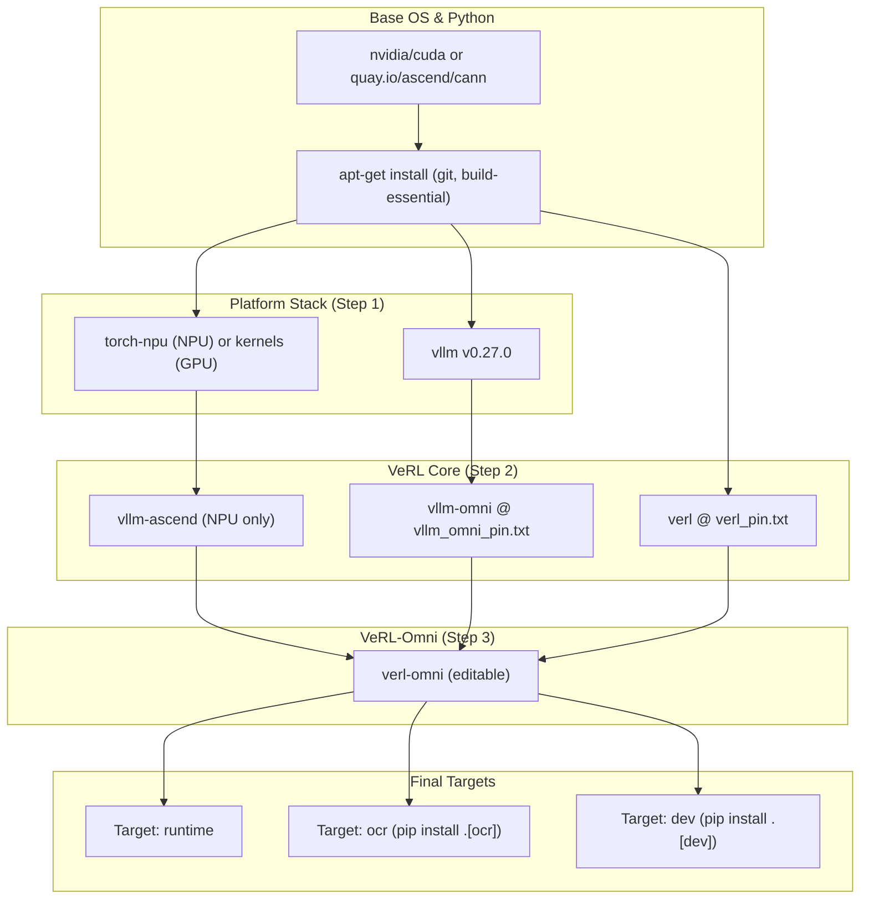
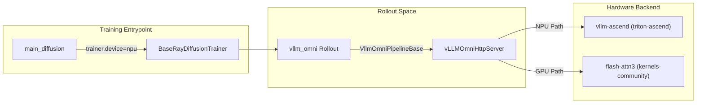

<!-- source: DeepWiki mcp.deepwiki.com · repo verl-project/verl-omni · page 1.1 Getting Started: Installation and Environment Setup · fetched 2026-10-30 -->

# Getting Started: Installation and Environment Setup

<details>
<summary>Relevant source files</summary>

The following files were used as context for generating this wiki page:

- [.dockerignore](.dockerignore)
- [.github/actions/gpu-smoke-prepare/action.yml](.github/actions/gpu-smoke-prepare/action.yml)
- [.github/vllm_ascend_pin.txt](.github/vllm_ascend_pin.txt)
- [.github/vllm_omni_pin.txt](.github/vllm_omni_pin.txt)
- [.github/workflows/gpu_smoke.yml](.github/workflows/gpu_smoke.yml)
- [.github/workflows/gpu_smoke_verl_latest.yml](.github/workflows/gpu_smoke_verl_latest.yml)
- [docker/Dockerfile.a2.npu](docker/Dockerfile.a2.npu)
- [docker/Dockerfile.a3.npu](docker/Dockerfile.a3.npu)
- [docker/Dockerfile.cuda](docker/Dockerfile.cuda)
- [docs/start/install.md](docs/start/install.md)
- [pyproject.toml](pyproject.toml)
- [tests/pipelines/test_ltx2_flow_grpo_on_cpu.py](tests/pipelines/test_ltx2_flow_grpo_on_cpu.py)
- [verl_omni/pipelines/ltx2_flow_grpo/vllm_omni_rollout_adapter.py](verl_omni/pipelines/ltx2_flow_grpo/vllm_omni_rollout_adapter.py)

</details>


This page provides a comprehensive technical guide for setting up the VeRL-Omni environment. It covers local installation using `uv`, hardware-specific requirements for NVIDIA GPUs and Ascend NPUs, dependency pinning for distributed stability, and the Docker-based deployment workflow.

## Environment Overview

VeRL-Omni utilizes a modular installation approach where the core library (`verl-omni`) is installed alongside specific backends for training (`verl`), rollout (`vllm-omni`), and hardware-accelerated kernels.

### Dependency Stack and Pinning
To ensure stability across distributed components, VeRL-Omni relies on specific pinned versions of its sister projects:
*   **`verl`**: Pinned to a specific commit hash for RL infrastructure. The hash `8a694930275061f52ebd538c906ef8819af56dbd` is tracked in [.github/verl_pin.txt:1]() and referenced in [pyproject.toml:70-71]().
*   **`vllm-omni`**: Pinned to a specific commit hash for multimodal diffusion rollout. The hash is tracked in [.github/vllm_omni_pin.txt:1]() and used during installation [docs/start/install.md:51]().
*   **`vllm-ascend`**: Pinned to a specific commit for NPU support, tracked in [.github/vllm_ascend_pin.txt:1]() and utilized in [docker/Dockerfile.a2.npu:101-113]().
*   **`kernels`**: Pinned to version `0.16.0` (in `pyproject.toml`) or `0.14.1` (in docs) for Flash Attention 3 (FA3) support in the actor [pyproject.toml:64](), [docs/start/install.md:61]().
*   **`vllm`**: Baseline version `v0.27.0` is used across CUDA and NPU paths [docs/start/install.md:44](), [pyproject.toml:63]().

### Hardware Requirements
| Hardware | Python | Driver/Stack |
| :--- | :--- | :--- |
| **NVIDIA GPU** | >= 3.10 | CUDA >= 12.8 [docs/start/install.md:9-10]() |
| **Ascend NPU** | >= 3.10 | CANN >= 8.5.0 [docs/start/install.md:14-15]() |

Sources: [docs/start/install.md:5-16](), [docs/start/install.md:56-65](), [.github/verl_pin.txt:1](), [.github/vllm_omni_pin.txt:1](), [.github/vllm_ascend_pin.txt:1](), [pyproject.toml:61-71]()

---

## Installation Workflow

The recommended workflow uses `uv` for fast, reproducible dependency resolution and virtual environment management.

### 1. Base Setup
```bash
git clone https://github.com/verl-project/verl-omni.git
cd verl-omni
uv venv --python 3.12 --seed
source .venv/bin/activate
```
Sources: [docs/start/install.md:19-29]()

### 2. Platform-Specific Installation

#### NVIDIA CUDA Path
The `gpu` extra installs the necessary stack for CUDA-accelerated rollout and training.
```bash
uv pip install -e ".[gpu]" --torch-backend=auto
uv pip install "vllm-omni @ git+https://github.com/vllm-project/vllm-omni.git@$(cat .github/vllm_omni_pin.txt)"
uv pip install -e ".[train]"
```
*   **Flash Attention 3**: The `gpu` extra pulls `kernels==0.16.0` for the Diffusers **actor** FA3 backend via `attn_backend=_flash_3_varlen_hub` [docs/start/install.md:77-78](), [pyproject.toml:64](). Rollout FA3 is provided by `vllm-omni` via `FLASH_ATTN_3_HUB` [docs/start/install.md:82-86]().

#### Ascend NPU Path
The NPU path requires specific `vllm-ascend` integration and uses `torch-npu`.
```bash
uv pip install vllm==0.27.0
uv pip install "vllm-ascend @ git+https://github.com/vllm-project/vllm-ascend.git@$(cat .github/vllm_ascend_pin.txt)"
uv pip install "vllm-omni @ git+https://github.com/vllm-project/vllm-omni.git@$(cat .github/vllm_omni_pin.txt)"
uv pip install -e ".[train]"
```
Sources: [docs/start/install.md:41-53](), [docs/start/install.md:75-88](), [.github/vllm_ascend_pin.txt:1]()

### 3. Optional Extras
| Extra | Purpose | Code Reference |
| :--- | :--- | :--- |
| **`ocr`** | Adds `Levenshtein` for OCR-based rewards in FlowGRPO. | [docs/start/install.md:65](), [pyproject.toml:81-83]() |
| **`dev`** | Adds `pytest`, `pre-commit`, etc., for local development. | [docs/start/install.md:64](), [pyproject.toml:72-80]() |
| **`veomni`** | Alternative training backend to FSDP2. | [docs/start/install.md:90-93]() |

#### Installing VeOmni Backend
VeOmni is an alternative engine for policy and reference models. Due to strict version pins in VeOmni 0.1.11, it must be installed without dependency resolution to avoid conflicting with the `vllm` stack [docs/start/install.md:94-103]():
```bash
uv pip install veomni==0.1.11 --no-deps
uv pip install torchcodec librosa soundfile av audioread
```
Sources: [docs/start/install.md:67-103](), [.github/actions/gpu-smoke-prepare/action.yml:31-32]()

---

## Docker Environment

VeRL-Omni provides Dockerfiles for both NVIDIA GPU and Ascend NPU environments. Build context is managed via `.dockerignore` to exclude large local artifacts like `checkpoints/` and `.venv` [.dockerignore:1-50]().

### CUDA Build Targets
The repository provides `docker/Dockerfile.cuda` which supports targets such as `runtime`, `ocr`, and `dev` [docker/Dockerfile.cuda:79-90]().

### NPU Docker Images
Two separate Dockerfiles are provided for different Ascend hardware generations:
*   **Atlas A2 (910B)**: `docker/Dockerfile.a2.npu` using `SOC_VERSION="ascend910b1"` [docker/Dockerfile.a2.npu:1-25]().
*   **Atlas A3**: `docker/Dockerfile.a3.npu` using `SOC_VERSION="ascend910_9391"` [docker/Dockerfile.a3.npu:1-25]().

Both NPU images bake in `CANN`, `torch-npu`, `vllm-ascend`, and the pinned version of `verl` [docker/Dockerfile.a2.npu:131-138]().

### Dependency Flow in Docker
The following diagram illustrates how the Docker build process layers dependencies to create the final runtime environment.

**Docker Build Entity Mapping**

Sources: [docker/Dockerfile.cuda:25-94](), [docker/Dockerfile.a2.npu:1-160](), [.dockerignore:1-50]()

---

## Post-Installation Verification

After installation, verify the environment by checking the versions of the core components.

### Verification Commands (NVIDIA GPU)
```bash
python -c "import torch; print('torch', torch.__version__, '| CUDA', torch.version.cuda)"
python -c "import vllm; print('vllm', vllm.__version__)"
python -c "import vllm_omni; print('vllm-omni OK')"
python -c "import verl; print('verl', verl.__version__)"
python -c "import verl_omni; print('VeRL-Omni ready')"
```
Sources: [docs/start/install.md:116-124]()

### Verification Commands (Ascend NPU)
```bash
python -c "import torch; import torch_npu; print('torch', torch.__version__, '| NPU', torch.npu.is_available())"
python -c "import vllm; print('vllm', vllm.__version__)"
python -c "import verl; print('verl', verl.__version__)"
python -c "import verl_omni; print('VeRL-Omni ready')"
```
Sources: [docs/start/install.md:128-133]()

---

## Hardware-Specific Execution Flow

The system adapts its execution logic based on the detected hardware (NPU vs GPU), particularly for the rollout server and attention backends. NPU recipes typically override the attention backend to `_native_npu` [docs/start/install.md:89]().

**Hardware Adaptation Entity Mapping**

Sources: [docs/start/install.md:77-89](), [docker/Dockerfile.a2.npu:98-116](), [verl_omni/pipelines/model_base.py:52]()

---

## Adapter Registration and Pipeline Setup

The system uses a registry pattern to bind model architectures to specific training and rollout adapters. For example, `LTX2Pipeline` is registered for `flow_grpo` to enable specialized joint audio-video sampling [verl_omni/pipelines/ltx2_flow_grpo/vllm_omni_rollout_adapter.py:71-72]().

Key configuration and adapter symbols:
*   `VllmOmniPipelineBase`: The base registry class for rollout pipeline adapters [verl_omni/pipelines/ltx2_flow_grpo/vllm_omni_rollout_adapter.py:52]().
*   `LTX23PipelineWithLogProb`: Rollout adapter for LTX-2.3 that handles prompt encoding via `_encode_token_ids` and injects precomputed embeddings [verl_omni/pipelines/ltx2_flow_grpo/vllm_omni_rollout_adapter.py:72-138]().
*   `FlowMatchSDEDiscreteScheduler`: A custom scheduler used for SDE-based FlowGRPO sampling [verl_omni/pipelines/ltx2_flow_grpo/vllm_omni_rollout_adapter.py:80-84]().

Sources: [verl_omni/pipelines/ltx2_flow_grpo/vllm_omni_rollout_adapter.py:71-168](), [pyproject.toml:52-83]()

---

