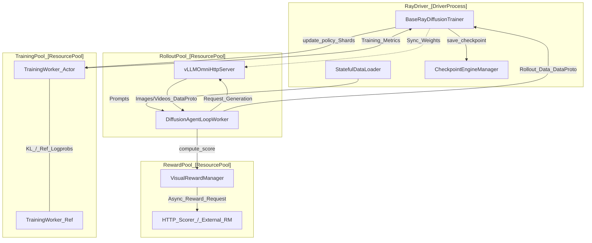
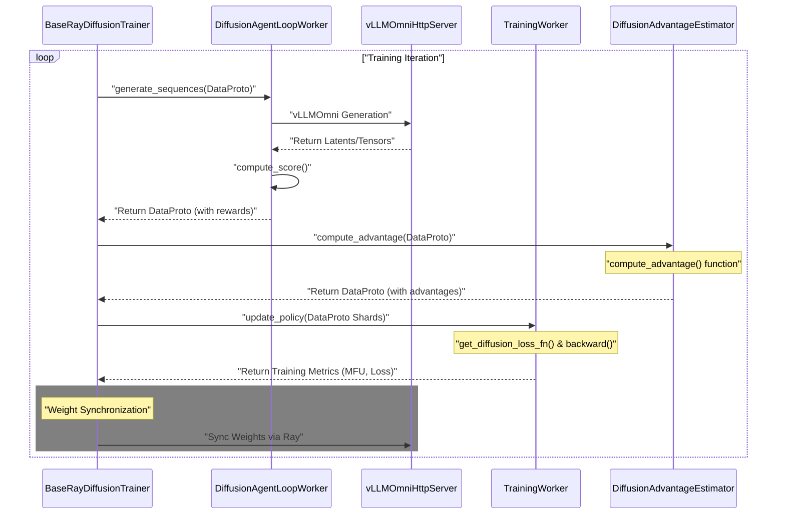

<!-- source: DeepWiki mcp.deepwiki.com · repo verl-project/verl-omni · page 1.2 System Architecture and Key Concepts · fetched 2026-10-30 -->

# System Architecture and Key Concepts

Relevant source files

The following files were used as context for generating this wiki page:

- [README.md](README.md)
- [docs/assets/arch.png](docs/assets/arch.png)
- [docs/contributing/integrating_a_diffusion_model.md](docs/contributing/integrating_a_diffusion_model.md)
- [docs/index.md](docs/index.md)
- [tests/trainer/diffusion/test_dump_generations_video_on_cpu.py](tests/trainer/diffusion/test_dump_generations_video_on_cpu.py)
- [tests/trainer/diffusion/test_val_video_logging_on_cpu.py](tests/trainer/diffusion/test_val_video_logging_on_cpu.py)
- [tests/utils/reward_score/test_reward_utils_on_cpu.py](tests/utils/reward_score/test_reward_utils_on_cpu.py)
- [tests/utils/test_tracking_on_cpu.py](tests/utils/test_tracking_on_cpu.py)
- [verl_omni/__init__.py](verl_omni/__init__.py)
- [verl_omni/agent_loop/single_turn_agent_loop.py](verl_omni/agent_loop/single_turn_agent_loop.py)
- [verl_omni/pipelines/model_base.py](verl_omni/pipelines/model_base.py)
- [verl_omni/pipelines/qwen_image_flow_grpo/vllm_omni_rollout_adapter.py](verl_omni/pipelines/qwen_image_flow_grpo/vllm_omni_rollout_adapter.py)
- [verl_omni/pipelines/qwen_image_mix_grpo/vllm_omni_rollout_adapter.py](verl_omni/pipelines/qwen_image_mix_grpo/vllm_omni_rollout_adapter.py)
- [verl_omni/pipelines/sd3_flow_grpo/common.py](verl_omni/pipelines/sd3_flow_grpo/common.py)
- [verl_omni/pipelines/sd3_flow_grpo/vllm_omni_rollout_adapter.py](verl_omni/pipelines/sd3_flow_grpo/vllm_omni_rollout_adapter.py)
- [verl_omni/trainer/diffusion/ray_diffusion_trainer.py](verl_omni/trainer/diffusion/ray_diffusion_trainer.py)
- [verl_omni/utils/reward_score/reward_utils.py](verl_omni/utils/reward_score/reward_utils.py)
- [verl_omni/utils/tracking.py](verl_omni/utils/tracking.py)
- [verl_omni/workers/rollout/vllm_rollout/vllm_omni_async_server.py](verl_omni/workers/rollout/vllm_rollout/vllm_omni_async_server.py)

VeRL-Omni is a distributed RL training framework designed for the unique computational demands of multimodal generative models. It extends the core design principles of `verl`—specifically the decoupling of rollout, reward, and training—to handle high-dimensional diffusion outputs (images, video) and complex omni-modal interaction patterns.

## Distributed Actor-Rollout-Reward Topology

VeRL-Omni utilizes a distributed actor-rollout-reward topology orchestrated by **Ray**. Unlike standard LLM RL which primarily deals with token sequences, VeRL-Omni manages large binary artifacts (latents/tensors) and asynchronous reward pipelines for diffusion and flow-matching models [README.md:26-36]().

### The Role of Ray
Ray serves as the execution engine that manages the lifecycle of distributed workers. The system utilizes `RayWorkerGroup` to co-locate or distribute different roles across a cluster [verl_omni/trainer/diffusion/ray_diffusion_trainer.py:148-149]().

Key architectural components include:
*   **Trainer Controller:** Subclasses of `BaseRayDiffusionTrainer` run on the Ray driver node, managing the high-level training loop, data sharding, and worker synchronization [verl_omni/trainer/diffusion/ray_diffusion_trainer.py:136-156]().
*   **Worker Roles:** The system defines specialized workers for diffusion tasks, including `TrainingWorker` (which wraps the training engine) for parameter updates and reference policy computations [verl_omni/trainer/diffusion/ray_diffusion_trainer.py:45-45]().
*   **Resource Pools:** Hardware is partitioned into pools (e.g., training pool, rollout pool) via the `ResourcePoolManager` to prevent resource contention between heavy diffusion sampling and training [verl_omni/trainer/diffusion/ray_diffusion_trainer.py:148-148]().

### Decoupling Rollout from Training
A core architectural feature is the strict separation of the **Rollout Engine** (responsible for generation) and the **Training Engine** (responsible for gradient updates).
1.  **Rollout:** Uses `vLLM-Omni` as a high-throughput rollout backend. It is optimized for multi-modal generation and supports specialized sampling parameters for diffusion and omni-modality models [README.md:38-40]().
2.  **Training:** Uses `FSDP2` or `VeOmni` backends. These engines are optimized for memory efficiency and communication overlap, supporting combinable parallelism like Ulysses Sequence Parallel (USP) [README.md:42-42]().

### Diagram: System Topology and Data Flow
The following diagram illustrates how Ray orchestrates the different entities and how data flows through the RL lifecycle.

Sources: [README.md:38-44](), [verl_omni/trainer/diffusion/ray_diffusion_trainer.py:37-54](), [verl_omni/trainer/diffusion/ray_diffusion_trainer.py:136-160]()

---

## Core Terminology and Entities

### DataProto
`DataProto` is the unified data container used throughout the system. It encapsulates tensors and metadata required for the diffusion RL loop [verl_omni/trainer/diffusion/ray_diffusion_trainer.py:36-36]().
*   **Batch:** PyTorch tensors (e.g., `sample_level_rewards`, `advantages`, `returns`) [verl_omni/trainer/diffusion/ray_diffusion_trainer.py:113-132]().
*   **Non-tensor Batch:** Metadata like prompt strings or unique identifiers (`uid`) [verl_omni/trainer/diffusion/ray_diffusion_trainer.py:116-120]().

### Hybrid Engine and Backends
VeRL-Omni supports multiple execution backends selectable via configuration:
*   **FSDP2 (Fully Sharded Data Parallel):** A distributed training engine that supports meta-tensor initialization and Ulysses sequence parallelism [README.md:42-44]().
*   **VeOmni:** A specialized training engine developed for diffusion transformers, providing advanced parameter/optimizer offloading and `reshard_after_forward` optimizations [README.md:42-42]().
*   **vLLM-Omni:** A specialized rollout backend for high-throughput multimodal generation. It can operate in **AR (Autoregressive)** mode using `OmniModelConfig` or **Diffusion** mode using `DiffusionModelConfig` [verl_omni/workers/rollout/vllm_rollout/vllm_omni_async_server.py:116-131]().

### Diffusion Model Adapters
To support diverse architectures (Qwen-Image, SD3.5, Wan2.2, LTX2.3), the system uses a base abstraction for models.
*   **DiffusionModelBase:** The abstract base class for diffusion model training helpers. It provides a registry for different architectures and algorithms [verl_omni/pipelines/model_base.py:28-58]().
*   **VllmOmniPipelineBase:** The equivalent base class for rollout adapters in the vLLM-Omni runtime [verl_omni/workers/rollout/vllm_rollout/vllm_omni_async_server.py:54-54]().
*   **Architecture-Specific Logic:** Subclasses (e.g., `QwenImagePipelineWithLogProb`) implement methods like `prepare_model_inputs`, `build_scheduler`, and `encode_prompt` to bridge between generic RL logic and model-specific forward/sampling code [verl_omni/pipelines/model_base.py:140-176](), [verl_omni/pipelines/qwen_image_flow_grpo/vllm_omni_rollout_adapter.py:49-59]().

---

## RL Training Loop Lifecycle

The training process is managed by specialized trainers that implement the training loop for different algorithm families.

### Lifecycle Phases
1.  **Rollout Generation:** The rollout system orchestrates generation via `vLLMOmniHttpServer`. The `DiffusionAgentLoopWorker` manages the generation pipeline and post-processing of diffusion outputs [README.md:38-40](), [verl_omni/workers/rollout/vllm_rollout/vllm_omni_async_server.py:105-110]().
2.  **Reward Computation:** Scores are computed using `VisualRewardManager` or external HTTP scorers. Computation can be overlapped with the rollout phase using asynchronous reward serving on dedicated GPU pools [README.md:41-42]().
3.  **Advantage Estimation:** The trainer computes advantage estimates via `compute_advantage` to guide policy optimization across denoising timesteps. For Flow-GRPO, this involves group-relative reward normalization [verl_omni/trainer/diffusion/ray_diffusion_trainer.py:86-133]().
4.  **Actor Update:** The trainer executes the policy update. For diffusion models, it uses `get_diffusion_loss_fn` to compute gradients based on the selected algorithm mode (e.g., PPO, DPO, NFT) [verl_omni/trainer/diffusion/ray_diffusion_trainer.py:57-61]().
5.  **Weight Synchronization:** Updated weights are periodically synchronized from the training engine to the rollout backend (via `vLLMOmniColocateWorkerExtension`) to ensure the rollout agent uses the latest policy [README.md:43-43](), [verl_omni/workers/rollout/vllm_rollout/vllm_omni_async_server.py:169-174]().

### Diagram: Training Loop Sequence
This diagram maps the logical RL steps to the specific components and functions in the codebase.

Sources: [verl_omni/trainer/diffusion/ray_diffusion_trainer.py:86-133](), [verl_omni/trainer/diffusion/ray_diffusion_trainer.py:57-61](), [README.md:38-44]()

Sources: [README.md:26-44](), [verl_omni/trainer/diffusion/ray_diffusion_trainer.py:86-160](), [verl_omni/pipelines/model_base.py:28-176](), [verl_omni/workers/rollout/vllm_rollout/vllm_omni_async_server.py:105-132]()

---

