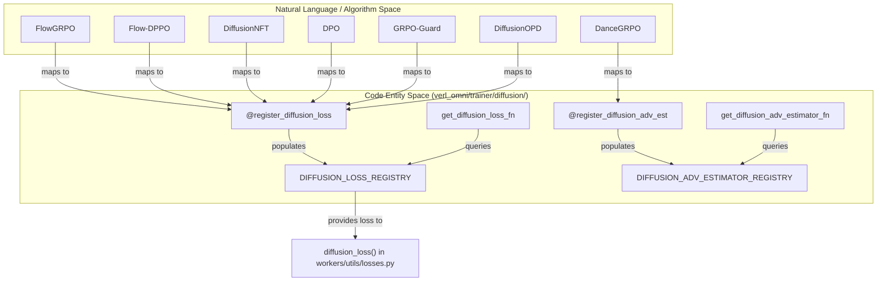
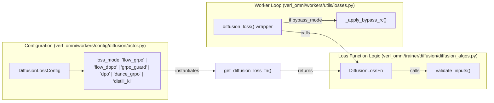

<!-- source: DeepWiki mcp.deepwiki.com · repo verl-project/verl-omni · page 2 RL Algorithms for Diffusion Models · fetched 2026-10-30 -->

# RL Algorithms for Diffusion Models

Relevant source files

The following files were used as context for generating this wiki page:

- [docs/algo/flowgrpo.md](docs/algo/flowgrpo.md)
- [docs/algo/grpo_guard.md](docs/algo/grpo_guard.md)
- [docs/algo/performance.md](docs/algo/performance.md)
- [docs/start/flowgrpo_quickstart.md](docs/start/flowgrpo_quickstart.md)
- [docs/start/metrics.md](docs/start/metrics.md)
- [examples/flowgrpo_trainer/README.md](examples/flowgrpo_trainer/README.md)
- [tests/special_e2e/run_flowgrpo_qwen_image.sh](tests/special_e2e/run_flowgrpo_qwen_image.sh)
- [tests/trainer/diffusion/test_diffusion_core_algos_on_cpu.py](tests/trainer/diffusion/test_diffusion_core_algos_on_cpu.py)
- [tests/trainer/diffusion/test_diffusion_distillation_losses_on_cpu.py](tests/trainer/diffusion/test_diffusion_distillation_losses_on_cpu.py)
- [tests/trainer/diffusion/test_diffusion_registry_on_cpu.py](tests/trainer/diffusion/test_diffusion_registry_on_cpu.py)
- [verl_omni/pipelines/schedulers/flow_match_sde.py](verl_omni/pipelines/schedulers/flow_match_sde.py)
- [verl_omni/trainer/config/diffusion/actor/diffusion_actor.yaml](verl_omni/trainer/config/diffusion/actor/diffusion_actor.yaml)
- [verl_omni/trainer/diffusion/diffusion_algos.py](verl_omni/trainer/diffusion/diffusion_algos.py)
- [verl_omni/workers/config/diffusion/actor.py](verl_omni/workers/config/diffusion/actor.py)
- [verl_omni/workers/engine/veomni/diffusion_impl.py](verl_omni/workers/engine/veomni/diffusion_impl.py)
- [verl_omni/workers/utils/losses.py](verl_omni/workers/utils/losses.py)

VeRL-Omni provides a suite of Reinforcement Learning (RL) algorithms specialized for the unique characteristics of diffusion and flow-matching models. Unlike standard text-based LLM RL, these algorithms must account for the iterative denoising process, the high-dimensional latent space, and the computational cost of estimating likelihoods across multiple sampling steps.

The framework supports three primary families of generative models: diffusion generators (e.g., Qwen-Image, Wan2.2, SD3.5), unified understanding and generation models (e.g., BAGEL), and omni-modality models (e.g., Qwen3-Omni).

### Algorithm Landscape

The supported algorithms are categorized by their optimization target (reverse-process policy gradient vs. forward-process preference) and their modality specialization.

| Algorithm | Type | Primary Model Support | Key Feature |
| :--- | :--- | :--- | :--- |
| **FlowGRPO** | Policy Gradient | Qwen-Image, SD3.5, BAGEL | Group Relative Policy Optimization via ODE-to-SDE conversion. |
| **MixGRPO** | Policy Gradient | Qwen-Image | Mixed ODE-SDE rollout with sliding-window training. |
| **Flow-DPPO** | Policy Gradient | Qwen-Image | Asymmetric Gaussian KL trust-region for stability. |
| **DiffusionNFT** | Direct Preference | Qwen-Image | Forward-process optimization with implicit branches. |
| **DPO** | Direct Preference | SD3.5, Qwen-Image | Online/Offline Direct Preference Optimization. |
| **DanceGRPO** | Policy Gradient | Wan2.2, LTX-2.3 | SDE-based video generation RL with HPSv3 or CPS rewards. |
| **GSPO** | Policy Gradient | Qwen3-Omni | Omni-modal RL for unified "Thinker" models. |
| **GRPO-Guard** | Policy Gradient | Qwen-Image | Ratio-mean bias correction to stabilize importance sampling. |
| **DiffusionOPD** | Distillation | SD3.5 | On-policy distillation against a frozen teacher. |

Sources: [verl_omni/trainer/diffusion/diffusion_algos.py:148-153](), [verl_omni/workers/config/diffusion/actor.py:52-61](), [docs/algo/flowgrpo.md:1-21](), [examples/flowgrpo_trainer/README.md:123-128](), [verl_omni/workers/config/diffusion/actor.py:149-151]()

### Code-to-System Mapping: Algorithm Registry

The codebase uses a registry pattern to decouple mathematical loss definitions from training infrastructure. This allows training engines to dynamically load the correct loss function based on the `loss_mode` configuration [verl_omni/workers/config/diffusion/actor.py:39-41]().

Title: Algorithm Registry Architecture

Sources: [verl_omni/trainer/diffusion/diffusion_algos.py:126-187](), [verl_omni/workers/utils/losses.py:70-78](), [verl_omni/workers/config/diffusion/actor.py:52-61]()

---

### [FlowGRPO: Flow-Matching Policy Gradient](#2.1)
FlowGRPO is the primary algorithm for image generation. It adapts the Group Relative Policy Optimization (GRPO) objective to flow-matching models by converting deterministic ODE samplers into equivalent Stochastic Differential Equations (SDE) [docs/algo/flowgrpo.md:9-11](). It uses the `FlowMatchSDEDiscreteScheduler` to inject controlled noise [verl_omni/pipelines/schedulers/flow_match_sde.py:48-52](). It supports **Denoising Reduction**, allowing training on a subset of steps while maintaining full-step inference [docs/algo/flowgrpo.md:19-20]().

*   **MixGRPO**: Extends FlowGRPO with a mixed ODE-SDE rollout and sliding-window schedule to cut online RL costs.
*   **GRPO-Guard**: Stabilizes training with reverse-SDE proposal-mean drift correction and per-step loss rescaling [verl_omni/workers/config/diffusion/actor.py:55]().

For details, see [FlowGRPO: Flow-Matching Policy Gradient](#2.1).
Sources: [docs/algo/flowgrpo.md:1-37](), [verl_omni/trainer/diffusion/diffusion_algos.py:190-191](), [verl_omni/pipelines/schedulers/flow_match_sde.py:48-52]()

### [DiffusionNFT and Flow-DPPO: Direct Preference Algorithms](#2.2)
These algorithms prioritize stability. **DiffusionNFT** optimizes the forward process using implicit positive and negative velocity branches [verl_omni/workers/config/diffusion/actor.py:38-39](). **Flow-DPPO** implements an asymmetric Gaussian KL trust-region by calculating the KL between the current policy mean and the rollout policy mean, masking advantages when the drift exceeds a threshold [verl_omni/workers/config/diffusion/actor.py:50-54](). It uses `sigma_t` for normalization [tests/trainer/diffusion/test_diffusion_core_algos_on_cpu.py:168-172]().

For details, see [DiffusionNFT and Flow-DPPO: Direct Preference Algorithms](#2.2).
Sources: [verl_omni/workers/config/diffusion/actor.py:38-54](), [verl_omni/trainer/diffusion/diffusion_algos.py:52-63](), [tests/trainer/diffusion/test_diffusion_core_algos_on_cpu.py:161-172]()

### [DPO for Diffusion Models](#2.3)
VeRL-Omni supports both online and offline Direct Preference Optimization (DPO) for diffusion models. The implementation uses a one-shot flow-matching objective with a `dpo_beta` temperature parameter [verl_omni/workers/config/diffusion/actor.py:48-49](). The `DPODiffusersFSDPEngine` handles the specific data pairing logic required for preference optimization.

For details, see [DPO for Diffusion Models](#2.3).
Sources: [verl_omni/trainer/diffusion/diffusion_algos.py:120-121](), [verl_omni/workers/config/diffusion/actor.py:48-49]()

### [DanceGRPO, LTX-2.3, and Video/Audio-Video Generation RL](#2.4)
Specialized for video generation models like Wan2.2 and LTX-2.3, **DanceGRPO** handles temporal complexities using the `dance_sde` SDE variant [verl_omni/pipelines/schedulers/flow_match_sde.py:68](). It integrates reward models like HPSv3 and CLAP to optimize for visual quality, temporal consistency, and audio-video alignment [examples/flowgrpo_trainer/README.md:123-128]().

For details, see [DanceGRPO, LTX-2.3, and Video/Audio-Video Generation RL](#2.4).
Sources: [verl_omni/trainer/diffusion/diffusion_algos.py:152-153](), [verl_omni/pipelines/schedulers/flow_match_sde.py:68-71](), [examples/flowgrpo_trainer/README.md:127-128]()

### [GSPO for Omni-Modal Models (Qwen3-Omni)](#2.5)
**GSPO** is designed for the Qwen3-Omni "Thinker" model. Unlike pure diffusion RL, GSPO manages an Autoregressive (AR) rollout mode to handle unified multimodal sequences where reasoning and generation are interleaved [verl_omni/workers/utils/losses.py:132-134](). It uses `omni_loss` for direct-preference training [verl_omni/workers/utils/losses.py:132-138]().

For details, see [GSPO for Omni-Modal Models (Qwen3-Omni)](#2.5).
Sources: [verl_omni/trainer/diffusion/diffusion_algos.py:155-156](), [verl_omni/workers/utils/losses.py:132-153]()

### [Diffusion On-Policy Distillation (DiffusionOPD)](#2.6)
**DiffusionOPD** enables on-policy distillation where a student model minimizes KL divergence against a frozen teacher's transition distribution. It supports `distill_kl` and `distill_fm_mse` loss modes [verl_omni/workers/config/diffusion/actor.py:150](). This is typically used to distill complex reasoning or high-quality generation capabilities from larger models (e.g., SD3.5 OCR distillation) [verl_omni/workers/utils/losses.py:114-120]().

For details, see [Diffusion On-Policy Distillation (DiffusionOPD)](#2.6).
Sources: [verl_omni/workers/config/diffusion/actor.py:149-151](), [verl_omni/workers/utils/losses.py:114-120]()

---

### Algorithm-Infrastructure Association

The following diagram shows how algorithm configurations (defined in `DiffusionLossConfig`) connect to the underlying training engines and how they are validated during the worker loop.

Title: Config-to-Engine Mapping

Sources: [verl_omni/workers/config/diffusion/actor.py:39-63](), [verl_omni/trainer/diffusion/diffusion_algos.py:50-84](), [verl_omni/workers/utils/losses.py:70-90]()

---

