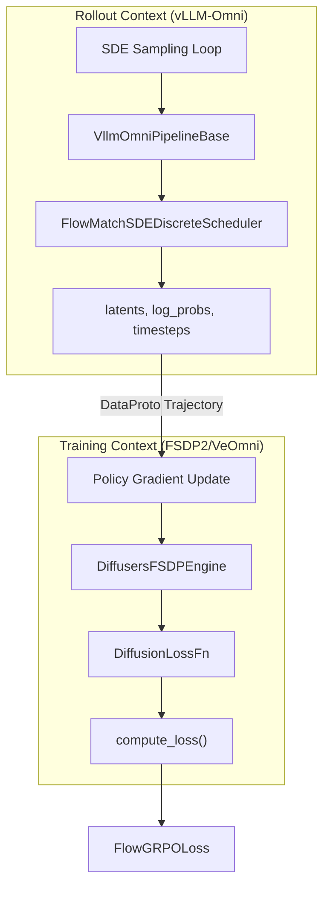
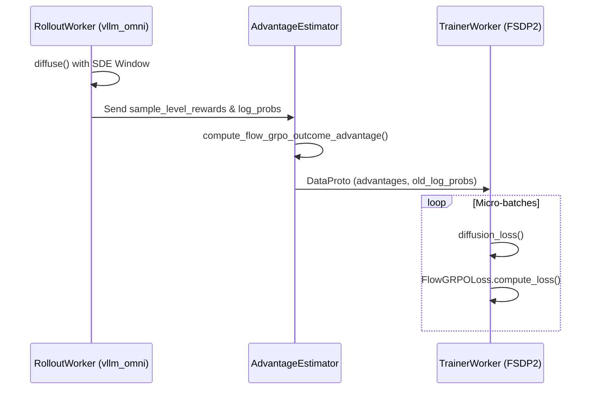

<!-- source: DeepWiki mcp.deepwiki.com · repo verl-project/verl-omni · page 2.1 FlowGRPO: Flow-Matching Policy Gradient · fetched 2026-10-30 -->

# FlowGRPO: Flow-Matching Policy Gradient

Relevant source files

The following files were used as context for generating this wiki page:

- [docs/algo/flowgrpo.md](docs/algo/flowgrpo.md)
- [docs/algo/grpo_guard.md](docs/algo/grpo_guard.md)
- [docs/algo/mixgrpo.md](docs/algo/mixgrpo.md)
- [docs/algo/performance.md](docs/algo/performance.md)
- [docs/start/flowgrpo_quickstart.md](docs/start/flowgrpo_quickstart.md)
- [docs/start/metrics.md](docs/start/metrics.md)
- [examples/flowgrpo_trainer/README.md](examples/flowgrpo_trainer/README.md)
- [examples/flowgrpo_trainer/qwen_image/run_qwen_image_ocr.sh](examples/flowgrpo_trainer/qwen_image/run_qwen_image_ocr.sh)
- [examples/flowgrpo_trainer/qwen_image/run_qwen_image_ocr_lora.sh](examples/flowgrpo_trainer/qwen_image/run_qwen_image_ocr_lora.sh)
- [examples/grpoguard_trainer/README.md](examples/grpoguard_trainer/README.md)
- [examples/mixgrpo_trainer/README.md](examples/mixgrpo_trainer/README.md)
- [tests/special_e2e/run_flowgrpo_qwen_image.sh](tests/special_e2e/run_flowgrpo_qwen_image.sh)
- [tests/trainer/diffusion/test_diffusion_core_algos_on_cpu.py](tests/trainer/diffusion/test_diffusion_core_algos_on_cpu.py)
- [tests/trainer/diffusion/test_diffusion_distillation_losses_on_cpu.py](tests/trainer/diffusion/test_diffusion_distillation_losses_on_cpu.py)
- [tests/trainer/diffusion/test_diffusion_registry_on_cpu.py](tests/trainer/diffusion/test_diffusion_registry_on_cpu.py)
- [verl_omni/pipelines/qwen_image_mix_grpo/__init__.py](verl_omni/pipelines/qwen_image_mix_grpo/__init__.py)
- [verl_omni/pipelines/qwen_image_mix_grpo/diffusers_training_adapter.py](verl_omni/pipelines/qwen_image_mix_grpo/diffusers_training_adapter.py)
- [verl_omni/pipelines/request_batch.py](verl_omni/pipelines/request_batch.py)
- [verl_omni/pipelines/schedulers/flow_match_sde.py](verl_omni/pipelines/schedulers/flow_match_sde.py)
- [verl_omni/trainer/config/diffusion/actor/diffusion_actor.yaml](verl_omni/trainer/config/diffusion/actor/diffusion_actor.yaml)
- [verl_omni/trainer/diffusion/diffusion_algos.py](verl_omni/trainer/diffusion/diffusion_algos.py)
- [verl_omni/workers/config/diffusion/actor.py](verl_omni/workers/config/diffusion/actor.py)
- [verl_omni/workers/engine/veomni/diffusion_impl.py](verl_omni/workers/engine/veomni/diffusion_impl.py)
- [verl_omni/workers/utils/losses.py](verl_omni/workers/utils/losses.py)

FlowGRPO is the primary reinforcement learning algorithm in VeRL-Omni for post-training flow-matching models (e.g., Qwen-Image, SD3.5, LTX-2.3). It adapts the Group Relative Policy Optimization (GRPO) framework to the continuous action space of diffusion models by converting deterministic ODE trajectories into stochastic SDE paths [docs/algo/flowgrpo.md:5-13]().

## Core Mechanism: ODE-to-SDE Conversion

Flow-matching models natively use deterministic ODE samplers. FlowGRPO introduces stochasticity required for RL exploration by converting the ODE into an equivalent SDE that preserves the model's marginal distribution at every timestep [docs/algo/flowgrpo.md:9-11](). This is implemented via the `FlowMatchSDEDiscreteScheduler`, which supports multiple SDE variants [verl_omni/pipelines/schedulers/flow_match_sde.py:48-52]().

### FlowMatchSDEDiscreteScheduler
The scheduler extends the standard `FlowMatchEulerDiscreteScheduler` to handle noise injection and log-probability calculation [verl_omni/pipelines/schedulers/flow_match_sde.py:48-54]().

*   **`step()`**: Predicts the sample from the previous timestep by reversing the SDE [verl_omni/pipelines/schedulers/flow_match_sde.py:54-71]().
*   **`sample_previous_step()`**: Computes the mean and standard deviation of the previous sample based on the current `model_output` and `noise_level`. It supports variants such as `sde`, `cps` (Controllable Path Sampling), and `dance_sde` [verl_omni/pipelines/schedulers/flow_match_sde.py:148-161]().
*   **Log-probability**: Calculates the log-probability of the sampled latent $x_{t-1}$ given the distribution defined by the model's velocity prediction at step $t$ [verl_omni/pipelines/schedulers/flow_match_sde.py:43-46]().

Sources: [verl_omni/pipelines/schedulers/flow_match_sde.py:48-161](), [docs/algo/flowgrpo.md:9-11]()

## Advantage Estimation and Denoising Reduction

FlowGRPO computes advantages relative to a group of $n$ trajectories generated for the same prompt [docs/algo/flowgrpo.md:77-78](). Unlike LLM GRPO, it employs **Denoising Reduction** to limit training to a subset of denoising steps, significantly reducing computational cost [docs/algo/flowgrpo.md:11-13]().

### SDE Window Management
The training window is controlled by parameters in the rollout configuration:
*   `sde_window_size`: The number of denoising steps included in the active training window [docs/algo/flowgrpo.md:86-88]().
*   `sde_window_range`: The range of timesteps from which the start of the window is sampled [docs/algo/flowgrpo.md:89-91]().

### Advantage Computation
The function `compute_flow_grpo_outcome_advantage` handles the group-relative normalization [verl_omni/trainer/diffusion/diffusion_algos.py:190-191](). It uses a unique identifier (`index`) to group samples belonging to the same prompt [verl_omni/trainer/diffusion/diffusion_algos.py:332-334]().

| Parameter | Description |
| :--- | :--- |
| `norm_adv_by_std_in_grpo` | Whether to scale advantages by the standard deviation of rewards within the group [tests/trainer/diffusion/test_diffusion_core_algos_on_cpu.py:24-26](). |
| `global_std` | If True, computes standard deviation across the entire batch instead of per-group [tests/trainer/diffusion/test_diffusion_core_algos_on_cpu.py:25-26](). |

Sources: [verl_omni/trainer/diffusion/diffusion_algos.py:190-200](), [docs/algo/flowgrpo.md:11-13](), [tests/trainer/diffusion/test_diffusion_core_algos_on_cpu.py:85-116]()

## Implementation and Data Flow

The implementation is split between a **Rollout Context** (vLLM-Omni) and a **Training Context** (FSDP2 or VeOmni) [verl_omni/workers/config/diffusion/actor.py:66-70]().

### Natural Language Space to Code Entity Space

The following diagrams map high-level FlowGRPO concepts to specific code entities within the VeRL-Omni architecture.

**Entity Mapping: FlowGRPO Pipeline**

Sources: [verl_omni/pipelines/schedulers/flow_match_sde.py:48-52](), [verl_omni/trainer/diffusion/diffusion_algos.py:50-61](), [verl_omni/workers/config/diffusion/actor.py:134-161]()

### Loss Calculation and Rollout Correction
The algorithm supports variants like `grpo_guard` and `MixGRPO` via the `DiffusionLossConfig` [verl_omni/workers/config/diffusion/actor.py:39-54](). It also integrates `RolloutCorrectionConfig` for bypass mode [verl_omni/workers/config/diffusion/actor.py:168-170]().

*   **`FlowGRPOLoss`**: Implements the standard clipped policy gradient loss for diffusion [verl_omni/trainer/diffusion/diffusion_algos.py:144-145]().
*   **`GRPO-Guard`**: Extends FlowGRPO with a reverse-SDE proposal-mean drift correction and per-step loss rescaling for stability [examples/grpoguard_trainer/README.md:5-7]().
*   **`MixGRPO`**: Combines deterministic ODE sampling outside a contiguous window and stochastic SDE sampling inside the window [examples/mixgrpo_trainer/README.md:7-9]().

**Data Flow: Rollout to Trainer**

Sources: [verl_omni/trainer/diffusion/diffusion_algos.py:190-200](), [verl_omni/workers/utils/losses.py:71-91](), [verl_omni/workers/config/diffusion/actor.py:134-161]()

## MixGRPO and GRPO-Guard Variants

### MixGRPO: Mixed ODE-SDE Rollout
MixGRPO utilizes a sliding-window training schedule to reduce RL fine-tuning costs [examples/mixgrpo_trainer/README.md:7-9]().
*   **Rollout**: Uses `sample_strategy` (`random` or `progressive`) to determine the SDE window position [examples/mixgrpo_trainer/README.md:68-70]().
*   **Efficiency**: Cuts cost by using deterministic ODE sampling outside a contiguous window of denoising steps [examples/mixgrpo_trainer/README.md:7-9]().

### GRPO-Guard: Ratio-Bias Regularization
GRPO-Guard stabilizes training via drift correction and per-step rescaling [examples/grpoguard_trainer/README.md:5-7]().
*   **Stability**: Extends Flow-GRPO with a reverse-SDE proposal-mean drift correction and per-step loss rescaling for improved training stability [examples/grpoguard_trainer/README.md:5-7]().
*   **Config**: Uses `loss_mode=grpo_guard` and specific `clip_ratio` settings [examples/grpoguard_trainer/README.md:69-70]().

Sources: [examples/mixgrpo_trainer/README.md:1-73](), [examples/grpoguard_trainer/README.md:1-73](), [verl_omni/workers/config/diffusion/actor.py:39-63]()

## Performance Benchmarks

Reference benchmarks for FlowGRPO training on Qwen-Image OCR tasks (H800 GPUs, LoRA rank 64):

| Script | # GPUs | Batch Size | Throughput (img/GPU/s) | Time/Step (s) |
| :--- | :--- | :--- | :--- | :--- |
| `run_qwen_image_ocr_lora.sh` | 4 | 32 | 0.305 | 420 |
| `run_qwen_image_ocr_lora_async_reward.sh` | 5 | 32 | 0.280 | 360 |

Sources: [docs/algo/performance.md:8-18]()

## Configuration Parameters

FlowGRPO configuration is managed via Hydra and defined in `DiffusionActorConfig` and `DiffusionLossConfig` [verl_omni/workers/config/diffusion/actor.py:39-161]().

| Key | Default | Description |
| :--- | :--- | :--- |
| `loss_mode` | `"flow_grpo"` | Selection of the diffusion loss algorithm (e.g., `flow_grpo`, `grpo_guard`, `mix_grpo`) [verl_omni/workers/config/diffusion/actor.py:40-54](). |
| `clip_ratio` | `0.0001` | PPO-style clipping factor for the diffusion loss [verl_omni/workers/config/diffusion/actor.py:41](). |
| `adv_clip_max` | `5.0` | Maximum absolute advantage used before computing policy loss [verl_omni/workers/config/diffusion/actor.py:42](). |
| `use_kl_loss` | `False` | Enables KL loss against the reference policy [verl_omni/workers/config/diffusion/actor.py:147](). |
| `kl_loss_coef` | `0.001` | Coefficient for the KL term [verl_omni/workers/config/diffusion/actor.py:148](). |
| `rollout_n` | `MISSING` | Number of rollouts per update (group size) [verl_omni/workers/config/diffusion/actor.py:158](). |
| `bypass_mode` | `False` | Skips old-log-prob recompute, using rollout log-probs directly for speed [verl_omni/workers/utils/losses.py:87-89](). |

Sources: [verl_omni/workers/config/diffusion/actor.py:39-170](), [verl_omni/trainer/config/diffusion/actor/diffusion_actor.yaml:24-55](), [docs/algo/flowgrpo.md:55-103](), [verl_omni/workers/utils/losses.py:26-89]()

---

