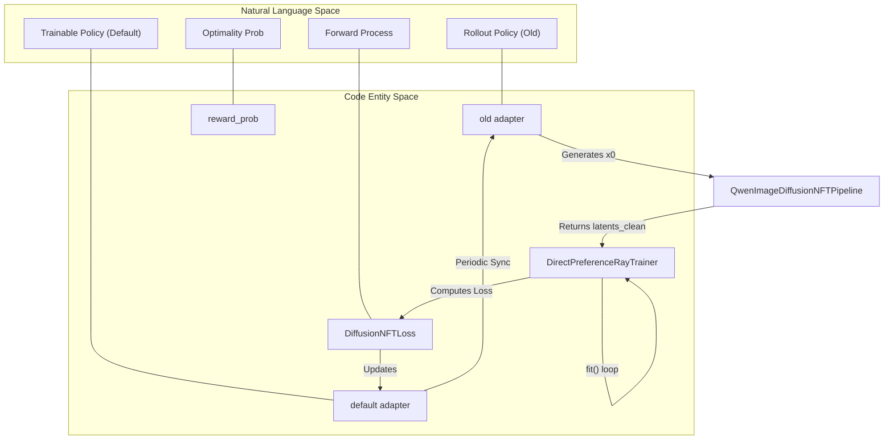
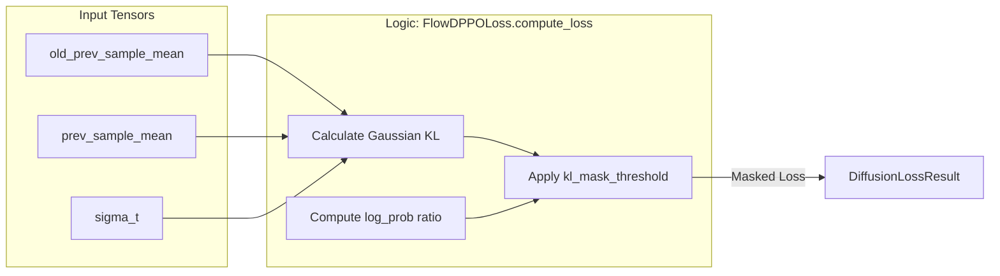

<!-- source: DeepWiki mcp.deepwiki.com · repo verl-project/verl-omni · page 2.2 DiffusionNFT and Flow-DPPO: Direct Preference Algorithms · fetched 2026-10-30 -->

# DiffusionNFT and Flow-DPPO: Direct Preference Algorithms

Relevant source files

The following files were used as context for generating this wiki page:

- [.github/workflows/example-docs-links.yml](.github/workflows/example-docs-links.yml)
- [docs/algo/flowdppo.md](docs/algo/flowdppo.md)
- [docs/contributing/integrating_a_stepwise_continuous_batching_model.md](docs/contributing/integrating_a_stepwise_continuous_batching_model.md)
- [docs/examples/ltx2/flowgrpo_trainer_ltx2.md](docs/examples/ltx2/flowgrpo_trainer_ltx2.md)
- [docs/examples/minimax_h3/diffusionnft_trainer_minimax_h3.md](docs/examples/minimax_h3/diffusionnft_trainer_minimax_h3.md)
- [examples/diffusionnft_trainer/README.md](examples/diffusionnft_trainer/README.md)
- [examples/diffusionnft_trainer/minimax_h3/README.md](examples/diffusionnft_trainer/minimax_h3/README.md)
- [examples/flowdppo_trainer/README.md](examples/flowdppo_trainer/README.md)
- [examples/flowgrpo_trainer/ltx2/README.md](examples/flowgrpo_trainer/ltx2/README.md)
- [tests/special_sanity/check_example_docs_symlinks.py](tests/special_sanity/check_example_docs_symlinks.py)
- [tests/workers/rollout/rollout_vllm/test_vllm_omni_generate.py](tests/workers/rollout/rollout_vllm/test_vllm_omni_generate.py)
- [verl_omni/pipelines/qwen_image_diffusion_nft/vllm_omni_rollout_adapter.py](verl_omni/pipelines/qwen_image_diffusion_nft/vllm_omni_rollout_adapter.py)
- [verl_omni/pipelines/qwen_image_dpo/vllm_omni_rollout_adapter.py](verl_omni/pipelines/qwen_image_dpo/vllm_omni_rollout_adapter.py)
- [verl_omni/pipelines/wan22_dance_grpo/vllm_omni_rollout_adapter.py](verl_omni/pipelines/wan22_dance_grpo/vllm_omni_rollout_adapter.py)

VeRL-Omni provides specialized support for direct preference and divergence-based algorithms that move beyond standard PPO-style ratio clipping. **DiffusionNFT** optimizes the forward diffusion process using implicit positive and negative branches, while **Flow-DPPO** implements an asymmetric Gaussian KL trust-region for flow-matching models.

## DiffusionNFT: Forward-Process Optimization

DiffusionNFT is an online RL method that optimizes the **forward diffusion process** instead of applying policy gradients to the reverse sampling chain [[examples/diffusionnft_trainer/README.md:1-8]](). It contrasts positive and negative generations under a reward signal and folds that reinforcement into a supervised flow-matching objective.

### Algorithm Implementation
DiffusionNFT maps raw scores into an optimality probability using GRPO-style group normalization. It then optimizes two implicit branches defined in the loss function:
1.  **Positive Branch**: $v_\theta^+(x_t,c,t) = (1-\beta)v^{\text{old}}(x_t,c,t) + \beta v_\theta(x_t,c,t)$
2.  **Negative Branch**: $v_\theta^-(x_t,c,t) = (1+\beta)v^{\text{old}}(x_t,c,t) - \beta v_\theta(x_t,c,t)$

Where $\beta$ is controlled by `actor_rollout_ref.actor.diffusion_loss.mix_beta` [[examples/diffusionnft_trainer/README.md:102-102]]().

### Data Flow and Architecture
DiffusionNFT utilizes the `DirectPreferenceRayTrainer` loop. In this mode, the rollout generates images using an `old` LoRA adapter while the trainer updates the `default` adapter [[examples/diffusionnft_trainer/README.md:7-8]](). Unlike reverse-process algorithms, DiffusionNFT trains from final clean latents by re-noising them at selected forward timesteps. On the rollout side, the adapter must return the clean latents (`latents_clean`) to the trainer [[verl_omni/pipelines/qwen_image_diffusion_nft/vllm_omni_rollout_adapter.py:41-44]]().

**System to Code Mapping: DiffusionNFT**

Sources: [[examples/diffusionnft_trainer/README.md:7-8]](), [[examples/diffusionnft_trainer/README.md:89-103]](), [[verl_omni/pipelines/qwen_image_diffusion_nft/vllm_omni_rollout_adapter.py:37-44]]()

### Key Configuration
| Parameter | Description | Code Pointer |
| :--- | :--- | :--- |
| `loss_mode` | Set to `diffusion_nft` | [[examples/diffusionnft_trainer/README.md:93-93]]() |
| `mix_beta` | Reinforcement guidance strength ($\beta$) | [[examples/diffusionnft_trainer/README.md:102-102]]() |
| `ref_kl_coef` | Prediction-space reference MSE coefficient | [[examples/diffusionnft_trainer/README.md:103-103]]() |
| `old_policy_update_interval` | Steps between refreshing the `old` adapter | [[examples/diffusionnft_trainer/README.md:100-100]]() |
| `trainer_type` | Set to `direct_preference` | [[examples/diffusionnft_trainer/README.md:92-92]]() |

Sources: [[examples/diffusionnft_trainer/README.md:89-105]]()

---

## Flow-DPPO: Divergence Proximal Policy Optimization

Flow-DPPO is an extension of Flow-GRPO that replaces PPO-style ratio clipping with an asymmetric divergence mask based on the Gaussian KL between transition means. It measures the mean-reduced policy drift $D_t$ at each denoising step using transition means.

### Divergence Masking Logic
The update is masked when the divergence exceeds a threshold $\epsilon_D$ (`kl_mask_threshold`) and the update is moving further from the rollout policy. The per-step KL-like divergence $D_t$ is calculated using the transition means `prev_sample_mean` and `old_prev_sample_mean` and the SDE noise scale `sigma_t`.

**System to Code Mapping: Flow-DPPO**

Sources: [[examples/flowdppo_trainer/README.md:58-63]]()

### Implementation Details
*   **KL Normalization**: If `add_kl_coefficient` is `True`, the drift is normalized by the scheduler's SDE noise scale `std_dev_t`, matching the Flow-SDE log-prob variance used during training.
*   **Rollout Alignment**: Requires `actor_rollout_ref.rollout.algo.sde_type="sde"` to ensure the rollout variance matches the loss transition variance.
*   **Data Flow**: Reuses the FlowGRPO training stack but swaps the `loss_mode` to `flow_dppo` in `DiffusionActorConfig`.

---

## Trainer and Adapter Management

Both algorithms rely on specialized actor logic or the `DirectPreferenceRayTrainer` to manage the lifecycle of "old" vs "current" policies.

### Old-Policy Adapter Management
For algorithms requiring an off-policy reference (like DiffusionNFT), the system maintains two LoRA adapters:
1.  **`default`**: The active training adapter updated via FSDP.
2.  **`old`**: The frozen rollout adapter used to generate samples and provide the reference velocities/means [[examples/diffusionnft_trainer/README.md:94-94]]().

The `old` adapter is periodically refreshed from `default` using a decay schedule defined by `algorithm.old_policy_decay_schedule` (e.g., `delayed_linear_to_0_999`) [[examples/diffusionnft_trainer/README.md:99-99]]().

### Comparison of Loss Configurations
Hyperparameters are centralized in the actor and algorithm configuration [[examples/diffusionnft_trainer/README.md:89-105]]().

| Algorithm | `loss_mode` | Key Metric | Guard Mechanism |
| :--- | :--- | :--- | :--- |
| **DiffusionNFT** | `diffusion_nft` | `reward_prob` | Implicit positive/negative branches [[examples/diffusionnft_trainer/README.md:93-93]]() |
| **Flow-DPPO** | `flow_dppo` | `actor/ppo_kl` | Asymmetric KL mask (`kl_mask_threshold`) [[examples/flowdppo_trainer/README.md:95-95]]() |

### Rollout Adapter Contracts
When implementing a new model for these algorithms, the rollout adapter must fulfill specific data contracts [[docs/contributing/integrating_a_stepwise_continuous_batching_model.md:113-117]]().

| Algorithm | Required Output Fields |
| :--- | :--- |
| **DiffusionNFT** | `latents_clean`, `train_timesteps`, `prompt_embeds`, `prompt_embeds_mask` |
| **Flow-DPPO** | `all_latents`, `all_log_probs`, `all_timesteps`, `prompt_embeds`, `prompt_embeds_mask` |

Sources: [[docs/contributing/integrating_a_stepwise_continuous_batching_model.md:113-121]](), [[verl_omni/pipelines/qwen_image_diffusion_nft/vllm_omni_rollout_adapter.py:153-158]]()

---

