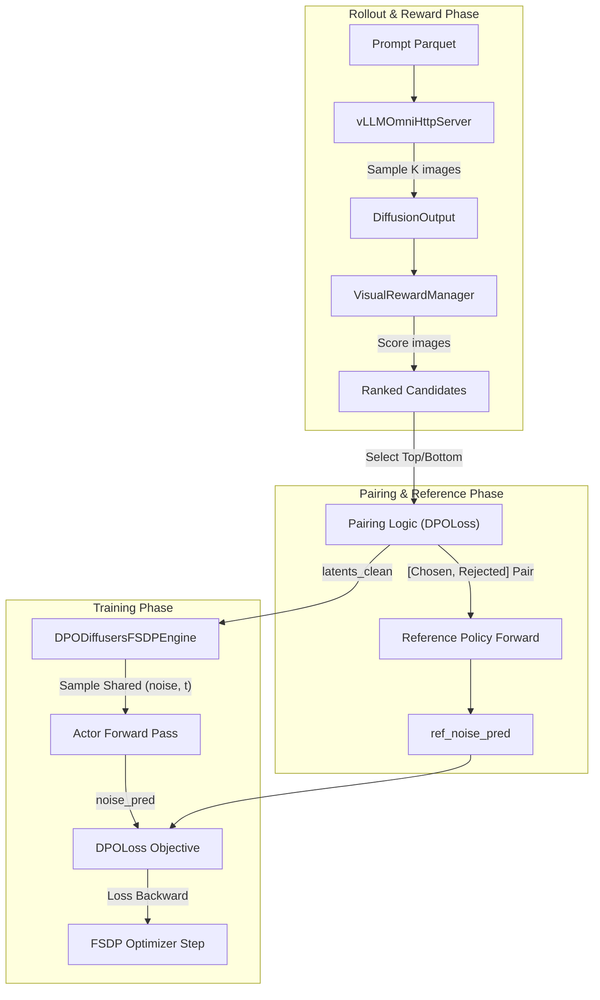
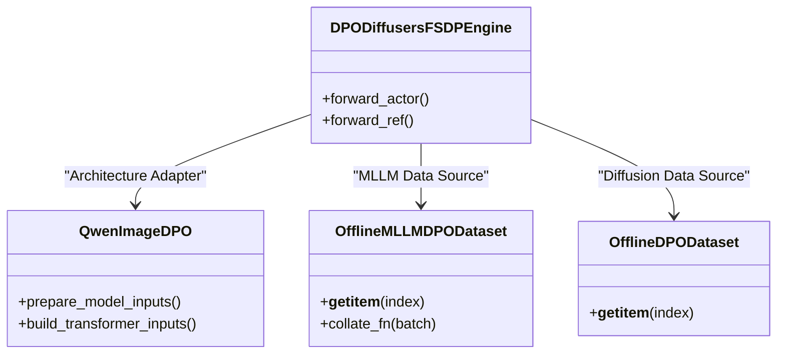

<!-- source: DeepWiki mcp.deepwiki.com · repo verl-project/verl-omni · page 2.3 DPO for Diffusion Models · fetched 2026-10-30 -->

# DPO for Diffusion Models

Relevant source files

The following files were used as context for generating this wiki page:

- [docs/algo/diffusion_dpo.md](docs/algo/diffusion_dpo.md)
- [docs/contributing/integrating_a_new_direct_preference_algorithm_for_diffusion_model.md](docs/contributing/integrating_a_new_direct_preference_algorithm_for_diffusion_model.md)
- [examples/dpo_trainer/README.md](examples/dpo_trainer/README.md)
- [examples/dpo_trainer/data_process/prepare_offline_dpo.py](examples/dpo_trainer/data_process/prepare_offline_dpo.py)
- [examples/dpo_trainer/qwen3_omni/eval_vlm_as_judge.sh](examples/dpo_trainer/qwen3_omni/eval_vlm_as_judge.sh)
- [examples/dpo_trainer/qwen3_omni/qwen3_omni/run_qwen3_omni_omni_preference_lora.sh](examples/dpo_trainer/qwen3_omni/qwen3_omni/run_qwen3_omni_omni_preference_lora.sh)
- [examples/dpo_trainer/qwen3_omni/vlm_as_judge.py](examples/dpo_trainer/qwen3_omni/vlm_as_judge.py)
- [tests/pipelines/test_qwen_image_dpo_adapter_on_cpu.py](tests/pipelines/test_qwen_image_dpo_adapter_on_cpu.py)
- [tests/special_e2e/build_sd3_tiny_random.py](tests/special_e2e/build_sd3_tiny_random.py)
- [tests/special_e2e/create_dummy_offline_dpo_data.py](tests/special_e2e/create_dummy_offline_dpo_data.py)
- [tests/special_e2e/run_diffusionnft_qwen_image.sh](tests/special_e2e/run_diffusionnft_qwen_image.sh)
- [tests/special_e2e/run_offline_dpo_sd35.sh](tests/special_e2e/run_offline_dpo_sd35.sh)
- [tests/special_e2e/run_online_dpo_qwen_image.sh](tests/special_e2e/run_online_dpo_qwen_image.sh)
- [tests/utils/smoke_attention.py](tests/utils/smoke_attention.py)
- [verl_omni/trainer/diffusion/diffusion_trainer_utils.py](verl_omni/trainer/diffusion/diffusion_trainer_utils.py)

Direct Preference Optimization (DPO) for diffusion models in VeRL-Omni aligns generative policies by comparing the prediction errors of a current model against a frozen reference model. Unlike policy-gradient methods (e.g., FlowGRPO) that optimize reverse denoising trajectories, DPO utilizes a forward-process objective over preference pairs (chosen and rejected samples) [docs/algo/diffusion_dpo.md:5-11]().

VeRL-Omni supports both **Online DPO** (live rollout and reward scoring) and **Offline DPO** (precomputed win/lose pairs) [examples/dpo_trainer/README.md:5-14]().

### Core Algorithm and Implementation

The implementation relies on three primary components:
1.  **`DirectPreferenceRayTrainer`**: Orchestrates the training loop, handling either offline data loading or online rollout/reward collection [verl_omni/trainer/diffusion/ray_diffusion_trainer.py:70-72]().
2.  **`DPODiffusersFSDPEngine`**: A specialized engine that performs the forward flow-matching pass, ensuring shared noise and timesteps across pairs [docs/algo/diffusion_dpo.md:86-87]().
3.  **`DPOLoss`**: Computes the pairwise DPO objective using the implicit reward formulation [docs/algo/diffusion_dpo.md:90-92]().

#### System Data Flow: Online DPO
The following diagram illustrates the flow from prompt to model update in the online setting.

**Title: Online DPO Data Flow**

Sources: [examples/dpo_trainer/README.md:22-30](), [docs/algo/diffusion_dpo.md:80-88](), [docs/contributing/integrating_a_new_direct_preference_algorithm_for_diffusion_model.md:123-130]()

---

### Pairing Logic and Data Handling

DPO requires strict pairing where a "chosen" sample and a "rejected" sample for the same prompt are processed together to compute the log-ratio of likelihoods.

#### Online Pairing
In online DPO, the trainer samples $K$ images (defined by `actor_rollout_ref.rollout.n`) per prompt [examples/dpo_trainer/README.md:68-70](). The pairing logic groups these by prompt, scores them via the configured reward function, and forms one `[chosen, rejected]` pair from the highest- and lowest-scoring candidates [examples/dpo_trainer/README.md:22-29](). The objective uses the implicit reward margin between these samples [docs/algo/diffusion_dpo.md:61-72]().

#### Offline Pairing
For offline DPO, the dataset reads rows from a parquet file where each row already contains a `win` and `lose` image/latent [examples/dpo_trainer/data_process/prepare_offline_dpo.py:17-24](). The `prepare_offline_dpo.py` script facilitates this by generating candidate images from a frozen pipeline and scoring them before writing to parquet [examples/dpo_trainer/data_process/prepare_offline_dpo.py:115-131](). Training updates consume precomputed latents and text embeddings directly [examples/dpo_trainer/data_process/prepare_offline_dpo.py:22-24]().

For multimodal models like Qwen3-Omni, a `ModalityGroupedBatchSampler` is used to keep batches single-modality, which is required by the `OfflineMLLMDPODataset` [examples/dpo_trainer/qwen3_omni/qwen3_omni/run_qwen3_omni_omni_preference_lora.sh:84-86]().

| Configuration Key | Value for DPO | Purpose |
| :--- | :--- | :--- |
| `algorithm.trainer_type` | `direct_preference` | Routes to `DirectPreferenceRayTrainer` [examples/dpo_trainer/qwen3_omni/qwen3_omni/run_qwen3_omni_omni_preference_lora.sh:68-68]() |
| `algorithm.paired_preference` | `true` | Ensures adjacent samples in micro-batches are treated as pairs [examples/dpo_trainer/qwen3_omni/qwen3_omni/run_qwen3_omni_omni_preference_lora.sh:70-70]() |
| `actor_rollout_ref.actor.shuffle` | `false` | Prevents breaking pair adjacency during training [examples/dpo_trainer/qwen3_omni/qwen3_omni/run_qwen3_omni_omni_preference_lora.sh:127-127]() |
| `actor_rollout_ref.actor.ppo_micro_batch_size_per_gpu` | Even Number | Prevents splitting a pair across GPUs/batches [examples/dpo_trainer/qwen3_omni/qwen3_omni/run_qwen3_omni_omni_preference_lora.sh:118-118]() |

Sources: [examples/dpo_trainer/README.md:90-113](), [examples/dpo_trainer/data_process/prepare_offline_dpo.py:17-24](), [examples/dpo_trainer/qwen3_omni/qwen3_omni/run_qwen3_omni_omni_preference_lora.sh:68-86](), [docs/algo/diffusion_dpo.md:124-144]()

---

### DPODiffusersFSDPEngine

The `DPODiffusersFSDPEngine` implements the "one-shot" forward pass required for DPO. Unlike the iterative reverse process used in FlowGRPO, DPO training only requires a single prediction at a sampled timestep $t$ [docs/algo/diffusion_dpo.md:86-87]().

**Title: DPO Engine and Data Entity Association**

Sources: [docs/algo/diffusion_dpo.md:86-87](), [verl_omni/pipelines/qwen_image_dpo/diffusers_training_adapter.py:29-30](), [examples/dpo_trainer/qwen3_omni/qwen3_omni/run_qwen3_omni_omni_preference_lora.sh:81-83](), [docs/contributing/integrating_a_new_direct_preference_algorithm_for_diffusion_model.md:123-128]()

**Key Operations:**
1.  **Shared Sampling**: The engine ensures that for every pair, the noise $\epsilon$ and timestep $t$ are identical [docs/algo/diffusion_dpo.md:93-95]().
2.  **Forward Noising**: It applies the flow-matching / diffusion noising formula to the clean latents (`latents_clean`) provided in the batch [docs/algo/diffusion_dpo.md:40-44]().
3.  **Model Forward**: It invokes the model adapter to format tensors for the specific transformer architecture (e.g., SD3 or Qwen-Image) [tests/pipelines/test_qwen_image_dpo_adapter_on_cpu.py:93-100]().

---

### Pipeline Adapters

Adapters bridge the generic DPO trainer with model-specific architectures.

#### Qwen-Image DPO Adapter
The `QwenImageDPO` adapter handles architecture-specific inputs for the transformer, including image shapes and optional guidance embeddings [tests/pipelines/test_qwen_image_dpo_adapter_on_cpu.py:29-30](). It implements `prepare_model_inputs` to handle True-CFG branching where both positive and negative prompts are evaluated [tests/pipelines/test_qwen_image_dpo_adapter_on_cpu.py:154-169]().

#### SD3 DPO Adapter
Offline DPO for SD3 uses precomputed tensors to avoid the cost of re-encoding during training. The `prepare_offline_dpo.py` script pre-encodes VAE latents [examples/dpo_trainer/data_process/prepare_offline_dpo.py:145-153]() and prompt embeddings (including `pooled_prompt_embeds` and `prompt_embeds_mask`) [examples/dpo_trainer/data_process/prepare_offline_dpo.py:156-190]().

| Feature | Qwen-Image DPO | SD3 DPO |
| :--- | :--- | :--- |
| **Algorithm Key** | `dpo` [tests/pipelines/test_qwen_image_dpo_adapter_on_cpu.py:43-43]() | `dpo` |
| **Primary Mode** | Online [examples/dpo_trainer/README.md:20-20]() | Offline [examples/dpo_trainer/README.md:12-14]() |
| **Latent Input** | `latents` [tests/pipelines/test_qwen_image_dpo_adapter_on_cpu.py:94-94]() | `img_win_latents` [tests/special_e2e/create_dummy_offline_dpo_data.py:183-184]() |
| **Model Type** | `diffusion_dpo_model` [tests/special_e2e/run_online_dpo_qwen_image.sh:63-63]() | `diffusion_dpo_model` |

Sources: [tests/pipelines/test_qwen_image_dpo_adapter_on_cpu.py:29-180](), [examples/dpo_trainer/README.md:1-30](), [examples/dpo_trainer/data_process/prepare_offline_dpo.py:156-195](), [tests/special_e2e/run_online_dpo_qwen_image.sh:50-113]()

---

