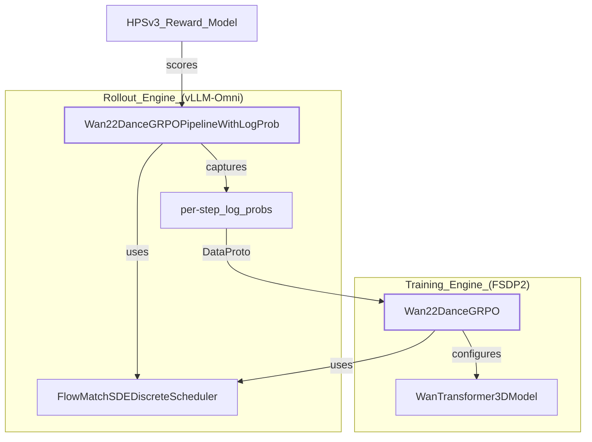
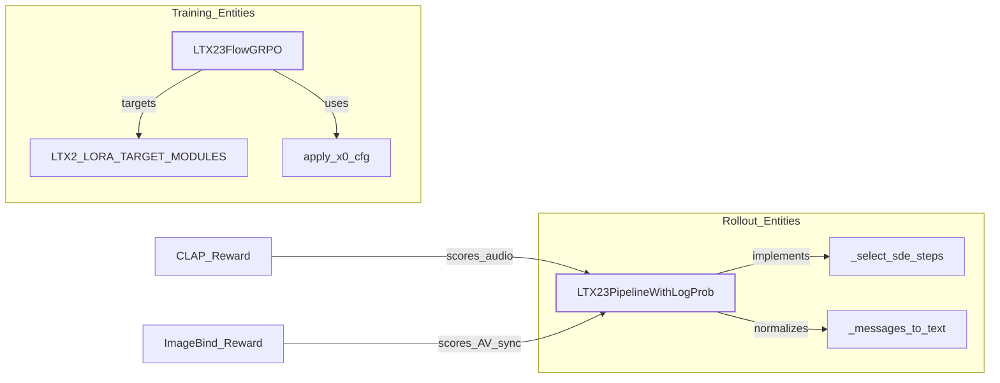

<!-- source: DeepWiki mcp.deepwiki.com · repo verl-project/verl-omni · page 2.4 DanceGRPO, LTX-2.3, and Video/Audio-Video Generation RL · fetched 2026-10-30 -->

# DanceGRPO, LTX-2.3, and Video/Audio-Video Generation RL

Relevant source files

The following files were used as context for generating this wiki page:

- [.dockerignore](.dockerignore)
- [.github/actions/gpu-smoke-prepare/action.yml](.github/actions/gpu-smoke-prepare/action.yml)
- [docker/Dockerfile.a2.npu](docker/Dockerfile.a2.npu)
- [docker/Dockerfile.a3.npu](docker/Dockerfile.a3.npu)
- [docker/Dockerfile.cuda](docker/Dockerfile.cuda)
- [examples/dancegrpo_trainer/README.md](examples/dancegrpo_trainer/README.md)
- [examples/dancegrpo_trainer/data_process/wan22_hpsv3.py](examples/dancegrpo_trainer/data_process/wan22_hpsv3.py)
- [examples/dancegrpo_trainer/wan22/run_wan22_5b_t2v_hpsv3_auto.sh](examples/dancegrpo_trainer/wan22/run_wan22_5b_t2v_hpsv3_auto.sh)
- [tests/pipelines/test_ltx2_flow_grpo_on_cpu.py](tests/pipelines/test_ltx2_flow_grpo_on_cpu.py)
- [verl_omni/pipelines/ltx2_flow_grpo/vllm_omni_rollout_adapter.py](verl_omni/pipelines/ltx2_flow_grpo/vllm_omni_rollout_adapter.py)
- [verl_omni/pipelines/wan22_dance_grpo/common.py](verl_omni/pipelines/wan22_dance_grpo/common.py)
- [verl_omni/pipelines/wan22_dance_grpo/diffusers_training_adapter.py](verl_omni/pipelines/wan22_dance_grpo/diffusers_training_adapter.py)
- [verl_omni/utils/reward_score/hpsv3_reward.py](verl_omni/utils/reward_score/hpsv3_reward.py)
- [verl_omni/utils/reward_score/imagebind.py](verl_omni/utils/reward_score/imagebind.py)

This page covers the implementation and recipes for Reinforcement Learning (RL) on advanced video and audio-video generation models. Specifically, it details the **DanceGRPO** algorithm for **Wan2.2** text-to-video models and the **FlowGRPO** recipe for **LTX-2.3** text-to-audio-video models. These implementations leverage score-based SDE formulations, joint modality transitions, and specialized reward models like HPSv3, CLAP, and ImageBind.

## DanceGRPO for Wan2.2 Video Generation

DanceGRPO is an extension of the FlowGRPO algorithm optimized for high-resolution video models. It introduces a score-based SDE (Stochastic Differential Equation) formulation to improve numerical stability during the rollout phase, particularly when the noise level ($\sigma$) is close to 1 [examples/dancegrpo_trainer/README.md:5-6]().

### System Architecture: DanceGRPO Data Flow

The relationship between the rollout pipeline, training adapter, and SDE scheduler is managed through a registry pattern that associates model architectures with RL algorithms.

Sources: [verl_omni/pipelines/wan22_dance_grpo/diffusers_training_adapter.py:69-79](), [examples/dancegrpo_trainer/README.md:82-94](), [verl_omni/pipelines/wan22_dance_grpo/diffusers_training_adapter.py:28-29]()

### Wan2.2 Training Adapter
The `Wan22DanceGRPO` class handles the training-side logic [verl_omni/pipelines/wan22_dance_grpo/diffusers_training_adapter.py:70-79]().
*   **Time Shifting:** Wan2.2 utilizes `sd3_time_shift` to adjust the noise schedule [verl_omni/pipelines/wan22_dance_grpo/diffusers_training_adapter.py:33-34](). The adapter configures the `FlowMatchSDEDiscreteScheduler` with a shift factor (typically 5.0 for Wan2.2) [verl_omni/pipelines/wan22_dance_grpo/diffusers_training_adapter.py:104-110]().
*   **Transformer Inputs:** `prepare_model_inputs` maps scheduler timesteps to the integer range and handles manual embedding masking since the Wan transformer lacks an explicit attention mask for `encoder_hidden_states` [verl_omni/pipelines/wan22_dance_grpo/diffusers_training_adapter.py:152-162]().

### SDE Variants
Rollout supports three stochastic variants via `actor_rollout_ref.rollout.algo.sde_type`:
*   `dance_sde`: Recommended score-based SDE correction for numerical stability at high sigma [examples/dancegrpo_trainer/README.md:101]().
*   `sde`: Original FlowGRPO SDE variant [examples/dancegrpo_trainer/README.md:102]().
*   `cps`: Consistency-preserving sampling variant [examples/dancegrpo_trainer/README.md:103]().

Sources: [verl_omni/pipelines/wan22_dance_grpo/diffusers_training_adapter.py:69-79](), [examples/dancegrpo_trainer/README.md:97-103]()

---

## LTX-2.3 Text-to-Audio-Video RL

The **LTX-2.3** recipe trains models to generate synchronized audio and video. This involves joint audio-video transitions and a specialized LoRA configuration covering both video and audio attention blocks.

### Joint Audio-Video Training Logic
The `LTX23FlowGRPO` training adapter manages the complex input structure of the LTX-2.3 transformer [tests/pipelines/test_ltx2_flow_grpo_on_cpu.py:32]().
*   **Latent Splitting:** The adapter splits joint latents into separate video and audio components before passing them to the model [tests/pipelines/test_ltx2_flow_grpo_on_cpu.py:63-98]().
*   **LoRA Targets:** The recipe targets 28 modules, including `audio_to_video_attn` and `video_to_audio_attn` to ensure cross-modal synchronization [tests/pipelines/test_ltx2_flow_grpo_on_cpu.py:37-42]().

### Non-Contiguous SDE Windows
Unlike standard diffusion RL, the LTX-2.3 recipe supports sampling non-contiguous SDE transitions. This is configured via `sde_contiguous=False`, allowing the agent to sample transitions from a broader range without them being consecutive [tests/pipelines/test_ltx2_flow_grpo_on_cpu.py:105-110]().
*   **Seeding:** Step selection is deterministic based on `sde_window_seed` to maintain consistency across rollout and training [tests/pipelines/test_ltx2_flow_grpo_on_cpu.py:105-117]().

### LTX-2.3 Entity Mapping

Sources: [verl_omni/pipelines/ltx2_flow_grpo/vllm_omni_rollout_adapter.py:72-76](), [tests/pipelines/test_ltx2_flow_grpo_on_cpu.py:26-33](), [tests/pipelines/test_ltx2_flow_grpo_on_cpu.py:105-117]()

---

## Reward Models for Video and Audio

Omni-modal RL requires specialized scorers to evaluate visual quality, text alignment, and cross-modal synchronization.

### HPSv3 (Visual Quality & Alignment)
Used primarily for Wan2.2, HPSv3 evaluates:
*   **Visual Quality:** Clarity, detail richness, aesthetic and creativity, and reasonableness [verl_omni/utils/reward_score/hpsv3_reward.py:38-48]().
*   **Text Alignment:** Subject relevance, style relevance, contextual consistency, attribute fidelity, and semantic coherence [verl_omni/utils/reward_score/hpsv3_reward.py:53-68]().

### ImageBind (Cross-Modal Alignment)
For LTX-2.3, ImageBind is used to score cross-modal semantic alignment [verl_omni/utils/reward_score/imagebind.py:15-20]().
*   **Supported Modes:** `audio_video`, `text_audio`, `text_video`, and a weighted `all` combination [verl_omni/utils/reward_score/imagebind.py:18-19]().
*   **Audio Preprocessing:** Audio is normalized to 16kHz and converted to Mel-spectrograms [verl_omni/utils/reward_score/imagebind.py:84-120]().
*   **Video Preprocessing:** Extracts 5 clips of 2 frames each, performing center cropping and normalization [verl_omni/utils/reward_score/imagebind.py:159-185]().

### Configuration Summary
| Model | Algorithm | Primary Rewards | Key Feature |
| :--- | :--- | :--- | :--- |
| **Wan2.2** | DanceGRPO | HPSv3 | `dance_sde` stability [examples/dancegrpo_trainer/README.md:101]() |
| **LTX-2.3** | FlowGRPO | ImageBind, CLAP | Non-contiguous SDE windows [tests/pipelines/test_ltx2_flow_grpo_on_cpu.py:105-110]() |

Sources: [verl_omni/utils/reward_score/hpsv3_reward.py:33-71](), [verl_omni/utils/reward_score/imagebind.py:15-51](), [examples/dancegrpo_trainer/README.md:97-103]()

---

