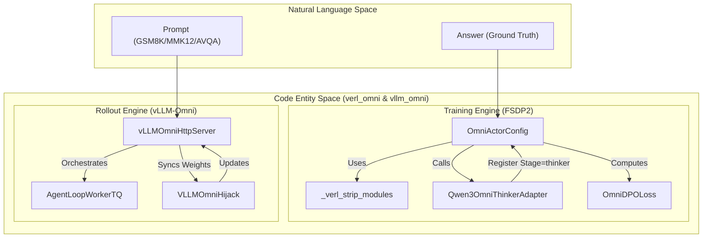
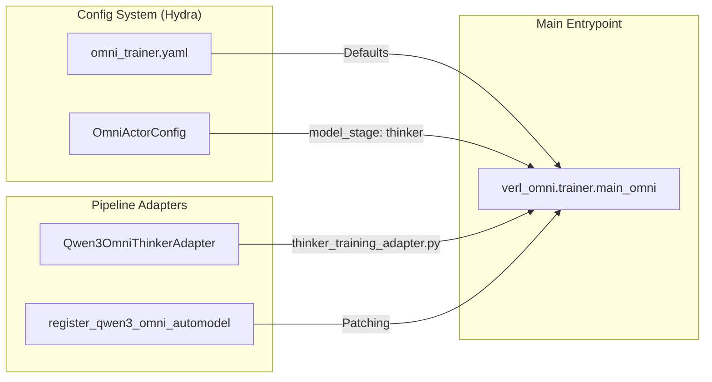

<!-- source: DeepWiki mcp.deepwiki.com · repo verl-project/verl-omni · page 2.5 GSPO for Omni-Modal Models (Qwen3-Omni) · fetched 2026-10-30 -->

# GSPO for Omni-Modal Models (Qwen3-Omni)

Relevant source files

The following files were used as context for generating this wiki page:

- [examples/gspo_trainer/README.md](examples/gspo_trainer/README.md)
- [examples/gspo_trainer/data_process/avqa.py](examples/gspo_trainer/data_process/avqa.py)
- [examples/gspo_trainer/qwen3_omni/config/qwen3_omni_thinker_gspo.yaml](examples/gspo_trainer/qwen3_omni/config/qwen3_omni_thinker_gspo.yaml)
- [examples/gspo_trainer/qwen3_omni/run_qwen3_omni_thinker_gspo_lora.sh](examples/gspo_trainer/qwen3_omni/run_qwen3_omni_thinker_gspo_lora.sh)
- [examples/gspo_trainer/qwen3_omni/run_qwen3_omni_thinker_gspo_lora_mmk12_v1_npu.sh](examples/gspo_trainer/qwen3_omni/run_qwen3_omni_thinker_gspo_lora_mmk12_v1_npu.sh)
- [examples/gspo_trainer/qwen3_omni/run_qwen3_omni_thinker_gspo_npu.sh](examples/gspo_trainer/qwen3_omni/run_qwen3_omni_thinker_gspo_npu.sh)
- [examples/gspo_trainer/qwen3_omni/run_qwen3_omni_thinker_gspo_npu_avqa_v1.sh](examples/gspo_trainer/qwen3_omni/run_qwen3_omni_thinker_gspo_npu_avqa_v1.sh)
- [tests/pipelines/test_qwen3_omni_thinker_adapter_on_cpu.py](tests/pipelines/test_qwen3_omni_thinker_adapter_on_cpu.py)
- [tests/special_e2e/run_gspo_qwen3_omni_thinker_lora_smoke.sh](tests/special_e2e/run_gspo_qwen3_omni_thinker_lora_smoke.sh)
- [tests/trainer/omni/test_omni_algos_on_cpu.py](tests/trainer/omni/test_omni_algos_on_cpu.py)
- [tests/trainer/omni/test_omni_dpo_trainer_on_cpu.py](tests/trainer/omni/test_omni_dpo_trainer_on_cpu.py)
- [tests/trainer/test_metrics_utils_on_cpu.py](tests/trainer/test_metrics_utils_on_cpu.py)
- [tests/utils/reward_score/test_choice_reward_on_cpu.py](tests/utils/reward_score/test_choice_reward_on_cpu.py)
- [tests/utils/reward_score/test_imagebind_on_cpu.py](tests/utils/reward_score/test_imagebind_on_cpu.py)
- [tests/utils/test_avqa_data_process_on_cpu.py](tests/utils/test_avqa_data_process_on_cpu.py)
- [tests/utils/test_omni_rl_datasets_on_cpu.py](tests/utils/test_omni_rl_datasets_on_cpu.py)
- [tests/utils/test_qwen3_omni_npu_launcher_on_cpu.py](tests/utils/test_qwen3_omni_npu_launcher_on_cpu.py)
- [verl_omni/models/transformers/__init__.py](verl_omni/models/transformers/__init__.py)
- [verl_omni/models/transformers/qwen3_omni_thinker.py](verl_omni/models/transformers/qwen3_omni_thinker.py)
- [verl_omni/pipelines/qwen3_omni/thinker_training_adapter.py](verl_omni/pipelines/qwen3_omni/thinker_training_adapter.py)
- [verl_omni/trainer/omni/__init__.py](verl_omni/trainer/omni/__init__.py)
- [verl_omni/trainer/omni/omni_algos.py](verl_omni/trainer/omni/omni_algos.py)
- [verl_omni/trainer/omni/ray_omni_trainer.py](verl_omni/trainer/omni/ray_omni_trainer.py)

This page describes the implementation of **Group Relative Policy Optimization (GSPO)** for the **Qwen3-Omni** model family, specifically focusing on the **Thinker** component. The integration utilizes `vllm-omni` as a high-performance rollout backend and `verl`'s FSDP2 engine for distributed training.

## Overview and Purpose

The Qwen3-Omni training pipeline in `verl-omni` is designed to post-train the **Qwen3-Omni-30B-A3B Thinker** model on multimodal reasoning tasks (e.g., mathematics) using RL [examples/gspo_trainer/README.md:5-9](). Unlike standard LLMs, Qwen3-Omni is a complex multi-stage model; the `verl-omni` implementation strips unnecessary modules to optimize memory and utilizes specialized `vllm-omni` stage configurations to handle the model's architecture [verl_omni/models/transformers/qwen3_omni_thinker.py:96-100]().

### Key Features
*   **AR Rollout Mode**: Uses Auto-Regressive (AR) generation for reasoning traces by setting `output_mode: ar` in the rollout configuration [tests/special_e2e/run_gspo_qwen3_omni_thinker_lora_smoke.sh:121-121]().
*   **LoRA Integration**: Supports Parameter-Efficient Fine-Tuning (PEFT) via LoRA (rank 32 default) with FSDP weight synchronization [examples/gspo_trainer/README.md:124-128]().
*   **Module Stripping**: Automatically removes non-Thinker modules (Talker, Code2Wav, Code Predictor) during training via `_verl_strip_modules` to reduce memory overhead [verl_omni/models/transformers/qwen3_omni_thinker.py:96-100]().
*   **Rollout-Actor Sync**: Implements weight synchronization between the FSDP training engine and the vLLM rollout server, validated by Pearson correlation metrics [examples/gspo_trainer/README.md:140-143]().
*   **Omni DPO Loss**: Support for Bradley-Terry DPO on sequence-level policy vs. reference log-probs, allowing for preference-based optimization [verl_omni/trainer/omni/omni_algos.py:62-66]().

---

## System Architecture: Training and Rollout Flow

The training loop involves a decoupled architecture where the **Actor** (FSDP2) and **Rollout** (vLLM-Omni) engines colocate on the same physical devices to maximize resource utilization [examples/gspo_trainer/README.md:52-54]().

### Data and Logic Flow
The diagram below illustrates how a Qwen3-Omni model is transformed and how weights are synchronized between the training and rollout components using the `OmniModelBase` registry.

**Figure 1: Qwen3-Omni Model Transformation and Weight Synchronization**

**Sources:** [verl_omni/trainer/omni/omni_algos.py:62-66](), [verl_omni/models/transformers/qwen3_omni_thinker.py:96-100](), [examples/gspo_trainer/README.md:140-150]().

---

## Model Patching and Module Stripping

The Qwen3-Omni Thinker is technically a decoder-only language model, but it is packaged within a multi-modal wrapper. `verl-omni` applies several configurations to make it compatible with RL training.

### Module Stripping (`_verl_strip_modules`)
To save VRAM, the training engine identifies and removes modules that are not required for the "Thinker" reasoning stage. This is handled by the `_verl_strip_modules` metadata [verl_omni/models/transformers/qwen3_omni_thinker.py:96-100]().

| Stripped Module | Purpose |
| :--- | :--- |
| `talker` | Speech generation component [verl_omni/models/transformers/qwen3_omni_thinker.py:97-97]() |
| `code2wav` | Code-to-audio synthesis [verl_omni/models/transformers/qwen3_omni_thinker.py:98-98]() |
| `code_predictor` | Specialized code generation head [verl_omni/models/transformers/qwen3_omni_thinker.py:99-99]() |

### FSDP and LoRA Configuration
*   **Thinker Forward Redirection**: The model forward is patched to redirect to `self.thinker` to bypass the multi-modal wrapper during actor training [verl_omni/models/transformers/qwen3_omni_thinker.py:59-87]().
*   **No-Split Modules**: `_no_split_modules` is set to `Qwen3OmniMoeThinkerTextDecoderLayer` and `Qwen3OmniMoeVisionBlock` to ensure FSDP shards the model at layer boundaries [verl_omni/models/transformers/qwen3_omni_thinker.py:91-94]().
*   **LoRA Target Modules**: Training typically targets `q_proj`, `k_proj`, `v_proj`, and `o_proj` with a rank of 32 [examples/gspo_trainer/README.md:124-128]().
*   **Tied Embeddings**: `tie_word_embeddings` is forced to `False` via a descriptor to enable FSDP meta-tensor initialization and avoid OOM on large models [verl_omni/models/transformers/qwen3_omni_thinker.py:102-115]().

**Sources:** [verl_omni/models/transformers/qwen3_omni_thinker.py:59-115](), [examples/gspo_trainer/README.md:124-128]().

---

## vLLM-Omni Integration

For Qwen3-Omni, the rollout backend is configured via the `vllm-omni` stage configs to handle the specific multi-stage pipeline topology.

### Processor and Tokenizer Patching
The `patch_hf_processor_for_qwen3_omni` function wraps the standard HuggingFace processor to handle Qwen3-Omni's unique requirements [verl_omni/models/transformers/qwen3_omni_thinker.py:118-135]().

*   **Config Redirection**: Swaps `processor.config` to `thinker_config` as multimodal settings are nested in Qwen3-Omni [verl_omni/models/transformers/qwen3_omni_thinker.py:147-150]().
*   **RoPE Indices**: Binds `get_rope_index` (casting to `long` to avoid FSDP rounding issues) and `get_llm_pos_ids_for_vision` to the processor [verl_omni/models/transformers/qwen3_omni_thinker.py:157-162]().
*   **Pad Token Dedup**: Implements `_dedup_pad_tokens` to collapse consecutive multimodal pad tokens before vLLM-Omni re-expands them, preventing double-expansion bugs [verl_omni/models/transformers/qwen3_omni_thinker.py:164-180]().

**Figure 2: Configuration and Adapter Registration**

**Sources:** [verl_omni/models/transformers/qwen3_omni_thinker.py:37-52](), [examples/gspo_trainer/README.md:46-51](), [verl_omni/pipelines/qwen3_omni/thinker_training_adapter.py:34-41]().

---

## Training Configuration and Metrics

The GSPO implementation for Qwen3-Omni supports text-only (GSM8K), image-to-text (MMK12), and text+image+audio (AVQA) inputs [examples/gspo_trainer/README.md:5-9]().

### Multimodal Data Preprocessing
For multimodal training, the dataset must be prepared using specialized converters:
*   **MMK12**: Carries image bytes inline in the `images` column and constrains the model via system prompts [examples/gspo_trainer/README.md:152-174]().
*   **AVQA**: Handles joint text, image, and audio inputs for full omni-modal reasoning [examples/gspo_trainer/README.md:18-19]().

### Critical Monitoring Metrics
A healthy GSPO training run for Qwen3-Omni should exhibit specific signals in the logs.

| Metric | Target Value | Description |
| :--- | :--- | :--- |
| `rollout_actor_probs_pearson_corr` | > 0.995 | Primary correctness signal for weight sync between actor and rollout [examples/gspo_trainer/README.md:140-143](). |
| `rollout_corr/log_ppl_diff` | ≈ 0.001 | Confirms log-prob consistency [examples/gspo_trainer/README.md:144-145](). |
| `actor/loss` | ≈ 1e-5 | Typical loss scale for stable GSPO reasoning training [examples/gspo_trainer/README.md:146-147](). |
| `reward_accuracy` | Rising | Accuracy of implicit rewards in DPO loss [verl_omni/trainer/omni/omni_algos.py:163-163](). |

**Sources:** [examples/gspo_trainer/README.md:140-150](), [verl_omni/trainer/omni/omni_algos.py:159-165]().

---

## Implementation Details: V1 Trainer

The Qwen3-Omni pipeline uses the **V1 Trainer** (`verl_omni.trainer.main_omni`), which handles Qwen3-Omni natively without the need for legacy monkey-patches [verl_omni/models/transformers/qwen3_omni_thinker.py:18-21]().

### Registration and Adapter Logic
The `Qwen3OmniThinkerAdapter` class, registered via `@OmniModelBase.register`, implements the core logic for preparing the model for FSDP2 [verl_omni/pipelines/qwen3_omni/thinker_training_adapter.py:34-35]().

*   **Audio RoPE Patch**: The adapter dynamically patches `AgentLoopWorkerTQ._compute_position_ids` to handle raw audio lengths required by Qwen3-Omni's RoPE implementation [verl_omni/pipelines/qwen3_omni/thinker_training_adapter.py:108-148]().
*   **External Modules**: To ensure adapters are active, the environment variable `VERL_USE_EXTERNAL_MODULES=verl_omni` must be set [examples/gspo_trainer/README.md:46-48]().

**Sources:** [verl_omni/pipelines/qwen3_omni/thinker_training_adapter.py:34-148](), [examples/gspo_trainer/README.md:46-51]().

---

