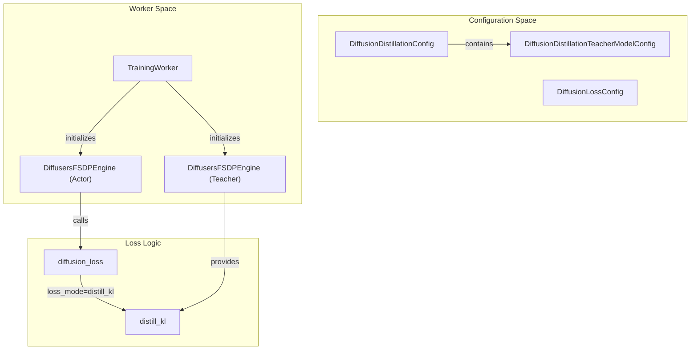
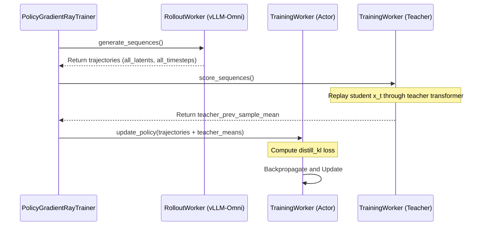

<!-- source: DeepWiki mcp.deepwiki.com · repo verl-project/verl-omni · page 2.6 Diffusion On-Policy Distillation (DiffusionOPD) · fetched 2026-10-30 -->

# Diffusion On-Policy Distillation (DiffusionOPD)

Relevant source files

The following files were used as context for generating this wiki page:

- [docs/algo/diffusion_opd.md](docs/algo/diffusion_opd.md)
- [docs/examples/config.md](docs/examples/config.md)
- [docs/examples/diffusionopd_trainer.md](docs/examples/diffusionopd_trainer.md)
- [examples/diffusionopd_trainer/README.md](examples/diffusionopd_trainer/README.md)
- [examples/diffusionopd_trainer/sd35/run_sd35_medium_ocr_distill.sh](examples/diffusionopd_trainer/sd35/run_sd35_medium_ocr_distill.sh)
- [tests/special_e2e/run_diffusion_teacher_smoke.sh](tests/special_e2e/run_diffusion_teacher_smoke.sh)
- [tests/special_sanity/test_config_docs.py](tests/special_sanity/test_config_docs.py)
- [tests/trainer/diffusion/test_distillation_config_on_cpu.py](tests/trainer/diffusion/test_distillation_config_on_cpu.py)
- [tests/workers/rollout/rollout_vllm/test_zmq_utils.py](tests/workers/rollout/rollout_vllm/test_zmq_utils.py)
- [verl_omni/workers/engine_workers.py](verl_omni/workers/engine_workers.py)
- [verl_omni/workers/rollout/vllm_rollout/utils.py](verl_omni/workers/rollout/vllm_rollout/utils.py)
- [verl_omni/workers/rollout/vllm_rollout/zmq_utils.py](verl_omni/workers/rollout/vllm_rollout/zmq_utils.py)

Diffusion On-Policy Distillation (DiffusionOPD) is an algorithm designed to improve a student diffusion model by distilling knowledge from a frozen teacher model at states sampled by the student during its own generation process. Unlike offline distillation which uses a static dataset, DiffusionOPD operates on-policy, allowing the student to receive supervision on the specific regions of the state space it actually visits [docs/algo/diffusion_opd.md:7-12]().

## Overview and Purpose

The primary objective of DiffusionOPD is to minimize the KL divergence between the student's transition distribution and the teacher's transition distribution. In VeRL-Omni, this is typically used to transfer capabilities (like OCR quality) from a strong teacher to a student without requiring the student to optimize sparse rewards directly [examples/diffusionopd_trainer/README.md:5-7]().

### Key Features
*   **Dense Supervision**: The student receives continuous guidance at every denoising step rather than a single sparse reward at the end of a trajectory [docs/algo/diffusion_opd.md:11-12]().
*   **Teacher Engine Integration**: A dedicated teacher engine is initialized within the `TrainingWorker` alongside the student (actor) and reference models [verl_omni/workers/engine_workers.py:157-164]().
*   **Coexistence Support**: The teacher and reference models can coexist, allowing for simultaneous task-reward optimization (e.g., FlowGRPO), reference-KL penalties, and teacher distillation [docs/algo/diffusion_opd.md:31-34]().

## System Architecture and Data Flow

DiffusionOPD integrates into the standard `PolicyGradientRayTrainer` loop. When `distillation.enabled` is `True`, the actor workers build a frozen teacher model using the path specified in `distillation.teacher_models.teacher_model.model_path` [verl_omni/workers/config/diffusion/diffusion.py:61-62]().

### Code Entity Relationship
The following diagram bridges the high-level distillation concepts to the specific classes and functions in the codebase.

**DiffusionOPD System Mapping**

*Sources: [verl_omni/workers/engine_workers.py:157-164](), [verl_omni/workers/config/diffusion/diffusion.py:22-69](), [verl_omni/workers/utils/losses.py:71-71]()*

## Implementation Details

### The Distillation Loss
The core logic resides in the `diffusion_loss` function, which computes the per-step KL divergence between Gaussian transition distributions.

1.  **`distill_kl`**: This mode minimizes the KL divergence between student and teacher transition means. Because both models share the same noise schedule and variance $\sigma_t^2$ (enforced at worker init), the KL reduces to the squared distance between predicted means normalized by variance [docs/algo/diffusion_opd.md:19-25]().
2.  **MSE-based Distillation**: While `distill_kl` is the primary mode, the config supports `distill_fm_mse` for flow-matching MSE distillation [docs/examples/config.md:135-135]().

### Integration in the Training Loop
The distillation loss is added to the total actor loss during the optimization step. It can either be the sole objective or an auxiliary term:

*   **Pure Distillation**: `diffusion_loss.loss_mode=distill_kl`. The student only imitates the teacher [docs/algo/diffusion_opd.md:90-104]().
*   **Combined Objective**: `use_distill_loss=True` with `loss_mode=flow_grpo`. The student optimizes a task reward while staying close to the teacher [docs/algo/diffusion_opd.md:106-125]().

### Sequence of Operations
The data flow for a single distillation-augmented training step is described below:

**DiffusionOPD Data Flow**

*Sources: [docs/algo/diffusion_opd.md:14-29](), [verl_omni/workers/engine_workers.py:157-164]()*

## Configuration Knobs

Distillation is configured via the `distillation` and `actor_rollout_ref.actor` blocks.

| Parameter | Type | Default | Description |
| :--- | :--- | :--- | :--- |
| `distillation.enabled` | `bool` | `false` | Enables the teacher model runtime [docs/algo/diffusion_opd.md:38-42](). |
| `distillation.teacher_models.teacher_model.model_path` | `str` | `null` | **Required** path to the frozen teacher checkpoint [docs/algo/diffusion_opd.md:44-46](). |
| `actor.diffusion_loss.loss_mode` | `str` | `flow_grpo` | Set to `distill_kl` for pure distillation [docs/examples/config.md:131-131](). |
| `actor.use_distill_loss` | `bool` | `false` | Enables distillation as an auxiliary loss term [docs/examples/config.md:134-134](). |
| `actor.distill_loss_coef` | `float` | `1.0` | Weight for the auxiliary distillation term [docs/examples/config.md:136-136](). |

*Sources: [verl_omni/workers/config/diffusion/diffusion.py:22-69](), [docs/examples/config.md:130-140]()*

## Example: SD3.5 OCR Distillation

A complete recipe is provided in `examples/diffusionopd_trainer/sd35/run_sd35_medium_ocr_distill.sh`. This example distills an OCR-tuned `SD3.5-Medium` teacher into a fresh `SD3.5-Medium` student.

1.  **Teacher**: A pre-trained SD3.5 checkpoint with task-specific (OCR) knowledge merged into the base weights [examples/diffusionopd_trainer/README.md:40-43]().
2.  **Student**: Initialized from the base SD3.5-Medium weights, training with LoRA [examples/diffusionopd_trainer/sd35/run_sd35_medium_ocr_distill.sh:58-60]().
3.  **Reward Monitoring**: The OCR GenRM reward is monitored but not optimized. The student reaches the teacher's performance level purely through the `distill_kl` loss [examples/diffusionopd_trainer/README.md:5-7]().
4.  **Convergence**: Distillation typically converges significantly faster than RL from sparse rewards, with `distill_kl_loss` falling sharply in the first few tens of steps [examples/diffusionopd_trainer/README.md:53-55]().

*Sources: [examples/diffusionopd_trainer/README.md:1-57](), [examples/diffusionopd_trainer/sd35/run_sd35_medium_ocr_distill.sh:1-123]()*

---

