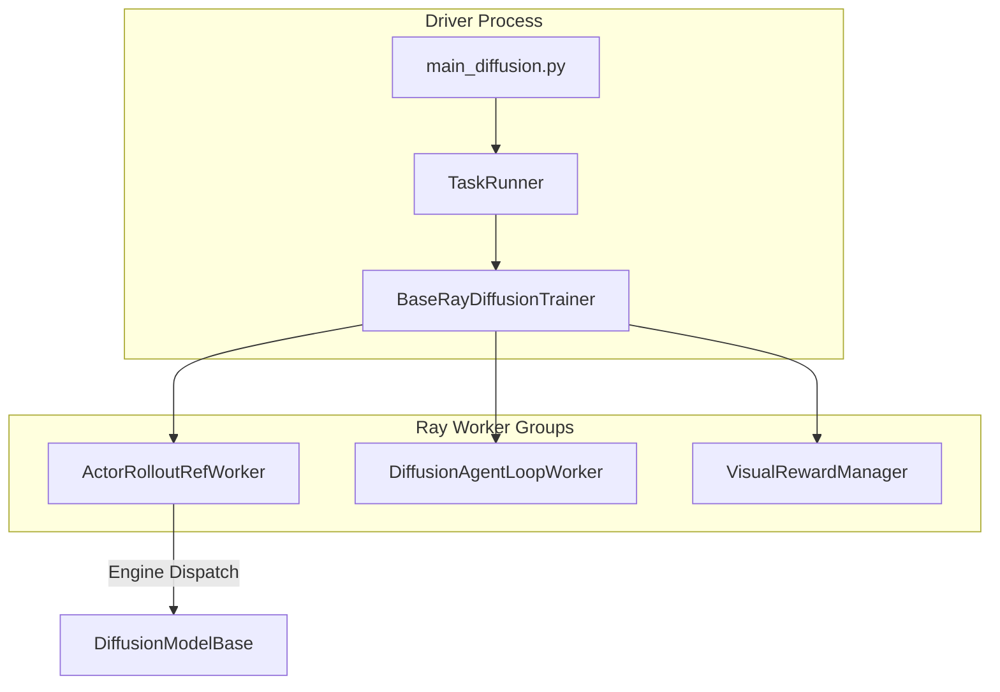
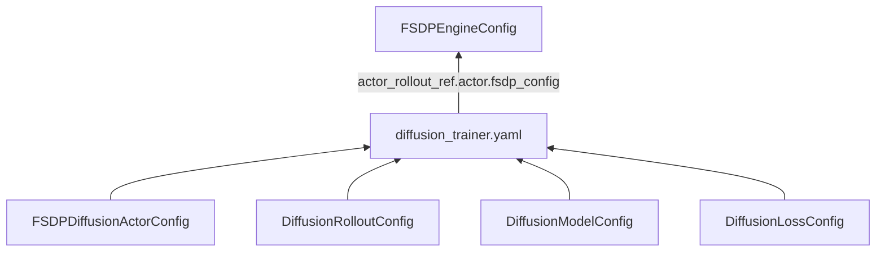

<!-- source: DeepWiki mcp.deepwiki.com · repo verl-project/verl-omni · page 3 Training Infrastructure · fetched 2026-10-30 -->

# Training Infrastructure

<details>
<summary>Relevant source files</summary>

The following files were used as context for generating this wiki page:

- [tests/gpu_smoke/run_gpu_smoke_tests.sh](tests/gpu_smoke/run_gpu_smoke_tests.sh)
- [tests/trainer/diffusion/test_dump_generations_video_on_cpu.py](tests/trainer/diffusion/test_dump_generations_video_on_cpu.py)
- [tests/trainer/diffusion/test_val_video_logging_on_cpu.py](tests/trainer/diffusion/test_val_video_logging_on_cpu.py)
- [tests/utils/reward_score/test_reward_utils_on_cpu.py](tests/utils/reward_score/test_reward_utils_on_cpu.py)
- [tests/utils/test_tracking_on_cpu.py](tests/utils/test_tracking_on_cpu.py)
- [tests/workers/test_diffusers_fsdp_engine.py](tests/workers/test_diffusers_fsdp_engine.py)
- [verl_omni/trainer/config/diffusion/model/diffusion_model.yaml](verl_omni/trainer/config/diffusion/model/diffusion_model.yaml)
- [verl_omni/trainer/diffusion/ray_diffusion_trainer.py](verl_omni/trainer/diffusion/ray_diffusion_trainer.py)
- [verl_omni/utils/reward_score/reward_utils.py](verl_omni/utils/reward_score/reward_utils.py)
- [verl_omni/utils/tracking.py](verl_omni/utils/tracking.py)
- [verl_omni/workers/config/diffusion/model.py](verl_omni/workers/config/diffusion/model.py)
- [verl_omni/workers/engine/fsdp/diffusers_impl.py](verl_omni/workers/engine/fsdp/diffusers_impl.py)

</details>


The training infrastructure of `verl-omni` is designed for large-scale, distributed RL training of diffusion and flow-matching models. It leverages **Ray** for orchestration and provides two distinct training backends: a high-performance **FSDP2** engine and the flexible **VeOmni** engine. The system is managed via a hierarchical Hydra-based configuration that coordinates the interaction between the trainer, rollout servers, and reward managers.

## System Overview

The training process is orchestrated by a single controller (the "driver") which manages a topology of Ray workers. The core entrypoint is `main_diffusion`, which initializes the Ray cluster and hands off control to a `TaskRunner`.

### Core Workflow
1.  **Initialization**: `main_diffusion` resolves the Hydra config and initializes Ray [verl_omni/trainer/main_diffusion.py:34-72]().
2.  **Resource Allocation**: The `TaskRunner` creates resource pools and maps roles (Actor, Rollout, Reward) to specific GPU groups [verl_omni/trainer/main_diffusion.py:157-180]().
3.  **Training Loop**: The `BaseRayDiffusionTrainer` (and its subclasses like `PolicyGradientRayTrainer`) manages the iterative loop of rollout, advantage estimation, and gradient updates [verl_omni/trainer/diffusion/ray_diffusion_trainer.py:136-160]().

### Code Entity Relationship
The following diagram maps high-level system components to their primary code entities.

**Infrastructure Topology**

Sources: [verl_omni/trainer/main_diffusion.py:114-155](), [verl_omni/trainer/diffusion/ray_diffusion_trainer.py:136-164](), [verl_omni/pipelines/model_base.py:27-58]().

## Key Components

### 1. Ray Trainer and Training Loop
The `BaseRayDiffusionTrainer` provides the infrastructure for distributed weight synchronization and checkpointing. Subclasses like `PolicyGradientRayTrainer` (used for Flow-GRPO) and `DirectPreferenceRayTrainer` (used for DPO/NFT) implement the specific logic for processing data through the training engines.

*   **Weight Sync**: Uses `CheckpointEngineManager` to broadcast model weights from the training engine to the rollout servers [verl_omni/trainer/diffusion/ray_diffusion_trainer.py:37-37]().
*   **Advantage Estimation**: Computes rewards and advantages across denoising timesteps using `compute_advantage` [verl_omni/trainer/diffusion/ray_diffusion_trainer.py:86-133]().
*   **Training Paradigms**: Supports both online RL (live rollouts) and offline preference training via `algorithm.sample_source` [verl_omni/trainer/main_diffusion.py:144-151]().

For details, see [Ray Trainer and Training Loop](#3.1).

### 2. FSDP2 Training Engine
The default backend for most models is the `DiffusersFSDPEngine` [verl_omni/workers/engine/fsdp/diffusers_impl.py:78-82](). It is optimized for Hugging Face `diffusers` models and supports:
*   **Meta-tensor initialization**: Handled via `init_device: meta` to manage massive models without OOM on the head node [verl_omni/trainer/config/_generated_diffusion_trainer.yaml:27-39]().
*   **Ulysses Sequence Parallelism**: Configurable via `ulysses_sequence_parallel_size` for training on high-resolution images or long sequences [verl_omni/workers/engine/fsdp/diffusers_impl.py:171-190]().
*   **LoRA Management**: Native support for LoRA adapters during RL via `LoRAAdapterMixin`, enabling reference policy computation within the same worker [verl_omni/workers/engine/fsdp/diffusers_impl.py:70-78]().

For details, see [FSDP2 Training Engine](#3.2).

### 3. VeOmni Training Engine
The `VeOmni` engine is an alternative backend that provides advanced memory management features. It is configured via `VeOmniDiffusionEngineConfig` [verl_omni/trainer/config/_generated_diffusion_veomni_trainer.yaml:26-56]().
*   **Offloading**: Supports parameter and optimizer offloading to CPU to increase effective batch size [verl_omni/trainer/config/_generated_diffusion_veomni_trainer.yaml:28-29]().
*   **Resharding**: Configurable `reshard_after_forward` to balance memory usage and communication overhead during the backward pass [verl_omni/trainer/config/_generated_diffusion_veomni_trainer.yaml:34-34]().

For details, see [VeOmni Training Engine](#3.3).

### 4. Configuration System
The system uses Hydra to manage a complex hierarchy of configurations covering models, algorithms, and infrastructure. Configurations are resolved and validated at runtime [verl_omni/trainer/main_diffusion.py:41-46]().

**Configuration Hierarchy**

Sources: [verl_omni/workers/config/diffusion/model.py:38-123](), [verl_omni/trainer/config/_generated_diffusion_trainer.yaml:6-73](), [verl_omni/trainer/config/_generated_diffusion_veomni_trainer.yaml:6-85]().

For details, see [Configuration System](#3.4).

## Main Entrypoint
The `main_diffusion.py` script is the unified entrypoint. It performs critical environment checks, such as verifying that the attention backend (e.g., Flash Attention 3) is consistent between the actor and the rollout workers [verl_omni/trainer/main_diffusion.py:34-46]().

```bash
# Example execution via main_diffusion for FlowGRPO
python3 -m verl_omni.trainer.main_diffusion \
    algorithm.trainer_type=policy_gradient \
    actor_rollout_ref.actor.strategy=fsdp \
    trainer.n_gpus_per_node=8
```
Sources: [verl_omni/trainer/main_diffusion.py:102-111]().

## Performance and Observability
The infrastructure reuses the `verl.utils.profiler` subsystem to support end-to-end tracing across Ray workers.

*   **Profiling Tools**: Supports `nsys` (Nsight Systems), `torch` (PyTorch Profiler), and `torch_memory` via the `ProfilerConfig` [verl_omni/trainer/config/_generated_diffusion_trainer.yaml:45-66]().
*   **Metrics**: Training throughput, timing metrics, and reward-specific metrics are computed per step to monitor scaling efficiency [verl_omni/trainer/diffusion/ray_diffusion_trainer.py:62-68]().
*   **Media Logging**: Supports logging video (MP4) and audio (WAV) media to WandB during validation using `wrap_val_samples_for_wandb` [verl_omni/utils/tracking.py:136-172]().
*   **Video Conversion**: Uses `video_tensor_to_pil_frames` to convert RGB uint8 tensors for export [verl_omni/utils/reward_score/reward_utils.py:24-36]().

Sources: [verl_omni/trainer/main_diffusion.py:87-90](), [verl_omni/trainer/diffusion/ray_diffusion_trainer.py:47-51](), [verl_omni/utils/tracking.py:74-134]().

---

