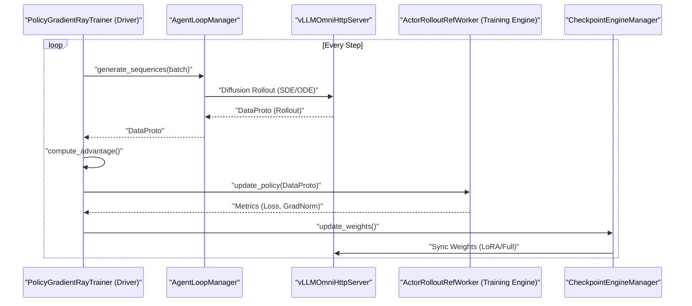

<!-- source: DeepWiki mcp.deepwiki.com · repo verl-project/verl-omni · page 3.1 Ray Trainer and Training Loop · fetched 2026-10-30 -->

# Ray Trainer and Training Loop

<details>
<summary>Relevant source files</summary>

The following files were used as context for generating this wiki page:

- [docs/start/diffusion_v1.md](docs/start/diffusion_v1.md)
- [examples/flowgrpo_trainer/sd35/run_sd35_medium_drm_lora.sh](examples/flowgrpo_trainer/sd35/run_sd35_medium_drm_lora.sh)
- [examples/flowgrpo_trainer/sd35/run_sd35_medium_ocr_lora.sh](examples/flowgrpo_trainer/sd35/run_sd35_medium_ocr_lora.sh)
- [examples/flowgrpo_trainer/sd35/run_sd35_medium_ocr_lora_v1.sh](examples/flowgrpo_trainer/sd35/run_sd35_medium_ocr_lora_v1.sh)
- [examples/flowgrpo_trainer/sd35/run_sd35_medium_ocr_lora_v1_separate_async.sh](examples/flowgrpo_trainer/sd35/run_sd35_medium_ocr_lora_v1_separate_async.sh)
- [tests/agent_loop/test_diffusion_agent_loop_correctness_on_cpu.py](tests/agent_loop/test_diffusion_agent_loop_correctness_on_cpu.py)
- [tests/pipelines/test_sd3_token_id_prompt_on_cpu.py](tests/pipelines/test_sd3_token_id_prompt_on_cpu.py)
- [tests/trainer/diffusion/test_dump_generations_video_on_cpu.py](tests/trainer/diffusion/test_dump_generations_video_on_cpu.py)
- [tests/trainer/diffusion/test_v1_replay_buffer_on_cpu.py](tests/trainer/diffusion/test_v1_replay_buffer_on_cpu.py)
- [tests/trainer/diffusion/test_val_video_logging_on_cpu.py](tests/trainer/diffusion/test_val_video_logging_on_cpu.py)
- [tests/utils/reward_score/test_reward_utils_on_cpu.py](tests/utils/reward_score/test_reward_utils_on_cpu.py)
- [tests/utils/test_tracking_on_cpu.py](tests/utils/test_tracking_on_cpu.py)
- [verl_omni/agent_loop/diffusion_agent_loop_tq.py](verl_omni/agent_loop/diffusion_agent_loop_tq.py)
- [verl_omni/trainer/config/diffusion_trainer.yaml](verl_omni/trainer/config/diffusion_trainer.yaml)
- [verl_omni/trainer/diffusion/ray_diffusion_trainer.py](verl_omni/trainer/diffusion/ray_diffusion_trainer.py)
- [verl_omni/trainer/diffusion/v1/__init__.py](verl_omni/trainer/diffusion/v1/__init__.py)
- [verl_omni/trainer/diffusion/v1/trainer_base.py](verl_omni/trainer/diffusion/v1/trainer_base.py)
- [verl_omni/utils/reward_score/reward_utils.py](verl_omni/utils/reward_score/reward_utils.py)
- [verl_omni/utils/tracking.py](verl_omni/utils/tracking.py)

</details>


The Ray-based training infrastructure in VeRL-Omni orchestrates distributed RL training for diffusion and flow-matching models. It manages the coordination between training engines (FSDP2/VeOmni), rollout workers (vLLM-Omni), and reward managers. The system is designed around a single controller pattern where a central trainer drives the RL lifecycle across a Ray cluster.

## Architecture Overview

The training loop is implemented via a hierarchy of trainers:
*   `BaseRayDiffusionTrainer`: Provides common infrastructure for worker initialization, validation, checkpointing, and logging [verl_omni/trainer/diffusion/ray_diffusion_trainer.py:136-164]().
*   `PolicyGradientRayTrainer`: Implements the `fit()` loop for policy gradient algorithms like FlowGRPO, MixGRPO, and DanceGRPO [verl_omni/trainer/diffusion/ray_diffusion_trainer.py:348-350]().
*   `DirectPreferenceRayTrainer`: Implements the `fit()` loop for preference-based algorithms like DiffusionNFT and DPO [verl_omni/trainer/diffusion/ray_diffusion_trainer.py:683-685]().
*   `PolicyGradientDiffusionTrainerV1`: A base class for V1 trainers using `TransferQueue` and `ReplayBuffer` to decouple rollout from training [verl_omni/trainer/diffusion/v1/trainer_base.py:104-112]().

### System Entity Mapping

The following diagram maps the conceptual RL components to their implementation entities in the codebase.

**Diagram: System Entity Mapping**
```mermaid
graph TD
    subgraph "Control_Plane_(Driver_Process)"
        ["main_diffusion_v1.py / main_diffusion.py"]
        ["PolicyGradientRayTrainer / DirectPreferenceRayTrainer"]
        ["PolicyGradientDiffusionTrainerV1"]
    end

    subgraph "Execution_Plane_(Ray_Worker_Groups)"
        ["ActorRolloutRefWorker"]
        ["vLLMOmniHttpServer"]
        ["AgentLoopManager / DiffusionAgentLoopWorker"]
        ["DiffusionAgentLoopWorkerTQ"]
        ["VisualRewardManager / MultiVisualRewardManager"]
    end

    subgraph "Data_Transport"
        ["transfer_queue"]
        ["ReplayBuffer"]
    end

    ["main_diffusion_v1.py / main_diffusion.py"] -->|Instantiates| ["PolicyGradientRayTrainer / DirectPreferenceRayTrainer"]
    ["main_diffusion_v1.py / main_diffusion.py"] -->|Instantiates| ["PolicyGradientDiffusionTrainerV1"]
    ["PolicyGradientRayTrainer / DirectPreferenceRayTrainer"] -->|Orchestrates| ["ActorRolloutRefWorker"]
    ["PolicyGradientRayTrainer / DirectPreferenceRayTrainer"] -->|Coordinates| ["AgentLoopManager / DiffusionAgentLoopWorker"]
    ["PolicyGradientDiffusionTrainerV1"] -->|Coordinates| ["DiffusionAgentLoopWorkerTQ"]
    ["DiffusionAgentLoopWorkerTQ"] -->|Writes_Trajectories| ["transfer_queue"]
    ["transfer_queue"] -->|Feeds| ["ReplayBuffer"]
    ["ReplayBuffer"] -->|Samples_to| ["PolicyGradientDiffusionTrainerV1"]
    ["AgentLoopManager / DiffusionAgentLoopWorker"] -->|Requests_Generations| ["vLLMOmniHttpServer"]
    ["AgentLoopManager / DiffusionAgentLoopWorker"] -->|Requests_Scores| ["VisualRewardManager / MultiVisualRewardManager"]
```

Sources: [verl_omni/trainer/diffusion/ray_diffusion_trainer.py:136-164](), [verl_omni/trainer/diffusion/v1/trainer_base.py:104-129](), [verl_omni/trainer/diffusion/v1/trainer_base.py:75](), [examples/flowgrpo_trainer/sd35/run_sd35_medium_ocr_lora_v1.sh:44]()

## The Training Loop (`fit`)

The `fit()` method represents the core RL execution loop. It iterates through epochs and steps, performing rollout, advantage estimation, and model updates.

### Execution Flow
1.  **Rollout Generation**: The trainer triggers `self.agent_loop_manager.generate_sequences()` which coordinates with vLLM-Omni [verl_omni/trainer/diffusion/ray_diffusion_trainer.py:416-435]().
2.  **Reward Integration**: Rewards are extracted from the rollout data via `extract_reward` [verl_omni/trainer/diffusion/ray_diffusion_trainer.py:44, 440-455]().
3.  **Advantage Estimation**: For policy gradients, `compute_advantage` calculates returns and advantages (e.g., Flow-GRPO) using the registered `adv_estimator_fn` [verl_omni/trainer/diffusion/ray_diffusion_trainer.py:86-133]().
4.  **Rollout Correction**: If enabled, Importance Sampling or Rejection Sampling is applied to the batch via `apply_rollout_correction_to_diffusion_batch` [verl_omni/trainer/diffusion/ray_diffusion_trainer.py:74-79, 465-475]().
5.  **Weight Update**: The trainer calls `actor_rollout_group.update_policy()` to perform backpropagation on the training engine [verl_omni/trainer/diffusion/ray_diffusion_trainer.py:489-495]().
6.  **Synchronization**: Weights are synchronized to the rollout servers via `self.checkpoint_manager.update_weights()` [verl_omni/trainer/diffusion/ray_diffusion_trainer.py:513-520]().

**Diagram: Diffusion RL Training Loop**


Sources: [verl_omni/trainer/diffusion/ray_diffusion_trainer.py:86-133](), [verl_omni/trainer/diffusion/ray_diffusion_trainer.py:416-520](), [verl_omni/trainer/diffusion/ray_diffusion_trainer.py:42-79]()

## V1 Trainer: TransferQueue and ReplayBuffer

The V1 trainer infrastructure (`PolicyGradientDiffusionTrainerV1`) mirrors the lifecycle of standard RL pipelines by decoupling rollout generation from training via a buffer [verl_omni/trainer/diffusion/v1/trainer_base.py:104-120]().

*   **TransferQueue (TQ)**: A high-performance transport layer used to move trajectories from workers to the trainer [verl_omni/trainer/diffusion/v1/trainer_base.py:28, 71]().
*   **ReplayBuffer**: Collects samples from TQ and manages off-policy thresholds and sampling strategies [verl_omni/trainer/diffusion/v1/trainer_base.py:119, 130-145]().
*   **Synchronous Mode**: In `sync` mode, the trainer waits for a full rollout batch before training [verl_omni/trainer/diffusion/v1/trainer_base.py:134-135]().
*   **Data Conversion**: `diffusion_tq_batch_to_dataproto` converts raw TQ rows into the `DataProto` format required by the diffusion compute path [verl_omni/trainer/diffusion/v1/tq_utils.py:91-143]().
*   **Rollout Failure Handling**: The V1 sampler supports `drop_incomplete_groups`, which evicts prompt groups if rollout sessions fail and refills them to maintain exact batch sizes [verl_omni/trainer/diffusion/v1/trainer_base.py:132-137]().
*   **Separate Async Mode**: In `separate_async` mode, a standalone rollout manager serves generation traffic on dedicated GPUs while colocated actor/rollout replicas sleep during training [examples/flowgrpo_trainer/sd35/run_sd35_medium_ocr_lora_v1_separate_async.sh:1-11]().

Sources: [verl_omni/trainer/diffusion/v1/trainer_base.py:104-145](), [verl_omni/trainer/diffusion/v1/tq_utils.py:91-143](), [examples/flowgrpo_trainer/sd35/run_sd35_medium_ocr_lora_v1_separate_async.sh:1-11]()

## Weight Synchronization and Checkpointing

Weight synchronization bridges the gap between the training engine and the vLLM rollout server.

### CheckpointEngineManager
The trainer uses the `CheckpointEngineManager` to manage model state across the cluster [verl_omni/trainer/diffusion/ray_diffusion_trainer.py:37](). 
*   **Weight Sync**: `self.checkpoint_manager.update_weights()` is called to push updated parameters (LoRA or full) to the rollout actors [verl_omni/trainer/diffusion/ray_diffusion_trainer.py:513-520]().
*   **Old Policy Management**: For preference algorithms, the trainer manages `old_policy` synchronization and decay via `old_policy_decay` [verl_omni/trainer/diffusion/ray_diffusion_trainer.py:71, 786-791]().

### ESI (Elastic State Interface)
The trainer supports saving and loading Elastic State Interface (ESI) checkpoints for seamless resumption [verl_omni/trainer/diffusion/ray_diffusion_trainer.py:47, 175-176]().
*   **Stateful Dataloader**: `StatefulDataLoader` is used to track dataset position across restarts [verl_omni/trainer/diffusion/ray_diffusion_trainer.py:34, 284-290]().
*   **ESI Logic**: `should_save_ckpt_esi` determines if an ESI checkpoint should be triggered based on time remaining and historical step duration [verl_omni/trainer/diffusion/ray_diffusion_trainer.py:47, 532-535]().

Sources: [verl_omni/trainer/diffusion/ray_diffusion_trainer.py:34-47](), [verl_omni/trainer/diffusion/ray_diffusion_trainer.py:513-535](), [verl_omni/trainer/diffusion/ray_diffusion_trainer.py:786-791](), [verl_omni/trainer/config/diffusion_trainer.yaml:173-187]()

## Advantage and Loss Computation

The trainer abstracts algorithm-specific logic into separate modules while maintaining a unified interface in the loop.

| Function / Class | Role | Source |
| :--- | :--- | :--- |
| `compute_advantage` | Orchestrates advantage and return calculation using `get_diffusion_adv_estimator_fn`. | [verl_omni/trainer/diffusion/ray_diffusion_trainer.py:86-133]() |
| `get_diffusion_loss_fn` | Retrieves the loss function (e.g., Flow-GRPO) based on config. | [verl_omni/trainer/diffusion/ray_diffusion_trainer.py:60]() |
| `apply_rollout_correction` | Adjusts batch data based on Importance Sampling or Rejection Sampling. | [verl_omni/trainer/diffusion/ray_diffusion_trainer.py:74-79]() |
| `old_policy_decay` | Computes the EMA decay for the old policy adapter in NFT. | [verl_omni/trainer/diffusion/ray_diffusion_trainer.py:71]() |

Sources: [verl_omni/trainer/diffusion/ray_diffusion_trainer.py:60-133](), [verl_omni/trainer/diffusion/ray_diffusion_trainer.py:74-79]()

## Worker Initialization

Distributed workers are instantiated via Ray worker groups, mapping logical roles to physical resource pools.

*   **ActorRolloutRefWorker**: A unified worker class that can act as the training engine, rollout coordinator, or reference policy [verl_omni/workers/engine_workers.py]() (referenced in [verl_omni/trainer/diffusion/v1/trainer_base.py:75]()).
*   **Resource Management**: `ResourcePoolManager` allocates GPU resources for the global training pool and dedicated reward pools [verl_omni/trainer/diffusion/ray_diffusion_trainer.py:40, 148]().
*   **Validation Logging**: `ValidationGenerationsLogger` manages the logging of media (images/videos) to tracking backends like WandB [verl_omni/trainer/diffusion/ray_diffusion_trainer.py:53, 206-209](). Video outputs are encoded to mp4 via `_export_video` and logged as `wandb.Video` [verl_omni/utils/tracking.py:74-134, 136-172]().

Sources: [verl_omni/trainer/diffusion/v1/trainer_base.py:75](), [verl_omni/trainer/diffusion/ray_diffusion_trainer.py:40, 148](), [verl_omni/trainer/diffusion/ray_diffusion_trainer.py:53, 206-209](), [verl_omni/utils/tracking.py:74-172]()

---

