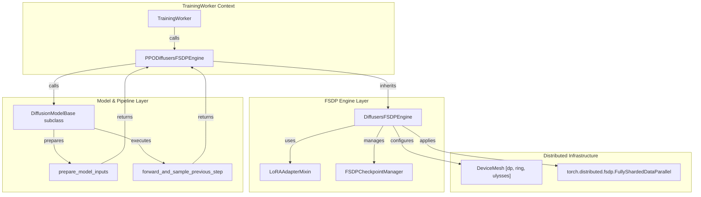
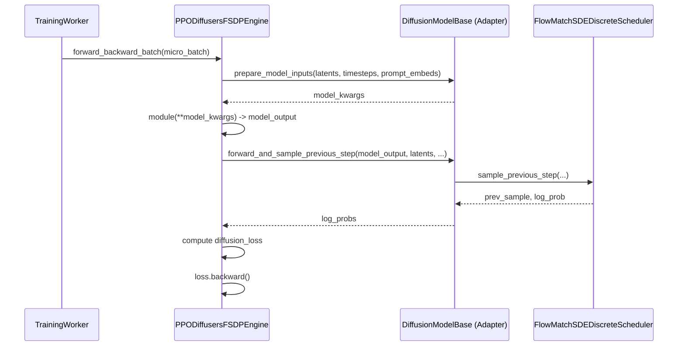

<!-- source: DeepWiki mcp.deepwiki.com · repo verl-project/verl-omni · page 3.2 FSDP2 Training Engine · fetched 2026-10-30 -->

# FSDP2 Training Engine

Relevant source files

The following files were used as context for generating this wiki page:

- [tests/gpu_smoke/run_gpu_smoke_tests.sh](tests/gpu_smoke/run_gpu_smoke_tests.sh)
- [tests/workers/test_diffusers_fsdp_engine.py](tests/workers/test_diffusers_fsdp_engine.py)
- [tests/workers/test_diffusers_ulysses.py](tests/workers/test_diffusers_ulysses.py)
- [verl_omni/models/__init__.py](verl_omni/models/__init__.py)
- [verl_omni/models/diffusers/__init__.py](verl_omni/models/diffusers/__init__.py)
- [verl_omni/models/diffusers/flash_attention_3.py](verl_omni/models/diffusers/flash_attention_3.py)
- [verl_omni/models/diffusers/qwen_image.py](verl_omni/models/diffusers/qwen_image.py)
- [verl_omni/trainer/config/diffusion/model/diffusion_model.yaml](verl_omni/trainer/config/diffusion/model/diffusion_model.yaml)
- [verl_omni/utils/fsdp_utils.py](verl_omni/utils/fsdp_utils.py)
- [verl_omni/workers/config/diffusion/model.py](verl_omni/workers/config/diffusion/model.py)
- [verl_omni/workers/engine/__init__.py](verl_omni/workers/engine/__init__.py)
- [verl_omni/workers/engine/fsdp/__init__.py](verl_omni/workers/engine/fsdp/__init__.py)
- [verl_omni/workers/engine/fsdp/diffusers_impl.py](verl_omni/workers/engine/fsdp/diffusers_impl.py)

The FSDP2 Training Engine in VeRL-Omni is centered around the `DiffusersFSDPEngine`, which provides a high-performance distributed training backend for Diffusion Transformers (DiTs). It leverages PyTorch's FullyShardedDataParallel (FSDP) to enable large-scale training of models like Qwen-Image, SD3.5, and Wan2.2.

The engine handles the complexities of model sharding, sequence parallelism (Ulysses), LoRA adapter management, and efficient memory offloading while maintaining a unified interface for various RL algorithms (PPO, DPO, NFT).

## Engine Architecture and Initialization

The `DiffusersFSDPEngine` serves as the abstract base class that implements the `BaseEngine` interface [verl_omni/workers/engine/fsdp/diffusers_impl.py:78-79](). It is designed to work with models loaded via the `diffusers` library but optimized for RL workloads.

### Model Construction with Meta-Tensors
To avoid Out-Of-Memory (OOM) issues during initialization of massive models, the engine uses **meta-tensor initialization**. The model is first instantiated on the `meta` device, and parameters are materialized only when needed during FSDP wrapping. This is facilitated by the `get_init_weight_context_manager` and `init_fn` utilities [verl_omni/workers/engine/fsdp/diffusers_impl.py:45-46]().

### FSDP1 vs FSDP2 Wrapping
The engine supports both FSDP1 (legacy `FullyShardedDataParallel`) and FSDP2 (`torch.distributed._composable.fsdp`). FSDP2 is preferred for newer PyTorch versions due to better integration with `torch.compile` and more flexible sharding strategies. The wrapping logic is abstracted behind `apply_fsdp2` and `get_fsdp_wrap_policy` [verl_omni/workers/engine/fsdp/diffusers_impl.py:36-44](). The sharding strategy is determined via `get_sharding_strategy` [verl_omni/workers/engine/fsdp/utils.py:57-57]().

### Sequence Parallelism (Ulysses)
For high-resolution image or video generation, sequence length can exceed the memory capacity of a single GPU. The engine implements **Ulysses Sequence Parallelism**, which partitions the sequence dimension across a dedicated sub-group of the device mesh.

- **Device Mesh**: The engine initializes a 3D device mesh with dimensions `["dp", "ring", "ulysses"]` [verl_omni/workers/engine/fsdp/diffusers_impl.py:184-188]().
- **Attention Backends**: The engine supports `_flash_3_varlen_hub` and other backends to handle non-contiguous attention masks common in multimodal joint attention [verl_omni/workers/config/diffusion/model.py:87-87]().
- **Compatibility**: Ulysses sequence parallelism requires `diffusers >= 0.38.0` [verl_omni/workers/engine/fsdp/diffusers_impl.py:177-180]().
- **Mask Fixes**: Multimodal models like Qwen-Image require specific attention mask patches when using Ulysses to handle interleaved text/image tokens [verl_omni/models/diffusers/qwen_image.py:24-34]().

**Sources:**
- `verl_omni/workers/engine/fsdp/diffusers_impl.py:78-192`()
- `verl_omni/workers/config/diffusion/model.py:38-123`()
- `verl_omni/models/diffusers/qwen_image.py:24-88`()

## Implementation Details

The following diagram illustrates the relationship between the Training Engine, the Pipeline Adapters, and the underlying FSDP infrastructure.

### Engine Entity Map
Title: "Engine Entity and Data Flow"

**Sources:**
- `verl_omni/workers/engine_workers.py:31-31`()
- `verl_omni/workers/engine/fsdp/diffusers_impl.py:78-82`()
- `verl_omni/workers/engine/fsdp/diffusers_impl.py:145-152`()
- `verl_omni/pipelines/model_base.py:60-60`()

## LoRA Adapter Management

The engine provides robust support for Parameter-Efficient Fine-Tuning (PEFT) via the `LoRAAdapterMixin` [verl_omni/workers/engine/lora_adapter_mixin.py:26](). This is critical for RL algorithms like PPO or DPO that often maintain multiple versions of the policy (e.g., "active" and "old/reference").

| Feature | Implementation |
| :--- | :--- |
| **Layered Summon** | `fsdp_summon_full_params` context manager gathers sharded LoRA weights across the mesh for synchronization [verl_omni/utils/fsdp_utils.py:62-83](). |
| **EMA Updates** | `ema_update_adapter` allows updating a reference adapter (e.g., a target network) using Exponential Moving Average [verl_omni/workers/engine/lora_adapter_mixin.py:148-152](). |
| **Switching** | `use_adapter` and `_set_adapter` allow hot-swapping active LoRA ranks during training or evaluation [verl_omni/workers/engine/lora_adapter_mixin.py:105-127](). |
| **Param Collection** | `collect_lora_params` provides FSDP-aware parameter gathering for weight synchronization between actor and rollout workers [verl_omni/utils/fsdp_utils.py:29-34](). |

The engine supports collecting parameters from specific named adapters. For FSDP2, it iterates through submodules using `_iter_fsdp2_submodules` to summon full parameters before extraction [verl_omni/utils/fsdp_utils.py:54-59](). It also handles specialized modules like Fused MoE experts via `split_fused_moe_lora_targets` [verl_omni/utils/fsdp_utils.py:122-125]().

**Sources:**
- `verl_omni/workers/engine/lora_adapter_mixin.py:26-152`()
- `verl_omni/utils/fsdp_utils.py:29-148`()
- `verl_omni/workers/engine/fsdp/diffusers_impl.py:118-118`()

## Engine Variants (PPO/DPO/NFT)

While `DiffusersFSDPEngine` handles infrastructure, concrete subclasses implement algorithm-specific logic [verl_omni/workers/engine/fsdp/__init__.py:14-19]():

1.  **PPODiffusersFSDPEngine**: Concrete engine registered for FlowGRPO-style training. It computes log-probabilities for the denoising trajectory and handles advantage-weighted losses.
2.  **DPODiffusersFSDPEngine**: Specialized for Direct Preference Optimization. It manages chosen/rejected pair forward passes and computes the implicit reward based on the log-ratio of the current and reference policies.
3.  **NFTDiffusersFSDPEngine**: Used for Diffusion-NFT (No-Fine-Tuning/Direct Process Optimization), focusing on forward-process updates.

### PPO Training Step Logic
Title: "PPO Forward/Backward Lifecycle"

**Sources:**
- `verl_omni/workers/engine/fsdp/diffusers_impl.py:61-67`()
- `verl_omni/pipelines/model_base.py:60-60`()
- `verl_omni/workers/utils/losses.py:32-33`()

## CPU Offloading and Memory Management

To support large models on limited VRAM, the engine implements several memory optimization strategies:

- **Param/Optimizer Offloading**: Parameters and optimizer states can be offloaded to CPU when not in use. Controlled via `engine_config.param_offload` and `engine_config.optimizer_offload` [verl_omni/workers/engine/fsdp/diffusers_impl.py:116-117]().
- **Aggressive Cache Clearing**: The engine calls `aggressive_empty_cache()` at key boundaries (e.g., after offloading or large sharding operations) [verl_omni/workers/engine/fsdp/diffusers_impl.py:52-52]().
- **Mixed Precision**: Uses `MixedPrecisionPolicy` to cast weights and activations during the forward pass while maintaining master weights in the configured optimizer dtype [verl_omni/workers/engine/fsdp/diffusers_impl.py:39-39]().

**Sources:**
- `verl_omni/workers/engine/fsdp/diffusers_impl.py:154-161`()
- `verl_omni/workers/config/diffusion/model.py:114-114`()
- `verl_omni/workers/config/diffusion/rollout.py:30-31`()

---

