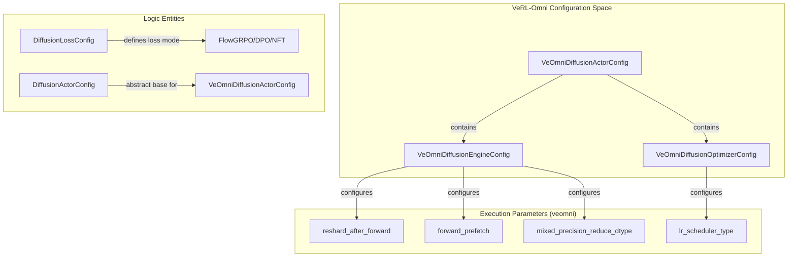
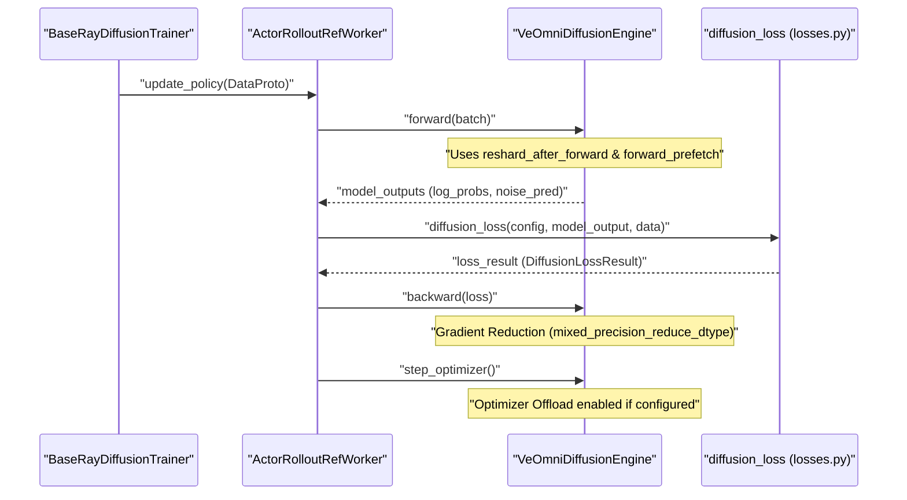

<!-- source: DeepWiki mcp.deepwiki.com · repo verl-project/verl-omni · page 3.3 VeOmni Training Engine · fetched 2026-10-30 -->

# VeOmni Training Engine

Relevant source files

The following files were used as context for generating this wiki page:

- [docs/algo/grpo_guard.md](docs/algo/grpo_guard.md)
- [tests/agent_loop/test_diffusion_agent_loop.py](tests/agent_loop/test_diffusion_agent_loop.py)
- [tests/trainer/diffusion/test_diffusion_core_algos_on_cpu.py](tests/trainer/diffusion/test_diffusion_core_algos_on_cpu.py)
- [tests/trainer/diffusion/test_diffusion_distillation_losses_on_cpu.py](tests/trainer/diffusion/test_diffusion_distillation_losses_on_cpu.py)
- [tests/trainer/diffusion/test_diffusion_registry_on_cpu.py](tests/trainer/diffusion/test_diffusion_registry_on_cpu.py)
- [tests/workers/config/test_diffusion_config_on_cpu.py](tests/workers/config/test_diffusion_config_on_cpu.py)
- [verl_omni/agent_loop/diffusion_agent_loop.py](verl_omni/agent_loop/diffusion_agent_loop.py)
- [verl_omni/pipelines/schedulers/flow_match_sde.py](verl_omni/pipelines/schedulers/flow_match_sde.py)
- [verl_omni/trainer/config/_generated_diffusion_trainer.yaml](verl_omni/trainer/config/_generated_diffusion_trainer.yaml)
- [verl_omni/trainer/config/_generated_diffusion_veomni_trainer.yaml](verl_omni/trainer/config/_generated_diffusion_veomni_trainer.yaml)
- [verl_omni/trainer/config/diffusion/actor/diffusion_actor.yaml](verl_omni/trainer/config/diffusion/actor/diffusion_actor.yaml)
- [verl_omni/trainer/config/diffusion/rollout/diffusion_rollout.yaml](verl_omni/trainer/config/diffusion/rollout/diffusion_rollout.yaml)
- [verl_omni/trainer/diffusion/diffusion_algos.py](verl_omni/trainer/diffusion/diffusion_algos.py)
- [verl_omni/workers/config/diffusion/actor.py](verl_omni/workers/config/diffusion/actor.py)
- [verl_omni/workers/config/diffusion/rollout.py](verl_omni/workers/config/diffusion/rollout.py)
- [verl_omni/workers/engine/veomni/diffusion_impl.py](verl_omni/workers/engine/veomni/diffusion_impl.py)
- [verl_omni/workers/utils/losses.py](verl_omni/workers/utils/losses.py)

The VeOmni Training Engine is a specialized alternative training backend for diffusion models within the VeRL-Omni framework. While the default engine leverages standard FSDP2 through `DiffusersFSDPEngine`, the VeOmni engine utilizes the `veomni` library to provide advanced distributed training features such as optimized parameter and optimizer offloading, fine-grained FSDP2 sharding control, and specialized kernel implementations for diffusion transformers (DiTs).

## Overview and Purpose

The `VeOmniDiffusionEngine` (referenced as the implementation of the `veomni` strategy) is designed for large-scale diffusion model training where memory efficiency and throughput are critical. It serves as a drop-in replacement for the FSDP2 engine when configured via the `strategy: veomni` flag [verl_omni/trainer/config/_generated_diffusion_veomni_trainer.yaml:45,81](). It is particularly optimized for models like Qwen-Image and BAGEL, providing a robust infrastructure for Flow-Matching Policy Gradient (FlowGRPO) and other RL-based diffusion algorithms.

### Key Capabilities
*   **FSDP2 Integration:** Native support for PyTorch FSDP2 with configurable sharding groups (`fsdp_size`) [verl_omni/workers/config/diffusion/actor.py:80]().
*   **Memory Management:** Built-in CPU offloading for both model parameters and optimizer states [verl_omni/trainer/config/_generated_diffusion_veomni_trainer.yaml:28-29]().
*   **Performance Optimization:** Support for `reshard_after_forward` and `forward_prefetch` to overlap communication with computation [verl_omni/workers/config/diffusion/actor.py:84-85]().
*   **Mixed Precision:** Configurable dtypes for parameters, gradient reduction, and forward outputs [verl_omni/workers/config/diffusion/actor.py:88-90]().
*   **Parallelism Support:** Integrated support for `ulysses_parallel_size` and `expert_parallel_size` for hybrid parallelism [verl_omni/workers/config/diffusion/actor.py:81-82]().

**Sources:**
* [verl_omni/workers/config/diffusion/actor.py:75-105]()
* [verl_omni/trainer/config/_generated_diffusion_veomni_trainer.yaml:26-56]()

---

## Architecture and Implementation

The engine is controlled via the `VeOmniDiffusionEngineConfig` and `VeOmniDiffusionActorConfig` classes [verl_omni/workers/config/diffusion/actor.py:75,190]().

### System Component Mapping
The following diagram illustrates how the VeOmni Training Engine bridges the high-level RL training requirements with the low-level distributed primitives.

**Diagram: VeOmni Engine Component Mapping**

**Sources:**
* [verl_omni/workers/config/diffusion/actor.py:75-132,190-204]()

### Implementation Details: Configuration
The engine lifecycle is driven by the configuration objects which specify how the model should be partitioned and executed.

*   **Engine Configuration:** The `VeOmniDiffusionEngineConfig` manages FSDP2-specific settings like `fsdp_size`, `ulysses_parallel_size`, and `expert_parallel_size` [verl_omni/workers/config/diffusion/actor.py:80-82](). It also controls kernel-level implementation choices for `attn_implementation`, `moe_implementation`, and `rms_norm_implementation` [verl_omni/workers/config/diffusion/actor.py:95-98]().
*   **Optimizer Configuration:** The `VeOmniDiffusionOptimizerConfig` provides specialized scheduling parameters such as `lr_scheduler_type` (supporting `constant`, `linear`, and `cosine`) and `lr_decay_ratio` [verl_omni/workers/config/diffusion/actor.py:120-121](). It also supports `fused` optimizer implementations [verl_omni/workers/config/diffusion/actor.py:122]().

**Sources:**
* [verl_omni/workers/config/diffusion/actor.py:75-132]()

---

## Data Flow and Training Loop

The data flow within the VeOmni engine follows the standard RL training contract but utilizes optimized forward and backward passes.

**Diagram: VeOmni Training Data Flow**

**Sources:**
* [verl_omni/workers/utils/losses.py:71-130]()
* [verl_omni/trainer/diffusion/diffusion_algos.py:34-40]()
* [verl_omni/trainer/config/_generated_diffusion_veomni_trainer.yaml:28-40]()

---

## Configuration and Switching

Switching to the VeOmni engine is performed by updating the Hydra configuration. The system uses a specific `VeOmniDiffusionActorConfig` which defaults the strategy to `veomni` [verl_omni/workers/config/diffusion/actor.py:192]().

### Configuration Structure
The configuration is split into three main parts:
1.  **Actor Config:** `VeOmniDiffusionActorConfig` [verl_omni/workers/config/diffusion/actor.py:190]().
2.  **Engine Config:** `VeOmniDiffusionEngineConfig` [verl_omni/workers/config/diffusion/actor.py:75]().
3.  **Optimizer Config:** `VeOmniDiffusionOptimizerConfig` [verl_omni/workers/config/diffusion/actor.py:115]().

### Key Parameters
| Parameter | Description | Default |
| :--- | :--- | :--- |
| `param_offload` | Offload model parameters to CPU when not training. | `false` [verl_omni/trainer/config/_generated_diffusion_veomni_trainer.yaml:28]() |
| `optimizer_offload` | Offload optimizer states to CPU. | `false` [verl_omni/trainer/config/_generated_diffusion_veomni_trainer.yaml:29]() |
| `fsdp_size` | Size of the FSDP shard group. `-1` uses all DP ranks. | `-1` [verl_omni/workers/config/diffusion/actor.py:80]() |
| `reshard_after_forward` | If `true`, parameters are resharded after the forward pass. | `true` [verl_omni/workers/config/diffusion/actor.py:84]() |
| `forward_prefetch` | Enables FSDP2 manual prefetching for better overlap. | `true` [verl_omni/workers/config/diffusion/actor.py:85]() |
| `init_device` | Device used for initial model creation (usually `meta`). | `meta` [verl_omni/workers/config/diffusion/actor.py:83]() |
| `mixed_precision_reduce_dtype` | Precision used for gradient reduction. | `float32` [verl_omni/workers/config/diffusion/actor.py:89]() |

**Sources:**
* [verl_omni/workers/config/diffusion/actor.py:75-132]()
* [verl_omni/trainer/config/_generated_diffusion_veomni_trainer.yaml:26-56]()

---

## Comparison with FSDP2 Engine

The standard `FSDPEngineConfig` used in the default engine lacks several of the specialized implementation flags present in VeOmni.

| Feature | FSDP2 Engine (Default) | VeOmni Engine |
| :--- | :--- | :--- |
| Strategy Name | `fsdp` [verl_omni/trainer/config/_generated_diffusion_trainer.yaml:43]() | `veomni` [verl_omni/workers/config/diffusion/actor.py:79]() |
| Parallelism | Ulysses [verl_omni/trainer/config/_generated_diffusion_trainer.yaml:41]() | Ulysses + Expert [verl_omni/workers/config/diffusion/actor.py:81-82]() |
| Kernel Control | None (Implicit) | Explicit (Attn, MoE, Norm, etc.) [verl_omni/workers/config/diffusion/actor.py:95-104]() |
| Mixed Precision | `dtype` [verl_omni/trainer/config/_generated_diffusion_trainer.yaml:44]() | Detailed (Param, Reduce, Output) [verl_omni/workers/config/diffusion/actor.py:87-91]() |

**Sources:**
* [verl_omni/trainer/config/_generated_diffusion_trainer.yaml:27-44]()
* [verl_omni/workers/config/diffusion/actor.py:75-113]()

---

