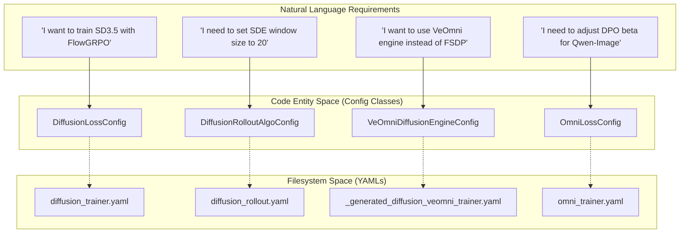
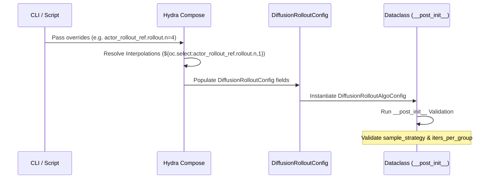

<!-- source: DeepWiki mcp.deepwiki.com · repo verl-project/verl-omni · page 3.4 Configuration System · fetched 2026-10-30 -->

# Configuration System

<details>
<summary>Relevant source files</summary>

The following files were used as context for generating this wiki page:

- [docs/algo/diffusion_opd.md](docs/algo/diffusion_opd.md)
- [docs/examples/config.md](docs/examples/config.md)
- [docs/examples/diffusionopd_trainer.md](docs/examples/diffusionopd_trainer.md)
- [examples/diffusionopd_trainer/README.md](examples/diffusionopd_trainer/README.md)
- [examples/diffusionopd_trainer/sd35/run_sd35_medium_ocr_distill.sh](examples/diffusionopd_trainer/sd35/run_sd35_medium_ocr_distill.sh)
- [scripts/generate_trainer_config.sh](scripts/generate_trainer_config.sh)
- [scripts/print_cfg.py](scripts/print_cfg.py)
- [tests/agent_loop/test_diffusion_agent_loop.py](tests/agent_loop/test_diffusion_agent_loop.py)
- [tests/special_e2e/run_diffusion_teacher_smoke.sh](tests/special_e2e/run_diffusion_teacher_smoke.sh)
- [tests/special_sanity/test_config_docs.py](tests/special_sanity/test_config_docs.py)
- [tests/trainer/diffusion/test_distillation_config_on_cpu.py](tests/trainer/diffusion/test_distillation_config_on_cpu.py)
- [tests/workers/config/test_diffusion_config_on_cpu.py](tests/workers/config/test_diffusion_config_on_cpu.py)
- [tests/workers/config/test_omni_config_on_cpu.py](tests/workers/config/test_omni_config_on_cpu.py)
- [tests/workers/config/test_print_cfg_on_cpu.py](tests/workers/config/test_print_cfg_on_cpu.py)
- [verl_omni/agent_loop/diffusion_agent_loop.py](verl_omni/agent_loop/diffusion_agent_loop.py)
- [verl_omni/trainer/config/_generated_diffusion_trainer.yaml](verl_omni/trainer/config/_generated_diffusion_trainer.yaml)
- [verl_omni/trainer/config/_generated_diffusion_veomni_trainer.yaml](verl_omni/trainer/config/_generated_diffusion_veomni_trainer.yaml)
- [verl_omni/trainer/config/_generated_omni_megatron_trainer.yaml](verl_omni/trainer/config/_generated_omni_megatron_trainer.yaml)
- [verl_omni/trainer/config/algorithm.py](verl_omni/trainer/config/algorithm.py)
- [verl_omni/trainer/config/diffusion/rollout/diffusion_rollout.yaml](verl_omni/trainer/config/diffusion/rollout/diffusion_rollout.yaml)
- [verl_omni/trainer/config/omni/model/omni_model.yaml](verl_omni/trainer/config/omni/model/omni_model.yaml)
- [verl_omni/trainer/config/omni_megatron_trainer.yaml](verl_omni/trainer/config/omni_megatron_trainer.yaml)
- [verl_omni/trainer/config/omni_trainer.yaml](verl_omni/trainer/config/omni_trainer.yaml)
- [verl_omni/workers/config/diffusion/rollout.py](verl_omni/workers/config/diffusion/rollout.py)
- [verl_omni/workers/config/omni/__init__.py](verl_omni/workers/config/omni/__init__.py)
- [verl_omni/workers/config/omni/actor.py](verl_omni/workers/config/omni/actor.py)
- [verl_omni/workers/config/omni/model.py](verl_omni/workers/config/omni/model.py)

</details>


VeRL-Omni utilizes a hierarchical configuration system based on [Hydra](https://hydra.cc/). This system allows for modular definition of RL algorithms, diffusion model architectures, distributed training strategies (FSDP/VeOmni), and rollout server parameters. The configuration is strongly typed using Python dataclasses, providing validation logic and IDE support.

## Hierarchical Structure

The configuration is organized into several key components composed at runtime. The root configurations are defined in `diffusion_trainer.yaml` and `omni_trainer.yaml`. They use Hydra `defaults` to assemble model, actor, rollout, and reward configurations into a unified `actor_rollout_ref` structure [verl_omni/trainer/config/omni_trainer.yaml:11-14]().

### Configuration Components

| Component | Target Class | Responsibility |
| :--- | :--- | :--- |
| **Model** | `DiffusionModelConfig` / `OmniModelConfig` | HF paths, LoRA settings, architecture detection, and multimodal token budgets. [verl_omni/workers/config/diffusion/model.py:23-23]() [verl_omni/workers/config/omni/model.py:37-37]() |
| **Actor** | `FSDPDiffusionActorConfig` / `OmniActorConfig` | Training hyperparameters, loss dispatch (FlowGRPO vs DPO), and FSDP/VeOmni settings. [verl_omni/workers/config/diffusion/actor.py:67-67]() [verl_omni/workers/config/omni/actor.py:72-72]() |
| **Rollout** | `DiffusionRolloutConfig` | vLLM-Omni engine settings, SDE algorithm parameters, and sampling parameters (height/width/steps). [verl_omni/workers/config/diffusion/rollout.py:92-92]() |
| **Algorithm** | `DiffusionAlgoConfig` / `OmniAlgoConfig` | High-level trainer loop settings, sample source (online/offline), and advantage estimation. [verl_omni/trainer/config/algorithm.py:29-81]() |
| **Loss** | `DiffusionLossConfig` / `OmniLossConfig` | Algorithm-specific parameters (FlowGRPO clip_ratio, DPO beta, mix_beta). [verl_omni/workers/config/diffusion/actor.py:73-73]() [verl_omni/workers/config/omni/actor.py:24-24]() |

**Sources:**
- [verl_omni/trainer/config/algorithm.py:29-81]()
- [verl_omni/workers/config/diffusion/rollout.py:37-190]()
- [verl_omni/workers/config/diffusion/actor.py:67-154]()
- [verl_omni/workers/config/omni/model.py:37-141]()

---

## Code Entity Association: Natural Language to Code

The following diagram bridges conceptual "Natural Language" requirements of an RL experiment to the specific "Code Entities" (Classes and YAMLs) that manage them.

### Mapping Requirements to Configuration Entities



**Sources:**
- [verl_omni/workers/config/diffusion/actor.py:73-73]()
- [verl_omni/workers/config/diffusion/rollout.py:38-38]()
- [verl_omni/trainer/config/_generated_diffusion_veomni_trainer.yaml:27-27]()
- [verl_omni/workers/config/omni/actor.py:24-24]()

---

## Diffusion-Specific Configuration

Diffusion training introduces unique configuration blocks for the SDE-based rollout and denoising loss calculation.

### DiffusionRolloutConfig
Controls the `vLLMOmniHttpServer` and the `DiffusionAgentLoopWorker`.
* **step_execution**: When `True`, runs the pipeline in step-wise continuous batching mode [verl_omni/workers/config/diffusion/rollout.py:142-142]().
* **algo**: An instance of `DiffusionRolloutAlgoConfig` defining `noise_level`, `sde_type` (sde/cps), and `sde_window_size` [verl_omni/workers/config/diffusion/rollout.py:38-45]().
* **pipeline**: Defines output resolution (`height`, `width`) and `num_inference_steps` [verl_omni/workers/config/diffusion/rollout.py:60-71]().
* **max_prompt_embed_length**: Final prompt-embedding sequence length after combining text encoders [verl_omni/workers/config/diffusion/rollout.py:114-116]().

### DiffusionLossConfig
Determines how the `DiffusersFSDPEngine` calculates gradients.
* **loss_mode**: Supports `flow_grpo`, `flow_dppo`, `diffusion_nft`, and `dance_grpo` [verl_omni/trainer/config/_generated_diffusion_trainer.yaml:74-74]().
* **mix_beta**: Used in `diffusion_nft` for reward-probability weighting [verl_omni/trainer/config/_generated_diffusion_trainer.yaml:77-77]().
* **adv_clip_max**: Clips advantages to prevent training instability [verl_omni/trainer/config/_generated_diffusion_trainer.yaml:76-76]().

**Sources:**
- [verl_omni/workers/config/diffusion/rollout.py:37-190]()
- [verl_omni/trainer/config/_generated_diffusion_trainer.yaml:67-91]()
- [verl_omni/workers/config/diffusion/actor.py:72-109]()

---

## Utility Scripts and Generated Configs

To simplify debugging and deployment, VeRL-Omni provides utilities to flatten and inspect the complex hierarchical configuration.

### scripts/generate_trainer_config.sh
This script generates flattened "reference" YAML files. It invokes `scripts/print_cfg.py` to resolve all interpolations and defaults into a single file [scripts/generate_trainer_config.sh:38-41]().
* `_generated_diffusion_trainer.yaml`: Reference for default FSDP-based diffusion setup [verl_omni/trainer/config/_generated_diffusion_trainer.yaml:1-2]().
* `_generated_diffusion_veomni_trainer.yaml`: Reference for using the `veomni` model engine [verl_omni/trainer/config/_generated_diffusion_veomni_trainer.yaml:1-2]().
* `_generated_omni_trainer.yaml`: Reference for Omni-modal (AR) training [scripts/generate_trainer_config.sh:9-9]().

### scripts/print_cfg.py
A Python utility that uses Hydra's `compose` API to print the fully resolved configuration. A key feature is the **reverse-merge**: it loads the raw YAML and merges the composed config into it, ensuring that keys not present in the structured `BaseConfig` schema (e.g., custom experiment flags) still survive in the output [scripts/generate_trainer_config.sh:38-41]().

**Sources:**
- [scripts/generate_trainer_config.sh:1-72]()
- [verl_omni/trainer/config/_generated_diffusion_trainer.yaml:1-5]()

---

## Data Flow and Resolution

The configuration system uses Hydra's variable interpolation to ensure consistency across actor and rollout workers.

### Configuration Initialization and Resolution Flow



**Sources:**
- [verl_omni/workers/config/diffusion/rollout.py:52-57]()
- [verl_omni/workers/config/diffusion/rollout.py:200-207]()
- [verl_omni/trainer/config/_generated_diffusion_trainer.yaml:68-68]()

---

## Validation Logic

VeRL-Omni implements strict validation within the configuration dataclasses:

1.  **SDE Strategy Validation**: `DiffusionRolloutAlgoConfig` ensures `sample_strategy` is either `random` or `progressive` [verl_omni/workers/config/diffusion/rollout.py:53-54]().
2.  **Loss Mode Validation**: `DiffusionLossConfig` ensures `loss_mode` is one of the supported diffusion algorithms [tests/workers/config/test_diffusion_config_on_cpu.py:68-70]().
3.  **Numerical Bounds**: Validates that `mix_beta`, `adv_clip_max`, and `kl_mask_threshold` are positive [tests/workers/config/test_diffusion_config_on_cpu.py:72-83]().
4.  **Rollout Mode**: Enforces `async` mode for diffusion rollouts as `sync` mode has been deprecated [verl_omni/workers/config/diffusion/rollout.py:204-206]().
5.  **Model Architecture**: `OmniModelConfig` automatically detects model architecture from `config.json` if not explicitly set [verl_omni/workers/config/omni/model.py:157-166]().

**Sources:**
- [verl_omni/workers/config/diffusion/rollout.py:52-57]()
- [verl_omni/workers/config/diffusion/rollout.py:200-207]()
- [tests/workers/config/test_diffusion_config_on_cpu.py:36-88]()
- [verl_omni/workers/config/omni/model.py:157-166]()

---

## Implementation Example: Overriding Configs

Configs can be overridden via the CLI to configure experiments without modifying YAML files.

### Example: FlowGRPO for SD3.5 with VeOmni Engine
```bash
python3 -m verl_omni.trainer.main_diffusion \
    diffusion/model_engine=veomni_diffusion \
    actor_rollout_ref.actor.diffusion_loss.loss_mode=flow_grpo \
    actor_rollout_ref.rollout.algo.sde_window_size=10 \
    actor_rollout_ref.actor.optim.lr=1e-5
```

In this example:
1. `diffusion/model_engine=veomni_diffusion` selects the VeOmni engine config [verl_omni/trainer/config/_generated_diffusion_veomni_trainer.yaml:2-2]().
2. `diffusion_loss.loss_mode=flow_grpo` sets the training objective [verl_omni/trainer/config/_generated_diffusion_trainer.yaml:74-74]().
3. `rollout.algo.sde_window_size=10` restricts the SDE noise injection to 10 steps [verl_omni/workers/config/diffusion/rollout.py:43-43]().
4. `actor.optim.lr=1e-5` overrides the default learning rate [verl_omni/trainer/config/_generated_diffusion_veomni_trainer.yaml:11-11]().

**Sources:**
- [verl_omni/trainer/config/_generated_diffusion_veomni_trainer.yaml:6-45]()
- [verl_omni/workers/config/diffusion/rollout.py:38-51]()
- [verl_omni/trainer/config/_generated_diffusion_trainer.yaml:72-82]()

---

