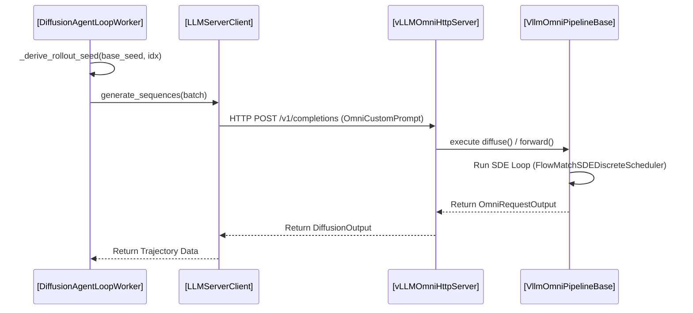

<!-- source: DeepWiki mcp.deepwiki.com · repo verl-project/verl-omni · page 4 Rollout System · fetched 2026-10-30 -->

# Rollout System

<details>
<summary>Relevant source files</summary>

The following files were used as context for generating this wiki page:

- [docs/contributing/integrating_a_diffusion_model.md](docs/contributing/integrating_a_diffusion_model.md)
- [verl_omni/__init__.py](verl_omni/__init__.py)
- [verl_omni/pipelines/model_base.py](verl_omni/pipelines/model_base.py)
- [verl_omni/pipelines/qwen_image_flow_grpo/vllm_omni_rollout_adapter.py](verl_omni/pipelines/qwen_image_flow_grpo/vllm_omni_rollout_adapter.py)
- [verl_omni/pipelines/qwen_image_mix_grpo/vllm_omni_rollout_adapter.py](verl_omni/pipelines/qwen_image_mix_grpo/vllm_omni_rollout_adapter.py)
- [verl_omni/workers/rollout/vllm_rollout/vllm_omni_async_server.py](verl_omni/workers/rollout/vllm_rollout/vllm_omni_async_server.py)

</details>


The Rollout System in `verl-omni` is responsible for generating multi-modal sequences (images, videos, or text) from the policy model during the RL training loop. It leverages a decoupled architecture where the generation process is offloaded to a specialized inference engine, **vLLM-Omni**, while the training logic resides in the Actor workers. This separation allows for high-throughput generation using continuous batching and optimized CUDA/NPU kernels, independent of the training framework's constraints.

### High-Level Architecture

The system consists of three primary layers:
1.  **vLLM-Omni Server**: An asynchronous HTTP/RPC server that manages the model weights and executes the diffusion or autoregressive (AR) sampling pipelines.
2.  **Agent Loop**: The orchestration layer that prepares prompts, manages deterministic seeding, and coordinates between the rollout server and the reward system.
3.  **Weight Synchronization**: A mechanism to ensure the rollout server's weights (often LoRA adapters) are updated to match the latest training iteration of the Actor.

### System Components Overview

The following diagram illustrates the interaction between the core code entities within the Rollout System:

#### Rollout Data Flow and Entity Mapping
```mermaid
graph TD
    subgraph "Actor / Agent Space"
        [AgentLoopManager] -- "coordinates" --> [DiffusionAgentLoopWorker]
        [DiffusionAgentLoopWorker] -- "calls generate_sequences()" --> [LLMServerClient]
        [DiffusionAgentLoopWorkerTQ] -- "uses" --> [transfer_queue]
    end

    subgraph "Rollout Server Space (vLLM-Omni)"
        [vLLMOmniHttpServer] -- "manages" --> [AsyncOmni]
        [AsyncOmni] -- "executes" --> [VllmOmniPipelineBase]
        [VLLMOmniHijack] -- "patches" --> [DiffusionLoRAManager]
    end

    [LLMServerClient] -- "HTTP Request (OmniCustomPrompt)" --> [vLLMOmniHttpServer]
    [DiffusionAgentLoopWorker] -- "Weight Sync (LoRA Tensors)" --> [vLLMOmniColocateWorkerExtension]
    [VllmOmniPipelineBase] -- "returns" --> [OmniRequestOutput]
    [OmniRequestOutput] -- "converted to" --> [DiffusionOutput]
    [DiffusionOutput] --> [DiffusionAgentLoopWorker]
```
Sources: [verl_omni/workers/rollout/vllm_rollout/vllm_omni_async_server.py:105-131](), [verl_omni/pipelines/model_base.py:204-220](), [verl_omni/workers/rollout/vllm_rollout/vllm_omni_async_server.py:50-52]()

---

### vLLM-Omni Async Server
The `vLLMOmniHttpServer` is the backbone of the rollout infrastructure. It supports two primary output modes: `diffusion` (default) and `ar` (autoregressive) [verl_omni/workers/rollout/vllm_rollout/vllm_omni_async_server.py:116-131](). 

Key features include:
*   **Mode Selection**: Automatically switches between `OmniModelConfig` for AR tasks (like Qwen3-Omni Thinker) and `DiffusionModelConfig` for image/video generation [verl_omni/workers/rollout/vllm_rollout/vllm_omni_async_server.py:129-131]().
*   **Colocated Extensions**: Uses `vLLMOmniColocateWorkerExtension` to support LoRA and weight updates for GPU [verl_omni/workers/rollout/vllm_rollout/vllm_omni_async_server.py:160-174](). For NPU hardware, it utilizes `vLLMOmniNPUColocateWorkerExtension` for memory pool management [verl_omni/workers/rollout/vllm_rollout/vllm_omni_async_server.py:177-178]().
*   **LoRA Synchronization**: Utilizes a cache-and-lock mechanism to handle `LoRARequest` resolution and distributed weight synchronization across tensor-parallel ranks via `_lora_resolve_lock` [verl_omni/workers/rollout/vllm_rollout/vllm_omni_async_server.py:143-145]().

For details, see [vLLM-Omni Async Server](#4.1).

### Diffusion Agent Loop and Rollout Batching
The Agent Loop, managed by `DiffusionAgentLoopWorker`, handles the lifecycle of a rollout batch. It is responsible for:
*   **Seeding**: Deriving deterministic seeds to ensure reproducibility. The system can derive per-rollout seeds using `_derive_rollout_seed` based on a base seed, sample index, and session ID.
*   **Batching Modes**: Supports two distinct batching modes. The default is request-level batching. The experimental **step-wise continuous batching** (`step_execution=true`) allows for finer-grained control by executing individual denoising steps across requests, managed via `prepare_encode` and `post_decode` overrides in the rollout adapter [verl_omni/pipelines/qwen_image_mix_grpo/vllm_omni_rollout_adapter.py:55-72]().
*   **MixGRPO Windowing**: For algorithms like MixGRPO, the agent loop and adapter coordinate to fix SDE windows. Strategies include `random` (seeded by `global_steps`) and `progressive` (sliding window) [verl_omni/pipelines/qwen_image_mix_grpo/vllm_omni_rollout_adapter.py:83-111]().
*   **Input Preparation**: Converting raw dataset items into `OmniCustomPrompt` and `OmniDiffusionSamplingParams` for the server [verl_omni/workers/rollout/vllm_rollout/vllm_omni_async_server.py:50-50]().

For details, see [Diffusion Agent Loop and Rollout Batching](#4.2).

### Rollout Correction
To maintain training stability, especially when the rollout policy deviates from the training policy (off-policy), the system implements correction mechanisms.
*   **SDE Window Management**: Controls the noise injection range during denoising. Adapters like `QwenImagePipelineWithLogProb` use `FlowMatchSDEDiscreteScheduler` to manage SDE-based sampling windows [verl_omni/pipelines/qwen_image_flow_grpo/vllm_omni_rollout_adapter.py:70-74]().
*   **Log-Probability Capture**: Rollout adapters capture intermediate latents and log-probabilities required for FlowGRPO advantage estimation. This is achieved by subclassing `VllmOmniPipelineBase` and overriding the `diffuse` or `forward` logic [verl_omni/pipelines/qwen_image_flow_grpo/vllm_omni_rollout_adapter.py:49-60]().
*   **Prompt Tokenization Parity**: To avoid drift, the system enforces that tokenization happens once in the agent loop. Rollout pipelines must consume `prompt_ids` directly via `encode_prompt` rather than re-tokenizing text [docs/contributing/integrating_a_diffusion_model.md:94-100]().

For details, see [Rollout Correction](#4.3).

---

### Key Code Entities

| Entity | File Path | Role |
| :--- | :--- | :--- |
| `vLLMOmniHttpServer` | `verl_omni/workers/rollout/vllm_rollout/vllm_omni_async_server.py` | Main entry point for the rollout server; handles AR vs Diffusion dispatch. |
| `VllmOmniPipelineBase` | `verl_omni/pipelines/model_base.py` | Base class for vLLM-Omni rollout pipelines; defines the `diffuse` contract. |
| `QwenImagePipelineWithLogProb` | `verl_omni/pipelines/qwen_image_flow_grpo/vllm_omni_rollout_adapter.py` | Rollout adapter capturing diffusion log-probs and latents for FlowGRPO. |
| `OmniCustomPrompt` | `verl_omni/workers/rollout/vllm_rollout/vllm_omni_async_server.py` | Data structure for passing multi-modal prompts and token IDs to vLLM-Omni. |
| `FlowMatchSDEDiscreteScheduler` | `verl_omni/pipelines/schedulers.py` | Specialized scheduler used for SDE-based log-prob estimation during rollout. |

#### Rollout Lifecycle and Seeding Logic
The following diagram details how seeds and trajectories are derived and transported.


Sources: [verl_omni/workers/rollout/vllm_rollout/vllm_omni_async_server.py:204-230](), [verl_omni/pipelines/qwen_image_flow_grpo/vllm_omni_rollout_adapter.py:70-74](), [docs/contributing/integrating_a_diffusion_model.md:58-71]()

**Sources:**
- `verl_omni/workers/rollout/vllm_rollout/vllm_omni_async_server.py`
- `verl_omni/pipelines/model_base.py`
- `verl_omni/pipelines/qwen_image_flow_grpo/vllm_omni_rollout_adapter.py`
- `verl_omni/pipelines/qwen_image_mix_grpo/vllm_omni_rollout_adapter.py`
- `docs/contributing/integrating_a_diffusion_model.md`

---

