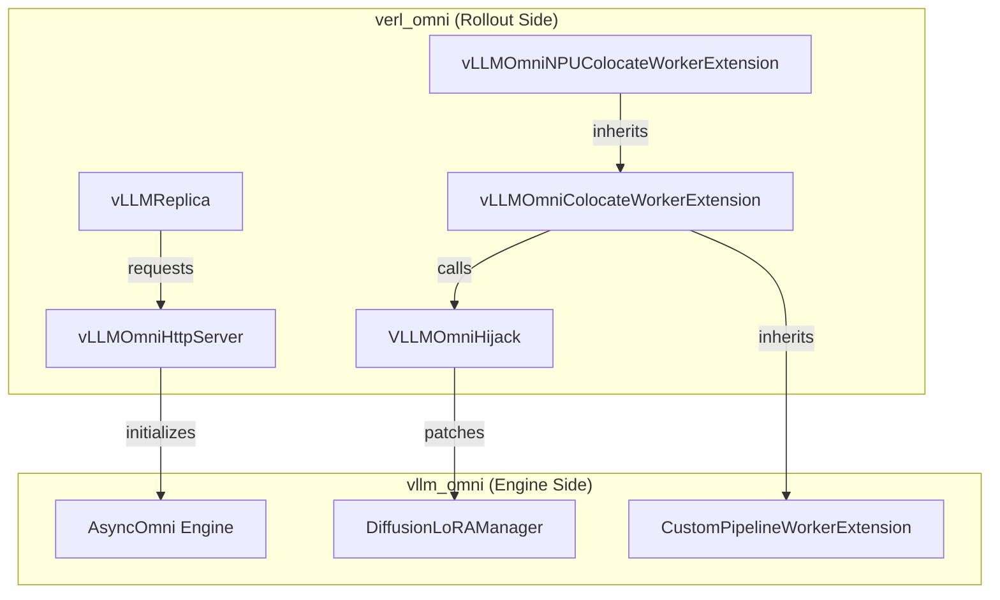
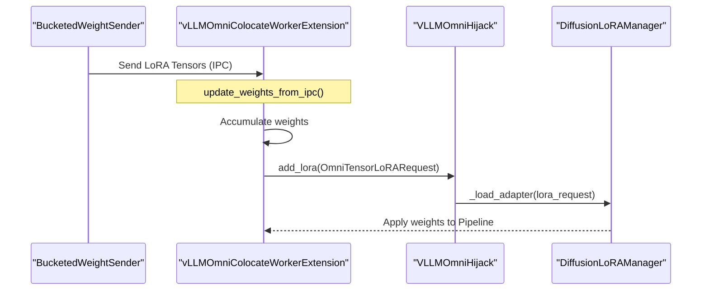

<!-- source: DeepWiki mcp.deepwiki.com · repo verl-project/verl-omni · page 4.1 vLLM-Omni Async Server · fetched 2026-10-30 -->

# vLLM-Omni Async Server

Relevant source files

The following files were used as context for generating this wiki page:

- [docs/contributing/integrating_a_diffusion_model.md](docs/contributing/integrating_a_diffusion_model.md)
- [docs/contributing/integrating_a_stepwise_continuous_batching_model.md](docs/contributing/integrating_a_stepwise_continuous_batching_model.md)
- [examples/gspo_trainer/qwen3_omni/qwen3_omni_thinker_only_npu.yaml](examples/gspo_trainer/qwen3_omni/qwen3_omni_thinker_only_npu.yaml)
- [tests/special_e2e/qwen3_omni_thinker_only_smoke.yaml](tests/special_e2e/qwen3_omni_thinker_only_smoke.yaml)
- [tests/workers/rollout/rollout_vllm/test_vllm_omni_generate.py](tests/workers/rollout/rollout_vllm/test_vllm_omni_generate.py)
- [verl_omni/__init__.py](verl_omni/__init__.py)
- [verl_omni/pipelines/model_base.py](verl_omni/pipelines/model_base.py)
- [verl_omni/pipelines/qwen_image_diffusion_nft/vllm_omni_rollout_adapter.py](verl_omni/pipelines/qwen_image_diffusion_nft/vllm_omni_rollout_adapter.py)
- [verl_omni/pipelines/qwen_image_dpo/vllm_omni_rollout_adapter.py](verl_omni/pipelines/qwen_image_dpo/vllm_omni_rollout_adapter.py)
- [verl_omni/pipelines/qwen_image_flow_grpo/vllm_omni_rollout_adapter.py](verl_omni/pipelines/qwen_image_flow_grpo/vllm_omni_rollout_adapter.py)
- [verl_omni/pipelines/qwen_image_mix_grpo/vllm_omni_rollout_adapter.py](verl_omni/pipelines/qwen_image_mix_grpo/vllm_omni_rollout_adapter.py)
- [verl_omni/pipelines/wan22_dance_grpo/vllm_omni_rollout_adapter.py](verl_omni/pipelines/wan22_dance_grpo/vllm_omni_rollout_adapter.py)
- [verl_omni/utils/vllm_omni/utils.py](verl_omni/utils/vllm_omni/utils.py)
- [verl_omni/workers/rollout/vllm_rollout/npu_utils.py](verl_omni/workers/rollout/vllm_rollout/npu_utils.py)
- [verl_omni/workers/rollout/vllm_rollout/vllm_omni_async_server.py](verl_omni/workers/rollout/vllm_rollout/vllm_omni_async_server.py)

The `vLLMOmniHttpServer` is the primary rollout backend for VeRL-Omni, extending the standard `vLLMHttpServer` to support multi-modal generation and diffusion models. It serves as a bridge between the RL training loop and the `vllm-omni` engine, providing asynchronous generation capabilities, distributed weight synchronization, and support for both Auto-Regressive (AR) and Diffusion generation modes.

## Architecture and Execution Modes

The server operates in two distinct modes based on the `output_mode` configuration. This choice determines the underlying model configuration classes, preprocessing steps, and the generation pipeline lifecycle.

| Feature | AR Mode (Auto-Regressive) | Diffusion Mode |
| :--- | :--- | :--- |
| **Model Config** | `OmniModelConfig` [verl_omni/workers/rollout/vllm_rollout/vllm_omni_async_server.py:130]() | `DiffusionModelConfig` [verl_omni/workers/rollout/vllm_rollout/vllm_omni_async_server.py:131]() |
| **Input Data** | Standard Token IDs | `OmniCustomPrompt` [verl_omni/workers/rollout/vllm_rollout/vllm_omni_async_server.py:50]() |
| **Sampling Params** | `SamplingParams` [verl_omni/workers/rollout/vllm_rollout/vllm_omni_async_server.py:45]() | `OmniDiffusionSamplingParams` [verl_omni/workers/rollout/vllm_rollout/vllm_omni_async_server.py:50]() |
| **Output Type** | `TokenOutput` [verl_omni/workers/rollout/vllm_rollout/vllm_omni_async_server.py:37]() | `DiffusionOutput` [verl_omni/workers/rollout/vllm_rollout/vllm_omni_async_server.py:56]() |

**Sources:** [verl_omni/workers/rollout/vllm_rollout/vllm_omni_async_server.py:116-132]()

### System Entity Mapping
The following diagram illustrates how the logical rollout server components map to specific code entities within the `verl_omni` and `vllm_omni` namespaces.

**Rollout Server Entity Mapping**

**Sources:** [verl_omni/workers/rollout/vllm_rollout/vllm_omni_async_server.py:105-145](), [verl_omni/workers/rollout/vllm_rollout/utils.py:61-83](), [verl_omni/utils/vllm_omni/utils.py:35-46](), [verl_omni/workers/rollout/vllm_rollout/npu_utils.py:98-107]()

## Generation Pipeline Lifecycle

The generation process in Diffusion mode utilizes specialized containers for multi-modal inputs. The server handles the conversion of raw data into `OmniCustomPrompt` objects, which are then dispatched to the `AsyncOmni` engine.

### Data Flow for Diffusion Rollout
1. **Request Reception**: The server receives a generation request via the `/generate` endpoint.
2. **Prompt Construction**: In diffusion mode, the server constructs an `OmniCustomPrompt` which can include multi-modal data (e.g., text, conditioning images) [verl_omni/workers/rollout/vllm_rollout/vllm_omni_async_server.py:273-277]().
3. **Sampling Parameters**: Uses `OmniDiffusionSamplingParams` to control the diffusion process (e.g., number of steps, CFG scale) [verl_omni/workers/rollout/vllm_rollout/vllm_omni_async_server.py:279-282]().
4. **Engine Execution**: The request is passed to `AsyncOmni.generate()` [verl_omni/workers/rollout/vllm_rollout/vllm_omni_async_server.py:284-287]().
5. **Post-processing**: Generated PIL images are converted to tensors using `T.PILToTensor()` [verl_omni/workers/rollout/vllm_rollout/vllm_omni_async_server.py:142]().
6. **Output Encapsulation**: Results are wrapped in a `DiffusionOutput` object containing the image/video tensor and associated log-probabilities [verl_omni/workers/rollout/vllm_rollout/vllm_omni_async_server.py:56]().

**Sources:** [verl_omni/workers/rollout/vllm_rollout/vllm_omni_async_server.py:266-298]()

## Distributed Coordination and Weight Synchronization

The server supports distributed execution across multiple GPUs using Ray. Weight synchronization is handled via Inter-Process Communication (IPC) using `BucketedWeightReceiver` [verl_omni/workers/rollout/vllm_rollout/utils.py:140-144]().

### LoRA Synchronization via Hijack
Because standard vLLM and `vllm-omni` primarily support loading LoRA adapters from disk, VeRL-Omni implements `VLLMOmniHijack` to enable in-memory tensor synchronization. This is critical for RL where the rollout model's LoRA weights must be updated every iteration without disk I/O overhead.

*   **`VLLMOmniHijack.hijack()`**: Monkey-patches `DiffusionLoRAManager._load_adapter` to accept `OmniTensorLoRARequest` objects containing raw tensors [verl_omni/utils/vllm_omni/utils.py:46-55]().
*   **`vLLMOmniColocateWorkerExtension`**: The worker extension class that triggers the hijack during initialization [verl_omni/workers/rollout/vllm_rollout/utils.py:77-83]().

### Weight Update Logic
The `update_weights_from_ipc` function differentiates between full-weight updates and LoRA updates:
1. **LoRA Path**: Accumulates all LoRA tensors across buckets and performs a single atomic `add_lora` call [verl_omni/workers/rollout/vllm_rollout/utils.py:156-158](). It selects between `TensorLoRARequest` (for AR) and `OmniTensorLoRARequest` (for diffusion) [verl_omni/workers/rollout/vllm_rollout/utils.py:172-189]().
2. **Full-Weight Path**: Streams weights bucket-by-bucket to bound GPU memory usage [verl_omni/workers/rollout/vllm_rollout/utils.py:195-209]().

**Weight Sync Interaction**

**Sources:** [verl_omni/workers/rollout/vllm_rollout/utils.py:113-209](), [verl_omni/utils/vllm_omni/utils.py:55-131]()

## Hardware-Specific Optimizations

### NPU (Ascend) Support
On Ascend NPU hardware, the server utilizes `vLLMOmniNPUColocateWorkerExtension` to manage specialized memory pools and lifecycle states.
*   **Memory Pool Management**: Uses `CaMemAllocator` to manage "weights" and "activation" tags [verl_omni/workers/rollout/vllm_rollout/npu_utils.py:116-125]().
*   **Sleep/Wake Lifecycle**: Implements `sleep()` to offload weights to CPU [verl_omni/workers/rollout/vllm_rollout/npu_utils.py:127-156]() and `wake_up()` to restore them [verl_omni/workers/rollout/vllm_rollout/npu_utils.py:158-171](), allowing the NPU to be shared between rollout and training actors.
*   **Cache Suppression**: Includes `_skip_diffusers_npu_empty_cache` to prevent `diffusers` from calling `empty_device_cache`, which would invalidate the `CaMemAllocator` internal bookkeeping [verl_omni/workers/rollout/vllm_rollout/npu_utils.py:61-91]().

**Sources:** [verl_omni/workers/rollout/vllm_rollout/npu_utils.py:98-171]()

### Qwen3-Omni Thinker Integration
For models like `Qwen3-Omni`, the server supports a "Thinker-only" mode via stage configurations [examples/gspo_trainer/qwen3_omni/qwen3_omni_thinker_only_npu.yaml:8-50](). This configuration ensures the Thinker stage uses all available GPUs for tensor parallelism while excluding the Talker and Code2Wav stages.

The server handles specific AR deployment requirements for Qwen3-Omni, including generating a deploy config based on the adapter's stage topology and merging pipeline-specific HF config overrides [verl_omni/workers/rollout/vllm_rollout/vllm_omni_async_server.py:207-212](). Per-stage rollout flags are stored to control the engine behavior during inference [verl_omni/workers/rollout/vllm_rollout/vllm_omni_async_server.py:209-210]().

**Sources:** [verl_omni/workers/rollout/vllm_rollout/vllm_omni_async_server.py:197-212](), [examples/gspo_trainer/qwen3_omni/qwen3_omni_thinker_only_npu.yaml:1-50]()

---

