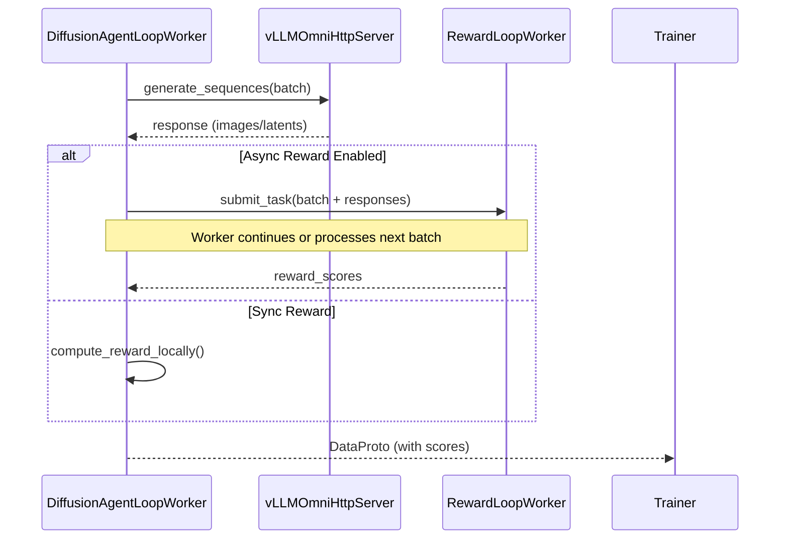

<!-- source: DeepWiki mcp.deepwiki.com · repo verl-project/verl-omni · page 4.2 Diffusion Agent Loop and Rollout Batching · fetched 2026-10-30 -->

# Diffusion Agent Loop and Rollout Batching

<details>
<summary>Relevant source files</summary>

The following files were used as context for generating this wiki page:

- [docs/api/pipelines.rst](docs/api/pipelines.rst)
- [docs/api/trainer.rst](docs/api/trainer.rst)
- [docs/api/workers.rst](docs/api/workers.rst)
- [docs/conf.py](docs/conf.py)
- [docs/start/multi_node_training.md](docs/start/multi_node_training.md)
- [docs/start/rollout_batching.md](docs/start/rollout_batching.md)
- [tests/agent_loop/test_composite_agent_loop.py](tests/agent_loop/test_composite_agent_loop.py)
- [tests/agent_loop/test_diffusion_agent_loop.py](tests/agent_loop/test_diffusion_agent_loop.py)
- [tests/agent_loop/test_diffusion_rollout_seed_gpu.py](tests/agent_loop/test_diffusion_rollout_seed_gpu.py)
- [tests/gpu_smoke/run_gpu_smoke_core.sh](tests/gpu_smoke/run_gpu_smoke_core.sh)
- [tests/workers/config/test_diffusion_config_on_cpu.py](tests/workers/config/test_diffusion_config_on_cpu.py)
- [tests/workers/test_diffusers_fsdp_lora_adapter.py](tests/workers/test_diffusers_fsdp_lora_adapter.py)
- [verl_omni/agent_loop/__init__.py](verl_omni/agent_loop/__init__.py)
- [verl_omni/agent_loop/composite_agent_loop.py](verl_omni/agent_loop/composite_agent_loop.py)
- [verl_omni/agent_loop/diffusion_agent_loop.py](verl_omni/agent_loop/diffusion_agent_loop.py)
- [verl_omni/agent_loop/utils.py](verl_omni/agent_loop/utils.py)
- [verl_omni/pipelines/__init__.py](verl_omni/pipelines/__init__.py)
- [verl_omni/pipelines/qwen_image_dual_grpo/__init__.py](verl_omni/pipelines/qwen_image_dual_grpo/__init__.py)
- [verl_omni/pipelines/qwen_image_dual_grpo/vllm_omni_rollout_adapter.py](verl_omni/pipelines/qwen_image_dual_grpo/vllm_omni_rollout_adapter.py)
- [verl_omni/trainer/config/_generated_diffusion_trainer.yaml](verl_omni/trainer/config/_generated_diffusion_trainer.yaml)
- [verl_omni/trainer/config/_generated_diffusion_veomni_trainer.yaml](verl_omni/trainer/config/_generated_diffusion_veomni_trainer.yaml)
- [verl_omni/trainer/config/diffusion/rollout/diffusion_rollout.yaml](verl_omni/trainer/config/diffusion/rollout/diffusion_rollout.yaml)
- [verl_omni/workers/config/diffusion/rollout.py](verl_omni/workers/config/diffusion/rollout.py)
- [verl_omni/workers/engine/lora_adapter_mixin.py](verl_omni/workers/engine/lora_adapter_mixin.py)

</details>


The Diffusion Agent Loop is the orchestration layer responsible for managing the generation process of diffusion models within the VeRL-Omni RL framework. It bridges the gap between the high-level trainer and the low-level `vllm-omni` inference server, handling tasks such as deterministic seeding, sequence generation, and asynchronous reward integration. This page also covers the two rollout batching modes: step-wise continuous batching and request-level batching, as well as composite architectures.

## Architecture Overview

The system is organized around two primary entities: the `AgentLoopManager` (provided by the `verl` base library) and the `DiffusionAgentLoopWorker`. The manager coordinates a pool of workers across the Ray cluster, while each worker interacts with a `vLLMOmniHttpServer` (via the `LLMServerClient`) to perform the actual sampling.

### System Topology and Entity Mapping

The following diagram illustrates how Natural Language concepts in the RL loop map to specific code entities and their interactions.

**Diffusion Rollout Data Flow**
```mermaid
graph TD
    subgraph "Trainer_Process"
        [BaseRayDiffusionTrainer] -- "calls" --> [AgentLoopManager]
    end

    subgraph "Ray_Worker_Group"
        [AgentLoopManager] -- "dispatch" --> [DiffusionAgentLoopWorker]
        [DiffusionAgentLoopWorker] -- "async_generate" --> [LLMServerClient]
    end

    subgraph "vLLM-Omni_Infrastructure"
        [LLMServerClient] -- "HTTP/gRPC" --> [vLLMOmniHttpServer]
        [vLLMOmniHttpServer] -- "executes" --> [VllmOmniPipelineBase]
    end

    subgraph "Reward_System"
        [DiffusionAgentLoopWorker] -- "stream" --> [RewardLoopWorker]
        [RewardLoopWorker] -- "return" --> [DiffusionAgentLoopWorker]
    end

    [DiffusionAgentLoopWorker] -- "DataProto" --> [AgentLoopManager]
    [AgentLoopManager] -- "DataProto" --> [BaseRayDiffusionTrainer]
```
Sources: [verl_omni/agent_loop/diffusion_agent_loop.py:105-117](), [verl_omni/agent_loop/diffusion_agent_loop.py:126-140]()

## Key Components

### DiffusionAgentLoopWorker
The `DiffusionAgentLoopWorker` is the core implementation of the agent loop for diffusion models. It is initialized with configurations for both the rollout and the model [verl_omni/agent_loop/diffusion_agent_loop.py:126-130]().

*   **Role**: Acts as a bridge between the trainer's data protocol and the `vllm-omni` server via `LLMServerClient` [verl_omni/agent_loop/diffusion_agent_loop.py:110-111]().
*   **Initialization**: Loads the tokenizer and processor, and resolves agent loop configurations from the provided paths [verl_omni/agent_loop/diffusion_agent_loop.py:138-152]().
*   **Input**: Receives a `DataProto` containing prompts and metadata [verl_omni/agent_loop/diffusion_agent_loop.py:158-162]().
*   **Output**: Produces a `DataProto` containing generated responses (images/videos), latents, and log probabilities [verl_omni/agent_loop/diffusion_agent_loop.py:90-103]().

### DiffusionAgentLoopWorkerTQ
For V1 trainers (e.g., `PolicyGradientDiffusionTrainerV1Sync`), the `DiffusionAgentLoopWorkerTQ` provides a `transfer_queue`-backed implementation [verl_omni/agent_loop/diffusion_agent_loop_tq.py:40-45](). It spawns agent loops as background tasks using `asyncio.create_task` and pushes results to the queue asynchronously [verl_omni/agent_loop/diffusion_agent_loop_tq.py:94-106](). It also handles `DiffusionWholeSampleRetryLLMServerClient` logic for retrying aborted diffusion samples [verl_omni/agent_loop/diffusion_agent_loop_tq.py:132-166]().

### CompositeAgentLoopWorker
For composite architectures like DualGRPO (AR + DiT), the `CompositeAgentLoopWorker` orchestrates multiple agent loops sequentially or in parallel [verl_omni/agent_loop/composite_agent_loop.py:15-30](). It allows combining an Autoregressive (AR) "Thinker" model with a Diffusion (DiT) model within a single rollout trajectory. This is critical for models like Qwen-Image DualGRPO where the model first generates a text explanation/reasoning and then generates an image [verl_omni/pipelines/qwen_image_dual_grpo/vllm_omni_rollout_adapter.py:20-40]().

Sources: [verl_omni/agent_loop/diffusion_agent_loop.py:105-152](), [verl_omni/agent_loop/diffusion_agent_loop_tq.py:40-107](), [verl_omni/agent_loop/composite_agent_loop.py:15-30]()

## Sequence Generation Logic

The primary entry point for generation is `generate_sequences`. This function transforms training configurations into `sampling_params` compatible with `vllm-omni`.

### Sampling Parameters
The worker extracts sampling parameters from `config.pipeline` and `config.algo` [verl_omni/agent_loop/diffusion_agent_loop.py:43-46](). These include:
*   `num_inference_steps`: Number of denoising steps [verl_omni/workers/config/diffusion/rollout.py:64-64]().
*   `calculate_log_probs`: Whether to calculate log probabilities (required for algorithms like FlowGRPO) [verl_omni/workers/config/diffusion/rollout.py:155-155]().
*   `sde_type` and `sde_window_size`: The type and size of the SDE window for flow-matching gradients [verl_omni/workers/config/diffusion/rollout.py:42-43]().

### Deterministic Seeding
To ensure reproducibility and mitigate variance issues, the system implements a deterministic seeding mechanism via `_derive_rollout_seed` [verl_omni/agent_loop/utils.py:18-22]().

1.  **Base Seed**: Derived from `meta_info.get("rollout_seed")` or the rollout config [verl_omni/agent_loop/utils.py:33-36]().
2.  **Global Index**: When `global_indices` are provided, seeds are derived from stable indices rather than local chunk positions to prevent RNG remapping across workers [verl_omni/agent_loop/utils.py:28-32]().
3.  **Derivation**: `(base_seed * 1,000,003 + rollout_index) % (2^63 - 1)` [verl_omni/agent_loop/utils.py:22-22]().

Sources: [verl_omni/agent_loop/diffusion_agent_loop.py:158-160](), [verl_omni/agent_loop/utils.py:18-45](), [verl_omni/workers/config/diffusion/rollout.py:108-110]()

## Rollout Batching Modes

VeRL-Omni supports two distinct rollout batching strategies, controlled by the `step_execution` flag in the `DiffusionRolloutConfig` [verl_omni/workers/config/diffusion/rollout.py:142-142]().

### 1. Request-Level Batching (`step_execution=false`)
In this default mode, the `vLLMOmniHttpServer` treats each generation request as an atomic unit. The entire diffusion trajectory for a request is handled within a single pipeline execution context. 
*   **Use Case**: Standard diffusion generation where continuous batching at the denoising step level is not required.
*   **Implementation**: The `LLMServerClient.generate` call waits for the full image/video to be produced [verl_omni/agent_loop/diffusion_agent_loop.py:158-180]().

### 2. Step-wise Continuous Batching (`step_execution=true`)
When `step_execution` is enabled, the engine runs the registered pipeline in a step-by-step mode. This allows vLLM to perform continuous batching across different requests at each denoising timestep.
*   **Use Case**: High-throughput scenarios where multiple requests are at different stages of the denoising process.
*   **Implementation**: Requires experimental stepwise pipeline adapters that override `prepare_encode` and `post_decode` hooks. In this mode, `max_num_seqs` can be set significantly higher to fill GPU capacity [verl_omni/workers/config/diffusion/rollout.py:138-142]().

**Batching Mode Comparison**
| Feature | Request-Level (`step_execution=false`) | Step-wise (`step_execution=true`) |
| :--- | :--- | :--- |
| **Batching Granularity** | Full Trajectory | Individual Denoising Step |
| **Throughput** | Lower (Sequential per request) | Higher (Continuous batching) |
| **Complexity** | Simple | High (Requires stepwise adapters) |
| **Deterministic Seeding** | Easier to maintain bit-equality | Sensitive to packing order [tests/agent_loop/test_diffusion_rollout_seed_gpu.py:133-136]() |

Sources: [verl_omni/workers/config/diffusion/rollout.py:138-142](), [tests/agent_loop/test_diffusion_rollout_seed_gpu.py:133-136]()

## Async Reward Integration

The `DiffusionAgentLoopWorker` supports asynchronous reward computation to prevent generation from idling while waiting for heavy reward models (e.g., VLM-based scorers).

**Reward Integration Flow**

Sources: [verl_omni/agent_loop/diffusion_agent_loop.py:115-117](), [verl_omni/agent_loop/diffusion_agent_loop.py:124-124]()

## Post-Processing and Output

After `vllm-omni` completes the diffusion process, the worker performs several post-processing steps:

1.  **Embedding Padding**: The loop ensures that prompt embeddings (e.g., `prompt_embeds`, `negative_prompt_embeds`) are padded to `max_prompt_embed_length` [verl_omni/agent_loop/diffusion_agent_loop.py:49-66]().
2.  **Latent Extraction**: Captures intermediate latents and logprobs for training [verl_omni/agent_loop/diffusion_agent_loop.py:97-100]().
3.  **Output Formatting**: Converts raw outputs into a `DataProto`. Images are typically `NCHW` and videos are `NTCHW` [verl_omni/agent_loop/diffusion_agent_loop.py:97-98]().
4.  **Metrics**: Collects performance metrics via `AgentLoopMetrics` [verl_omni/agent_loop/diffusion_agent_loop.py:84-85]().

### Configuration and Validation
The rollout behavior is governed by the `DiffusionRolloutConfig`. This configuration includes support for:
*   **Validation Kwargs**: Separate sampling parameters (`val_kwargs`) for validation runs (e.g., higher inference steps, zero noise level) [verl_omni/workers/config/diffusion/rollout.py:135-135]().
*   **Attention Backends**: Selection of optimized backends like `FLASH_ATTN_3_HUB` [verl_omni/workers/config/diffusion/rollout.py:123-125]().

Sources: [verl_omni/agent_loop/diffusion_agent_loop.py:49-103](), [verl_omni/workers/config/diffusion/rollout.py:123-135]()

---

