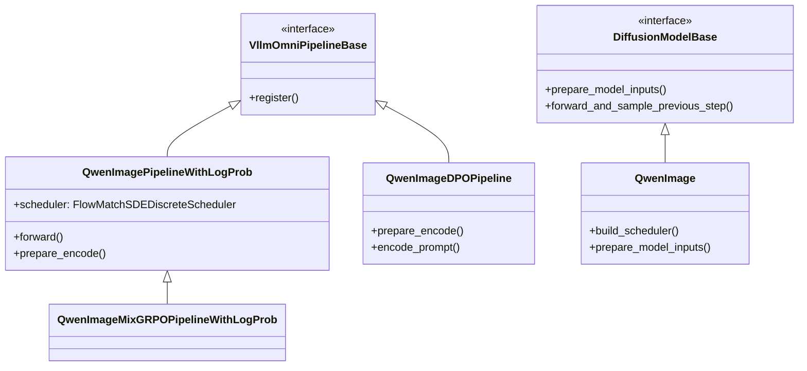

<!-- source: DeepWiki mcp.deepwiki.com · repo verl-project/verl-omni · page 5.1 Qwen-Image Pipeline Adapters · fetched 2026-10-30 -->

# Qwen-Image Pipeline Adapters

<details>
<summary>Relevant source files</summary>

The following files were used as context for generating this wiki page:

- [docs/contributing/integrating_a_diffusion_model.md](docs/contributing/integrating_a_diffusion_model.md)
- [docs/contributing/integrating_a_stepwise_continuous_batching_model.md](docs/contributing/integrating_a_stepwise_continuous_batching_model.md)
- [tests/workers/rollout/rollout_vllm/test_vllm_omni_generate.py](tests/workers/rollout/rollout_vllm/test_vllm_omni_generate.py)
- [verl_omni/__init__.py](verl_omni/__init__.py)
- [verl_omni/pipelines/model_base.py](verl_omni/pipelines/model_base.py)
- [verl_omni/pipelines/qwen_image_diffusion_nft/vllm_omni_rollout_adapter.py](verl_omni/pipelines/qwen_image_diffusion_nft/vllm_omni_rollout_adapter.py)
- [verl_omni/pipelines/qwen_image_dpo/vllm_omni_rollout_adapter.py](verl_omni/pipelines/qwen_image_dpo/vllm_omni_rollout_adapter.py)
- [verl_omni/pipelines/qwen_image_flow_grpo/diffusers_training_adapter.py](verl_omni/pipelines/qwen_image_flow_grpo/diffusers_training_adapter.py)
- [verl_omni/pipelines/qwen_image_flow_grpo/vllm_omni_rollout_adapter.py](verl_omni/pipelines/qwen_image_flow_grpo/vllm_omni_rollout_adapter.py)
- [verl_omni/pipelines/qwen_image_mix_grpo/vllm_omni_rollout_adapter.py](verl_omni/pipelines/qwen_image_mix_grpo/vllm_omni_rollout_adapter.py)
- [verl_omni/pipelines/wan22_dance_grpo/vllm_omni_rollout_adapter.py](verl_omni/pipelines/wan22_dance_grpo/vllm_omni_rollout_adapter.py)
- [verl_omni/workers/rollout/vllm_rollout/vllm_omni_async_server.py](verl_omni/workers/rollout/vllm_rollout/vllm_omni_async_server.py)

</details>


The Qwen-Image pipeline adapters provide the necessary glue code to integrate the Qwen-Image model into the VeRL-Omni RL framework. These adapters bridge the gap between the `vllm-omni` rollout engine and the `diffusers`-based FSDP training engine, supporting algorithms like FlowGRPO, MixGRPO, DPO, and DiffusionNFT.

The integration is split into two contexts:
1.  **Rollout Adapter**: Extends the `vllm-omni` pipeline to capture intermediate latents and log-probabilities during the diffusion process.
2.  **Training Adapter**: Implements the `DiffusionModelBase` interface to handle model-specific input preparation and loss calculation during the training step.

## System Architecture: Rollout and Training Flow

The following diagram illustrates how the Qwen-Image adapters facilitate data flow between the Rollout workers (using `vllm-omni`) and the Training workers (using `diffusers`).

### Qwen-Image RL Data Flow
```mermaid
graph TD
    subgraph "Rollout Context (vllm-omni)"
        ["QwenImagePipelineWithLogProb"] -- "diffuse()" --> ["FlowMatchSDEDiscreteScheduler"]
        ["FlowMatchSDEDiscreteScheduler"] -- "SDE Window" --> ["Capture Latents & LogProbs"]
        ["Capture Latents & LogProbs"] --> ["DataProto (Rollout)"]
    end

    subgraph "Training Context (diffusers/FSDP2)"
        ["QwenImage (Training Adapter)"] -- "prepare_model_inputs()" --> ["QwenImageTransformer2DModel"]
        ["DataProto (Rollout)"] -- "Micro-batch" --> ["QwenImage (Training Adapter)"]
        ["QwenImageTransformer2DModel"] -- "forward()" --> ["Loss Calculation"]
    end

    ["DataProto (Rollout)"] -. "Ray Plasma Store" .-> ["QwenImage (Training Adapter)"]
```
Sources: [verl_omni/pipelines/qwen_image_flow_grpo/vllm_omni_rollout_adapter.py:49-65](), [verl_omni/pipelines/qwen_image_flow_grpo/diffusers_training_adapter.py:66-78]()

## Rollout Adapters

The rollout adapters are responsible for executing the SDE-based diffusion loop and recording the data required for RL advantage estimation.

### QwenImagePipelineWithLogProb
This class is registered under the `flow_grpo` algorithm and extends the base `QwenImagePipeline` [verl_omni/pipelines/qwen_image_flow_grpo/vllm_omni_rollout_adapter.py:49-50](). It uses the `FlowMatchSDEDiscreteScheduler` to manage the denoising process [verl_omni/pipelines/qwen_image_flow_grpo/vllm_omni_rollout_adapter.py:70-74]().

Key features include:
*   **SDE Window Management**: It defines a window where noise is injected and rollout data is collected via `sde_window_range` [verl_omni/pipelines/qwen_image_flow_grpo/vllm_omni_rollout_adapter.py:211-224]().
*   **Log-Probability Capture**: Within the SDE window, it calculates the log-probability of the transition from $x_t$ to $x_{t-1}$ [verl_omni/pipelines/qwen_image_flow_grpo/vllm_omni_rollout_adapter.py:284-301]().
*   **True-CFG Guidance**: Supports Classifier-Free Guidance by performing two forward passes (positive and negative prompts) and applying a norm-preserving combination via `apply_true_cfg` [verl_omni/pipelines/qwen_image_flow_grpo/vllm_omni_rollout_adapter.py:263-277]().

### MixGRPO Strategy
The `QwenImageMixGRPOPipelineWithLogProb` adds logic to dynamically shift the SDE window via `_maybe_make_progressive_window` [verl_omni/pipelines/qwen_image_mix_grpo/vllm_omni_rollout_adapter.py:51-54]().
*   **Progressive Mode**: The window slides deterministically based on `global_steps`, advancing by `sde_window_size` every `iters_per_group` [verl_omni/pipelines/qwen_image_mix_grpo/vllm_omni_rollout_adapter.py:113-137]().
*   **Random Mode**: If `sde_window_seed` is present, the window start is seeded by `seed + global_steps` to ensure all rollout ranks stay synchronized on the same window for a given training step [verl_omni/pipelines/qwen_image_mix_grpo/vllm_omni_rollout_adapter.py:95-111]().

### DPO and NFT Adapters
*   **QwenImageDPOPipeline**: Registered for the `dpo` algorithm [verl_omni/pipelines/qwen_image_dpo/vllm_omni_rollout_adapter.py:38-39](). It implements `prepare_encode` to handle `StepRequestState` and returns `DiffusionOutput` containing DPO-specific training tensors like `latents` and `prompt_embeds` [verl_omni/pipelines/qwen_image_dpo/vllm_omni_rollout_adapter.py:78-164]().
*   **QwenImageDiffusionNFTPipeline**: Registered for `diffusion_nft` [verl_omni/pipelines/qwen_image_diffusion_nft/vllm_omni_rollout_adapter.py:37-38](). Since NFT trains from clean latents with a forward-process objective, this adapter prepares a `token_id_generation_context` but does not collect reverse-SDE trajectories [verl_omni/pipelines/qwen_image_diffusion_nft/vllm_omni_rollout_adapter.py:110-151]().

Sources: [verl_omni/pipelines/qwen_image_flow_grpo/vllm_omni_rollout_adapter.py:211-301](), [verl_omni/pipelines/qwen_image_mix_grpo/vllm_omni_rollout_adapter.py:83-137](), [verl_omni/pipelines/qwen_image_dpo/vllm_omni_rollout_adapter.py:38-164](), [verl_omni/pipelines/qwen_image_diffusion_nft/vllm_omni_rollout_adapter.py:37-151]()

## Training Adapters

Training adapters implement the logic to reconstruct model inputs from the `DataProto` collected during rollout.

### Input Preparation
The `prepare_model_inputs` function handles the conversion of latent tensors and metadata into the specific format expected by `QwenImageTransformer2DModel` [verl_omni/pipelines/qwen_image_flow_grpo/diffusers_training_adapter.py:115-127]().

| Parameter | Source/Logic |
| :--- | :--- |
| `img_shapes` | Built from `height`, `width`, and `vae_scale_factor` using `build_img_shapes` [verl_omni/pipelines/qwen_image_flow_grpo/diffusers_training_adapter.py:148-151](). |
| `timestep` | Sliced from the `timesteps` tensor and normalized by 1000.0 [verl_omni/pipelines/qwen_image_flow_grpo/diffusers_training_adapter.py:160](). |
| `guidance` | Constructed as a full tensor if `guidance_embeds` is enabled in the model config [verl_omni/pipelines/qwen_image_flow_grpo/diffusers_training_adapter.py:153-158](). |

### Scheduler Configuration
The adapter configures the `FlowMatchSDEDiscreteScheduler` with a specific `mu` shift based on the image resolution to handle the flow-matching objective correctly via `calculate_shift` [verl_omni/pipelines/qwen_image_flow_grpo/diffusers_training_adapter.py:56-63]().

### Forward and Sampling
The `forward_and_sample_previous_step` method (in the training adapter) returns the noise prediction and optionally computes the previous latent step for SDE-based algorithms [verl_omni/pipelines/qwen_image_flow_grpo/diffusers_training_adapter.py:182-202]().

Sources: [verl_omni/pipelines/qwen_image_flow_grpo/diffusers_training_adapter.py:115-202](), [verl_omni/pipelines/qwen_image_flow_grpo/common.py:24-30]()

## Stepwise Continuous Batching

Qwen-Image supports a **step-execution** mode for continuous batching in vLLM-Omni. This mode interleaves denoising steps from multiple requests to improve throughput [docs/contributing/integrating_a_stepwise_continuous_batching_model.md:73-85]().

The adapter implements the following lifecycle methods:
*   `prepare_encode()`: Encodes prompts and initializes Float32 latents [verl_omni/pipelines/qwen_image_dpo/vllm_omni_rollout_adapter.py:78-164]().
*   `denoise_step()`: Runs the transformer to return a noise prediction.
*   `step_scheduler()`: Advances the scheduler by one step and collects trajectory data such as log-probabilities [docs/contributing/integrating_a_stepwise_continuous_batching_model.md:94]().
*   `post_decode()`: Finalizes the trajectory into a `DiffusionOutput` [verl_omni/pipelines/qwen_image_diffusion_nft/vllm_omni_rollout_adapter.py:153-163]().

Sources: [docs/contributing/integrating_a_stepwise_continuous_batching_model.md:68-98](), [verl_omni/pipelines/qwen_image_mix_grpo/vllm_omni_rollout_adapter.py:55-72](), [verl_omni/pipelines/qwen_image_dpo/vllm_omni_rollout_adapter.py:78-164]()

## Common Utilities and Patches

The Qwen-Image adapters rely on shared logic and monkey-patches to support advanced features like sequence parallelism.

### Ulysses Mask Patch
When `architecture` is detected as `QwenImagePipeline`, the engine automatically applies a monkey-patch `apply_qwen_image_ulysses_mask_fix` [verl_omni/pipelines/model_base.py:66-74](). This fix addresses issues with Ulysses sequence parallelism in the `QwenImageTransformer2DModel` attention masks.

### Image Shape Construction
Since Qwen-Image handles variable aspect ratios, shape calculation is standardized. In `build_img_shapes`, the latent dimensions are derived by dividing pixels by the VAE scale factor (8) and a transformer-specific patch factor (2) [verl_omni/pipelines/qwen_image_flow_grpo/common.py:27-28]().

### True-CFG Implementation
The `apply_true_cfg` function implements a norm-preserving classifier-free guidance formula [verl_omni/pipelines/qwen_image_flow_grpo/common.py:32-40]():
$$ \epsilon_{comb} = \epsilon_{uncond} + s \cdot (\epsilon_{cond} - \epsilon_{uncond}) $$
This ensures that the magnitude of the combined noise prediction does not explode at high guidance scales by scaling the result to match the norm of the conditional prediction [verl_omni/pipelines/qwen_image_flow_grpo/common.py:38-40]().

### Class Relationship Diagram

Sources: [verl_omni/pipelines/qwen_image_flow_grpo/vllm_omni_rollout_adapter.py:49-50](), [verl_omni/pipelines/qwen_image_flow_grpo/diffusers_training_adapter.py:66-67](), [verl_omni/pipelines/qwen_image_dpo/vllm_omni_rollout_adapter.py:38-39](), [verl_omni/pipelines/qwen_image_mix_grpo/vllm_omni_rollout_adapter.py:51-52](), [verl_omni/pipelines/model_base.py:28-46]()

---

