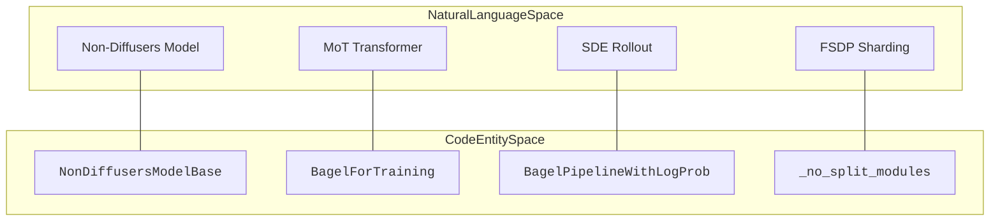
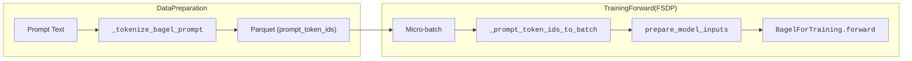

<!-- source: DeepWiki mcp.deepwiki.com · repo verl-project/verl-omni · page 5.2 BAGEL and Non-Diffusers Model Integration · fetched 2026-10-30 -->

# BAGEL and Non-Diffusers Model Integration

Relevant source files

The following files were used as context for generating this wiki page:

- [docs/contributing/integrating_a_non_diffusers_model.md](docs/contributing/integrating_a_non_diffusers_model.md)
- [examples/flowgrpo_trainer/data_process/bagel_ocr.py](examples/flowgrpo_trainer/data_process/bagel_ocr.py)
- [tests/gpu_smoke/run_gpu_smoke_diffusion_e2e.sh](tests/gpu_smoke/run_gpu_smoke_diffusion_e2e.sh)
- [tests/gpu_smoke/select_gpu_smoke_groups.py](tests/gpu_smoke/select_gpu_smoke_groups.py)
- [tests/pipelines/test_bagel_sft_model_on_cpu.py](tests/pipelines/test_bagel_sft_model_on_cpu.py)
- [tests/special_e2e/bagel_pickscore_reward.py](tests/special_e2e/bagel_pickscore_reward.py)
- [tests/special_e2e/build_bagel_tiny_random.py](tests/special_e2e/build_bagel_tiny_random.py)
- [tests/special_e2e/build_pickscore_tiny_random.py](tests/special_e2e/build_pickscore_tiny_random.py)
- [tests/special_e2e/create_dummy_bagel_pickscore_data.py](tests/special_e2e/create_dummy_bagel_pickscore_data.py)
- [tests/special_e2e/run_flowgrpo_bagel_pickscore.sh](tests/special_e2e/run_flowgrpo_bagel_pickscore.sh)
- [verl_omni/pipelines/bagel_flow_grpo/bagel_model.py](verl_omni/pipelines/bagel_flow_grpo/bagel_model.py)
- [verl_omni/pipelines/bagel_flow_grpo/bagel_sft_model.py](verl_omni/pipelines/bagel_flow_grpo/bagel_sft_model.py)
- [verl_omni/pipelines/bagel_flow_grpo/common.py](verl_omni/pipelines/bagel_flow_grpo/common.py)
- [verl_omni/pipelines/bagel_flow_grpo/diffusers_training_adapter.py](verl_omni/pipelines/bagel_flow_grpo/diffusers_training_adapter.py)
- [verl_omni/pipelines/bagel_flow_grpo/vllm_omni_rollout_adapter.py](verl_omni/pipelines/bagel_flow_grpo/vllm_omni_rollout_adapter.py)
- [verl_omni/pipelines/non_diffusers_model_base.py](verl_omni/pipelines/non_diffusers_model_base.py)

This page details the integration of **BAGEL-7B-MoT** and the general **Non-Diffusers** model framework within VeRL-Omni. While most diffusion models in the system leverage the `diffusers` library for loading and management, BAGEL-7B-MoT is a standalone Mixture-of-Transformers (MoT) model that requires a custom weight-loading and architectural path.

## Overview of Non-Diffusers Integration

The non-diffusers integration path is designed for models that do not inherit from `diffusers.ModelMixin` and cannot be loaded via `diffusers.AutoModel.from_pretrained` [verl_omni/pipelines/non_diffusers_model_base.py:17-21](). These models manage their own architecture, configuration formats, weight-loading logic, and internal text processing (token embedding inside the forward pass) [verl_omni/pipelines/non_diffusers_model_base.py:17-21]().

### The Two-Context Architecture
Like standard models, non-diffusers models operate in two contexts: **Rollout** (via `vllm-omni`) and **Training** (via `FSDP2`).

| Component | Entity | Role |
|---|---|---|
| **Model Module** | `BagelForTraining` | Standalone `nn.Module` implementing the transformer architecture [verl_omni/pipelines/bagel_flow_grpo/bagel_model.py:15-20](). |
| **Training Adapter** | `BagelDiffusion` | Subclass of `DiffusionModelBase` that manages the training lifecycle and CFG [verl_omni/pipelines/bagel_flow_grpo/diffusers_training_adapter.py:45-47](). |
| **Rollout Adapter** | `BagelPipelineWithLogProb` | Extends the `vllm-omni` pipeline to support SDE scheduling and log-prob recording [verl_omni/pipelines/bagel_flow_grpo/vllm_omni_rollout_adapter.py:14-20](). |
| **SFT Primitive** | `BagelForSFT` | Tokenizer-independent model boundary for visual reflection and SFT tasks [verl_omni/pipelines/bagel_flow_grpo/bagel_sft_model.py:30-34](). |

### Entity Mapping: Natural Language to Code
The following diagram maps high-level system concepts to the specific code entities used in the BAGEL integration.

**Diagram: BAGEL Integration Entity Mapping**

Sources: [verl_omni/pipelines/non_diffusers_model_base.py:36-36](), [verl_omni/pipelines/bagel_flow_grpo/bagel_model.py:15-20](), [verl_omni/pipelines/bagel_flow_grpo/vllm_omni_rollout_adapter.py:16-17](), [verl_omni/pipelines/non_diffusers_model_base.py:83-84]()

## NonDiffusersModelBase

The `NonDiffusersModelBase` class is the abstract base for all standalone models. It provides the necessary hooks for FSDP training, LoRA integration, and gradient checkpointing [verl_omni/pipelines/non_diffusers_model_base.py:41-48]().

### Key Features
*   **FSDP Sharding**: Subclasses define `_no_split_modules` (e.g., `["layers."]`) to hint to FSDP where to wrap layers for sharding [verl_omni/pipelines/non_diffusers_model_base.py:83-84]().
*   **LoRA Lifecycle**: Implements `add_adapter`, `load_lora_adapter`, and `set_adapter` using the PEFT library [verl_omni/pipelines/non_diffusers_model_base.py:123-180]().
*   **Gradient Checkpointing**: Provides `_checkpointed_call` to wrap layer forwards when enabled [verl_omni/pipelines/non_diffusers_model_base.py:110-119](). It requires setting `_supports_gradient_checkpointing = True` [verl_omni/pipelines/non_diffusers_model_base.py:88-100]().

Sources: [verl_omni/pipelines/non_diffusers_model_base.py:15-180]()

## BAGEL Mixture-of-Transformers (MoT)

BAGEL-7B-MoT uses a dual-pathway architecture (text vs. generation) and specific conditioning logic.

### MoT Routing and CFG
BAGEL training uses a **3-branch CFG** (Classifier-Free Guidance) strategy with global renormalization [verl_omni/pipelines/bagel_flow_grpo/common.py:23-31]().
1.  **Generation Branch**: Conditioned on both text and image.
2.  **Text-Unconditional Branch**: `text_token_ids` set to `None` [verl_omni/pipelines/bagel_flow_grpo/diffusers_training_adapter.py:166-172]().
3.  **Image-Unconditional Branch**: Handled internally by the MoT routing logic where the generation pathway is bypassed.

### Data Flow and Model Inputs
The `BagelDiffusion` adapter prepares inputs for the transformer. Unlike standard diffusers models, it processes raw token IDs directly instead of prompt embeddings [verl_omni/pipelines/bagel_flow_grpo/diffusers_training_adapter.py:160-170]().

**Diagram: BAGEL Training Data Flow**

Sources: [tests/special_e2e/create_dummy_bagel_pickscore_data.py:33-37](), [verl_omni/pipelines/bagel_flow_grpo/diffusers_training_adapter.py:104-138](), [verl_omni/pipelines/bagel_flow_grpo/diffusers_training_adapter.py:141-180]()

## Rollout Integration

The rollout side is managed by `BagelPipelineWithLogProb`, which wraps the upstream `BagelPipeline` from `vllm-omni` [verl_omni/pipelines/bagel_flow_grpo/vllm_omni_rollout_adapter.py:32-33]().

### SDE Scheduling and Windowing
To support FlowGRPO, the rollout adapter uses a `FlowMatchSDEDiscreteScheduler` [verl_omni/pipelines/bagel_flow_grpo/vllm_omni_rollout_adapter.py:42]().
*   **SDE Windowing**: Noise injection and log-probability recording are restricted to a specific step range (window) via `_BagelSchedulerAdapter.begin_forward` [verl_omni/pipelines/bagel_flow_grpo/vllm_omni_rollout_adapter.py:126-146](). Outside this window, the model runs deterministic ODE steps [verl_omni/pipelines/bagel_flow_grpo/vllm_omni_rollout_adapter.py:170-176]().
*   **Time Shifting**: BAGEL uses an SD3-style time shift of 3.0 [verl_omni/pipelines/bagel_flow_grpo/common.py:21-46]().

### Scheduler Adapter
The `_BagelSchedulerAdapter` class translates between the `diffusers`-style scheduler API and BAGEL's internal calling convention, which expects 4 positional arguments (`model_output`, `sigma`, `sample`, `dt`) [verl_omni/pipelines/bagel_flow_grpo/vllm_omni_rollout_adapter.py:148-155]().

Sources: [verl_omni/pipelines/bagel_flow_grpo/vllm_omni_rollout_adapter.py:107-185](), [verl_omni/pipelines/bagel_flow_grpo/common.py:49-74]()

## Configuration and Deployment

BAGEL requires explicit architecture registration in the Hydra configuration as it bypasses the standard `diffusers` auto-detection logic.

### Weight Mapping
`BagelForTraining` implements `from_pretrained` to load weights directly from safetensors [verl_omni/pipelines/bagel_flow_grpo/bagel_model.py:284](). It parses `config.json` into a `BagelTrainingConfig` object, mapping keys from the `llm_config` and `vae_config` blocks [verl_omni/pipelines/bagel_flow_grpo/bagel_model.py:84-114]().

### FSDP Configuration
For non-diffusers models, FSDP wrapping is controlled by the `_no_split_modules` attribute [verl_omni/pipelines/non_diffusers_model_base.py:84](). In the BAGEL implementation, this is typically set to `["BagelMoTLayer"]` [verl_omni/pipelines/bagel_flow_grpo/bagel_model.py:304]().

### Mixed Trainability and FSDP2
BAGEL supports a specific training mode where only the generation pathway (`moe_gen`) is trainable, while the understanding pathway is frozen. The `configure_trainable_params` hook in `BagelDiffusion` enforces this freezing logic [verl_omni/pipelines/bagel_flow_grpo/diffusers_training_adapter.py:67-71](). This requires **FSDP2** (`strategy=fsdp2`) because FSDP1 does not natively support mixed `requires_grad` within a single wrapped module. Trainable parameters are also cast to `fp32` for stability [verl_omni/pipelines/bagel_flow_grpo/diffusers_training_adapter.py:72-76]().

Sources: [verl_omni/pipelines/bagel_flow_grpo/bagel_model.py:44-114](), [verl_omni/pipelines/non_diffusers_model_base.py:83-84](), [verl_omni/pipelines/bagel_flow_grpo/diffusers_training_adapter.py:67-76]()

---

