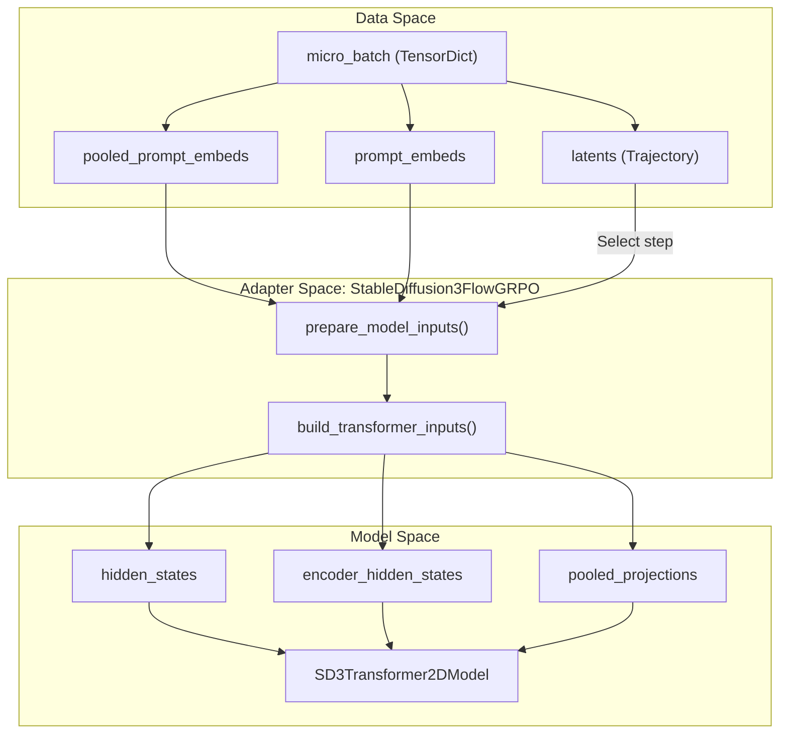
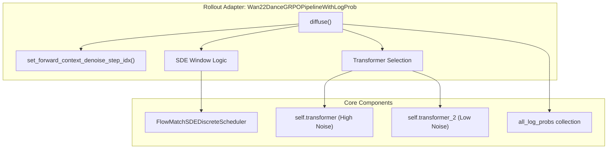

<!-- source: DeepWiki mcp.deepwiki.com · repo verl-project/verl-omni · page 5.3 SD3, Wan2.2, and LTX-2.3 Pipeline Adapters · fetched 2026-10-30 -->

# SD3, Wan2.2, and LTX-2.3 Pipeline Adapters

Relevant source files

The following files were used as context for generating this wiki page:

- [.dockerignore](.dockerignore)
- [.github/actions/gpu-smoke-prepare/action.yml](.github/actions/gpu-smoke-prepare/action.yml)
- [README.md](README.md)
- [docker/Dockerfile.a2.npu](docker/Dockerfile.a2.npu)
- [docker/Dockerfile.a3.npu](docker/Dockerfile.a3.npu)
- [docker/Dockerfile.cuda](docker/Dockerfile.cuda)
- [docs/assets/arch.png](docs/assets/arch.png)
- [docs/index.md](docs/index.md)
- [examples/dancegrpo_trainer/README.md](examples/dancegrpo_trainer/README.md)
- [examples/dancegrpo_trainer/data_process/wan22_hpsv3.py](examples/dancegrpo_trainer/data_process/wan22_hpsv3.py)
- [examples/dancegrpo_trainer/wan22/run_wan22_5b_t2v_hpsv3_auto.sh](examples/dancegrpo_trainer/wan22/run_wan22_5b_t2v_hpsv3_auto.sh)
- [examples/flowgrpo_trainer/data_process/sd3_ocr.py](examples/flowgrpo_trainer/data_process/sd3_ocr.py)
- [tests/pipelines/test_ltx2_flow_grpo_on_cpu.py](tests/pipelines/test_ltx2_flow_grpo_on_cpu.py)
- [verl_omni/agent_loop/single_turn_agent_loop.py](verl_omni/agent_loop/single_turn_agent_loop.py)
- [verl_omni/pipelines/ltx2_flow_grpo/vllm_omni_rollout_adapter.py](verl_omni/pipelines/ltx2_flow_grpo/vllm_omni_rollout_adapter.py)
- [verl_omni/pipelines/sd3_flow_grpo/__init__.py](verl_omni/pipelines/sd3_flow_grpo/__init__.py)
- [verl_omni/pipelines/sd3_flow_grpo/common.py](verl_omni/pipelines/sd3_flow_grpo/common.py)
- [verl_omni/pipelines/sd3_flow_grpo/diffusers_training_adapter.py](verl_omni/pipelines/sd3_flow_grpo/diffusers_training_adapter.py)
- [verl_omni/pipelines/sd3_flow_grpo/vllm_omni_rollout_adapter.py](verl_omni/pipelines/sd3_flow_grpo/vllm_omni_rollout_adapter.py)
- [verl_omni/pipelines/wan22_dance_grpo/common.py](verl_omni/pipelines/wan22_dance_grpo/common.py)
- [verl_omni/pipelines/wan22_dance_grpo/diffusers_training_adapter.py](verl_omni/pipelines/wan22_dance_grpo/diffusers_training_adapter.py)
- [verl_omni/utils/reward_score/hpsv3_reward.py](verl_omni/utils/reward_score/hpsv3_reward.py)

This section covers the specialized pipeline adapters for **Stable Diffusion 3 (SD3)**, **Wan2.2**, and **LTX-2.3**. These adapters facilitate the integration of complex diffusion, video, and audio-video models into RL frameworks like FlowGRPO, DPO, and DanceGRPO by managing architecture-specific requirements such as time-shifting, sigma schedules, and model-specific Classifier-Free Guidance (CFG) implementations.

## SD3 FlowGRPO and DPO Adapters

The SD3 integration in VeRL-Omni supports both **FlowGRPO** (online RL) and **DPO** (direct preference optimization). These adapters manage the joint CLIP+T5 prompt embeddings and the specific "pooled" projections required by the SD3 transformer.

### SD3 Implementation Details

SD3 uses a Multimodal Diffusion Transformer (MMDiT) which requires two types of prompt embeddings: a sequence of embeddings and a pooled projection [verl_omni/pipelines/sd3_flow_grpo/diffusers_training_adapter.py:52-56](). The adapters ensure these are correctly passed during both rollout and training.

*   **Token-ID Native Rollout**: The SD3 rollout adapter consumes per-text-encoder token IDs produced once by the agent loop via `actor_rollout_ref.model.extra_tokenizers` [verl_omni/pipelines/sd3_flow_grpo/vllm_omni_rollout_adapter.py:178-180](). This avoids decoding IDs back to text inside the pipeline. The `SD3TokenIdPromptMixin` handles padding for CLIP and T5 separately using `pad_token_id_batch` [verl_omni/pipelines/sd3_flow_grpo/common.py:49-57]().
*   **Time Shifting**: SD3 uses a dynamic shifting schedule for timesteps based on the image sequence length to account for the signal-to-noise ratio changes in higher resolutions [verl_omni/pipelines/sd3_flow_grpo/diffusers_training_adapter.py:31-40](). The `mu` parameter is calculated using `_calculate_shift` [verl_omni/pipelines/sd3_flow_grpo/diffusers_training_adapter.py:31-40]() and applied during `set_timesteps` [verl_omni/pipelines/sd3_flow_grpo/diffusers_training_adapter.py:68-78]().
*   **CFG Implementation**: The SD3 adapters implement Classifier-Free Guidance (CFG) by optionally executing a negative prompt branch. In the rollout adapter, if `guidance_scale <= 1.0`, the negative branch is skipped to save computation [verl_omni/pipelines/sd3_flow_grpo/vllm_omni_rollout_adapter.py:162-164](). In the training adapter, `prepare_model_inputs` builds `negative_model_inputs` only if `guidance_scale > 1.0` [verl_omni/pipelines/sd3_flow_grpo/diffusers_training_adapter.py:129-144]().
*   **Latent Rewards**: SD3 supports a diffusion-native reward model (DRM) path. Using `output_type=latent`, the rollout skips VAE decoding and sends clean latents to the reward system [verl_omni/pipelines/sd3_flow_grpo/vllm_omni_rollout_adapter.py:152-161]().

### SD3 Training Architecture

The following diagram shows the data flow from a raw prompt to the SD3 transformer inputs during training.

**SD3 Training Data Flow**

Sources: [verl_omni/pipelines/sd3_flow_grpo/diffusers_training_adapter.py:81-100](), [verl_omni/pipelines/sd3_flow_grpo/diffusers_training_adapter.py:103-146]()

---

## Wan2.2 DanceGRPO Adapter

The **Wan2.2** adapter is designed for text-to-video (T2V) RL training using the **DanceGRPO** algorithm. It handles the complexity of 3D video transformers and video-specific conditioning.

### Key Features of Wan22DanceGRPO

1.  **Time Shifting**: Wan2.2 uses a specialized `sd3_time_shift` function with a shift factor (typically 5.0 for Wan2.2) to adjust the sigma schedule [verl_omni/pipelines/wan22_dance_grpo/common.py:27-38]().
2.  **SDE Types**: Supports multiple SDE variants via `sde_type`, including `dance_sde`, `cps`, and the original `sde` [verl_omni/pipelines/wan22_dance_grpo/vllm_omni_rollout_adapter.py:103](). `dance_sde` is recommended for numerical stability [examples/dancegrpo_trainer/README.md:101]().
3.  **CFG and Stage Selection**: Wan2.2 often uses dual transformers (e.g., MoE A14B). The adapter manages the `boundary_timestep` to select between `transformer` and `transformer_2` based on the current noise level [verl_omni/pipelines/wan22_dance_grpo/vllm_omni_rollout_adapter.py:159-174]().
4.  **Reward Model**: Training typically uses **HPSv3** (Human Preference Score v3) via the `compute_score_hpsv3` function [verl_omni/utils/reward_score/hpsv3_reward.py:33-71]().

**Wan2.2 DanceGRPO Rollout Flow**

Sources: [verl_omni/pipelines/wan22_dance_grpo/vllm_omni_rollout_adapter.py:88-130](), [verl_omni/pipelines/wan22_dance_grpo/vllm_omni_rollout_adapter.py:159-174]()

---

## LTX-2.3 Text-to-Audio-Video Adapter

The **LTX-2.3** adapter enables FlowGRPO for joint audio-video generation. It extends the video-only FlowGRPO logic to handle multi-modal output tensors and non-contiguous SDE windows.

### Implementation Specifics

*   **Non-Contiguous SDE Windows**: LTX-2.3 supports training on disjoint sets of timesteps. The `sample_per_sample_sde_windows` function can generate multiple windows per sample to cover different parts of the trajectory [verl_omni/pipelines/request_batch.py:18]().
*   **Joint Modality CPS**: The `cps` (Change-Point Sampling) SDE variant is adapted for LTX-2.3 to handle transitions in both audio and video latent spaces simultaneously.
*   **Reward Integration**: Training recipes for LTX-2.3 utilize multi-modal rewards like **CLAP** (audio-text alignment) and **ImageBind** (audio-video alignment) [examples/flowgrpo_trainer/ltx2/run_ltx2_3_t2av_lora.sh:96-105]().

---

## Comparison of Pipeline Adapters

| Feature | SD3 (FlowGRPO) | Wan2.2 (DanceGRPO) | LTX-2.3 (FlowGRPO) |
| :--- | :--- | :--- | :--- |
| **Scheduler** | `FlowMatchSDEDiscreteScheduler` [verl_omni/pipelines/sd3_flow_grpo/vllm_omni_rollout_adapter.py:175]() | `FlowMatchSDEDiscreteScheduler` [verl_omni/pipelines/wan22_dance_grpo/vllm_omni_rollout_adapter.py:74]() | `FlowMatchSDEDiscreteScheduler` |
| **Model Type** | MMDiT (Image) | 3D Transformer (Video) | Joint Audio-Video Transformer |
| **Prompt Embeds** | Sequence + Pooled [verl_omni/pipelines/sd3_flow_grpo/diffusers_training_adapter.py:81]() | Sequence (Masked) [verl_omni/pipelines/wan22_dance_grpo/diffusers_training_adapter.py:158-162]() | Joint Multi-Modal Embeds |
| **Time Shifting** | Dynamic shift via `_calculate_shift` [verl_omni/pipelines/sd3_flow_grpo/diffusers_training_adapter.py:31]() | Fixed shift via `sd3_time_shift` [verl_omni/pipelines/wan22_dance_grpo/common.py:27]() | LTX-Specific Schedule |
| **SDE Window** | Contiguous range [verl_omni/pipelines/sd3_flow_grpo/vllm_omni_rollout_adapter.py:53]() | Contiguous range [verl_omni/pipelines/wan22_dance_grpo/vllm_omni_rollout_adapter.py:146]() | Non-contiguous support |

### SDE Window Management
All adapters use an SDE window to limit RL training to specific denoising steps, reducing memory and compute costs. 
*   **SD3**: Sampled via `sde_window_size` and `sde_window_range` parameters passed to the rollout [verl_omni/pipelines/sd3_flow_grpo/vllm_omni_rollout_adapter.py:53-63]().
*   **Wan2.2**: Captures per-step log-probabilities within the `sde_window` indices [verl_omni/pipelines/wan22_dance_grpo/vllm_omni_rollout_adapter.py:146-154]().
*   **LTX-2.3**: Supports multiple windows via `sde_window_size` configuration [examples/flowgrpo_trainer/ltx2/run_ltx2_3_t2av_lora.sh:88]().

Sources:
- `verl_omni/pipelines/sd3_flow_grpo/vllm_omni_rollout_adapter.py`
- `verl_omni/pipelines/sd3_flow_grpo/diffusers_training_adapter.py`
- `verl_omni/pipelines/wan22_dance_grpo/vllm_omni_rollout_adapter.py`
- `verl_omni/pipelines/wan22_dance_grpo/common.py`
- `verl_omni/utils/reward_score/hpsv3_reward.py`
- `examples/dancegrpo_trainer/README.md`
- `examples/flowgrpo_trainer/ltx2/run_ltx2_3_t2av_lora.sh`
- `verl_omni/agent_loop/single_turn_agent_loop.py`

---

