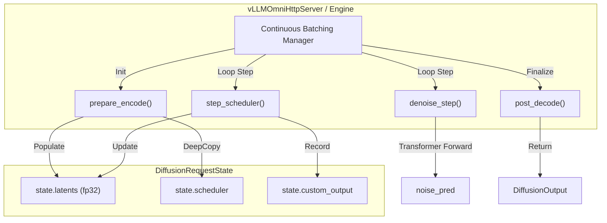

<!-- source: DeepWiki mcp.deepwiki.com · repo verl-project/verl-omni · page 5.4 Experimental Stepwise Pipelines and Image-to-Image Integration · fetched 2026-10-30 -->

# Experimental Stepwise Pipelines and Image-to-Image Integration

Relevant source files

The following files were used as context for generating this wiki page:

- [docs/contributing/integrating_an_i2i_diffusion_model.md](docs/contributing/integrating_an_i2i_diffusion_model.md)
- [examples/flowgrpo_trainer/qwen_image_edit/README.md](examples/flowgrpo_trainer/qwen_image_edit/README.md)
- [examples/flowgrpo_trainer/qwen_image_edit/prepare_data.py](examples/flowgrpo_trainer/qwen_image_edit/prepare_data.py)
- [examples/flowgrpo_trainer/qwen_image_edit/run_qwen_image_edit_lora.sh](examples/flowgrpo_trainer/qwen_image_edit/run_qwen_image_edit_lora.sh)
- [tests/pipelines/test_i2i_model_base_on_cpu.py](tests/pipelines/test_i2i_model_base_on_cpu.py)
- [tests/pipelines/test_image_edit_interface_on_cpu.py](tests/pipelines/test_image_edit_interface_on_cpu.py)
- [tests/pipelines/test_qwen_image_edit_on_cpu.py](tests/pipelines/test_qwen_image_edit_on_cpu.py)
- [tests/special_e2e/build_qwen_image_edit_plus_tiny_random.py](tests/special_e2e/build_qwen_image_edit_plus_tiny_random.py)
- [tests/special_e2e/create_dummy_image_edit_data.py](tests/special_e2e/create_dummy_image_edit_data.py)
- [tests/special_e2e/run_flowgrpo_qwen_image_edit.sh](tests/special_e2e/run_flowgrpo_qwen_image_edit.sh)
- [verl_omni/pipelines/qwen_image_edit_flow_grpo/__init__.py](verl_omni/pipelines/qwen_image_edit_flow_grpo/__init__.py)
- [verl_omni/pipelines/qwen_image_edit_flow_grpo/diffusers_training_adapter.py](verl_omni/pipelines/qwen_image_edit_flow_grpo/diffusers_training_adapter.py)
- [verl_omni/pipelines/qwen_image_edit_flow_grpo/vllm_omni_rollout_adapter.py](verl_omni/pipelines/qwen_image_edit_flow_grpo/vllm_omni_rollout_adapter.py)
- [verl_omni/pipelines/utils.py](verl_omni/pipelines/utils.py)

This page covers the experimental infrastructure for **continuous-batching (CB) rollout** and **image-to-image (I2I)** diffusion model integration. Stepwise pipelines interleave denoising steps from multiple requests to increase throughput, while I2I integration enables RL for image-editing tasks like those performed by Qwen-Image-Edit-Plus.

## Stepwise Execution and Continuous Batching

Experimental stepwise pipelines provide support for continuous-batching rollout in diffusion models. Unlike standard full-forward mode, where a single request occupies the inference engine until its entire trajectory is generated, stepwise mode interleaves denoising steps from multiple in-flight requests.

### System Architecture and Data Flow

In stepwise mode, the `vLLM-Omni` engine manages a pool of `DiffusionRequestState` objects. Instead of calling a monolithic `forward()` method, the engine executes a four-phase lifecycle for every request.

| Phase | Method | Responsibility |
| :--- | :--- | :--- |
| **Setup** | `prepare_encode()` | Encodes prompts, initializes latents in `fp32`, and sets up request-local schedulers. |
| **Per-step** | `denoise_step()` | Runs the transformer forward pass to produce noise predictions. |
| **Per-step** | `step_scheduler()` | Advances one scheduler step, applies noise, and collects trajectory data (e.g., log-probs). |
| **Finalize** | `post_decode()` | Decodes latents into images and packages the `DiffusionOutput` with algorithm-specific tensors. |

### Logical Flow Diagram: Stepwise Engine

## Image-to-Image (I2I) Integration

The I2I framework enables RL training for models that take an image as a condition (e.g., for editing or style transfer). This requires transporting condition images from the dataset through the rollout system and into the training engine [docs/contributing/integrating_an_i2i_diffusion_model.md:19-26]().

### DiffusionI2IModelBase and Condition Transport

Models inheriting from `DiffusionI2IModelBase` implement specific hooks for condition handling [docs/contributing/integrating_an_i2i_diffusion_model.md:28-30]():

1.  **Condition Transport**: The `ImageGenerationRequest` utility parses condition images from the request payload (e.g., from the `images` or `multi_modal_data` fields) [verl_omni/pipelines/utils.py:62-115](). It searches multiple candidate keys including `images`, `image`, `multi_modal_data.image`, and `additional_information.condition_images` [verl_omni/pipelines/utils.py:78-84]().
2.  **`prepare_condition`**: Reconstructs condition tensors from the micro-batch during training [docs/contributing/integrating_an_i2i_diffusion_model.md:150-152](). In the global `prepare_model_inputs` utility, this hook is called if the model class is a subclass of `DiffusionI2IModelBase` [verl_omni/pipelines/utils.py:171-172]().
3.  **`inject_condition`**: Injects condition latents (often via concatenation) into the transformer inputs [docs/contributing/integrating_an_i2i_diffusion_model.md:154-156](). This is called immediately after the base T2I `prepare_model_inputs` logic [verl_omni/pipelines/utils.py:175-176]().

### Data Flow: Concat-Conditioned I2I

```mermaid
graph LR
    subgraph "Data Loading"
        PAR["Parquet Image Bytes"] --> AL["Agent Loop"]
    end
    subgraph "Rollout (vLLM-Omni)"
        AL --> |"Condition Image"| VAE_R["VAE Encode"]
        VAE_R --> |"Condition Latent"| TR_R["Transformer Forward"]
        TR_R --> |"Trajectory"| CO["custom_output['condition_image_latents']"]
    end
    subgraph "Training (FSDP)"
        CO --> MB["Micro-batch"]
        MB --> PC["prepare_condition()"]
        PC --> IC["inject_condition()"]
        IC --> TR_T["Transformer Log-Prob"]
    end
```

**Sources:** [docs/contributing/integrating_an_i2i_diffusion_model.md:49-63](), [verl_omni/pipelines/utils.py:118-177]()

## Worked Example: Qwen-Image-Edit-Plus

Qwen-Image-Edit-Plus is the canonical I2I implementation. It uses a `QwenImageEditPlusPipelineWithLogProb` for rollout and `QwenImageEditPlusFlowGRPO` for training [verl_omni/pipelines/qwen_image_edit_flow_grpo/__init__.py:15-18]().

### Implementation Features
*   **Dataset Preparation**: The `prepare_data.py` script letterboxes condition images onto a square canvas and stores them as PNG bytes in parquet files [examples/flowgrpo_trainer/qwen_image_edit/README.md:58-59]().
*   **Prompt Formatting**: Instructions are formatted with `<image>` placeholders to match the multimodal input convention [examples/flowgrpo_trainer/qwen_image_edit/README.md:65]().
*   **Registry**: Both rollout and training adapters are registered under the architecture name `QwenImageEditPlusPipeline` [verl_omni/pipelines/qwen_image_edit_flow_grpo/diffusers_training_adapter.py:31](), [verl_omni/pipelines/qwen_image_edit_flow_grpo/vllm_omni_rollout_adapter.py:114]().
*   **Training Configuration**: The `run_qwen_image_edit_lora.sh` script configures the actor to use `flow_grpo` and the rollout to use `vllm_omni` [examples/flowgrpo_trainer/qwen_image_edit/run_qwen_image_edit_lora.sh:39-59](). It sets a `true_cfg_scale` of 4.0, which requires a negative prompt containing the condition image [examples/flowgrpo_trainer/qwen_image_edit/run_qwen_image_edit_lora.sh:67]().

### Key Code Entities and Roles

| Class/Function | Role | Source |
| :--- | :--- | :--- |
| `QwenImageEditPlusFlowGRPO` | Training adapter; implements `prepare_condition` and `inject_condition`. | [verl_omni/pipelines/qwen_image_edit_flow_grpo/diffusers_training_adapter.py:32-101]() |
| `QwenImageEditPlusPipelineWithLogProb` | Rollout adapter; manages SDE log-prob collection and prompt encoding with images. | [verl_omni/pipelines/qwen_image_edit_flow_grpo/vllm_omni_rollout_adapter.py:115-200]() |
| `_validate_condition_image_sizes` | Ensures condition images match the target aspect ratio for constant latent lengths. | [verl_omni/pipelines/qwen_image_edit_flow_grpo/vllm_omni_rollout_adapter.py:81-113]() |
| `prepare_processor_files` | Hook to generate missing `processor/config.json` in Qwen-Image-Edit checkpoints. | [verl_omni/pipelines/qwen_image_edit_flow_grpo/diffusers_training_adapter.py:40-49]() |

### Image Generation Request Resolution
The `ImageGenerationRequest.from_request_payload` method implements a priority-based resolution for multimodal data [verl_omni/pipelines/utils.py:62-115]():

1.  **Prompt**: Checks `prompt` then `prompt_token_ids` [verl_omni/pipelines/utils.py:64-66]().
2.  **Images**: Iterates through `images`, `image`, `multi_modal_data.image`, `extra_args.multi_modal_data.image`, and `additional_information.condition_images` [verl_omni/pipelines/utils.py:78-84]().
3.  **Metadata**: Checks `metadata`, `extra_info`, and `additional_information` [verl_omni/pipelines/utils.py:96-100]().

**Sources:** [examples/flowgrpo_trainer/qwen_image_edit/README.md:1-198](), [docs/contributing/integrating_an_i2i_diffusion_model.md:96-133](), [verl_omni/pipelines/utils.py:45-115](), [verl_omni/pipelines/qwen_image_edit_flow_grpo/diffusers_training_adapter.py:15-101](), [verl_omni/pipelines/qwen_image_edit_flow_grpo/vllm_omni_rollout_adapter.py:15-200]()

---

