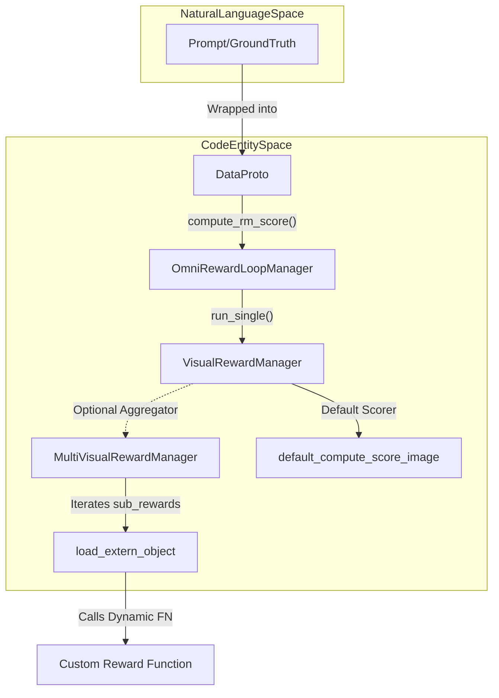
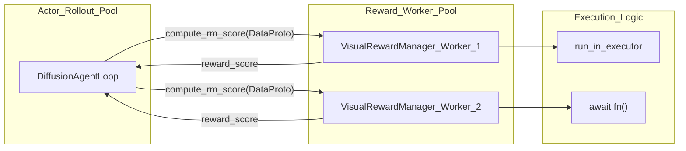

<!-- source: DeepWiki mcp.deepwiki.com · repo verl-project/verl-omni · page 6 Reward System · fetched 2026-10-30 -->

# Reward System

Relevant source files

The following files were used as context for generating this wiki page:

- [docs/algo/async_reward.md](docs/algo/async_reward.md)
- [docs/algo/diffusionnft.md](docs/algo/diffusionnft.md)
- [docs/api/reward.rst](docs/api/reward.rst)
- [docs/api/utils.rst](docs/api/utils.rst)
- [docs/start/http_scorer.md](docs/start/http_scorer.md)
- [examples/flowgrpo_trainer/data_process/qwenimage_ocr_http_service.py](examples/flowgrpo_trainer/data_process/qwenimage_ocr_http_service.py)
- [tests/reward_loop/test_multi_reward_manager_on_cpu.py](tests/reward_loop/test_multi_reward_manager_on_cpu.py)
- [tests/reward_loop/test_visual_reward_manager.py](tests/reward_loop/test_visual_reward_manager.py)
- [tests/utils/reward_score/test_http_scorer_client_on_cpu.py](tests/utils/reward_score/test_http_scorer_client_on_cpu.py)
- [verl_omni/reward_loop/reward_manager/multi.py](verl_omni/reward_loop/reward_manager/multi.py)
- [verl_omni/reward_loop/reward_manager/visual.py](verl_omni/reward_loop/reward_manager/visual.py)
- [verl_omni/trainer/config/_generated_omni_trainer.yaml](verl_omni/trainer/config/_generated_omni_trainer.yaml)
- [verl_omni/utils/reward_score/__init__.py](verl_omni/utils/reward_score/__init__.py)
- [verl_omni/utils/reward_score/http_scorer_client.py](verl_omni/utils/reward_score/http_scorer_client.py)
- [verl_omni/utils/reward_score/jpeg_compressibility.py](verl_omni/utils/reward_score/jpeg_compressibility.py)
- [verl_omni/workers/rollout/replica.py](verl_omni/workers/rollout/replica.py)

The VeRL-Omni Reward System is a distributed infrastructure designed to score generated visual content (images or videos) within Reinforcement Learning loops. It decouples reward computation from policy updates, allowing for expensive scoring functions—such as VLM judges, OCR models, or external HTTP services—to run asynchronously and in parallel with rollout generation.

## System Architecture

The reward system is centered around the `RewardLoopManager` (extended by `OmniRewardLoopManager` in this codebase) which orchestrates one or more reward workers [verl_omni/reward_loop/reward_loop.py:19-28](). These workers host a **Reward Manager** class that executes specific scoring logic. The configuration allows scaling these workers via `reward.num_workers` to parallelize computation [verl_omni/trainer/config/_generated_omni_trainer.yaml:313]().

### Data Flow and Scoring Pipeline
The system transitions from the "Natural Language Space" (prompts and ground truth) to the "Code Entity Space" (DataProto and Reward Managers) as follows:

1.  **Rollout Completion**: The `DiffusionAgentLoop` finishes generating a visual response.
2.  **Sample Streaming**: Each sample is wrapped in a `DataProto` and sent to the reward infrastructure.
3.  **Manager Execution**: The `VisualRewardManager` (or its multi-reward variant) extracts the `responses` tensor, `data_source`, and `ground_truth` from the `DataProto` [verl_omni/reward_loop/reward_manager/visual.py:62-65]().
4.  **Scoring**: A `compute_score` function is invoked. This can be a local Python function (e.g., `jpeg_compressibility`), a model-based scorer (GenRM), or an async HTTP client [verl_omni/reward_loop/reward_manager/visual.py:85-103]().

### Reward System Entity Mapping

The following diagram maps the logical reward flow to the specific classes and methods used in the codebase.

Title: Reward Execution Flow

| Concept | Code Entity / Config Key | File Reference |
| :--- | :--- | :--- |
| **Primary Manager** | `VisualRewardManager` | [verl_omni/reward_loop/reward_manager/visual.py:39]() |
| **Aggregator** | `MultiVisualRewardManager` | [verl_omni/reward_loop/reward_manager/multi.py:49]() |
| **Default Scorer** | `default_compute_score_image` | [verl_omni/utils/reward_score/__init__.py:18]() |
| **Dynamic Loader** | `load_extern_object` | [verl_omni/reward_loop/reward_manager/multi.py:20]() |
| **Placeholder** | `_multi_reward_placeholder` | [verl_omni/reward_loop/reward_manager/multi.py:27]() |

**Sources:** [verl_omni/reward_loop/reward_manager/visual.py:39-53](), [verl_omni/reward_loop/reward_manager/multi.py:49-61](), [verl_omni/reward_loop/reward_manager/multi.py:27-32](), [verl_omni/utils/reward_score/__init__.py:18-55]()

---

## Key Components

### Reward Managers
Reward Managers are the execution engines for scoring. 
*   **`VisualRewardManager`**: The default manager for visual responses. It handles single-score extraction and supports both synchronous and `async def` scoring functions [verl_omni/reward_loop/reward_manager/visual.py:50-52](). It maps scores into a `(batch_size, 1)` tensor via `assemble_rm_scores` [verl_omni/reward_loop/reward_manager/visual.py:55-57]().
*   **`MultiVisualRewardManager`**: A subclass of `VisualRewardManager` used when multiple scoring criteria (e.g., OCR accuracy + aesthetic score) must be combined. It performs a weighted sum aggregation of sub-rewards [verl_omni/reward_loop/reward_manager/multi.py:150-180](). It uses `_filter_kwargs` to ensure each sub-function only receives the arguments it expects [verl_omni/reward_loop/reward_manager/multi.py:35-46]().

For details, see [Reward Managers and Scoring Functions](#6.1).

### Async Reward Architecture
Async reward enables concurrent execution of scoring functions. The system can send individual samples to reward workers as soon as they are ready. The `OmniRewardLoopManager` also provides hooks to profile the reward-model rollout servers [verl_omni/reward_loop/reward_loop.py:30-37](). By setting `reward.reward_model.enable_resource_pool=True`, reward workers can be assigned to a dedicated GPU pool to avoid contention with the trainer [verl_omni/trainer/config/_generated_omni_trainer.yaml:352]().

Title: Distributed Reward Topology

**Sources:** [verl_omni/reward_loop/reward_manager/visual.py:85-103](), [verl_omni/reward_loop/reward_loop.py:19-46](), [verl_omni/reward_loop/reward_manager/multi.py:166-170](), [docs/algo/async_reward.md:38-55]()

### HTTP Scorer and External Services
For extremely large reward models or shared environments, the system supports external scoring services via the `http_scorer_client` [verl_omni/utils/reward_score/http_scorer_client.py:68-75](). This client uses a pickle-based protocol to transmit images and prompts to a remote Flask/Gunicorn service [docs/start/http_scorer.md:11-20](). The `MultiVisualRewardManager` can load these external functions dynamically via `path` and `name` fields in the Hydra configuration [verl_omni/reward_loop/reward_manager/multi.py:72-91]().

For details, see [Async Reward and HTTP Scorer](#6.2).

---

## Reward Metrics and Monitoring

The system tracks reward health through several key metrics:

*   **`reward_score`**: The primary scalar returned by the manager, used for advantage estimation in RL algorithms [verl_omni/reward_loop/reward_manager/visual.py:120]().
*   **`reward_extra_info`**: Managers return dictionaries containing granular metadata (e.g., `acc`, `genrm_response`). For multi-reward setups, these are logged per sub-reward [verl_omni/reward_loop/reward_manager/multi.py:177-185]().
*   **`zero_std_ratio`**: A performance metric indicating the fraction of samples with zero reward variance, helping detect reward collapse [docs/algo/async_reward.md:168]().
*   **`throughput`**: Measured as images/GPU/s, tracked across rollout and reward workers [docs/algo/async_reward.md:168]().

**Sources:** [verl_omni/reward_loop/reward_manager/visual.py:105-120](), [verl_omni/reward_loop/reward_manager/multi.py:171-185](), [docs/algo/async_reward.md:150-168]()

---

## Child Pages
*   [Reward Managers and Scoring Functions](#6.1) — Details on `VisualRewardManager`, `MultiVisualRewardManager`, weighted aggregation logic, and built-in scoring functions like OCR, HPSv3, and ImageBind.
*   [Async Reward and HTTP Scorer](#6.2) — Deep dive into the Ray-based async architecture, sample-level streaming, dedicated GPU pools, and the `http_scorer_client` for external service integration.

---

