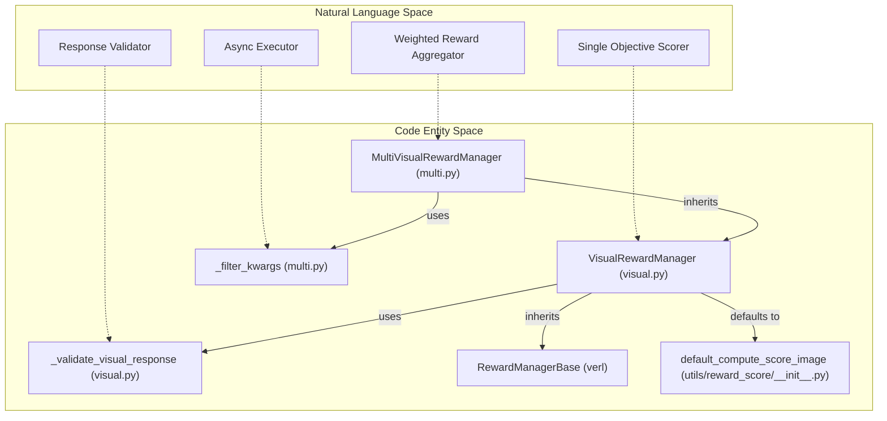
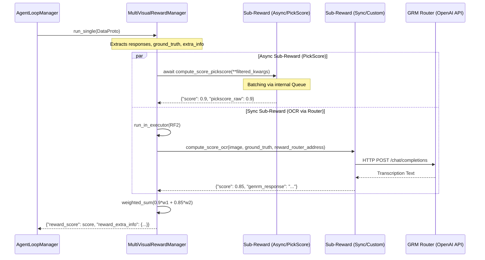

<!-- source: DeepWiki mcp.deepwiki.com · repo verl-project/verl-omni · page 6.1 Reward Managers and Scoring Functions · fetched 2026-10-30 -->

# Reward Managers and Scoring Functions

Relevant source files

The following files were used as context for generating this wiki page:

- [docs/contributing/ci_cd.md](docs/contributing/ci_cd.md)
- [docs/contributing/testing_guide.md](docs/contributing/testing_guide.md)
- [examples/dancegrpo_trainer/README.md](examples/dancegrpo_trainer/README.md)
- [examples/dancegrpo_trainer/data_process/wan22_hpsv3.py](examples/dancegrpo_trainer/data_process/wan22_hpsv3.py)
- [examples/dancegrpo_trainer/wan22/run_wan22_5b_t2v_hpsv3_auto.sh](examples/dancegrpo_trainer/wan22/run_wan22_5b_t2v_hpsv3_auto.sh)
- [tests/nightly/qwen_image_flowgrpo/README.md](tests/nightly/qwen_image_flowgrpo/README.md)
- [tests/nightly/qwen_image_flowgrpo/collect_metrics.py](tests/nightly/qwen_image_flowgrpo/collect_metrics.py)
- [tests/nightly/qwen_image_flowgrpo/compare_dumps.py](tests/nightly/qwen_image_flowgrpo/compare_dumps.py)
- [tests/nightly/qwen_image_flowgrpo/create_single_sample_data.py](tests/nightly/qwen_image_flowgrpo/create_single_sample_data.py)
- [tests/nightly/qwen_image_flowgrpo/install_debug_hooks.py](tests/nightly/qwen_image_flowgrpo/install_debug_hooks.py)
- [tests/reward_loop/test_multi_reward_manager_on_cpu.py](tests/reward_loop/test_multi_reward_manager_on_cpu.py)
- [tests/reward_loop/test_visual_reward_manager.py](tests/reward_loop/test_visual_reward_manager.py)
- [tests/utils/reward_score/test_pickscore_reward_on_cpu.py](tests/utils/reward_score/test_pickscore_reward_on_cpu.py)
- [verl_omni/pipelines/wan22_dance_grpo/common.py](verl_omni/pipelines/wan22_dance_grpo/common.py)
- [verl_omni/pipelines/wan22_dance_grpo/diffusers_training_adapter.py](verl_omni/pipelines/wan22_dance_grpo/diffusers_training_adapter.py)
- [verl_omni/reward_loop/reward_manager/multi.py](verl_omni/reward_loop/reward_manager/multi.py)
- [verl_omni/reward_loop/reward_manager/visual.py](verl_omni/reward_loop/reward_manager/visual.py)
- [verl_omni/utils/reward_score/__init__.py](verl_omni/utils/reward_score/__init__.py)
- [verl_omni/utils/reward_score/choice_reward.py](verl_omni/utils/reward_score/choice_reward.py)
- [verl_omni/utils/reward_score/genrm_ocr.py](verl_omni/utils/reward_score/genrm_ocr.py)
- [verl_omni/utils/reward_score/hpsv3_reward.py](verl_omni/utils/reward_score/hpsv3_reward.py)
- [verl_omni/utils/reward_score/imagebind.py](verl_omni/utils/reward_score/imagebind.py)
- [verl_omni/utils/reward_score/jpeg_compressibility.py](verl_omni/utils/reward_score/jpeg_compressibility.py)
- [verl_omni/utils/reward_score/pickscore_reward.py](verl_omni/utils/reward_score/pickscore_reward.py)
- [verl_omni/utils/reward_score/unified_reward.py](verl_omni/utils/reward_score/unified_reward.py)
- [verl_omni/workers/rollout/replica.py](verl_omni/workers/rollout/replica.py)

The reward system in VeRL-Omni is responsible for evaluating generated visual content (images or videos) against specific criteria to provide feedback for reinforcement learning algorithms like FlowGRPO, DiffusionNFT, or DanceGRPO. The system is built around two primary manager classes: `VisualRewardManager` for single-function scoring and `MultiVisualRewardManager` for complex, weighted multi-objective scoring.

## Reward Manager Architecture

The reward managers act as the interface between the RL rollout process and the specific scoring logic. They handle data extraction from `DataProto` objects, coordinate with external reward models (via Ray or HTTP), and manage asynchronous execution to maximize throughput.

### VisualRewardManager
`VisualRewardManager` is the base class for visual tasks. It specializes in handling `responses` tensors (images/videos) rather than text tokens [verl_omni/reward_loop/reward_manager/visual.py:39-40]().

*   **Initialization**: It defaults to `default_compute_score_image` if no custom function is provided [verl_omni/reward_loop/reward_manager/visual.py:45-46]().
*   **Validation**: It enforces strict data type contracts: `uint8` for pixel images/videos and floating-point for latent-space responses [verl_omni/reward_loop/reward_manager/visual.py:25-36]().
*   **Execution**: It detects if the scoring function is asynchronous using `inspect.iscoroutinefunction`. If not, it wraps the execution in `self.loop.run_in_executor` to avoid blocking the event loop [verl_omni/reward_loop/reward_manager/visual.py:50, 94-103]().

### MultiVisualRewardManager
`MultiVisualRewardManager` allows for the aggregation of multiple independent reward functions. This is critical for tasks requiring a balance between different qualities (e.g., OCR accuracy vs. aesthetic quality).

*   **Weighted Aggregation**: It calculates a `combined_score` as a weighted sum of sub-rewards defined in the configuration [verl_omni/reward_loop/reward_manager/multi.py:150, 172-175]().
*   **Signature Filtering**: It uses `_filter_kwargs` to inspect the signature of each sub-reward function, passing only the arguments that the function explicitly requests or passing all if `**kwargs` is present [verl_omni/reward_loop/reward_manager/multi.py:35-46, 164]().
*   **Fault Tolerance**: If a sub-reward function raises an exception, it logs the error and contributes `0.0` to the weighted sum [verl_omni/reward_loop/reward_manager/multi.py:180-185](). Sub-rewards can be marked as `required: true` in the config to enforce stricter behavior; if a required reward fails, the entire manager raises an error [verl_omni/reward_loop/reward_manager/multi.py:76-85, 182-183]().

### System-to-Code Mapping: Reward Managers

The following diagram bridges the high-level reward concepts to the specific code entities in the `verl_omni.reward_loop` package.

**Diagram: Reward Manager Entity Mapping**

Sources: [verl_omni/reward_loop/reward_manager/multi.py:49-59](), [verl_omni/reward_loop/reward_manager/multi.py:35-46](), [verl_omni/reward_loop/reward_manager/visual.py:25-53]()

## Scoring Functions and Reward Types

Scoring functions are the core logic units that return a numerical value (and optional metadata) for a generation. VeRL-Omni supports several primary types of scoring:

| Reward Type | Implementation | Description |
| :--- | :--- | :--- |
| **Generative RM (OCR)** | `genrm_ocr.py` | Uses a VLM (e.g., Qwen3-VL) via an OpenAI-compatible router to transcribe images and compute Levenshtein distance [verl_omni/utils/reward_score/genrm_ocr.py:96-126](). |
| **PickScore** | `pickscore_reward.py` | Uses CLIP-based PickScore to evaluate text-to-image alignment via an async batching consumer [verl_omni/utils/reward_score/pickscore_reward.py:182-198](). |
| **HPSv3** | `hpsv3_reward.py` | Human Preference Score v3, evaluating visual quality and text alignment for videos/images [verl_omni/utils/reward_score/hpsv3_reward.py:33-71](). |
| **Choice Reward** | `choice_reward.py` | A text-based rule reward that extracts content between `<answer>` tags for exact match scoring [verl_omni/utils/reward_score/choice_reward.py:22-31](). |
| **JPEG Compressibility** | `jpeg_compressibility.py` | Rule-based reward measuring image complexity via file size [verl_omni/utils/reward_score/jpeg_compressibility.py:42-49](). |
| **CLAP / ImageBind** | `imagebind.py`, `clap` | Used in audio-video generation tasks (e.g., LTX-2.3) to evaluate cross-modal alignment. |
| **Unified Reward** | `unified_reward.py` | A generic wrapper for combining multiple scoring criteria into a single entry point. |

### Multi-Reward Configuration
Multi-reward behavior is controlled via the `reward.reward_functions` Hydra dictionary. Each entry specifies a `path`, `name`, and `weight`. Any field in the config that is not a reserved key (`path`, `name`, `weight`, `required`) is automatically passed to the scoring function as an extra argument [verl_omni/reward_loop/reward_manager/multi.py:65-90, 163]().

Sources: [verl_omni/reward_loop/reward_manager/multi.py:65-112](), [tests/reward_loop/test_multi_reward_manager_on_cpu.py:75-82](), [verl_omni/utils/reward_score/choice_reward.py:22-31]()

## Data Flow and Execution

The reward process follows a specific sequence from the completion of a rollout to the aggregation of metrics.

**Diagram: Reward Data Flow**

Sources: [verl_omni/reward_loop/reward_manager/multi.py:114-176](), [verl_omni/utils/reward_score/genrm_ocr.py:41-48, 105-126](), [verl_omni/utils/reward_score/pickscore_reward.py:182-198]()

## Key Scoring Functions

### PickScore Reward
The `compute_score_pickscore` function evaluates image-text alignment using the PickScore model (CLIP-ViT-H-14 backbone).
1.  **Async Consumer**: It uses an internal `asyncio.Queue` and a background `_consumer_loop` to batch inference requests (up to `_MAX_BATCH_SIZE=16`) to avoid blocking the event loop [verl_omni/utils/reward_score/pickscore_reward.py:29, 32, 135-167]().
2.  **Preprocessing**: Converts tensors to PIL images and normalizes them for CLIP using `_to_pil_hwc` [verl_omni/utils/reward_score/pickscore_reward.py:97-105, 117]().
3.  **Inference**: Computes the dot product between text and image embeddings, scaled by the model's logit scale and normalized [verl_omni/utils/reward_score/pickscore_reward.py:90-94]().

### HPSv3 Reward
Human Preference Score v3 (HPSv3) is used extensively in video generation tasks like Wan2.2 DanceGRPO [examples/dancegrpo_trainer/README.md:48-53]().
*   **Evaluation Dimensions**: It considers visual quality (reasonableness, clarity, aesthetics, safety) and text alignment (subject relevance, style, context) [verl_omni/utils/reward_score/hpsv3_reward.py:33-68]().
*   **Implementation**: It defines a detailed instruction string and utilizes a VLM backbone (defaulting to `Qwen2-VL-7B-Instruct`) to estimate human preference ratings [verl_omni/utils/reward_score/hpsv3_reward.py:33-83]().

### Generative RM (OCR)
The `compute_score_ocr` function uses a visual language model to transcribe text from generated images or videos and compares it to ground truth.
*   **Video Subsampling**: For videos (4D/5D tensors), it subsamples frames based on `frame_interval` found in `extra_info` to reduce inference load [verl_omni/utils/reward_score/genrm_ocr.py:141-164]().
*   **Scoring Logic**: It uses Levenshtein distance to compare the transcribed text with `ground_truth`, returning a normalized score in `[0, 1]` [verl_omni/utils/reward_score/genrm_ocr.py:62-77,199]().
*   **Deployment**: It requires a `reward_router_address` pointing to an OpenAI-compatible VLM server [verl_omni/utils/reward_score/genrm_ocr.py:41-48, 101]().

### Choice Reward
Used primarily for reasoning tasks where the model must output a specific answer.
*   **Regex Extraction**: It extracts content found within `<answer>...</answer>` tags [verl_omni/utils/reward_score/choice_reward.py:26]().
*   **Strict Matching**: Returns `1.0` if the extracted answer matches the ground truth exactly, otherwise `0.0` [verl_omni/utils/reward_score/choice_reward.py:27-31]().

## Metrics and Monitoring

The reward managers return a `reward_extra_info` dictionary that is logged to monitoring backends like Weights & Biases or TensorBoard.
*   **`reward_score`**: The final aggregated score used for advantage estimation in the RL training loop [verl_omni/reward_loop/reward_manager/multi.py:150,191]().
*   **Sub-Reward Breakdown**: Each individual sub-reward's raw score is added to `reward_extra_info` under its configuration key [verl_omni/reward_loop/reward_manager/multi.py:172-175]().
*   **Performance Tracking**: Nightly tests monitor `timing_s/reward` to detect regressions in scoring latency [tests/nightly/qwen_image_flowgrpo/collect_metrics.py:37, 150]().

Sources: [verl_omni/reward_loop/reward_manager/multi.py:114-191](), [tests/nightly/qwen_image_flowgrpo/collect_metrics.py:33-45](), [verl_omni/utils/reward_score/pickscore_reward.py:198]()

---

