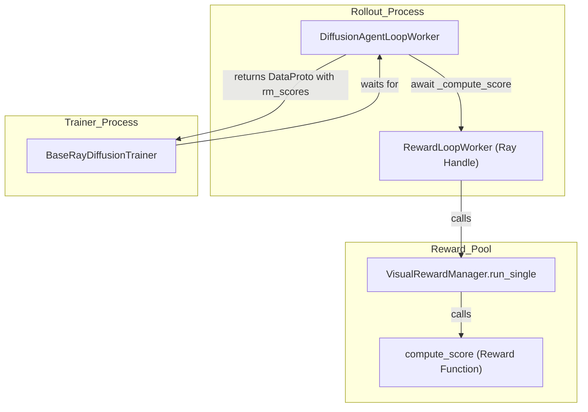
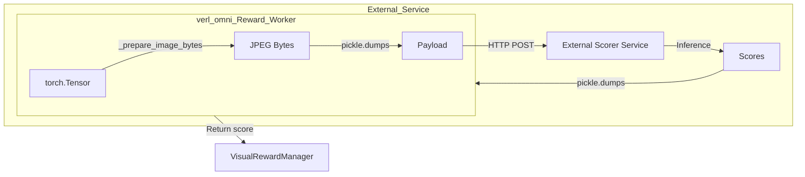

<!-- source: DeepWiki mcp.deepwiki.com · repo verl-project/verl-omni · page 6.2 Async Reward and HTTP Scorer · fetched 2026-10-30 -->

# Async Reward and HTTP Scorer

<details>
<summary>Relevant source files</summary>

The following files were used as context for generating this wiki page:

- [docs/algo/async_reward.md](docs/algo/async_reward.md)
- [docs/algo/diffusionnft.md](docs/algo/diffusionnft.md)
- [docs/api/reward.rst](docs/api/reward.rst)
- [docs/api/utils.rst](docs/api/utils.rst)
- [docs/start/http_scorer.md](docs/start/http_scorer.md)
- [examples/flowgrpo_trainer/data_process/qwenimage_ocr_http_service.py](examples/flowgrpo_trainer/data_process/qwenimage_ocr_http_service.py)
- [examples/flowgrpo_trainer/data_process/sd3_pickscore_sfw.py](examples/flowgrpo_trainer/data_process/sd3_pickscore_sfw.py)
- [tests/pipelines/test_diffusion_model_base_on_cpu.py](tests/pipelines/test_diffusion_model_base_on_cpu.py)
- [tests/utils/reward_score/test_http_scorer_client_on_cpu.py](tests/utils/reward_score/test_http_scorer_client_on_cpu.py)
- [tests/utils/reward_score/test_latent_http_scorer_client_on_cpu.py](tests/utils/reward_score/test_latent_http_scorer_client_on_cpu.py)
- [verl_omni/reward_loop/__init__.py](verl_omni/reward_loop/__init__.py)
- [verl_omni/reward_loop/reward_loop.py](verl_omni/reward_loop/reward_loop.py)
- [verl_omni/reward_loop/reward_manager/__init__.py](verl_omni/reward_loop/reward_manager/__init__.py)
- [verl_omni/trainer/config/_generated_omni_trainer.yaml](verl_omni/trainer/config/_generated_omni_trainer.yaml)
- [verl_omni/trainer/config/reward/reward.yaml](verl_omni/trainer/config/reward/reward.yaml)
- [verl_omni/trainer/diffusion/diffusion_metric_utils.py](verl_omni/trainer/diffusion/diffusion_metric_utils.py)
- [verl_omni/utils/reward_score/http_scorer_client.py](verl_omni/utils/reward_score/http_scorer_client.py)
- [verl_omni/utils/reward_score/latent_http_scorer_client.py](verl_omni/utils/reward_score/latent_http_scorer_client.py)

</details>


Async reward in VeRL-Omni enables **sample-level streaming reward computation** within an otherwise on-policy training step. This architecture allows the system to score completed rollout samples through reward-loop workers while other samples are still being generated by the rollout engine [docs/algo/async_reward.md:6-9](). By decoupling reward inference from the critical path of the trainer, expensive reward models (such as VLMs, OCR models, or external HTTP scorers) can be hidden behind the rollout generation time, significantly reducing end-to-end step latency [docs/algo/async_reward.md:32-34]().

## Async Reward Architecture

The async reward system moves reward scoring into dedicated reward-loop workers. When a sample finishes generation in the agent loop, it is immediately sent to a reward worker [docs/algo/async_reward.md:26-28]().

### Data Flow and Parallelism

The trainer maintains on-policy semantics by waiting for the full batch to be scored before proceeding to the actor update [docs/algo/async_reward.md:51-55](). However, the "reward stage" is effectively pipelined with the "rollout stage".

**Data Flow Topology**

| Component | Role | Code Entity |
| :--- | :--- | :--- |
| **Agent Loop** | Generates images and triggers async scoring. | `DiffusionAgentLoopWorker` [docs/algo/async_reward.md:123-125]() |
| **Reward Loop** | Orchestrates reward workers and resource pools. | `OmniRewardLoopManager` [verl_omni/reward_loop/reward_loop.py:14-17]() |
| **Reward Worker** | Executes reward functions (sync or async). | `RewardLoopWorker` [docs/start/http_scorer.md:22]() |
| **Reward Manager** | Dispatches data to specific scoring functions. | `VisualRewardManager` [verl_omni/reward_loop/reward_manager/visual_reward_manager.py:15-17]() |

**Code Entity Interaction**

The following diagram illustrates how the code entities interact during an async reward cycle:

**Diagram: "Async Reward Code Interaction"**

Sources: [docs/algo/async_reward.md:113-135](), [docs/api/reward.rst:18-19](), [docs/start/http_scorer.md:22]()

## Implementation Details

### Sample-Level Streaming
The `DiffusionAgentLoop` runs one async task per rollout sample. After a sample finishes, it builds a single-sample `DataProto` containing the visual response and sends it to a randomly selected reward-loop worker via `selected_reward_loop_worker_handle.compute_score.remote(data)` [docs/algo/async_reward.md:123-132]().

### Dedicated Resource Pools
By setting `reward.reward_model.enable_resource_pool=True`, reward workers are allocated to a separate Ray resource pool [verl_omni/trainer/config/reward/reward.yaml:48-50](). This prevents expensive reward inference (e.g., using a large VLM judge) from competing for GPU resources with the actor training or rollout generation [docs/algo/async_reward.md:29-31]().

### Profiling
The `OmniRewardLoopManager` extends the base manager to support profiling on reward-model rollout servers via `start_profile` and `stop_profile` [docs/api/reward.rst:27-28](). This is configured through `reward.reward_model.rollout.profiler` [verl_omni/trainer/config/reward/reward.yaml:58-59]().

Sources: [docs/algo/async_reward.md:108-121](), [docs/api/reward.rst:27-34](), [verl_omni/trainer/config/_generated_omni_trainer.yaml:106-112]()

## HTTP Scorer Client

VeRL-Omni provides specialized HTTP clients for external reward services. This is useful when the reward model is too large to co-locate or requires a different runtime [docs/start/http_scorer.md:6]().

### Generic HTTP Scorer
The `http_scorer_client.py` interacts with services via a pickle-based protocol [verl_omni/utils/reward_score/http_scorer_client.py:15-23]().
*   **Image Serialization**: The client converts `torch.Tensor` images to PIL and then to JPEG bytes [verl_omni/utils/reward_score/http_scorer_client.py:34-54](). This CPU-heavy work is offloaded to a thread pool via `run_in_executor` to avoid blocking the async event loop [verl_omni/utils/reward_score/http_scorer_client.py:96-97]().
*   **Request**: A POST request with `pickle.dumps` payload containing `images`, `prompts`, and `metadata` [verl_omni/utils/reward_score/http_scorer_client.py:99-105]().
*   **Session Management**: Reuses a single `aiohttp.ClientSession` stored on the function object to minimize connection overhead [verl_omni/utils/reward_score/http_scorer_client.py:107-111]().
*   **Retries**: Implements exponential backoff for 408, 429, and 5xx errors [verl_omni/utils/reward_score/http_scorer_client.py:114-136]().

### Latent HTTP Scorer (DiNa-LRM)
For models that operate in the latent space, such as DiNa-LRM, `latent_http_scorer_client.py` provides a specialized client that transmits raw tensors [verl_omni/utils/reward_score/latent_http_scorer_client.py:1-20]().
*   **Protocol**: It uses `safetensors` for efficient tensor serialization over the wire [verl_omni/utils/reward_score/latent_http_scorer_client.py:45-50]().
*   **Payload**: Includes `latents`, `prompt_embeds`, `pooled_prompt_embeds`, and noise parameters required for latent-space reward models [verl_omni/utils/reward_score/latent_http_scorer_client.py:60-75]().
*   **Normalization**: Supports applying `score_scale` and `score_bias` to the raw scores returned by the server [verl_omni/utils/reward_score/latent_http_scorer_client.py:120-125]().

**Diagram: "HTTP Scorer Data Flow"**

Sources: [verl_omni/utils/reward_score/http_scorer_client.py:68-146](), [docs/start/http_scorer.md:10-22](), [tests/utils/reward_score/test_http_scorer_client_on_cpu.py:45-54]()

## Configuration Reference

Key Hydra configurations for enabling async reward and HTTP scoring:

| Configuration Path | Type | Description |
| :--- | :--- | :--- |
| `reward.reward_model.enable_resource_pool` | `bool` | Enables dedicated GPU pool for reward workers. [verl_omni/trainer/config/reward/reward.yaml:48]() |
| `reward.num_workers` | `int` | Number of Ray workers in the reward loop. [verl_omni/trainer/config/reward/reward.yaml:14]() |
| `reward.reward_functions.<name>.path` | `str` | Module path for the reward function (e.g., `pkg://...`). [docs/start/http_scorer.md:74]() |
| `reward.reward_functions.<name>.server_url` | `str` | URL for the external HTTP scorer service. [docs/start/http_scorer.md:78]() |
| `reward.reward_functions.<name>.max_retries` | `int` | Number of retries for HTTP failures. [docs/start/http_scorer.md:79]() |

### Example Launch Configuration
For a Qwen-Image task using an external OCR reward server [docs/start/http_scorer.md:72-81]():
```bash
python3 -m verl_omni.trainer.main_diffusion \
    ...
    "+reward.reward_functions.ocr.path=pkg://verl_omni.utils.reward_score.http_scorer_client" \
    '+reward.reward_functions.ocr.name=compute_score' \
    '+reward.reward_functions.ocr.weight=1.0' \
    "+reward.reward_functions.ocr.server_url=http://<scorer-host>:19082" \
    '+reward.reward_functions.ocr.max_retries=2'
```
Sources: [docs/start/http_scorer.md:72-82](), [docs/algo/async_reward.md:89-101](), [verl_omni/trainer/config/reward/reward.yaml:14-50]()

---

