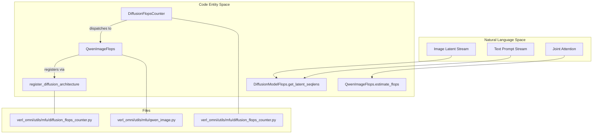
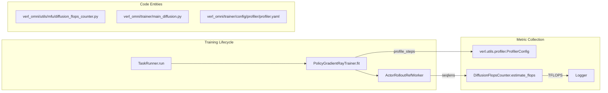

<!-- source: DeepWiki mcp.deepwiki.com · repo verl-project/verl-omni · page 7 Performance and Observability · fetched 2026-10-30 -->

# Performance and Observability

Relevant source files

The following files were used as context for generating this wiki page:

- [docs/assets/nsys_controller_actor_timeline.png](docs/assets/nsys_controller_actor_timeline.png)
- [docs/perf/diffusion_mfu.md](docs/perf/diffusion_mfu.md)
- [docs/perf/profiler.md](docs/perf/profiler.md)
- [examples/flowgrpo_trainer/qwen_image/run_qwen_image_ocr_fsdp2_benchmark.sh](examples/flowgrpo_trainer/qwen_image/run_qwen_image_ocr_fsdp2_benchmark.sh)
- [examples/flowgrpo_trainer/qwen_image/run_qwen_image_ocr_fsdp2_benchmark_nsys.sh](examples/flowgrpo_trainer/qwen_image/run_qwen_image_ocr_fsdp2_benchmark_nsys.sh)
- [tests/special_sanity/check_license.py](tests/special_sanity/check_license.py)
- [tests/trainer/diffusion/test_controller_nsys_profiler_on_cpu.py](tests/trainer/diffusion/test_controller_nsys_profiler_on_cpu.py)
- [verl_omni/trainer/main_diffusion.py](verl_omni/trainer/main_diffusion.py)
- [verl_omni/utils/mfu/__init__.py](verl_omni/utils/mfu/__init__.py)
- [verl_omni/utils/mfu/qwen_image.py](verl_omni/utils/mfu/qwen_image.py)

VeRL-Omni provides a comprehensive suite of tools for monitoring, benchmarking, and optimizing RL training for diffusion and flow-matching models. This includes specialized training metrics for reinforcement learning, Model FLOPs Utilization (MFU) tracking for diffusion transformers, and deep integration with system profilers like Nsight Systems and `torch.profiler`.

## Training Metrics and Monitoring

The system logs a specific set of metrics to interpret the health of the RL training loop, particularly for policy gradient algorithms like FlowGRPO. These metrics help identify issues such as reward saturation, importance ratio divergence, and clipping behavior.

| Metric | Definition | Role |
| :--- | :--- | :--- |
| `zero_std_ratio` | $\frac{1}{B}\lvert\{i : \sigma_i = 0\}\rvert$ | Detects reward saturation or lack of diversity within groups. |
| `std_mean` | $\frac{1}{B}\sum \sigma_i$ | Average reward diversity; declining trend is an early warning of saturation. |
| `ratio_mean` | $\mathbb{E}[\rho_t]$ | Monitors policy divergence from the rollout policy; should stay close to 1. |
| `pg_clipfrac_higher` | $\hat{P}(r > 1 + \varepsilon)$ | Tracks reinforcement of high-advantage steps beyond the clip threshold. |
| `throughput` | $\dfrac{B \times n}{t_\mathrm{step} \times N}$ | Measures images / GPU / Second for end-to-end efficiency. |

For a deep dive into these metrics and their interpretation, see [Training Metrics and Monitoring](#7.1).

**Sources:**
- `docs/perf/diffusion_mfu.md:14-16` ()
- `docs/perf/profiler.md:175-180` ()

## Performance Tooling and MFU

VeRL-Omni tracks **Model FLOPs Utilization (MFU)** to provide a hardware-agnostic efficiency metric. Unlike standard LLMs, the diffusion MFU counter accounts for the dual-stream nature of Diffusion Transformers (DiTs). For example, in Qwen-Image, the counter distinguishes between the **Latent stream** (image tokens) and the **Prompt stream** (text conditioning) [docs/perf/diffusion_mfu.md:53-68]().

### MFU Architecture Association
The following diagram illustrates how the MFU counter maps high-level model components to the FLOP estimation logic, specifically identifying the dual-stream handling in the `DiffusionModelFlops` base class.

**Diagram: Diffusion MFU Mapping**

**Sources:**
- [verl_omni/utils/mfu/qwen_image.py:31-35]()
- [verl_omni/utils/mfu/qwen_image.py:63-71]()
- [docs/perf/diffusion_mfu.md:53-73]()

### Profiling and Diagnostics
The system reuses the `verl.utils.profiler` subsystem to support `nsys`, `torch.profiler`, and `torch_memory` snapshots [docs/perf/profiler.md:5-14](). 

Key profiling capabilities include:
*   **MFU Calculation**: MFU is calculated relative to peak hardware TFLOPS via `get_device_peak_tflops()` [verl_omni/utils/mfu/__init__.py:23-23](), which honors the `VERL_OMNI_DEVICE_FLOPS_TFLOPS` environment override [docs/perf/diffusion_mfu.md:33-36]().
*   **Step-Scoped Profiling**: The `PolicyGradientRayTrainer` coordinates profiler start/stop across the controller and worker groups [tests/trainer/diffusion/test_controller_nsys_profiler_on_cpu.py:56-64]().
*   **Forward Pass Resolution**: The system automatically detects the number of forward passes per step based on `guidance_scale` and `true_cfg_scale` [verl_omni/utils/mfu/diffusion_flops_counter.py:79-103]().

For technical details on FLOP calculation for dual-stream DiTs and H200-optimized recipes, see [MFU Measurement and Profiling](#7.2).

**Sources:**
- [docs/perf/profiler.md:10-14]()
- [verl_omni/trainer/main_diffusion.py:98-111]()
- [verl_omni/utils/mfu/qwen_image.py:93-106]()

## Scaling and Benchmarks

VeRL-Omni supports multi-node scaling via Ray and provides optimized configurations for various hardware backends, including NVIDIA GPUs and Ascend NPUs [verl_omni/trainer/main_diffusion.py:61-62](). 

### Performance Monitoring Flow
The training entrypoint `main_diffusion.py` handles the initialization of the Ray `TaskRunner` and can wrap the entire execution under `nsys` for timeline analysis [verl_omni/trainer/main_diffusion.py:98-111]().

**Diagram: Performance Monitoring Flow**

**Sources:**
- [verl_omni/trainer/main_diffusion.py:132-154]()
- [docs/perf/profiler.md:39-48]()
- [examples/flowgrpo_trainer/qwen_image/run_qwen_image_ocr_fsdp2_benchmark_nsys.sh:125-146]()

---

## Child Pages
- [Training Metrics and Monitoring](#7.1) — Detailed breakdown of RL-specific metrics like `zero_std_ratio`, `pg_clipfrac`, and `ratio_mean`.
- [MFU Measurement and Profiling](#7.2) — Technical details on FLOP calculation for dual-stream DiTs, `DiffusionModelFlops` implementation, and profiler integration using `nsys` and `torch.profiler`.

---

