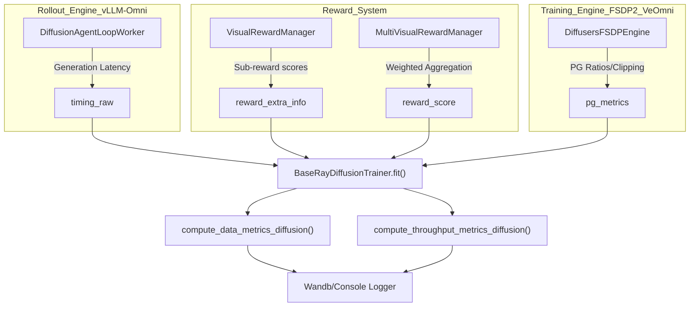
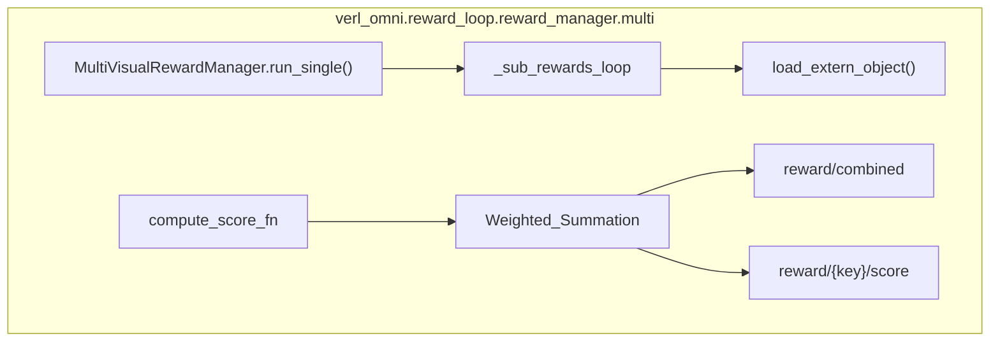
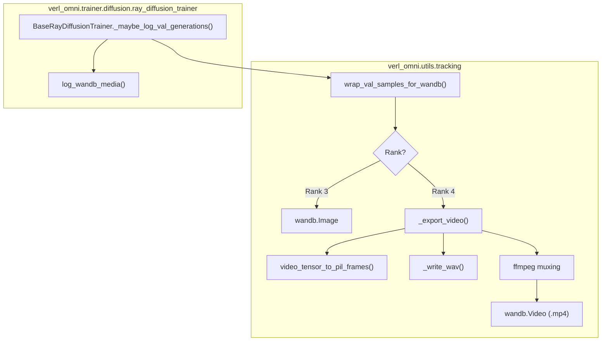

<!-- source: DeepWiki mcp.deepwiki.com · repo verl-project/verl-omni · page 7.1 Training Metrics and Monitoring · fetched 2026-10-30 -->

# Training Metrics and Monitoring

Relevant source files

The following files were used as context for generating this wiki page:

- [docs/algo/flowgrpo.md](docs/algo/flowgrpo.md)
- [docs/algo/performance.md](docs/algo/performance.md)
- [docs/start/flowgrpo_quickstart.md](docs/start/flowgrpo_quickstart.md)
- [docs/start/metrics.md](docs/start/metrics.md)
- [examples/flowgrpo_trainer/README.md](examples/flowgrpo_trainer/README.md)
- [tests/special_e2e/run_flowgrpo_qwen_image.sh](tests/special_e2e/run_flowgrpo_qwen_image.sh)
- [tests/trainer/diffusion/test_dump_generations_video_on_cpu.py](tests/trainer/diffusion/test_dump_generations_video_on_cpu.py)
- [tests/trainer/diffusion/test_val_video_logging_on_cpu.py](tests/trainer/diffusion/test_val_video_logging_on_cpu.py)
- [tests/utils/reward_score/test_reward_utils_on_cpu.py](tests/utils/reward_score/test_reward_utils_on_cpu.py)
- [tests/utils/test_offline_mllm_dpo_dataset_on_cpu.py](tests/utils/test_offline_mllm_dpo_dataset_on_cpu.py)
- [tests/utils/test_tracking_on_cpu.py](tests/utils/test_tracking_on_cpu.py)
- [verl_omni/trainer/diffusion/ray_diffusion_trainer.py](verl_omni/trainer/diffusion/ray_diffusion_trainer.py)
- [verl_omni/utils/dataset/offline_mllm_dpo_dataset.py](verl_omni/utils/dataset/offline_mllm_dpo_dataset.py)
- [verl_omni/utils/dataset/qwen3_omni_transform.py](verl_omni/utils/dataset/qwen3_omni_transform.py)
- [verl_omni/utils/dataset/rl_dataset.py](verl_omni/utils/dataset/rl_dataset.py)
- [verl_omni/utils/metrics_utils.py](verl_omni/utils/metrics_utils.py)
- [verl_omni/utils/reward_score/reward_utils.py](verl_omni/utils/reward_score/reward_utils.py)
- [verl_omni/utils/tracking.py](verl_omni/utils/tracking.py)

This page covers the key training metrics used in VeRL-Omni to monitor the health, stability, and performance of diffusion RL training. Unlike standard language model RL, diffusion-based RL (such as FlowGRPO) requires tracking metrics indexed over denoising timesteps and image-group statistics.

## Core Diffusion RL Metrics

The primary utility for computing these metrics is `compute_data_metrics_diffusion` [verl_omni/trainer/diffusion/diffusion_metric_utils.py:25-95](), which processes `DataProto` batches containing rewards, advantages, and returns.

### Reward and Group Statistics
In GRPO-style algorithms, images are sampled in groups for each prompt. Metrics are calculated to detect reward saturation and group diversity.

| Metric | Definition | Interpretation |
| :--- | :--- | :--- |
| `zero_std_ratio` | $\frac{1}{B}\lvert\{i : \sigma_i = 0\}\rvert$ | Fraction of groups where all images have identical rewards. High values ($>0.5$) suggest the task is too easy or rewards are saturated [docs/start/metrics.md:10-10](). |
| `std_mean` | $\frac{1}{B}\sum \sigma_i$ | Tracks average reward diversity across the batch. A declining trend is an early warning of saturation [docs/start/metrics.md:11-11](). |
| `group_size` | $N_{total} / N_{unique\_prompts}$ | Average number of images generated per unique prompt in the batch [verl_omni/trainer/diffusion/diffusion_metric_utils.py:93-93](). |
| `critic/rewards/mean` | $\mathbb{E}[R]$ | Mean reward across all generated images in the batch [verl_omni/trainer/diffusion/diffusion_metric_utils.py:52-52](). |

### Policy Gradient and Clipping
These metrics track the stability of the policy update by monitoring the importance ratio $\rho_t = \pi_\theta / \pi_{\theta_\mathrm{old}}$ and the effect of the PPO/GRPO clip threshold $\varepsilon$.

| Metric | Definition | Interpretation |
| :--- | :--- | :--- |
| `ratio_mean` | $\mathbb{E}[\rho_t]$ | Mean importance ratio. Significant drift from 1.0 indicates the policy is diverging too fast from the rollout policy [docs/start/metrics.md:14-14](). |
| `ratio_std` | $\mathrm{Std}(\rho_t)$ | Spread of the importance ratio. High values signal high-variance gradient updates [docs/start/metrics.md:15-15](). |
| `pg_clipfrac_higher` | $\hat{P}(\rho_t > 1 + \varepsilon)$ | Policy reinforcing high-advantage steps beyond the clip threshold. Signals upward-dominant learning [docs/start/metrics.md:12-12](). |
| `pg_clipfrac_lower` | $\hat{P}(\rho_t < 1 - \varepsilon)$ | Policy suppressing low-advantage steps beyond the clip threshold [docs/start/metrics.md:13-13](). |

### Throughput and Timing
Performance is measured in images per second rather than tokens per second.

| Metric | Calculation | Interpretation |
| :--- | :--- | :--- |
| `perf/throughput` | $\frac{B \times n}{t_{step} \times N}$ | Overall training throughput (images/GPU/s) [verl_omni/trainer/diffusion/diffusion_metric_utils.py:165-165](). |
| `timing_per_image_ms/gen` | Latency / Image | Time spent in the `vllm-omni` rollout stage [verl_omni/trainer/diffusion/diffusion_metric_utils.py:131-131](). |
| `timing_per_image_ms/update_actor` | Latency / Image | Time spent in the FSDP2/VeOmni optimizer update [verl_omni/trainer/diffusion/diffusion_metric_utils.py:131-131](). |

**Sources:** [verl_omni/trainer/diffusion/diffusion_metric_utils.py:25-167](), [docs/start/metrics.md:1-28](), [docs/algo/performance.md:14-17]().

## Metric Data Flow

The following diagram illustrates how metrics are collected from the various subsystems (Rollout, Reward, Training) and aggregated.

### System-to-Code Metric Flow
Title: Metric Collection and Aggregation Pipeline

**Sources:** [verl_omni/trainer/diffusion/diffusion_metric_utils.py:25-95](), [verl_omni/trainer/diffusion/diffusion_metric_utils.py:137-167](), [verl_omni/trainer/diffusion/ray_diffusion_trainer.py:125-132]().

## Multi-Reward Monitoring

When using `MultiVisualRewardManager`, the system logs both the combined weighted reward and individual sub-reward components. This is configured via the `reward_functions` dictionary in the reward configuration.

### Sub-Reward Aggregation Logic
Title: Multi-Reward Calculation Logic

- **Weights:** Each sub-reward is multiplied by its weight before being added to the combined score.
- **Extra Info:** Any metadata returned by sub-reward functions (e.g., OCR edit distance) is logged via `compute_reward_extra_metrics_diffusion` [verl_omni/trainer/diffusion/diffusion_metric_utils.py:169-174]().

**Sources:** [verl_omni/trainer/diffusion/diffusion_metric_utils.py:169-174](), [verl_omni/reward_loop/reward_manager/multi.py:1-50]().

## Rollout Correction and Correlation Metrics

VeRL-Omni provides specialized metrics for advanced diffusion RL algorithms that use rollout correction or monitor actor-rollout alignment.

### Rollout Correction (Bypass Mode)
When `rollout_correction.bypass_mode=True` is enabled [verl_omni/trainer/diffusion/rollout_correction.py:68-73](), the system applies corrections to the diffusion batch to mitigate off-policy bias.
- **Metric Logging:** `compute_rollout_corr_metrics_from_batch` tracks the impact of correction [verl_omni/trainer/diffusion/rollout_correction.py:77-77]().
- **Pearson Correlation:** `rollout_actor_probs_pearson_corr` measures the correlation between the rollout log-probabilities and the current actor's log-probabilities. Low correlation suggests the actor has drifted significantly from the rollout distribution.

### Advantage Computation
Advantages are computed using the `compute_advantage` function [verl_omni/trainer/diffusion/ray_diffusion_trainer.py:86-133](). In FlowGRPO, these are typically normalized by the group standard deviation [verl_omni/trainer/diffusion/ray_diffusion_trainer.py:126-128]().

**Sources:** [verl_omni/trainer/diffusion/rollout_correction.py:68-78](), [verl_omni/trainer/diffusion/ray_diffusion_trainer.py:86-133]().

## Old Policy Refresh Metrics

For algorithms like DiffusionNFT or Flow-DPPO that maintain an "old policy" for importance sampling, VeRL-Omni tracks the synchronization frequency via `compute_old_policy_metrics` [verl_omni/trainer/diffusion/diffusion_metric_utils.py:98-109](). These operations are handled by the `LoRAAdapterMixin` for PEFT-based models.

- `old_policy/update_applied`: Binary flag indicating if the reference weights were updated this step [verl_omni/trainer/diffusion/diffusion_metric_utils.py:104-104]().
- `old_policy/copy_update`: Indicates a hard copy from the actor to the reference model via `copy_adapter`.
- `old_policy/ema_update`: Indicates an Exponential Moving Average update via `ema_update_adapter`.

**Sources:** [verl_omni/trainer/diffusion/diffusion_metric_utils.py:98-109]().

## Visual Monitoring and Artifacts

For experiment tracking backends like WandB, VeRL-Omni provides helpers to wrap validation samples (images, videos, and audio).

### Validation Media Flow
Title: Validation Sample Visualization Data Flow

- **Media Wrapping:** `wrap_val_samples_for_wandb` converts tensor outputs into `wandb.Image` or `wandb.Video` objects [verl_omni/utils/tracking.py:136-170]().
- **Video and Audio:** Video tensors `[T, C, H, W]` (rank 4) are processed through `video_tensor_to_pil_frames` and exported as MP4 files. If audio `[C, T]` is present, it is written to a temporary WAV via `_write_wav` and muxed into the MP4 using `ffmpeg` [verl_omni/utils/tracking.py:74-134]().
- **Persistent Storage:** If `validation_data_dir` is provided in the trainer config, media files are stored in `wandb_val_media/global_step_{N}/` to ensure availability during asynchronous WandB uploads [tests/trainer/diffusion/test_val_video_logging_on_cpu.py:114-118]().

**Sources:** [verl_omni/utils/tracking.py:74-181](), [tests/trainer/diffusion/test_val_video_logging_on_cpu.py:76-155](), [verl_omni/trainer/diffusion/ray_diffusion_trainer.py:136-170]().

## Interpretation Guidelines

| Scenario | Metric Signal | Potential Fix |
| :--- | :--- | :--- |
| **Reward Saturation** | `zero_std_ratio` > 0.7 | Increase task difficulty or adjust reward scaling [docs/start/metrics.md:10-10](). |
| **Training Instability** | `ratio_std` is high or `ratio_mean` drifts far from 1.0 | Decrease learning rate or tighten `clip_ratio` [docs/start/metrics.md:14-15](). |
| **Optimization Bottleneck** | `timing_per_image_ms/update_actor` is dominant | Enable `optimizer_offload` in VeOmni or FSDP2 configs [docs/algo/performance.md:87-87](). |
| **Rollout Bottleneck** | `timing_per_image_ms/gen` is high | Increase `rollout.tensor_model_parallel_size` or use more rollout workers [docs/algo/performance.md:14-17](). |

**Sources:** [docs/start/metrics.md:10-17](), [docs/algo/performance.md:83-88](), [verl_omni/trainer/diffusion/diffusion_metric_utils.py:111-134]().

---

