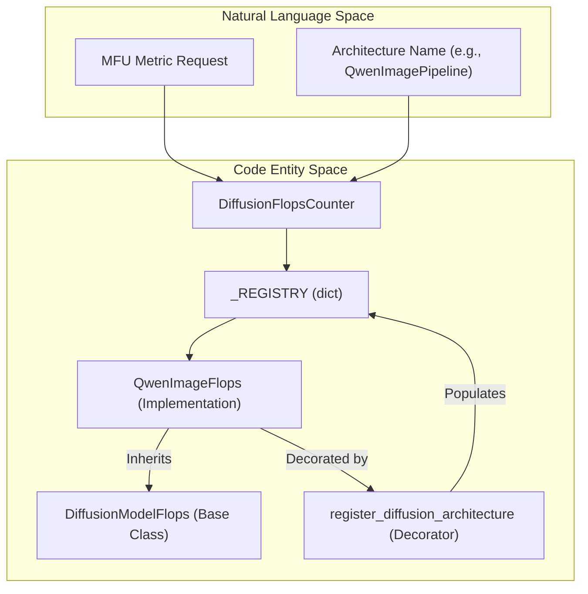
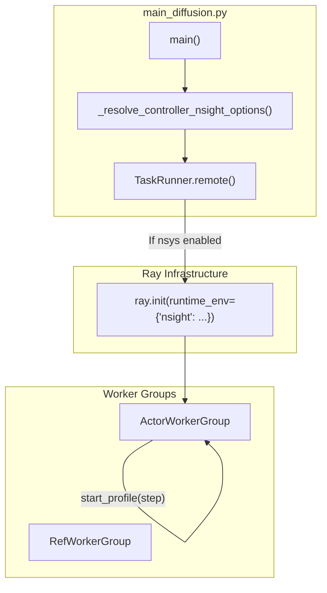

<!-- source: DeepWiki mcp.deepwiki.com · repo verl-project/verl-omni · page 7.2 MFU Measurement and Profiling · fetched 2026-10-30 -->

# MFU Measurement and Profiling

Relevant source files

The following files were used as context for generating this wiki page:

- [.github/verl_pin.txt](.github/verl_pin.txt)
- [AGENTS.md](AGENTS.md)
- [CONTRIBUTING.md](CONTRIBUTING.md)
- [docs/assets/nsys_controller_actor_timeline.png](docs/assets/nsys_controller_actor_timeline.png)
- [docs/perf/diffusion_mfu.md](docs/perf/diffusion_mfu.md)
- [docs/perf/profiler.md](docs/perf/profiler.md)
- [examples/flowgrpo_trainer/qwen_image/run_qwen_image_ocr_fsdp2_benchmark.sh](examples/flowgrpo_trainer/qwen_image/run_qwen_image_ocr_fsdp2_benchmark.sh)
- [examples/flowgrpo_trainer/qwen_image/run_qwen_image_ocr_fsdp2_benchmark_nsys.sh](examples/flowgrpo_trainer/qwen_image/run_qwen_image_ocr_fsdp2_benchmark_nsys.sh)
- [setup.py](setup.py)
- [tests/special_sanity/check_license.py](tests/special_sanity/check_license.py)
- [tests/trainer/diffusion/test_controller_nsys_profiler_on_cpu.py](tests/trainer/diffusion/test_controller_nsys_profiler_on_cpu.py)
- [tests/utils/test_diffusion_flops_counter_on_cpu.py](tests/utils/test_diffusion_flops_counter_on_cpu.py)
- [verl_omni/trainer/main_diffusion.py](verl_omni/trainer/main_diffusion.py)
- [verl_omni/utils/mfu/__init__.py](verl_omni/utils/mfu/__init__.py)
- [verl_omni/utils/mfu/diffusion_flops_counter.py](verl_omni/utils/mfu/diffusion_flops_counter.py)
- [verl_omni/utils/mfu/qwen_image.py](verl_omni/utils/mfu/qwen_image.py)

This page covers the measurement of **Model FLOPs Utilization (MFU)** for diffusion transformer training and the configuration of profiling tools in VeRL-Omni. It provides technical details on the FLOPs calculation logic for dual-stream architectures, the integrated profiling subsystem, and hardware-optimized training recipes.

## MFU Measurement

VeRL-Omni reports MFU to provide a hardware-agnostic metric for comparing training efficiency across different model architectures and cluster configurations. MFU measures how close the hardware is running to its theoretical peak performance during specific training phases.

### Reported Metrics
The diffusion trainer emits two primary MFU keys during the training loop:

| Metric | Description |
| :--- | :--- |
| `perf/mfu/actor` | Measures the full `train_batch` update, including forward and backward passes for all micro-batches. |
| `perf/mfu/actor_infer` | Measures the `infer_batch` pass, specifically log-prob recomputation on rollout trajectories. |

The MFU is calculated as the ratio of achieved TFLOPS to the peak hardware TFLOPS. Peak values are retrieved via `get_device_peak_tflops()`, which honors the `VERL_OMNI_DEVICE_FLOPS_TFLOPS` environment variable as a manual override and otherwise falls back to the upstream `verl` implementation `get_device_flops` [verl_omni/utils/mfu/diffusion_flops_counter.py:49-77]().

### FLOPs Calculation Logic
For Diffusion Transformers (DiTs), VeRL-Omni distinguishes between two token streams to accurately estimate compute requirements:

1.  **Latent Stream**: The VAE-encoded tokens (images, video, or audio) flowing through image-side linear layers and FFNs. These are identified by keys such as `image_latents`, `audio_latents`, or `all_latents` [verl_omni/utils/mfu/diffusion_flops_counter.py:151-151]().
2.  **Prompt Stream**: The conditioning tokens (typically text) flowing through text-side or cross-attention linear layers, identified by `prompt_embeds` [verl_omni/utils/mfu/diffusion_flops_counter.py:152-152]().

The `DiffusionModelFlops` base class implements the core estimation logic [verl_omni/utils/mfu/diffusion_flops_counter.py:148-161](). Dense FLOPs are estimated as $6.0 \times \text{params\_per\_token} \times \text{total\_tokens}$ [verl_omni/utils/mfu/diffusion_flops_counter.py:163-164](). Attention FLOPs scale quadratically with the combined sequence length of both streams, using a factor of 12 for non-causal attention [verl_omni/utils/mfu/diffusion_flops_counter.py:166-180]().

### Code Entity Mapping: FLOPs Infrastructure

The following diagram shows the relationship between the configuration-driven `DiffusionFlopsCounter` and the architecture-specific implementations.

**FLOPs Estimator Registry Architecture**

Sources: [verl_omni/utils/mfu/diffusion_flops_counter.py:106-123](), [verl_omni/utils/mfu/diffusion_flops_counter.py:148-155]().

### Qwen-Image Reference Implementation
The `QwenImageFlops` implementation accounts for the dual-stream nature of the `QwenImageTransformer2DModel`. It calculates dense FLOPs for both image and text streams separately and adds joint attention FLOPs based on the concatenated sequence length. The implementation handles specific `diffusers` layouts, such as packed latents, via `get_latent_seqlens` overrides that detect the `(B, T, L, C')` layout.

Sources: [verl_omni/utils/mfu/diffusion_flops_counter.py:106-145](), [verl_omni/utils/mfu/qwen_image.py:63-106]().

## Profiling Configuration

VeRL-Omni reuses the profiler subsystem from upstream `verl.utils.profiler` and exposes the same configuration surface for diffusion training [docs/perf/profiler.md:5-9]().

### Profiler Backends
Profiling is configured via `ProfilerConfig` and supports several tools [docs/perf/profiler.md:39-48]():
*   **`nsys`**: NVIDIA Nsight Systems for kernel-level timeline tracing. Requires `nvtx` and launches workers with `capture-range: cudaProfilerApi` [docs/perf/profiler.md:131-153](). The `TaskRunner` is launched under `nsys` using `controller_nsight_options` [verl_omni/trainer/main_diffusion.py:98-108]().
*   **`torch`**: `torch.profiler` for PyTorch operator activity (CPU/CUDA/Memory/Stack) [docs/perf/profiler.md:84-97]().
*   **`torch_memory`**: CUDA memory snapshot dumping for allocation analysis, visualized via `pytorch.org/memory_viz` [docs/perf/profiler.md:117-129]().

### Profiler Hierarchy and Lifecycle
The system uses a two-layer configuration: a global `global_profiler` and per-role configs under `actor_rollout_ref.{actor,ref,rollout}.profiler` [docs/perf/profiler.md:20-30](). 

The `main_diffusion.py` entrypoint includes logic to resolve `capture-range-end` for Nsight based on the number of configured steps, ensuring the profiler shuts down correctly after the desired data is collected [verl_omni/trainer/main_diffusion.py:34-51]().

**Profiling Control Flow**

Sources: [verl_omni/trainer/main_diffusion.py:34-111](), [docs/perf/profiler.md:20-77]().

## Hardware-Optimized Training Recipes

VeRL-Omni provides optimized configurations for high-end hardware like NVIDIA H200 and Ascend NPUs.

### NVIDIA H200 Optimizations
*   **Peak TFLOPS Override**: By setting the `VERL_OMNI_DEVICE_FLOPS_TFLOPS` environment variable, users can ensure MFU is calculated against the H200's specific BF16 dense peak [verl_omni/utils/mfu/diffusion_flops_counter.py:45-62]().
*   **Forward Pass Resolution**: The number of forward passes per step is automatically resolved based on `guidance_scale` or `true_cfg_scale` in the config, ensuring FLOPs estimates account for Classifier-Free Guidance (CFG) [verl_omni/utils/mfu/diffusion_flops_counter.py:79-103]().
*   **Benchmark Recipes**: The `run_qwen_image_ocr_fsdp2_benchmark.sh` script provides a template for maximizing throughput on 8x80GB GPU nodes by enabling `rollout.step_execution=True`, disabling eager execution for reward models, and using FSDP2 to manage memory [examples/flowgrpo_trainer/qwen_image/run_qwen_image_ocr_fsdp2_benchmark.sh:1-26]().
*   **Nsight Update Actor Timeline**: A specialized recipe `run_qwen_image_ocr_fsdp2_benchmark_nsys.sh` is provided to profile the `old_log_prob` and `update_actor` phases specifically, using a continuous capture window to analyze GPU-idle intervals and Python control flow [examples/flowgrpo_trainer/qwen_image/run_qwen_image_ocr_fsdp2_benchmark_nsys.sh:1-20]().

### Ascend NPU Optimizations
The project supports Ascend NPUs via specific dependency management and Docker targets.
*   **CANN Stack Integration**: Requires CANN version >= 8.5.0 and utilizes `vllm-ascend` for rollout.
*   **NPU Backend Overrides**: The `auto_set_device(config)` function automatically sets the trainer device to `npu` when running on Ascend hardware [verl_omni/trainer/main_diffusion.py:61-63]().
*   **Docker Targets**: Dedicated Dockerfiles (e.g., `Dockerfile.a2.npu`) provide pre-configured environments for Ascend 910B / Atlas A2 and A3 hardware.

Sources: [verl_omni/utils/mfu/diffusion_flops_counter.py:45-103](), [docs/perf/profiler.md:1-185](), [verl_omni/trainer/main_diffusion.py:61-111](), [examples/flowgrpo_trainer/qwen_image/run_qwen_image_ocr_fsdp2_benchmark.sh:1-26](), [examples/flowgrpo_trainer/qwen_image/run_qwen_image_ocr_fsdp2_benchmark_nsys.sh:1-154]().

---

