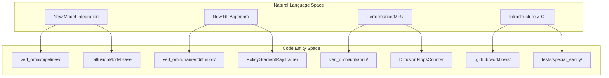
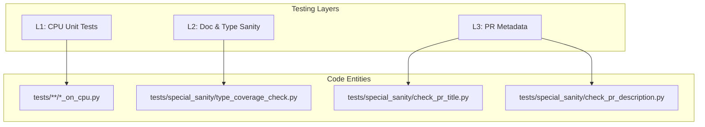

<!-- source: DeepWiki mcp.deepwiki.com · repo verl-project/verl-omni · page 8 Contributing and Development · fetched 2026-10-30 -->

# Contributing and Development

Relevant source files

The following files were used as context for generating this wiki page:

- [.github/verl_pin.txt](.github/verl_pin.txt)
- [.github/workflows/check-pr-title.yml](.github/workflows/check-pr-title.yml)
- [.github/workflows/cpu_unit_tests.yml](.github/workflows/cpu_unit_tests.yml)
- [.github/workflows/doc.yml](.github/workflows/doc.yml)
- [.github/workflows/pre-commit.yml](.github/workflows/pre-commit.yml)
- [.github/workflows/sanity.yml](.github/workflows/sanity.yml)
- [.github/workflows/type-coverage-check.yml](.github/workflows/type-coverage-check.yml)
- [AGENTS.md](AGENTS.md)
- [CONTRIBUTING.md](CONTRIBUTING.md)
- [setup.py](setup.py)
- [tests/utils/test_diffusion_flops_counter_on_cpu.py](tests/utils/test_diffusion_flops_counter_on_cpu.py)
- [verl_omni/utils/mfu/diffusion_flops_counter.py](verl_omni/utils/mfu/diffusion_flops_counter.py)

This page provides an overview of the contribution guidelines, development workflows, and the infrastructure supporting the growth of the VeRL-Omni codebase. It serves as a high-level entry point for developers looking to fix bugs, add new features, or integrate novel models and algorithms.

## Contribution Guidelines

We welcome contributions ranging from documentation improvements to complex algorithmic enhancements. All contributors are expected to follow the project's development standards to ensure code quality and maintainability.

### Development Workflow
The development process relies on standard Python tooling and specific repository conventions:
*   **Dependency Management**: The project uses a specific installation path for GPU/NPU environments and dependency pinning for `vllm-omni` and `verl` via `.github/vllm_omni_pin.txt` and `.github/verl_pin.txt` [.github/workflows/cpu_unit_tests.yml:57-59](), [.github/workflows/sanity.yml:54-56]().
*   **Code Linting**: We use `pre-commit` hooks to enforce consistency via `ruff` and other formatters [CONTRIBUTING.md:28-40](). The CI runs these checks on every PR [.github/workflows/pre-commit.yml:22-49]().
*   **PR Standards**: Pull Requests must follow a specific title format: `[{modules}] {type}: {description}` [CONTRIBUTING.md:94-97](), [AGENTS.md:55-57](). The `check_pr_title` workflow validates this format using `tests/special_sanity/check_pr_title.py` [.github/workflows/check-pr-title.yml:28-31]().
*   **Documentation**: New features require documentation updates. Docs are built using Sphinx and can be previewed locally using `make html` in the `docs` directory [CONTRIBUTING.md:56-68]().
*   **AI-Assisted Work**: Contributions using AI agents must follow the accountability and duplicate-work check rules defined in `AGENTS.md` [AGENTS.md:6-37]().

### Repository Structure for Developers
The following diagram maps the logical contribution areas to their corresponding code entities.

**Contribution Area to Code Entity Mapping**

Sources: [CONTRIBUTING.md:72-88](), [verl_omni/utils/mfu/diffusion_flops_counter.py:35-43](), [.github/workflows/sanity.yml:59-63]()

---

## Integrating New Models and Algorithms

VeRL-Omni is designed with a registry-based architecture that decouples model-specific logic from the core RL training loops.

### Model Integration
To add a new diffusion model, you must implement a "Pipeline Adapter." This involves registering classes that inherit from:
1.  `DiffusionModelBase`: Handles training-side logic such as input preparation and FSDP sharding hints [CONTRIBUTING.md:74-77]().
2.  `VllmOmniPipelineBase`: Handles rollout-side logic within the vLLM-Omni environment [CONTRIBUTING.md:75-75]().

### Algorithm Integration
Integrating a new algorithm requires extending the trainer infrastructure. The system distinguishes between:
*   **Policy Gradient**: implemented in `PolicyGradientRayTrainer`, handling reverse-trajectory logprob ratios and advantages (e.g., FlowGRPO, MixGRPO) [CONTRIBUTING.md:79-82]().
*   **Direct Preference**: implemented in `DirectPreferenceRayTrainer`, handling single forward-timestep preference updates (e.g., DPO, DiffusionNFT) [CONTRIBUTING.md:84-87]().

For a step-by-step guide on these integrations, see **[Integrating a New Diffusion Model or Algorithm](#8.1)**.

---

## CI/CD Pipeline and Testing

The project maintains a testing hierarchy to provide fast feedback while ensuring hardware-specific compatibility.

### Testing Hierarchy
VeRL-Omni enforces strict placement and naming rules for tests to optimize CI time:
*   **Sanity Checks**: Fast checks for PR titles, docstrings, and type coverage [.github/workflows/type-coverage-check.yml:45-48](), [tests/special_sanity/validate_imported_docs.py]().
*   **CPU Unit Tests**: Lightweight logic tests that must end in `*_on_cpu.py` and are executed via `pytest` in the `cpu_unit_tests` workflow [.github/workflows/cpu_unit_tests.yml:64-71]().
*   **Hardware Smoke Tests**: GPU and NPU smoke tests verify engine initialization and basic forward/backward passes on real hardware.

**Testing Layer to Code Artifact Mapping**

Sources: [.github/workflows/cpu_unit_tests.yml:10-24](), [.github/workflows/type-coverage-check.yml:45-48](), [.github/workflows/check-pr-title.yml:28-36]()

For details on running these tests locally and adding new ones, see **[CI/CD Pipeline and Testing](#8.2)**.

---

## Multi-Node Training and Scaling

Scaling diffusion RL training requires efficient distributed coordination. VeRL-Omni utilizes **Ray** for resource management and **FSDP** for model sharding.

*   **Ray Orchestration**: The trainer manages colocated actor/ref worker setup, dataloaders, and checkpointing across nodes.
*   **FSDP Sharding**: For multi-node runs, FSDP must shard parameters within each node to minimize cross-node all-gather overhead.
*   **Batch Scaling**: Moving to multi-node requires scaling the global batch sizes by the total GPU count to maintain consistent per-GPU work.

For setup instructions and multi-node examples, see **[Multi-Node Training](#8.3)**.

---

## Child Pages
*   **[Integrating a New Diffusion Model or Algorithm](#8.1)** — Step-by-step guide for adding a new model: the three-file package structure, `DiffusionModelBase` and `VllmOmniPipelineBase` registry hooks, and training/rollout adapter contracts.
*   **[CI/CD Pipeline and Testing](#8.2)** — Detailed coverage of GitHub Actions, the testing hierarchy (sanity, CPU unit tests, smoke tests), pre-commit hooks, and dependency pinning.
*   **[Multi-Node Training](#8.3)** — Resource pool configuration, Ray cluster initialization, and scaling recipes for distributed FlowGRPO.

---

