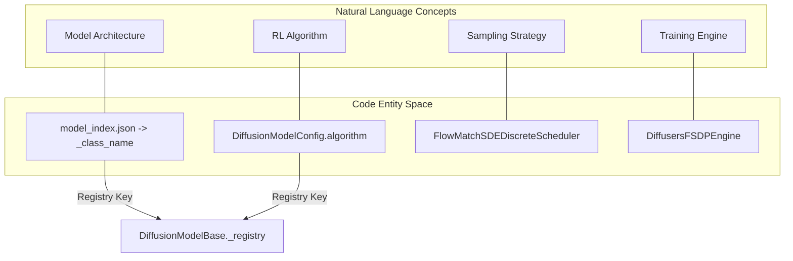
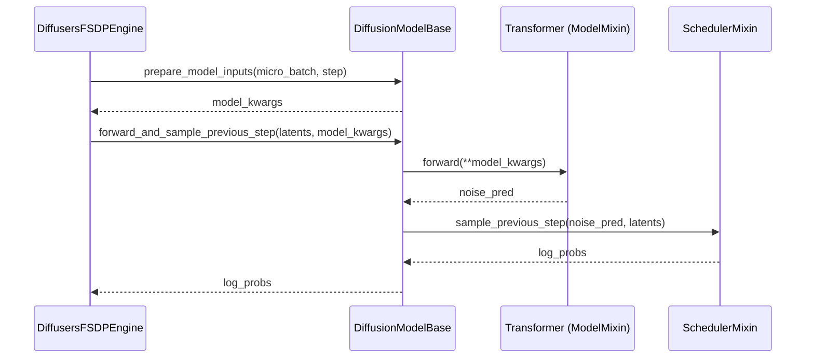
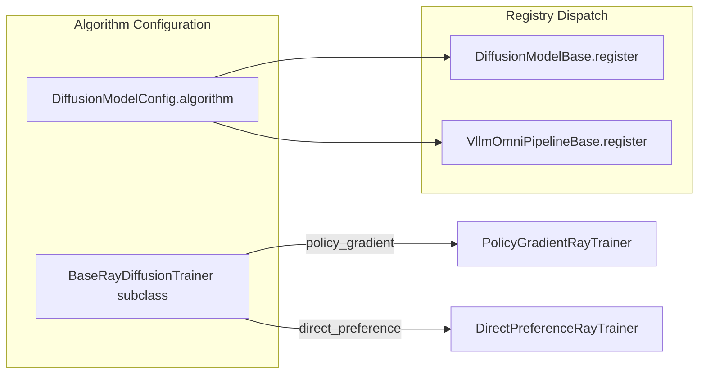

<!-- source: DeepWiki mcp.deepwiki.com · repo verl-project/verl-omni · page 8.1 Integrating a New Diffusion Model or Algorithm · fetched 2026-10-30 -->

# Integrating a New Diffusion Model or Algorithm

<details>
<summary>Relevant source files</summary>

The following files were used as context for generating this wiki page:

- [.agents/README.md](.agents/README.md)
- [.agents/rules/code-style.md](.agents/rules/code-style.md)
- [.agents/rules/config.md](.agents/rules/config.md)
- [.agents/rules/pipelines.md](.agents/rules/pipelines.md)
- [.agents/rules/reward.md](.agents/rules/reward.md)
- [.agents/rules/testing.md](.agents/rules/testing.md)
- [.agents/skills/add-pipeline/SKILL.md](.agents/skills/add-pipeline/SKILL.md)
- [.agents/skills/add-reward-score/SKILL.md](.agents/skills/add-reward-score/SKILL.md)
- [.agents/skills/commit-and-pr/SKILL.md](.agents/skills/commit-and-pr/SKILL.md)
- [.agents/skills/run-cpu-tests/SKILL.md](.agents/skills/run-cpu-tests/SKILL.md)
- [docs/contributing/common_pitfalls.md](docs/contributing/common_pitfalls.md)
- [docs/contributing/integrating_a_diffusion_model.md](docs/contributing/integrating_a_diffusion_model.md)
- [docs/contributing/integrating_an_i2i_diffusion_model.md](docs/contributing/integrating_an_i2i_diffusion_model.md)
- [examples/flowgrpo_trainer/data_process/bagel_pickscore.py](examples/flowgrpo_trainer/data_process/bagel_pickscore.py)
- [examples/flowgrpo_trainer/qwen_image_edit/README.md](examples/flowgrpo_trainer/qwen_image_edit/README.md)
- [verl_omni/__init__.py](verl_omni/__init__.py)
- [verl_omni/pipelines/model_base.py](verl_omni/pipelines/model_base.py)
- [verl_omni/pipelines/qwen_image_flow_grpo/vllm_omni_rollout_adapter.py](verl_omni/pipelines/qwen_image_flow_grpo/vllm_omni_rollout_adapter.py)
- [verl_omni/pipelines/qwen_image_mix_grpo/vllm_omni_rollout_adapter.py](verl_omni/pipelines/qwen_image_mix_grpo/vllm_omni_rollout_adapter.py)
- [verl_omni/workers/rollout/vllm_rollout/vllm_omni_async_server.py](verl_omni/workers/rollout/vllm_rollout/vllm_omni_async_server.py)

</details>


This guide provides a technical walkthrough for integrating new diffusion models and algorithms into the VeRL-Omni framework. VeRL-Omni utilizes a decoupled architecture where the **Rollout** (sampling) and **Training** (optimization) contexts are handled by different runtimes while sharing a unified algorithm contract [docs/contributing/integrating_a_diffusion_model.md:52-61]().

## System Architecture and Data Flow

The integration relies on two primary adapters that must agree on the architecture, algorithm, and data formats. The rollout worker (using `vllm-omni`) generates trajectories, which are then processed by the trainer worker (using `FSDP2` + `diffusers` or the `VeOmni` engine) [docs/contributing/integrating_a_diffusion_model.md:63-72]().

### Rollout to Training Lifecycle

| Context | Runtime | Base Class | Key Responsibility |
| :--- | :--- | :--- | :--- |
| **Rollout** | `vllm-omni` | `VllmOmniPipelineBase` | Executes the SDE loop, injects noise, and returns latents/log-probs [docs/contributing/integrating_a_diffusion_model.md:58-58](). |
| **Training** | `FSDP` / `VeOmni` | `DiffusionModelBase` | Re-runs denoising steps per micro-batch to compute fresh log-probs for gradients [docs/contributing/integrating_a_diffusion_model.md:59-59](). |

### Entity Mapping: Natural Language to Code

The following diagram bridges high-level system concepts to their specific code implementations.

**System Entity to Code Mapping**

**Sources:** [verl_omni/pipelines/model_base.py:48-58](), [verl_omni/workers/config.py:55-55](), [verl_omni/workers/rollout/vllm_rollout/vllm_omni_async_server.py:116-131]()

## Integration Package Structure

A new model integration requires a new package under `verl_omni/pipelines/<model>_<algo>/` with three mandatory files [docs/contributing/integrating_a_diffusion_model.md:34-39]():

1.  `__init__.py`: Re-exports both adapters for registry discovery [docs/contributing/integrating_a_diffusion_model.md:36-36]().
2.  `diffusers_training_adapter.py`: Implements the `DiffusionModelBase` contract [verl_omni/pipelines/model_base.py:28-46]().
3.  `vllm_omni_rollout_adapter.py`: Implements the `VllmOmniPipelineBase` contract [verl_omni/pipelines/model_base.py:236-248]().

### Registry Hooks
Adapters are registered using class decorators that dispatch on the pair `(architecture, algorithm)` [verl_omni/pipelines/model_base.py:51-58]().

```python
# Training side registration
@DiffusionModelBase.register("QwenImagePipeline", algorithm="flow_grpo")
class QwenImage(DiffusionModelBase): ...

# Rollout side registration
@VllmOmniPipelineBase.register("QwenImagePipeline", algorithm="flow_grpo")
class QwenImagePipeline(VllmOmniPipelineBase): ...
```

**Sources:** [verl_omni/pipelines/model_base.py:28-58](), [docs/contributing/integrating_a_diffusion_model.md:41-47](), [verl_omni/pipelines/qwen_image_flow_grpo/vllm_omni_rollout_adapter.py:49-50]()

## Implementing the Training Adapter (`DiffusionModelBase`)

The training adapter must implement abstract methods to plug into the training engine [verl_omni/pipelines/model_base.py:140-170]():

*   `build_scheduler`: Returns a scheduler (e.g., `FlowMatchSDEDiscreteScheduler`) with pre-configured timesteps and sigmas [verl_omni/pipelines/model_base.py:140-149]().
*   `prepare_model_inputs`: Converts the `TensorDict` micro-batch into architecture-specific kwargs for the transformer (e.g., handling image shapes or attention masks) [verl_omni/pipelines/model_base.py:164-176]().
*   `forward_and_sample_previous_step`: Executes a single forward pass and invokes the scheduler's `sample_previous_step` to compute the log-probability of the action taken during rollout [verl_omni/pipelines/model_base.py:180-195]().

### Data Flow in Training Engine

**Sources:** [verl_omni/pipelines/model_base.py:130-195](), [docs/contributing/integrating_a_diffusion_model.md:59-72]()

## Image-to-Image (I2I) Integration

For I2I models like `Qwen-Image-Edit-Plus`, the `DiffusionI2IModelBase` provides specialized hooks for conditional generation [verl_omni/pipelines/model_base.py:202-212]().

*   **Condition Transport**: I2I models require a `condition_image` (e.g., the original image to be edited). This is transported via the `micro_batch` [verl_omni/pipelines/model_base.py:218-228]().
*   **VAE Encoding**: The condition image is typically VAE-encoded before being passed to the transformer. This logic resides in `prepare_condition` and `inject_condition` [docs/contributing/integrating_an_i2i_diffusion_model.md:28-31]().

**Sources:** [verl_omni/pipelines/model_base.py:202-230](), [docs/contributing/integrating_an_i2i_diffusion_model.md:49-63]()

## Integrating a New Algorithm

Adding a new RL algorithm involves extension points across the trainer and adapters [docs/contributing/integrating_a_diffusion_model.md:7-14]():

1.  **Advantage Estimator & Loss**: Algorithms must register their specific loss functions and advantage estimation logic.
2.  **Trainer Type**: Dispatch to the correct trainer (e.g., `PolicyGradientRayTrainer` or `DirectPreferenceRayTrainer`) via the config [verl_omni/workers/config.py:55-55]().
3.  **Adapter Pair**: Create a new adapter package for the `(architecture, new_algorithm)` pair [docs/contributing/integrating_a_diffusion_model.md:41-47]().

### Algorithm Entity Mapping

**Sources:** [verl_omni/workers/config.py:55-55](), [verl_omni/pipelines/model_base.py:51-58](), [docs/contributing/integrating_a_diffusion_model.md:41-47]()

## Common Pitfalls and Best Practices

*   **Float32 Precision**: Always store rollout latents in `float32`. The `FlowMatchSDEDiscreteScheduler` computes log-probs in fp32; casting back to bf16 in the rollout stage causes precision loss and biased training metrics [docs/contributing/common_pitfalls.md:22-28]().
*   **Prompt Tokenization**: Tokenization must happen once in the agent loop. The rollout pipeline must not decode token ids back to text and re-tokenize [docs/contributing/integrating_a_diffusion_model.md:96-103]().
*   **RoPE Sequence Length**: When using continuous batching (`step_execution=True`), ensure RoPE sequence lengths are derived from the padded embedding width rather than the valid mask sum to match `diffusers` behavior [docs/contributing/common_pitfalls.md:73-87]().
*   **SDE Window Seeding**: For algorithms like MixGRPO, ensure the SDE window is seeded by `global_steps` so all rollout ranks agree on the noise range for a given training iteration [verl_omni/pipelines/qwen_image_mix_grpo/vllm_omni_rollout_adapter.py:83-111](), [docs/contributing/common_pitfalls.md:188-200]().

**Sources:** [docs/contributing/common_pitfalls.md:7-200](), [docs/contributing/integrating_a_diffusion_model.md:96-103](), [verl_omni/pipelines/qwen_image_mix_grpo/vllm_omni_rollout_adapter.py:83-111]()

---

