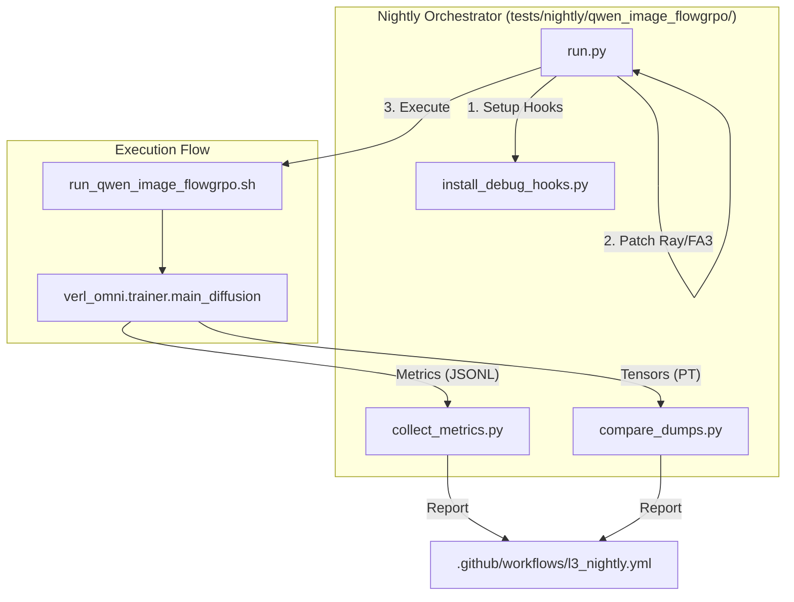
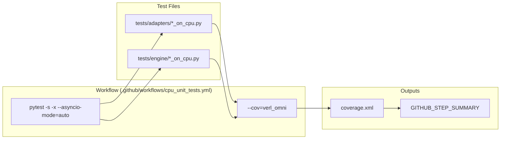

<!-- source: DeepWiki mcp.deepwiki.com · repo verl-project/verl-omni · page 8.2 CI/CD Pipeline and Testing · fetched 2026-10-30 -->

# CI/CD Pipeline and Testing

Relevant source files

The following files were used as context for generating this wiki page:

- [.github/ISSUE_TEMPLATE/bug-report.yml](.github/ISSUE_TEMPLATE/bug-report.yml)
- [.github/ISSUE_TEMPLATE/config.yml](.github/ISSUE_TEMPLATE/config.yml)
- [.github/ISSUE_TEMPLATE/feature-request.yml](.github/ISSUE_TEMPLATE/feature-request.yml)
- [.github/workflows/check-pr-title.yml](.github/workflows/check-pr-title.yml)
- [.github/workflows/cpu_unit_tests.yml](.github/workflows/cpu_unit_tests.yml)
- [.github/workflows/doc.yml](.github/workflows/doc.yml)
- [.github/workflows/l3_nightly.yml](.github/workflows/l3_nightly.yml)
- [.github/workflows/pre-commit.yml](.github/workflows/pre-commit.yml)
- [.github/workflows/sanity.yml](.github/workflows/sanity.yml)
- [.github/workflows/type-coverage-check.yml](.github/workflows/type-coverage-check.yml)
- [.pre-commit-config.yaml](.pre-commit-config.yaml)
- [docs/contributing/ci_cd.md](docs/contributing/ci_cd.md)
- [docs/contributing/testing_guide.md](docs/contributing/testing_guide.md)
- [scripts/diagnose.py](scripts/diagnose.py)
- [tests/nightly/qwen_image_flowgrpo/README.md](tests/nightly/qwen_image_flowgrpo/README.md)
- [tests/nightly/qwen_image_flowgrpo/collect_metrics.py](tests/nightly/qwen_image_flowgrpo/collect_metrics.py)
- [tests/nightly/qwen_image_flowgrpo/compare_dumps.py](tests/nightly/qwen_image_flowgrpo/compare_dumps.py)
- [tests/nightly/qwen_image_flowgrpo/create_single_sample_data.py](tests/nightly/qwen_image_flowgrpo/create_single_sample_data.py)
- [tests/nightly/qwen_image_flowgrpo/env_metadata.py](tests/nightly/qwen_image_flowgrpo/env_metadata.py)
- [tests/nightly/qwen_image_flowgrpo/install_debug_hooks.py](tests/nightly/qwen_image_flowgrpo/install_debug_hooks.py)
- [tests/nightly/qwen_image_flowgrpo/run.py](tests/nightly/qwen_image_flowgrpo/run.py)
- [tests/nightly/qwen_image_flowgrpo/run_qwen_image_flowgrpo.sh](tests/nightly/qwen_image_flowgrpo/run_qwen_image_flowgrpo.sh)
- [tests/special_sanity/check_api_docs.py](tests/special_sanity/check_api_docs.py)
- [tests/special_sanity/check_docstrings.py](tests/special_sanity/check_docstrings.py)
- [tests/special_sanity/test_import.py](tests/special_sanity/test_import.py)
- [tests/special_sanity/type_coverage_check.py](tests/special_sanity/type_coverage_check.py)
- [tests/special_sanity/validate_imported_docs.py](tests/special_sanity/validate_imported_docs.py)
- [tests/special_sanity/validate_structure.py](tests/special_sanity/validate_structure.py)
- [verl_omni/utils/reward_score/genrm_ocr.py](verl_omni/utils/reward_score/genrm_ocr.py)

The VeRL-Omni CI/CD pipeline ensures code quality, type safety, and cross-hardware compatibility (NVIDIA GPU, NPU, and CPU). The system utilizes GitHub Actions to orchestrate a multi-stage testing strategy ranging from lightweight linting to distributed GPU smoke tests and L3 nightly regression tests.

## Pipeline Overview

The CI/CD infrastructure is triggered by `push` and `pull_request` events to the `main` and `v0.*` branches. To optimize resource usage, heavy compute jobs (GPU smoke tests) are gated behind labels like `ci`, `ready-for-ci`, `ci-core`, `ci-e2e-omni`, or `ci-e2e-diffusion` on Pull Requests [[.github/workflows/sanity.yml:27-30]](), [[.github/workflows/type-coverage-check.yml:21-22]]().

### Core Workflows

| Workflow | Purpose | Hardware |
| :--- | :--- | :--- |
| `pre-commit` | Linting, formatting (Ruff), and configuration validation. | CPU |
| `sanity` | Basic import checks and docstring validation via `pytest`. | CPU |
| `type_coverage_check` | Verifies type hint coverage and API documentation presence. | CPU |
| `cpu_unit_tests` | Logic tests (e.g., adapters) that do not require accelerators. | CPU |
| `gpu_smoke` | Parallelized integration tests for rollout and training. | NVIDIA L20/H800 |
| `l3_nightly` | Deep regression tests comparing metrics against baselines. | NVIDIA L20/H800 |
| `doc` | Builds Sphinx documentation and checks for broken toctrees. | CPU |

**Sources:** [[.github/workflows/sanity.yml:1-17]](), [[.github/workflows/cpu_unit_tests.yml:1-23]](), [[.github/workflows/l3_nightly.yml:1-49]](), [[.github/workflows/type-coverage-check.yml:1-12]](), [[.github/workflows/doc.yml:1-15]]()

---

## Dependency Management and Pinning

VeRL-Omni relies on specific versions of `verl` and `vllm-omni`. These are managed via "pin files" in the `.github/` directory to ensure reproducible CI environments and prevent breaking changes from upstream repositories.

*   **`verl` Pin**: Loaded from `.github/verl_pin.txt` and installed via `pip install --no-deps` [[.github/workflows/cpu_unit_tests.yml:59]]().
*   **`vllm-omni` Pin**: Loaded from `.github/vllm_omni_pin.txt` [[.github/workflows/cpu_unit_tests.yml:57]]().
*   **`vllm-ascend` Pin**: Specifically tracked in `.github/vllm_ascend_pin.txt` and verified for NPU compatibility in the `sanity` workflow [[.github/workflows/sanity.yml:15-16]](), [[.github/workflows/sanity.yml:42-50]]().

### Dependency Installation Logic
The CI environment setup typically follows this sequence:
1.  Install CPU-only `vllm` (for CPU jobs) or GPU `vllm-omni` using the pinned version [[.github/workflows/cpu_unit_tests.yml:56-57]](), [[.github/workflows/type-coverage-check.yml:38-39]]().
2.  Install `verl` from the pinned commit [[.github/workflows/cpu_unit_tests.yml:59]]().
3.  Install the current repository in editable mode `pip install -e .` [[.github/workflows/cpu_unit_tests.yml:61]]().
4.  Optionally install `veomni` (specialized training backend) for engine-specific tests [[.github/workflows/type-coverage-check.yml:44]]().

**Sources:** [[.github/workflows/cpu_unit_tests.yml:54-61]](), [[.github/workflows/type-coverage-check.yml:36-44]](), [[.github/workflows/sanity.yml:42-58]]()

---

## Static Analysis and Sanity Checks

### Type and Docstring Coverage
The `type_coverage_check` workflow executes specialized scripts to maintain codebase health:
*   `tests/special_sanity/type_coverage_check.py`: Measures the percentage of functions with type annotations [[.github/workflows/type-coverage-check.yml:46]]().
*   `tests/special_sanity/check_api_docs.py`: Verifies that public modules in `verl_omni` have corresponding documentation [[.github/workflows/type-coverage-check.yml:48]]().
*   `tests/special_sanity/validate_imported_docs.py`: Asserts that imported functions meet documentation requirements [[.github/workflows/sanity.yml:63]]().

### Pre-commit Hooks
The pipeline uses `ruff` for linting and formatting [[.pre-commit-config.yaml:2-9]](). The `pre-commit` workflow ensures that `hydra-core`, `ray`, and `tensordict` are present during the check to resolve references [[.github/workflows/pre-commit.yml:39-41]]().
Additional local hooks include:
*   `autogen-trainer-cfg`: Runs `scripts/generate_trainer_config.sh` to keep generated YAMLs in sync [[.pre-commit-config.yaml:15-21]]().
*   `check-license`: Validates license headers across the repository [[.pre-commit-config.yaml:35-39]]().
*   `check-device-api-usage`: Scans for incorrect device-specific API calls in `verl_omni` [[.pre-commit-config.yaml:41-45]]().

**Sources:** [[.github/workflows/type-coverage-check.yml:45-48]](), [[.github/workflows/sanity.yml:59-63]](), [[.github/workflows/pre-commit.yml:37-43]](), [[.pre-commit-config.yaml:1-70]]()

---

## L3 Nightly Regression Tests

The `l3_nightly` workflow performs deep regression testing by comparing current run metrics and tensors against a stored "baseline" artifact [[.github/workflows/l3_nightly.yml:87-117]]().

### Regression Pipeline Logic
The L3 suite (Level 3) targets numerical and performance stability. It supports two primary modes: `baseline` (to record ground truth) and `nightly` (to verify against truth) [[.github/workflows/l3_nightly.yml:8-16]]().

1.  **Baseline Mode**: Runs the training pipeline (e.g., `run_qwen_image_flowgrpo.sh`) and saves metrics, timing, and tensor dumps to a baseline artifact [[tests/nightly/qwen_image_flowgrpo/run_qwen_image_flowgrpo.sh:33-38]]().
2.  **Nightly Mode**: Downloads the latest baseline [[.github/workflows/l3_nightly.yml:87]](), runs the current code with a deterministic seed [[tests/nightly/qwen_image_flowgrpo/run_qwen_image_flowgrpo.sh:25]](), and uses `compare_dumps.py` and `collect_metrics.py` to assert that metrics have not drifted beyond thresholds [[tests/nightly/qwen_image_flowgrpo/run_qwen_image_flowgrpo.sh:16-21]]().

#### Code Entity Mapping: L3 Regression Orchestration
The regression suite uses specialized hooks (`install_debug_hooks.py`) to capture internal engine states without modifying production code [[tests/nightly/qwen_image_flowgrpo/README.md:13-14]]().

### Numerical and Performance Comparison
*   **Precision**: `compare_dumps.py` recursively flattens tensors from `payload.pt` files and compares them using `max_abs_err`, `max_rel_err`, and `cos_sim` [[tests/nightly/qwen_image_flowgrpo/compare_dumps.py:31-62]](). It applies specific tolerances for decoded images (uint8-style) versus standard model weights [[tests/nightly/qwen_image_flowgrpo/compare_dumps.py:112-120]]().
*   **Performance**: `collect_metrics.py` parses `metrics.jsonl` (or console logs) to compare mean values for keys like `perf/throughput` and `timing_s/update_actor` [[tests/nightly/qwen_image_flowgrpo/collect_metrics.py:33-48]](). It applies a relative-change threshold (default 15%), with a wider 20% tolerance for `timing_s/update_weights` to avoid noise [[tests/nightly/qwen_image_flowgrpo/collect_metrics.py:172-181]]().

**Sources:** [[.github/workflows/l3_nightly.yml:1-180]](), [[tests/nightly/qwen_image_flowgrpo/run_qwen_image_flowgrpo.sh:1-150]](), [[tests/nightly/qwen_image_flowgrpo/compare_dumps.py:1-160]](), [[tests/nightly/qwen_image_flowgrpo/collect_metrics.py:1-210]]()

---

## CPU Unit Testing

CPU tests focus on engine logic, adapter configuration, and data processing that do not require accelerators. These are typically named `*_on_cpu.py` to be discovered by the CPU workflow [[.github/workflows/cpu_unit_tests.yml:64-65]]().

### Coverage Reporting
The `cpu_unit_tests` workflow generates a coverage summary in the GitHub Step Summary using `pytest-cov` [[.github/workflows/cpu_unit_tests.yml:67-71]](). It captures `coverage.xml` and `pytest-coverage.txt` as artifacts [[.github/workflows/cpu_unit_tests.yml:82-90]]().

#### Code Entity Mapping: CPU Test Lifecycle

**Sources:** [[.github/workflows/cpu_unit_tests.yml:62-91]]()

---

## Diagnostic Utilities

### scripts/diagnose.py
A utility script for checking the health of the local environment. It verifies Python versions, package installations (`verl`, `vllm-omni`, `torch`), and hardware visibility (CUDA/NPU).

### scripts/generate_trainer_config.sh
Ensures that the flattened YAML configuration files in `verl_omni/trainer/config/` are up to date with the Hydra source templates. This is enforced via pre-commit hooks to prevent configuration drift [[.pre-commit-config.yaml:15-21]]().

**Sources:** [[scripts/diagnose.py:1-50]](), [[.pre-commit-config.yaml:15-21]]()

---

