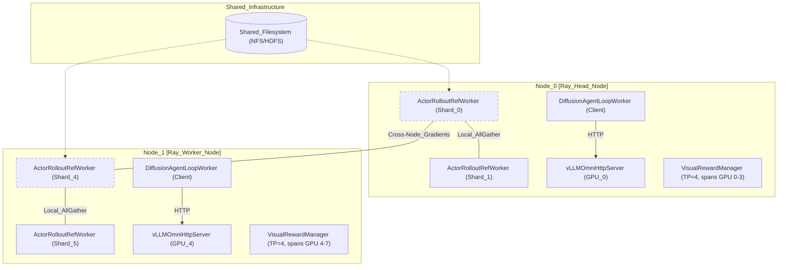
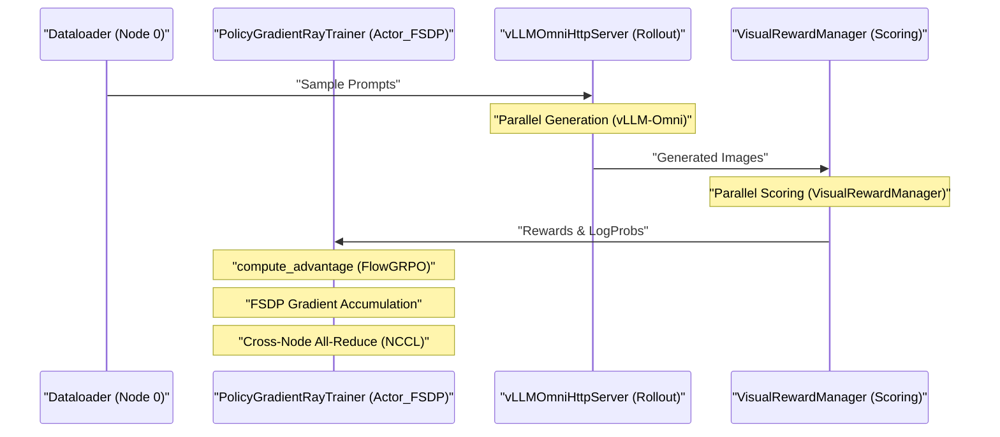

<!-- source: DeepWiki mcp.deepwiki.com · repo verl-project/verl-omni · page 8.3 Multi-Node Training · fetched 2026-10-30 -->

# Multi-Node Training

Relevant source files

The following files were used as context for generating this wiki page:

- [docs/algo/flowgrpo.md](docs/algo/flowgrpo.md)
- [docs/algo/performance.md](docs/algo/performance.md)
- [docs/api/pipelines.rst](docs/api/pipelines.rst)
- [docs/api/trainer.rst](docs/api/trainer.rst)
- [docs/api/workers.rst](docs/api/workers.rst)
- [docs/conf.py](docs/conf.py)
- [docs/start/flowgrpo_quickstart.md](docs/start/flowgrpo_quickstart.md)
- [docs/start/metrics.md](docs/start/metrics.md)
- [docs/start/multi_node_training.md](docs/start/multi_node_training.md)
- [docs/start/rollout_batching.md](docs/start/rollout_batching.md)
- [examples/flowgrpo_trainer/README.md](examples/flowgrpo_trainer/README.md)
- [tests/special_e2e/run_flowgrpo_qwen_image.sh](tests/special_e2e/run_flowgrpo_qwen_image.sh)
- [tests/workers/test_diffusers_fsdp_lora_adapter.py](tests/workers/test_diffusers_fsdp_lora_adapter.py)
- [verl_omni/workers/engine/lora_adapter_mixin.py](verl_omni/workers/engine/lora_adapter_mixin.py)

This page covers the configuration and architectural requirements for scaling diffusion RL training across multiple nodes in VeRL-Omni. It details resource pool management, Ray cluster initialization, and the specific parameter scaling required to maintain throughput and stability when moving from single-node to multi-node environments.

## System Architecture

Multi-node training in VeRL-Omni distributes actor training, rollout generation, and reward scoring across a cluster connected by high-speed interconnects (InfiniBand or RoCE) [[docs/start/multi_node_training.md:18-19]](). The system uses Ray for orchestration, allowing components to be colocated or distributed based on GPU resource requirements.

### Component Placement and Resource Groups

In a typical multi-node FlowGRPO setup (e.g., 2 nodes with 4 GPUs each), the components are mapped as follows:

1.  **Actor (Training):** FSDP shards the actor parameters within each node to minimize cross-node All-Gather traffic [[docs/start/multi_node_training.md:65-68]](). This is managed by `BaseRayDiffusionTrainer` [[docs/api/trainer.rst:30-34]]().
2.  **Rollout (vLLM-Omni):** One rollout replica is typically hosted per GPU (`ROLLOUT_TP=1`). These replicas operate independently [[docs/start/multi_node_training.md:58-60]](). vLLM-Omni can further optimize this via **step-wise continuous batching** (`step_execution=true`) to overlap denoising steps across requests [[docs/start/rollout_batching.md:13-14]]().
3.  **Reward (Scoring):** Reward models are colocated with rollout replicas. If `REWARD_TP=4`, one reward replica spans all 4 GPUs of a node using Ray's fractional GPU scheduling [[docs/start/multi_node_training.md:61-64]]().

### Distributed Entity Mapping

The following diagram bridges the logical training components to their implementation entities and resource constraints.

**Figure 1: Multi-Node Entity and Resource Mapping**

Sources: [[docs/start/multi_node_training.md:38-56]](), [[docs/api/workers.rst:35-39]](), [[docs/start/rollout_batching.md:13-15]]()

## Scaling Recipe: Single-Node to Multi-Node

Moving from a single-node baseline to a multi-node cluster requires mechanical adjustments to the Hydra configuration to ensure that the global batch size scales linearly with the hardware while keeping per-GPU work constant.

### 1. Topology and Batch Sizing
The global `train_batch_size` and `ppo_mini_batch_size` must be scaled by the ratio of the total GPU count to the baseline GPU count [[docs/start/multi_node_training.md:109-113]]().

| Parameter | Single-Node (4 GPU) | Multi-Node (8 GPU) | Formula |
| :--- | :--- | :--- | :--- |
| `data.train_batch_size` | 32 | 64 | `32 * TOTAL_GPUS / 4` |
| `actor_rollout_ref.actor.ppo_mini_batch_size` | 16 | 32 | `16 * TOTAL_GPUS / 4` |
| `ppo_micro_batch_size_per_gpu` | 16 | 16 | Constant |

Sources: [[docs/start/multi_node_training.md:119-127]](), [[docs/algo/flowgrpo.md:133-145]]()

### 2. Worker Configuration
The number of `DiffusionAgentLoopWorker` clients and reward workers must be updated to match the total GPU count and the desired Tensor Parallelism (TP) [[docs/start/multi_node_training.md:134-137]]().

*   **Rollout Workers:** `actor_rollout_ref.rollout.agent.num_workers = TOTAL_GPUS / ROLLOUT_TP` [[docs/start/multi_node_training.md:144-145]]().
*   **Reward Workers:** `reward.num_workers = TOTAL_GPUS / REWARD_TP` [[docs/start/multi_node_training.md:147-148]]().

### 3. FSDP and Memory Optimization
For multi-node, FSDP is typically configured to shard within a node (`fsdp_size=$GPUS_PER_NODE`) to avoid the latency of cross-node All-Gather operations [[docs/start/multi_node_training.md:171-172]]().

To manage memory on nodes hosting multiple components, the following optimizations are commonly applied:
*   **Offloading:** Moving FSDP states to CPU memory via `param_offload` and `optimizer_offload` for the `DiffusersFSDPEngine` [[docs/api/workers.rst:49-56]]().
*   **VeOmni Engine:** As an alternative to FSDP2, the `VeOmni` engine can be used for large-scale training (e.g., 64-card runs) by setting `diffusion.model_engine=veomni_diffusion` [[examples/flowgrpo_trainer/README.md:148-150]]().

## Data Flow and Network Requirements

In a multi-node environment, the `PolicyGradientRayTrainer` coordinates the flow of generated trajectories and scores across the network during the `fit()` loop [[docs/api/trainer.rst:41-44]]().

**Figure 2: Multi-Node Data Flow**

Sources: [[docs/start/multi_node_training.md:38-56]](), [[docs/api/trainer.rst:41-48]](), [[docs/start/metrics.md:8-17]]()

### Network and Storage Prerequisites
*   **Interconnect:** InfiniBand or RoCE is required for performant FSDP gradient synchronization [[docs/start/multi_node_training.md:19]]().
*   **Shared Filesystem:** All nodes must have access to a shared directory (NFS/HDFS) for input files, pre-trained weights, and checkpointing [[docs/start/multi_node_training.md:77-78]]().
*   **Environment Consistency:** All nodes must have identical software environments, including CUDA and specific dependencies [[docs/start/multi_node_training.md:75-77]]().

## Multi-Node Example: Qwen-Image OCR
The reference multi-node script for `Qwen-Image` FlowGRPO training can be found at `examples/flowgrpo_trainer/qwen_image/run_qwen_image_ocr_lora_multi_node.sh` [[docs/start/multi_node_training.md:82-86]](). This script demonstrates horizontal scaling across 2 nodes (8 GPUs total) using LoRA fine-tuning.

Key overrides in the multi-node script include:
*   `algorithm.adv_estimator=flow_grpo` [[examples/flowgrpo_trainer/README.md:63]]()
*   `actor_rollout_ref.actor.ppo_mini_batch_size` scaling [[docs/start/multi_node_training.md:120-122]]()
*   `reward.num_workers` scaling [[docs/start/multi_node_training.md:147-149]]()

Sources: [[docs/start/multi_node_training.md:82-108]](), [[examples/flowgrpo_trainer/README.md:106]]()

---

