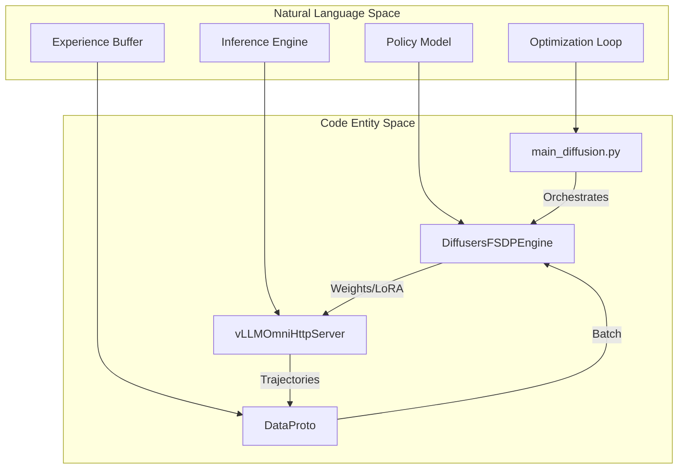
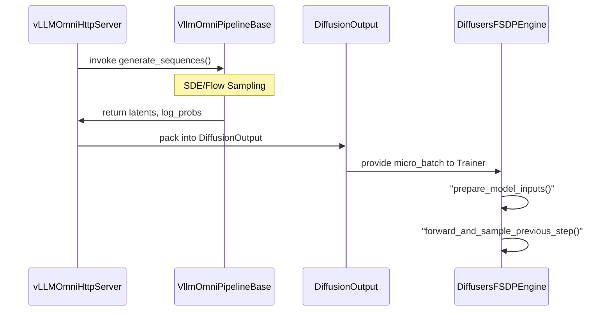

<!-- source: DeepWiki mcp.deepwiki.com · repo verl-project/verl-omni · page 9 Glossary · fetched 2026-10-30 -->

# Glossary

Relevant source files

The following files were used as context for generating this wiki page:

- [README.md](README.md)
- [docs/algo/flowgrpo.md](docs/algo/flowgrpo.md)
- [docs/algo/performance.md](docs/algo/performance.md)
- [docs/assets/arch.png](docs/assets/arch.png)
- [docs/contributing/integrating_a_diffusion_model.md](docs/contributing/integrating_a_diffusion_model.md)
- [docs/index.md](docs/index.md)
- [docs/start/flowgrpo_quickstart.md](docs/start/flowgrpo_quickstart.md)
- [docs/start/metrics.md](docs/start/metrics.md)
- [examples/flowgrpo_trainer/README.md](examples/flowgrpo_trainer/README.md)
- [tests/agent_loop/test_diffusion_agent_loop.py](tests/agent_loop/test_diffusion_agent_loop.py)
- [tests/gpu_smoke/run_gpu_smoke_tests.sh](tests/gpu_smoke/run_gpu_smoke_tests.sh)
- [tests/special_e2e/run_flowgrpo_qwen_image.sh](tests/special_e2e/run_flowgrpo_qwen_image.sh)
- [tests/workers/config/test_diffusion_config_on_cpu.py](tests/workers/config/test_diffusion_config_on_cpu.py)
- [tests/workers/rollout/rollout_vllm/test_zmq_utils.py](tests/workers/rollout/rollout_vllm/test_zmq_utils.py)
- [tests/workers/test_diffusers_fsdp_engine.py](tests/workers/test_diffusers_fsdp_engine.py)
- [verl_omni/__init__.py](verl_omni/__init__.py)
- [verl_omni/agent_loop/diffusion_agent_loop.py](verl_omni/agent_loop/diffusion_agent_loop.py)
- [verl_omni/agent_loop/single_turn_agent_loop.py](verl_omni/agent_loop/single_turn_agent_loop.py)
- [verl_omni/pipelines/model_base.py](verl_omni/pipelines/model_base.py)
- [verl_omni/pipelines/qwen_image_flow_grpo/vllm_omni_rollout_adapter.py](verl_omni/pipelines/qwen_image_flow_grpo/vllm_omni_rollout_adapter.py)
- [verl_omni/pipelines/qwen_image_mix_grpo/vllm_omni_rollout_adapter.py](verl_omni/pipelines/qwen_image_mix_grpo/vllm_omni_rollout_adapter.py)
- [verl_omni/pipelines/sd3_flow_grpo/common.py](verl_omni/pipelines/sd3_flow_grpo/common.py)
- [verl_omni/pipelines/sd3_flow_grpo/vllm_omni_rollout_adapter.py](verl_omni/pipelines/sd3_flow_grpo/vllm_omni_rollout_adapter.py)
- [verl_omni/trainer/config/_generated_diffusion_trainer.yaml](verl_omni/trainer/config/_generated_diffusion_trainer.yaml)
- [verl_omni/trainer/config/_generated_diffusion_veomni_trainer.yaml](verl_omni/trainer/config/_generated_diffusion_veomni_trainer.yaml)
- [verl_omni/trainer/config/diffusion/model/diffusion_model.yaml](verl_omni/trainer/config/diffusion/model/diffusion_model.yaml)
- [verl_omni/trainer/config/diffusion/rollout/diffusion_rollout.yaml](verl_omni/trainer/config/diffusion/rollout/diffusion_rollout.yaml)
- [verl_omni/workers/config/diffusion/model.py](verl_omni/workers/config/diffusion/model.py)
- [verl_omni/workers/config/diffusion/rollout.py](verl_omni/workers/config/diffusion/rollout.py)
- [verl_omni/workers/engine/fsdp/diffusers_impl.py](verl_omni/workers/engine/fsdp/diffusers_impl.py)
- [verl_omni/workers/engine_workers.py](verl_omni/workers/engine_workers.py)
- [verl_omni/workers/rollout/vllm_rollout/utils.py](verl_omni/workers/rollout/vllm_rollout/utils.py)
- [verl_omni/workers/rollout/vllm_rollout/vllm_omni_async_server.py](verl_omni/workers/rollout/vllm_rollout/vllm_omni_async_server.py)
- [verl_omni/workers/rollout/vllm_rollout/zmq_utils.py](verl_omni/workers/rollout/vllm_rollout/zmq_utils.py)

This page provides definitions for codebase-specific terminology, domain concepts, and technical jargon used within the VeRL-Omni project. It serves as a reference for onboarding engineers to understand the mapping between theoretical RL concepts and their concrete implementation in code.

## Core System Terminology

The following terms define the primary infrastructure components and data structures used to coordinate distributed training and rollout.

| Term | Definition | Code Pointer |
|:---|:---|:---|
| **Actor** | The policy model being trained. It receives prompts and processes rollout trajectories to compute gradients using engines like FSDP2. | [verl_omni/workers/engine/fsdp/diffusers_impl.py:78-82]() |
| **Rollout** | The process of generating samples from the current policy. In VeRL-Omni, this is typically handled by an asynchronous `vLLM-Omni` server. | [verl_omni/workers/rollout/vllm_rollout/vllm_omni_async_server.py:105-110]() |
| **Reference (Ref)** | A frozen copy of the initial policy used to compute KL divergence or probability ratios to prevent the trained model from collapsing. | [verl_omni/trainer/config/_generated_diffusion_trainer.yaml:110-112]() |
| **DataProto** | The primary data container used to pass batches of sequences, rewards, and metadata between workers. | [verl_omni/agent_loop/diffusion_agent_loop.py:33-33]() |
| **Hybrid Engine** | A configuration where the Rollout and Actor share the same GPU resources, switching between inference and training modes to maximize utilization. | [README.md:40-42]() |
| **Agent Loop** | The component that manages the generation lifecycle, including prompt padding, seeding, and interfacing with the LLM/Diffusion server. | [verl_omni/agent_loop/diffusion_agent_loop.py:105-117]() |

### System Entity Mapping: Training Loop

The diagram below bridges the gap between the conceptual RL loop and the specific classes that implement it.

**RL Concept to Code Entity Mapping**

Sources: [verl_omni/workers/rollout/vllm_rollout/vllm_omni_async_server.py:105-110](), [verl_omni/agent_loop/diffusion_agent_loop.py:33-33](), [verl_omni/workers/engine/fsdp/diffusers_impl.py:78-82](), [examples/flowgrpo_trainer/README.md:61-61]()

---

## Diffusion & Flow Matching Jargon

VeRL-Omni specializes in RL for diffusion and flow-matching models. These terms describe the mathematical and implementation-specific details of these models.

*   **Flow Matching:** A generative modeling paradigm (used by SD3, Qwen-Image) where the model learns to predict the velocity vector field between noise and data. [README.md:19-22]()
*   **Latents:** The representation of an image or video that the diffusion model operates on before VAE decoding. [verl_omni/workers/engine/fsdp/diffusers_impl.py:65-66]()
*   **Pipeline Adapter:** A model-specific class implementing `DiffusionModelBase` or `VllmOmniPipelineBase` that bridges generic RL loops with specific model architectures. [verl_omni/workers/rollout/vllm_rollout/vllm_omni_async_server.py:53-54]()
*   **SDE Window:** The specific timesteps in a diffusion trajectory where noise is injected and gradients are calculated for RL exploration. [verl_omni/workers/config/diffusion/rollout.py:43-45]()
*   **CFG (Classifier-Free Guidance):** A technique to improve sample quality by combining conditional and unconditional model outputs. [verl_omni/workers/config/diffusion/rollout.py:66-66]()
*   **Step Execution:** A mode in `vLLM-Omni` where the engine runs the registered pipeline step-by-step for continuous batching. [verl_omni/workers/config/diffusion/rollout.py:141-142]()

### Data Flow: Rollout to Training

This diagram shows how data moves from the vLLM-Omni rollout environment into the training environment via the pipeline adapters.

**Diffusion Trajectory Data Flow**

Sources: [verl_omni/workers/rollout/vllm_rollout/vllm_omni_async_server.py:53-55](), [verl_omni/workers/rollout/replica.py:41](), [verl_omni/workers/engine/fsdp/diffusers_impl.py:61-67]()

---

## Distributed Infrastructure Terms

Terms related to the underlying compute and communication stack.

*   **FSDP2 (Fully Sharded Data Parallel):** The primary training backend in PyTorch used for sharding model parameters, gradients, and optimizer states. [verl_omni/workers/engine/fsdp/diffusers_impl.py:78-83]()
*   **VeOmni:** An alternative high-performance training engine backend that supports advanced memory management like parameter offloading and resharding. [verl_omni/trainer/config/_generated_diffusion_veomni_trainer.yaml:26-34]()
*   **Ulysses Sequence Parallelism (USP):** A technique to shard the sequence dimension of Transformers across multiple GPUs to handle long contexts. [verl_omni/workers/engine/fsdp/diffusers_impl.py:171-181]()
*   **Ray:** The orchestration layer used to manage the lifecycle of distributed workers. [verl_omni/workers/rollout/vllm_rollout/vllm_omni_async_server.py:26-26]()
*   **LoRA (Low-Rank Adaptation):** A PEFT method used to fine-tune large models by adding small trainable matrices. [verl_omni/workers/config/diffusion/model.py:89-92]()
*   **Checkpoint Engine:** The mechanism used to synchronize weights from the Actor to the Rollout server. [verl_omni/workers/config/diffusion/rollout.py:167-168]()
*   **ZMQ Handle:** ZeroMQ-based communication channel used for low-latency weight updates between actor and rollout workers. [verl_omni/workers/rollout/vllm_rollout/utils.py:106-108]()

---

## Algorithm-Specific Abbreviations

| Abbreviation | Full Term | Description |
|:---|:---|:---|
| **FlowGRPO** | Flow-Matching Group Relative Policy Optimization | Policy gradient algorithm using relative rewards within a group for diffusion models. |
| **DiffusionNFT** | Diffusion No-Fine-Tune | Direct preference optimization using implicit branching. |
| **GSPO** | General Segmented Policy Optimization | Used for omni-modality models like Qwen3-Omni for Thinker-only training. |
| **DPO** | Direct Preference Optimization | Aligning models with preferences without an explicit reward model. |
| **DanceGRPO** | Dance Group Relative Policy Optimization | Variant of GRPO optimized for video generation tasks like Wan2.2. |
| **DiffusionOPD** | Diffusion On-Policy Distillation | Minimizing KL divergence against a frozen teacher's transition distribution. |

Sources: [README.md:19-24](), [verl_omni/workers/config/diffusion/rollout.py:38-50](), [verl_omni/trainer/config/_generated_diffusion_trainer.yaml:74-74]()

---

## Metrics and Observability

Key performance indicators (KPIs) logged during training.

*   **zero_std_ratio:** The fraction of groups where the reward standard deviation is zero (indicating no learning signal). [README.md:43-44]()
*   **pg_clipfrac:** The fraction of policy gradient updates that were clipped by the objective. [verl_omni/trainer/config/_generated_diffusion_trainer.yaml:75-76]()
*   **MFU (Model FLOPs Utilization):** Efficiency of the training hardware relative to peak performance. [verl_omni/workers/config/diffusion/model.py:55-56]()
*   **throughput (images/GPU/s):** Samples processed per GPU per second. [README.md:44-45]()
*   **rollout_actor_probs_pearson_corr:** Correlation metric used to track synchronization between the rollout engine and actor updates. [README.md:41-41]()

Sources: [README.md:39-45](), [verl_omni/workers/config/diffusion/model.py:55-56](), [verl_omni/trainer/config/_generated_diffusion_trainer.yaml:75-76]()