# Page: VeRL-Omni Overview

# VeRL-Omni Overview

<details>
<summary>Relevant source files</summary>

The following files were used as context for generating this wiki page:

- [.github/workflows/gpu_smoke.yml](.github/workflows/gpu_smoke.yml)
- [.github/workflows/gpu_smoke_verl_latest.yml](.github/workflows/gpu_smoke_verl_latest.yml)
- [README.md](README.md)
- [docs/assets/WeChat.jpg](docs/assets/WeChat.jpg)
- [docs/assets/arch.png](docs/assets/arch.png)
- [docs/index.md](docs/index.md)
- [docs/start/install.md](docs/start/install.md)
- [pyproject.toml](pyproject.toml)
- [verl_omni/agent_loop/single_turn_agent_loop.py](verl_omni/agent_loop/single_turn_agent_loop.py)
- [verl_omni/pipelines/sd3_flow_grpo/common.py](verl_omni/pipelines/sd3_flow_grpo/common.py)
- [verl_omni/pipelines/sd3_flow_grpo/vllm_omni_rollout_adapter.py](verl_omni/pipelines/sd3_flow_grpo/vllm_omni_rollout_adapter.py)

</details>


`VeRL-Omni` is a general-purpose reinforcement learning (RL) framework specifically designed for post-training multimodal generative models. Built as an evolution of the multimodal efforts within the [`verl`](https://github.com/verl-project/verl) project, it provides a high-performance, stable, and modular infrastructure for training diffusion models and omni-modality systems [README.md:13-15]().

The framework addresses the unique I/O patterns and compute characteristics of multimodal RL, such as high-throughput generation requirements and complex reward modeling across different modalities including image, video, audio, and text [README.md:23-27]().

## System Purpose and Scope

VeRL-Omni targets RL post-training for three primary families of generative models [README.md:29-35](), [docs/index.md:7-13]():
1.  **Diffusion Generative Models**: Models for image, video, and audio (e.g., Qwen-Image, Wan2.2, SD3.5, LTX2.3) [README.md:89-128](), [README.md:144-157]().
2.  **Unified Multimodal Models**: Models that jointly handle understanding and generation (e.g., BAGEL, HunyuanImage-3.0) [README.md:137-142](), [README.md:159-160]().
3.  **Omni-modality Models**: Models processing and generating across text, image, audio, and video simultaneously (e.g., Qwen3-Omni) [README.md:22](), [README.md:35]().

The system is optimized for high training throughput, achieving approximately 25% higher end-to-end performance compared to standard reference implementations by leveraging `vLLM-Omni` for rollouts and asynchronous reward computation [README.md:39-43](), [docs/index.md:21]().

Sources: [README.md:13-43](), [docs/index.md:5-21](), [README.md:89-160]()

## High-Level Architecture

VeRL-Omni follows a distributed actor-rollout-reward topology managed by **Ray** [pyproject.toml:35](). The architecture decouples the generation of samples (rollout) from the optimization of the model (training), allowing for heterogeneous resource allocation and efficient scaling across multiple nodes [README.md:39-42]().

### System Components Diagram
The following diagram illustrates the relationship between the major subsystems and the core code entities that manage them.

**VeRL-Omni Distributed Topology**
```mermaid
graph TD
    subgraph "Orchestration_Layer"
        [Trainer] --> ["BaseRayDiffusionTrainer"]
        [Trainer] --> ["PolicyGradientRayTrainer"]
        [Trainer] --> ["DirectPreferenceRayTrainer"]
        style [Trainer] stroke-dasharray: 5 5
    end

    subgraph "Rollout_Space_vLLM-Omni"
        [RolloutWorker] --> ["vLLMOmniHttpServer"]
        [AgentLoop] --> ["DiffusionAgentLoopWorker"]
        [Manager] --> ["AgentLoopManager"]
    end

    subgraph "Training_Space_FSDP2_VeOmni"
        [TrainingEngine] --> ["DiffusersFSDPEngine"]
        [TrainingEngine] --> ["DPODiffusersFSDPEngine"]
        [Worker] --> ["TrainingWorker"]
    end

    subgraph "Reward_Space"
        [RewardMgr] --> ["VisualRewardManager"]
        [RewardMgr] --> ["MultiVisualRewardManager"]
    end

    ["PolicyGradientRayTrainer"] -->|"Schedule_Fit_Loop"| ["DiffusionAgentLoopWorker"]
    ["DiffusionAgentLoopWorker"] -->|"Request_Generation"| ["vLLMOmniHttpServer"]
    ["DiffusionAgentLoopWorker"] -->|"Request_Scores"| ["VisualRewardManager"]
    ["PolicyGradientRayTrainer"] -->|"Update_Weights"| ["TrainingWorker"]
    ["TrainingWorker"] -->|"Engine_Logic"| ["DiffusersFSDPEngine"]
    ["DiffusersFSDPEngine"] -->|"Sync_LoRA_Weights"| ["vLLMOmniHttpServer"]
```
Sources: [README.md:46-48](), [docs/index.md:15-21](), [pyproject.toml:35](), [verl_omni/agent_loop/single_turn_agent_loop.py:104-113]()

## Major Subsystems

### 1. Distributed Training Engines
VeRL-Omni supports multiple modular backends for model optimization. The default is **FSDP2** (Fully Sharded Data Parallel), which integrates with USP (Ulysses Sequence Parallelism) for distributed training [README.md:41](). The trainer abstracts the underlying engine, supporting both standard FSDP and the **VeOmni** backend [docs/start/install.md:91-93]().
*   **Key Classes**: `DiffusersFSDPEngine` (FSDP-based implementation) and `VeOmniDiffusionEngineConfig` (VeOmni alternative) [docs/start/install.md:93]().
*   For details, see [System Architecture and Key Concepts](#1.2).

### 2. Rollout and Generation
Generation is handled by `vLLM-Omni`, a specialized version of vLLM tailored for high-throughput multimodal generation [README.md:39](). The `vLLMOmniHttpServer` manages the rollout lifecycle, supporting both Autoregressive (AR) and Diffusion modes [README.md:22]().
*   **Key Classes**: `vLLMOmniHttpServer` and `DiffusionAgentLoopWorker` [verl_omni/agent_loop/single_turn_agent_loop.py:104-113]().
*   For details, see [System Architecture and Key Concepts](#1.2).

### 3. Reward Infrastructure
The framework features a flexible reward pipeline that supports rule-based, model-based (e.g., HPSv3, GenRM-OCR, ImageBind, CLAP), and multimodal rewards [README.md:40](). It includes an **Async Reward** mechanism and an **HTTP Scorer** to overlap reward computation with other phases [README.md:40](), [docs/index.md:21]().
*   **Key Classes**: `VisualRewardManager`, `MultiVisualRewardManager`.

### 4. Algorithm Implementations
VeRL-Omni implements several state-of-the-art RL algorithms adapted for diffusion and omni-modality models [README.md:79-170]():
*   **FlowGRPO**: Policy gradient for flow-matching models (e.g., Qwen-Image, SD3.5, LTX2.3) [README.md:92](), [README.md:126]().
*   **DiffusionNFT**: Optimizes the forward diffusion process using implicit branches [README.md:23]().
*   **GSPO**: Designed for omni-modal models like Qwen3-Omni [README.md:22]().
*   **DanceGRPO**: Specialized for video generation tasks like Wan2.2 [README.md:23]().
*   **DiffusionOPD**: On-policy distillation for diffusion models [docs/index.md:64]().

**Code Entity Mapping: Algorithm to Trainer**
```mermaid
graph LR
    subgraph "Algorithm_Category"
        ["FlowGRPO"]
        ["DanceGRPO"]
        ["MixGRPO"]
        ["DiffusionNFT"]
        ["Diffusion_DPO"]
        ["Flow-DPPO"]
        ["DiffusionOPD"]
    end

    subgraph "Trainer_Classes"
        ["PolicyGradientRayTrainer"]
        ["DirectPreferenceRayTrainer"]
    end

    ["FlowGRPO"] --> ["PolicyGradientRayTrainer"]
    ["DanceGRPO"] --> ["PolicyGradientRayTrainer"]
    ["MixGRPO"] --> ["PolicyGradientRayTrainer"]
    ["DiffusionNFT"] --> ["DirectPreferenceRayTrainer"]
    ["Diffusion_DPO"] --> ["DirectPreferenceRayTrainer"]
    ["Flow-DPPO"] --> ["PolicyGradientRayTrainer"]
    ["DiffusionOPD"] --> ["PolicyGradientRayTrainer"]
```
Sources: [README.md:79-170](), [docs/index.md:58-64]()

## Getting Started and Next Steps

To begin using VeRL-Omni, you should first set up your environment (CUDA or NPU) and then explore the system architecture in depth.

*   **[Getting Started: Installation and Environment Setup](#1.1)**: Detailed instructions on installation using `uv`, Docker configurations, and hardware-specific requirements for NVIDIA GPUs and Ascend NPUs [docs/start/install.md:1-53]().
*   **[System Architecture and Key Concepts](#1.2)**: A deep dive into the distributed actors, the role of Ray, and the training loop lifecycle.

Sources: [README.md:51-56](), [docs/index.md:25-34](), [docs/start/install.md:1-53]()

---

# Page: Getting Started: Installation and Environment Setup

# Getting Started: Installation and Environment Setup

<details>
<summary>Relevant source files</summary>

The following files were used as context for generating this wiki page:

- [.dockerignore](.dockerignore)
- [.github/actions/gpu-smoke-prepare/action.yml](.github/actions/gpu-smoke-prepare/action.yml)
- [.github/vllm_ascend_pin.txt](.github/vllm_ascend_pin.txt)
- [.github/vllm_omni_pin.txt](.github/vllm_omni_pin.txt)
- [.github/workflows/gpu_smoke.yml](.github/workflows/gpu_smoke.yml)
- [.github/workflows/gpu_smoke_verl_latest.yml](.github/workflows/gpu_smoke_verl_latest.yml)
- [docker/Dockerfile.a2.npu](docker/Dockerfile.a2.npu)
- [docker/Dockerfile.a3.npu](docker/Dockerfile.a3.npu)
- [docker/Dockerfile.cuda](docker/Dockerfile.cuda)
- [docs/start/install.md](docs/start/install.md)
- [pyproject.toml](pyproject.toml)
- [tests/pipelines/test_ltx2_flow_grpo_on_cpu.py](tests/pipelines/test_ltx2_flow_grpo_on_cpu.py)
- [verl_omni/pipelines/ltx2_flow_grpo/vllm_omni_rollout_adapter.py](verl_omni/pipelines/ltx2_flow_grpo/vllm_omni_rollout_adapter.py)

</details>


This page provides a comprehensive technical guide for setting up the VeRL-Omni environment. It covers local installation using `uv`, hardware-specific requirements for NVIDIA GPUs and Ascend NPUs, dependency pinning for distributed stability, and the Docker-based deployment workflow.

## Environment Overview

VeRL-Omni utilizes a modular installation approach where the core library (`verl-omni`) is installed alongside specific backends for training (`verl`), rollout (`vllm-omni`), and hardware-accelerated kernels.

### Dependency Stack and Pinning
To ensure stability across distributed components, VeRL-Omni relies on specific pinned versions of its sister projects:
*   **`verl`**: Pinned to a specific commit hash for RL infrastructure. The hash `8a694930275061f52ebd538c906ef8819af56dbd` is tracked in [.github/verl_pin.txt:1]() and referenced in [pyproject.toml:70-71]().
*   **`vllm-omni`**: Pinned to a specific commit hash for multimodal diffusion rollout. The hash is tracked in [.github/vllm_omni_pin.txt:1]() and used during installation [docs/start/install.md:51]().
*   **`vllm-ascend`**: Pinned to a specific commit for NPU support, tracked in [.github/vllm_ascend_pin.txt:1]() and utilized in [docker/Dockerfile.a2.npu:101-113]().
*   **`kernels`**: Pinned to version `0.16.0` (in `pyproject.toml`) or `0.14.1` (in docs) for Flash Attention 3 (FA3) support in the actor [pyproject.toml:64](), [docs/start/install.md:61]().
*   **`vllm`**: Baseline version `v0.27.0` is used across CUDA and NPU paths [docs/start/install.md:44](), [pyproject.toml:63]().

### Hardware Requirements
| Hardware | Python | Driver/Stack |
| :--- | :--- | :--- |
| **NVIDIA GPU** | >= 3.10 | CUDA >= 12.8 [docs/start/install.md:9-10]() |
| **Ascend NPU** | >= 3.10 | CANN >= 8.5.0 [docs/start/install.md:14-15]() |

Sources: [docs/start/install.md:5-16](), [docs/start/install.md:56-65](), [.github/verl_pin.txt:1](), [.github/vllm_omni_pin.txt:1](), [.github/vllm_ascend_pin.txt:1](), [pyproject.toml:61-71]()

---

## Installation Workflow

The recommended workflow uses `uv` for fast, reproducible dependency resolution and virtual environment management.

### 1. Base Setup
```bash
git clone https://github.com/verl-project/verl-omni.git
cd verl-omni
uv venv --python 3.12 --seed
source .venv/bin/activate
```
Sources: [docs/start/install.md:19-29]()

### 2. Platform-Specific Installation

#### NVIDIA CUDA Path
The `gpu` extra installs the necessary stack for CUDA-accelerated rollout and training.
```bash
uv pip install -e ".[gpu]" --torch-backend=auto
uv pip install "vllm-omni @ git+https://github.com/vllm-project/vllm-omni.git@$(cat .github/vllm_omni_pin.txt)"
uv pip install -e ".[train]"
```
*   **Flash Attention 3**: The `gpu` extra pulls `kernels==0.16.0` for the Diffusers **actor** FA3 backend via `attn_backend=_flash_3_varlen_hub` [docs/start/install.md:77-78](), [pyproject.toml:64](). Rollout FA3 is provided by `vllm-omni` via `FLASH_ATTN_3_HUB` [docs/start/install.md:82-86]().

#### Ascend NPU Path
The NPU path requires specific `vllm-ascend` integration and uses `torch-npu`.
```bash
uv pip install vllm==0.27.0
uv pip install "vllm-ascend @ git+https://github.com/vllm-project/vllm-ascend.git@$(cat .github/vllm_ascend_pin.txt)"
uv pip install "vllm-omni @ git+https://github.com/vllm-project/vllm-omni.git@$(cat .github/vllm_omni_pin.txt)"
uv pip install -e ".[train]"
```
Sources: [docs/start/install.md:41-53](), [docs/start/install.md:75-88](), [.github/vllm_ascend_pin.txt:1]()

### 3. Optional Extras
| Extra | Purpose | Code Reference |
| :--- | :--- | :--- |
| **`ocr`** | Adds `Levenshtein` for OCR-based rewards in FlowGRPO. | [docs/start/install.md:65](), [pyproject.toml:81-83]() |
| **`dev`** | Adds `pytest`, `pre-commit`, etc., for local development. | [docs/start/install.md:64](), [pyproject.toml:72-80]() |
| **`veomni`** | Alternative training backend to FSDP2. | [docs/start/install.md:90-93]() |

#### Installing VeOmni Backend
VeOmni is an alternative engine for policy and reference models. Due to strict version pins in VeOmni 0.1.11, it must be installed without dependency resolution to avoid conflicting with the `vllm` stack [docs/start/install.md:94-103]():
```bash
uv pip install veomni==0.1.11 --no-deps
uv pip install torchcodec librosa soundfile av audioread
```
Sources: [docs/start/install.md:67-103](), [.github/actions/gpu-smoke-prepare/action.yml:31-32]()

---

## Docker Environment

VeRL-Omni provides Dockerfiles for both NVIDIA GPU and Ascend NPU environments. Build context is managed via `.dockerignore` to exclude large local artifacts like `checkpoints/` and `.venv` [.dockerignore:1-50]().

### CUDA Build Targets
The repository provides `docker/Dockerfile.cuda` which supports targets such as `runtime`, `ocr`, and `dev` [docker/Dockerfile.cuda:79-90]().

### NPU Docker Images
Two separate Dockerfiles are provided for different Ascend hardware generations:
*   **Atlas A2 (910B)**: `docker/Dockerfile.a2.npu` using `SOC_VERSION="ascend910b1"` [docker/Dockerfile.a2.npu:1-25]().
*   **Atlas A3**: `docker/Dockerfile.a3.npu` using `SOC_VERSION="ascend910_9391"` [docker/Dockerfile.a3.npu:1-25]().

Both NPU images bake in `CANN`, `torch-npu`, `vllm-ascend`, and the pinned version of `verl` [docker/Dockerfile.a2.npu:131-138]().

### Dependency Flow in Docker
The following diagram illustrates how the Docker build process layers dependencies to create the final runtime environment.

**Docker Build Entity Mapping**
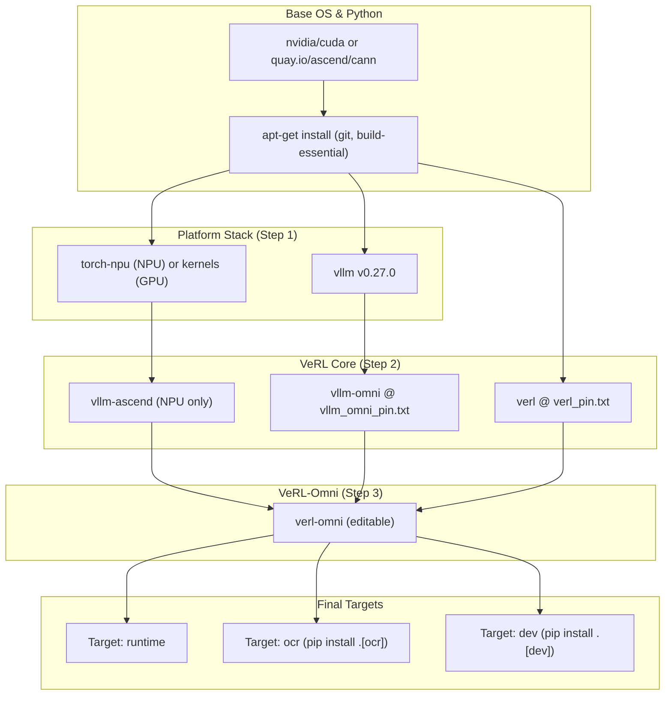
Sources: [docker/Dockerfile.cuda:25-94](), [docker/Dockerfile.a2.npu:1-160](), [.dockerignore:1-50]()

---

## Post-Installation Verification

After installation, verify the environment by checking the versions of the core components.

### Verification Commands (NVIDIA GPU)
```bash
python -c "import torch; print('torch', torch.__version__, '| CUDA', torch.version.cuda)"
python -c "import vllm; print('vllm', vllm.__version__)"
python -c "import vllm_omni; print('vllm-omni OK')"
python -c "import verl; print('verl', verl.__version__)"
python -c "import verl_omni; print('VeRL-Omni ready')"
```
Sources: [docs/start/install.md:116-124]()

### Verification Commands (Ascend NPU)
```bash
python -c "import torch; import torch_npu; print('torch', torch.__version__, '| NPU', torch.npu.is_available())"
python -c "import vllm; print('vllm', vllm.__version__)"
python -c "import verl; print('verl', verl.__version__)"
python -c "import verl_omni; print('VeRL-Omni ready')"
```
Sources: [docs/start/install.md:128-133]()

---

## Hardware-Specific Execution Flow

The system adapts its execution logic based on the detected hardware (NPU vs GPU), particularly for the rollout server and attention backends. NPU recipes typically override the attention backend to `_native_npu` [docs/start/install.md:89]().

**Hardware Adaptation Entity Mapping**
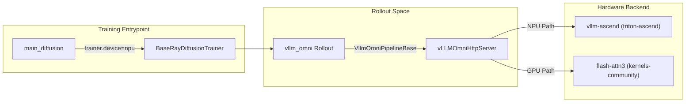
Sources: [docs/start/install.md:77-89](), [docker/Dockerfile.a2.npu:98-116](), [verl_omni/pipelines/model_base.py:52]()

---

## Adapter Registration and Pipeline Setup

The system uses a registry pattern to bind model architectures to specific training and rollout adapters. For example, `LTX2Pipeline` is registered for `flow_grpo` to enable specialized joint audio-video sampling [verl_omni/pipelines/ltx2_flow_grpo/vllm_omni_rollout_adapter.py:71-72]().

Key configuration and adapter symbols:
*   `VllmOmniPipelineBase`: The base registry class for rollout pipeline adapters [verl_omni/pipelines/ltx2_flow_grpo/vllm_omni_rollout_adapter.py:52]().
*   `LTX23PipelineWithLogProb`: Rollout adapter for LTX-2.3 that handles prompt encoding via `_encode_token_ids` and injects precomputed embeddings [verl_omni/pipelines/ltx2_flow_grpo/vllm_omni_rollout_adapter.py:72-138]().
*   `FlowMatchSDEDiscreteScheduler`: A custom scheduler used for SDE-based FlowGRPO sampling [verl_omni/pipelines/ltx2_flow_grpo/vllm_omni_rollout_adapter.py:80-84]().

Sources: [verl_omni/pipelines/ltx2_flow_grpo/vllm_omni_rollout_adapter.py:71-168](), [pyproject.toml:52-83]()

---

# Page: System Architecture and Key Concepts

# System Architecture and Key Concepts

<details>
<summary>Relevant source files</summary>

The following files were used as context for generating this wiki page:

- [README.md](README.md)
- [docs/assets/arch.png](docs/assets/arch.png)
- [docs/contributing/integrating_a_diffusion_model.md](docs/contributing/integrating_a_diffusion_model.md)
- [docs/index.md](docs/index.md)
- [tests/trainer/diffusion/test_dump_generations_video_on_cpu.py](tests/trainer/diffusion/test_dump_generations_video_on_cpu.py)
- [tests/trainer/diffusion/test_val_video_logging_on_cpu.py](tests/trainer/diffusion/test_val_video_logging_on_cpu.py)
- [tests/utils/reward_score/test_reward_utils_on_cpu.py](tests/utils/reward_score/test_reward_utils_on_cpu.py)
- [tests/utils/test_tracking_on_cpu.py](tests/utils/test_tracking_on_cpu.py)
- [verl_omni/__init__.py](verl_omni/__init__.py)
- [verl_omni/agent_loop/single_turn_agent_loop.py](verl_omni/agent_loop/single_turn_agent_loop.py)
- [verl_omni/pipelines/model_base.py](verl_omni/pipelines/model_base.py)
- [verl_omni/pipelines/qwen_image_flow_grpo/vllm_omni_rollout_adapter.py](verl_omni/pipelines/qwen_image_flow_grpo/vllm_omni_rollout_adapter.py)
- [verl_omni/pipelines/qwen_image_mix_grpo/vllm_omni_rollout_adapter.py](verl_omni/pipelines/qwen_image_mix_grpo/vllm_omni_rollout_adapter.py)
- [verl_omni/pipelines/sd3_flow_grpo/common.py](verl_omni/pipelines/sd3_flow_grpo/common.py)
- [verl_omni/pipelines/sd3_flow_grpo/vllm_omni_rollout_adapter.py](verl_omni/pipelines/sd3_flow_grpo/vllm_omni_rollout_adapter.py)
- [verl_omni/trainer/diffusion/ray_diffusion_trainer.py](verl_omni/trainer/diffusion/ray_diffusion_trainer.py)
- [verl_omni/utils/reward_score/reward_utils.py](verl_omni/utils/reward_score/reward_utils.py)
- [verl_omni/utils/tracking.py](verl_omni/utils/tracking.py)
- [verl_omni/workers/rollout/vllm_rollout/vllm_omni_async_server.py](verl_omni/workers/rollout/vllm_rollout/vllm_omni_async_server.py)

</details>


VeRL-Omni is a distributed RL training framework designed for the unique computational demands of multimodal generative models. It extends the core design principles of `verl`—specifically the decoupling of rollout, reward, and training—to handle high-dimensional diffusion outputs (images, video) and complex omni-modal interaction patterns.

## Distributed Actor-Rollout-Reward Topology

VeRL-Omni utilizes a distributed actor-rollout-reward topology orchestrated by **Ray**. Unlike standard LLM RL which primarily deals with token sequences, VeRL-Omni manages large binary artifacts (latents/tensors) and asynchronous reward pipelines for diffusion and flow-matching models [README.md:26-36]().

### The Role of Ray
Ray serves as the execution engine that manages the lifecycle of distributed workers. The system utilizes `RayWorkerGroup` to co-locate or distribute different roles across a cluster [verl_omni/trainer/diffusion/ray_diffusion_trainer.py:148-149]().

Key architectural components include:
*   **Trainer Controller:** Subclasses of `BaseRayDiffusionTrainer` run on the Ray driver node, managing the high-level training loop, data sharding, and worker synchronization [verl_omni/trainer/diffusion/ray_diffusion_trainer.py:136-156]().
*   **Worker Roles:** The system defines specialized workers for diffusion tasks, including `TrainingWorker` (which wraps the training engine) for parameter updates and reference policy computations [verl_omni/trainer/diffusion/ray_diffusion_trainer.py:45-45]().
*   **Resource Pools:** Hardware is partitioned into pools (e.g., training pool, rollout pool) via the `ResourcePoolManager` to prevent resource contention between heavy diffusion sampling and training [verl_omni/trainer/diffusion/ray_diffusion_trainer.py:148-148]().

### Decoupling Rollout from Training
A core architectural feature is the strict separation of the **Rollout Engine** (responsible for generation) and the **Training Engine** (responsible for gradient updates).
1.  **Rollout:** Uses `vLLM-Omni` as a high-throughput rollout backend. It is optimized for multi-modal generation and supports specialized sampling parameters for diffusion and omni-modality models [README.md:38-40]().
2.  **Training:** Uses `FSDP2` or `VeOmni` backends. These engines are optimized for memory efficiency and communication overlap, supporting combinable parallelism like Ulysses Sequence Parallel (USP) [README.md:42-42]().

### Diagram: System Topology and Data Flow
The following diagram illustrates how Ray orchestrates the different entities and how data flows through the RL lifecycle.

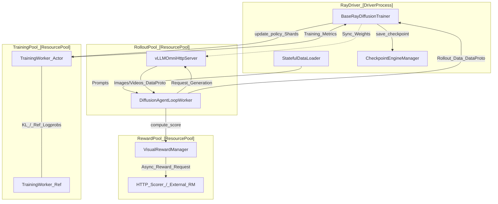
Sources: [README.md:38-44](), [verl_omni/trainer/diffusion/ray_diffusion_trainer.py:37-54](), [verl_omni/trainer/diffusion/ray_diffusion_trainer.py:136-160]()

---

## Core Terminology and Entities

### DataProto
`DataProto` is the unified data container used throughout the system. It encapsulates tensors and metadata required for the diffusion RL loop [verl_omni/trainer/diffusion/ray_diffusion_trainer.py:36-36]().
*   **Batch:** PyTorch tensors (e.g., `sample_level_rewards`, `advantages`, `returns`) [verl_omni/trainer/diffusion/ray_diffusion_trainer.py:113-132]().
*   **Non-tensor Batch:** Metadata like prompt strings or unique identifiers (`uid`) [verl_omni/trainer/diffusion/ray_diffusion_trainer.py:116-120]().

### Hybrid Engine and Backends
VeRL-Omni supports multiple execution backends selectable via configuration:
*   **FSDP2 (Fully Sharded Data Parallel):** A distributed training engine that supports meta-tensor initialization and Ulysses sequence parallelism [README.md:42-44]().
*   **VeOmni:** A specialized training engine developed for diffusion transformers, providing advanced parameter/optimizer offloading and `reshard_after_forward` optimizations [README.md:42-42]().
*   **vLLM-Omni:** A specialized rollout backend for high-throughput multimodal generation. It can operate in **AR (Autoregressive)** mode using `OmniModelConfig` or **Diffusion** mode using `DiffusionModelConfig` [verl_omni/workers/rollout/vllm_rollout/vllm_omni_async_server.py:116-131]().

### Diffusion Model Adapters
To support diverse architectures (Qwen-Image, SD3.5, Wan2.2, LTX2.3), the system uses a base abstraction for models.
*   **DiffusionModelBase:** The abstract base class for diffusion model training helpers. It provides a registry for different architectures and algorithms [verl_omni/pipelines/model_base.py:28-58]().
*   **VllmOmniPipelineBase:** The equivalent base class for rollout adapters in the vLLM-Omni runtime [verl_omni/workers/rollout/vllm_rollout/vllm_omni_async_server.py:54-54]().
*   **Architecture-Specific Logic:** Subclasses (e.g., `QwenImagePipelineWithLogProb`) implement methods like `prepare_model_inputs`, `build_scheduler`, and `encode_prompt` to bridge between generic RL logic and model-specific forward/sampling code [verl_omni/pipelines/model_base.py:140-176](), [verl_omni/pipelines/qwen_image_flow_grpo/vllm_omni_rollout_adapter.py:49-59]().

---

## RL Training Loop Lifecycle

The training process is managed by specialized trainers that implement the training loop for different algorithm families.

### Lifecycle Phases
1.  **Rollout Generation:** The rollout system orchestrates generation via `vLLMOmniHttpServer`. The `DiffusionAgentLoopWorker` manages the generation pipeline and post-processing of diffusion outputs [README.md:38-40](), [verl_omni/workers/rollout/vllm_rollout/vllm_omni_async_server.py:105-110]().
2.  **Reward Computation:** Scores are computed using `VisualRewardManager` or external HTTP scorers. Computation can be overlapped with the rollout phase using asynchronous reward serving on dedicated GPU pools [README.md:41-42]().
3.  **Advantage Estimation:** The trainer computes advantage estimates via `compute_advantage` to guide policy optimization across denoising timesteps. For Flow-GRPO, this involves group-relative reward normalization [verl_omni/trainer/diffusion/ray_diffusion_trainer.py:86-133]().
4.  **Actor Update:** The trainer executes the policy update. For diffusion models, it uses `get_diffusion_loss_fn` to compute gradients based on the selected algorithm mode (e.g., PPO, DPO, NFT) [verl_omni/trainer/diffusion/ray_diffusion_trainer.py:57-61]().
5.  **Weight Synchronization:** Updated weights are periodically synchronized from the training engine to the rollout backend (via `vLLMOmniColocateWorkerExtension`) to ensure the rollout agent uses the latest policy [README.md:43-43](), [verl_omni/workers/rollout/vllm_rollout/vllm_omni_async_server.py:169-174]().

### Diagram: Training Loop Sequence
This diagram maps the logical RL steps to the specific components and functions in the codebase.

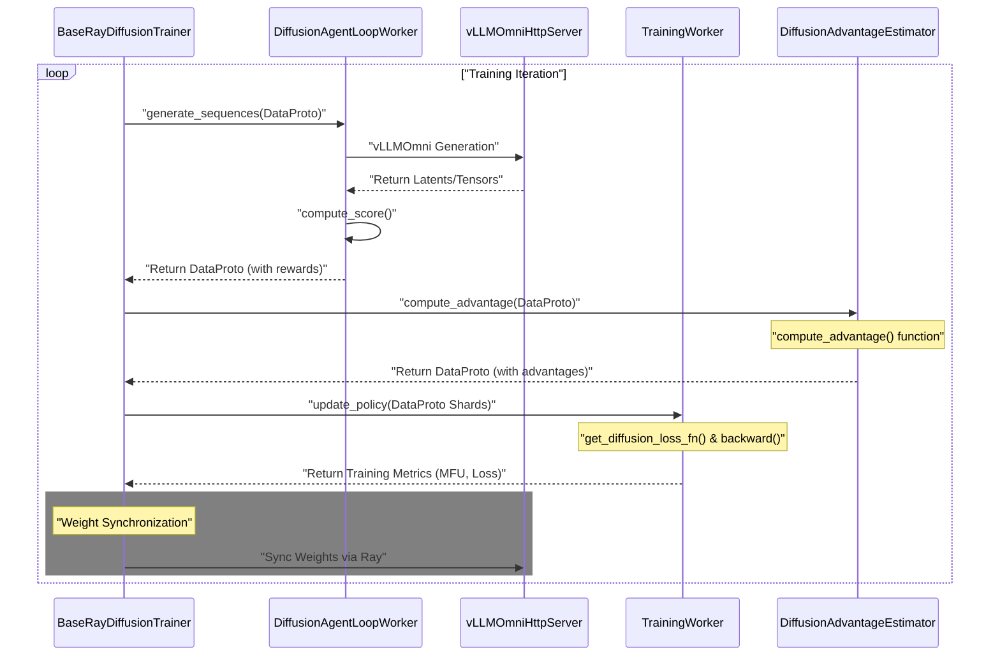
Sources: [verl_omni/trainer/diffusion/ray_diffusion_trainer.py:86-133](), [verl_omni/trainer/diffusion/ray_diffusion_trainer.py:57-61](), [README.md:38-44]()

Sources: [README.md:26-44](), [verl_omni/trainer/diffusion/ray_diffusion_trainer.py:86-160](), [verl_omni/pipelines/model_base.py:28-176](), [verl_omni/workers/rollout/vllm_rollout/vllm_omni_async_server.py:105-132]()

---

# Page: RL Algorithms for Diffusion Models

# RL Algorithms for Diffusion Models

<details>
<summary>Relevant source files</summary>

The following files were used as context for generating this wiki page:

- [docs/algo/flowgrpo.md](docs/algo/flowgrpo.md)
- [docs/algo/grpo_guard.md](docs/algo/grpo_guard.md)
- [docs/algo/performance.md](docs/algo/performance.md)
- [docs/start/flowgrpo_quickstart.md](docs/start/flowgrpo_quickstart.md)
- [docs/start/metrics.md](docs/start/metrics.md)
- [examples/flowgrpo_trainer/README.md](examples/flowgrpo_trainer/README.md)
- [tests/special_e2e/run_flowgrpo_qwen_image.sh](tests/special_e2e/run_flowgrpo_qwen_image.sh)
- [tests/trainer/diffusion/test_diffusion_core_algos_on_cpu.py](tests/trainer/diffusion/test_diffusion_core_algos_on_cpu.py)
- [tests/trainer/diffusion/test_diffusion_distillation_losses_on_cpu.py](tests/trainer/diffusion/test_diffusion_distillation_losses_on_cpu.py)
- [tests/trainer/diffusion/test_diffusion_registry_on_cpu.py](tests/trainer/diffusion/test_diffusion_registry_on_cpu.py)
- [verl_omni/pipelines/schedulers/flow_match_sde.py](verl_omni/pipelines/schedulers/flow_match_sde.py)
- [verl_omni/trainer/config/diffusion/actor/diffusion_actor.yaml](verl_omni/trainer/config/diffusion/actor/diffusion_actor.yaml)
- [verl_omni/trainer/diffusion/diffusion_algos.py](verl_omni/trainer/diffusion/diffusion_algos.py)
- [verl_omni/workers/config/diffusion/actor.py](verl_omni/workers/config/diffusion/actor.py)
- [verl_omni/workers/engine/veomni/diffusion_impl.py](verl_omni/workers/engine/veomni/diffusion_impl.py)
- [verl_omni/workers/utils/losses.py](verl_omni/workers/utils/losses.py)

</details>


VeRL-Omni provides a suite of Reinforcement Learning (RL) algorithms specialized for the unique characteristics of diffusion and flow-matching models. Unlike standard text-based LLM RL, these algorithms must account for the iterative denoising process, the high-dimensional latent space, and the computational cost of estimating likelihoods across multiple sampling steps.

The framework supports three primary families of generative models: diffusion generators (e.g., Qwen-Image, Wan2.2, SD3.5), unified understanding and generation models (e.g., BAGEL), and omni-modality models (e.g., Qwen3-Omni).

### Algorithm Landscape

The supported algorithms are categorized by their optimization target (reverse-process policy gradient vs. forward-process preference) and their modality specialization.

| Algorithm | Type | Primary Model Support | Key Feature |
| :--- | :--- | :--- | :--- |
| **FlowGRPO** | Policy Gradient | Qwen-Image, SD3.5, BAGEL | Group Relative Policy Optimization via ODE-to-SDE conversion. |
| **MixGRPO** | Policy Gradient | Qwen-Image | Mixed ODE-SDE rollout with sliding-window training. |
| **Flow-DPPO** | Policy Gradient | Qwen-Image | Asymmetric Gaussian KL trust-region for stability. |
| **DiffusionNFT** | Direct Preference | Qwen-Image | Forward-process optimization with implicit branches. |
| **DPO** | Direct Preference | SD3.5, Qwen-Image | Online/Offline Direct Preference Optimization. |
| **DanceGRPO** | Policy Gradient | Wan2.2, LTX-2.3 | SDE-based video generation RL with HPSv3 or CPS rewards. |
| **GSPO** | Policy Gradient | Qwen3-Omni | Omni-modal RL for unified "Thinker" models. |
| **GRPO-Guard** | Policy Gradient | Qwen-Image | Ratio-mean bias correction to stabilize importance sampling. |
| **DiffusionOPD** | Distillation | SD3.5 | On-policy distillation against a frozen teacher. |

Sources: [verl_omni/trainer/diffusion/diffusion_algos.py:148-153](), [verl_omni/workers/config/diffusion/actor.py:52-61](), [docs/algo/flowgrpo.md:1-21](), [examples/flowgrpo_trainer/README.md:123-128](), [verl_omni/workers/config/diffusion/actor.py:149-151]()

### Code-to-System Mapping: Algorithm Registry

The codebase uses a registry pattern to decouple mathematical loss definitions from training infrastructure. This allows training engines to dynamically load the correct loss function based on the `loss_mode` configuration [verl_omni/workers/config/diffusion/actor.py:39-41]().

Title: Algorithm Registry Architecture
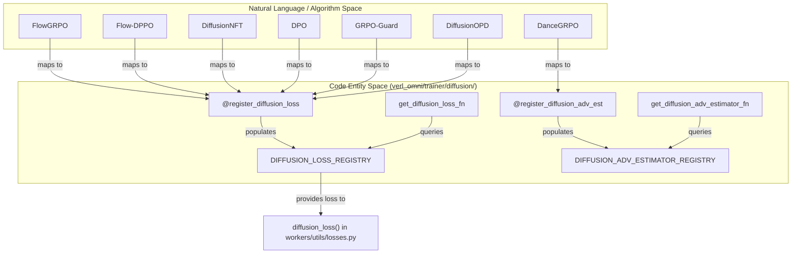
Sources: [verl_omni/trainer/diffusion/diffusion_algos.py:126-187](), [verl_omni/workers/utils/losses.py:70-78](), [verl_omni/workers/config/diffusion/actor.py:52-61]()

---

### [FlowGRPO: Flow-Matching Policy Gradient](#2.1)
FlowGRPO is the primary algorithm for image generation. It adapts the Group Relative Policy Optimization (GRPO) objective to flow-matching models by converting deterministic ODE samplers into equivalent Stochastic Differential Equations (SDE) [docs/algo/flowgrpo.md:9-11](). It uses the `FlowMatchSDEDiscreteScheduler` to inject controlled noise [verl_omni/pipelines/schedulers/flow_match_sde.py:48-52](). It supports **Denoising Reduction**, allowing training on a subset of steps while maintaining full-step inference [docs/algo/flowgrpo.md:19-20]().

*   **MixGRPO**: Extends FlowGRPO with a mixed ODE-SDE rollout and sliding-window schedule to cut online RL costs.
*   **GRPO-Guard**: Stabilizes training with reverse-SDE proposal-mean drift correction and per-step loss rescaling [verl_omni/workers/config/diffusion/actor.py:55]().

For details, see [FlowGRPO: Flow-Matching Policy Gradient](#2.1).
Sources: [docs/algo/flowgrpo.md:1-37](), [verl_omni/trainer/diffusion/diffusion_algos.py:190-191](), [verl_omni/pipelines/schedulers/flow_match_sde.py:48-52]()

### [DiffusionNFT and Flow-DPPO: Direct Preference Algorithms](#2.2)
These algorithms prioritize stability. **DiffusionNFT** optimizes the forward process using implicit positive and negative velocity branches [verl_omni/workers/config/diffusion/actor.py:38-39](). **Flow-DPPO** implements an asymmetric Gaussian KL trust-region by calculating the KL between the current policy mean and the rollout policy mean, masking advantages when the drift exceeds a threshold [verl_omni/workers/config/diffusion/actor.py:50-54](). It uses `sigma_t` for normalization [tests/trainer/diffusion/test_diffusion_core_algos_on_cpu.py:168-172]().

For details, see [DiffusionNFT and Flow-DPPO: Direct Preference Algorithms](#2.2).
Sources: [verl_omni/workers/config/diffusion/actor.py:38-54](), [verl_omni/trainer/diffusion/diffusion_algos.py:52-63](), [tests/trainer/diffusion/test_diffusion_core_algos_on_cpu.py:161-172]()

### [DPO for Diffusion Models](#2.3)
VeRL-Omni supports both online and offline Direct Preference Optimization (DPO) for diffusion models. The implementation uses a one-shot flow-matching objective with a `dpo_beta` temperature parameter [verl_omni/workers/config/diffusion/actor.py:48-49](). The `DPODiffusersFSDPEngine` handles the specific data pairing logic required for preference optimization.

For details, see [DPO for Diffusion Models](#2.3).
Sources: [verl_omni/trainer/diffusion/diffusion_algos.py:120-121](), [verl_omni/workers/config/diffusion/actor.py:48-49]()

### [DanceGRPO, LTX-2.3, and Video/Audio-Video Generation RL](#2.4)
Specialized for video generation models like Wan2.2 and LTX-2.3, **DanceGRPO** handles temporal complexities using the `dance_sde` SDE variant [verl_omni/pipelines/schedulers/flow_match_sde.py:68](). It integrates reward models like HPSv3 and CLAP to optimize for visual quality, temporal consistency, and audio-video alignment [examples/flowgrpo_trainer/README.md:123-128]().

For details, see [DanceGRPO, LTX-2.3, and Video/Audio-Video Generation RL](#2.4).
Sources: [verl_omni/trainer/diffusion/diffusion_algos.py:152-153](), [verl_omni/pipelines/schedulers/flow_match_sde.py:68-71](), [examples/flowgrpo_trainer/README.md:127-128]()

### [GSPO for Omni-Modal Models (Qwen3-Omni)](#2.5)
**GSPO** is designed for the Qwen3-Omni "Thinker" model. Unlike pure diffusion RL, GSPO manages an Autoregressive (AR) rollout mode to handle unified multimodal sequences where reasoning and generation are interleaved [verl_omni/workers/utils/losses.py:132-134](). It uses `omni_loss` for direct-preference training [verl_omni/workers/utils/losses.py:132-138]().

For details, see [GSPO for Omni-Modal Models (Qwen3-Omni)](#2.5).
Sources: [verl_omni/trainer/diffusion/diffusion_algos.py:155-156](), [verl_omni/workers/utils/losses.py:132-153]()

### [Diffusion On-Policy Distillation (DiffusionOPD)](#2.6)
**DiffusionOPD** enables on-policy distillation where a student model minimizes KL divergence against a frozen teacher's transition distribution. It supports `distill_kl` and `distill_fm_mse` loss modes [verl_omni/workers/config/diffusion/actor.py:150](). This is typically used to distill complex reasoning or high-quality generation capabilities from larger models (e.g., SD3.5 OCR distillation) [verl_omni/workers/utils/losses.py:114-120]().

For details, see [Diffusion On-Policy Distillation (DiffusionOPD)](#2.6).
Sources: [verl_omni/workers/config/diffusion/actor.py:149-151](), [verl_omni/workers/utils/losses.py:114-120]()

---

### Algorithm-Infrastructure Association

The following diagram shows how algorithm configurations (defined in `DiffusionLossConfig`) connect to the underlying training engines and how they are validated during the worker loop.

Title: Config-to-Engine Mapping
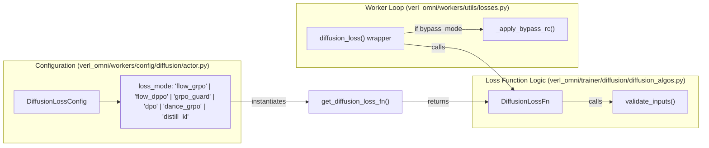
Sources: [verl_omni/workers/config/diffusion/actor.py:39-63](), [verl_omni/trainer/diffusion/diffusion_algos.py:50-84](), [verl_omni/workers/utils/losses.py:70-90]()

---

# Page: FlowGRPO: Flow-Matching Policy Gradient

# FlowGRPO: Flow-Matching Policy Gradient

<details>
<summary>Relevant source files</summary>

The following files were used as context for generating this wiki page:

- [docs/algo/flowgrpo.md](docs/algo/flowgrpo.md)
- [docs/algo/grpo_guard.md](docs/algo/grpo_guard.md)
- [docs/algo/mixgrpo.md](docs/algo/mixgrpo.md)
- [docs/algo/performance.md](docs/algo/performance.md)
- [docs/start/flowgrpo_quickstart.md](docs/start/flowgrpo_quickstart.md)
- [docs/start/metrics.md](docs/start/metrics.md)
- [examples/flowgrpo_trainer/README.md](examples/flowgrpo_trainer/README.md)
- [examples/flowgrpo_trainer/qwen_image/run_qwen_image_ocr.sh](examples/flowgrpo_trainer/qwen_image/run_qwen_image_ocr.sh)
- [examples/flowgrpo_trainer/qwen_image/run_qwen_image_ocr_lora.sh](examples/flowgrpo_trainer/qwen_image/run_qwen_image_ocr_lora.sh)
- [examples/grpoguard_trainer/README.md](examples/grpoguard_trainer/README.md)
- [examples/mixgrpo_trainer/README.md](examples/mixgrpo_trainer/README.md)
- [tests/special_e2e/run_flowgrpo_qwen_image.sh](tests/special_e2e/run_flowgrpo_qwen_image.sh)
- [tests/trainer/diffusion/test_diffusion_core_algos_on_cpu.py](tests/trainer/diffusion/test_diffusion_core_algos_on_cpu.py)
- [tests/trainer/diffusion/test_diffusion_distillation_losses_on_cpu.py](tests/trainer/diffusion/test_diffusion_distillation_losses_on_cpu.py)
- [tests/trainer/diffusion/test_diffusion_registry_on_cpu.py](tests/trainer/diffusion/test_diffusion_registry_on_cpu.py)
- [verl_omni/pipelines/qwen_image_mix_grpo/__init__.py](verl_omni/pipelines/qwen_image_mix_grpo/__init__.py)
- [verl_omni/pipelines/qwen_image_mix_grpo/diffusers_training_adapter.py](verl_omni/pipelines/qwen_image_mix_grpo/diffusers_training_adapter.py)
- [verl_omni/pipelines/request_batch.py](verl_omni/pipelines/request_batch.py)
- [verl_omni/pipelines/schedulers/flow_match_sde.py](verl_omni/pipelines/schedulers/flow_match_sde.py)
- [verl_omni/trainer/config/diffusion/actor/diffusion_actor.yaml](verl_omni/trainer/config/diffusion/actor/diffusion_actor.yaml)
- [verl_omni/trainer/diffusion/diffusion_algos.py](verl_omni/trainer/diffusion/diffusion_algos.py)
- [verl_omni/workers/config/diffusion/actor.py](verl_omni/workers/config/diffusion/actor.py)
- [verl_omni/workers/engine/veomni/diffusion_impl.py](verl_omni/workers/engine/veomni/diffusion_impl.py)
- [verl_omni/workers/utils/losses.py](verl_omni/workers/utils/losses.py)

</details>


FlowGRPO is the primary reinforcement learning algorithm in VeRL-Omni for post-training flow-matching models (e.g., Qwen-Image, SD3.5, LTX-2.3). It adapts the Group Relative Policy Optimization (GRPO) framework to the continuous action space of diffusion models by converting deterministic ODE trajectories into stochastic SDE paths [docs/algo/flowgrpo.md:5-13]().

## Core Mechanism: ODE-to-SDE Conversion

Flow-matching models natively use deterministic ODE samplers. FlowGRPO introduces stochasticity required for RL exploration by converting the ODE into an equivalent SDE that preserves the model's marginal distribution at every timestep [docs/algo/flowgrpo.md:9-11](). This is implemented via the `FlowMatchSDEDiscreteScheduler`, which supports multiple SDE variants [verl_omni/pipelines/schedulers/flow_match_sde.py:48-52]().

### FlowMatchSDEDiscreteScheduler
The scheduler extends the standard `FlowMatchEulerDiscreteScheduler` to handle noise injection and log-probability calculation [verl_omni/pipelines/schedulers/flow_match_sde.py:48-54]().

*   **`step()`**: Predicts the sample from the previous timestep by reversing the SDE [verl_omni/pipelines/schedulers/flow_match_sde.py:54-71]().
*   **`sample_previous_step()`**: Computes the mean and standard deviation of the previous sample based on the current `model_output` and `noise_level`. It supports variants such as `sde`, `cps` (Controllable Path Sampling), and `dance_sde` [verl_omni/pipelines/schedulers/flow_match_sde.py:148-161]().
*   **Log-probability**: Calculates the log-probability of the sampled latent $x_{t-1}$ given the distribution defined by the model's velocity prediction at step $t$ [verl_omni/pipelines/schedulers/flow_match_sde.py:43-46]().

Sources: [verl_omni/pipelines/schedulers/flow_match_sde.py:48-161](), [docs/algo/flowgrpo.md:9-11]()

## Advantage Estimation and Denoising Reduction

FlowGRPO computes advantages relative to a group of $n$ trajectories generated for the same prompt [docs/algo/flowgrpo.md:77-78](). Unlike LLM GRPO, it employs **Denoising Reduction** to limit training to a subset of denoising steps, significantly reducing computational cost [docs/algo/flowgrpo.md:11-13]().

### SDE Window Management
The training window is controlled by parameters in the rollout configuration:
*   `sde_window_size`: The number of denoising steps included in the active training window [docs/algo/flowgrpo.md:86-88]().
*   `sde_window_range`: The range of timesteps from which the start of the window is sampled [docs/algo/flowgrpo.md:89-91]().

### Advantage Computation
The function `compute_flow_grpo_outcome_advantage` handles the group-relative normalization [verl_omni/trainer/diffusion/diffusion_algos.py:190-191](). It uses a unique identifier (`index`) to group samples belonging to the same prompt [verl_omni/trainer/diffusion/diffusion_algos.py:332-334]().

| Parameter | Description |
| :--- | :--- |
| `norm_adv_by_std_in_grpo` | Whether to scale advantages by the standard deviation of rewards within the group [tests/trainer/diffusion/test_diffusion_core_algos_on_cpu.py:24-26](). |
| `global_std` | If True, computes standard deviation across the entire batch instead of per-group [tests/trainer/diffusion/test_diffusion_core_algos_on_cpu.py:25-26](). |

Sources: [verl_omni/trainer/diffusion/diffusion_algos.py:190-200](), [docs/algo/flowgrpo.md:11-13](), [tests/trainer/diffusion/test_diffusion_core_algos_on_cpu.py:85-116]()

## Implementation and Data Flow

The implementation is split between a **Rollout Context** (vLLM-Omni) and a **Training Context** (FSDP2 or VeOmni) [verl_omni/workers/config/diffusion/actor.py:66-70]().

### Natural Language Space to Code Entity Space

The following diagrams map high-level FlowGRPO concepts to specific code entities within the VeRL-Omni architecture.

**Entity Mapping: FlowGRPO Pipeline**
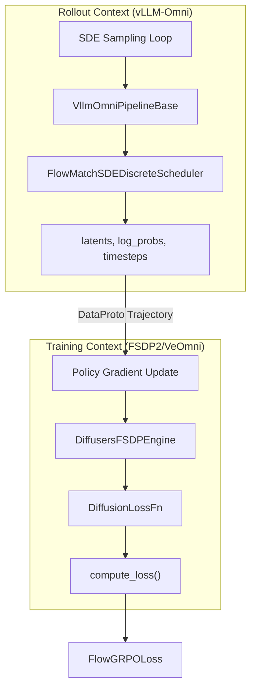
Sources: [verl_omni/pipelines/schedulers/flow_match_sde.py:48-52](), [verl_omni/trainer/diffusion/diffusion_algos.py:50-61](), [verl_omni/workers/config/diffusion/actor.py:134-161]()

### Loss Calculation and Rollout Correction
The algorithm supports variants like `grpo_guard` and `MixGRPO` via the `DiffusionLossConfig` [verl_omni/workers/config/diffusion/actor.py:39-54](). It also integrates `RolloutCorrectionConfig` for bypass mode [verl_omni/workers/config/diffusion/actor.py:168-170]().

*   **`FlowGRPOLoss`**: Implements the standard clipped policy gradient loss for diffusion [verl_omni/trainer/diffusion/diffusion_algos.py:144-145]().
*   **`GRPO-Guard`**: Extends FlowGRPO with a reverse-SDE proposal-mean drift correction and per-step loss rescaling for stability [examples/grpoguard_trainer/README.md:5-7]().
*   **`MixGRPO`**: Combines deterministic ODE sampling outside a contiguous window and stochastic SDE sampling inside the window [examples/mixgrpo_trainer/README.md:7-9]().

**Data Flow: Rollout to Trainer**
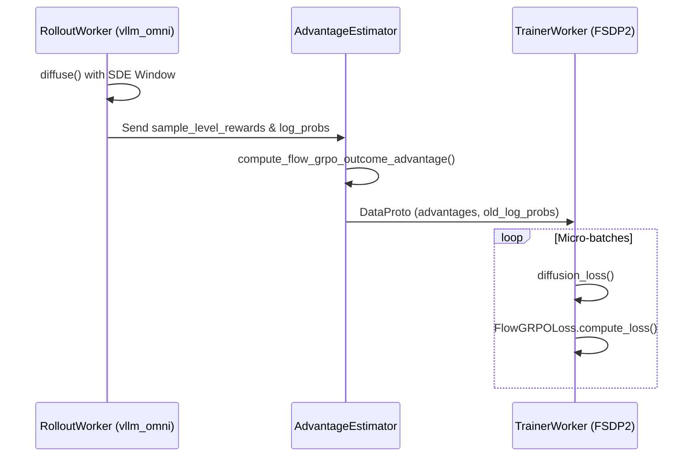
Sources: [verl_omni/trainer/diffusion/diffusion_algos.py:190-200](), [verl_omni/workers/utils/losses.py:71-91](), [verl_omni/workers/config/diffusion/actor.py:134-161]()

## MixGRPO and GRPO-Guard Variants

### MixGRPO: Mixed ODE-SDE Rollout
MixGRPO utilizes a sliding-window training schedule to reduce RL fine-tuning costs [examples/mixgrpo_trainer/README.md:7-9]().
*   **Rollout**: Uses `sample_strategy` (`random` or `progressive`) to determine the SDE window position [examples/mixgrpo_trainer/README.md:68-70]().
*   **Efficiency**: Cuts cost by using deterministic ODE sampling outside a contiguous window of denoising steps [examples/mixgrpo_trainer/README.md:7-9]().

### GRPO-Guard: Ratio-Bias Regularization
GRPO-Guard stabilizes training via drift correction and per-step rescaling [examples/grpoguard_trainer/README.md:5-7]().
*   **Stability**: Extends Flow-GRPO with a reverse-SDE proposal-mean drift correction and per-step loss rescaling for improved training stability [examples/grpoguard_trainer/README.md:5-7]().
*   **Config**: Uses `loss_mode=grpo_guard` and specific `clip_ratio` settings [examples/grpoguard_trainer/README.md:69-70]().

Sources: [examples/mixgrpo_trainer/README.md:1-73](), [examples/grpoguard_trainer/README.md:1-73](), [verl_omni/workers/config/diffusion/actor.py:39-63]()

## Performance Benchmarks

Reference benchmarks for FlowGRPO training on Qwen-Image OCR tasks (H800 GPUs, LoRA rank 64):

| Script | # GPUs | Batch Size | Throughput (img/GPU/s) | Time/Step (s) |
| :--- | :--- | :--- | :--- | :--- |
| `run_qwen_image_ocr_lora.sh` | 4 | 32 | 0.305 | 420 |
| `run_qwen_image_ocr_lora_async_reward.sh` | 5 | 32 | 0.280 | 360 |

Sources: [docs/algo/performance.md:8-18]()

## Configuration Parameters

FlowGRPO configuration is managed via Hydra and defined in `DiffusionActorConfig` and `DiffusionLossConfig` [verl_omni/workers/config/diffusion/actor.py:39-161]().

| Key | Default | Description |
| :--- | :--- | :--- |
| `loss_mode` | `"flow_grpo"` | Selection of the diffusion loss algorithm (e.g., `flow_grpo`, `grpo_guard`, `mix_grpo`) [verl_omni/workers/config/diffusion/actor.py:40-54](). |
| `clip_ratio` | `0.0001` | PPO-style clipping factor for the diffusion loss [verl_omni/workers/config/diffusion/actor.py:41](). |
| `adv_clip_max` | `5.0` | Maximum absolute advantage used before computing policy loss [verl_omni/workers/config/diffusion/actor.py:42](). |
| `use_kl_loss` | `False` | Enables KL loss against the reference policy [verl_omni/workers/config/diffusion/actor.py:147](). |
| `kl_loss_coef` | `0.001` | Coefficient for the KL term [verl_omni/workers/config/diffusion/actor.py:148](). |
| `rollout_n` | `MISSING` | Number of rollouts per update (group size) [verl_omni/workers/config/diffusion/actor.py:158](). |
| `bypass_mode` | `False` | Skips old-log-prob recompute, using rollout log-probs directly for speed [verl_omni/workers/utils/losses.py:87-89](). |

Sources: [verl_omni/workers/config/diffusion/actor.py:39-170](), [verl_omni/trainer/config/diffusion/actor/diffusion_actor.yaml:24-55](), [docs/algo/flowgrpo.md:55-103](), [verl_omni/workers/utils/losses.py:26-89]()

---

# Page: DiffusionNFT and Flow-DPPO: Direct Preference Algorithms

# DiffusionNFT and Flow-DPPO: Direct Preference Algorithms

<details>
<summary>Relevant source files</summary>

The following files were used as context for generating this wiki page:

- [.github/workflows/example-docs-links.yml](.github/workflows/example-docs-links.yml)
- [docs/algo/flowdppo.md](docs/algo/flowdppo.md)
- [docs/contributing/integrating_a_stepwise_continuous_batching_model.md](docs/contributing/integrating_a_stepwise_continuous_batching_model.md)
- [docs/examples/ltx2/flowgrpo_trainer_ltx2.md](docs/examples/ltx2/flowgrpo_trainer_ltx2.md)
- [docs/examples/minimax_h3/diffusionnft_trainer_minimax_h3.md](docs/examples/minimax_h3/diffusionnft_trainer_minimax_h3.md)
- [examples/diffusionnft_trainer/README.md](examples/diffusionnft_trainer/README.md)
- [examples/diffusionnft_trainer/minimax_h3/README.md](examples/diffusionnft_trainer/minimax_h3/README.md)
- [examples/flowdppo_trainer/README.md](examples/flowdppo_trainer/README.md)
- [examples/flowgrpo_trainer/ltx2/README.md](examples/flowgrpo_trainer/ltx2/README.md)
- [tests/special_sanity/check_example_docs_symlinks.py](tests/special_sanity/check_example_docs_symlinks.py)
- [tests/workers/rollout/rollout_vllm/test_vllm_omni_generate.py](tests/workers/rollout/rollout_vllm/test_vllm_omni_generate.py)
- [verl_omni/pipelines/qwen_image_diffusion_nft/vllm_omni_rollout_adapter.py](verl_omni/pipelines/qwen_image_diffusion_nft/vllm_omni_rollout_adapter.py)
- [verl_omni/pipelines/qwen_image_dpo/vllm_omni_rollout_adapter.py](verl_omni/pipelines/qwen_image_dpo/vllm_omni_rollout_adapter.py)
- [verl_omni/pipelines/wan22_dance_grpo/vllm_omni_rollout_adapter.py](verl_omni/pipelines/wan22_dance_grpo/vllm_omni_rollout_adapter.py)

</details>


VeRL-Omni provides specialized support for direct preference and divergence-based algorithms that move beyond standard PPO-style ratio clipping. **DiffusionNFT** optimizes the forward diffusion process using implicit positive and negative branches, while **Flow-DPPO** implements an asymmetric Gaussian KL trust-region for flow-matching models.

## DiffusionNFT: Forward-Process Optimization

DiffusionNFT is an online RL method that optimizes the **forward diffusion process** instead of applying policy gradients to the reverse sampling chain [[examples/diffusionnft_trainer/README.md:1-8]](). It contrasts positive and negative generations under a reward signal and folds that reinforcement into a supervised flow-matching objective.

### Algorithm Implementation
DiffusionNFT maps raw scores into an optimality probability using GRPO-style group normalization. It then optimizes two implicit branches defined in the loss function:
1.  **Positive Branch**: $v_\theta^+(x_t,c,t) = (1-\beta)v^{\text{old}}(x_t,c,t) + \beta v_\theta(x_t,c,t)$
2.  **Negative Branch**: $v_\theta^-(x_t,c,t) = (1+\beta)v^{\text{old}}(x_t,c,t) - \beta v_\theta(x_t,c,t)$

Where $\beta$ is controlled by `actor_rollout_ref.actor.diffusion_loss.mix_beta` [[examples/diffusionnft_trainer/README.md:102-102]]().

### Data Flow and Architecture
DiffusionNFT utilizes the `DirectPreferenceRayTrainer` loop. In this mode, the rollout generates images using an `old` LoRA adapter while the trainer updates the `default` adapter [[examples/diffusionnft_trainer/README.md:7-8]](). Unlike reverse-process algorithms, DiffusionNFT trains from final clean latents by re-noising them at selected forward timesteps. On the rollout side, the adapter must return the clean latents (`latents_clean`) to the trainer [[verl_omni/pipelines/qwen_image_diffusion_nft/vllm_omni_rollout_adapter.py:41-44]]().

**System to Code Mapping: DiffusionNFT**

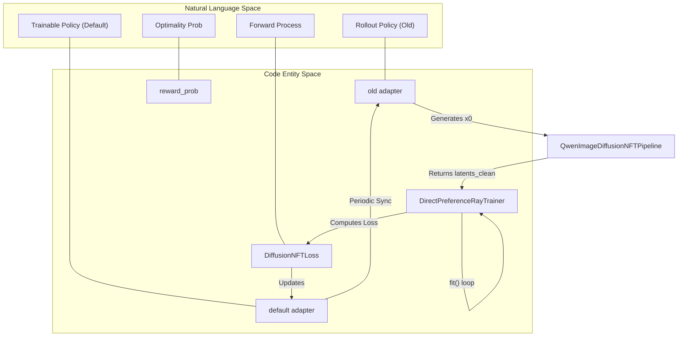
Sources: [[examples/diffusionnft_trainer/README.md:7-8]](), [[examples/diffusionnft_trainer/README.md:89-103]](), [[verl_omni/pipelines/qwen_image_diffusion_nft/vllm_omni_rollout_adapter.py:37-44]]()

### Key Configuration
| Parameter | Description | Code Pointer |
| :--- | :--- | :--- |
| `loss_mode` | Set to `diffusion_nft` | [[examples/diffusionnft_trainer/README.md:93-93]]() |
| `mix_beta` | Reinforcement guidance strength ($\beta$) | [[examples/diffusionnft_trainer/README.md:102-102]]() |
| `ref_kl_coef` | Prediction-space reference MSE coefficient | [[examples/diffusionnft_trainer/README.md:103-103]]() |
| `old_policy_update_interval` | Steps between refreshing the `old` adapter | [[examples/diffusionnft_trainer/README.md:100-100]]() |
| `trainer_type` | Set to `direct_preference` | [[examples/diffusionnft_trainer/README.md:92-92]]() |

Sources: [[examples/diffusionnft_trainer/README.md:89-105]]()

---

## Flow-DPPO: Divergence Proximal Policy Optimization

Flow-DPPO is an extension of Flow-GRPO that replaces PPO-style ratio clipping with an asymmetric divergence mask based on the Gaussian KL between transition means. It measures the mean-reduced policy drift $D_t$ at each denoising step using transition means.

### Divergence Masking Logic
The update is masked when the divergence exceeds a threshold $\epsilon_D$ (`kl_mask_threshold`) and the update is moving further from the rollout policy. The per-step KL-like divergence $D_t$ is calculated using the transition means `prev_sample_mean` and `old_prev_sample_mean` and the SDE noise scale `sigma_t`.

**System to Code Mapping: Flow-DPPO**

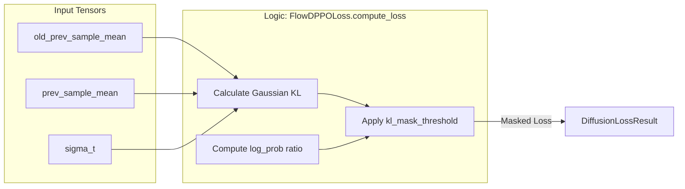
Sources: [[examples/flowdppo_trainer/README.md:58-63]]()

### Implementation Details
*   **KL Normalization**: If `add_kl_coefficient` is `True`, the drift is normalized by the scheduler's SDE noise scale `std_dev_t`, matching the Flow-SDE log-prob variance used during training.
*   **Rollout Alignment**: Requires `actor_rollout_ref.rollout.algo.sde_type="sde"` to ensure the rollout variance matches the loss transition variance.
*   **Data Flow**: Reuses the FlowGRPO training stack but swaps the `loss_mode` to `flow_dppo` in `DiffusionActorConfig`.

---

## Trainer and Adapter Management

Both algorithms rely on specialized actor logic or the `DirectPreferenceRayTrainer` to manage the lifecycle of "old" vs "current" policies.

### Old-Policy Adapter Management
For algorithms requiring an off-policy reference (like DiffusionNFT), the system maintains two LoRA adapters:
1.  **`default`**: The active training adapter updated via FSDP.
2.  **`old`**: The frozen rollout adapter used to generate samples and provide the reference velocities/means [[examples/diffusionnft_trainer/README.md:94-94]]().

The `old` adapter is periodically refreshed from `default` using a decay schedule defined by `algorithm.old_policy_decay_schedule` (e.g., `delayed_linear_to_0_999`) [[examples/diffusionnft_trainer/README.md:99-99]]().

### Comparison of Loss Configurations
Hyperparameters are centralized in the actor and algorithm configuration [[examples/diffusionnft_trainer/README.md:89-105]]().

| Algorithm | `loss_mode` | Key Metric | Guard Mechanism |
| :--- | :--- | :--- | :--- |
| **DiffusionNFT** | `diffusion_nft` | `reward_prob` | Implicit positive/negative branches [[examples/diffusionnft_trainer/README.md:93-93]]() |
| **Flow-DPPO** | `flow_dppo` | `actor/ppo_kl` | Asymmetric KL mask (`kl_mask_threshold`) [[examples/flowdppo_trainer/README.md:95-95]]() |

### Rollout Adapter Contracts
When implementing a new model for these algorithms, the rollout adapter must fulfill specific data contracts [[docs/contributing/integrating_a_stepwise_continuous_batching_model.md:113-117]]().

| Algorithm | Required Output Fields |
| :--- | :--- |
| **DiffusionNFT** | `latents_clean`, `train_timesteps`, `prompt_embeds`, `prompt_embeds_mask` |
| **Flow-DPPO** | `all_latents`, `all_log_probs`, `all_timesteps`, `prompt_embeds`, `prompt_embeds_mask` |

Sources: [[docs/contributing/integrating_a_stepwise_continuous_batching_model.md:113-121]](), [[verl_omni/pipelines/qwen_image_diffusion_nft/vllm_omni_rollout_adapter.py:153-158]]()

---

# Page: DPO for Diffusion Models

# DPO for Diffusion Models

<details>
<summary>Relevant source files</summary>

The following files were used as context for generating this wiki page:

- [docs/algo/diffusion_dpo.md](docs/algo/diffusion_dpo.md)
- [docs/contributing/integrating_a_new_direct_preference_algorithm_for_diffusion_model.md](docs/contributing/integrating_a_new_direct_preference_algorithm_for_diffusion_model.md)
- [examples/dpo_trainer/README.md](examples/dpo_trainer/README.md)
- [examples/dpo_trainer/data_process/prepare_offline_dpo.py](examples/dpo_trainer/data_process/prepare_offline_dpo.py)
- [examples/dpo_trainer/qwen3_omni/eval_vlm_as_judge.sh](examples/dpo_trainer/qwen3_omni/eval_vlm_as_judge.sh)
- [examples/dpo_trainer/qwen3_omni/qwen3_omni/run_qwen3_omni_omni_preference_lora.sh](examples/dpo_trainer/qwen3_omni/qwen3_omni/run_qwen3_omni_omni_preference_lora.sh)
- [examples/dpo_trainer/qwen3_omni/vlm_as_judge.py](examples/dpo_trainer/qwen3_omni/vlm_as_judge.py)
- [tests/pipelines/test_qwen_image_dpo_adapter_on_cpu.py](tests/pipelines/test_qwen_image_dpo_adapter_on_cpu.py)
- [tests/special_e2e/build_sd3_tiny_random.py](tests/special_e2e/build_sd3_tiny_random.py)
- [tests/special_e2e/create_dummy_offline_dpo_data.py](tests/special_e2e/create_dummy_offline_dpo_data.py)
- [tests/special_e2e/run_diffusionnft_qwen_image.sh](tests/special_e2e/run_diffusionnft_qwen_image.sh)
- [tests/special_e2e/run_offline_dpo_sd35.sh](tests/special_e2e/run_offline_dpo_sd35.sh)
- [tests/special_e2e/run_online_dpo_qwen_image.sh](tests/special_e2e/run_online_dpo_qwen_image.sh)
- [tests/utils/smoke_attention.py](tests/utils/smoke_attention.py)
- [verl_omni/trainer/diffusion/diffusion_trainer_utils.py](verl_omni/trainer/diffusion/diffusion_trainer_utils.py)

</details>


Direct Preference Optimization (DPO) for diffusion models in VeRL-Omni aligns generative policies by comparing the prediction errors of a current model against a frozen reference model. Unlike policy-gradient methods (e.g., FlowGRPO) that optimize reverse denoising trajectories, DPO utilizes a forward-process objective over preference pairs (chosen and rejected samples) [docs/algo/diffusion_dpo.md:5-11]().

VeRL-Omni supports both **Online DPO** (live rollout and reward scoring) and **Offline DPO** (precomputed win/lose pairs) [examples/dpo_trainer/README.md:5-14]().

### Core Algorithm and Implementation

The implementation relies on three primary components:
1.  **`DirectPreferenceRayTrainer`**: Orchestrates the training loop, handling either offline data loading or online rollout/reward collection [verl_omni/trainer/diffusion/ray_diffusion_trainer.py:70-72]().
2.  **`DPODiffusersFSDPEngine`**: A specialized engine that performs the forward flow-matching pass, ensuring shared noise and timesteps across pairs [docs/algo/diffusion_dpo.md:86-87]().
3.  **`DPOLoss`**: Computes the pairwise DPO objective using the implicit reward formulation [docs/algo/diffusion_dpo.md:90-92]().

#### System Data Flow: Online DPO
The following diagram illustrates the flow from prompt to model update in the online setting.

**Title: Online DPO Data Flow**
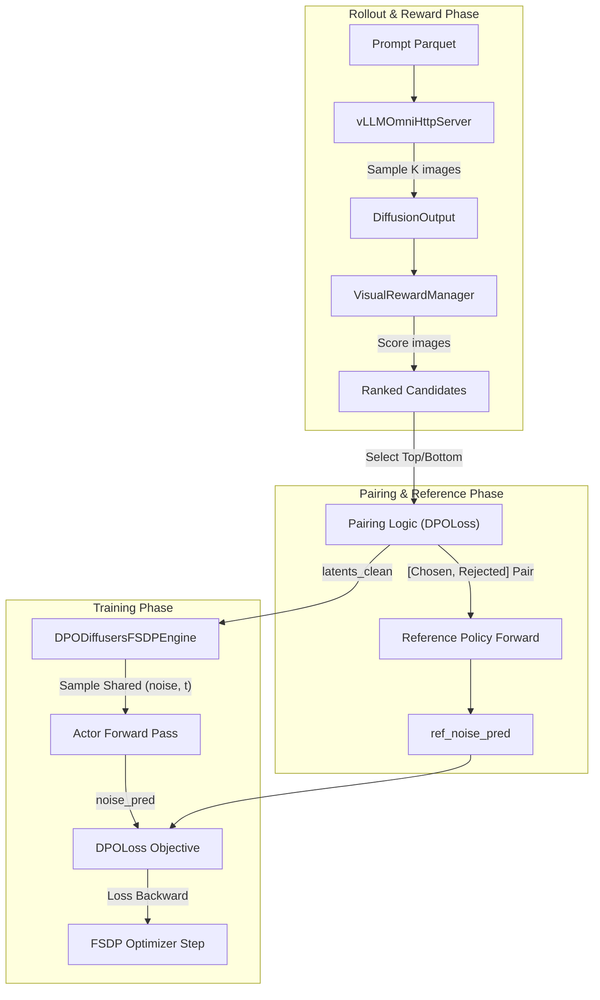
Sources: [examples/dpo_trainer/README.md:22-30](), [docs/algo/diffusion_dpo.md:80-88](), [docs/contributing/integrating_a_new_direct_preference_algorithm_for_diffusion_model.md:123-130]()

---

### Pairing Logic and Data Handling

DPO requires strict pairing where a "chosen" sample and a "rejected" sample for the same prompt are processed together to compute the log-ratio of likelihoods.

#### Online Pairing
In online DPO, the trainer samples $K$ images (defined by `actor_rollout_ref.rollout.n`) per prompt [examples/dpo_trainer/README.md:68-70](). The pairing logic groups these by prompt, scores them via the configured reward function, and forms one `[chosen, rejected]` pair from the highest- and lowest-scoring candidates [examples/dpo_trainer/README.md:22-29](). The objective uses the implicit reward margin between these samples [docs/algo/diffusion_dpo.md:61-72]().

#### Offline Pairing
For offline DPO, the dataset reads rows from a parquet file where each row already contains a `win` and `lose` image/latent [examples/dpo_trainer/data_process/prepare_offline_dpo.py:17-24](). The `prepare_offline_dpo.py` script facilitates this by generating candidate images from a frozen pipeline and scoring them before writing to parquet [examples/dpo_trainer/data_process/prepare_offline_dpo.py:115-131](). Training updates consume precomputed latents and text embeddings directly [examples/dpo_trainer/data_process/prepare_offline_dpo.py:22-24]().

For multimodal models like Qwen3-Omni, a `ModalityGroupedBatchSampler` is used to keep batches single-modality, which is required by the `OfflineMLLMDPODataset` [examples/dpo_trainer/qwen3_omni/qwen3_omni/run_qwen3_omni_omni_preference_lora.sh:84-86]().

| Configuration Key | Value for DPO | Purpose |
| :--- | :--- | :--- |
| `algorithm.trainer_type` | `direct_preference` | Routes to `DirectPreferenceRayTrainer` [examples/dpo_trainer/qwen3_omni/qwen3_omni/run_qwen3_omni_omni_preference_lora.sh:68-68]() |
| `algorithm.paired_preference` | `true` | Ensures adjacent samples in micro-batches are treated as pairs [examples/dpo_trainer/qwen3_omni/qwen3_omni/run_qwen3_omni_omni_preference_lora.sh:70-70]() |
| `actor_rollout_ref.actor.shuffle` | `false` | Prevents breaking pair adjacency during training [examples/dpo_trainer/qwen3_omni/qwen3_omni/run_qwen3_omni_omni_preference_lora.sh:127-127]() |
| `actor_rollout_ref.actor.ppo_micro_batch_size_per_gpu` | Even Number | Prevents splitting a pair across GPUs/batches [examples/dpo_trainer/qwen3_omni/qwen3_omni/run_qwen3_omni_omni_preference_lora.sh:118-118]() |

Sources: [examples/dpo_trainer/README.md:90-113](), [examples/dpo_trainer/data_process/prepare_offline_dpo.py:17-24](), [examples/dpo_trainer/qwen3_omni/qwen3_omni/run_qwen3_omni_omni_preference_lora.sh:68-86](), [docs/algo/diffusion_dpo.md:124-144]()

---

### DPODiffusersFSDPEngine

The `DPODiffusersFSDPEngine` implements the "one-shot" forward pass required for DPO. Unlike the iterative reverse process used in FlowGRPO, DPO training only requires a single prediction at a sampled timestep $t$ [docs/algo/diffusion_dpo.md:86-87]().

**Title: DPO Engine and Data Entity Association**
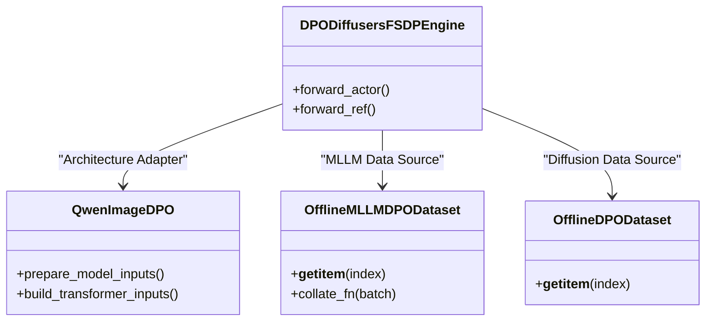
Sources: [docs/algo/diffusion_dpo.md:86-87](), [verl_omni/pipelines/qwen_image_dpo/diffusers_training_adapter.py:29-30](), [examples/dpo_trainer/qwen3_omni/qwen3_omni/run_qwen3_omni_omni_preference_lora.sh:81-83](), [docs/contributing/integrating_a_new_direct_preference_algorithm_for_diffusion_model.md:123-128]()

**Key Operations:**
1.  **Shared Sampling**: The engine ensures that for every pair, the noise $\epsilon$ and timestep $t$ are identical [docs/algo/diffusion_dpo.md:93-95]().
2.  **Forward Noising**: It applies the flow-matching / diffusion noising formula to the clean latents (`latents_clean`) provided in the batch [docs/algo/diffusion_dpo.md:40-44]().
3.  **Model Forward**: It invokes the model adapter to format tensors for the specific transformer architecture (e.g., SD3 or Qwen-Image) [tests/pipelines/test_qwen_image_dpo_adapter_on_cpu.py:93-100]().

---

### Pipeline Adapters

Adapters bridge the generic DPO trainer with model-specific architectures.

#### Qwen-Image DPO Adapter
The `QwenImageDPO` adapter handles architecture-specific inputs for the transformer, including image shapes and optional guidance embeddings [tests/pipelines/test_qwen_image_dpo_adapter_on_cpu.py:29-30](). It implements `prepare_model_inputs` to handle True-CFG branching where both positive and negative prompts are evaluated [tests/pipelines/test_qwen_image_dpo_adapter_on_cpu.py:154-169]().

#### SD3 DPO Adapter
Offline DPO for SD3 uses precomputed tensors to avoid the cost of re-encoding during training. The `prepare_offline_dpo.py` script pre-encodes VAE latents [examples/dpo_trainer/data_process/prepare_offline_dpo.py:145-153]() and prompt embeddings (including `pooled_prompt_embeds` and `prompt_embeds_mask`) [examples/dpo_trainer/data_process/prepare_offline_dpo.py:156-190]().

| Feature | Qwen-Image DPO | SD3 DPO |
| :--- | :--- | :--- |
| **Algorithm Key** | `dpo` [tests/pipelines/test_qwen_image_dpo_adapter_on_cpu.py:43-43]() | `dpo` |
| **Primary Mode** | Online [examples/dpo_trainer/README.md:20-20]() | Offline [examples/dpo_trainer/README.md:12-14]() |
| **Latent Input** | `latents` [tests/pipelines/test_qwen_image_dpo_adapter_on_cpu.py:94-94]() | `img_win_latents` [tests/special_e2e/create_dummy_offline_dpo_data.py:183-184]() |
| **Model Type** | `diffusion_dpo_model` [tests/special_e2e/run_online_dpo_qwen_image.sh:63-63]() | `diffusion_dpo_model` |

Sources: [tests/pipelines/test_qwen_image_dpo_adapter_on_cpu.py:29-180](), [examples/dpo_trainer/README.md:1-30](), [examples/dpo_trainer/data_process/prepare_offline_dpo.py:156-195](), [tests/special_e2e/run_online_dpo_qwen_image.sh:50-113]()

---

# Page: DanceGRPO, LTX-2.3, and Video/Audio-Video Generation RL

# DanceGRPO, LTX-2.3, and Video/Audio-Video Generation RL

<details>
<summary>Relevant source files</summary>

The following files were used as context for generating this wiki page:

- [.dockerignore](.dockerignore)
- [.github/actions/gpu-smoke-prepare/action.yml](.github/actions/gpu-smoke-prepare/action.yml)
- [docker/Dockerfile.a2.npu](docker/Dockerfile.a2.npu)
- [docker/Dockerfile.a3.npu](docker/Dockerfile.a3.npu)
- [docker/Dockerfile.cuda](docker/Dockerfile.cuda)
- [examples/dancegrpo_trainer/README.md](examples/dancegrpo_trainer/README.md)
- [examples/dancegrpo_trainer/data_process/wan22_hpsv3.py](examples/dancegrpo_trainer/data_process/wan22_hpsv3.py)
- [examples/dancegrpo_trainer/wan22/run_wan22_5b_t2v_hpsv3_auto.sh](examples/dancegrpo_trainer/wan22/run_wan22_5b_t2v_hpsv3_auto.sh)
- [tests/pipelines/test_ltx2_flow_grpo_on_cpu.py](tests/pipelines/test_ltx2_flow_grpo_on_cpu.py)
- [verl_omni/pipelines/ltx2_flow_grpo/vllm_omni_rollout_adapter.py](verl_omni/pipelines/ltx2_flow_grpo/vllm_omni_rollout_adapter.py)
- [verl_omni/pipelines/wan22_dance_grpo/common.py](verl_omni/pipelines/wan22_dance_grpo/common.py)
- [verl_omni/pipelines/wan22_dance_grpo/diffusers_training_adapter.py](verl_omni/pipelines/wan22_dance_grpo/diffusers_training_adapter.py)
- [verl_omni/utils/reward_score/hpsv3_reward.py](verl_omni/utils/reward_score/hpsv3_reward.py)
- [verl_omni/utils/reward_score/imagebind.py](verl_omni/utils/reward_score/imagebind.py)

</details>


This page covers the implementation and recipes for Reinforcement Learning (RL) on advanced video and audio-video generation models. Specifically, it details the **DanceGRPO** algorithm for **Wan2.2** text-to-video models and the **FlowGRPO** recipe for **LTX-2.3** text-to-audio-video models. These implementations leverage score-based SDE formulations, joint modality transitions, and specialized reward models like HPSv3, CLAP, and ImageBind.

## DanceGRPO for Wan2.2 Video Generation

DanceGRPO is an extension of the FlowGRPO algorithm optimized for high-resolution video models. It introduces a score-based SDE (Stochastic Differential Equation) formulation to improve numerical stability during the rollout phase, particularly when the noise level ($\sigma$) is close to 1 [examples/dancegrpo_trainer/README.md:5-6]().

### System Architecture: DanceGRPO Data Flow

The relationship between the rollout pipeline, training adapter, and SDE scheduler is managed through a registry pattern that associates model architectures with RL algorithms.

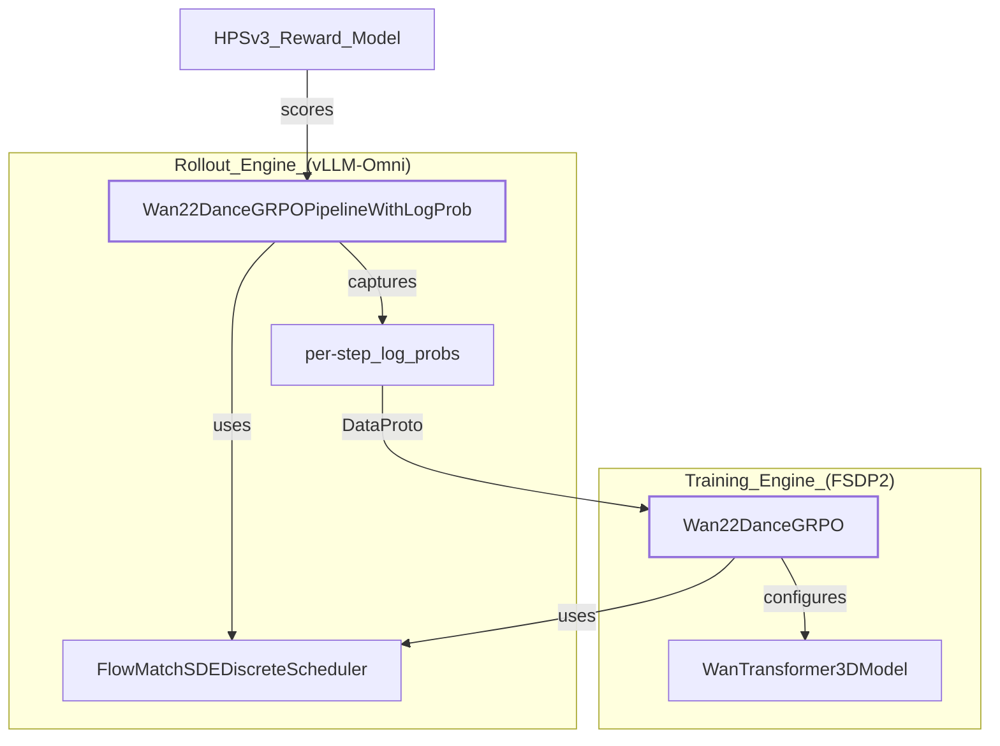
Sources: [verl_omni/pipelines/wan22_dance_grpo/diffusers_training_adapter.py:69-79](), [examples/dancegrpo_trainer/README.md:82-94](), [verl_omni/pipelines/wan22_dance_grpo/diffusers_training_adapter.py:28-29]()

### Wan2.2 Training Adapter
The `Wan22DanceGRPO` class handles the training-side logic [verl_omni/pipelines/wan22_dance_grpo/diffusers_training_adapter.py:70-79]().
*   **Time Shifting:** Wan2.2 utilizes `sd3_time_shift` to adjust the noise schedule [verl_omni/pipelines/wan22_dance_grpo/diffusers_training_adapter.py:33-34](). The adapter configures the `FlowMatchSDEDiscreteScheduler` with a shift factor (typically 5.0 for Wan2.2) [verl_omni/pipelines/wan22_dance_grpo/diffusers_training_adapter.py:104-110]().
*   **Transformer Inputs:** `prepare_model_inputs` maps scheduler timesteps to the integer range and handles manual embedding masking since the Wan transformer lacks an explicit attention mask for `encoder_hidden_states` [verl_omni/pipelines/wan22_dance_grpo/diffusers_training_adapter.py:152-162]().

### SDE Variants
Rollout supports three stochastic variants via `actor_rollout_ref.rollout.algo.sde_type`:
*   `dance_sde`: Recommended score-based SDE correction for numerical stability at high sigma [examples/dancegrpo_trainer/README.md:101]().
*   `sde`: Original FlowGRPO SDE variant [examples/dancegrpo_trainer/README.md:102]().
*   `cps`: Consistency-preserving sampling variant [examples/dancegrpo_trainer/README.md:103]().

Sources: [verl_omni/pipelines/wan22_dance_grpo/diffusers_training_adapter.py:69-79](), [examples/dancegrpo_trainer/README.md:97-103]()

---

## LTX-2.3 Text-to-Audio-Video RL

The **LTX-2.3** recipe trains models to generate synchronized audio and video. This involves joint audio-video transitions and a specialized LoRA configuration covering both video and audio attention blocks.

### Joint Audio-Video Training Logic
The `LTX23FlowGRPO` training adapter manages the complex input structure of the LTX-2.3 transformer [tests/pipelines/test_ltx2_flow_grpo_on_cpu.py:32]().
*   **Latent Splitting:** The adapter splits joint latents into separate video and audio components before passing them to the model [tests/pipelines/test_ltx2_flow_grpo_on_cpu.py:63-98]().
*   **LoRA Targets:** The recipe targets 28 modules, including `audio_to_video_attn` and `video_to_audio_attn` to ensure cross-modal synchronization [tests/pipelines/test_ltx2_flow_grpo_on_cpu.py:37-42]().

### Non-Contiguous SDE Windows
Unlike standard diffusion RL, the LTX-2.3 recipe supports sampling non-contiguous SDE transitions. This is configured via `sde_contiguous=False`, allowing the agent to sample transitions from a broader range without them being consecutive [tests/pipelines/test_ltx2_flow_grpo_on_cpu.py:105-110]().
*   **Seeding:** Step selection is deterministic based on `sde_window_seed` to maintain consistency across rollout and training [tests/pipelines/test_ltx2_flow_grpo_on_cpu.py:105-117]().

### LTX-2.3 Entity Mapping
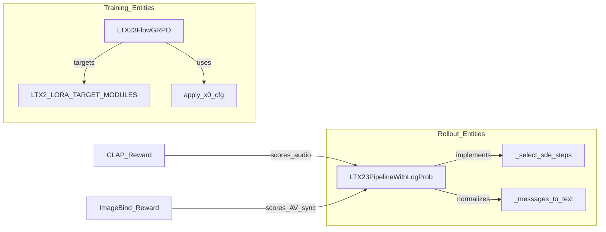
Sources: [verl_omni/pipelines/ltx2_flow_grpo/vllm_omni_rollout_adapter.py:72-76](), [tests/pipelines/test_ltx2_flow_grpo_on_cpu.py:26-33](), [tests/pipelines/test_ltx2_flow_grpo_on_cpu.py:105-117]()

---

## Reward Models for Video and Audio

Omni-modal RL requires specialized scorers to evaluate visual quality, text alignment, and cross-modal synchronization.

### HPSv3 (Visual Quality & Alignment)
Used primarily for Wan2.2, HPSv3 evaluates:
*   **Visual Quality:** Clarity, detail richness, aesthetic and creativity, and reasonableness [verl_omni/utils/reward_score/hpsv3_reward.py:38-48]().
*   **Text Alignment:** Subject relevance, style relevance, contextual consistency, attribute fidelity, and semantic coherence [verl_omni/utils/reward_score/hpsv3_reward.py:53-68]().

### ImageBind (Cross-Modal Alignment)
For LTX-2.3, ImageBind is used to score cross-modal semantic alignment [verl_omni/utils/reward_score/imagebind.py:15-20]().
*   **Supported Modes:** `audio_video`, `text_audio`, `text_video`, and a weighted `all` combination [verl_omni/utils/reward_score/imagebind.py:18-19]().
*   **Audio Preprocessing:** Audio is normalized to 16kHz and converted to Mel-spectrograms [verl_omni/utils/reward_score/imagebind.py:84-120]().
*   **Video Preprocessing:** Extracts 5 clips of 2 frames each, performing center cropping and normalization [verl_omni/utils/reward_score/imagebind.py:159-185]().

### Configuration Summary
| Model | Algorithm | Primary Rewards | Key Feature |
| :--- | :--- | :--- | :--- |
| **Wan2.2** | DanceGRPO | HPSv3 | `dance_sde` stability [examples/dancegrpo_trainer/README.md:101]() |
| **LTX-2.3** | FlowGRPO | ImageBind, CLAP | Non-contiguous SDE windows [tests/pipelines/test_ltx2_flow_grpo_on_cpu.py:105-110]() |

Sources: [verl_omni/utils/reward_score/hpsv3_reward.py:33-71](), [verl_omni/utils/reward_score/imagebind.py:15-51](), [examples/dancegrpo_trainer/README.md:97-103]()

---

# Page: GSPO for Omni-Modal Models (Qwen3-Omni)

# GSPO for Omni-Modal Models (Qwen3-Omni)

<details>
<summary>Relevant source files</summary>

The following files were used as context for generating this wiki page:

- [examples/gspo_trainer/README.md](examples/gspo_trainer/README.md)
- [examples/gspo_trainer/data_process/avqa.py](examples/gspo_trainer/data_process/avqa.py)
- [examples/gspo_trainer/qwen3_omni/config/qwen3_omni_thinker_gspo.yaml](examples/gspo_trainer/qwen3_omni/config/qwen3_omni_thinker_gspo.yaml)
- [examples/gspo_trainer/qwen3_omni/run_qwen3_omni_thinker_gspo_lora.sh](examples/gspo_trainer/qwen3_omni/run_qwen3_omni_thinker_gspo_lora.sh)
- [examples/gspo_trainer/qwen3_omni/run_qwen3_omni_thinker_gspo_lora_mmk12_v1_npu.sh](examples/gspo_trainer/qwen3_omni/run_qwen3_omni_thinker_gspo_lora_mmk12_v1_npu.sh)
- [examples/gspo_trainer/qwen3_omni/run_qwen3_omni_thinker_gspo_npu.sh](examples/gspo_trainer/qwen3_omni/run_qwen3_omni_thinker_gspo_npu.sh)
- [examples/gspo_trainer/qwen3_omni/run_qwen3_omni_thinker_gspo_npu_avqa_v1.sh](examples/gspo_trainer/qwen3_omni/run_qwen3_omni_thinker_gspo_npu_avqa_v1.sh)
- [tests/pipelines/test_qwen3_omni_thinker_adapter_on_cpu.py](tests/pipelines/test_qwen3_omni_thinker_adapter_on_cpu.py)
- [tests/special_e2e/run_gspo_qwen3_omni_thinker_lora_smoke.sh](tests/special_e2e/run_gspo_qwen3_omni_thinker_lora_smoke.sh)
- [tests/trainer/omni/test_omni_algos_on_cpu.py](tests/trainer/omni/test_omni_algos_on_cpu.py)
- [tests/trainer/omni/test_omni_dpo_trainer_on_cpu.py](tests/trainer/omni/test_omni_dpo_trainer_on_cpu.py)
- [tests/trainer/test_metrics_utils_on_cpu.py](tests/trainer/test_metrics_utils_on_cpu.py)
- [tests/utils/reward_score/test_choice_reward_on_cpu.py](tests/utils/reward_score/test_choice_reward_on_cpu.py)
- [tests/utils/reward_score/test_imagebind_on_cpu.py](tests/utils/reward_score/test_imagebind_on_cpu.py)
- [tests/utils/test_avqa_data_process_on_cpu.py](tests/utils/test_avqa_data_process_on_cpu.py)
- [tests/utils/test_omni_rl_datasets_on_cpu.py](tests/utils/test_omni_rl_datasets_on_cpu.py)
- [tests/utils/test_qwen3_omni_npu_launcher_on_cpu.py](tests/utils/test_qwen3_omni_npu_launcher_on_cpu.py)
- [verl_omni/models/transformers/__init__.py](verl_omni/models/transformers/__init__.py)
- [verl_omni/models/transformers/qwen3_omni_thinker.py](verl_omni/models/transformers/qwen3_omni_thinker.py)
- [verl_omni/pipelines/qwen3_omni/thinker_training_adapter.py](verl_omni/pipelines/qwen3_omni/thinker_training_adapter.py)
- [verl_omni/trainer/omni/__init__.py](verl_omni/trainer/omni/__init__.py)
- [verl_omni/trainer/omni/omni_algos.py](verl_omni/trainer/omni/omni_algos.py)
- [verl_omni/trainer/omni/ray_omni_trainer.py](verl_omni/trainer/omni/ray_omni_trainer.py)

</details>


This page describes the implementation of **Group Relative Policy Optimization (GSPO)** for the **Qwen3-Omni** model family, specifically focusing on the **Thinker** component. The integration utilizes `vllm-omni` as a high-performance rollout backend and `verl`'s FSDP2 engine for distributed training.

## Overview and Purpose

The Qwen3-Omni training pipeline in `verl-omni` is designed to post-train the **Qwen3-Omni-30B-A3B Thinker** model on multimodal reasoning tasks (e.g., mathematics) using RL [examples/gspo_trainer/README.md:5-9](). Unlike standard LLMs, Qwen3-Omni is a complex multi-stage model; the `verl-omni` implementation strips unnecessary modules to optimize memory and utilizes specialized `vllm-omni` stage configurations to handle the model's architecture [verl_omni/models/transformers/qwen3_omni_thinker.py:96-100]().

### Key Features
*   **AR Rollout Mode**: Uses Auto-Regressive (AR) generation for reasoning traces by setting `output_mode: ar` in the rollout configuration [tests/special_e2e/run_gspo_qwen3_omni_thinker_lora_smoke.sh:121-121]().
*   **LoRA Integration**: Supports Parameter-Efficient Fine-Tuning (PEFT) via LoRA (rank 32 default) with FSDP weight synchronization [examples/gspo_trainer/README.md:124-128]().
*   **Module Stripping**: Automatically removes non-Thinker modules (Talker, Code2Wav, Code Predictor) during training via `_verl_strip_modules` to reduce memory overhead [verl_omni/models/transformers/qwen3_omni_thinker.py:96-100]().
*   **Rollout-Actor Sync**: Implements weight synchronization between the FSDP training engine and the vLLM rollout server, validated by Pearson correlation metrics [examples/gspo_trainer/README.md:140-143]().
*   **Omni DPO Loss**: Support for Bradley-Terry DPO on sequence-level policy vs. reference log-probs, allowing for preference-based optimization [verl_omni/trainer/omni/omni_algos.py:62-66]().

---

## System Architecture: Training and Rollout Flow

The training loop involves a decoupled architecture where the **Actor** (FSDP2) and **Rollout** (vLLM-Omni) engines colocate on the same physical devices to maximize resource utilization [examples/gspo_trainer/README.md:52-54]().

### Data and Logic Flow
The diagram below illustrates how a Qwen3-Omni model is transformed and how weights are synchronized between the training and rollout components using the `OmniModelBase` registry.

**Figure 1: Qwen3-Omni Model Transformation and Weight Synchronization**
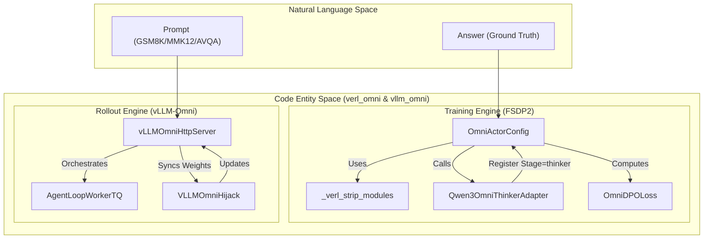
**Sources:** [verl_omni/trainer/omni/omni_algos.py:62-66](), [verl_omni/models/transformers/qwen3_omni_thinker.py:96-100](), [examples/gspo_trainer/README.md:140-150]().

---

## Model Patching and Module Stripping

The Qwen3-Omni Thinker is technically a decoder-only language model, but it is packaged within a multi-modal wrapper. `verl-omni` applies several configurations to make it compatible with RL training.

### Module Stripping (`_verl_strip_modules`)
To save VRAM, the training engine identifies and removes modules that are not required for the "Thinker" reasoning stage. This is handled by the `_verl_strip_modules` metadata [verl_omni/models/transformers/qwen3_omni_thinker.py:96-100]().

| Stripped Module | Purpose |
| :--- | :--- |
| `talker` | Speech generation component [verl_omni/models/transformers/qwen3_omni_thinker.py:97-97]() |
| `code2wav` | Code-to-audio synthesis [verl_omni/models/transformers/qwen3_omni_thinker.py:98-98]() |
| `code_predictor` | Specialized code generation head [verl_omni/models/transformers/qwen3_omni_thinker.py:99-99]() |

### FSDP and LoRA Configuration
*   **Thinker Forward Redirection**: The model forward is patched to redirect to `self.thinker` to bypass the multi-modal wrapper during actor training [verl_omni/models/transformers/qwen3_omni_thinker.py:59-87]().
*   **No-Split Modules**: `_no_split_modules` is set to `Qwen3OmniMoeThinkerTextDecoderLayer` and `Qwen3OmniMoeVisionBlock` to ensure FSDP shards the model at layer boundaries [verl_omni/models/transformers/qwen3_omni_thinker.py:91-94]().
*   **LoRA Target Modules**: Training typically targets `q_proj`, `k_proj`, `v_proj`, and `o_proj` with a rank of 32 [examples/gspo_trainer/README.md:124-128]().
*   **Tied Embeddings**: `tie_word_embeddings` is forced to `False` via a descriptor to enable FSDP meta-tensor initialization and avoid OOM on large models [verl_omni/models/transformers/qwen3_omni_thinker.py:102-115]().

**Sources:** [verl_omni/models/transformers/qwen3_omni_thinker.py:59-115](), [examples/gspo_trainer/README.md:124-128]().

---

## vLLM-Omni Integration

For Qwen3-Omni, the rollout backend is configured via the `vllm-omni` stage configs to handle the specific multi-stage pipeline topology.

### Processor and Tokenizer Patching
The `patch_hf_processor_for_qwen3_omni` function wraps the standard HuggingFace processor to handle Qwen3-Omni's unique requirements [verl_omni/models/transformers/qwen3_omni_thinker.py:118-135]().

*   **Config Redirection**: Swaps `processor.config` to `thinker_config` as multimodal settings are nested in Qwen3-Omni [verl_omni/models/transformers/qwen3_omni_thinker.py:147-150]().
*   **RoPE Indices**: Binds `get_rope_index` (casting to `long` to avoid FSDP rounding issues) and `get_llm_pos_ids_for_vision` to the processor [verl_omni/models/transformers/qwen3_omni_thinker.py:157-162]().
*   **Pad Token Dedup**: Implements `_dedup_pad_tokens` to collapse consecutive multimodal pad tokens before vLLM-Omni re-expands them, preventing double-expansion bugs [verl_omni/models/transformers/qwen3_omni_thinker.py:164-180]().

**Figure 2: Configuration and Adapter Registration**
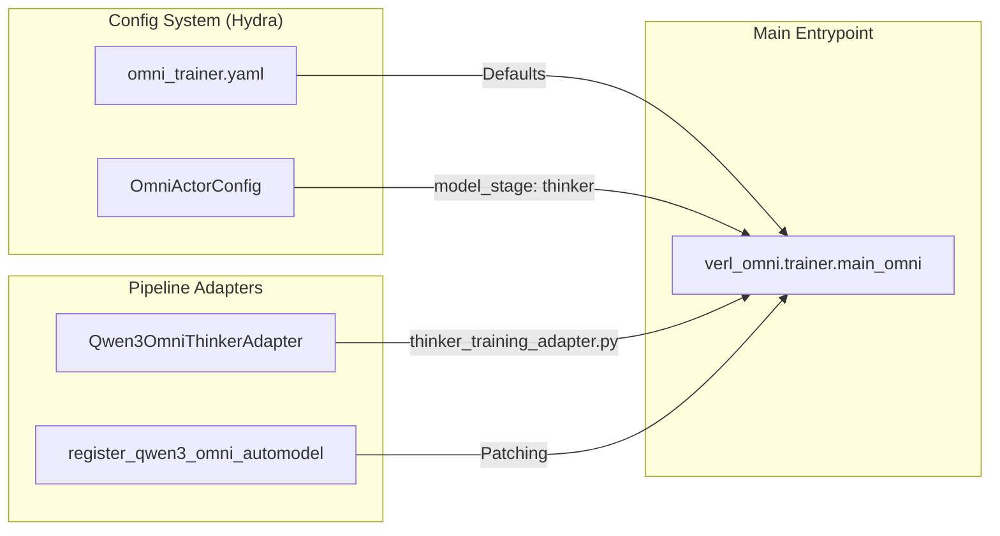
**Sources:** [verl_omni/models/transformers/qwen3_omni_thinker.py:37-52](), [examples/gspo_trainer/README.md:46-51](), [verl_omni/pipelines/qwen3_omni/thinker_training_adapter.py:34-41]().

---

## Training Configuration and Metrics

The GSPO implementation for Qwen3-Omni supports text-only (GSM8K), image-to-text (MMK12), and text+image+audio (AVQA) inputs [examples/gspo_trainer/README.md:5-9]().

### Multimodal Data Preprocessing
For multimodal training, the dataset must be prepared using specialized converters:
*   **MMK12**: Carries image bytes inline in the `images` column and constrains the model via system prompts [examples/gspo_trainer/README.md:152-174]().
*   **AVQA**: Handles joint text, image, and audio inputs for full omni-modal reasoning [examples/gspo_trainer/README.md:18-19]().

### Critical Monitoring Metrics
A healthy GSPO training run for Qwen3-Omni should exhibit specific signals in the logs.

| Metric | Target Value | Description |
| :--- | :--- | :--- |
| `rollout_actor_probs_pearson_corr` | > 0.995 | Primary correctness signal for weight sync between actor and rollout [examples/gspo_trainer/README.md:140-143](). |
| `rollout_corr/log_ppl_diff` | ≈ 0.001 | Confirms log-prob consistency [examples/gspo_trainer/README.md:144-145](). |
| `actor/loss` | ≈ 1e-5 | Typical loss scale for stable GSPO reasoning training [examples/gspo_trainer/README.md:146-147](). |
| `reward_accuracy` | Rising | Accuracy of implicit rewards in DPO loss [verl_omni/trainer/omni/omni_algos.py:163-163](). |

**Sources:** [examples/gspo_trainer/README.md:140-150](), [verl_omni/trainer/omni/omni_algos.py:159-165]().

---

## Implementation Details: V1 Trainer

The Qwen3-Omni pipeline uses the **V1 Trainer** (`verl_omni.trainer.main_omni`), which handles Qwen3-Omni natively without the need for legacy monkey-patches [verl_omni/models/transformers/qwen3_omni_thinker.py:18-21]().

### Registration and Adapter Logic
The `Qwen3OmniThinkerAdapter` class, registered via `@OmniModelBase.register`, implements the core logic for preparing the model for FSDP2 [verl_omni/pipelines/qwen3_omni/thinker_training_adapter.py:34-35]().

*   **Audio RoPE Patch**: The adapter dynamically patches `AgentLoopWorkerTQ._compute_position_ids` to handle raw audio lengths required by Qwen3-Omni's RoPE implementation [verl_omni/pipelines/qwen3_omni/thinker_training_adapter.py:108-148]().
*   **External Modules**: To ensure adapters are active, the environment variable `VERL_USE_EXTERNAL_MODULES=verl_omni` must be set [examples/gspo_trainer/README.md:46-48]().

**Sources:** [verl_omni/pipelines/qwen3_omni/thinker_training_adapter.py:34-148](), [examples/gspo_trainer/README.md:46-51]().

---

# Page: Diffusion On-Policy Distillation (DiffusionOPD)

# Diffusion On-Policy Distillation (DiffusionOPD)

<details>
<summary>Relevant source files</summary>

The following files were used as context for generating this wiki page:

- [docs/algo/diffusion_opd.md](docs/algo/diffusion_opd.md)
- [docs/examples/config.md](docs/examples/config.md)
- [docs/examples/diffusionopd_trainer.md](docs/examples/diffusionopd_trainer.md)
- [examples/diffusionopd_trainer/README.md](examples/diffusionopd_trainer/README.md)
- [examples/diffusionopd_trainer/sd35/run_sd35_medium_ocr_distill.sh](examples/diffusionopd_trainer/sd35/run_sd35_medium_ocr_distill.sh)
- [tests/special_e2e/run_diffusion_teacher_smoke.sh](tests/special_e2e/run_diffusion_teacher_smoke.sh)
- [tests/special_sanity/test_config_docs.py](tests/special_sanity/test_config_docs.py)
- [tests/trainer/diffusion/test_distillation_config_on_cpu.py](tests/trainer/diffusion/test_distillation_config_on_cpu.py)
- [tests/workers/rollout/rollout_vllm/test_zmq_utils.py](tests/workers/rollout/rollout_vllm/test_zmq_utils.py)
- [verl_omni/workers/engine_workers.py](verl_omni/workers/engine_workers.py)
- [verl_omni/workers/rollout/vllm_rollout/utils.py](verl_omni/workers/rollout/vllm_rollout/utils.py)
- [verl_omni/workers/rollout/vllm_rollout/zmq_utils.py](verl_omni/workers/rollout/vllm_rollout/zmq_utils.py)

</details>


Diffusion On-Policy Distillation (DiffusionOPD) is an algorithm designed to improve a student diffusion model by distilling knowledge from a frozen teacher model at states sampled by the student during its own generation process. Unlike offline distillation which uses a static dataset, DiffusionOPD operates on-policy, allowing the student to receive supervision on the specific regions of the state space it actually visits [docs/algo/diffusion_opd.md:7-12]().

## Overview and Purpose

The primary objective of DiffusionOPD is to minimize the KL divergence between the student's transition distribution and the teacher's transition distribution. In VeRL-Omni, this is typically used to transfer capabilities (like OCR quality) from a strong teacher to a student without requiring the student to optimize sparse rewards directly [examples/diffusionopd_trainer/README.md:5-7]().

### Key Features
*   **Dense Supervision**: The student receives continuous guidance at every denoising step rather than a single sparse reward at the end of a trajectory [docs/algo/diffusion_opd.md:11-12]().
*   **Teacher Engine Integration**: A dedicated teacher engine is initialized within the `TrainingWorker` alongside the student (actor) and reference models [verl_omni/workers/engine_workers.py:157-164]().
*   **Coexistence Support**: The teacher and reference models can coexist, allowing for simultaneous task-reward optimization (e.g., FlowGRPO), reference-KL penalties, and teacher distillation [docs/algo/diffusion_opd.md:31-34]().

## System Architecture and Data Flow

DiffusionOPD integrates into the standard `PolicyGradientRayTrainer` loop. When `distillation.enabled` is `True`, the actor workers build a frozen teacher model using the path specified in `distillation.teacher_models.teacher_model.model_path` [verl_omni/workers/config/diffusion/diffusion.py:61-62]().

### Code Entity Relationship
The following diagram bridges the high-level distillation concepts to the specific classes and functions in the codebase.

**DiffusionOPD System Mapping**
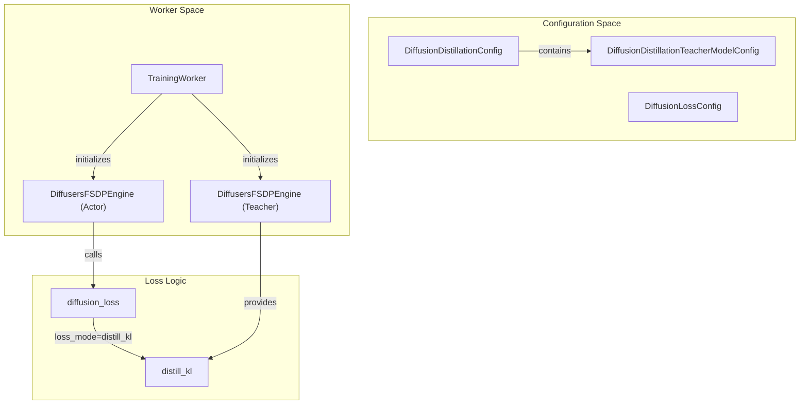
*Sources: [verl_omni/workers/engine_workers.py:157-164](), [verl_omni/workers/config/diffusion/diffusion.py:22-69](), [verl_omni/workers/utils/losses.py:71-71]()*

## Implementation Details

### The Distillation Loss
The core logic resides in the `diffusion_loss` function, which computes the per-step KL divergence between Gaussian transition distributions.

1.  **`distill_kl`**: This mode minimizes the KL divergence between student and teacher transition means. Because both models share the same noise schedule and variance $\sigma_t^2$ (enforced at worker init), the KL reduces to the squared distance between predicted means normalized by variance [docs/algo/diffusion_opd.md:19-25]().
2.  **MSE-based Distillation**: While `distill_kl` is the primary mode, the config supports `distill_fm_mse` for flow-matching MSE distillation [docs/examples/config.md:135-135]().

### Integration in the Training Loop
The distillation loss is added to the total actor loss during the optimization step. It can either be the sole objective or an auxiliary term:

*   **Pure Distillation**: `diffusion_loss.loss_mode=distill_kl`. The student only imitates the teacher [docs/algo/diffusion_opd.md:90-104]().
*   **Combined Objective**: `use_distill_loss=True` with `loss_mode=flow_grpo`. The student optimizes a task reward while staying close to the teacher [docs/algo/diffusion_opd.md:106-125]().

### Sequence of Operations
The data flow for a single distillation-augmented training step is described below:

**DiffusionOPD Data Flow**
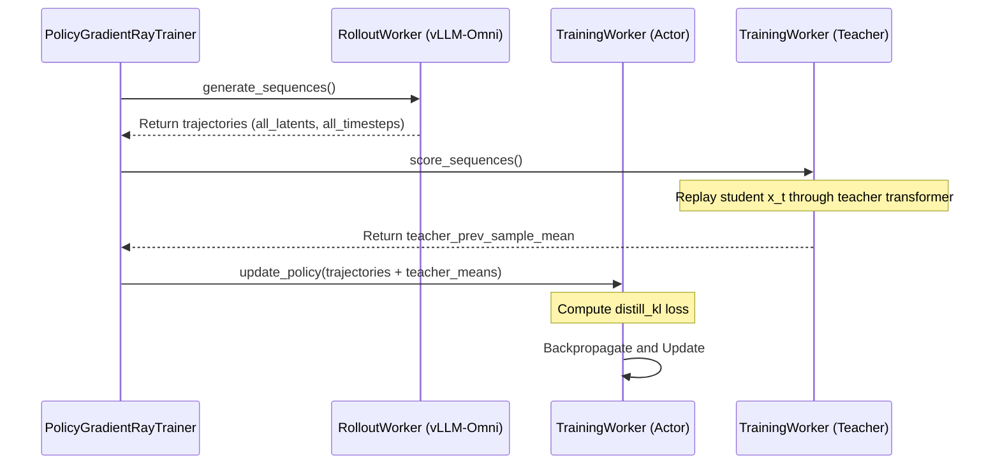
*Sources: [docs/algo/diffusion_opd.md:14-29](), [verl_omni/workers/engine_workers.py:157-164]()*

## Configuration Knobs

Distillation is configured via the `distillation` and `actor_rollout_ref.actor` blocks.

| Parameter | Type | Default | Description |
| :--- | :--- | :--- | :--- |
| `distillation.enabled` | `bool` | `false` | Enables the teacher model runtime [docs/algo/diffusion_opd.md:38-42](). |
| `distillation.teacher_models.teacher_model.model_path` | `str` | `null` | **Required** path to the frozen teacher checkpoint [docs/algo/diffusion_opd.md:44-46](). |
| `actor.diffusion_loss.loss_mode` | `str` | `flow_grpo` | Set to `distill_kl` for pure distillation [docs/examples/config.md:131-131](). |
| `actor.use_distill_loss` | `bool` | `false` | Enables distillation as an auxiliary loss term [docs/examples/config.md:134-134](). |
| `actor.distill_loss_coef` | `float` | `1.0` | Weight for the auxiliary distillation term [docs/examples/config.md:136-136](). |

*Sources: [verl_omni/workers/config/diffusion/diffusion.py:22-69](), [docs/examples/config.md:130-140]()*

## Example: SD3.5 OCR Distillation

A complete recipe is provided in `examples/diffusionopd_trainer/sd35/run_sd35_medium_ocr_distill.sh`. This example distills an OCR-tuned `SD3.5-Medium` teacher into a fresh `SD3.5-Medium` student.

1.  **Teacher**: A pre-trained SD3.5 checkpoint with task-specific (OCR) knowledge merged into the base weights [examples/diffusionopd_trainer/README.md:40-43]().
2.  **Student**: Initialized from the base SD3.5-Medium weights, training with LoRA [examples/diffusionopd_trainer/sd35/run_sd35_medium_ocr_distill.sh:58-60]().
3.  **Reward Monitoring**: The OCR GenRM reward is monitored but not optimized. The student reaches the teacher's performance level purely through the `distill_kl` loss [examples/diffusionopd_trainer/README.md:5-7]().
4.  **Convergence**: Distillation typically converges significantly faster than RL from sparse rewards, with `distill_kl_loss` falling sharply in the first few tens of steps [examples/diffusionopd_trainer/README.md:53-55]().

*Sources: [examples/diffusionopd_trainer/README.md:1-57](), [examples/diffusionopd_trainer/sd35/run_sd35_medium_ocr_distill.sh:1-123]()*

---

# Page: Training Infrastructure

# Training Infrastructure

<details>
<summary>Relevant source files</summary>

The following files were used as context for generating this wiki page:

- [tests/gpu_smoke/run_gpu_smoke_tests.sh](tests/gpu_smoke/run_gpu_smoke_tests.sh)
- [tests/trainer/diffusion/test_dump_generations_video_on_cpu.py](tests/trainer/diffusion/test_dump_generations_video_on_cpu.py)
- [tests/trainer/diffusion/test_val_video_logging_on_cpu.py](tests/trainer/diffusion/test_val_video_logging_on_cpu.py)
- [tests/utils/reward_score/test_reward_utils_on_cpu.py](tests/utils/reward_score/test_reward_utils_on_cpu.py)
- [tests/utils/test_tracking_on_cpu.py](tests/utils/test_tracking_on_cpu.py)
- [tests/workers/test_diffusers_fsdp_engine.py](tests/workers/test_diffusers_fsdp_engine.py)
- [verl_omni/trainer/config/diffusion/model/diffusion_model.yaml](verl_omni/trainer/config/diffusion/model/diffusion_model.yaml)
- [verl_omni/trainer/diffusion/ray_diffusion_trainer.py](verl_omni/trainer/diffusion/ray_diffusion_trainer.py)
- [verl_omni/utils/reward_score/reward_utils.py](verl_omni/utils/reward_score/reward_utils.py)
- [verl_omni/utils/tracking.py](verl_omni/utils/tracking.py)
- [verl_omni/workers/config/diffusion/model.py](verl_omni/workers/config/diffusion/model.py)
- [verl_omni/workers/engine/fsdp/diffusers_impl.py](verl_omni/workers/engine/fsdp/diffusers_impl.py)

</details>


The training infrastructure of `verl-omni` is designed for large-scale, distributed RL training of diffusion and flow-matching models. It leverages **Ray** for orchestration and provides two distinct training backends: a high-performance **FSDP2** engine and the flexible **VeOmni** engine. The system is managed via a hierarchical Hydra-based configuration that coordinates the interaction between the trainer, rollout servers, and reward managers.

## System Overview

The training process is orchestrated by a single controller (the "driver") which manages a topology of Ray workers. The core entrypoint is `main_diffusion`, which initializes the Ray cluster and hands off control to a `TaskRunner`.

### Core Workflow
1.  **Initialization**: `main_diffusion` resolves the Hydra config and initializes Ray [verl_omni/trainer/main_diffusion.py:34-72]().
2.  **Resource Allocation**: The `TaskRunner` creates resource pools and maps roles (Actor, Rollout, Reward) to specific GPU groups [verl_omni/trainer/main_diffusion.py:157-180]().
3.  **Training Loop**: The `BaseRayDiffusionTrainer` (and its subclasses like `PolicyGradientRayTrainer`) manages the iterative loop of rollout, advantage estimation, and gradient updates [verl_omni/trainer/diffusion/ray_diffusion_trainer.py:136-160]().

### Code Entity Relationship
The following diagram maps high-level system components to their primary code entities.

**Infrastructure Topology**
```mermaid
graph TD
    subgraph "Driver Process"
        Main["main_diffusion.py"]
        TR["TaskRunner"]
        Trainer["BaseRayDiffusionTrainer"]
    end

    subgraph "Ray Worker Groups"
        EngineWorker["ActorRolloutRefWorker"]
        RolloutWorker["DiffusionAgentLoopWorker"]
        RewardWorker["VisualRewardManager"]
    end

    Main --> TR
    TR --> Trainer
    Trainer --> EngineWorker
    Trainer --> RolloutWorker
    Trainer --> RewardWorker
    
    EngineWorker -- "Engine Dispatch" --> Model["DiffusionModelBase"]
```
Sources: [verl_omni/trainer/main_diffusion.py:114-155](), [verl_omni/trainer/diffusion/ray_diffusion_trainer.py:136-164](), [verl_omni/pipelines/model_base.py:27-58]().

## Key Components

### 1. Ray Trainer and Training Loop
The `BaseRayDiffusionTrainer` provides the infrastructure for distributed weight synchronization and checkpointing. Subclasses like `PolicyGradientRayTrainer` (used for Flow-GRPO) and `DirectPreferenceRayTrainer` (used for DPO/NFT) implement the specific logic for processing data through the training engines.

*   **Weight Sync**: Uses `CheckpointEngineManager` to broadcast model weights from the training engine to the rollout servers [verl_omni/trainer/diffusion/ray_diffusion_trainer.py:37-37]().
*   **Advantage Estimation**: Computes rewards and advantages across denoising timesteps using `compute_advantage` [verl_omni/trainer/diffusion/ray_diffusion_trainer.py:86-133]().
*   **Training Paradigms**: Supports both online RL (live rollouts) and offline preference training via `algorithm.sample_source` [verl_omni/trainer/main_diffusion.py:144-151]().

For details, see [Ray Trainer and Training Loop](#3.1).

### 2. FSDP2 Training Engine
The default backend for most models is the `DiffusersFSDPEngine` [verl_omni/workers/engine/fsdp/diffusers_impl.py:78-82](). It is optimized for Hugging Face `diffusers` models and supports:
*   **Meta-tensor initialization**: Handled via `init_device: meta` to manage massive models without OOM on the head node [verl_omni/trainer/config/_generated_diffusion_trainer.yaml:27-39]().
*   **Ulysses Sequence Parallelism**: Configurable via `ulysses_sequence_parallel_size` for training on high-resolution images or long sequences [verl_omni/workers/engine/fsdp/diffusers_impl.py:171-190]().
*   **LoRA Management**: Native support for LoRA adapters during RL via `LoRAAdapterMixin`, enabling reference policy computation within the same worker [verl_omni/workers/engine/fsdp/diffusers_impl.py:70-78]().

For details, see [FSDP2 Training Engine](#3.2).

### 3. VeOmni Training Engine
The `VeOmni` engine is an alternative backend that provides advanced memory management features. It is configured via `VeOmniDiffusionEngineConfig` [verl_omni/trainer/config/_generated_diffusion_veomni_trainer.yaml:26-56]().
*   **Offloading**: Supports parameter and optimizer offloading to CPU to increase effective batch size [verl_omni/trainer/config/_generated_diffusion_veomni_trainer.yaml:28-29]().
*   **Resharding**: Configurable `reshard_after_forward` to balance memory usage and communication overhead during the backward pass [verl_omni/trainer/config/_generated_diffusion_veomni_trainer.yaml:34-34]().

For details, see [VeOmni Training Engine](#3.3).

### 4. Configuration System
The system uses Hydra to manage a complex hierarchy of configurations covering models, algorithms, and infrastructure. Configurations are resolved and validated at runtime [verl_omni/trainer/main_diffusion.py:41-46]().

**Configuration Hierarchy**
```mermaid
graph BT
    Actor["FSDPDiffusionActorConfig"] --> Root["diffusion_trainer.yaml"]
    Rollout["DiffusionRolloutConfig"] --> Root
    Model["DiffusionModelConfig"] --> Root
    Loss["DiffusionLossConfig"] --> Root
    
    Root -- "actor_rollout_ref.actor.fsdp_config" --> Strategy["FSDPEngineConfig"]
```
Sources: [verl_omni/workers/config/diffusion/model.py:38-123](), [verl_omni/trainer/config/_generated_diffusion_trainer.yaml:6-73](), [verl_omni/trainer/config/_generated_diffusion_veomni_trainer.yaml:6-85]().

For details, see [Configuration System](#3.4).

## Main Entrypoint
The `main_diffusion.py` script is the unified entrypoint. It performs critical environment checks, such as verifying that the attention backend (e.g., Flash Attention 3) is consistent between the actor and the rollout workers [verl_omni/trainer/main_diffusion.py:34-46]().

```bash
# Example execution via main_diffusion for FlowGRPO
python3 -m verl_omni.trainer.main_diffusion \
    algorithm.trainer_type=policy_gradient \
    actor_rollout_ref.actor.strategy=fsdp \
    trainer.n_gpus_per_node=8
```
Sources: [verl_omni/trainer/main_diffusion.py:102-111]().

## Performance and Observability
The infrastructure reuses the `verl.utils.profiler` subsystem to support end-to-end tracing across Ray workers.

*   **Profiling Tools**: Supports `nsys` (Nsight Systems), `torch` (PyTorch Profiler), and `torch_memory` via the `ProfilerConfig` [verl_omni/trainer/config/_generated_diffusion_trainer.yaml:45-66]().
*   **Metrics**: Training throughput, timing metrics, and reward-specific metrics are computed per step to monitor scaling efficiency [verl_omni/trainer/diffusion/ray_diffusion_trainer.py:62-68]().
*   **Media Logging**: Supports logging video (MP4) and audio (WAV) media to WandB during validation using `wrap_val_samples_for_wandb` [verl_omni/utils/tracking.py:136-172]().
*   **Video Conversion**: Uses `video_tensor_to_pil_frames` to convert RGB uint8 tensors for export [verl_omni/utils/reward_score/reward_utils.py:24-36]().

Sources: [verl_omni/trainer/main_diffusion.py:87-90](), [verl_omni/trainer/diffusion/ray_diffusion_trainer.py:47-51](), [verl_omni/utils/tracking.py:74-134]().

---

# Page: Ray Trainer and Training Loop

# Ray Trainer and Training Loop

<details>
<summary>Relevant source files</summary>

The following files were used as context for generating this wiki page:

- [docs/start/diffusion_v1.md](docs/start/diffusion_v1.md)
- [examples/flowgrpo_trainer/sd35/run_sd35_medium_drm_lora.sh](examples/flowgrpo_trainer/sd35/run_sd35_medium_drm_lora.sh)
- [examples/flowgrpo_trainer/sd35/run_sd35_medium_ocr_lora.sh](examples/flowgrpo_trainer/sd35/run_sd35_medium_ocr_lora.sh)
- [examples/flowgrpo_trainer/sd35/run_sd35_medium_ocr_lora_v1.sh](examples/flowgrpo_trainer/sd35/run_sd35_medium_ocr_lora_v1.sh)
- [examples/flowgrpo_trainer/sd35/run_sd35_medium_ocr_lora_v1_separate_async.sh](examples/flowgrpo_trainer/sd35/run_sd35_medium_ocr_lora_v1_separate_async.sh)
- [tests/agent_loop/test_diffusion_agent_loop_correctness_on_cpu.py](tests/agent_loop/test_diffusion_agent_loop_correctness_on_cpu.py)
- [tests/pipelines/test_sd3_token_id_prompt_on_cpu.py](tests/pipelines/test_sd3_token_id_prompt_on_cpu.py)
- [tests/trainer/diffusion/test_dump_generations_video_on_cpu.py](tests/trainer/diffusion/test_dump_generations_video_on_cpu.py)
- [tests/trainer/diffusion/test_v1_replay_buffer_on_cpu.py](tests/trainer/diffusion/test_v1_replay_buffer_on_cpu.py)
- [tests/trainer/diffusion/test_val_video_logging_on_cpu.py](tests/trainer/diffusion/test_val_video_logging_on_cpu.py)
- [tests/utils/reward_score/test_reward_utils_on_cpu.py](tests/utils/reward_score/test_reward_utils_on_cpu.py)
- [tests/utils/test_tracking_on_cpu.py](tests/utils/test_tracking_on_cpu.py)
- [verl_omni/agent_loop/diffusion_agent_loop_tq.py](verl_omni/agent_loop/diffusion_agent_loop_tq.py)
- [verl_omni/trainer/config/diffusion_trainer.yaml](verl_omni/trainer/config/diffusion_trainer.yaml)
- [verl_omni/trainer/diffusion/ray_diffusion_trainer.py](verl_omni/trainer/diffusion/ray_diffusion_trainer.py)
- [verl_omni/trainer/diffusion/v1/__init__.py](verl_omni/trainer/diffusion/v1/__init__.py)
- [verl_omni/trainer/diffusion/v1/trainer_base.py](verl_omni/trainer/diffusion/v1/trainer_base.py)
- [verl_omni/utils/reward_score/reward_utils.py](verl_omni/utils/reward_score/reward_utils.py)
- [verl_omni/utils/tracking.py](verl_omni/utils/tracking.py)

</details>


The Ray-based training infrastructure in VeRL-Omni orchestrates distributed RL training for diffusion and flow-matching models. It manages the coordination between training engines (FSDP2/VeOmni), rollout workers (vLLM-Omni), and reward managers. The system is designed around a single controller pattern where a central trainer drives the RL lifecycle across a Ray cluster.

## Architecture Overview

The training loop is implemented via a hierarchy of trainers:
*   `BaseRayDiffusionTrainer`: Provides common infrastructure for worker initialization, validation, checkpointing, and logging [verl_omni/trainer/diffusion/ray_diffusion_trainer.py:136-164]().
*   `PolicyGradientRayTrainer`: Implements the `fit()` loop for policy gradient algorithms like FlowGRPO, MixGRPO, and DanceGRPO [verl_omni/trainer/diffusion/ray_diffusion_trainer.py:348-350]().
*   `DirectPreferenceRayTrainer`: Implements the `fit()` loop for preference-based algorithms like DiffusionNFT and DPO [verl_omni/trainer/diffusion/ray_diffusion_trainer.py:683-685]().
*   `PolicyGradientDiffusionTrainerV1`: A base class for V1 trainers using `TransferQueue` and `ReplayBuffer` to decouple rollout from training [verl_omni/trainer/diffusion/v1/trainer_base.py:104-112]().

### System Entity Mapping

The following diagram maps the conceptual RL components to their implementation entities in the codebase.

**Diagram: System Entity Mapping**
```mermaid
graph TD
    subgraph "Control_Plane_(Driver_Process)"
        ["main_diffusion_v1.py / main_diffusion.py"]
        ["PolicyGradientRayTrainer / DirectPreferenceRayTrainer"]
        ["PolicyGradientDiffusionTrainerV1"]
    end

    subgraph "Execution_Plane_(Ray_Worker_Groups)"
        ["ActorRolloutRefWorker"]
        ["vLLMOmniHttpServer"]
        ["AgentLoopManager / DiffusionAgentLoopWorker"]
        ["DiffusionAgentLoopWorkerTQ"]
        ["VisualRewardManager / MultiVisualRewardManager"]
    end

    subgraph "Data_Transport"
        ["transfer_queue"]
        ["ReplayBuffer"]
    end

    ["main_diffusion_v1.py / main_diffusion.py"] -->|Instantiates| ["PolicyGradientRayTrainer / DirectPreferenceRayTrainer"]
    ["main_diffusion_v1.py / main_diffusion.py"] -->|Instantiates| ["PolicyGradientDiffusionTrainerV1"]
    ["PolicyGradientRayTrainer / DirectPreferenceRayTrainer"] -->|Orchestrates| ["ActorRolloutRefWorker"]
    ["PolicyGradientRayTrainer / DirectPreferenceRayTrainer"] -->|Coordinates| ["AgentLoopManager / DiffusionAgentLoopWorker"]
    ["PolicyGradientDiffusionTrainerV1"] -->|Coordinates| ["DiffusionAgentLoopWorkerTQ"]
    ["DiffusionAgentLoopWorkerTQ"] -->|Writes_Trajectories| ["transfer_queue"]
    ["transfer_queue"] -->|Feeds| ["ReplayBuffer"]
    ["ReplayBuffer"] -->|Samples_to| ["PolicyGradientDiffusionTrainerV1"]
    ["AgentLoopManager / DiffusionAgentLoopWorker"] -->|Requests_Generations| ["vLLMOmniHttpServer"]
    ["AgentLoopManager / DiffusionAgentLoopWorker"] -->|Requests_Scores| ["VisualRewardManager / MultiVisualRewardManager"]
```

Sources: [verl_omni/trainer/diffusion/ray_diffusion_trainer.py:136-164](), [verl_omni/trainer/diffusion/v1/trainer_base.py:104-129](), [verl_omni/trainer/diffusion/v1/trainer_base.py:75](), [examples/flowgrpo_trainer/sd35/run_sd35_medium_ocr_lora_v1.sh:44]()

## The Training Loop (`fit`)

The `fit()` method represents the core RL execution loop. It iterates through epochs and steps, performing rollout, advantage estimation, and model updates.

### Execution Flow
1.  **Rollout Generation**: The trainer triggers `self.agent_loop_manager.generate_sequences()` which coordinates with vLLM-Omni [verl_omni/trainer/diffusion/ray_diffusion_trainer.py:416-435]().
2.  **Reward Integration**: Rewards are extracted from the rollout data via `extract_reward` [verl_omni/trainer/diffusion/ray_diffusion_trainer.py:44, 440-455]().
3.  **Advantage Estimation**: For policy gradients, `compute_advantage` calculates returns and advantages (e.g., Flow-GRPO) using the registered `adv_estimator_fn` [verl_omni/trainer/diffusion/ray_diffusion_trainer.py:86-133]().
4.  **Rollout Correction**: If enabled, Importance Sampling or Rejection Sampling is applied to the batch via `apply_rollout_correction_to_diffusion_batch` [verl_omni/trainer/diffusion/ray_diffusion_trainer.py:74-79, 465-475]().
5.  **Weight Update**: The trainer calls `actor_rollout_group.update_policy()` to perform backpropagation on the training engine [verl_omni/trainer/diffusion/ray_diffusion_trainer.py:489-495]().
6.  **Synchronization**: Weights are synchronized to the rollout servers via `self.checkpoint_manager.update_weights()` [verl_omni/trainer/diffusion/ray_diffusion_trainer.py:513-520]().

**Diagram: Diffusion RL Training Loop**
```mermaid
sequenceDiagram
    participant T as "PolicyGradientRayTrainer (Driver)"
    participant A as "AgentLoopManager"
    participant V as "vLLMOmniHttpServer"
    participant E as "ActorRolloutRefWorker (Training Engine)"
    participant C as "CheckpointEngineManager"

    loop Every Step
        T->>A: "generate_sequences(batch)"
        A->>V: "Diffusion Rollout (SDE/ODE)"
        V-->>A: "DataProto (Rollout)"
        A-->>T: "DataProto"
        T->>T: "compute_advantage()"
        T->>E: "update_policy(DataProto)"
        E-->>T: "Metrics (Loss, GradNorm)"
        T->>C: "update_weights()"
        C->>V: "Sync Weights (LoRA/Full)"
    end
```

Sources: [verl_omni/trainer/diffusion/ray_diffusion_trainer.py:86-133](), [verl_omni/trainer/diffusion/ray_diffusion_trainer.py:416-520](), [verl_omni/trainer/diffusion/ray_diffusion_trainer.py:42-79]()

## V1 Trainer: TransferQueue and ReplayBuffer

The V1 trainer infrastructure (`PolicyGradientDiffusionTrainerV1`) mirrors the lifecycle of standard RL pipelines by decoupling rollout generation from training via a buffer [verl_omni/trainer/diffusion/v1/trainer_base.py:104-120]().

*   **TransferQueue (TQ)**: A high-performance transport layer used to move trajectories from workers to the trainer [verl_omni/trainer/diffusion/v1/trainer_base.py:28, 71]().
*   **ReplayBuffer**: Collects samples from TQ and manages off-policy thresholds and sampling strategies [verl_omni/trainer/diffusion/v1/trainer_base.py:119, 130-145]().
*   **Synchronous Mode**: In `sync` mode, the trainer waits for a full rollout batch before training [verl_omni/trainer/diffusion/v1/trainer_base.py:134-135]().
*   **Data Conversion**: `diffusion_tq_batch_to_dataproto` converts raw TQ rows into the `DataProto` format required by the diffusion compute path [verl_omni/trainer/diffusion/v1/tq_utils.py:91-143]().
*   **Rollout Failure Handling**: The V1 sampler supports `drop_incomplete_groups`, which evicts prompt groups if rollout sessions fail and refills them to maintain exact batch sizes [verl_omni/trainer/diffusion/v1/trainer_base.py:132-137]().
*   **Separate Async Mode**: In `separate_async` mode, a standalone rollout manager serves generation traffic on dedicated GPUs while colocated actor/rollout replicas sleep during training [examples/flowgrpo_trainer/sd35/run_sd35_medium_ocr_lora_v1_separate_async.sh:1-11]().

Sources: [verl_omni/trainer/diffusion/v1/trainer_base.py:104-145](), [verl_omni/trainer/diffusion/v1/tq_utils.py:91-143](), [examples/flowgrpo_trainer/sd35/run_sd35_medium_ocr_lora_v1_separate_async.sh:1-11]()

## Weight Synchronization and Checkpointing

Weight synchronization bridges the gap between the training engine and the vLLM rollout server.

### CheckpointEngineManager
The trainer uses the `CheckpointEngineManager` to manage model state across the cluster [verl_omni/trainer/diffusion/ray_diffusion_trainer.py:37](). 
*   **Weight Sync**: `self.checkpoint_manager.update_weights()` is called to push updated parameters (LoRA or full) to the rollout actors [verl_omni/trainer/diffusion/ray_diffusion_trainer.py:513-520]().
*   **Old Policy Management**: For preference algorithms, the trainer manages `old_policy` synchronization and decay via `old_policy_decay` [verl_omni/trainer/diffusion/ray_diffusion_trainer.py:71, 786-791]().

### ESI (Elastic State Interface)
The trainer supports saving and loading Elastic State Interface (ESI) checkpoints for seamless resumption [verl_omni/trainer/diffusion/ray_diffusion_trainer.py:47, 175-176]().
*   **Stateful Dataloader**: `StatefulDataLoader` is used to track dataset position across restarts [verl_omni/trainer/diffusion/ray_diffusion_trainer.py:34, 284-290]().
*   **ESI Logic**: `should_save_ckpt_esi` determines if an ESI checkpoint should be triggered based on time remaining and historical step duration [verl_omni/trainer/diffusion/ray_diffusion_trainer.py:47, 532-535]().

Sources: [verl_omni/trainer/diffusion/ray_diffusion_trainer.py:34-47](), [verl_omni/trainer/diffusion/ray_diffusion_trainer.py:513-535](), [verl_omni/trainer/diffusion/ray_diffusion_trainer.py:786-791](), [verl_omni/trainer/config/diffusion_trainer.yaml:173-187]()

## Advantage and Loss Computation

The trainer abstracts algorithm-specific logic into separate modules while maintaining a unified interface in the loop.

| Function / Class | Role | Source |
| :--- | :--- | :--- |
| `compute_advantage` | Orchestrates advantage and return calculation using `get_diffusion_adv_estimator_fn`. | [verl_omni/trainer/diffusion/ray_diffusion_trainer.py:86-133]() |
| `get_diffusion_loss_fn` | Retrieves the loss function (e.g., Flow-GRPO) based on config. | [verl_omni/trainer/diffusion/ray_diffusion_trainer.py:60]() |
| `apply_rollout_correction` | Adjusts batch data based on Importance Sampling or Rejection Sampling. | [verl_omni/trainer/diffusion/ray_diffusion_trainer.py:74-79]() |
| `old_policy_decay` | Computes the EMA decay for the old policy adapter in NFT. | [verl_omni/trainer/diffusion/ray_diffusion_trainer.py:71]() |

Sources: [verl_omni/trainer/diffusion/ray_diffusion_trainer.py:60-133](), [verl_omni/trainer/diffusion/ray_diffusion_trainer.py:74-79]()

## Worker Initialization

Distributed workers are instantiated via Ray worker groups, mapping logical roles to physical resource pools.

*   **ActorRolloutRefWorker**: A unified worker class that can act as the training engine, rollout coordinator, or reference policy [verl_omni/workers/engine_workers.py]() (referenced in [verl_omni/trainer/diffusion/v1/trainer_base.py:75]()).
*   **Resource Management**: `ResourcePoolManager` allocates GPU resources for the global training pool and dedicated reward pools [verl_omni/trainer/diffusion/ray_diffusion_trainer.py:40, 148]().
*   **Validation Logging**: `ValidationGenerationsLogger` manages the logging of media (images/videos) to tracking backends like WandB [verl_omni/trainer/diffusion/ray_diffusion_trainer.py:53, 206-209](). Video outputs are encoded to mp4 via `_export_video` and logged as `wandb.Video` [verl_omni/utils/tracking.py:74-134, 136-172]().

Sources: [verl_omni/trainer/diffusion/v1/trainer_base.py:75](), [verl_omni/trainer/diffusion/ray_diffusion_trainer.py:40, 148](), [verl_omni/trainer/diffusion/ray_diffusion_trainer.py:53, 206-209](), [verl_omni/utils/tracking.py:74-172]()

---

# Page: FSDP2 Training Engine

# FSDP2 Training Engine

<details>
<summary>Relevant source files</summary>

The following files were used as context for generating this wiki page:

- [tests/gpu_smoke/run_gpu_smoke_tests.sh](tests/gpu_smoke/run_gpu_smoke_tests.sh)
- [tests/workers/test_diffusers_fsdp_engine.py](tests/workers/test_diffusers_fsdp_engine.py)
- [tests/workers/test_diffusers_ulysses.py](tests/workers/test_diffusers_ulysses.py)
- [verl_omni/models/__init__.py](verl_omni/models/__init__.py)
- [verl_omni/models/diffusers/__init__.py](verl_omni/models/diffusers/__init__.py)
- [verl_omni/models/diffusers/flash_attention_3.py](verl_omni/models/diffusers/flash_attention_3.py)
- [verl_omni/models/diffusers/qwen_image.py](verl_omni/models/diffusers/qwen_image.py)
- [verl_omni/trainer/config/diffusion/model/diffusion_model.yaml](verl_omni/trainer/config/diffusion/model/diffusion_model.yaml)
- [verl_omni/utils/fsdp_utils.py](verl_omni/utils/fsdp_utils.py)
- [verl_omni/workers/config/diffusion/model.py](verl_omni/workers/config/diffusion/model.py)
- [verl_omni/workers/engine/__init__.py](verl_omni/workers/engine/__init__.py)
- [verl_omni/workers/engine/fsdp/__init__.py](verl_omni/workers/engine/fsdp/__init__.py)
- [verl_omni/workers/engine/fsdp/diffusers_impl.py](verl_omni/workers/engine/fsdp/diffusers_impl.py)

</details>


The FSDP2 Training Engine in VeRL-Omni is centered around the `DiffusersFSDPEngine`, which provides a high-performance distributed training backend for Diffusion Transformers (DiTs). It leverages PyTorch's FullyShardedDataParallel (FSDP) to enable large-scale training of models like Qwen-Image, SD3.5, and Wan2.2.

The engine handles the complexities of model sharding, sequence parallelism (Ulysses), LoRA adapter management, and efficient memory offloading while maintaining a unified interface for various RL algorithms (PPO, DPO, NFT).

## Engine Architecture and Initialization

The `DiffusersFSDPEngine` serves as the abstract base class that implements the `BaseEngine` interface [verl_omni/workers/engine/fsdp/diffusers_impl.py:78-79](). It is designed to work with models loaded via the `diffusers` library but optimized for RL workloads.

### Model Construction with Meta-Tensors
To avoid Out-Of-Memory (OOM) issues during initialization of massive models, the engine uses **meta-tensor initialization**. The model is first instantiated on the `meta` device, and parameters are materialized only when needed during FSDP wrapping. This is facilitated by the `get_init_weight_context_manager` and `init_fn` utilities [verl_omni/workers/engine/fsdp/diffusers_impl.py:45-46]().

### FSDP1 vs FSDP2 Wrapping
The engine supports both FSDP1 (legacy `FullyShardedDataParallel`) and FSDP2 (`torch.distributed._composable.fsdp`). FSDP2 is preferred for newer PyTorch versions due to better integration with `torch.compile` and more flexible sharding strategies. The wrapping logic is abstracted behind `apply_fsdp2` and `get_fsdp_wrap_policy` [verl_omni/workers/engine/fsdp/diffusers_impl.py:36-44](). The sharding strategy is determined via `get_sharding_strategy` [verl_omni/workers/engine/fsdp/utils.py:57-57]().

### Sequence Parallelism (Ulysses)
For high-resolution image or video generation, sequence length can exceed the memory capacity of a single GPU. The engine implements **Ulysses Sequence Parallelism**, which partitions the sequence dimension across a dedicated sub-group of the device mesh.

- **Device Mesh**: The engine initializes a 3D device mesh with dimensions `["dp", "ring", "ulysses"]` [verl_omni/workers/engine/fsdp/diffusers_impl.py:184-188]().
- **Attention Backends**: The engine supports `_flash_3_varlen_hub` and other backends to handle non-contiguous attention masks common in multimodal joint attention [verl_omni/workers/config/diffusion/model.py:87-87]().
- **Compatibility**: Ulysses sequence parallelism requires `diffusers >= 0.38.0` [verl_omni/workers/engine/fsdp/diffusers_impl.py:177-180]().
- **Mask Fixes**: Multimodal models like Qwen-Image require specific attention mask patches when using Ulysses to handle interleaved text/image tokens [verl_omni/models/diffusers/qwen_image.py:24-34]().

**Sources:**
- `verl_omni/workers/engine/fsdp/diffusers_impl.py:78-192`()
- `verl_omni/workers/config/diffusion/model.py:38-123`()
- `verl_omni/models/diffusers/qwen_image.py:24-88`()

## Implementation Details

The following diagram illustrates the relationship between the Training Engine, the Pipeline Adapters, and the underlying FSDP infrastructure.

### Engine Entity Map
Title: "Engine Entity and Data Flow"
```mermaid
graph TD
    subgraph "TrainingWorker Context"
        TW["TrainingWorker"] -- "calls" --> PE["PPODiffusersFSDPEngine"]
    end

    subgraph "FSDP Engine Layer"
        PE -- "inherits" --> DFE["DiffusersFSDPEngine"]
        DFE -- "uses" --> LAM["LoRAAdapterMixin"]
        DFE -- "manages" --> CM["FSDPCheckpointManager"]
    end

    subgraph "Model & Pipeline Layer"
        PE -- "calls" --> DMB["DiffusionModelBase subclass"]
        DMB -- "prepares" --> MI["prepare_model_inputs"]
        DMB -- "executes" --> FS["forward_and_sample_previous_step"]
    end

    subgraph "Distributed Infrastructure"
        DFE -- "configures" --> DM["DeviceMesh [dp, ring, ulysses]"]
        DFE -- "applies" --> FSDP["torch.distributed.fsdp.FullyShardedDataParallel"]
    end

    MI -- "returns" --> PE
    FS -- "returns" --> PE
```
**Sources:**
- `verl_omni/workers/engine_workers.py:31-31`()
- `verl_omni/workers/engine/fsdp/diffusers_impl.py:78-82`()
- `verl_omni/workers/engine/fsdp/diffusers_impl.py:145-152`()
- `verl_omni/pipelines/model_base.py:60-60`()

## LoRA Adapter Management

The engine provides robust support for Parameter-Efficient Fine-Tuning (PEFT) via the `LoRAAdapterMixin` [verl_omni/workers/engine/lora_adapter_mixin.py:26](). This is critical for RL algorithms like PPO or DPO that often maintain multiple versions of the policy (e.g., "active" and "old/reference").

| Feature | Implementation |
| :--- | :--- |
| **Layered Summon** | `fsdp_summon_full_params` context manager gathers sharded LoRA weights across the mesh for synchronization [verl_omni/utils/fsdp_utils.py:62-83](). |
| **EMA Updates** | `ema_update_adapter` allows updating a reference adapter (e.g., a target network) using Exponential Moving Average [verl_omni/workers/engine/lora_adapter_mixin.py:148-152](). |
| **Switching** | `use_adapter` and `_set_adapter` allow hot-swapping active LoRA ranks during training or evaluation [verl_omni/workers/engine/lora_adapter_mixin.py:105-127](). |
| **Param Collection** | `collect_lora_params` provides FSDP-aware parameter gathering for weight synchronization between actor and rollout workers [verl_omni/utils/fsdp_utils.py:29-34](). |

The engine supports collecting parameters from specific named adapters. For FSDP2, it iterates through submodules using `_iter_fsdp2_submodules` to summon full parameters before extraction [verl_omni/utils/fsdp_utils.py:54-59](). It also handles specialized modules like Fused MoE experts via `split_fused_moe_lora_targets` [verl_omni/utils/fsdp_utils.py:122-125]().

**Sources:**
- `verl_omni/workers/engine/lora_adapter_mixin.py:26-152`()
- `verl_omni/utils/fsdp_utils.py:29-148`()
- `verl_omni/workers/engine/fsdp/diffusers_impl.py:118-118`()

## Engine Variants (PPO/DPO/NFT)

While `DiffusersFSDPEngine` handles infrastructure, concrete subclasses implement algorithm-specific logic [verl_omni/workers/engine/fsdp/__init__.py:14-19]():

1.  **PPODiffusersFSDPEngine**: Concrete engine registered for FlowGRPO-style training. It computes log-probabilities for the denoising trajectory and handles advantage-weighted losses.
2.  **DPODiffusersFSDPEngine**: Specialized for Direct Preference Optimization. It manages chosen/rejected pair forward passes and computes the implicit reward based on the log-ratio of the current and reference policies.
3.  **NFTDiffusersFSDPEngine**: Used for Diffusion-NFT (No-Fine-Tuning/Direct Process Optimization), focusing on forward-process updates.

### PPO Training Step Logic
Title: "PPO Forward/Backward Lifecycle"
```mermaid
sequenceDiagram
    participant T as TrainingWorker
    participant E as PPODiffusersFSDPEngine
    participant A as DiffusionModelBase (Adapter)
    participant S as FlowMatchSDEDiscreteScheduler

    T->>E: forward_backward_batch(micro_batch)
    E->>A: prepare_model_inputs(latents, timesteps, prompt_embeds)
    A-->>E: model_kwargs
    E->>E: module(**model_kwargs) -> model_output
    E->>A: forward_and_sample_previous_step(model_output, latents, ...)
    A->>S: sample_previous_step(...)
    S-->>A: prev_sample, log_prob
    A-->>E: log_probs
    E->>E: compute diffusion_loss
    E->>E: loss.backward()
```
**Sources:**
- `verl_omni/workers/engine/fsdp/diffusers_impl.py:61-67`()
- `verl_omni/pipelines/model_base.py:60-60`()
- `verl_omni/workers/utils/losses.py:32-33`()

## CPU Offloading and Memory Management

To support large models on limited VRAM, the engine implements several memory optimization strategies:

- **Param/Optimizer Offloading**: Parameters and optimizer states can be offloaded to CPU when not in use. Controlled via `engine_config.param_offload` and `engine_config.optimizer_offload` [verl_omni/workers/engine/fsdp/diffusers_impl.py:116-117]().
- **Aggressive Cache Clearing**: The engine calls `aggressive_empty_cache()` at key boundaries (e.g., after offloading or large sharding operations) [verl_omni/workers/engine/fsdp/diffusers_impl.py:52-52]().
- **Mixed Precision**: Uses `MixedPrecisionPolicy` to cast weights and activations during the forward pass while maintaining master weights in the configured optimizer dtype [verl_omni/workers/engine/fsdp/diffusers_impl.py:39-39]().

**Sources:**
- `verl_omni/workers/engine/fsdp/diffusers_impl.py:154-161`()
- `verl_omni/workers/config/diffusion/model.py:114-114`()
- `verl_omni/workers/config/diffusion/rollout.py:30-31`()

---

# Page: VeOmni Training Engine

# VeOmni Training Engine

<details>
<summary>Relevant source files</summary>

The following files were used as context for generating this wiki page:

- [docs/algo/grpo_guard.md](docs/algo/grpo_guard.md)
- [tests/agent_loop/test_diffusion_agent_loop.py](tests/agent_loop/test_diffusion_agent_loop.py)
- [tests/trainer/diffusion/test_diffusion_core_algos_on_cpu.py](tests/trainer/diffusion/test_diffusion_core_algos_on_cpu.py)
- [tests/trainer/diffusion/test_diffusion_distillation_losses_on_cpu.py](tests/trainer/diffusion/test_diffusion_distillation_losses_on_cpu.py)
- [tests/trainer/diffusion/test_diffusion_registry_on_cpu.py](tests/trainer/diffusion/test_diffusion_registry_on_cpu.py)
- [tests/workers/config/test_diffusion_config_on_cpu.py](tests/workers/config/test_diffusion_config_on_cpu.py)
- [verl_omni/agent_loop/diffusion_agent_loop.py](verl_omni/agent_loop/diffusion_agent_loop.py)
- [verl_omni/pipelines/schedulers/flow_match_sde.py](verl_omni/pipelines/schedulers/flow_match_sde.py)
- [verl_omni/trainer/config/_generated_diffusion_trainer.yaml](verl_omni/trainer/config/_generated_diffusion_trainer.yaml)
- [verl_omni/trainer/config/_generated_diffusion_veomni_trainer.yaml](verl_omni/trainer/config/_generated_diffusion_veomni_trainer.yaml)
- [verl_omni/trainer/config/diffusion/actor/diffusion_actor.yaml](verl_omni/trainer/config/diffusion/actor/diffusion_actor.yaml)
- [verl_omni/trainer/config/diffusion/rollout/diffusion_rollout.yaml](verl_omni/trainer/config/diffusion/rollout/diffusion_rollout.yaml)
- [verl_omni/trainer/diffusion/diffusion_algos.py](verl_omni/trainer/diffusion/diffusion_algos.py)
- [verl_omni/workers/config/diffusion/actor.py](verl_omni/workers/config/diffusion/actor.py)
- [verl_omni/workers/config/diffusion/rollout.py](verl_omni/workers/config/diffusion/rollout.py)
- [verl_omni/workers/engine/veomni/diffusion_impl.py](verl_omni/workers/engine/veomni/diffusion_impl.py)
- [verl_omni/workers/utils/losses.py](verl_omni/workers/utils/losses.py)

</details>


The VeOmni Training Engine is a specialized alternative training backend for diffusion models within the VeRL-Omni framework. While the default engine leverages standard FSDP2 through `DiffusersFSDPEngine`, the VeOmni engine utilizes the `veomni` library to provide advanced distributed training features such as optimized parameter and optimizer offloading, fine-grained FSDP2 sharding control, and specialized kernel implementations for diffusion transformers (DiTs).

## Overview and Purpose

The `VeOmniDiffusionEngine` (referenced as the implementation of the `veomni` strategy) is designed for large-scale diffusion model training where memory efficiency and throughput are critical. It serves as a drop-in replacement for the FSDP2 engine when configured via the `strategy: veomni` flag [verl_omni/trainer/config/_generated_diffusion_veomni_trainer.yaml:45,81](). It is particularly optimized for models like Qwen-Image and BAGEL, providing a robust infrastructure for Flow-Matching Policy Gradient (FlowGRPO) and other RL-based diffusion algorithms.

### Key Capabilities
*   **FSDP2 Integration:** Native support for PyTorch FSDP2 with configurable sharding groups (`fsdp_size`) [verl_omni/workers/config/diffusion/actor.py:80]().
*   **Memory Management:** Built-in CPU offloading for both model parameters and optimizer states [verl_omni/trainer/config/_generated_diffusion_veomni_trainer.yaml:28-29]().
*   **Performance Optimization:** Support for `reshard_after_forward` and `forward_prefetch` to overlap communication with computation [verl_omni/workers/config/diffusion/actor.py:84-85]().
*   **Mixed Precision:** Configurable dtypes for parameters, gradient reduction, and forward outputs [verl_omni/workers/config/diffusion/actor.py:88-90]().
*   **Parallelism Support:** Integrated support for `ulysses_parallel_size` and `expert_parallel_size` for hybrid parallelism [verl_omni/workers/config/diffusion/actor.py:81-82]().

**Sources:**
* [verl_omni/workers/config/diffusion/actor.py:75-105]()
* [verl_omni/trainer/config/_generated_diffusion_veomni_trainer.yaml:26-56]()

---

## Architecture and Implementation

The engine is controlled via the `VeOmniDiffusionEngineConfig` and `VeOmniDiffusionActorConfig` classes [verl_omni/workers/config/diffusion/actor.py:75,190]().

### System Component Mapping
The following diagram illustrates how the VeOmni Training Engine bridges the high-level RL training requirements with the low-level distributed primitives.

**Diagram: VeOmni Engine Component Mapping**
```mermaid
graph TD
    subgraph "VeRL-Omni Configuration Space"
        A["VeOmniDiffusionActorConfig"] -- "contains" --> B["VeOmniDiffusionEngineConfig"]
        A -- "contains" --> C["VeOmniDiffusionOptimizerConfig"]
    end

    subgraph "Logic Entities"
        D["DiffusionLossConfig"] -- "defines loss mode" --> E["FlowGRPO/DPO/NFT"]
        F["DiffusionActorConfig"] -- "abstract base for" --> G["VeOmniDiffusionActorConfig"]
    end

    subgraph "Execution Parameters (veomni)"
        B -- "configures" --> H["reshard_after_forward"]
        B -- "configures" --> I["forward_prefetch"]
        B -- "configures" --> J["mixed_precision_reduce_dtype"]
        C -- "configures" --> K["lr_scheduler_type"]
    end
```
**Sources:**
* [verl_omni/workers/config/diffusion/actor.py:75-132,190-204]()

### Implementation Details: Configuration
The engine lifecycle is driven by the configuration objects which specify how the model should be partitioned and executed.

*   **Engine Configuration:** The `VeOmniDiffusionEngineConfig` manages FSDP2-specific settings like `fsdp_size`, `ulysses_parallel_size`, and `expert_parallel_size` [verl_omni/workers/config/diffusion/actor.py:80-82](). It also controls kernel-level implementation choices for `attn_implementation`, `moe_implementation`, and `rms_norm_implementation` [verl_omni/workers/config/diffusion/actor.py:95-98]().
*   **Optimizer Configuration:** The `VeOmniDiffusionOptimizerConfig` provides specialized scheduling parameters such as `lr_scheduler_type` (supporting `constant`, `linear`, and `cosine`) and `lr_decay_ratio` [verl_omni/workers/config/diffusion/actor.py:120-121](). It also supports `fused` optimizer implementations [verl_omni/workers/config/diffusion/actor.py:122]().

**Sources:**
* [verl_omni/workers/config/diffusion/actor.py:75-132]()

---

## Data Flow and Training Loop

The data flow within the VeOmni engine follows the standard RL training contract but utilizes optimized forward and backward passes.

**Diagram: VeOmni Training Data Flow**
```mermaid
sequenceDiagram
    participant Trainer as "BaseRayDiffusionTrainer"
    participant Worker as "ActorRolloutRefWorker"
    participant Engine as "VeOmniDiffusionEngine"
    participant Loss as "diffusion_loss (losses.py)"

    Trainer->>Worker: "update_policy(DataProto)"
    Worker->>Engine: "forward(batch)"
    Note over Engine: "Uses reshard_after_forward & forward_prefetch"
    Engine-->>Worker: "model_outputs (log_probs, noise_pred)"
    Worker->>Loss: "diffusion_loss(config, model_output, data)"
    Loss-->>Worker: "loss_result (DiffusionLossResult)"
    Worker->>Engine: "backward(loss)"
    Note over Engine: "Gradient Reduction (mixed_precision_reduce_dtype)"
    Worker->>Engine: "step_optimizer()"
    Note over Engine: "Optimizer Offload enabled if configured"
```
**Sources:**
* [verl_omni/workers/utils/losses.py:71-130]()
* [verl_omni/trainer/diffusion/diffusion_algos.py:34-40]()
* [verl_omni/trainer/config/_generated_diffusion_veomni_trainer.yaml:28-40]()

---

## Configuration and Switching

Switching to the VeOmni engine is performed by updating the Hydra configuration. The system uses a specific `VeOmniDiffusionActorConfig` which defaults the strategy to `veomni` [verl_omni/workers/config/diffusion/actor.py:192]().

### Configuration Structure
The configuration is split into three main parts:
1.  **Actor Config:** `VeOmniDiffusionActorConfig` [verl_omni/workers/config/diffusion/actor.py:190]().
2.  **Engine Config:** `VeOmniDiffusionEngineConfig` [verl_omni/workers/config/diffusion/actor.py:75]().
3.  **Optimizer Config:** `VeOmniDiffusionOptimizerConfig` [verl_omni/workers/config/diffusion/actor.py:115]().

### Key Parameters
| Parameter | Description | Default |
| :--- | :--- | :--- |
| `param_offload` | Offload model parameters to CPU when not training. | `false` [verl_omni/trainer/config/_generated_diffusion_veomni_trainer.yaml:28]() |
| `optimizer_offload` | Offload optimizer states to CPU. | `false` [verl_omni/trainer/config/_generated_diffusion_veomni_trainer.yaml:29]() |
| `fsdp_size` | Size of the FSDP shard group. `-1` uses all DP ranks. | `-1` [verl_omni/workers/config/diffusion/actor.py:80]() |
| `reshard_after_forward` | If `true`, parameters are resharded after the forward pass. | `true` [verl_omni/workers/config/diffusion/actor.py:84]() |
| `forward_prefetch` | Enables FSDP2 manual prefetching for better overlap. | `true` [verl_omni/workers/config/diffusion/actor.py:85]() |
| `init_device` | Device used for initial model creation (usually `meta`). | `meta` [verl_omni/workers/config/diffusion/actor.py:83]() |
| `mixed_precision_reduce_dtype` | Precision used for gradient reduction. | `float32` [verl_omni/workers/config/diffusion/actor.py:89]() |

**Sources:**
* [verl_omni/workers/config/diffusion/actor.py:75-132]()
* [verl_omni/trainer/config/_generated_diffusion_veomni_trainer.yaml:26-56]()

---

## Comparison with FSDP2 Engine

The standard `FSDPEngineConfig` used in the default engine lacks several of the specialized implementation flags present in VeOmni.

| Feature | FSDP2 Engine (Default) | VeOmni Engine |
| :--- | :--- | :--- |
| Strategy Name | `fsdp` [verl_omni/trainer/config/_generated_diffusion_trainer.yaml:43]() | `veomni` [verl_omni/workers/config/diffusion/actor.py:79]() |
| Parallelism | Ulysses [verl_omni/trainer/config/_generated_diffusion_trainer.yaml:41]() | Ulysses + Expert [verl_omni/workers/config/diffusion/actor.py:81-82]() |
| Kernel Control | None (Implicit) | Explicit (Attn, MoE, Norm, etc.) [verl_omni/workers/config/diffusion/actor.py:95-104]() |
| Mixed Precision | `dtype` [verl_omni/trainer/config/_generated_diffusion_trainer.yaml:44]() | Detailed (Param, Reduce, Output) [verl_omni/workers/config/diffusion/actor.py:87-91]() |

**Sources:**
* [verl_omni/trainer/config/_generated_diffusion_trainer.yaml:27-44]()
* [verl_omni/workers/config/diffusion/actor.py:75-113]()

---

# Page: Configuration System

# Configuration System

<details>
<summary>Relevant source files</summary>

The following files were used as context for generating this wiki page:

- [docs/algo/diffusion_opd.md](docs/algo/diffusion_opd.md)
- [docs/examples/config.md](docs/examples/config.md)
- [docs/examples/diffusionopd_trainer.md](docs/examples/diffusionopd_trainer.md)
- [examples/diffusionopd_trainer/README.md](examples/diffusionopd_trainer/README.md)
- [examples/diffusionopd_trainer/sd35/run_sd35_medium_ocr_distill.sh](examples/diffusionopd_trainer/sd35/run_sd35_medium_ocr_distill.sh)
- [scripts/generate_trainer_config.sh](scripts/generate_trainer_config.sh)
- [scripts/print_cfg.py](scripts/print_cfg.py)
- [tests/agent_loop/test_diffusion_agent_loop.py](tests/agent_loop/test_diffusion_agent_loop.py)
- [tests/special_e2e/run_diffusion_teacher_smoke.sh](tests/special_e2e/run_diffusion_teacher_smoke.sh)
- [tests/special_sanity/test_config_docs.py](tests/special_sanity/test_config_docs.py)
- [tests/trainer/diffusion/test_distillation_config_on_cpu.py](tests/trainer/diffusion/test_distillation_config_on_cpu.py)
- [tests/workers/config/test_diffusion_config_on_cpu.py](tests/workers/config/test_diffusion_config_on_cpu.py)
- [tests/workers/config/test_omni_config_on_cpu.py](tests/workers/config/test_omni_config_on_cpu.py)
- [tests/workers/config/test_print_cfg_on_cpu.py](tests/workers/config/test_print_cfg_on_cpu.py)
- [verl_omni/agent_loop/diffusion_agent_loop.py](verl_omni/agent_loop/diffusion_agent_loop.py)
- [verl_omni/trainer/config/_generated_diffusion_trainer.yaml](verl_omni/trainer/config/_generated_diffusion_trainer.yaml)
- [verl_omni/trainer/config/_generated_diffusion_veomni_trainer.yaml](verl_omni/trainer/config/_generated_diffusion_veomni_trainer.yaml)
- [verl_omni/trainer/config/_generated_omni_megatron_trainer.yaml](verl_omni/trainer/config/_generated_omni_megatron_trainer.yaml)
- [verl_omni/trainer/config/algorithm.py](verl_omni/trainer/config/algorithm.py)
- [verl_omni/trainer/config/diffusion/rollout/diffusion_rollout.yaml](verl_omni/trainer/config/diffusion/rollout/diffusion_rollout.yaml)
- [verl_omni/trainer/config/omni/model/omni_model.yaml](verl_omni/trainer/config/omni/model/omni_model.yaml)
- [verl_omni/trainer/config/omni_megatron_trainer.yaml](verl_omni/trainer/config/omni_megatron_trainer.yaml)
- [verl_omni/trainer/config/omni_trainer.yaml](verl_omni/trainer/config/omni_trainer.yaml)
- [verl_omni/workers/config/diffusion/rollout.py](verl_omni/workers/config/diffusion/rollout.py)
- [verl_omni/workers/config/omni/__init__.py](verl_omni/workers/config/omni/__init__.py)
- [verl_omni/workers/config/omni/actor.py](verl_omni/workers/config/omni/actor.py)
- [verl_omni/workers/config/omni/model.py](verl_omni/workers/config/omni/model.py)

</details>


VeRL-Omni utilizes a hierarchical configuration system based on [Hydra](https://hydra.cc/). This system allows for modular definition of RL algorithms, diffusion model architectures, distributed training strategies (FSDP/VeOmni), and rollout server parameters. The configuration is strongly typed using Python dataclasses, providing validation logic and IDE support.

## Hierarchical Structure

The configuration is organized into several key components composed at runtime. The root configurations are defined in `diffusion_trainer.yaml` and `omni_trainer.yaml`. They use Hydra `defaults` to assemble model, actor, rollout, and reward configurations into a unified `actor_rollout_ref` structure [verl_omni/trainer/config/omni_trainer.yaml:11-14]().

### Configuration Components

| Component | Target Class | Responsibility |
| :--- | :--- | :--- |
| **Model** | `DiffusionModelConfig` / `OmniModelConfig` | HF paths, LoRA settings, architecture detection, and multimodal token budgets. [verl_omni/workers/config/diffusion/model.py:23-23]() [verl_omni/workers/config/omni/model.py:37-37]() |
| **Actor** | `FSDPDiffusionActorConfig` / `OmniActorConfig` | Training hyperparameters, loss dispatch (FlowGRPO vs DPO), and FSDP/VeOmni settings. [verl_omni/workers/config/diffusion/actor.py:67-67]() [verl_omni/workers/config/omni/actor.py:72-72]() |
| **Rollout** | `DiffusionRolloutConfig` | vLLM-Omni engine settings, SDE algorithm parameters, and sampling parameters (height/width/steps). [verl_omni/workers/config/diffusion/rollout.py:92-92]() |
| **Algorithm** | `DiffusionAlgoConfig` / `OmniAlgoConfig` | High-level trainer loop settings, sample source (online/offline), and advantage estimation. [verl_omni/trainer/config/algorithm.py:29-81]() |
| **Loss** | `DiffusionLossConfig` / `OmniLossConfig` | Algorithm-specific parameters (FlowGRPO clip_ratio, DPO beta, mix_beta). [verl_omni/workers/config/diffusion/actor.py:73-73]() [verl_omni/workers/config/omni/actor.py:24-24]() |

**Sources:**
- [verl_omni/trainer/config/algorithm.py:29-81]()
- [verl_omni/workers/config/diffusion/rollout.py:37-190]()
- [verl_omni/workers/config/diffusion/actor.py:67-154]()
- [verl_omni/workers/config/omni/model.py:37-141]()

---

## Code Entity Association: Natural Language to Code

The following diagram bridges conceptual "Natural Language" requirements of an RL experiment to the specific "Code Entities" (Classes and YAMLs) that manage them.

### Mapping Requirements to Configuration Entities

```mermaid
graph TD
    subgraph "Natural Language Requirements"
        R1["'I want to train SD3.5 with FlowGRPO'"]
        R2["'I need to set SDE window size to 20'"]
        R3["'I want to use VeOmni engine instead of FSDP'"]
        R4["'I need to adjust DPO beta for Qwen-Image'"]
    end

    subgraph "Code Entity Space (Config Classes)"
        C1["DiffusionLossConfig"]
        C2["DiffusionRolloutAlgoConfig"]
        C3["VeOmniDiffusionEngineConfig"]
        C4["OmniLossConfig"]
    end

    subgraph "Filesystem Space (YAMLs)"
        F1["diffusion_trainer.yaml"]
        F2["diffusion_rollout.yaml"]
        F3["_generated_diffusion_veomni_trainer.yaml"]
        F4["omni_trainer.yaml"]
    end

    R1 --> C1
    R2 --> C2
    R3 --> C3
    R4 --> C4

    C1 -.-> F1
    C2 -.-> F2
    C3 -.-> F3
    C4 -.-> F4
```

**Sources:**
- [verl_omni/workers/config/diffusion/actor.py:73-73]()
- [verl_omni/workers/config/diffusion/rollout.py:38-38]()
- [verl_omni/trainer/config/_generated_diffusion_veomni_trainer.yaml:27-27]()
- [verl_omni/workers/config/omni/actor.py:24-24]()

---

## Diffusion-Specific Configuration

Diffusion training introduces unique configuration blocks for the SDE-based rollout and denoising loss calculation.

### DiffusionRolloutConfig
Controls the `vLLMOmniHttpServer` and the `DiffusionAgentLoopWorker`.
* **step_execution**: When `True`, runs the pipeline in step-wise continuous batching mode [verl_omni/workers/config/diffusion/rollout.py:142-142]().
* **algo**: An instance of `DiffusionRolloutAlgoConfig` defining `noise_level`, `sde_type` (sde/cps), and `sde_window_size` [verl_omni/workers/config/diffusion/rollout.py:38-45]().
* **pipeline**: Defines output resolution (`height`, `width`) and `num_inference_steps` [verl_omni/workers/config/diffusion/rollout.py:60-71]().
* **max_prompt_embed_length**: Final prompt-embedding sequence length after combining text encoders [verl_omni/workers/config/diffusion/rollout.py:114-116]().

### DiffusionLossConfig
Determines how the `DiffusersFSDPEngine` calculates gradients.
* **loss_mode**: Supports `flow_grpo`, `flow_dppo`, `diffusion_nft`, and `dance_grpo` [verl_omni/trainer/config/_generated_diffusion_trainer.yaml:74-74]().
* **mix_beta**: Used in `diffusion_nft` for reward-probability weighting [verl_omni/trainer/config/_generated_diffusion_trainer.yaml:77-77]().
* **adv_clip_max**: Clips advantages to prevent training instability [verl_omni/trainer/config/_generated_diffusion_trainer.yaml:76-76]().

**Sources:**
- [verl_omni/workers/config/diffusion/rollout.py:37-190]()
- [verl_omni/trainer/config/_generated_diffusion_trainer.yaml:67-91]()
- [verl_omni/workers/config/diffusion/actor.py:72-109]()

---

## Utility Scripts and Generated Configs

To simplify debugging and deployment, VeRL-Omni provides utilities to flatten and inspect the complex hierarchical configuration.

### scripts/generate_trainer_config.sh
This script generates flattened "reference" YAML files. It invokes `scripts/print_cfg.py` to resolve all interpolations and defaults into a single file [scripts/generate_trainer_config.sh:38-41]().
* `_generated_diffusion_trainer.yaml`: Reference for default FSDP-based diffusion setup [verl_omni/trainer/config/_generated_diffusion_trainer.yaml:1-2]().
* `_generated_diffusion_veomni_trainer.yaml`: Reference for using the `veomni` model engine [verl_omni/trainer/config/_generated_diffusion_veomni_trainer.yaml:1-2]().
* `_generated_omni_trainer.yaml`: Reference for Omni-modal (AR) training [scripts/generate_trainer_config.sh:9-9]().

### scripts/print_cfg.py
A Python utility that uses Hydra's `compose` API to print the fully resolved configuration. A key feature is the **reverse-merge**: it loads the raw YAML and merges the composed config into it, ensuring that keys not present in the structured `BaseConfig` schema (e.g., custom experiment flags) still survive in the output [scripts/generate_trainer_config.sh:38-41]().

**Sources:**
- [scripts/generate_trainer_config.sh:1-72]()
- [verl_omni/trainer/config/_generated_diffusion_trainer.yaml:1-5]()

---

## Data Flow and Resolution

The configuration system uses Hydra's variable interpolation to ensure consistency across actor and rollout workers.

### Configuration Initialization and Resolution Flow

```mermaid
sequenceDiagram
    participant CLI as CLI / Script
    participant Hydra as Hydra Compose
    participant PConfig as DiffusionRolloutConfig
    participant DC as Dataclass (__post_init__)

    CLI->>Hydra: Pass overrides (e.g. actor_rollout_ref.rollout.n=4)
    Hydra->>Hydra: Resolve Interpolations (${oc.select:actor_rollout_ref.rollout.n,1})
    Hydra->>PConfig: Populate DiffusionRolloutConfig fields
    PConfig->>DC: Instantiate DiffusionRolloutAlgoConfig
    DC->>DC: Run __post_init__ Validation
    Note over DC: Validate sample_strategy & iters_per_group
```

**Sources:**
- [verl_omni/workers/config/diffusion/rollout.py:52-57]()
- [verl_omni/workers/config/diffusion/rollout.py:200-207]()
- [verl_omni/trainer/config/_generated_diffusion_trainer.yaml:68-68]()

---

## Validation Logic

VeRL-Omni implements strict validation within the configuration dataclasses:

1.  **SDE Strategy Validation**: `DiffusionRolloutAlgoConfig` ensures `sample_strategy` is either `random` or `progressive` [verl_omni/workers/config/diffusion/rollout.py:53-54]().
2.  **Loss Mode Validation**: `DiffusionLossConfig` ensures `loss_mode` is one of the supported diffusion algorithms [tests/workers/config/test_diffusion_config_on_cpu.py:68-70]().
3.  **Numerical Bounds**: Validates that `mix_beta`, `adv_clip_max`, and `kl_mask_threshold` are positive [tests/workers/config/test_diffusion_config_on_cpu.py:72-83]().
4.  **Rollout Mode**: Enforces `async` mode for diffusion rollouts as `sync` mode has been deprecated [verl_omni/workers/config/diffusion/rollout.py:204-206]().
5.  **Model Architecture**: `OmniModelConfig` automatically detects model architecture from `config.json` if not explicitly set [verl_omni/workers/config/omni/model.py:157-166]().

**Sources:**
- [verl_omni/workers/config/diffusion/rollout.py:52-57]()
- [verl_omni/workers/config/diffusion/rollout.py:200-207]()
- [tests/workers/config/test_diffusion_config_on_cpu.py:36-88]()
- [verl_omni/workers/config/omni/model.py:157-166]()

---

## Implementation Example: Overriding Configs

Configs can be overridden via the CLI to configure experiments without modifying YAML files.

### Example: FlowGRPO for SD3.5 with VeOmni Engine
```bash
python3 -m verl_omni.trainer.main_diffusion \
    diffusion/model_engine=veomni_diffusion \
    actor_rollout_ref.actor.diffusion_loss.loss_mode=flow_grpo \
    actor_rollout_ref.rollout.algo.sde_window_size=10 \
    actor_rollout_ref.actor.optim.lr=1e-5
```

In this example:
1. `diffusion/model_engine=veomni_diffusion` selects the VeOmni engine config [verl_omni/trainer/config/_generated_diffusion_veomni_trainer.yaml:2-2]().
2. `diffusion_loss.loss_mode=flow_grpo` sets the training objective [verl_omni/trainer/config/_generated_diffusion_trainer.yaml:74-74]().
3. `rollout.algo.sde_window_size=10` restricts the SDE noise injection to 10 steps [verl_omni/workers/config/diffusion/rollout.py:43-43]().
4. `actor.optim.lr=1e-5` overrides the default learning rate [verl_omni/trainer/config/_generated_diffusion_veomni_trainer.yaml:11-11]().

**Sources:**
- [verl_omni/trainer/config/_generated_diffusion_veomni_trainer.yaml:6-45]()
- [verl_omni/workers/config/diffusion/rollout.py:38-51]()
- [verl_omni/trainer/config/_generated_diffusion_trainer.yaml:72-82]()

---

# Page: Rollout System

# Rollout System

<details>
<summary>Relevant source files</summary>

The following files were used as context for generating this wiki page:

- [docs/contributing/integrating_a_diffusion_model.md](docs/contributing/integrating_a_diffusion_model.md)
- [verl_omni/__init__.py](verl_omni/__init__.py)
- [verl_omni/pipelines/model_base.py](verl_omni/pipelines/model_base.py)
- [verl_omni/pipelines/qwen_image_flow_grpo/vllm_omni_rollout_adapter.py](verl_omni/pipelines/qwen_image_flow_grpo/vllm_omni_rollout_adapter.py)
- [verl_omni/pipelines/qwen_image_mix_grpo/vllm_omni_rollout_adapter.py](verl_omni/pipelines/qwen_image_mix_grpo/vllm_omni_rollout_adapter.py)
- [verl_omni/workers/rollout/vllm_rollout/vllm_omni_async_server.py](verl_omni/workers/rollout/vllm_rollout/vllm_omni_async_server.py)

</details>


The Rollout System in `verl-omni` is responsible for generating multi-modal sequences (images, videos, or text) from the policy model during the RL training loop. It leverages a decoupled architecture where the generation process is offloaded to a specialized inference engine, **vLLM-Omni**, while the training logic resides in the Actor workers. This separation allows for high-throughput generation using continuous batching and optimized CUDA/NPU kernels, independent of the training framework's constraints.

### High-Level Architecture

The system consists of three primary layers:
1.  **vLLM-Omni Server**: An asynchronous HTTP/RPC server that manages the model weights and executes the diffusion or autoregressive (AR) sampling pipelines.
2.  **Agent Loop**: The orchestration layer that prepares prompts, manages deterministic seeding, and coordinates between the rollout server and the reward system.
3.  **Weight Synchronization**: A mechanism to ensure the rollout server's weights (often LoRA adapters) are updated to match the latest training iteration of the Actor.

### System Components Overview

The following diagram illustrates the interaction between the core code entities within the Rollout System:

#### Rollout Data Flow and Entity Mapping
```mermaid
graph TD
    subgraph "Actor / Agent Space"
        [AgentLoopManager] -- "coordinates" --> [DiffusionAgentLoopWorker]
        [DiffusionAgentLoopWorker] -- "calls generate_sequences()" --> [LLMServerClient]
        [DiffusionAgentLoopWorkerTQ] -- "uses" --> [transfer_queue]
    end

    subgraph "Rollout Server Space (vLLM-Omni)"
        [vLLMOmniHttpServer] -- "manages" --> [AsyncOmni]
        [AsyncOmni] -- "executes" --> [VllmOmniPipelineBase]
        [VLLMOmniHijack] -- "patches" --> [DiffusionLoRAManager]
    end

    [LLMServerClient] -- "HTTP Request (OmniCustomPrompt)" --> [vLLMOmniHttpServer]
    [DiffusionAgentLoopWorker] -- "Weight Sync (LoRA Tensors)" --> [vLLMOmniColocateWorkerExtension]
    [VllmOmniPipelineBase] -- "returns" --> [OmniRequestOutput]
    [OmniRequestOutput] -- "converted to" --> [DiffusionOutput]
    [DiffusionOutput] --> [DiffusionAgentLoopWorker]
```
Sources: [verl_omni/workers/rollout/vllm_rollout/vllm_omni_async_server.py:105-131](), [verl_omni/pipelines/model_base.py:204-220](), [verl_omni/workers/rollout/vllm_rollout/vllm_omni_async_server.py:50-52]()

---

### vLLM-Omni Async Server
The `vLLMOmniHttpServer` is the backbone of the rollout infrastructure. It supports two primary output modes: `diffusion` (default) and `ar` (autoregressive) [verl_omni/workers/rollout/vllm_rollout/vllm_omni_async_server.py:116-131](). 

Key features include:
*   **Mode Selection**: Automatically switches between `OmniModelConfig` for AR tasks (like Qwen3-Omni Thinker) and `DiffusionModelConfig` for image/video generation [verl_omni/workers/rollout/vllm_rollout/vllm_omni_async_server.py:129-131]().
*   **Colocated Extensions**: Uses `vLLMOmniColocateWorkerExtension` to support LoRA and weight updates for GPU [verl_omni/workers/rollout/vllm_rollout/vllm_omni_async_server.py:160-174](). For NPU hardware, it utilizes `vLLMOmniNPUColocateWorkerExtension` for memory pool management [verl_omni/workers/rollout/vllm_rollout/vllm_omni_async_server.py:177-178]().
*   **LoRA Synchronization**: Utilizes a cache-and-lock mechanism to handle `LoRARequest` resolution and distributed weight synchronization across tensor-parallel ranks via `_lora_resolve_lock` [verl_omni/workers/rollout/vllm_rollout/vllm_omni_async_server.py:143-145]().

For details, see [vLLM-Omni Async Server](#4.1).

### Diffusion Agent Loop and Rollout Batching
The Agent Loop, managed by `DiffusionAgentLoopWorker`, handles the lifecycle of a rollout batch. It is responsible for:
*   **Seeding**: Deriving deterministic seeds to ensure reproducibility. The system can derive per-rollout seeds using `_derive_rollout_seed` based on a base seed, sample index, and session ID.
*   **Batching Modes**: Supports two distinct batching modes. The default is request-level batching. The experimental **step-wise continuous batching** (`step_execution=true`) allows for finer-grained control by executing individual denoising steps across requests, managed via `prepare_encode` and `post_decode` overrides in the rollout adapter [verl_omni/pipelines/qwen_image_mix_grpo/vllm_omni_rollout_adapter.py:55-72]().
*   **MixGRPO Windowing**: For algorithms like MixGRPO, the agent loop and adapter coordinate to fix SDE windows. Strategies include `random` (seeded by `global_steps`) and `progressive` (sliding window) [verl_omni/pipelines/qwen_image_mix_grpo/vllm_omni_rollout_adapter.py:83-111]().
*   **Input Preparation**: Converting raw dataset items into `OmniCustomPrompt` and `OmniDiffusionSamplingParams` for the server [verl_omni/workers/rollout/vllm_rollout/vllm_omni_async_server.py:50-50]().

For details, see [Diffusion Agent Loop and Rollout Batching](#4.2).

### Rollout Correction
To maintain training stability, especially when the rollout policy deviates from the training policy (off-policy), the system implements correction mechanisms.
*   **SDE Window Management**: Controls the noise injection range during denoising. Adapters like `QwenImagePipelineWithLogProb` use `FlowMatchSDEDiscreteScheduler` to manage SDE-based sampling windows [verl_omni/pipelines/qwen_image_flow_grpo/vllm_omni_rollout_adapter.py:70-74]().
*   **Log-Probability Capture**: Rollout adapters capture intermediate latents and log-probabilities required for FlowGRPO advantage estimation. This is achieved by subclassing `VllmOmniPipelineBase` and overriding the `diffuse` or `forward` logic [verl_omni/pipelines/qwen_image_flow_grpo/vllm_omni_rollout_adapter.py:49-60]().
*   **Prompt Tokenization Parity**: To avoid drift, the system enforces that tokenization happens once in the agent loop. Rollout pipelines must consume `prompt_ids` directly via `encode_prompt` rather than re-tokenizing text [docs/contributing/integrating_a_diffusion_model.md:94-100]().

For details, see [Rollout Correction](#4.3).

---

### Key Code Entities

| Entity | File Path | Role |
| :--- | :--- | :--- |
| `vLLMOmniHttpServer` | `verl_omni/workers/rollout/vllm_rollout/vllm_omni_async_server.py` | Main entry point for the rollout server; handles AR vs Diffusion dispatch. |
| `VllmOmniPipelineBase` | `verl_omni/pipelines/model_base.py` | Base class for vLLM-Omni rollout pipelines; defines the `diffuse` contract. |
| `QwenImagePipelineWithLogProb` | `verl_omni/pipelines/qwen_image_flow_grpo/vllm_omni_rollout_adapter.py` | Rollout adapter capturing diffusion log-probs and latents for FlowGRPO. |
| `OmniCustomPrompt` | `verl_omni/workers/rollout/vllm_rollout/vllm_omni_async_server.py` | Data structure for passing multi-modal prompts and token IDs to vLLM-Omni. |
| `FlowMatchSDEDiscreteScheduler` | `verl_omni/pipelines/schedulers.py` | Specialized scheduler used for SDE-based log-prob estimation during rollout. |

#### Rollout Lifecycle and Seeding Logic
The following diagram details how seeds and trajectories are derived and transported.

```mermaid
sequenceDiagram
    participant Worker as [DiffusionAgentLoopWorker]
    participant Client as [LLMServerClient]
    participant Server as [vLLMOmniHttpServer]
    participant Pipeline as [VllmOmniPipelineBase]

    Worker->>Worker: _derive_rollout_seed(base_seed, idx)
    Worker->>Client: generate_sequences(batch)
    Client->>Server: HTTP POST /v1/completions (OmniCustomPrompt)
    Server->>Pipeline: execute diffuse() / forward()
    Pipeline->>Pipeline: Run SDE Loop (FlowMatchSDEDiscreteScheduler)
    Pipeline-->>Server: Return OmniRequestOutput
    Server-->>Client: Return DiffusionOutput
    Client-->>Worker: Return Trajectory Data
```
Sources: [verl_omni/workers/rollout/vllm_rollout/vllm_omni_async_server.py:204-230](), [verl_omni/pipelines/qwen_image_flow_grpo/vllm_omni_rollout_adapter.py:70-74](), [docs/contributing/integrating_a_diffusion_model.md:58-71]()

**Sources:**
- `verl_omni/workers/rollout/vllm_rollout/vllm_omni_async_server.py`
- `verl_omni/pipelines/model_base.py`
- `verl_omni/pipelines/qwen_image_flow_grpo/vllm_omni_rollout_adapter.py`
- `verl_omni/pipelines/qwen_image_mix_grpo/vllm_omni_rollout_adapter.py`
- `docs/contributing/integrating_a_diffusion_model.md`

---

# Page: vLLM-Omni Async Server

# vLLM-Omni Async Server

<details>
<summary>Relevant source files</summary>

The following files were used as context for generating this wiki page:

- [docs/contributing/integrating_a_diffusion_model.md](docs/contributing/integrating_a_diffusion_model.md)
- [docs/contributing/integrating_a_stepwise_continuous_batching_model.md](docs/contributing/integrating_a_stepwise_continuous_batching_model.md)
- [examples/gspo_trainer/qwen3_omni/qwen3_omni_thinker_only_npu.yaml](examples/gspo_trainer/qwen3_omni/qwen3_omni_thinker_only_npu.yaml)
- [tests/special_e2e/qwen3_omni_thinker_only_smoke.yaml](tests/special_e2e/qwen3_omni_thinker_only_smoke.yaml)
- [tests/workers/rollout/rollout_vllm/test_vllm_omni_generate.py](tests/workers/rollout/rollout_vllm/test_vllm_omni_generate.py)
- [verl_omni/__init__.py](verl_omni/__init__.py)
- [verl_omni/pipelines/model_base.py](verl_omni/pipelines/model_base.py)
- [verl_omni/pipelines/qwen_image_diffusion_nft/vllm_omni_rollout_adapter.py](verl_omni/pipelines/qwen_image_diffusion_nft/vllm_omni_rollout_adapter.py)
- [verl_omni/pipelines/qwen_image_dpo/vllm_omni_rollout_adapter.py](verl_omni/pipelines/qwen_image_dpo/vllm_omni_rollout_adapter.py)
- [verl_omni/pipelines/qwen_image_flow_grpo/vllm_omni_rollout_adapter.py](verl_omni/pipelines/qwen_image_flow_grpo/vllm_omni_rollout_adapter.py)
- [verl_omni/pipelines/qwen_image_mix_grpo/vllm_omni_rollout_adapter.py](verl_omni/pipelines/qwen_image_mix_grpo/vllm_omni_rollout_adapter.py)
- [verl_omni/pipelines/wan22_dance_grpo/vllm_omni_rollout_adapter.py](verl_omni/pipelines/wan22_dance_grpo/vllm_omni_rollout_adapter.py)
- [verl_omni/utils/vllm_omni/utils.py](verl_omni/utils/vllm_omni/utils.py)
- [verl_omni/workers/rollout/vllm_rollout/npu_utils.py](verl_omni/workers/rollout/vllm_rollout/npu_utils.py)
- [verl_omni/workers/rollout/vllm_rollout/vllm_omni_async_server.py](verl_omni/workers/rollout/vllm_rollout/vllm_omni_async_server.py)

</details>


The `vLLMOmniHttpServer` is the primary rollout backend for VeRL-Omni, extending the standard `vLLMHttpServer` to support multi-modal generation and diffusion models. It serves as a bridge between the RL training loop and the `vllm-omni` engine, providing asynchronous generation capabilities, distributed weight synchronization, and support for both Auto-Regressive (AR) and Diffusion generation modes.

## Architecture and Execution Modes

The server operates in two distinct modes based on the `output_mode` configuration. This choice determines the underlying model configuration classes, preprocessing steps, and the generation pipeline lifecycle.

| Feature | AR Mode (Auto-Regressive) | Diffusion Mode |
| :--- | :--- | :--- |
| **Model Config** | `OmniModelConfig` [verl_omni/workers/rollout/vllm_rollout/vllm_omni_async_server.py:130]() | `DiffusionModelConfig` [verl_omni/workers/rollout/vllm_rollout/vllm_omni_async_server.py:131]() |
| **Input Data** | Standard Token IDs | `OmniCustomPrompt` [verl_omni/workers/rollout/vllm_rollout/vllm_omni_async_server.py:50]() |
| **Sampling Params** | `SamplingParams` [verl_omni/workers/rollout/vllm_rollout/vllm_omni_async_server.py:45]() | `OmniDiffusionSamplingParams` [verl_omni/workers/rollout/vllm_rollout/vllm_omni_async_server.py:50]() |
| **Output Type** | `TokenOutput` [verl_omni/workers/rollout/vllm_rollout/vllm_omni_async_server.py:37]() | `DiffusionOutput` [verl_omni/workers/rollout/vllm_rollout/vllm_omni_async_server.py:56]() |

**Sources:** [verl_omni/workers/rollout/vllm_rollout/vllm_omni_async_server.py:116-132]()

### System Entity Mapping
The following diagram illustrates how the logical rollout server components map to specific code entities within the `verl_omni` and `vllm_omni` namespaces.

**Rollout Server Entity Mapping**
```mermaid
graph TD
    subgraph "verl_omni (Rollout Side)"
        Server["vLLMOmniHttpServer"]
        Replica["vLLMReplica"]
        Hijack["VLLMOmniHijack"]
        WorkerExt["vLLMOmniColocateWorkerExtension"]
        NPUWorkerExt["vLLMOmniNPUColocateWorkerExtension"]
    end

    subgraph "vllm_omni (Engine Side)"
        AsyncOmni["AsyncOmni Engine"]
        DiffManager["DiffusionLoRAManager"]
        CustomPipe["CustomPipelineWorkerExtension"]
    end

    Server -- "initializes" --> AsyncOmni
    Replica -- "requests" --> Server
    WorkerExt -- "inherits" --> CustomPipe
    WorkerExt -- "calls" --> Hijack
    NPUWorkerExt -- "inherits" --> WorkerExt
    Hijack -- "patches" --> DiffManager
```
**Sources:** [verl_omni/workers/rollout/vllm_rollout/vllm_omni_async_server.py:105-145](), [verl_omni/workers/rollout/vllm_rollout/utils.py:61-83](), [verl_omni/utils/vllm_omni/utils.py:35-46](), [verl_omni/workers/rollout/vllm_rollout/npu_utils.py:98-107]()

## Generation Pipeline Lifecycle

The generation process in Diffusion mode utilizes specialized containers for multi-modal inputs. The server handles the conversion of raw data into `OmniCustomPrompt` objects, which are then dispatched to the `AsyncOmni` engine.

### Data Flow for Diffusion Rollout
1. **Request Reception**: The server receives a generation request via the `/generate` endpoint.
2. **Prompt Construction**: In diffusion mode, the server constructs an `OmniCustomPrompt` which can include multi-modal data (e.g., text, conditioning images) [verl_omni/workers/rollout/vllm_rollout/vllm_omni_async_server.py:273-277]().
3. **Sampling Parameters**: Uses `OmniDiffusionSamplingParams` to control the diffusion process (e.g., number of steps, CFG scale) [verl_omni/workers/rollout/vllm_rollout/vllm_omni_async_server.py:279-282]().
4. **Engine Execution**: The request is passed to `AsyncOmni.generate()` [verl_omni/workers/rollout/vllm_rollout/vllm_omni_async_server.py:284-287]().
5. **Post-processing**: Generated PIL images are converted to tensors using `T.PILToTensor()` [verl_omni/workers/rollout/vllm_rollout/vllm_omni_async_server.py:142]().
6. **Output Encapsulation**: Results are wrapped in a `DiffusionOutput` object containing the image/video tensor and associated log-probabilities [verl_omni/workers/rollout/vllm_rollout/vllm_omni_async_server.py:56]().

**Sources:** [verl_omni/workers/rollout/vllm_rollout/vllm_omni_async_server.py:266-298]()

## Distributed Coordination and Weight Synchronization

The server supports distributed execution across multiple GPUs using Ray. Weight synchronization is handled via Inter-Process Communication (IPC) using `BucketedWeightReceiver` [verl_omni/workers/rollout/vllm_rollout/utils.py:140-144]().

### LoRA Synchronization via Hijack
Because standard vLLM and `vllm-omni` primarily support loading LoRA adapters from disk, VeRL-Omni implements `VLLMOmniHijack` to enable in-memory tensor synchronization. This is critical for RL where the rollout model's LoRA weights must be updated every iteration without disk I/O overhead.

*   **`VLLMOmniHijack.hijack()`**: Monkey-patches `DiffusionLoRAManager._load_adapter` to accept `OmniTensorLoRARequest` objects containing raw tensors [verl_omni/utils/vllm_omni/utils.py:46-55]().
*   **`vLLMOmniColocateWorkerExtension`**: The worker extension class that triggers the hijack during initialization [verl_omni/workers/rollout/vllm_rollout/utils.py:77-83]().

### Weight Update Logic
The `update_weights_from_ipc` function differentiates between full-weight updates and LoRA updates:
1. **LoRA Path**: Accumulates all LoRA tensors across buckets and performs a single atomic `add_lora` call [verl_omni/workers/rollout/vllm_rollout/utils.py:156-158](). It selects between `TensorLoRARequest` (for AR) and `OmniTensorLoRARequest` (for diffusion) [verl_omni/workers/rollout/vllm_rollout/utils.py:172-189]().
2. **Full-Weight Path**: Streams weights bucket-by-bucket to bound GPU memory usage [verl_omni/workers/rollout/vllm_rollout/utils.py:195-209]().

**Weight Sync Interaction**
```mermaid
sequenceDiagram
    participant S as "BucketedWeightSender"
    participant R as "vLLMOmniColocateWorkerExtension"
    participant H as "VLLMOmniHijack"
    participant M as "DiffusionLoRAManager"

    S->>R: Send LoRA Tensors (IPC)
    Note over R: update_weights_from_ipc()
    R->>R: Accumulate weights
    R->>H: add_lora(OmniTensorLoRARequest)
    H->>M: _load_adapter(lora_request)
    M-->>R: Apply weights to Pipeline
```
**Sources:** [verl_omni/workers/rollout/vllm_rollout/utils.py:113-209](), [verl_omni/utils/vllm_omni/utils.py:55-131]()

## Hardware-Specific Optimizations

### NPU (Ascend) Support
On Ascend NPU hardware, the server utilizes `vLLMOmniNPUColocateWorkerExtension` to manage specialized memory pools and lifecycle states.
*   **Memory Pool Management**: Uses `CaMemAllocator` to manage "weights" and "activation" tags [verl_omni/workers/rollout/vllm_rollout/npu_utils.py:116-125]().
*   **Sleep/Wake Lifecycle**: Implements `sleep()` to offload weights to CPU [verl_omni/workers/rollout/vllm_rollout/npu_utils.py:127-156]() and `wake_up()` to restore them [verl_omni/workers/rollout/vllm_rollout/npu_utils.py:158-171](), allowing the NPU to be shared between rollout and training actors.
*   **Cache Suppression**: Includes `_skip_diffusers_npu_empty_cache` to prevent `diffusers` from calling `empty_device_cache`, which would invalidate the `CaMemAllocator` internal bookkeeping [verl_omni/workers/rollout/vllm_rollout/npu_utils.py:61-91]().

**Sources:** [verl_omni/workers/rollout/vllm_rollout/npu_utils.py:98-171]()

### Qwen3-Omni Thinker Integration
For models like `Qwen3-Omni`, the server supports a "Thinker-only" mode via stage configurations [examples/gspo_trainer/qwen3_omni/qwen3_omni_thinker_only_npu.yaml:8-50](). This configuration ensures the Thinker stage uses all available GPUs for tensor parallelism while excluding the Talker and Code2Wav stages.

The server handles specific AR deployment requirements for Qwen3-Omni, including generating a deploy config based on the adapter's stage topology and merging pipeline-specific HF config overrides [verl_omni/workers/rollout/vllm_rollout/vllm_omni_async_server.py:207-212](). Per-stage rollout flags are stored to control the engine behavior during inference [verl_omni/workers/rollout/vllm_rollout/vllm_omni_async_server.py:209-210]().

**Sources:** [verl_omni/workers/rollout/vllm_rollout/vllm_omni_async_server.py:197-212](), [examples/gspo_trainer/qwen3_omni/qwen3_omni_thinker_only_npu.yaml:1-50]()

---

# Page: Diffusion Agent Loop and Rollout Batching

# Diffusion Agent Loop and Rollout Batching

<details>
<summary>Relevant source files</summary>

The following files were used as context for generating this wiki page:

- [docs/api/pipelines.rst](docs/api/pipelines.rst)
- [docs/api/trainer.rst](docs/api/trainer.rst)
- [docs/api/workers.rst](docs/api/workers.rst)
- [docs/conf.py](docs/conf.py)
- [docs/start/multi_node_training.md](docs/start/multi_node_training.md)
- [docs/start/rollout_batching.md](docs/start/rollout_batching.md)
- [tests/agent_loop/test_composite_agent_loop.py](tests/agent_loop/test_composite_agent_loop.py)
- [tests/agent_loop/test_diffusion_agent_loop.py](tests/agent_loop/test_diffusion_agent_loop.py)
- [tests/agent_loop/test_diffusion_rollout_seed_gpu.py](tests/agent_loop/test_diffusion_rollout_seed_gpu.py)
- [tests/gpu_smoke/run_gpu_smoke_core.sh](tests/gpu_smoke/run_gpu_smoke_core.sh)
- [tests/workers/config/test_diffusion_config_on_cpu.py](tests/workers/config/test_diffusion_config_on_cpu.py)
- [tests/workers/test_diffusers_fsdp_lora_adapter.py](tests/workers/test_diffusers_fsdp_lora_adapter.py)
- [verl_omni/agent_loop/__init__.py](verl_omni/agent_loop/__init__.py)
- [verl_omni/agent_loop/composite_agent_loop.py](verl_omni/agent_loop/composite_agent_loop.py)
- [verl_omni/agent_loop/diffusion_agent_loop.py](verl_omni/agent_loop/diffusion_agent_loop.py)
- [verl_omni/agent_loop/utils.py](verl_omni/agent_loop/utils.py)
- [verl_omni/pipelines/__init__.py](verl_omni/pipelines/__init__.py)
- [verl_omni/pipelines/qwen_image_dual_grpo/__init__.py](verl_omni/pipelines/qwen_image_dual_grpo/__init__.py)
- [verl_omni/pipelines/qwen_image_dual_grpo/vllm_omni_rollout_adapter.py](verl_omni/pipelines/qwen_image_dual_grpo/vllm_omni_rollout_adapter.py)
- [verl_omni/trainer/config/_generated_diffusion_trainer.yaml](verl_omni/trainer/config/_generated_diffusion_trainer.yaml)
- [verl_omni/trainer/config/_generated_diffusion_veomni_trainer.yaml](verl_omni/trainer/config/_generated_diffusion_veomni_trainer.yaml)
- [verl_omni/trainer/config/diffusion/rollout/diffusion_rollout.yaml](verl_omni/trainer/config/diffusion/rollout/diffusion_rollout.yaml)
- [verl_omni/workers/config/diffusion/rollout.py](verl_omni/workers/config/diffusion/rollout.py)
- [verl_omni/workers/engine/lora_adapter_mixin.py](verl_omni/workers/engine/lora_adapter_mixin.py)

</details>


The Diffusion Agent Loop is the orchestration layer responsible for managing the generation process of diffusion models within the VeRL-Omni RL framework. It bridges the gap between the high-level trainer and the low-level `vllm-omni` inference server, handling tasks such as deterministic seeding, sequence generation, and asynchronous reward integration. This page also covers the two rollout batching modes: step-wise continuous batching and request-level batching, as well as composite architectures.

## Architecture Overview

The system is organized around two primary entities: the `AgentLoopManager` (provided by the `verl` base library) and the `DiffusionAgentLoopWorker`. The manager coordinates a pool of workers across the Ray cluster, while each worker interacts with a `vLLMOmniHttpServer` (via the `LLMServerClient`) to perform the actual sampling.

### System Topology and Entity Mapping

The following diagram illustrates how Natural Language concepts in the RL loop map to specific code entities and their interactions.

**Diffusion Rollout Data Flow**
```mermaid
graph TD
    subgraph "Trainer_Process"
        [BaseRayDiffusionTrainer] -- "calls" --> [AgentLoopManager]
    end

    subgraph "Ray_Worker_Group"
        [AgentLoopManager] -- "dispatch" --> [DiffusionAgentLoopWorker]
        [DiffusionAgentLoopWorker] -- "async_generate" --> [LLMServerClient]
    end

    subgraph "vLLM-Omni_Infrastructure"
        [LLMServerClient] -- "HTTP/gRPC" --> [vLLMOmniHttpServer]
        [vLLMOmniHttpServer] -- "executes" --> [VllmOmniPipelineBase]
    end

    subgraph "Reward_System"
        [DiffusionAgentLoopWorker] -- "stream" --> [RewardLoopWorker]
        [RewardLoopWorker] -- "return" --> [DiffusionAgentLoopWorker]
    end

    [DiffusionAgentLoopWorker] -- "DataProto" --> [AgentLoopManager]
    [AgentLoopManager] -- "DataProto" --> [BaseRayDiffusionTrainer]
```
Sources: [verl_omni/agent_loop/diffusion_agent_loop.py:105-117](), [verl_omni/agent_loop/diffusion_agent_loop.py:126-140]()

## Key Components

### DiffusionAgentLoopWorker
The `DiffusionAgentLoopWorker` is the core implementation of the agent loop for diffusion models. It is initialized with configurations for both the rollout and the model [verl_omni/agent_loop/diffusion_agent_loop.py:126-130]().

*   **Role**: Acts as a bridge between the trainer's data protocol and the `vllm-omni` server via `LLMServerClient` [verl_omni/agent_loop/diffusion_agent_loop.py:110-111]().
*   **Initialization**: Loads the tokenizer and processor, and resolves agent loop configurations from the provided paths [verl_omni/agent_loop/diffusion_agent_loop.py:138-152]().
*   **Input**: Receives a `DataProto` containing prompts and metadata [verl_omni/agent_loop/diffusion_agent_loop.py:158-162]().
*   **Output**: Produces a `DataProto` containing generated responses (images/videos), latents, and log probabilities [verl_omni/agent_loop/diffusion_agent_loop.py:90-103]().

### DiffusionAgentLoopWorkerTQ
For V1 trainers (e.g., `PolicyGradientDiffusionTrainerV1Sync`), the `DiffusionAgentLoopWorkerTQ` provides a `transfer_queue`-backed implementation [verl_omni/agent_loop/diffusion_agent_loop_tq.py:40-45](). It spawns agent loops as background tasks using `asyncio.create_task` and pushes results to the queue asynchronously [verl_omni/agent_loop/diffusion_agent_loop_tq.py:94-106](). It also handles `DiffusionWholeSampleRetryLLMServerClient` logic for retrying aborted diffusion samples [verl_omni/agent_loop/diffusion_agent_loop_tq.py:132-166]().

### CompositeAgentLoopWorker
For composite architectures like DualGRPO (AR + DiT), the `CompositeAgentLoopWorker` orchestrates multiple agent loops sequentially or in parallel [verl_omni/agent_loop/composite_agent_loop.py:15-30](). It allows combining an Autoregressive (AR) "Thinker" model with a Diffusion (DiT) model within a single rollout trajectory. This is critical for models like Qwen-Image DualGRPO where the model first generates a text explanation/reasoning and then generates an image [verl_omni/pipelines/qwen_image_dual_grpo/vllm_omni_rollout_adapter.py:20-40]().

Sources: [verl_omni/agent_loop/diffusion_agent_loop.py:105-152](), [verl_omni/agent_loop/diffusion_agent_loop_tq.py:40-107](), [verl_omni/agent_loop/composite_agent_loop.py:15-30]()

## Sequence Generation Logic

The primary entry point for generation is `generate_sequences`. This function transforms training configurations into `sampling_params` compatible with `vllm-omni`.

### Sampling Parameters
The worker extracts sampling parameters from `config.pipeline` and `config.algo` [verl_omni/agent_loop/diffusion_agent_loop.py:43-46](). These include:
*   `num_inference_steps`: Number of denoising steps [verl_omni/workers/config/diffusion/rollout.py:64-64]().
*   `calculate_log_probs`: Whether to calculate log probabilities (required for algorithms like FlowGRPO) [verl_omni/workers/config/diffusion/rollout.py:155-155]().
*   `sde_type` and `sde_window_size`: The type and size of the SDE window for flow-matching gradients [verl_omni/workers/config/diffusion/rollout.py:42-43]().

### Deterministic Seeding
To ensure reproducibility and mitigate variance issues, the system implements a deterministic seeding mechanism via `_derive_rollout_seed` [verl_omni/agent_loop/utils.py:18-22]().

1.  **Base Seed**: Derived from `meta_info.get("rollout_seed")` or the rollout config [verl_omni/agent_loop/utils.py:33-36]().
2.  **Global Index**: When `global_indices` are provided, seeds are derived from stable indices rather than local chunk positions to prevent RNG remapping across workers [verl_omni/agent_loop/utils.py:28-32]().
3.  **Derivation**: `(base_seed * 1,000,003 + rollout_index) % (2^63 - 1)` [verl_omni/agent_loop/utils.py:22-22]().

Sources: [verl_omni/agent_loop/diffusion_agent_loop.py:158-160](), [verl_omni/agent_loop/utils.py:18-45](), [verl_omni/workers/config/diffusion/rollout.py:108-110]()

## Rollout Batching Modes

VeRL-Omni supports two distinct rollout batching strategies, controlled by the `step_execution` flag in the `DiffusionRolloutConfig` [verl_omni/workers/config/diffusion/rollout.py:142-142]().

### 1. Request-Level Batching (`step_execution=false`)
In this default mode, the `vLLMOmniHttpServer` treats each generation request as an atomic unit. The entire diffusion trajectory for a request is handled within a single pipeline execution context. 
*   **Use Case**: Standard diffusion generation where continuous batching at the denoising step level is not required.
*   **Implementation**: The `LLMServerClient.generate` call waits for the full image/video to be produced [verl_omni/agent_loop/diffusion_agent_loop.py:158-180]().

### 2. Step-wise Continuous Batching (`step_execution=true`)
When `step_execution` is enabled, the engine runs the registered pipeline in a step-by-step mode. This allows vLLM to perform continuous batching across different requests at each denoising timestep.
*   **Use Case**: High-throughput scenarios where multiple requests are at different stages of the denoising process.
*   **Implementation**: Requires experimental stepwise pipeline adapters that override `prepare_encode` and `post_decode` hooks. In this mode, `max_num_seqs` can be set significantly higher to fill GPU capacity [verl_omni/workers/config/diffusion/rollout.py:138-142]().

**Batching Mode Comparison**
| Feature | Request-Level (`step_execution=false`) | Step-wise (`step_execution=true`) |
| :--- | :--- | :--- |
| **Batching Granularity** | Full Trajectory | Individual Denoising Step |
| **Throughput** | Lower (Sequential per request) | Higher (Continuous batching) |
| **Complexity** | Simple | High (Requires stepwise adapters) |
| **Deterministic Seeding** | Easier to maintain bit-equality | Sensitive to packing order [tests/agent_loop/test_diffusion_rollout_seed_gpu.py:133-136]() |

Sources: [verl_omni/workers/config/diffusion/rollout.py:138-142](), [tests/agent_loop/test_diffusion_rollout_seed_gpu.py:133-136]()

## Async Reward Integration

The `DiffusionAgentLoopWorker` supports asynchronous reward computation to prevent generation from idling while waiting for heavy reward models (e.g., VLM-based scorers).

**Reward Integration Flow**
```mermaid
sequenceDiagram
    participant Worker as DiffusionAgentLoopWorker
    participant VLLM as vLLMOmniHttpServer
    participant RM as RewardLoopWorker

    Worker->>VLLM: generate_sequences(batch)
    VLLM-->>Worker: response (images/latents)
    
    alt Async Reward Enabled
        Worker->>RM: submit_task(batch + responses)
        Note over Worker, RM: Worker continues or processes next batch
        RM-->>Worker: reward_scores
    else Sync Reward
        Worker->>Worker: compute_reward_locally()
    end
    
    Worker-->>Trainer: DataProto (with scores)
```
Sources: [verl_omni/agent_loop/diffusion_agent_loop.py:115-117](), [verl_omni/agent_loop/diffusion_agent_loop.py:124-124]()

## Post-Processing and Output

After `vllm-omni` completes the diffusion process, the worker performs several post-processing steps:

1.  **Embedding Padding**: The loop ensures that prompt embeddings (e.g., `prompt_embeds`, `negative_prompt_embeds`) are padded to `max_prompt_embed_length` [verl_omni/agent_loop/diffusion_agent_loop.py:49-66]().
2.  **Latent Extraction**: Captures intermediate latents and logprobs for training [verl_omni/agent_loop/diffusion_agent_loop.py:97-100]().
3.  **Output Formatting**: Converts raw outputs into a `DataProto`. Images are typically `NCHW` and videos are `NTCHW` [verl_omni/agent_loop/diffusion_agent_loop.py:97-98]().
4.  **Metrics**: Collects performance metrics via `AgentLoopMetrics` [verl_omni/agent_loop/diffusion_agent_loop.py:84-85]().

### Configuration and Validation
The rollout behavior is governed by the `DiffusionRolloutConfig`. This configuration includes support for:
*   **Validation Kwargs**: Separate sampling parameters (`val_kwargs`) for validation runs (e.g., higher inference steps, zero noise level) [verl_omni/workers/config/diffusion/rollout.py:135-135]().
*   **Attention Backends**: Selection of optimized backends like `FLASH_ATTN_3_HUB` [verl_omni/workers/config/diffusion/rollout.py:123-125]().

Sources: [verl_omni/agent_loop/diffusion_agent_loop.py:49-103](), [verl_omni/workers/config/diffusion/rollout.py:123-135]()

---

# Page: Rollout Correction

# Rollout Correction

<details>
<summary>Relevant source files</summary>

The following files were used as context for generating this wiki page:

- [docs/algo/rollout_correction.md](docs/algo/rollout_correction.md)
- [tests/trainer/diffusion/test_rollout_correction_on_cpu.py](tests/trainer/diffusion/test_rollout_correction_on_cpu.py)
- [tests/utils/test_diffusion_attention_on_cpu.py](tests/utils/test_diffusion_attention_on_cpu.py)
- [verl_omni/trainer/diffusion/rollout_correction.py](verl_omni/trainer/diffusion/rollout_correction.py)
- [verl_omni/utils/diffusion_attention.py](verl_omni/utils/diffusion_attention.py)

</details>


Rollout Correction is an experimental feature in VeRL-Omni designed to mitigate off-policy bias during diffusion model training. It addresses the numerical and architectural discrepancy between the **Rollout Policy** (executed by high-throughput, low-precision inference engines like `vllm-omni`) and the **Training Policy** (executed in full precision via FSDP2 or VeOmni engines).

### Purpose and Mechanisms

In a standard FlowGRPO training step, three log-probability sources exist:
1.  **Rollout Policy**: Sampled using `vllm-omni` with optimized kernels (FP8/BF16) and tensor parallelism [docs/algo/rollout_correction.md:11-12]().
2.  **Old Policy Recompute**: The actor re-runs the same trajectories under its full-precision training graph to produce `old_log_probs` [docs/algo/rollout_correction.md:13-14]().
3.  **Current Policy**: Recomputed every actor mini-step to drive PPO ratios [docs/algo/rollout_correction.md:15-15]().

The recompute pass (Step 2) typically accounts for ~20% of per-step training time. Setting `algorithm.rollout_correction.bypass_mode=True` skips this pass and reuses the rollout backend's log-probs directly as `old_log_probs` [docs/algo/rollout_correction.md:17-19](). This yields significant speedups but introduces off-policy bias because the rollout and training stacks evaluate the same trajectory slightly differently [docs/algo/rollout_correction.md:19-21](). 

Rollout Correction mitigates this via two orthogonal mechanisms:
*   **Importance Sampling (IS)**: Multiplies per-sample loss by a clipped ratio `clamp(exp(old_logp - rollout_logp), ...)` [docs/algo/rollout_correction.md:25-26]().
*   **Rejection Sampling (RS)**: Zeroes out loss for samples where the log-ratio falls outside a configurable band, preventing the optimizer from seeing extreme outliers [docs/algo/rollout_correction.md:27-29]().

**Sources:** [docs/algo/rollout_correction.md:1-31]()

### System Data Flow

The logic is integrated into the training pipeline, distinguishing between **Bypass Mode** (per-step) and **Decoupled Mode** (global batch).

#### Rollout Correction Data Integration
```mermaid
graph TD
    subgraph "DataSources"
        ["vllm-omni"] -- "rollout_log_probs" --> DP["DataProto_Batch"]
        ["ActorEngine"] -- "old_log_probs_if_decoupled" --> DP
    end

    subgraph "CorrectionLogic"
        Bypass["apply_bypass_mode_to_diffusion_batch"]
        Decoupled["apply_rollout_correction_to_diffusion_batch"]
        Loss["diffusion_loss"]
    end

    DP --> Bypass
    Bypass -- "old_log_probs_eq_rollout_log_probs" --> Loss
    
    DP --> Decoupled
    Decoupled -- "rollout_is_weights" --> GRPO["flow_grpo_or_grpo_guard"]

    subgraph "CoreCalculators"
        CRC["compute_rollout_correction_and_rejection_mask"]
        Metrics["compute_offpolicy_metrics"]
    end

    Decoupled --> CRC
    Loss --> CRC
    CRC --> Metrics
```
**Sources:** [docs/algo/rollout_correction.md:125-127](), [verl_omni/trainer/diffusion/rollout_correction.py:64-82](), [verl_omni/trainer/diffusion/rollout_correction.py:90-150]()

### Implementation Detail

#### Bypass Mode vs. Decoupled Mode
*   **Bypass Mode**: The function `apply_bypass_mode_to_diffusion_batch` performs a zero-cost substitution where `old_log_probs` is set to `rollout_log_probs` [verl_omni/trainer/diffusion/rollout_correction.py:64-82](). In this mode, IS/RS is computed per SDE step inside the `diffusion_loss` via `_apply_bypass_rc` [tests/trainer/diffusion/test_rollout_correction_on_cpu.py:26-26]().
*   **Decoupled Mode**: The function `apply_rollout_correction_to_diffusion_batch` runs once per global batch. It compares `old_log_probs` (from recompute) vs `rollout_log_probs` and stashes a `rollout_is_weights` tensor in the `DataProto` [verl_omni/trainer/diffusion/rollout_correction.py:90-162]().

#### Diffusion-Specific Implementation
Diffusion log-probs are dense (no padding), meaning `response_mask` is not used [verl_omni/trainer/diffusion/rollout_correction.py:17-20](). Rejection sampling is expressed as a `0` weight in the `rollout_is_weights` tensor [verl_omni/trainer/diffusion/rollout_correction.py:18-20](). If RS rejection occurs, the binary mask is folded into the effective weights stashed into the batch data [verl_omni/trainer/diffusion/rollout_correction.py:152-160]().

**Sources:** [verl_omni/trainer/diffusion/rollout_correction.py:15-162](), [tests/trainer/diffusion/test_rollout_correction_on_cpu.py:99-130]()

### Configuration and Tuning

Configuration is managed via `RolloutCorrectionConfig` [tests/trainer/diffusion/test_rollout_correction_on_cpu.py:43-51]().

| Config Key | Description | Recommended (Diffusion) |
| :--- | :--- | :--- |
| `bypass_mode` | Skip actor recompute pass | `True` for max throughput [docs/algo/rollout_correction.md:37-37]() |
| `rollout_is` | Importance sampling mode | `sequence` [docs/algo/rollout_correction.md:38-38]() |
| `rollout_rs` | Rejection sampling mode | `seq_mean_k1` [docs/algo/rollout_correction.md:39-39]() |
| `rollout_rs_threshold` | Rejection band | `"0.5_2.0"` or `"0.3_3.0"` [docs/algo/rollout_correction.md:40-40]() |

**Sources:** [docs/algo/rollout_correction.md:36-41](), [docs/algo/rollout_correction.md:117-121](), [verl_omni/trainer/diffusion/rollout_correction.py:50-56]()

### Code Entity Association

The following diagram maps high-level rollout correction concepts to specific classes and implementation hooks.

#### Code Entity Mapping
```mermaid
graph LR
    subgraph "ConfigEntities"
        ["RolloutCorrectionConfig"]
    end

    subgraph "ExecutionLogic"
        ["apply_bypass_mode_to_diffusion_batch"] --> ["diffusion_loss"]
        ["diffusion_loss"] -- "calls" --> ["_apply_bypass_rc"]
        ["apply_rollout_correction_to_diffusion_batch"] --> ["compute_rollout_correction_and_rejection_mask"]
    end

    subgraph "LossCalculators"
        ["compute_rollout_correction_and_rejection_mask"] -- "from" --> ["verl.trainer.ppo.rollout_corr_helper"]
        ["compute_offpolicy_metrics"] -- "from" --> ["verl.trainer.ppo.rollout_corr_helper"]
    end

    ["RolloutCorrectionConfig"] -- "configures" --> ["apply_bypass_mode_to_diffusion_batch"]
```
**Sources:** [verl_omni/trainer/diffusion/rollout_correction.py:29-32](), [verl_omni/trainer/diffusion/rollout_correction.py:64-82](), [verl_omni/trainer/diffusion/rollout_correction.py:90-150](), [docs/algo/rollout_correction.md:125-127]()

### Diffusion-Specific Tuning Guidance

The SDE window in algorithms like FlowGRPO is often short (e.g., `sde_window_size=2`), which affects statistical power [docs/algo/rollout_correction.md:114-115]():

*   **Window Size Impact**: With `sde_window_size=2`, a single outlier step in `seq_mean_k1` mode can reject the entire sample. If the `rollout_rs_seq_masked_fraction` is high, widen the threshold to `"0.3_3.0"` [docs/algo/rollout_correction.md:119-119]().
*   **Bypass Mode RS**: In bypass mode, all RS modes are effectively equivalent because IS/RS is computed per SDE step with shape `(B, 1)` [docs/algo/rollout_correction.md:120-120]().
*   **Gradient Dilution**: Rejection zeroes the loss but does **not** remove samples from the denominator. High rejection rates (>10%) dilute the effective gradient [docs/algo/rollout_correction.md:82-86]().
*   **Attention Consistency**: The utility `validate_attention_consistency` ensures that rollout and training attention backends match [verl_omni/utils/diffusion_attention.py:90-107](). Mismatches in attention implementations (e.g., `native` vs `FLASH_ATTN`) can amplify off-policy drift [verl_omni/utils/diffusion_attention.py:128-135](). The system provides `fallback_fa3_if_unavailable` to downgrade backends if Flash Attention 3 is requested but the environment lacks the necessary kernels [verl_omni/utils/diffusion_attention.py:64-89]().

**Sources:** [docs/algo/rollout_correction.md:112-124](), [verl_omni/utils/diffusion_attention.py:64-135]()

### Logged Metrics

| Metric | Meaning |
| :--- | :--- |
| `rollout_corr/rollout_is_mean` | Post-clip IS weight average [docs/algo/rollout_correction.md:65-65](). |
| `rollout_corr/rollout_rs_seq_masked_fraction` | Fraction of sequences rejected. High values indicate policy drift [docs/algo/rollout_correction.md:68-68](). |
| `rollout_corr/kl` | KL divergence between rollout and old policies [docs/algo/rollout_correction.md:69-69](). |
| `rollout_corr/log_ppl_diff` | Mean log-perplexity difference (rollout − old) [docs/algo/rollout_correction.md:71-71](). |
| `rollout_corr/logprob_abs_diff_mean` | Direct absolute difference between recomputed and rollout log-probs [docs/algo/rollout_correction.md:94-94](). |

**Sources:** [docs/algo/rollout_correction.md:61-73](), [docs/algo/rollout_correction.md:94-97](), [verl_omni/trainer/diffusion/rollout_correction.py:170-173]()

---

# Page: Pipeline Adapters and Model Integration

# Pipeline Adapters and Model Integration

<details>
<summary>Relevant source files</summary>

The following files were used as context for generating this wiki page:

- [docs/contributing/integrating_a_diffusion_model.md](docs/contributing/integrating_a_diffusion_model.md)
- [tests/agent_loop/test_composite_agent_loop.py](tests/agent_loop/test_composite_agent_loop.py)
- [tests/gpu_smoke/run_gpu_smoke_core.sh](tests/gpu_smoke/run_gpu_smoke_core.sh)
- [verl_omni/__init__.py](verl_omni/__init__.py)
- [verl_omni/agent_loop/__init__.py](verl_omni/agent_loop/__init__.py)
- [verl_omni/agent_loop/composite_agent_loop.py](verl_omni/agent_loop/composite_agent_loop.py)
- [verl_omni/pipelines/__init__.py](verl_omni/pipelines/__init__.py)
- [verl_omni/pipelines/model_base.py](verl_omni/pipelines/model_base.py)
- [verl_omni/pipelines/qwen_image_dual_grpo/__init__.py](verl_omni/pipelines/qwen_image_dual_grpo/__init__.py)
- [verl_omni/pipelines/qwen_image_dual_grpo/vllm_omni_rollout_adapter.py](verl_omni/pipelines/qwen_image_dual_grpo/vllm_omni_rollout_adapter.py)
- [verl_omni/pipelines/qwen_image_flow_grpo/vllm_omni_rollout_adapter.py](verl_omni/pipelines/qwen_image_flow_grpo/vllm_omni_rollout_adapter.py)
- [verl_omni/pipelines/qwen_image_mix_grpo/vllm_omni_rollout_adapter.py](verl_omni/pipelines/qwen_image_mix_grpo/vllm_omni_rollout_adapter.py)
- [verl_omni/workers/rollout/vllm_rollout/vllm_omni_async_server.py](verl_omni/workers/rollout/vllm_rollout/vllm_omni_async_server.py)

</details>


The **Pipeline Adapter System** in VeRL-Omni provides a unified interface for integrating diverse diffusion and flow-matching models into the RL training loop. It abstracts the differences between model families (e.g., Qwen-Image, SD3, Wan2.2, BAGEL, LTX-2.3) and ensures that both the **Rollout Context** (running in vLLM-Omni) and the **Training Context** (running in FSDP2 or VeOmni) remain mathematically synchronized.

### Two-Context Architecture

VeRL-Omni operates across two distinct execution environments. The adapter system ensures that a model registered under a specific name behaves identically in both contexts [verl_omni/pipelines/model_base.py:31-33]():

1.  **Rollout Context (vLLM-Omni):** High-throughput sampling using continuous batching. Adapters here (subclassing `VllmOmniPipelineBase`) run the SDE/ODE loop and return latents, log-probs, and prompt embeddings [docs/contributing/integrating_a_diffusion_model.md:58-59]().
2.  **Training Context (FSDP2 / VeOmni):** Distributed gradient descent. Adapters here subclass `DiffusionModelBase` to re-run denoising steps and compute fresh log-probs for the policy gradient [verl_omni/pipelines/model_base.py:28-46]().

#### Registry and Code Entity Mapping

The system uses a string-based registry pattern to map architecture names and algorithm types to their respective adapter implementations [verl_omni/pipelines/model_base.py:48-58](). The `architecture` string must match the `_class_name` found in the model's `model_index.json` [verl_omni/pipelines/model_base.py:63-65]().

| Component | Code Entity / Base Class | Role |
| :--- | :--- | :--- |
| **Training Adapter** | `DiffusionModelBase` | Abstract base class for loading, scheduling, and forward logic [verl_omni/pipelines/model_base.py:28-46](). |
| **Rollout Adapter** | `VllmOmniPipelineBase` | Abstract base for vLLM-Omni pipelines capturing RL-required outputs [verl_omni/pipelines/model_base.py:207-213](). |
| **I2I Training Adapter** | `DiffusionI2IModelBase` | Extension for image-to-image models requiring condition injection [verl_omni/pipelines/model_base.py:189-191](). |
| **Registry Hook** | `@DiffusionModelBase.register` | Decorator to map `(architecture, algorithm)` to a subclass [verl_omni/pipelines/model_base.py:51-58](). |
| **Resolution** | `get_class_by_name` | Resolves the correct adapter class from the internal `_registry` dict [verl_omni/pipelines/model_base.py:78-98](). |

**Model Integration Flow**
```mermaid
graph TD
    subgraph "Natural Language Space (Model Families)"
        QW["Qwen-Image Family"]
        BG["BAGEL (MoT)"]
        SD["SD3 / Wan2.2 / LTX-2.3 Family"]
        QW_Dual["Qwen-Image Dual-GRPO"]
    end

    subgraph "Code Entity Space (verl_omni/pipelines/)"
        direction TB
        Registry["model_base.py (DiffusionModelBase._registry)"]
        
        subgraph "Training Context (verl_omni/workers/)"
            FSDP_Eng["DiffusersFSDPEngine"]
            T_Base["DiffusionModelBase"]
            T_Qwen["QwenImage (in qwen_image_flow_grpo)"]
            T_Bagel["BagelFlowGRPO (in bagel_flow_grpo)"]
        end

        subgraph "Rollout Context (vllm-omni / pipelines)"
            R_Base["VllmOmniPipelineBase"]
            R_Qwen["QwenImagePipelineWithLogProb"]
            R_Wan["Wan22DanceGRPO (in wan22_dance_grpo)"]
            R_Dual["QwenImagePipelineWithDualLogProb"]
        end
    end

    QW --> T_Qwen
    QW --> R_Qwen
    BG --> T_Bagel
    SD --> R_Wan
    QW_Dual --> R_Dual
    
    T_Qwen -- "inherits" --> T_Base
    T_Bagel -- "inherits" --> T_Base
    FSDP_Eng -- "calls get_class via prepare_model_inputs" --> Registry

    Registry -- "stores" --> T_Qwen
    Registry -- "stores" --> T_Bagel
    Registry -- "stores" --> R_Dual
```
**Sources:** [verl_omni/pipelines/__init__.py:15-27](), [verl_omni/pipelines/model_base.py:48-58](), [docs/contributing/integrating_a_diffusion_model.md:34-39](), [verl_omni/pipelines/qwen_image_flow_grpo/vllm_omni_rollout_adapter.py:49-60](), [verl_omni/pipelines/qwen_image_dual_grpo/vllm_omni_rollout_adapter.py:56-57]()

---

### Qwen-Image Pipeline Adapters
The Qwen-Image adapters are the primary reference for multimodal diffusion models. They support **FlowGRPO**, **MixGRPO**, **DPO**, **DiffusionNFT**, and **Dual-GRPO** [verl_omni/pipelines/__init__.py:18-24](). These adapters implement a specific "Ulysses mask patch" for `QwenImageTransformer2DModel` to enable sequence parallelism during training [verl_omni/pipelines/model_base.py:66-74](). The rollout side captures per-step log-probabilities using a custom SDE-based scheduler [verl_omni/pipelines/qwen_image_flow_grpo/vllm_omni_rollout_adapter.py:51-60](). The `QwenImagePipelineWithDualLogProb` variant additionally supports autoregressive text generation from the text encoder before DiT sampling [verl_omni/pipelines/qwen_image_dual_grpo/vllm_omni_rollout_adapter.py:57-71]().

For details, see [Qwen-Image Pipeline Adapters](#5.1).

**Sources:** [verl_omni/pipelines/__init__.py:18-24](), [verl_omni/pipelines/model_base.py:66-74](), [verl_omni/pipelines/qwen_image_flow_grpo/vllm_omni_rollout_adapter.py:51-60](), [verl_omni/pipelines/qwen_image_dual_grpo/vllm_omni_rollout_adapter.py:57-71]()

---

### BAGEL and Non-Diffusers Model Integration
While most models use the `diffusers` library, some models like **BAGEL** (Mixture-of-Transformers) require custom loading logic. The `DiffusionModelBase` provides a `build_module` hook to load models that `diffusers.AutoModel` cannot handle [verl_omni/pipelines/model_base.py:101-107](). For these cases, `NonDiffusersModelBase` provides a standalone `nn.Module` template that manages its own `from_pretrained` logic [docs/contributing/integrating_a_diffusion_model.md:16-19]().

For details, see [BAGEL and Non-Diffusers Model Integration](#5.2).

**Sources:** [verl_omni/pipelines/model_base.py:101-107](), [docs/contributing/integrating_a_diffusion_model.md:16-19]()

---

### SD3, Wan2.2, and LTX-2.3 Pipeline Adapters
These models require specific handling of time-shifting and sigma schedules. The SD3 adapter implements the `FlowGRPO` and `DPO` objectives [verl_omni/pipelines/__init__.py:25-26](). The Wan2.2 adapter enables **DanceGRPO** for video [verl_omni/pipelines/__init__.py:27-27](), and LTX-2.3 supports text-to-audio-video generation [verl_omni/pipelines/__init__.py:17-17]().

For details, see [SD3, Wan2.2, and LTX-2.3 Pipeline Adapters](#5.3).

**Sources:** [verl_omni/pipelines/__init__.py:17-27]()

---

### Experimental Stepwise and I2I Integration
The system supports experimental **step-wise** execution where the rollout loop is managed externally to allow for continuous batching [docs/contributing/integrating_a_diffusion_model.md:58-61](). This mode requires overrides for `prepare_encode` and `post_decode` [verl_omni/pipelines/qwen_image_mix_grpo/vllm_omni_rollout_adapter.py:55-72](). Additionally, the `DiffusionI2IModelBase` provides hooks for **Image-to-Image (I2I)** tasks, including `prepare_condition` for injecting VAE-encoded images into the denoising stream [verl_omni/pipelines/model_base.py:189-204]().

For details, see [Experimental Stepwise Pipelines and Image-to-Image Integration](#5.4).

**Sources:** [verl_omni/pipelines/model_base.py:189-204](), [verl_omni/pipelines/qwen_image_mix_grpo/vllm_omni_rollout_adapter.py:55-72]()

---

### Model Registration Pattern

To integrate a new model, developers must register their classes using the `@register` decorator, which maps the pair `(architecture, algorithm)` to the class [verl_omni/pipelines/model_base.py:51-58]().

**Registration Logic**
```mermaid
graph LR
    Config["DiffusionModelConfig (config.py)"] -- "get_class()" --> Registry["DiffusionModelBase._registry"]
    Registry -- "Returns" --> TrainingAdapter["Training Adapter Subclass"]
    
    subgraph "Initialization Sequence in DiffusersFSDPEngine"
        TrainingAdapter -- "build_module()" --> Module["nn.Module"]
        TrainingAdapter -- "build_scheduler()" --> Scheduler["SchedulerMixin"]
        TrainingAdapter -- "configure_trainable_params()" --> Params["requires_grad setup"]
    end
```
**Sources:** [verl_omni/pipelines/model_base.py:48-132](), [verl_omni/workers/rollout/vllm_rollout/vllm_omni_async_server.py:83-99](), [verl_omni/pipelines/qwen_image_flow_grpo/vllm_omni_rollout_adapter.py:49-51]()

---

# Page: Qwen-Image Pipeline Adapters

# Qwen-Image Pipeline Adapters

<details>
<summary>Relevant source files</summary>

The following files were used as context for generating this wiki page:

- [docs/contributing/integrating_a_diffusion_model.md](docs/contributing/integrating_a_diffusion_model.md)
- [docs/contributing/integrating_a_stepwise_continuous_batching_model.md](docs/contributing/integrating_a_stepwise_continuous_batching_model.md)
- [tests/workers/rollout/rollout_vllm/test_vllm_omni_generate.py](tests/workers/rollout/rollout_vllm/test_vllm_omni_generate.py)
- [verl_omni/__init__.py](verl_omni/__init__.py)
- [verl_omni/pipelines/model_base.py](verl_omni/pipelines/model_base.py)
- [verl_omni/pipelines/qwen_image_diffusion_nft/vllm_omni_rollout_adapter.py](verl_omni/pipelines/qwen_image_diffusion_nft/vllm_omni_rollout_adapter.py)
- [verl_omni/pipelines/qwen_image_dpo/vllm_omni_rollout_adapter.py](verl_omni/pipelines/qwen_image_dpo/vllm_omni_rollout_adapter.py)
- [verl_omni/pipelines/qwen_image_flow_grpo/diffusers_training_adapter.py](verl_omni/pipelines/qwen_image_flow_grpo/diffusers_training_adapter.py)
- [verl_omni/pipelines/qwen_image_flow_grpo/vllm_omni_rollout_adapter.py](verl_omni/pipelines/qwen_image_flow_grpo/vllm_omni_rollout_adapter.py)
- [verl_omni/pipelines/qwen_image_mix_grpo/vllm_omni_rollout_adapter.py](verl_omni/pipelines/qwen_image_mix_grpo/vllm_omni_rollout_adapter.py)
- [verl_omni/pipelines/wan22_dance_grpo/vllm_omni_rollout_adapter.py](verl_omni/pipelines/wan22_dance_grpo/vllm_omni_rollout_adapter.py)
- [verl_omni/workers/rollout/vllm_rollout/vllm_omni_async_server.py](verl_omni/workers/rollout/vllm_rollout/vllm_omni_async_server.py)

</details>


The Qwen-Image pipeline adapters provide the necessary glue code to integrate the Qwen-Image model into the VeRL-Omni RL framework. These adapters bridge the gap between the `vllm-omni` rollout engine and the `diffusers`-based FSDP training engine, supporting algorithms like FlowGRPO, MixGRPO, DPO, and DiffusionNFT.

The integration is split into two contexts:
1.  **Rollout Adapter**: Extends the `vllm-omni` pipeline to capture intermediate latents and log-probabilities during the diffusion process.
2.  **Training Adapter**: Implements the `DiffusionModelBase` interface to handle model-specific input preparation and loss calculation during the training step.

## System Architecture: Rollout and Training Flow

The following diagram illustrates how the Qwen-Image adapters facilitate data flow between the Rollout workers (using `vllm-omni`) and the Training workers (using `diffusers`).

### Qwen-Image RL Data Flow
```mermaid
graph TD
    subgraph "Rollout Context (vllm-omni)"
        ["QwenImagePipelineWithLogProb"] -- "diffuse()" --> ["FlowMatchSDEDiscreteScheduler"]
        ["FlowMatchSDEDiscreteScheduler"] -- "SDE Window" --> ["Capture Latents & LogProbs"]
        ["Capture Latents & LogProbs"] --> ["DataProto (Rollout)"]
    end

    subgraph "Training Context (diffusers/FSDP2)"
        ["QwenImage (Training Adapter)"] -- "prepare_model_inputs()" --> ["QwenImageTransformer2DModel"]
        ["DataProto (Rollout)"] -- "Micro-batch" --> ["QwenImage (Training Adapter)"]
        ["QwenImageTransformer2DModel"] -- "forward()" --> ["Loss Calculation"]
    end

    ["DataProto (Rollout)"] -. "Ray Plasma Store" .-> ["QwenImage (Training Adapter)"]
```
Sources: [verl_omni/pipelines/qwen_image_flow_grpo/vllm_omni_rollout_adapter.py:49-65](), [verl_omni/pipelines/qwen_image_flow_grpo/diffusers_training_adapter.py:66-78]()

## Rollout Adapters

The rollout adapters are responsible for executing the SDE-based diffusion loop and recording the data required for RL advantage estimation.

### QwenImagePipelineWithLogProb
This class is registered under the `flow_grpo` algorithm and extends the base `QwenImagePipeline` [verl_omni/pipelines/qwen_image_flow_grpo/vllm_omni_rollout_adapter.py:49-50](). It uses the `FlowMatchSDEDiscreteScheduler` to manage the denoising process [verl_omni/pipelines/qwen_image_flow_grpo/vllm_omni_rollout_adapter.py:70-74]().

Key features include:
*   **SDE Window Management**: It defines a window where noise is injected and rollout data is collected via `sde_window_range` [verl_omni/pipelines/qwen_image_flow_grpo/vllm_omni_rollout_adapter.py:211-224]().
*   **Log-Probability Capture**: Within the SDE window, it calculates the log-probability of the transition from $x_t$ to $x_{t-1}$ [verl_omni/pipelines/qwen_image_flow_grpo/vllm_omni_rollout_adapter.py:284-301]().
*   **True-CFG Guidance**: Supports Classifier-Free Guidance by performing two forward passes (positive and negative prompts) and applying a norm-preserving combination via `apply_true_cfg` [verl_omni/pipelines/qwen_image_flow_grpo/vllm_omni_rollout_adapter.py:263-277]().

### MixGRPO Strategy
The `QwenImageMixGRPOPipelineWithLogProb` adds logic to dynamically shift the SDE window via `_maybe_make_progressive_window` [verl_omni/pipelines/qwen_image_mix_grpo/vllm_omni_rollout_adapter.py:51-54]().
*   **Progressive Mode**: The window slides deterministically based on `global_steps`, advancing by `sde_window_size` every `iters_per_group` [verl_omni/pipelines/qwen_image_mix_grpo/vllm_omni_rollout_adapter.py:113-137]().
*   **Random Mode**: If `sde_window_seed` is present, the window start is seeded by `seed + global_steps` to ensure all rollout ranks stay synchronized on the same window for a given training step [verl_omni/pipelines/qwen_image_mix_grpo/vllm_omni_rollout_adapter.py:95-111]().

### DPO and NFT Adapters
*   **QwenImageDPOPipeline**: Registered for the `dpo` algorithm [verl_omni/pipelines/qwen_image_dpo/vllm_omni_rollout_adapter.py:38-39](). It implements `prepare_encode` to handle `StepRequestState` and returns `DiffusionOutput` containing DPO-specific training tensors like `latents` and `prompt_embeds` [verl_omni/pipelines/qwen_image_dpo/vllm_omni_rollout_adapter.py:78-164]().
*   **QwenImageDiffusionNFTPipeline**: Registered for `diffusion_nft` [verl_omni/pipelines/qwen_image_diffusion_nft/vllm_omni_rollout_adapter.py:37-38](). Since NFT trains from clean latents with a forward-process objective, this adapter prepares a `token_id_generation_context` but does not collect reverse-SDE trajectories [verl_omni/pipelines/qwen_image_diffusion_nft/vllm_omni_rollout_adapter.py:110-151]().

Sources: [verl_omni/pipelines/qwen_image_flow_grpo/vllm_omni_rollout_adapter.py:211-301](), [verl_omni/pipelines/qwen_image_mix_grpo/vllm_omni_rollout_adapter.py:83-137](), [verl_omni/pipelines/qwen_image_dpo/vllm_omni_rollout_adapter.py:38-164](), [verl_omni/pipelines/qwen_image_diffusion_nft/vllm_omni_rollout_adapter.py:37-151]()

## Training Adapters

Training adapters implement the logic to reconstruct model inputs from the `DataProto` collected during rollout.

### Input Preparation
The `prepare_model_inputs` function handles the conversion of latent tensors and metadata into the specific format expected by `QwenImageTransformer2DModel` [verl_omni/pipelines/qwen_image_flow_grpo/diffusers_training_adapter.py:115-127]().

| Parameter | Source/Logic |
| :--- | :--- |
| `img_shapes` | Built from `height`, `width`, and `vae_scale_factor` using `build_img_shapes` [verl_omni/pipelines/qwen_image_flow_grpo/diffusers_training_adapter.py:148-151](). |
| `timestep` | Sliced from the `timesteps` tensor and normalized by 1000.0 [verl_omni/pipelines/qwen_image_flow_grpo/diffusers_training_adapter.py:160](). |
| `guidance` | Constructed as a full tensor if `guidance_embeds` is enabled in the model config [verl_omni/pipelines/qwen_image_flow_grpo/diffusers_training_adapter.py:153-158](). |

### Scheduler Configuration
The adapter configures the `FlowMatchSDEDiscreteScheduler` with a specific `mu` shift based on the image resolution to handle the flow-matching objective correctly via `calculate_shift` [verl_omni/pipelines/qwen_image_flow_grpo/diffusers_training_adapter.py:56-63]().

### Forward and Sampling
The `forward_and_sample_previous_step` method (in the training adapter) returns the noise prediction and optionally computes the previous latent step for SDE-based algorithms [verl_omni/pipelines/qwen_image_flow_grpo/diffusers_training_adapter.py:182-202]().

Sources: [verl_omni/pipelines/qwen_image_flow_grpo/diffusers_training_adapter.py:115-202](), [verl_omni/pipelines/qwen_image_flow_grpo/common.py:24-30]()

## Stepwise Continuous Batching

Qwen-Image supports a **step-execution** mode for continuous batching in vLLM-Omni. This mode interleaves denoising steps from multiple requests to improve throughput [docs/contributing/integrating_a_stepwise_continuous_batching_model.md:73-85]().

The adapter implements the following lifecycle methods:
*   `prepare_encode()`: Encodes prompts and initializes Float32 latents [verl_omni/pipelines/qwen_image_dpo/vllm_omni_rollout_adapter.py:78-164]().
*   `denoise_step()`: Runs the transformer to return a noise prediction.
*   `step_scheduler()`: Advances the scheduler by one step and collects trajectory data such as log-probabilities [docs/contributing/integrating_a_stepwise_continuous_batching_model.md:94]().
*   `post_decode()`: Finalizes the trajectory into a `DiffusionOutput` [verl_omni/pipelines/qwen_image_diffusion_nft/vllm_omni_rollout_adapter.py:153-163]().

Sources: [docs/contributing/integrating_a_stepwise_continuous_batching_model.md:68-98](), [verl_omni/pipelines/qwen_image_mix_grpo/vllm_omni_rollout_adapter.py:55-72](), [verl_omni/pipelines/qwen_image_dpo/vllm_omni_rollout_adapter.py:78-164]()

## Common Utilities and Patches

The Qwen-Image adapters rely on shared logic and monkey-patches to support advanced features like sequence parallelism.

### Ulysses Mask Patch
When `architecture` is detected as `QwenImagePipeline`, the engine automatically applies a monkey-patch `apply_qwen_image_ulysses_mask_fix` [verl_omni/pipelines/model_base.py:66-74](). This fix addresses issues with Ulysses sequence parallelism in the `QwenImageTransformer2DModel` attention masks.

### Image Shape Construction
Since Qwen-Image handles variable aspect ratios, shape calculation is standardized. In `build_img_shapes`, the latent dimensions are derived by dividing pixels by the VAE scale factor (8) and a transformer-specific patch factor (2) [verl_omni/pipelines/qwen_image_flow_grpo/common.py:27-28]().

### True-CFG Implementation
The `apply_true_cfg` function implements a norm-preserving classifier-free guidance formula [verl_omni/pipelines/qwen_image_flow_grpo/common.py:32-40]():
$$ \epsilon_{comb} = \epsilon_{uncond} + s \cdot (\epsilon_{cond} - \epsilon_{uncond}) $$
This ensures that the magnitude of the combined noise prediction does not explode at high guidance scales by scaling the result to match the norm of the conditional prediction [verl_omni/pipelines/qwen_image_flow_grpo/common.py:38-40]().

### Class Relationship Diagram
```mermaid
classDiagram
    class VllmOmniPipelineBase {
        <<interface>>
        +register()
    }
    class DiffusionModelBase {
        <<interface>>
        +prepare_model_inputs()
        +forward_and_sample_previous_step()
    }
    class QwenImagePipelineWithLogProb {
        +forward()
        +prepare_encode()
        +scheduler: FlowMatchSDEDiscreteScheduler
    }
    class QwenImage {
        +build_scheduler()
        +prepare_model_inputs()
    }
    class QwenImageDPOPipeline {
        +prepare_encode()
        +encode_prompt()
    }

    VllmOmniPipelineBase <|-- QwenImagePipelineWithLogProb
    VllmOmniPipelineBase <|-- QwenImageDPOPipeline
    DiffusionModelBase <|-- QwenImage
    QwenImagePipelineWithLogProb <|-- QwenImageMixGRPOPipelineWithLogProb
```
Sources: [verl_omni/pipelines/qwen_image_flow_grpo/vllm_omni_rollout_adapter.py:49-50](), [verl_omni/pipelines/qwen_image_flow_grpo/diffusers_training_adapter.py:66-67](), [verl_omni/pipelines/qwen_image_dpo/vllm_omni_rollout_adapter.py:38-39](), [verl_omni/pipelines/qwen_image_mix_grpo/vllm_omni_rollout_adapter.py:51-52](), [verl_omni/pipelines/model_base.py:28-46]()

---

# Page: BAGEL and Non-Diffusers Model Integration

# BAGEL and Non-Diffusers Model Integration

<details>
<summary>Relevant source files</summary>

The following files were used as context for generating this wiki page:

- [docs/contributing/integrating_a_non_diffusers_model.md](docs/contributing/integrating_a_non_diffusers_model.md)
- [examples/flowgrpo_trainer/data_process/bagel_ocr.py](examples/flowgrpo_trainer/data_process/bagel_ocr.py)
- [tests/gpu_smoke/run_gpu_smoke_diffusion_e2e.sh](tests/gpu_smoke/run_gpu_smoke_diffusion_e2e.sh)
- [tests/gpu_smoke/select_gpu_smoke_groups.py](tests/gpu_smoke/select_gpu_smoke_groups.py)
- [tests/pipelines/test_bagel_sft_model_on_cpu.py](tests/pipelines/test_bagel_sft_model_on_cpu.py)
- [tests/special_e2e/bagel_pickscore_reward.py](tests/special_e2e/bagel_pickscore_reward.py)
- [tests/special_e2e/build_bagel_tiny_random.py](tests/special_e2e/build_bagel_tiny_random.py)
- [tests/special_e2e/build_pickscore_tiny_random.py](tests/special_e2e/build_pickscore_tiny_random.py)
- [tests/special_e2e/create_dummy_bagel_pickscore_data.py](tests/special_e2e/create_dummy_bagel_pickscore_data.py)
- [tests/special_e2e/run_flowgrpo_bagel_pickscore.sh](tests/special_e2e/run_flowgrpo_bagel_pickscore.sh)
- [verl_omni/pipelines/bagel_flow_grpo/bagel_model.py](verl_omni/pipelines/bagel_flow_grpo/bagel_model.py)
- [verl_omni/pipelines/bagel_flow_grpo/bagel_sft_model.py](verl_omni/pipelines/bagel_flow_grpo/bagel_sft_model.py)
- [verl_omni/pipelines/bagel_flow_grpo/common.py](verl_omni/pipelines/bagel_flow_grpo/common.py)
- [verl_omni/pipelines/bagel_flow_grpo/diffusers_training_adapter.py](verl_omni/pipelines/bagel_flow_grpo/diffusers_training_adapter.py)
- [verl_omni/pipelines/bagel_flow_grpo/vllm_omni_rollout_adapter.py](verl_omni/pipelines/bagel_flow_grpo/vllm_omni_rollout_adapter.py)
- [verl_omni/pipelines/non_diffusers_model_base.py](verl_omni/pipelines/non_diffusers_model_base.py)

</details>


This page details the integration of **BAGEL-7B-MoT** and the general **Non-Diffusers** model framework within VeRL-Omni. While most diffusion models in the system leverage the `diffusers` library for loading and management, BAGEL-7B-MoT is a standalone Mixture-of-Transformers (MoT) model that requires a custom weight-loading and architectural path.

## Overview of Non-Diffusers Integration

The non-diffusers integration path is designed for models that do not inherit from `diffusers.ModelMixin` and cannot be loaded via `diffusers.AutoModel.from_pretrained` [verl_omni/pipelines/non_diffusers_model_base.py:17-21](). These models manage their own architecture, configuration formats, weight-loading logic, and internal text processing (token embedding inside the forward pass) [verl_omni/pipelines/non_diffusers_model_base.py:17-21]().

### The Two-Context Architecture
Like standard models, non-diffusers models operate in two contexts: **Rollout** (via `vllm-omni`) and **Training** (via `FSDP2`).

| Component | Entity | Role |
|---|---|---|
| **Model Module** | `BagelForTraining` | Standalone `nn.Module` implementing the transformer architecture [verl_omni/pipelines/bagel_flow_grpo/bagel_model.py:15-20](). |
| **Training Adapter** | `BagelDiffusion` | Subclass of `DiffusionModelBase` that manages the training lifecycle and CFG [verl_omni/pipelines/bagel_flow_grpo/diffusers_training_adapter.py:45-47](). |
| **Rollout Adapter** | `BagelPipelineWithLogProb` | Extends the `vllm-omni` pipeline to support SDE scheduling and log-prob recording [verl_omni/pipelines/bagel_flow_grpo/vllm_omni_rollout_adapter.py:14-20](). |
| **SFT Primitive** | `BagelForSFT` | Tokenizer-independent model boundary for visual reflection and SFT tasks [verl_omni/pipelines/bagel_flow_grpo/bagel_sft_model.py:30-34](). |

### Entity Mapping: Natural Language to Code
The following diagram maps high-level system concepts to the specific code entities used in the BAGEL integration.

**Diagram: BAGEL Integration Entity Mapping**
```mermaid
graph TD
    subgraph "NaturalLanguageSpace"
        A["Non-Diffusers Model"]
        B["MoT Transformer"]
        C["SDE Rollout"]
        D["FSDP Sharding"]
    end

    subgraph "CodeEntitySpace"
        A1["NonDiffusersModelBase"]
        B1["BagelForTraining"]
        C1["BagelPipelineWithLogProb"]
        D1["_no_split_modules"]
    end

    A --- A1
    B --- B1
    C --- C1
    D --- D1

    style A1 font-family:monospace
    style B1 font-family:monospace
    style C1 font-family:monospace
    style D1 font-family:monospace
```
Sources: [verl_omni/pipelines/non_diffusers_model_base.py:36-36](), [verl_omni/pipelines/bagel_flow_grpo/bagel_model.py:15-20](), [verl_omni/pipelines/bagel_flow_grpo/vllm_omni_rollout_adapter.py:16-17](), [verl_omni/pipelines/non_diffusers_model_base.py:83-84]()

## NonDiffusersModelBase

The `NonDiffusersModelBase` class is the abstract base for all standalone models. It provides the necessary hooks for FSDP training, LoRA integration, and gradient checkpointing [verl_omni/pipelines/non_diffusers_model_base.py:41-48]().

### Key Features
*   **FSDP Sharding**: Subclasses define `_no_split_modules` (e.g., `["layers."]`) to hint to FSDP where to wrap layers for sharding [verl_omni/pipelines/non_diffusers_model_base.py:83-84]().
*   **LoRA Lifecycle**: Implements `add_adapter`, `load_lora_adapter`, and `set_adapter` using the PEFT library [verl_omni/pipelines/non_diffusers_model_base.py:123-180]().
*   **Gradient Checkpointing**: Provides `_checkpointed_call` to wrap layer forwards when enabled [verl_omni/pipelines/non_diffusers_model_base.py:110-119](). It requires setting `_supports_gradient_checkpointing = True` [verl_omni/pipelines/non_diffusers_model_base.py:88-100]().

Sources: [verl_omni/pipelines/non_diffusers_model_base.py:15-180]()

## BAGEL Mixture-of-Transformers (MoT)

BAGEL-7B-MoT uses a dual-pathway architecture (text vs. generation) and specific conditioning logic.

### MoT Routing and CFG
BAGEL training uses a **3-branch CFG** (Classifier-Free Guidance) strategy with global renormalization [verl_omni/pipelines/bagel_flow_grpo/common.py:23-31]().
1.  **Generation Branch**: Conditioned on both text and image.
2.  **Text-Unconditional Branch**: `text_token_ids` set to `None` [verl_omni/pipelines/bagel_flow_grpo/diffusers_training_adapter.py:166-172]().
3.  **Image-Unconditional Branch**: Handled internally by the MoT routing logic where the generation pathway is bypassed.

### Data Flow and Model Inputs
The `BagelDiffusion` adapter prepares inputs for the transformer. Unlike standard diffusers models, it processes raw token IDs directly instead of prompt embeddings [verl_omni/pipelines/bagel_flow_grpo/diffusers_training_adapter.py:160-170]().

**Diagram: BAGEL Training Data Flow**
```mermaid
graph LR
    subgraph "DataPreparation"
        P["Prompt Text"] --> T["_tokenize_bagel_prompt"]
        T --> DB["Parquet (prompt_token_ids)"]
    end

    subgraph "TrainingForward(FSDP)"
        DB --> MB["Micro-batch"]
        MB --> PIA["_prompt_token_ids_to_batch"]
        PIA --> PMI["prepare_model_inputs"]
        PMI --> BFT["BagelForTraining.forward"]
    end

    style T font-family:monospace
    style PIA font-family:monospace
    style PMI font-family:monospace
    style BFT font-family:monospace
```
Sources: [tests/special_e2e/create_dummy_bagel_pickscore_data.py:33-37](), [verl_omni/pipelines/bagel_flow_grpo/diffusers_training_adapter.py:104-138](), [verl_omni/pipelines/bagel_flow_grpo/diffusers_training_adapter.py:141-180]()

## Rollout Integration

The rollout side is managed by `BagelPipelineWithLogProb`, which wraps the upstream `BagelPipeline` from `vllm-omni` [verl_omni/pipelines/bagel_flow_grpo/vllm_omni_rollout_adapter.py:32-33]().

### SDE Scheduling and Windowing
To support FlowGRPO, the rollout adapter uses a `FlowMatchSDEDiscreteScheduler` [verl_omni/pipelines/bagel_flow_grpo/vllm_omni_rollout_adapter.py:42]().
*   **SDE Windowing**: Noise injection and log-probability recording are restricted to a specific step range (window) via `_BagelSchedulerAdapter.begin_forward` [verl_omni/pipelines/bagel_flow_grpo/vllm_omni_rollout_adapter.py:126-146](). Outside this window, the model runs deterministic ODE steps [verl_omni/pipelines/bagel_flow_grpo/vllm_omni_rollout_adapter.py:170-176]().
*   **Time Shifting**: BAGEL uses an SD3-style time shift of 3.0 [verl_omni/pipelines/bagel_flow_grpo/common.py:21-46]().

### Scheduler Adapter
The `_BagelSchedulerAdapter` class translates between the `diffusers`-style scheduler API and BAGEL's internal calling convention, which expects 4 positional arguments (`model_output`, `sigma`, `sample`, `dt`) [verl_omni/pipelines/bagel_flow_grpo/vllm_omni_rollout_adapter.py:148-155]().

Sources: [verl_omni/pipelines/bagel_flow_grpo/vllm_omni_rollout_adapter.py:107-185](), [verl_omni/pipelines/bagel_flow_grpo/common.py:49-74]()

## Configuration and Deployment

BAGEL requires explicit architecture registration in the Hydra configuration as it bypasses the standard `diffusers` auto-detection logic.

### Weight Mapping
`BagelForTraining` implements `from_pretrained` to load weights directly from safetensors [verl_omni/pipelines/bagel_flow_grpo/bagel_model.py:284](). It parses `config.json` into a `BagelTrainingConfig` object, mapping keys from the `llm_config` and `vae_config` blocks [verl_omni/pipelines/bagel_flow_grpo/bagel_model.py:84-114]().

### FSDP Configuration
For non-diffusers models, FSDP wrapping is controlled by the `_no_split_modules` attribute [verl_omni/pipelines/non_diffusers_model_base.py:84](). In the BAGEL implementation, this is typically set to `["BagelMoTLayer"]` [verl_omni/pipelines/bagel_flow_grpo/bagel_model.py:304]().

### Mixed Trainability and FSDP2
BAGEL supports a specific training mode where only the generation pathway (`moe_gen`) is trainable, while the understanding pathway is frozen. The `configure_trainable_params` hook in `BagelDiffusion` enforces this freezing logic [verl_omni/pipelines/bagel_flow_grpo/diffusers_training_adapter.py:67-71](). This requires **FSDP2** (`strategy=fsdp2`) because FSDP1 does not natively support mixed `requires_grad` within a single wrapped module. Trainable parameters are also cast to `fp32` for stability [verl_omni/pipelines/bagel_flow_grpo/diffusers_training_adapter.py:72-76]().

Sources: [verl_omni/pipelines/bagel_flow_grpo/bagel_model.py:44-114](), [verl_omni/pipelines/non_diffusers_model_base.py:83-84](), [verl_omni/pipelines/bagel_flow_grpo/diffusers_training_adapter.py:67-76]()

---

# Page: SD3, Wan2.2, and LTX-2.3 Pipeline Adapters

# SD3, Wan2.2, and LTX-2.3 Pipeline Adapters

<details>
<summary>Relevant source files</summary>

The following files were used as context for generating this wiki page:

- [.dockerignore](.dockerignore)
- [.github/actions/gpu-smoke-prepare/action.yml](.github/actions/gpu-smoke-prepare/action.yml)
- [README.md](README.md)
- [docker/Dockerfile.a2.npu](docker/Dockerfile.a2.npu)
- [docker/Dockerfile.a3.npu](docker/Dockerfile.a3.npu)
- [docker/Dockerfile.cuda](docker/Dockerfile.cuda)
- [docs/assets/arch.png](docs/assets/arch.png)
- [docs/index.md](docs/index.md)
- [examples/dancegrpo_trainer/README.md](examples/dancegrpo_trainer/README.md)
- [examples/dancegrpo_trainer/data_process/wan22_hpsv3.py](examples/dancegrpo_trainer/data_process/wan22_hpsv3.py)
- [examples/dancegrpo_trainer/wan22/run_wan22_5b_t2v_hpsv3_auto.sh](examples/dancegrpo_trainer/wan22/run_wan22_5b_t2v_hpsv3_auto.sh)
- [examples/flowgrpo_trainer/data_process/sd3_ocr.py](examples/flowgrpo_trainer/data_process/sd3_ocr.py)
- [tests/pipelines/test_ltx2_flow_grpo_on_cpu.py](tests/pipelines/test_ltx2_flow_grpo_on_cpu.py)
- [verl_omni/agent_loop/single_turn_agent_loop.py](verl_omni/agent_loop/single_turn_agent_loop.py)
- [verl_omni/pipelines/ltx2_flow_grpo/vllm_omni_rollout_adapter.py](verl_omni/pipelines/ltx2_flow_grpo/vllm_omni_rollout_adapter.py)
- [verl_omni/pipelines/sd3_flow_grpo/__init__.py](verl_omni/pipelines/sd3_flow_grpo/__init__.py)
- [verl_omni/pipelines/sd3_flow_grpo/common.py](verl_omni/pipelines/sd3_flow_grpo/common.py)
- [verl_omni/pipelines/sd3_flow_grpo/diffusers_training_adapter.py](verl_omni/pipelines/sd3_flow_grpo/diffusers_training_adapter.py)
- [verl_omni/pipelines/sd3_flow_grpo/vllm_omni_rollout_adapter.py](verl_omni/pipelines/sd3_flow_grpo/vllm_omni_rollout_adapter.py)
- [verl_omni/pipelines/wan22_dance_grpo/common.py](verl_omni/pipelines/wan22_dance_grpo/common.py)
- [verl_omni/pipelines/wan22_dance_grpo/diffusers_training_adapter.py](verl_omni/pipelines/wan22_dance_grpo/diffusers_training_adapter.py)
- [verl_omni/utils/reward_score/hpsv3_reward.py](verl_omni/utils/reward_score/hpsv3_reward.py)

</details>


This section covers the specialized pipeline adapters for **Stable Diffusion 3 (SD3)**, **Wan2.2**, and **LTX-2.3**. These adapters facilitate the integration of complex diffusion, video, and audio-video models into RL frameworks like FlowGRPO, DPO, and DanceGRPO by managing architecture-specific requirements such as time-shifting, sigma schedules, and model-specific Classifier-Free Guidance (CFG) implementations.

## SD3 FlowGRPO and DPO Adapters

The SD3 integration in VeRL-Omni supports both **FlowGRPO** (online RL) and **DPO** (direct preference optimization). These adapters manage the joint CLIP+T5 prompt embeddings and the specific "pooled" projections required by the SD3 transformer.

### SD3 Implementation Details

SD3 uses a Multimodal Diffusion Transformer (MMDiT) which requires two types of prompt embeddings: a sequence of embeddings and a pooled projection [verl_omni/pipelines/sd3_flow_grpo/diffusers_training_adapter.py:52-56](). The adapters ensure these are correctly passed during both rollout and training.

*   **Token-ID Native Rollout**: The SD3 rollout adapter consumes per-text-encoder token IDs produced once by the agent loop via `actor_rollout_ref.model.extra_tokenizers` [verl_omni/pipelines/sd3_flow_grpo/vllm_omni_rollout_adapter.py:178-180](). This avoids decoding IDs back to text inside the pipeline. The `SD3TokenIdPromptMixin` handles padding for CLIP and T5 separately using `pad_token_id_batch` [verl_omni/pipelines/sd3_flow_grpo/common.py:49-57]().
*   **Time Shifting**: SD3 uses a dynamic shifting schedule for timesteps based on the image sequence length to account for the signal-to-noise ratio changes in higher resolutions [verl_omni/pipelines/sd3_flow_grpo/diffusers_training_adapter.py:31-40](). The `mu` parameter is calculated using `_calculate_shift` [verl_omni/pipelines/sd3_flow_grpo/diffusers_training_adapter.py:31-40]() and applied during `set_timesteps` [verl_omni/pipelines/sd3_flow_grpo/diffusers_training_adapter.py:68-78]().
*   **CFG Implementation**: The SD3 adapters implement Classifier-Free Guidance (CFG) by optionally executing a negative prompt branch. In the rollout adapter, if `guidance_scale <= 1.0`, the negative branch is skipped to save computation [verl_omni/pipelines/sd3_flow_grpo/vllm_omni_rollout_adapter.py:162-164](). In the training adapter, `prepare_model_inputs` builds `negative_model_inputs` only if `guidance_scale > 1.0` [verl_omni/pipelines/sd3_flow_grpo/diffusers_training_adapter.py:129-144]().
*   **Latent Rewards**: SD3 supports a diffusion-native reward model (DRM) path. Using `output_type=latent`, the rollout skips VAE decoding and sends clean latents to the reward system [verl_omni/pipelines/sd3_flow_grpo/vllm_omni_rollout_adapter.py:152-161]().

### SD3 Training Architecture

The following diagram shows the data flow from a raw prompt to the SD3 transformer inputs during training.

**SD3 Training Data Flow**
```mermaid
graph TD
    subgraph "Data Space"
        A["micro_batch (TensorDict)"] --> B["pooled_prompt_embeds"]
        A --> C["prompt_embeds"]
        A --> D["latents (Trajectory)"]
    end

    subgraph "Adapter Space: StableDiffusion3FlowGRPO"
        E["prepare_model_inputs()"]
        F["build_transformer_inputs()"]
    end

    B & C --> E
    D -- "Select step" --> E
    E --> F
    F --> G["hidden_states"]
    F --> H["encoder_hidden_states"]
    F --> I["pooled_projections"]
    
    subgraph "Model Space"
        G & H & I --> J["SD3Transformer2DModel"]
    end
```
Sources: [verl_omni/pipelines/sd3_flow_grpo/diffusers_training_adapter.py:81-100](), [verl_omni/pipelines/sd3_flow_grpo/diffusers_training_adapter.py:103-146]()

---

## Wan2.2 DanceGRPO Adapter

The **Wan2.2** adapter is designed for text-to-video (T2V) RL training using the **DanceGRPO** algorithm. It handles the complexity of 3D video transformers and video-specific conditioning.

### Key Features of Wan22DanceGRPO

1.  **Time Shifting**: Wan2.2 uses a specialized `sd3_time_shift` function with a shift factor (typically 5.0 for Wan2.2) to adjust the sigma schedule [verl_omni/pipelines/wan22_dance_grpo/common.py:27-38]().
2.  **SDE Types**: Supports multiple SDE variants via `sde_type`, including `dance_sde`, `cps`, and the original `sde` [verl_omni/pipelines/wan22_dance_grpo/vllm_omni_rollout_adapter.py:103](). `dance_sde` is recommended for numerical stability [examples/dancegrpo_trainer/README.md:101]().
3.  **CFG and Stage Selection**: Wan2.2 often uses dual transformers (e.g., MoE A14B). The adapter manages the `boundary_timestep` to select between `transformer` and `transformer_2` based on the current noise level [verl_omni/pipelines/wan22_dance_grpo/vllm_omni_rollout_adapter.py:159-174]().
4.  **Reward Model**: Training typically uses **HPSv3** (Human Preference Score v3) via the `compute_score_hpsv3` function [verl_omni/utils/reward_score/hpsv3_reward.py:33-71]().

**Wan2.2 DanceGRPO Rollout Flow**
```mermaid
graph TD
    subgraph "Rollout Adapter: Wan22DanceGRPOPipelineWithLogProb"
        A["diffuse()"] --> B["set_forward_context_denoise_step_idx()"]
        A --> C["SDE Window Logic"]
        A --> D["Transformer Selection"]
    end

    subgraph "Core Components"
        C --> E["FlowMatchSDEDiscreteScheduler"]
        D --> F["self.transformer (High Noise)"]
        D --> G["self.transformer_2 (Low Noise)"]
        A --> H["all_log_probs collection"]
    end
```
Sources: [verl_omni/pipelines/wan22_dance_grpo/vllm_omni_rollout_adapter.py:88-130](), [verl_omni/pipelines/wan22_dance_grpo/vllm_omni_rollout_adapter.py:159-174]()

---

## LTX-2.3 Text-to-Audio-Video Adapter

The **LTX-2.3** adapter enables FlowGRPO for joint audio-video generation. It extends the video-only FlowGRPO logic to handle multi-modal output tensors and non-contiguous SDE windows.

### Implementation Specifics

*   **Non-Contiguous SDE Windows**: LTX-2.3 supports training on disjoint sets of timesteps. The `sample_per_sample_sde_windows` function can generate multiple windows per sample to cover different parts of the trajectory [verl_omni/pipelines/request_batch.py:18]().
*   **Joint Modality CPS**: The `cps` (Change-Point Sampling) SDE variant is adapted for LTX-2.3 to handle transitions in both audio and video latent spaces simultaneously.
*   **Reward Integration**: Training recipes for LTX-2.3 utilize multi-modal rewards like **CLAP** (audio-text alignment) and **ImageBind** (audio-video alignment) [examples/flowgrpo_trainer/ltx2/run_ltx2_3_t2av_lora.sh:96-105]().

---

## Comparison of Pipeline Adapters

| Feature | SD3 (FlowGRPO) | Wan2.2 (DanceGRPO) | LTX-2.3 (FlowGRPO) |
| :--- | :--- | :--- | :--- |
| **Scheduler** | `FlowMatchSDEDiscreteScheduler` [verl_omni/pipelines/sd3_flow_grpo/vllm_omni_rollout_adapter.py:175]() | `FlowMatchSDEDiscreteScheduler` [verl_omni/pipelines/wan22_dance_grpo/vllm_omni_rollout_adapter.py:74]() | `FlowMatchSDEDiscreteScheduler` |
| **Model Type** | MMDiT (Image) | 3D Transformer (Video) | Joint Audio-Video Transformer |
| **Prompt Embeds** | Sequence + Pooled [verl_omni/pipelines/sd3_flow_grpo/diffusers_training_adapter.py:81]() | Sequence (Masked) [verl_omni/pipelines/wan22_dance_grpo/diffusers_training_adapter.py:158-162]() | Joint Multi-Modal Embeds |
| **Time Shifting** | Dynamic shift via `_calculate_shift` [verl_omni/pipelines/sd3_flow_grpo/diffusers_training_adapter.py:31]() | Fixed shift via `sd3_time_shift` [verl_omni/pipelines/wan22_dance_grpo/common.py:27]() | LTX-Specific Schedule |
| **SDE Window** | Contiguous range [verl_omni/pipelines/sd3_flow_grpo/vllm_omni_rollout_adapter.py:53]() | Contiguous range [verl_omni/pipelines/wan22_dance_grpo/vllm_omni_rollout_adapter.py:146]() | Non-contiguous support |

### SDE Window Management
All adapters use an SDE window to limit RL training to specific denoising steps, reducing memory and compute costs. 
*   **SD3**: Sampled via `sde_window_size` and `sde_window_range` parameters passed to the rollout [verl_omni/pipelines/sd3_flow_grpo/vllm_omni_rollout_adapter.py:53-63]().
*   **Wan2.2**: Captures per-step log-probabilities within the `sde_window` indices [verl_omni/pipelines/wan22_dance_grpo/vllm_omni_rollout_adapter.py:146-154]().
*   **LTX-2.3**: Supports multiple windows via `sde_window_size` configuration [examples/flowgrpo_trainer/ltx2/run_ltx2_3_t2av_lora.sh:88]().

Sources:
- `verl_omni/pipelines/sd3_flow_grpo/vllm_omni_rollout_adapter.py`
- `verl_omni/pipelines/sd3_flow_grpo/diffusers_training_adapter.py`
- `verl_omni/pipelines/wan22_dance_grpo/vllm_omni_rollout_adapter.py`
- `verl_omni/pipelines/wan22_dance_grpo/common.py`
- `verl_omni/utils/reward_score/hpsv3_reward.py`
- `examples/dancegrpo_trainer/README.md`
- `examples/flowgrpo_trainer/ltx2/run_ltx2_3_t2av_lora.sh`
- `verl_omni/agent_loop/single_turn_agent_loop.py`

---

# Page: Experimental Stepwise Pipelines and Image-to-Image Integration

# Experimental Stepwise Pipelines and Image-to-Image Integration

<details>
<summary>Relevant source files</summary>

The following files were used as context for generating this wiki page:

- [docs/contributing/integrating_an_i2i_diffusion_model.md](docs/contributing/integrating_an_i2i_diffusion_model.md)
- [examples/flowgrpo_trainer/qwen_image_edit/README.md](examples/flowgrpo_trainer/qwen_image_edit/README.md)
- [examples/flowgrpo_trainer/qwen_image_edit/prepare_data.py](examples/flowgrpo_trainer/qwen_image_edit/prepare_data.py)
- [examples/flowgrpo_trainer/qwen_image_edit/run_qwen_image_edit_lora.sh](examples/flowgrpo_trainer/qwen_image_edit/run_qwen_image_edit_lora.sh)
- [tests/pipelines/test_i2i_model_base_on_cpu.py](tests/pipelines/test_i2i_model_base_on_cpu.py)
- [tests/pipelines/test_image_edit_interface_on_cpu.py](tests/pipelines/test_image_edit_interface_on_cpu.py)
- [tests/pipelines/test_qwen_image_edit_on_cpu.py](tests/pipelines/test_qwen_image_edit_on_cpu.py)
- [tests/special_e2e/build_qwen_image_edit_plus_tiny_random.py](tests/special_e2e/build_qwen_image_edit_plus_tiny_random.py)
- [tests/special_e2e/create_dummy_image_edit_data.py](tests/special_e2e/create_dummy_image_edit_data.py)
- [tests/special_e2e/run_flowgrpo_qwen_image_edit.sh](tests/special_e2e/run_flowgrpo_qwen_image_edit.sh)
- [verl_omni/pipelines/qwen_image_edit_flow_grpo/__init__.py](verl_omni/pipelines/qwen_image_edit_flow_grpo/__init__.py)
- [verl_omni/pipelines/qwen_image_edit_flow_grpo/diffusers_training_adapter.py](verl_omni/pipelines/qwen_image_edit_flow_grpo/diffusers_training_adapter.py)
- [verl_omni/pipelines/qwen_image_edit_flow_grpo/vllm_omni_rollout_adapter.py](verl_omni/pipelines/qwen_image_edit_flow_grpo/vllm_omni_rollout_adapter.py)
- [verl_omni/pipelines/utils.py](verl_omni/pipelines/utils.py)

</details>


This page covers the experimental infrastructure for **continuous-batching (CB) rollout** and **image-to-image (I2I)** diffusion model integration. Stepwise pipelines interleave denoising steps from multiple requests to increase throughput, while I2I integration enables RL for image-editing tasks like those performed by Qwen-Image-Edit-Plus.

## Stepwise Execution and Continuous Batching

Experimental stepwise pipelines provide support for continuous-batching rollout in diffusion models. Unlike standard full-forward mode, where a single request occupies the inference engine until its entire trajectory is generated, stepwise mode interleaves denoising steps from multiple in-flight requests.

### System Architecture and Data Flow

In stepwise mode, the `vLLM-Omni` engine manages a pool of `DiffusionRequestState` objects. Instead of calling a monolithic `forward()` method, the engine executes a four-phase lifecycle for every request.

| Phase | Method | Responsibility |
| :--- | :--- | :--- |
| **Setup** | `prepare_encode()` | Encodes prompts, initializes latents in `fp32`, and sets up request-local schedulers. |
| **Per-step** | `denoise_step()` | Runs the transformer forward pass to produce noise predictions. |
| **Per-step** | `step_scheduler()` | Advances one scheduler step, applies noise, and collects trajectory data (e.g., log-probs). |
| **Finalize** | `post_decode()` | Decodes latents into images and packages the `DiffusionOutput` with algorithm-specific tensors. |

### Logical Flow Diagram: Stepwise Engine

```mermaid
graph TD
    subgraph "vLLMOmniHttpServer / Engine"
        CB["Continuous Batching Manager"] --> |"Init"| PE["prepare_encode()"]
        CB --> |"Loop Step"| DS["denoise_step()"]
        CB --> |"Loop Step"| SS["step_scheduler()"]
        CB --> |"Finalize"| PD["post_decode()"]
    end

    subgraph "DiffusionRequestState"
        LAT["state.latents (fp32)"]
        SCHED["state.scheduler"]
        TRAJ["state.custom_output"]
    end

    PE --> |"Populate"| LAT
    PE --> |"DeepCopy"| SCHED
    DS --> |"Transformer Forward"| NP["noise_pred"]
    SS --> |"Update"| LAT
    SS --> |"Record"| TRAJ
    PD --> |"Return"| DO["DiffusionOutput"]
```

## Image-to-Image (I2I) Integration

The I2I framework enables RL training for models that take an image as a condition (e.g., for editing or style transfer). This requires transporting condition images from the dataset through the rollout system and into the training engine [docs/contributing/integrating_an_i2i_diffusion_model.md:19-26]().

### DiffusionI2IModelBase and Condition Transport

Models inheriting from `DiffusionI2IModelBase` implement specific hooks for condition handling [docs/contributing/integrating_an_i2i_diffusion_model.md:28-30]():

1.  **Condition Transport**: The `ImageGenerationRequest` utility parses condition images from the request payload (e.g., from the `images` or `multi_modal_data` fields) [verl_omni/pipelines/utils.py:62-115](). It searches multiple candidate keys including `images`, `image`, `multi_modal_data.image`, and `additional_information.condition_images` [verl_omni/pipelines/utils.py:78-84]().
2.  **`prepare_condition`**: Reconstructs condition tensors from the micro-batch during training [docs/contributing/integrating_an_i2i_diffusion_model.md:150-152](). In the global `prepare_model_inputs` utility, this hook is called if the model class is a subclass of `DiffusionI2IModelBase` [verl_omni/pipelines/utils.py:171-172]().
3.  **`inject_condition`**: Injects condition latents (often via concatenation) into the transformer inputs [docs/contributing/integrating_an_i2i_diffusion_model.md:154-156](). This is called immediately after the base T2I `prepare_model_inputs` logic [verl_omni/pipelines/utils.py:175-176]().

### Data Flow: Concat-Conditioned I2I

```mermaid
graph LR
    subgraph "Data Loading"
        PAR["Parquet Image Bytes"] --> AL["Agent Loop"]
    end
    subgraph "Rollout (vLLM-Omni)"
        AL --> |"Condition Image"| VAE_R["VAE Encode"]
        VAE_R --> |"Condition Latent"| TR_R["Transformer Forward"]
        TR_R --> |"Trajectory"| CO["custom_output['condition_image_latents']"]
    end
    subgraph "Training (FSDP)"
        CO --> MB["Micro-batch"]
        MB --> PC["prepare_condition()"]
        PC --> IC["inject_condition()"]
        IC --> TR_T["Transformer Log-Prob"]
    end
```
**Sources:** [docs/contributing/integrating_an_i2i_diffusion_model.md:49-63](), [verl_omni/pipelines/utils.py:118-177]()

## Worked Example: Qwen-Image-Edit-Plus

Qwen-Image-Edit-Plus is the canonical I2I implementation. It uses a `QwenImageEditPlusPipelineWithLogProb` for rollout and `QwenImageEditPlusFlowGRPO` for training [verl_omni/pipelines/qwen_image_edit_flow_grpo/__init__.py:15-18]().

### Implementation Features
*   **Dataset Preparation**: The `prepare_data.py` script letterboxes condition images onto a square canvas and stores them as PNG bytes in parquet files [examples/flowgrpo_trainer/qwen_image_edit/README.md:58-59]().
*   **Prompt Formatting**: Instructions are formatted with `<image>` placeholders to match the multimodal input convention [examples/flowgrpo_trainer/qwen_image_edit/README.md:65]().
*   **Registry**: Both rollout and training adapters are registered under the architecture name `QwenImageEditPlusPipeline` [verl_omni/pipelines/qwen_image_edit_flow_grpo/diffusers_training_adapter.py:31](), [verl_omni/pipelines/qwen_image_edit_flow_grpo/vllm_omni_rollout_adapter.py:114]().
*   **Training Configuration**: The `run_qwen_image_edit_lora.sh` script configures the actor to use `flow_grpo` and the rollout to use `vllm_omni` [examples/flowgrpo_trainer/qwen_image_edit/run_qwen_image_edit_lora.sh:39-59](). It sets a `true_cfg_scale` of 4.0, which requires a negative prompt containing the condition image [examples/flowgrpo_trainer/qwen_image_edit/run_qwen_image_edit_lora.sh:67]().

### Key Code Entities and Roles

| Class/Function | Role | Source |
| :--- | :--- | :--- |
| `QwenImageEditPlusFlowGRPO` | Training adapter; implements `prepare_condition` and `inject_condition`. | [verl_omni/pipelines/qwen_image_edit_flow_grpo/diffusers_training_adapter.py:32-101]() |
| `QwenImageEditPlusPipelineWithLogProb` | Rollout adapter; manages SDE log-prob collection and prompt encoding with images. | [verl_omni/pipelines/qwen_image_edit_flow_grpo/vllm_omni_rollout_adapter.py:115-200]() |
| `_validate_condition_image_sizes` | Ensures condition images match the target aspect ratio for constant latent lengths. | [verl_omni/pipelines/qwen_image_edit_flow_grpo/vllm_omni_rollout_adapter.py:81-113]() |
| `prepare_processor_files` | Hook to generate missing `processor/config.json` in Qwen-Image-Edit checkpoints. | [verl_omni/pipelines/qwen_image_edit_flow_grpo/diffusers_training_adapter.py:40-49]() |

### Image Generation Request Resolution
The `ImageGenerationRequest.from_request_payload` method implements a priority-based resolution for multimodal data [verl_omni/pipelines/utils.py:62-115]():

1.  **Prompt**: Checks `prompt` then `prompt_token_ids` [verl_omni/pipelines/utils.py:64-66]().
2.  **Images**: Iterates through `images`, `image`, `multi_modal_data.image`, `extra_args.multi_modal_data.image`, and `additional_information.condition_images` [verl_omni/pipelines/utils.py:78-84]().
3.  **Metadata**: Checks `metadata`, `extra_info`, and `additional_information` [verl_omni/pipelines/utils.py:96-100]().

**Sources:** [examples/flowgrpo_trainer/qwen_image_edit/README.md:1-198](), [docs/contributing/integrating_an_i2i_diffusion_model.md:96-133](), [verl_omni/pipelines/utils.py:45-115](), [verl_omni/pipelines/qwen_image_edit_flow_grpo/diffusers_training_adapter.py:15-101](), [verl_omni/pipelines/qwen_image_edit_flow_grpo/vllm_omni_rollout_adapter.py:15-200]()

---

# Page: Reward System

# Reward System

<details>
<summary>Relevant source files</summary>

The following files were used as context for generating this wiki page:

- [docs/algo/async_reward.md](docs/algo/async_reward.md)
- [docs/algo/diffusionnft.md](docs/algo/diffusionnft.md)
- [docs/api/reward.rst](docs/api/reward.rst)
- [docs/api/utils.rst](docs/api/utils.rst)
- [docs/start/http_scorer.md](docs/start/http_scorer.md)
- [examples/flowgrpo_trainer/data_process/qwenimage_ocr_http_service.py](examples/flowgrpo_trainer/data_process/qwenimage_ocr_http_service.py)
- [tests/reward_loop/test_multi_reward_manager_on_cpu.py](tests/reward_loop/test_multi_reward_manager_on_cpu.py)
- [tests/reward_loop/test_visual_reward_manager.py](tests/reward_loop/test_visual_reward_manager.py)
- [tests/utils/reward_score/test_http_scorer_client_on_cpu.py](tests/utils/reward_score/test_http_scorer_client_on_cpu.py)
- [verl_omni/reward_loop/reward_manager/multi.py](verl_omni/reward_loop/reward_manager/multi.py)
- [verl_omni/reward_loop/reward_manager/visual.py](verl_omni/reward_loop/reward_manager/visual.py)
- [verl_omni/trainer/config/_generated_omni_trainer.yaml](verl_omni/trainer/config/_generated_omni_trainer.yaml)
- [verl_omni/utils/reward_score/__init__.py](verl_omni/utils/reward_score/__init__.py)
- [verl_omni/utils/reward_score/http_scorer_client.py](verl_omni/utils/reward_score/http_scorer_client.py)
- [verl_omni/utils/reward_score/jpeg_compressibility.py](verl_omni/utils/reward_score/jpeg_compressibility.py)
- [verl_omni/workers/rollout/replica.py](verl_omni/workers/rollout/replica.py)

</details>


The VeRL-Omni Reward System is a distributed infrastructure designed to score generated visual content (images or videos) within Reinforcement Learning loops. It decouples reward computation from policy updates, allowing for expensive scoring functions—such as VLM judges, OCR models, or external HTTP services—to run asynchronously and in parallel with rollout generation.

## System Architecture

The reward system is centered around the `RewardLoopManager` (extended by `OmniRewardLoopManager` in this codebase) which orchestrates one or more reward workers [verl_omni/reward_loop/reward_loop.py:19-28](). These workers host a **Reward Manager** class that executes specific scoring logic. The configuration allows scaling these workers via `reward.num_workers` to parallelize computation [verl_omni/trainer/config/_generated_omni_trainer.yaml:313]().

### Data Flow and Scoring Pipeline
The system transitions from the "Natural Language Space" (prompts and ground truth) to the "Code Entity Space" (DataProto and Reward Managers) as follows:

1.  **Rollout Completion**: The `DiffusionAgentLoop` finishes generating a visual response.
2.  **Sample Streaming**: Each sample is wrapped in a `DataProto` and sent to the reward infrastructure.
3.  **Manager Execution**: The `VisualRewardManager` (or its multi-reward variant) extracts the `responses` tensor, `data_source`, and `ground_truth` from the `DataProto` [verl_omni/reward_loop/reward_manager/visual.py:62-65]().
4.  **Scoring**: A `compute_score` function is invoked. This can be a local Python function (e.g., `jpeg_compressibility`), a model-based scorer (GenRM), or an async HTTP client [verl_omni/reward_loop/reward_manager/visual.py:85-103]().

### Reward System Entity Mapping

The following diagram maps the logical reward flow to the specific classes and methods used in the codebase.

Title: Reward Execution Flow
```mermaid
graph TD
    subgraph "NaturalLanguageSpace"
        A["Prompt/GroundTruth"]
    end

    subgraph "CodeEntitySpace"
        B["DataProto"]
        C["OmniRewardLoopManager"]
        D["VisualRewardManager"]
        E["MultiVisualRewardManager"]
        F["default_compute_score_image"]
        G["load_extern_object"]
    end

    A -->|"Wrapped into"| B
    B -->|"compute_rm_score()"| C
    C -->|"run_single()"| D
    D -.->|"Optional Aggregator"| E
    E -->|"Iterates sub_rewards"| G
    D -->|"Default Scorer"| F
    G -->|"Calls Dynamic FN"| H["Custom Reward Function"]
```

| Concept | Code Entity / Config Key | File Reference |
| :--- | :--- | :--- |
| **Primary Manager** | `VisualRewardManager` | [verl_omni/reward_loop/reward_manager/visual.py:39]() |
| **Aggregator** | `MultiVisualRewardManager` | [verl_omni/reward_loop/reward_manager/multi.py:49]() |
| **Default Scorer** | `default_compute_score_image` | [verl_omni/utils/reward_score/__init__.py:18]() |
| **Dynamic Loader** | `load_extern_object` | [verl_omni/reward_loop/reward_manager/multi.py:20]() |
| **Placeholder** | `_multi_reward_placeholder` | [verl_omni/reward_loop/reward_manager/multi.py:27]() |

**Sources:** [verl_omni/reward_loop/reward_manager/visual.py:39-53](), [verl_omni/reward_loop/reward_manager/multi.py:49-61](), [verl_omni/reward_loop/reward_manager/multi.py:27-32](), [verl_omni/utils/reward_score/__init__.py:18-55]()

---

## Key Components

### Reward Managers
Reward Managers are the execution engines for scoring. 
*   **`VisualRewardManager`**: The default manager for visual responses. It handles single-score extraction and supports both synchronous and `async def` scoring functions [verl_omni/reward_loop/reward_manager/visual.py:50-52](). It maps scores into a `(batch_size, 1)` tensor via `assemble_rm_scores` [verl_omni/reward_loop/reward_manager/visual.py:55-57]().
*   **`MultiVisualRewardManager`**: A subclass of `VisualRewardManager` used when multiple scoring criteria (e.g., OCR accuracy + aesthetic score) must be combined. It performs a weighted sum aggregation of sub-rewards [verl_omni/reward_loop/reward_manager/multi.py:150-180](). It uses `_filter_kwargs` to ensure each sub-function only receives the arguments it expects [verl_omni/reward_loop/reward_manager/multi.py:35-46]().

For details, see [Reward Managers and Scoring Functions](#6.1).

### Async Reward Architecture
Async reward enables concurrent execution of scoring functions. The system can send individual samples to reward workers as soon as they are ready. The `OmniRewardLoopManager` also provides hooks to profile the reward-model rollout servers [verl_omni/reward_loop/reward_loop.py:30-37](). By setting `reward.reward_model.enable_resource_pool=True`, reward workers can be assigned to a dedicated GPU pool to avoid contention with the trainer [verl_omni/trainer/config/_generated_omni_trainer.yaml:352]().

Title: Distributed Reward Topology
```mermaid
graph LR
    subgraph "Actor_Rollout_Pool"
        A["DiffusionAgentLoop"]
    end

    subgraph "Reward_Worker_Pool"
        B["VisualRewardManager_Worker_1"]
        C["VisualRewardManager_Worker_2"]
    end

    A -- "compute_rm_score(DataProto)" --> B
    A -- "compute_rm_score(DataProto)" --> C
    B -- "reward_score" --> A
    C -- "reward_score" --> A

    subgraph "Execution_Logic"
        B --> D["run_in_executor"]
        C --> E["await fn()"]
    end
```
**Sources:** [verl_omni/reward_loop/reward_manager/visual.py:85-103](), [verl_omni/reward_loop/reward_loop.py:19-46](), [verl_omni/reward_loop/reward_manager/multi.py:166-170](), [docs/algo/async_reward.md:38-55]()

### HTTP Scorer and External Services
For extremely large reward models or shared environments, the system supports external scoring services via the `http_scorer_client` [verl_omni/utils/reward_score/http_scorer_client.py:68-75](). This client uses a pickle-based protocol to transmit images and prompts to a remote Flask/Gunicorn service [docs/start/http_scorer.md:11-20](). The `MultiVisualRewardManager` can load these external functions dynamically via `path` and `name` fields in the Hydra configuration [verl_omni/reward_loop/reward_manager/multi.py:72-91]().

For details, see [Async Reward and HTTP Scorer](#6.2).

---

## Reward Metrics and Monitoring

The system tracks reward health through several key metrics:

*   **`reward_score`**: The primary scalar returned by the manager, used for advantage estimation in RL algorithms [verl_omni/reward_loop/reward_manager/visual.py:120]().
*   **`reward_extra_info`**: Managers return dictionaries containing granular metadata (e.g., `acc`, `genrm_response`). For multi-reward setups, these are logged per sub-reward [verl_omni/reward_loop/reward_manager/multi.py:177-185]().
*   **`zero_std_ratio`**: A performance metric indicating the fraction of samples with zero reward variance, helping detect reward collapse [docs/algo/async_reward.md:168]().
*   **`throughput`**: Measured as images/GPU/s, tracked across rollout and reward workers [docs/algo/async_reward.md:168]().

**Sources:** [verl_omni/reward_loop/reward_manager/visual.py:105-120](), [verl_omni/reward_loop/reward_manager/multi.py:171-185](), [docs/algo/async_reward.md:150-168]()

---

## Child Pages
*   [Reward Managers and Scoring Functions](#6.1) — Details on `VisualRewardManager`, `MultiVisualRewardManager`, weighted aggregation logic, and built-in scoring functions like OCR, HPSv3, and ImageBind.
*   [Async Reward and HTTP Scorer](#6.2) — Deep dive into the Ray-based async architecture, sample-level streaming, dedicated GPU pools, and the `http_scorer_client` for external service integration.

---

# Page: Reward Managers and Scoring Functions

# Reward Managers and Scoring Functions

<details>
<summary>Relevant source files</summary>

The following files were used as context for generating this wiki page:

- [docs/contributing/ci_cd.md](docs/contributing/ci_cd.md)
- [docs/contributing/testing_guide.md](docs/contributing/testing_guide.md)
- [examples/dancegrpo_trainer/README.md](examples/dancegrpo_trainer/README.md)
- [examples/dancegrpo_trainer/data_process/wan22_hpsv3.py](examples/dancegrpo_trainer/data_process/wan22_hpsv3.py)
- [examples/dancegrpo_trainer/wan22/run_wan22_5b_t2v_hpsv3_auto.sh](examples/dancegrpo_trainer/wan22/run_wan22_5b_t2v_hpsv3_auto.sh)
- [tests/nightly/qwen_image_flowgrpo/README.md](tests/nightly/qwen_image_flowgrpo/README.md)
- [tests/nightly/qwen_image_flowgrpo/collect_metrics.py](tests/nightly/qwen_image_flowgrpo/collect_metrics.py)
- [tests/nightly/qwen_image_flowgrpo/compare_dumps.py](tests/nightly/qwen_image_flowgrpo/compare_dumps.py)
- [tests/nightly/qwen_image_flowgrpo/create_single_sample_data.py](tests/nightly/qwen_image_flowgrpo/create_single_sample_data.py)
- [tests/nightly/qwen_image_flowgrpo/install_debug_hooks.py](tests/nightly/qwen_image_flowgrpo/install_debug_hooks.py)
- [tests/reward_loop/test_multi_reward_manager_on_cpu.py](tests/reward_loop/test_multi_reward_manager_on_cpu.py)
- [tests/reward_loop/test_visual_reward_manager.py](tests/reward_loop/test_visual_reward_manager.py)
- [tests/utils/reward_score/test_pickscore_reward_on_cpu.py](tests/utils/reward_score/test_pickscore_reward_on_cpu.py)
- [verl_omni/pipelines/wan22_dance_grpo/common.py](verl_omni/pipelines/wan22_dance_grpo/common.py)
- [verl_omni/pipelines/wan22_dance_grpo/diffusers_training_adapter.py](verl_omni/pipelines/wan22_dance_grpo/diffusers_training_adapter.py)
- [verl_omni/reward_loop/reward_manager/multi.py](verl_omni/reward_loop/reward_manager/multi.py)
- [verl_omni/reward_loop/reward_manager/visual.py](verl_omni/reward_loop/reward_manager/visual.py)
- [verl_omni/utils/reward_score/__init__.py](verl_omni/utils/reward_score/__init__.py)
- [verl_omni/utils/reward_score/choice_reward.py](verl_omni/utils/reward_score/choice_reward.py)
- [verl_omni/utils/reward_score/genrm_ocr.py](verl_omni/utils/reward_score/genrm_ocr.py)
- [verl_omni/utils/reward_score/hpsv3_reward.py](verl_omni/utils/reward_score/hpsv3_reward.py)
- [verl_omni/utils/reward_score/imagebind.py](verl_omni/utils/reward_score/imagebind.py)
- [verl_omni/utils/reward_score/jpeg_compressibility.py](verl_omni/utils/reward_score/jpeg_compressibility.py)
- [verl_omni/utils/reward_score/pickscore_reward.py](verl_omni/utils/reward_score/pickscore_reward.py)
- [verl_omni/utils/reward_score/unified_reward.py](verl_omni/utils/reward_score/unified_reward.py)
- [verl_omni/workers/rollout/replica.py](verl_omni/workers/rollout/replica.py)

</details>


The reward system in VeRL-Omni is responsible for evaluating generated visual content (images or videos) against specific criteria to provide feedback for reinforcement learning algorithms like FlowGRPO, DiffusionNFT, or DanceGRPO. The system is built around two primary manager classes: `VisualRewardManager` for single-function scoring and `MultiVisualRewardManager` for complex, weighted multi-objective scoring.

## Reward Manager Architecture

The reward managers act as the interface between the RL rollout process and the specific scoring logic. They handle data extraction from `DataProto` objects, coordinate with external reward models (via Ray or HTTP), and manage asynchronous execution to maximize throughput.

### VisualRewardManager
`VisualRewardManager` is the base class for visual tasks. It specializes in handling `responses` tensors (images/videos) rather than text tokens [verl_omni/reward_loop/reward_manager/visual.py:39-40]().

*   **Initialization**: It defaults to `default_compute_score_image` if no custom function is provided [verl_omni/reward_loop/reward_manager/visual.py:45-46]().
*   **Validation**: It enforces strict data type contracts: `uint8` for pixel images/videos and floating-point for latent-space responses [verl_omni/reward_loop/reward_manager/visual.py:25-36]().
*   **Execution**: It detects if the scoring function is asynchronous using `inspect.iscoroutinefunction`. If not, it wraps the execution in `self.loop.run_in_executor` to avoid blocking the event loop [verl_omni/reward_loop/reward_manager/visual.py:50, 94-103]().

### MultiVisualRewardManager
`MultiVisualRewardManager` allows for the aggregation of multiple independent reward functions. This is critical for tasks requiring a balance between different qualities (e.g., OCR accuracy vs. aesthetic quality).

*   **Weighted Aggregation**: It calculates a `combined_score` as a weighted sum of sub-rewards defined in the configuration [verl_omni/reward_loop/reward_manager/multi.py:150, 172-175]().
*   **Signature Filtering**: It uses `_filter_kwargs` to inspect the signature of each sub-reward function, passing only the arguments that the function explicitly requests or passing all if `**kwargs` is present [verl_omni/reward_loop/reward_manager/multi.py:35-46, 164]().
*   **Fault Tolerance**: If a sub-reward function raises an exception, it logs the error and contributes `0.0` to the weighted sum [verl_omni/reward_loop/reward_manager/multi.py:180-185](). Sub-rewards can be marked as `required: true` in the config to enforce stricter behavior; if a required reward fails, the entire manager raises an error [verl_omni/reward_loop/reward_manager/multi.py:76-85, 182-183]().

### System-to-Code Mapping: Reward Managers

The following diagram bridges the high-level reward concepts to the specific code entities in the `verl_omni.reward_loop` package.

**Diagram: Reward Manager Entity Mapping**
```mermaid
graph TD
    subgraph "Natural Language Space"
        Aggregator["Weighted Reward Aggregator"]
        SingleScorer["Single Objective Scorer"]
        AsyncWrapper["Async Executor"]
        ResponseValidator["Response Validator"]
    end

    subgraph "Code Entity Space"
        MRM["MultiVisualRewardManager (multi.py)"]
        VRM["VisualRewardManager (visual.py)"]
        FK["_filter_kwargs (multi.py)"]
        VVR["_validate_visual_response (visual.py)"]
        RMB["RewardManagerBase (verl)"]
        DCS["default_compute_score_image (utils/reward_score/__init__.py)"]
    end

    Aggregator -.-> MRM
    SingleScorer -.-> VRM
    AsyncWrapper -.-> FK
    ResponseValidator -.-> VVR
    MRM -- "inherits" --> VRM
    VRM -- "inherits" --> RMB
    MRM -- "uses" --> FK
    VRM -- "uses" --> VVR
    VRM -- "defaults to" --> DCS
```
Sources: [verl_omni/reward_loop/reward_manager/multi.py:49-59](), [verl_omni/reward_loop/reward_manager/multi.py:35-46](), [verl_omni/reward_loop/reward_manager/visual.py:25-53]()

## Scoring Functions and Reward Types

Scoring functions are the core logic units that return a numerical value (and optional metadata) for a generation. VeRL-Omni supports several primary types of scoring:

| Reward Type | Implementation | Description |
| :--- | :--- | :--- |
| **Generative RM (OCR)** | `genrm_ocr.py` | Uses a VLM (e.g., Qwen3-VL) via an OpenAI-compatible router to transcribe images and compute Levenshtein distance [verl_omni/utils/reward_score/genrm_ocr.py:96-126](). |
| **PickScore** | `pickscore_reward.py` | Uses CLIP-based PickScore to evaluate text-to-image alignment via an async batching consumer [verl_omni/utils/reward_score/pickscore_reward.py:182-198](). |
| **HPSv3** | `hpsv3_reward.py` | Human Preference Score v3, evaluating visual quality and text alignment for videos/images [verl_omni/utils/reward_score/hpsv3_reward.py:33-71](). |
| **Choice Reward** | `choice_reward.py` | A text-based rule reward that extracts content between `<answer>` tags for exact match scoring [verl_omni/utils/reward_score/choice_reward.py:22-31](). |
| **JPEG Compressibility** | `jpeg_compressibility.py` | Rule-based reward measuring image complexity via file size [verl_omni/utils/reward_score/jpeg_compressibility.py:42-49](). |
| **CLAP / ImageBind** | `imagebind.py`, `clap` | Used in audio-video generation tasks (e.g., LTX-2.3) to evaluate cross-modal alignment. |
| **Unified Reward** | `unified_reward.py` | A generic wrapper for combining multiple scoring criteria into a single entry point. |

### Multi-Reward Configuration
Multi-reward behavior is controlled via the `reward.reward_functions` Hydra dictionary. Each entry specifies a `path`, `name`, and `weight`. Any field in the config that is not a reserved key (`path`, `name`, `weight`, `required`) is automatically passed to the scoring function as an extra argument [verl_omni/reward_loop/reward_manager/multi.py:65-90, 163]().

Sources: [verl_omni/reward_loop/reward_manager/multi.py:65-112](), [tests/reward_loop/test_multi_reward_manager_on_cpu.py:75-82](), [verl_omni/utils/reward_score/choice_reward.py:22-31]()

## Data Flow and Execution

The reward process follows a specific sequence from the completion of a rollout to the aggregation of metrics.

**Diagram: Reward Data Flow**
```mermaid
sequenceDiagram
    participant ALW as AgentLoopManager
    participant MRM as MultiVisualRewardManager
    participant RF1 as Sub-Reward (Async/PickScore)
    participant RF2 as Sub-Reward (Sync/Custom)
    participant Router as GRM Router (OpenAI API)

    ALW->>MRM: run_single(DataProto)
    Note over MRM: Extracts responses, ground_truth, extra_info
    
    par Async Sub-Reward (PickScore)
        MRM->>RF1: await compute_score_pickscore(**filtered_kwargs)
        Note over RF1: Batching via internal Queue
        RF1-->>MRM: {"score": 0.9, "pickscore_raw": 0.9}
    and Sync Sub-Reward (OCR via Router)
        MRM->>MRM: run_in_executor(RF2)
        MRM->>RF2: compute_score_ocr(image, ground_truth, reward_router_address)
        RF2->>Router: HTTP POST /chat/completions
        Router-->>RF2: Transcription Text
        RF2-->>MRM: {"score": 0.85, "genrm_response": "..."}
    end

    MRM->>MRM: weighted_sum(0.9*w1 + 0.85*w2)
    MRM-->>ALW: {"reward_score": score, "reward_extra_info": {...}}
```
Sources: [verl_omni/reward_loop/reward_manager/multi.py:114-176](), [verl_omni/utils/reward_score/genrm_ocr.py:41-48, 105-126](), [verl_omni/utils/reward_score/pickscore_reward.py:182-198]()

## Key Scoring Functions

### PickScore Reward
The `compute_score_pickscore` function evaluates image-text alignment using the PickScore model (CLIP-ViT-H-14 backbone).
1.  **Async Consumer**: It uses an internal `asyncio.Queue` and a background `_consumer_loop` to batch inference requests (up to `_MAX_BATCH_SIZE=16`) to avoid blocking the event loop [verl_omni/utils/reward_score/pickscore_reward.py:29, 32, 135-167]().
2.  **Preprocessing**: Converts tensors to PIL images and normalizes them for CLIP using `_to_pil_hwc` [verl_omni/utils/reward_score/pickscore_reward.py:97-105, 117]().
3.  **Inference**: Computes the dot product between text and image embeddings, scaled by the model's logit scale and normalized [verl_omni/utils/reward_score/pickscore_reward.py:90-94]().

### HPSv3 Reward
Human Preference Score v3 (HPSv3) is used extensively in video generation tasks like Wan2.2 DanceGRPO [examples/dancegrpo_trainer/README.md:48-53]().
*   **Evaluation Dimensions**: It considers visual quality (reasonableness, clarity, aesthetics, safety) and text alignment (subject relevance, style, context) [verl_omni/utils/reward_score/hpsv3_reward.py:33-68]().
*   **Implementation**: It defines a detailed instruction string and utilizes a VLM backbone (defaulting to `Qwen2-VL-7B-Instruct`) to estimate human preference ratings [verl_omni/utils/reward_score/hpsv3_reward.py:33-83]().

### Generative RM (OCR)
The `compute_score_ocr` function uses a visual language model to transcribe text from generated images or videos and compares it to ground truth.
*   **Video Subsampling**: For videos (4D/5D tensors), it subsamples frames based on `frame_interval` found in `extra_info` to reduce inference load [verl_omni/utils/reward_score/genrm_ocr.py:141-164]().
*   **Scoring Logic**: It uses Levenshtein distance to compare the transcribed text with `ground_truth`, returning a normalized score in `[0, 1]` [verl_omni/utils/reward_score/genrm_ocr.py:62-77,199]().
*   **Deployment**: It requires a `reward_router_address` pointing to an OpenAI-compatible VLM server [verl_omni/utils/reward_score/genrm_ocr.py:41-48, 101]().

### Choice Reward
Used primarily for reasoning tasks where the model must output a specific answer.
*   **Regex Extraction**: It extracts content found within `<answer>...</answer>` tags [verl_omni/utils/reward_score/choice_reward.py:26]().
*   **Strict Matching**: Returns `1.0` if the extracted answer matches the ground truth exactly, otherwise `0.0` [verl_omni/utils/reward_score/choice_reward.py:27-31]().

## Metrics and Monitoring

The reward managers return a `reward_extra_info` dictionary that is logged to monitoring backends like Weights & Biases or TensorBoard.
*   **`reward_score`**: The final aggregated score used for advantage estimation in the RL training loop [verl_omni/reward_loop/reward_manager/multi.py:150,191]().
*   **Sub-Reward Breakdown**: Each individual sub-reward's raw score is added to `reward_extra_info` under its configuration key [verl_omni/reward_loop/reward_manager/multi.py:172-175]().
*   **Performance Tracking**: Nightly tests monitor `timing_s/reward` to detect regressions in scoring latency [tests/nightly/qwen_image_flowgrpo/collect_metrics.py:37, 150]().

Sources: [verl_omni/reward_loop/reward_manager/multi.py:114-191](), [tests/nightly/qwen_image_flowgrpo/collect_metrics.py:33-45](), [verl_omni/utils/reward_score/pickscore_reward.py:198]()

---

# Page: Async Reward and HTTP Scorer

# Async Reward and HTTP Scorer

<details>
<summary>Relevant source files</summary>

The following files were used as context for generating this wiki page:

- [docs/algo/async_reward.md](docs/algo/async_reward.md)
- [docs/algo/diffusionnft.md](docs/algo/diffusionnft.md)
- [docs/api/reward.rst](docs/api/reward.rst)
- [docs/api/utils.rst](docs/api/utils.rst)
- [docs/start/http_scorer.md](docs/start/http_scorer.md)
- [examples/flowgrpo_trainer/data_process/qwenimage_ocr_http_service.py](examples/flowgrpo_trainer/data_process/qwenimage_ocr_http_service.py)
- [examples/flowgrpo_trainer/data_process/sd3_pickscore_sfw.py](examples/flowgrpo_trainer/data_process/sd3_pickscore_sfw.py)
- [tests/pipelines/test_diffusion_model_base_on_cpu.py](tests/pipelines/test_diffusion_model_base_on_cpu.py)
- [tests/utils/reward_score/test_http_scorer_client_on_cpu.py](tests/utils/reward_score/test_http_scorer_client_on_cpu.py)
- [tests/utils/reward_score/test_latent_http_scorer_client_on_cpu.py](tests/utils/reward_score/test_latent_http_scorer_client_on_cpu.py)
- [verl_omni/reward_loop/__init__.py](verl_omni/reward_loop/__init__.py)
- [verl_omni/reward_loop/reward_loop.py](verl_omni/reward_loop/reward_loop.py)
- [verl_omni/reward_loop/reward_manager/__init__.py](verl_omni/reward_loop/reward_manager/__init__.py)
- [verl_omni/trainer/config/_generated_omni_trainer.yaml](verl_omni/trainer/config/_generated_omni_trainer.yaml)
- [verl_omni/trainer/config/reward/reward.yaml](verl_omni/trainer/config/reward/reward.yaml)
- [verl_omni/trainer/diffusion/diffusion_metric_utils.py](verl_omni/trainer/diffusion/diffusion_metric_utils.py)
- [verl_omni/utils/reward_score/http_scorer_client.py](verl_omni/utils/reward_score/http_scorer_client.py)
- [verl_omni/utils/reward_score/latent_http_scorer_client.py](verl_omni/utils/reward_score/latent_http_scorer_client.py)

</details>


Async reward in VeRL-Omni enables **sample-level streaming reward computation** within an otherwise on-policy training step. This architecture allows the system to score completed rollout samples through reward-loop workers while other samples are still being generated by the rollout engine [docs/algo/async_reward.md:6-9](). By decoupling reward inference from the critical path of the trainer, expensive reward models (such as VLMs, OCR models, or external HTTP scorers) can be hidden behind the rollout generation time, significantly reducing end-to-end step latency [docs/algo/async_reward.md:32-34]().

## Async Reward Architecture

The async reward system moves reward scoring into dedicated reward-loop workers. When a sample finishes generation in the agent loop, it is immediately sent to a reward worker [docs/algo/async_reward.md:26-28]().

### Data Flow and Parallelism

The trainer maintains on-policy semantics by waiting for the full batch to be scored before proceeding to the actor update [docs/algo/async_reward.md:51-55](). However, the "reward stage" is effectively pipelined with the "rollout stage".

**Data Flow Topology**

| Component | Role | Code Entity |
| :--- | :--- | :--- |
| **Agent Loop** | Generates images and triggers async scoring. | `DiffusionAgentLoopWorker` [docs/algo/async_reward.md:123-125]() |
| **Reward Loop** | Orchestrates reward workers and resource pools. | `OmniRewardLoopManager` [verl_omni/reward_loop/reward_loop.py:14-17]() |
| **Reward Worker** | Executes reward functions (sync or async). | `RewardLoopWorker` [docs/start/http_scorer.md:22]() |
| **Reward Manager** | Dispatches data to specific scoring functions. | `VisualRewardManager` [verl_omni/reward_loop/reward_manager/visual_reward_manager.py:15-17]() |

**Code Entity Interaction**

The following diagram illustrates how the code entities interact during an async reward cycle:

**Diagram: "Async Reward Code Interaction"**
```mermaid
graph TD
    subgraph "Rollout_Process"
        A["DiffusionAgentLoopWorker"] -- "await _compute_score" --> B["RewardLoopWorker (Ray Handle)"]
    end

    subgraph "Reward_Pool"
        B -- "calls" --> C["VisualRewardManager.run_single"]
        C -- "calls" --> D["compute_score (Reward Function)"]
    end

    subgraph "Trainer_Process"
        E["BaseRayDiffusionTrainer"] -- "waits for" --> A
        A -- "returns DataProto with rm_scores" --> E
    end
```
Sources: [docs/algo/async_reward.md:113-135](), [docs/api/reward.rst:18-19](), [docs/start/http_scorer.md:22]()

## Implementation Details

### Sample-Level Streaming
The `DiffusionAgentLoop` runs one async task per rollout sample. After a sample finishes, it builds a single-sample `DataProto` containing the visual response and sends it to a randomly selected reward-loop worker via `selected_reward_loop_worker_handle.compute_score.remote(data)` [docs/algo/async_reward.md:123-132]().

### Dedicated Resource Pools
By setting `reward.reward_model.enable_resource_pool=True`, reward workers are allocated to a separate Ray resource pool [verl_omni/trainer/config/reward/reward.yaml:48-50](). This prevents expensive reward inference (e.g., using a large VLM judge) from competing for GPU resources with the actor training or rollout generation [docs/algo/async_reward.md:29-31]().

### Profiling
The `OmniRewardLoopManager` extends the base manager to support profiling on reward-model rollout servers via `start_profile` and `stop_profile` [docs/api/reward.rst:27-28](). This is configured through `reward.reward_model.rollout.profiler` [verl_omni/trainer/config/reward/reward.yaml:58-59]().

Sources: [docs/algo/async_reward.md:108-121](), [docs/api/reward.rst:27-34](), [verl_omni/trainer/config/_generated_omni_trainer.yaml:106-112]()

## HTTP Scorer Client

VeRL-Omni provides specialized HTTP clients for external reward services. This is useful when the reward model is too large to co-locate or requires a different runtime [docs/start/http_scorer.md:6]().

### Generic HTTP Scorer
The `http_scorer_client.py` interacts with services via a pickle-based protocol [verl_omni/utils/reward_score/http_scorer_client.py:15-23]().
*   **Image Serialization**: The client converts `torch.Tensor` images to PIL and then to JPEG bytes [verl_omni/utils/reward_score/http_scorer_client.py:34-54](). This CPU-heavy work is offloaded to a thread pool via `run_in_executor` to avoid blocking the async event loop [verl_omni/utils/reward_score/http_scorer_client.py:96-97]().
*   **Request**: A POST request with `pickle.dumps` payload containing `images`, `prompts`, and `metadata` [verl_omni/utils/reward_score/http_scorer_client.py:99-105]().
*   **Session Management**: Reuses a single `aiohttp.ClientSession` stored on the function object to minimize connection overhead [verl_omni/utils/reward_score/http_scorer_client.py:107-111]().
*   **Retries**: Implements exponential backoff for 408, 429, and 5xx errors [verl_omni/utils/reward_score/http_scorer_client.py:114-136]().

### Latent HTTP Scorer (DiNa-LRM)
For models that operate in the latent space, such as DiNa-LRM, `latent_http_scorer_client.py` provides a specialized client that transmits raw tensors [verl_omni/utils/reward_score/latent_http_scorer_client.py:1-20]().
*   **Protocol**: It uses `safetensors` for efficient tensor serialization over the wire [verl_omni/utils/reward_score/latent_http_scorer_client.py:45-50]().
*   **Payload**: Includes `latents`, `prompt_embeds`, `pooled_prompt_embeds`, and noise parameters required for latent-space reward models [verl_omni/utils/reward_score/latent_http_scorer_client.py:60-75]().
*   **Normalization**: Supports applying `score_scale` and `score_bias` to the raw scores returned by the server [verl_omni/utils/reward_score/latent_http_scorer_client.py:120-125]().

**Diagram: "HTTP Scorer Data Flow"**
```mermaid
graph LR
    subgraph "verl_omni_Reward_Worker"
        T["torch.Tensor"] -- "_prepare_image_bytes" --> P["JPEG Bytes"]
        P -- "pickle.dumps" --> PL["Payload"]
    end

    PL -- "HTTP POST" --> S["External Scorer Service"]

    subgraph "External_Service"
        S -- "Inference" --> SC["Scores"]
        SC -- "pickle.dumps" --> verl_omni_Reward_Worker
    end

    verl_omni_Reward_Worker -- "Return score" --> R["VisualRewardManager"]
```
Sources: [verl_omni/utils/reward_score/http_scorer_client.py:68-146](), [docs/start/http_scorer.md:10-22](), [tests/utils/reward_score/test_http_scorer_client_on_cpu.py:45-54]()

## Configuration Reference

Key Hydra configurations for enabling async reward and HTTP scoring:

| Configuration Path | Type | Description |
| :--- | :--- | :--- |
| `reward.reward_model.enable_resource_pool` | `bool` | Enables dedicated GPU pool for reward workers. [verl_omni/trainer/config/reward/reward.yaml:48]() |
| `reward.num_workers` | `int` | Number of Ray workers in the reward loop. [verl_omni/trainer/config/reward/reward.yaml:14]() |
| `reward.reward_functions.<name>.path` | `str` | Module path for the reward function (e.g., `pkg://...`). [docs/start/http_scorer.md:74]() |
| `reward.reward_functions.<name>.server_url` | `str` | URL for the external HTTP scorer service. [docs/start/http_scorer.md:78]() |
| `reward.reward_functions.<name>.max_retries` | `int` | Number of retries for HTTP failures. [docs/start/http_scorer.md:79]() |

### Example Launch Configuration
For a Qwen-Image task using an external OCR reward server [docs/start/http_scorer.md:72-81]():
```bash
python3 -m verl_omni.trainer.main_diffusion \
    ...
    "+reward.reward_functions.ocr.path=pkg://verl_omni.utils.reward_score.http_scorer_client" \
    '+reward.reward_functions.ocr.name=compute_score' \
    '+reward.reward_functions.ocr.weight=1.0' \
    "+reward.reward_functions.ocr.server_url=http://<scorer-host>:19082" \
    '+reward.reward_functions.ocr.max_retries=2'
```
Sources: [docs/start/http_scorer.md:72-82](), [docs/algo/async_reward.md:89-101](), [verl_omni/trainer/config/reward/reward.yaml:14-50]()

---

# Page: Performance and Observability

# Performance and Observability

<details>
<summary>Relevant source files</summary>

The following files were used as context for generating this wiki page:

- [docs/assets/nsys_controller_actor_timeline.png](docs/assets/nsys_controller_actor_timeline.png)
- [docs/perf/diffusion_mfu.md](docs/perf/diffusion_mfu.md)
- [docs/perf/profiler.md](docs/perf/profiler.md)
- [examples/flowgrpo_trainer/qwen_image/run_qwen_image_ocr_fsdp2_benchmark.sh](examples/flowgrpo_trainer/qwen_image/run_qwen_image_ocr_fsdp2_benchmark.sh)
- [examples/flowgrpo_trainer/qwen_image/run_qwen_image_ocr_fsdp2_benchmark_nsys.sh](examples/flowgrpo_trainer/qwen_image/run_qwen_image_ocr_fsdp2_benchmark_nsys.sh)
- [tests/special_sanity/check_license.py](tests/special_sanity/check_license.py)
- [tests/trainer/diffusion/test_controller_nsys_profiler_on_cpu.py](tests/trainer/diffusion/test_controller_nsys_profiler_on_cpu.py)
- [verl_omni/trainer/main_diffusion.py](verl_omni/trainer/main_diffusion.py)
- [verl_omni/utils/mfu/__init__.py](verl_omni/utils/mfu/__init__.py)
- [verl_omni/utils/mfu/qwen_image.py](verl_omni/utils/mfu/qwen_image.py)

</details>


VeRL-Omni provides a comprehensive suite of tools for monitoring, benchmarking, and optimizing RL training for diffusion and flow-matching models. This includes specialized training metrics for reinforcement learning, Model FLOPs Utilization (MFU) tracking for diffusion transformers, and deep integration with system profilers like Nsight Systems and `torch.profiler`.

## Training Metrics and Monitoring

The system logs a specific set of metrics to interpret the health of the RL training loop, particularly for policy gradient algorithms like FlowGRPO. These metrics help identify issues such as reward saturation, importance ratio divergence, and clipping behavior.

| Metric | Definition | Role |
| :--- | :--- | :--- |
| `zero_std_ratio` | $\frac{1}{B}\lvert\{i : \sigma_i = 0\}\rvert$ | Detects reward saturation or lack of diversity within groups. |
| `std_mean` | $\frac{1}{B}\sum \sigma_i$ | Average reward diversity; declining trend is an early warning of saturation. |
| `ratio_mean` | $\mathbb{E}[\rho_t]$ | Monitors policy divergence from the rollout policy; should stay close to 1. |
| `pg_clipfrac_higher` | $\hat{P}(r > 1 + \varepsilon)$ | Tracks reinforcement of high-advantage steps beyond the clip threshold. |
| `throughput` | $\dfrac{B \times n}{t_\mathrm{step} \times N}$ | Measures images / GPU / Second for end-to-end efficiency. |

For a deep dive into these metrics and their interpretation, see [Training Metrics and Monitoring](#7.1).

**Sources:**
- `docs/perf/diffusion_mfu.md:14-16` ()
- `docs/perf/profiler.md:175-180` ()

## Performance Tooling and MFU

VeRL-Omni tracks **Model FLOPs Utilization (MFU)** to provide a hardware-agnostic efficiency metric. Unlike standard LLMs, the diffusion MFU counter accounts for the dual-stream nature of Diffusion Transformers (DiTs). For example, in Qwen-Image, the counter distinguishes between the **Latent stream** (image tokens) and the **Prompt stream** (text conditioning) [docs/perf/diffusion_mfu.md:53-68]().

### MFU Architecture Association
The following diagram illustrates how the MFU counter maps high-level model components to the FLOP estimation logic, specifically identifying the dual-stream handling in the `DiffusionModelFlops` base class.

**Diagram: Diffusion MFU Mapping**
```mermaid
graph TD
    subgraph "Natural Language Space"
        A["Image Latent Stream"]
        B["Text Prompt Stream"]
        C["Joint Attention"]
    end

    subgraph "Code Entity Space"
        A --> D["DiffusionModelFlops.get_latent_seqlens"]
        B --> D
        C --> E["QwenImageFlops.estimate_flops"]
        
        F["QwenImageFlops"] -- "registers via" --> G["register_diffusion_architecture"]
        H["DiffusionFlopsCounter"] -- "dispatches to" --> F
    end

    subgraph "Files"
        F --- F_FILE["verl_omni/utils/mfu/qwen_image.py"]
        H --- H_FILE["verl_omni/utils/mfu/diffusion_flops_counter.py"]
        G --- G_FILE["verl_omni/utils/mfu/diffusion_flops_counter.py"]
    end
```
**Sources:**
- [verl_omni/utils/mfu/qwen_image.py:31-35]()
- [verl_omni/utils/mfu/qwen_image.py:63-71]()
- [docs/perf/diffusion_mfu.md:53-73]()

### Profiling and Diagnostics
The system reuses the `verl.utils.profiler` subsystem to support `nsys`, `torch.profiler`, and `torch_memory` snapshots [docs/perf/profiler.md:5-14](). 

Key profiling capabilities include:
*   **MFU Calculation**: MFU is calculated relative to peak hardware TFLOPS via `get_device_peak_tflops()` [verl_omni/utils/mfu/__init__.py:23-23](), which honors the `VERL_OMNI_DEVICE_FLOPS_TFLOPS` environment override [docs/perf/diffusion_mfu.md:33-36]().
*   **Step-Scoped Profiling**: The `PolicyGradientRayTrainer` coordinates profiler start/stop across the controller and worker groups [tests/trainer/diffusion/test_controller_nsys_profiler_on_cpu.py:56-64]().
*   **Forward Pass Resolution**: The system automatically detects the number of forward passes per step based on `guidance_scale` and `true_cfg_scale` [verl_omni/utils/mfu/diffusion_flops_counter.py:79-103]().

For technical details on FLOP calculation for dual-stream DiTs and H200-optimized recipes, see [MFU Measurement and Profiling](#7.2).

**Sources:**
- [docs/perf/profiler.md:10-14]()
- [verl_omni/trainer/main_diffusion.py:98-111]()
- [verl_omni/utils/mfu/qwen_image.py:93-106]()

## Scaling and Benchmarks

VeRL-Omni supports multi-node scaling via Ray and provides optimized configurations for various hardware backends, including NVIDIA GPUs and Ascend NPUs [verl_omni/trainer/main_diffusion.py:61-62](). 

### Performance Monitoring Flow
The training entrypoint `main_diffusion.py` handles the initialization of the Ray `TaskRunner` and can wrap the entire execution under `nsys` for timeline analysis [verl_omni/trainer/main_diffusion.py:98-111]().

**Diagram: Performance Monitoring Flow**
```mermaid
graph LR
    subgraph "Training Lifecycle"
        T["TaskRunner.run"] --> TR["PolicyGradientRayTrainer.fit"]
        TR --> E["ActorRolloutRefWorker"]
    end

    subgraph "Metric Collection"
        TR -- "profile_steps" --> P["verl.utils.profiler.ProfilerConfig"]
        E -- "seqlens" --> MFU["DiffusionFlopsCounter.estimate_flops"]
        MFU -- "TFLOPS" --> L["Logger"]
    end

    subgraph "Code Entities"
        MFU_C["verl_omni/utils/mfu/diffusion_flops_counter.py"]
        MAIN_C["verl_omni/trainer/main_diffusion.py"]
        PROFILER_C["verl_omni/trainer/config/profiler/profiler.yaml"]
    end
```

**Sources:**
- [verl_omni/trainer/main_diffusion.py:132-154]()
- [docs/perf/profiler.md:39-48]()
- [examples/flowgrpo_trainer/qwen_image/run_qwen_image_ocr_fsdp2_benchmark_nsys.sh:125-146]()

---

## Child Pages
- [Training Metrics and Monitoring](#7.1) — Detailed breakdown of RL-specific metrics like `zero_std_ratio`, `pg_clipfrac`, and `ratio_mean`.
- [MFU Measurement and Profiling](#7.2) — Technical details on FLOP calculation for dual-stream DiTs, `DiffusionModelFlops` implementation, and profiler integration using `nsys` and `torch.profiler`.

---

# Page: Training Metrics and Monitoring

# Training Metrics and Monitoring

<details>
<summary>Relevant source files</summary>

The following files were used as context for generating this wiki page:

- [docs/algo/flowgrpo.md](docs/algo/flowgrpo.md)
- [docs/algo/performance.md](docs/algo/performance.md)
- [docs/start/flowgrpo_quickstart.md](docs/start/flowgrpo_quickstart.md)
- [docs/start/metrics.md](docs/start/metrics.md)
- [examples/flowgrpo_trainer/README.md](examples/flowgrpo_trainer/README.md)
- [tests/special_e2e/run_flowgrpo_qwen_image.sh](tests/special_e2e/run_flowgrpo_qwen_image.sh)
- [tests/trainer/diffusion/test_dump_generations_video_on_cpu.py](tests/trainer/diffusion/test_dump_generations_video_on_cpu.py)
- [tests/trainer/diffusion/test_val_video_logging_on_cpu.py](tests/trainer/diffusion/test_val_video_logging_on_cpu.py)
- [tests/utils/reward_score/test_reward_utils_on_cpu.py](tests/utils/reward_score/test_reward_utils_on_cpu.py)
- [tests/utils/test_offline_mllm_dpo_dataset_on_cpu.py](tests/utils/test_offline_mllm_dpo_dataset_on_cpu.py)
- [tests/utils/test_tracking_on_cpu.py](tests/utils/test_tracking_on_cpu.py)
- [verl_omni/trainer/diffusion/ray_diffusion_trainer.py](verl_omni/trainer/diffusion/ray_diffusion_trainer.py)
- [verl_omni/utils/dataset/offline_mllm_dpo_dataset.py](verl_omni/utils/dataset/offline_mllm_dpo_dataset.py)
- [verl_omni/utils/dataset/qwen3_omni_transform.py](verl_omni/utils/dataset/qwen3_omni_transform.py)
- [verl_omni/utils/dataset/rl_dataset.py](verl_omni/utils/dataset/rl_dataset.py)
- [verl_omni/utils/metrics_utils.py](verl_omni/utils/metrics_utils.py)
- [verl_omni/utils/reward_score/reward_utils.py](verl_omni/utils/reward_score/reward_utils.py)
- [verl_omni/utils/tracking.py](verl_omni/utils/tracking.py)

</details>


This page covers the key training metrics used in VeRL-Omni to monitor the health, stability, and performance of diffusion RL training. Unlike standard language model RL, diffusion-based RL (such as FlowGRPO) requires tracking metrics indexed over denoising timesteps and image-group statistics.

## Core Diffusion RL Metrics

The primary utility for computing these metrics is `compute_data_metrics_diffusion` [verl_omni/trainer/diffusion/diffusion_metric_utils.py:25-95](), which processes `DataProto` batches containing rewards, advantages, and returns.

### Reward and Group Statistics
In GRPO-style algorithms, images are sampled in groups for each prompt. Metrics are calculated to detect reward saturation and group diversity.

| Metric | Definition | Interpretation |
| :--- | :--- | :--- |
| `zero_std_ratio` | $\frac{1}{B}\lvert\{i : \sigma_i = 0\}\rvert$ | Fraction of groups where all images have identical rewards. High values ($>0.5$) suggest the task is too easy or rewards are saturated [docs/start/metrics.md:10-10](). |
| `std_mean` | $\frac{1}{B}\sum \sigma_i$ | Tracks average reward diversity across the batch. A declining trend is an early warning of saturation [docs/start/metrics.md:11-11](). |
| `group_size` | $N_{total} / N_{unique\_prompts}$ | Average number of images generated per unique prompt in the batch [verl_omni/trainer/diffusion/diffusion_metric_utils.py:93-93](). |
| `critic/rewards/mean` | $\mathbb{E}[R]$ | Mean reward across all generated images in the batch [verl_omni/trainer/diffusion/diffusion_metric_utils.py:52-52](). |

### Policy Gradient and Clipping
These metrics track the stability of the policy update by monitoring the importance ratio $\rho_t = \pi_\theta / \pi_{\theta_\mathrm{old}}$ and the effect of the PPO/GRPO clip threshold $\varepsilon$.

| Metric | Definition | Interpretation |
| :--- | :--- | :--- |
| `ratio_mean` | $\mathbb{E}[\rho_t]$ | Mean importance ratio. Significant drift from 1.0 indicates the policy is diverging too fast from the rollout policy [docs/start/metrics.md:14-14](). |
| `ratio_std` | $\mathrm{Std}(\rho_t)$ | Spread of the importance ratio. High values signal high-variance gradient updates [docs/start/metrics.md:15-15](). |
| `pg_clipfrac_higher` | $\hat{P}(\rho_t > 1 + \varepsilon)$ | Policy reinforcing high-advantage steps beyond the clip threshold. Signals upward-dominant learning [docs/start/metrics.md:12-12](). |
| `pg_clipfrac_lower` | $\hat{P}(\rho_t < 1 - \varepsilon)$ | Policy suppressing low-advantage steps beyond the clip threshold [docs/start/metrics.md:13-13](). |

### Throughput and Timing
Performance is measured in images per second rather than tokens per second.

| Metric | Calculation | Interpretation |
| :--- | :--- | :--- |
| `perf/throughput` | $\frac{B \times n}{t_{step} \times N}$ | Overall training throughput (images/GPU/s) [verl_omni/trainer/diffusion/diffusion_metric_utils.py:165-165](). |
| `timing_per_image_ms/gen` | Latency / Image | Time spent in the `vllm-omni` rollout stage [verl_omni/trainer/diffusion/diffusion_metric_utils.py:131-131](). |
| `timing_per_image_ms/update_actor` | Latency / Image | Time spent in the FSDP2/VeOmni optimizer update [verl_omni/trainer/diffusion/diffusion_metric_utils.py:131-131](). |

**Sources:** [verl_omni/trainer/diffusion/diffusion_metric_utils.py:25-167](), [docs/start/metrics.md:1-28](), [docs/algo/performance.md:14-17]().

## Metric Data Flow

The following diagram illustrates how metrics are collected from the various subsystems (Rollout, Reward, Training) and aggregated.

### System-to-Code Metric Flow
Title: Metric Collection and Aggregation Pipeline
```mermaid
graph TD
    subgraph "Rollout_Engine_vLLM-Omni"
        A["DiffusionAgentLoopWorker"] -- "Generation Latency" --> B["timing_raw"]
    end

    subgraph "Reward_System"
        C["VisualRewardManager"] -- "Sub-reward scores" --> D["reward_extra_info"]
        E["MultiVisualRewardManager"] -- "Weighted Aggregation" --> F["reward_score"]
    end

    subgraph "Training_Engine_FSDP2_VeOmni"
        G["DiffusersFSDPEngine"] -- "PG Ratios/Clipping" --> H["pg_metrics"]
    end

    B & D & F & H --> I["BaseRayDiffusionTrainer.fit()"]
    I --> J["compute_data_metrics_diffusion()"]
    I --> K["compute_throughput_metrics_diffusion()"]
    J & K --> L["Wandb/Console Logger"]
```
**Sources:** [verl_omni/trainer/diffusion/diffusion_metric_utils.py:25-95](), [verl_omni/trainer/diffusion/diffusion_metric_utils.py:137-167](), [verl_omni/trainer/diffusion/ray_diffusion_trainer.py:125-132]().

## Multi-Reward Monitoring

When using `MultiVisualRewardManager`, the system logs both the combined weighted reward and individual sub-reward components. This is configured via the `reward_functions` dictionary in the reward configuration.

### Sub-Reward Aggregation Logic
Title: Multi-Reward Calculation Logic
```mermaid
graph TD
    subgraph "verl_omni.reward_loop.reward_manager.multi"
        A["MultiVisualRewardManager.run_single()"] --> B["_sub_rewards_loop"]
        B --> C["load_extern_object()"]
        D["compute_score_fn"] --> E["Weighted_Summation"]
        E --> F["reward/combined"]
        E --> G["reward/{key}/score"]
    end
```
- **Weights:** Each sub-reward is multiplied by its weight before being added to the combined score.
- **Extra Info:** Any metadata returned by sub-reward functions (e.g., OCR edit distance) is logged via `compute_reward_extra_metrics_diffusion` [verl_omni/trainer/diffusion/diffusion_metric_utils.py:169-174]().

**Sources:** [verl_omni/trainer/diffusion/diffusion_metric_utils.py:169-174](), [verl_omni/reward_loop/reward_manager/multi.py:1-50]().

## Rollout Correction and Correlation Metrics

VeRL-Omni provides specialized metrics for advanced diffusion RL algorithms that use rollout correction or monitor actor-rollout alignment.

### Rollout Correction (Bypass Mode)
When `rollout_correction.bypass_mode=True` is enabled [verl_omni/trainer/diffusion/rollout_correction.py:68-73](), the system applies corrections to the diffusion batch to mitigate off-policy bias.
- **Metric Logging:** `compute_rollout_corr_metrics_from_batch` tracks the impact of correction [verl_omni/trainer/diffusion/rollout_correction.py:77-77]().
- **Pearson Correlation:** `rollout_actor_probs_pearson_corr` measures the correlation between the rollout log-probabilities and the current actor's log-probabilities. Low correlation suggests the actor has drifted significantly from the rollout distribution.

### Advantage Computation
Advantages are computed using the `compute_advantage` function [verl_omni/trainer/diffusion/ray_diffusion_trainer.py:86-133](). In FlowGRPO, these are typically normalized by the group standard deviation [verl_omni/trainer/diffusion/ray_diffusion_trainer.py:126-128]().

**Sources:** [verl_omni/trainer/diffusion/rollout_correction.py:68-78](), [verl_omni/trainer/diffusion/ray_diffusion_trainer.py:86-133]().

## Old Policy Refresh Metrics

For algorithms like DiffusionNFT or Flow-DPPO that maintain an "old policy" for importance sampling, VeRL-Omni tracks the synchronization frequency via `compute_old_policy_metrics` [verl_omni/trainer/diffusion/diffusion_metric_utils.py:98-109](). These operations are handled by the `LoRAAdapterMixin` for PEFT-based models.

- `old_policy/update_applied`: Binary flag indicating if the reference weights were updated this step [verl_omni/trainer/diffusion/diffusion_metric_utils.py:104-104]().
- `old_policy/copy_update`: Indicates a hard copy from the actor to the reference model via `copy_adapter`.
- `old_policy/ema_update`: Indicates an Exponential Moving Average update via `ema_update_adapter`.

**Sources:** [verl_omni/trainer/diffusion/diffusion_metric_utils.py:98-109]().

## Visual Monitoring and Artifacts

For experiment tracking backends like WandB, VeRL-Omni provides helpers to wrap validation samples (images, videos, and audio).

### Validation Media Flow
Title: Validation Sample Visualization Data Flow
```mermaid
graph TD
    subgraph "verl_omni.utils.tracking"
        A["wrap_val_samples_for_wandb()"] --> B{Rank?}
        B -- "Rank 3" --> C["wandb.Image"]
        B -- "Rank 4" --> D["_export_video()"]
        D --> E["video_tensor_to_pil_frames()"]
        D --> F["_write_wav()"]
        D --> G["ffmpeg muxing"]
        G --> H["wandb.Video (.mp4)"]
    end
    subgraph "verl_omni.trainer.diffusion.ray_diffusion_trainer"
        I["BaseRayDiffusionTrainer._maybe_log_val_generations()"] --> A
        I --> J["log_wandb_media()"]
    end
```

- **Media Wrapping:** `wrap_val_samples_for_wandb` converts tensor outputs into `wandb.Image` or `wandb.Video` objects [verl_omni/utils/tracking.py:136-170]().
- **Video and Audio:** Video tensors `[T, C, H, W]` (rank 4) are processed through `video_tensor_to_pil_frames` and exported as MP4 files. If audio `[C, T]` is present, it is written to a temporary WAV via `_write_wav` and muxed into the MP4 using `ffmpeg` [verl_omni/utils/tracking.py:74-134]().
- **Persistent Storage:** If `validation_data_dir` is provided in the trainer config, media files are stored in `wandb_val_media/global_step_{N}/` to ensure availability during asynchronous WandB uploads [tests/trainer/diffusion/test_val_video_logging_on_cpu.py:114-118]().

**Sources:** [verl_omni/utils/tracking.py:74-181](), [tests/trainer/diffusion/test_val_video_logging_on_cpu.py:76-155](), [verl_omni/trainer/diffusion/ray_diffusion_trainer.py:136-170]().

## Interpretation Guidelines

| Scenario | Metric Signal | Potential Fix |
| :--- | :--- | :--- |
| **Reward Saturation** | `zero_std_ratio` > 0.7 | Increase task difficulty or adjust reward scaling [docs/start/metrics.md:10-10](). |
| **Training Instability** | `ratio_std` is high or `ratio_mean` drifts far from 1.0 | Decrease learning rate or tighten `clip_ratio` [docs/start/metrics.md:14-15](). |
| **Optimization Bottleneck** | `timing_per_image_ms/update_actor` is dominant | Enable `optimizer_offload` in VeOmni or FSDP2 configs [docs/algo/performance.md:87-87](). |
| **Rollout Bottleneck** | `timing_per_image_ms/gen` is high | Increase `rollout.tensor_model_parallel_size` or use more rollout workers [docs/algo/performance.md:14-17](). |

**Sources:** [docs/start/metrics.md:10-17](), [docs/algo/performance.md:83-88](), [verl_omni/trainer/diffusion/diffusion_metric_utils.py:111-134]().

---

# Page: MFU Measurement and Profiling

# MFU Measurement and Profiling

<details>
<summary>Relevant source files</summary>

The following files were used as context for generating this wiki page:

- [.github/verl_pin.txt](.github/verl_pin.txt)
- [AGENTS.md](AGENTS.md)
- [CONTRIBUTING.md](CONTRIBUTING.md)
- [docs/assets/nsys_controller_actor_timeline.png](docs/assets/nsys_controller_actor_timeline.png)
- [docs/perf/diffusion_mfu.md](docs/perf/diffusion_mfu.md)
- [docs/perf/profiler.md](docs/perf/profiler.md)
- [examples/flowgrpo_trainer/qwen_image/run_qwen_image_ocr_fsdp2_benchmark.sh](examples/flowgrpo_trainer/qwen_image/run_qwen_image_ocr_fsdp2_benchmark.sh)
- [examples/flowgrpo_trainer/qwen_image/run_qwen_image_ocr_fsdp2_benchmark_nsys.sh](examples/flowgrpo_trainer/qwen_image/run_qwen_image_ocr_fsdp2_benchmark_nsys.sh)
- [setup.py](setup.py)
- [tests/special_sanity/check_license.py](tests/special_sanity/check_license.py)
- [tests/trainer/diffusion/test_controller_nsys_profiler_on_cpu.py](tests/trainer/diffusion/test_controller_nsys_profiler_on_cpu.py)
- [tests/utils/test_diffusion_flops_counter_on_cpu.py](tests/utils/test_diffusion_flops_counter_on_cpu.py)
- [verl_omni/trainer/main_diffusion.py](verl_omni/trainer/main_diffusion.py)
- [verl_omni/utils/mfu/__init__.py](verl_omni/utils/mfu/__init__.py)
- [verl_omni/utils/mfu/diffusion_flops_counter.py](verl_omni/utils/mfu/diffusion_flops_counter.py)
- [verl_omni/utils/mfu/qwen_image.py](verl_omni/utils/mfu/qwen_image.py)

</details>


This page covers the measurement of **Model FLOPs Utilization (MFU)** for diffusion transformer training and the configuration of profiling tools in VeRL-Omni. It provides technical details on the FLOPs calculation logic for dual-stream architectures, the integrated profiling subsystem, and hardware-optimized training recipes.

## MFU Measurement

VeRL-Omni reports MFU to provide a hardware-agnostic metric for comparing training efficiency across different model architectures and cluster configurations. MFU measures how close the hardware is running to its theoretical peak performance during specific training phases.

### Reported Metrics
The diffusion trainer emits two primary MFU keys during the training loop:

| Metric | Description |
| :--- | :--- |
| `perf/mfu/actor` | Measures the full `train_batch` update, including forward and backward passes for all micro-batches. |
| `perf/mfu/actor_infer` | Measures the `infer_batch` pass, specifically log-prob recomputation on rollout trajectories. |

The MFU is calculated as the ratio of achieved TFLOPS to the peak hardware TFLOPS. Peak values are retrieved via `get_device_peak_tflops()`, which honors the `VERL_OMNI_DEVICE_FLOPS_TFLOPS` environment variable as a manual override and otherwise falls back to the upstream `verl` implementation `get_device_flops` [verl_omni/utils/mfu/diffusion_flops_counter.py:49-77]().

### FLOPs Calculation Logic
For Diffusion Transformers (DiTs), VeRL-Omni distinguishes between two token streams to accurately estimate compute requirements:

1.  **Latent Stream**: The VAE-encoded tokens (images, video, or audio) flowing through image-side linear layers and FFNs. These are identified by keys such as `image_latents`, `audio_latents`, or `all_latents` [verl_omni/utils/mfu/diffusion_flops_counter.py:151-151]().
2.  **Prompt Stream**: The conditioning tokens (typically text) flowing through text-side or cross-attention linear layers, identified by `prompt_embeds` [verl_omni/utils/mfu/diffusion_flops_counter.py:152-152]().

The `DiffusionModelFlops` base class implements the core estimation logic [verl_omni/utils/mfu/diffusion_flops_counter.py:148-161](). Dense FLOPs are estimated as $6.0 \times \text{params\_per\_token} \times \text{total\_tokens}$ [verl_omni/utils/mfu/diffusion_flops_counter.py:163-164](). Attention FLOPs scale quadratically with the combined sequence length of both streams, using a factor of 12 for non-causal attention [verl_omni/utils/mfu/diffusion_flops_counter.py:166-180]().

### Code Entity Mapping: FLOPs Infrastructure

The following diagram shows the relationship between the configuration-driven `DiffusionFlopsCounter` and the architecture-specific implementations.

**FLOPs Estimator Registry Architecture**
```mermaid
graph TD
    subgraph "Natural Language Space"
        A["MFU Metric Request"]
        B["Architecture Name (e.g., QwenImagePipeline)"]
    end

    subgraph "Code Entity Space"
        C["DiffusionFlopsCounter"]
        D["_REGISTRY (dict)"]
        E["DiffusionModelFlops (Base Class)"]
        F["QwenImageFlops (Implementation)"]
        G["register_diffusion_architecture (Decorator)"]
    end

    A --> C
    B --> C
    C --> D
    D --> F
    F -- "Inherits" --> E
    G -- "Populates" --> D
    F -- "Decorated by" --> G
```
Sources: [verl_omni/utils/mfu/diffusion_flops_counter.py:106-123](), [verl_omni/utils/mfu/diffusion_flops_counter.py:148-155]().

### Qwen-Image Reference Implementation
The `QwenImageFlops` implementation accounts for the dual-stream nature of the `QwenImageTransformer2DModel`. It calculates dense FLOPs for both image and text streams separately and adds joint attention FLOPs based on the concatenated sequence length. The implementation handles specific `diffusers` layouts, such as packed latents, via `get_latent_seqlens` overrides that detect the `(B, T, L, C')` layout.

Sources: [verl_omni/utils/mfu/diffusion_flops_counter.py:106-145](), [verl_omni/utils/mfu/qwen_image.py:63-106]().

## Profiling Configuration

VeRL-Omni reuses the profiler subsystem from upstream `verl.utils.profiler` and exposes the same configuration surface for diffusion training [docs/perf/profiler.md:5-9]().

### Profiler Backends
Profiling is configured via `ProfilerConfig` and supports several tools [docs/perf/profiler.md:39-48]():
*   **`nsys`**: NVIDIA Nsight Systems for kernel-level timeline tracing. Requires `nvtx` and launches workers with `capture-range: cudaProfilerApi` [docs/perf/profiler.md:131-153](). The `TaskRunner` is launched under `nsys` using `controller_nsight_options` [verl_omni/trainer/main_diffusion.py:98-108]().
*   **`torch`**: `torch.profiler` for PyTorch operator activity (CPU/CUDA/Memory/Stack) [docs/perf/profiler.md:84-97]().
*   **`torch_memory`**: CUDA memory snapshot dumping for allocation analysis, visualized via `pytorch.org/memory_viz` [docs/perf/profiler.md:117-129]().

### Profiler Hierarchy and Lifecycle
The system uses a two-layer configuration: a global `global_profiler` and per-role configs under `actor_rollout_ref.{actor,ref,rollout}.profiler` [docs/perf/profiler.md:20-30](). 

The `main_diffusion.py` entrypoint includes logic to resolve `capture-range-end` for Nsight based on the number of configured steps, ensuring the profiler shuts down correctly after the desired data is collected [verl_omni/trainer/main_diffusion.py:34-51]().

**Profiling Control Flow**
```mermaid
graph TD
    subgraph "main_diffusion.py"
        Main["main()"]
        Resolve["_resolve_controller_nsight_options()"]
        TaskRun["TaskRunner.remote()"]
    end

    subgraph "Ray Infrastructure"
        RayInit["ray.init(runtime_env={'nsight': ...})"]
    end

    subgraph "Worker Groups"
        ActorWG["ActorWorkerGroup"]
        RefWG["RefWorkerGroup"]
    end

    Main --> Resolve
    Resolve --> TaskRun
    TaskRun -- "If nsys enabled" --> RayInit
    RayInit --> ActorWG
    ActorWG -- "start_profile(step)" --> ActorWG
```
Sources: [verl_omni/trainer/main_diffusion.py:34-111](), [docs/perf/profiler.md:20-77]().

## Hardware-Optimized Training Recipes

VeRL-Omni provides optimized configurations for high-end hardware like NVIDIA H200 and Ascend NPUs.

### NVIDIA H200 Optimizations
*   **Peak TFLOPS Override**: By setting the `VERL_OMNI_DEVICE_FLOPS_TFLOPS` environment variable, users can ensure MFU is calculated against the H200's specific BF16 dense peak [verl_omni/utils/mfu/diffusion_flops_counter.py:45-62]().
*   **Forward Pass Resolution**: The number of forward passes per step is automatically resolved based on `guidance_scale` or `true_cfg_scale` in the config, ensuring FLOPs estimates account for Classifier-Free Guidance (CFG) [verl_omni/utils/mfu/diffusion_flops_counter.py:79-103]().
*   **Benchmark Recipes**: The `run_qwen_image_ocr_fsdp2_benchmark.sh` script provides a template for maximizing throughput on 8x80GB GPU nodes by enabling `rollout.step_execution=True`, disabling eager execution for reward models, and using FSDP2 to manage memory [examples/flowgrpo_trainer/qwen_image/run_qwen_image_ocr_fsdp2_benchmark.sh:1-26]().
*   **Nsight Update Actor Timeline**: A specialized recipe `run_qwen_image_ocr_fsdp2_benchmark_nsys.sh` is provided to profile the `old_log_prob` and `update_actor` phases specifically, using a continuous capture window to analyze GPU-idle intervals and Python control flow [examples/flowgrpo_trainer/qwen_image/run_qwen_image_ocr_fsdp2_benchmark_nsys.sh:1-20]().

### Ascend NPU Optimizations
The project supports Ascend NPUs via specific dependency management and Docker targets.
*   **CANN Stack Integration**: Requires CANN version >= 8.5.0 and utilizes `vllm-ascend` for rollout.
*   **NPU Backend Overrides**: The `auto_set_device(config)` function automatically sets the trainer device to `npu` when running on Ascend hardware [verl_omni/trainer/main_diffusion.py:61-63]().
*   **Docker Targets**: Dedicated Dockerfiles (e.g., `Dockerfile.a2.npu`) provide pre-configured environments for Ascend 910B / Atlas A2 and A3 hardware.

Sources: [verl_omni/utils/mfu/diffusion_flops_counter.py:45-103](), [docs/perf/profiler.md:1-185](), [verl_omni/trainer/main_diffusion.py:61-111](), [examples/flowgrpo_trainer/qwen_image/run_qwen_image_ocr_fsdp2_benchmark.sh:1-26](), [examples/flowgrpo_trainer/qwen_image/run_qwen_image_ocr_fsdp2_benchmark_nsys.sh:1-154]().

---

# Page: Contributing and Development

# Contributing and Development

<details>
<summary>Relevant source files</summary>

The following files were used as context for generating this wiki page:

- [.github/verl_pin.txt](.github/verl_pin.txt)
- [.github/workflows/check-pr-title.yml](.github/workflows/check-pr-title.yml)
- [.github/workflows/cpu_unit_tests.yml](.github/workflows/cpu_unit_tests.yml)
- [.github/workflows/doc.yml](.github/workflows/doc.yml)
- [.github/workflows/pre-commit.yml](.github/workflows/pre-commit.yml)
- [.github/workflows/sanity.yml](.github/workflows/sanity.yml)
- [.github/workflows/type-coverage-check.yml](.github/workflows/type-coverage-check.yml)
- [AGENTS.md](AGENTS.md)
- [CONTRIBUTING.md](CONTRIBUTING.md)
- [setup.py](setup.py)
- [tests/utils/test_diffusion_flops_counter_on_cpu.py](tests/utils/test_diffusion_flops_counter_on_cpu.py)
- [verl_omni/utils/mfu/diffusion_flops_counter.py](verl_omni/utils/mfu/diffusion_flops_counter.py)

</details>


This page provides an overview of the contribution guidelines, development workflows, and the infrastructure supporting the growth of the VeRL-Omni codebase. It serves as a high-level entry point for developers looking to fix bugs, add new features, or integrate novel models and algorithms.

## Contribution Guidelines

We welcome contributions ranging from documentation improvements to complex algorithmic enhancements. All contributors are expected to follow the project's development standards to ensure code quality and maintainability.

### Development Workflow
The development process relies on standard Python tooling and specific repository conventions:
*   **Dependency Management**: The project uses a specific installation path for GPU/NPU environments and dependency pinning for `vllm-omni` and `verl` via `.github/vllm_omni_pin.txt` and `.github/verl_pin.txt` [.github/workflows/cpu_unit_tests.yml:57-59](), [.github/workflows/sanity.yml:54-56]().
*   **Code Linting**: We use `pre-commit` hooks to enforce consistency via `ruff` and other formatters [CONTRIBUTING.md:28-40](). The CI runs these checks on every PR [.github/workflows/pre-commit.yml:22-49]().
*   **PR Standards**: Pull Requests must follow a specific title format: `[{modules}] {type}: {description}` [CONTRIBUTING.md:94-97](), [AGENTS.md:55-57](). The `check_pr_title` workflow validates this format using `tests/special_sanity/check_pr_title.py` [.github/workflows/check-pr-title.yml:28-31]().
*   **Documentation**: New features require documentation updates. Docs are built using Sphinx and can be previewed locally using `make html` in the `docs` directory [CONTRIBUTING.md:56-68]().
*   **AI-Assisted Work**: Contributions using AI agents must follow the accountability and duplicate-work check rules defined in `AGENTS.md` [AGENTS.md:6-37]().

### Repository Structure for Developers
The following diagram maps the logical contribution areas to their corresponding code entities.

**Contribution Area to Code Entity Mapping**
```mermaid
graph TD
    subgraph "Natural Language Space"
        A["New Model Integration"]
        B["New RL Algorithm"]
        C["Performance/MFU"]
        D["Infrastructure & CI"]
    end

    subgraph "Code Entity Space"
        A1["verl_omni/pipelines/"]
        A2["DiffusionModelBase"]
        B1["verl_omni/trainer/diffusion/"]
        B2["PolicyGradientRayTrainer"]
        C1["verl_omni/utils/mfu/"]
        C2["DiffusionFlopsCounter"]
        D1[".github/workflows/"]
        D2["tests/special_sanity/"]
    end

    A --> A1
    A --> A2
    B --> B1
    B --> B2
    C --> C1
    C --> C2
    D --> D1
    D --> D2
```
Sources: [CONTRIBUTING.md:72-88](), [verl_omni/utils/mfu/diffusion_flops_counter.py:35-43](), [.github/workflows/sanity.yml:59-63]()

---

## Integrating New Models and Algorithms

VeRL-Omni is designed with a registry-based architecture that decouples model-specific logic from the core RL training loops.

### Model Integration
To add a new diffusion model, you must implement a "Pipeline Adapter." This involves registering classes that inherit from:
1.  `DiffusionModelBase`: Handles training-side logic such as input preparation and FSDP sharding hints [CONTRIBUTING.md:74-77]().
2.  `VllmOmniPipelineBase`: Handles rollout-side logic within the vLLM-Omni environment [CONTRIBUTING.md:75-75]().

### Algorithm Integration
Integrating a new algorithm requires extending the trainer infrastructure. The system distinguishes between:
*   **Policy Gradient**: implemented in `PolicyGradientRayTrainer`, handling reverse-trajectory logprob ratios and advantages (e.g., FlowGRPO, MixGRPO) [CONTRIBUTING.md:79-82]().
*   **Direct Preference**: implemented in `DirectPreferenceRayTrainer`, handling single forward-timestep preference updates (e.g., DPO, DiffusionNFT) [CONTRIBUTING.md:84-87]().

For a step-by-step guide on these integrations, see **[Integrating a New Diffusion Model or Algorithm](#8.1)**.

---

## CI/CD Pipeline and Testing

The project maintains a testing hierarchy to provide fast feedback while ensuring hardware-specific compatibility.

### Testing Hierarchy
VeRL-Omni enforces strict placement and naming rules for tests to optimize CI time:
*   **Sanity Checks**: Fast checks for PR titles, docstrings, and type coverage [.github/workflows/type-coverage-check.yml:45-48](), [tests/special_sanity/validate_imported_docs.py]().
*   **CPU Unit Tests**: Lightweight logic tests that must end in `*_on_cpu.py` and are executed via `pytest` in the `cpu_unit_tests` workflow [.github/workflows/cpu_unit_tests.yml:64-71]().
*   **Hardware Smoke Tests**: GPU and NPU smoke tests verify engine initialization and basic forward/backward passes on real hardware.

**Testing Layer to Code Artifact Mapping**
```mermaid
graph TD
    subgraph "Testing Layers"
        L1["L1: CPU Unit Tests"]
        L2["L2: Doc & Type Sanity"]
        L3["L3: PR Metadata"]
    end

    subgraph "Code Entities"
        L1_FILE["tests/**/*_on_cpu.py"]
        L2_FILE["tests/special_sanity/type_coverage_check.py"]
        L3_FILE["tests/special_sanity/check_pr_title.py"]
        L3_DESC["tests/special_sanity/check_pr_description.py"]
    end

    L1 --> L1_FILE
    L2 --> L2_FILE
    L3 --> L3_FILE
    L3 --> L3_DESC
```
Sources: [.github/workflows/cpu_unit_tests.yml:10-24](), [.github/workflows/type-coverage-check.yml:45-48](), [.github/workflows/check-pr-title.yml:28-36]()

For details on running these tests locally and adding new ones, see **[CI/CD Pipeline and Testing](#8.2)**.

---

## Multi-Node Training and Scaling

Scaling diffusion RL training requires efficient distributed coordination. VeRL-Omni utilizes **Ray** for resource management and **FSDP** for model sharding.

*   **Ray Orchestration**: The trainer manages colocated actor/ref worker setup, dataloaders, and checkpointing across nodes.
*   **FSDP Sharding**: For multi-node runs, FSDP must shard parameters within each node to minimize cross-node all-gather overhead.
*   **Batch Scaling**: Moving to multi-node requires scaling the global batch sizes by the total GPU count to maintain consistent per-GPU work.

For setup instructions and multi-node examples, see **[Multi-Node Training](#8.3)**.

---

## Child Pages
*   **[Integrating a New Diffusion Model or Algorithm](#8.1)** — Step-by-step guide for adding a new model: the three-file package structure, `DiffusionModelBase` and `VllmOmniPipelineBase` registry hooks, and training/rollout adapter contracts.
*   **[CI/CD Pipeline and Testing](#8.2)** — Detailed coverage of GitHub Actions, the testing hierarchy (sanity, CPU unit tests, smoke tests), pre-commit hooks, and dependency pinning.
*   **[Multi-Node Training](#8.3)** — Resource pool configuration, Ray cluster initialization, and scaling recipes for distributed FlowGRPO.

---

# Page: Integrating a New Diffusion Model or Algorithm

# Integrating a New Diffusion Model or Algorithm

<details>
<summary>Relevant source files</summary>

The following files were used as context for generating this wiki page:

- [.agents/README.md](.agents/README.md)
- [.agents/rules/code-style.md](.agents/rules/code-style.md)
- [.agents/rules/config.md](.agents/rules/config.md)
- [.agents/rules/pipelines.md](.agents/rules/pipelines.md)
- [.agents/rules/reward.md](.agents/rules/reward.md)
- [.agents/rules/testing.md](.agents/rules/testing.md)
- [.agents/skills/add-pipeline/SKILL.md](.agents/skills/add-pipeline/SKILL.md)
- [.agents/skills/add-reward-score/SKILL.md](.agents/skills/add-reward-score/SKILL.md)
- [.agents/skills/commit-and-pr/SKILL.md](.agents/skills/commit-and-pr/SKILL.md)
- [.agents/skills/run-cpu-tests/SKILL.md](.agents/skills/run-cpu-tests/SKILL.md)
- [docs/contributing/common_pitfalls.md](docs/contributing/common_pitfalls.md)
- [docs/contributing/integrating_a_diffusion_model.md](docs/contributing/integrating_a_diffusion_model.md)
- [docs/contributing/integrating_an_i2i_diffusion_model.md](docs/contributing/integrating_an_i2i_diffusion_model.md)
- [examples/flowgrpo_trainer/data_process/bagel_pickscore.py](examples/flowgrpo_trainer/data_process/bagel_pickscore.py)
- [examples/flowgrpo_trainer/qwen_image_edit/README.md](examples/flowgrpo_trainer/qwen_image_edit/README.md)
- [verl_omni/__init__.py](verl_omni/__init__.py)
- [verl_omni/pipelines/model_base.py](verl_omni/pipelines/model_base.py)
- [verl_omni/pipelines/qwen_image_flow_grpo/vllm_omni_rollout_adapter.py](verl_omni/pipelines/qwen_image_flow_grpo/vllm_omni_rollout_adapter.py)
- [verl_omni/pipelines/qwen_image_mix_grpo/vllm_omni_rollout_adapter.py](verl_omni/pipelines/qwen_image_mix_grpo/vllm_omni_rollout_adapter.py)
- [verl_omni/workers/rollout/vllm_rollout/vllm_omni_async_server.py](verl_omni/workers/rollout/vllm_rollout/vllm_omni_async_server.py)

</details>


This guide provides a technical walkthrough for integrating new diffusion models and algorithms into the VeRL-Omni framework. VeRL-Omni utilizes a decoupled architecture where the **Rollout** (sampling) and **Training** (optimization) contexts are handled by different runtimes while sharing a unified algorithm contract [docs/contributing/integrating_a_diffusion_model.md:52-61]().

## System Architecture and Data Flow

The integration relies on two primary adapters that must agree on the architecture, algorithm, and data formats. The rollout worker (using `vllm-omni`) generates trajectories, which are then processed by the trainer worker (using `FSDP2` + `diffusers` or the `VeOmni` engine) [docs/contributing/integrating_a_diffusion_model.md:63-72]().

### Rollout to Training Lifecycle

| Context | Runtime | Base Class | Key Responsibility |
| :--- | :--- | :--- | :--- |
| **Rollout** | `vllm-omni` | `VllmOmniPipelineBase` | Executes the SDE loop, injects noise, and returns latents/log-probs [docs/contributing/integrating_a_diffusion_model.md:58-58](). |
| **Training** | `FSDP` / `VeOmni` | `DiffusionModelBase` | Re-runs denoising steps per micro-batch to compute fresh log-probs for gradients [docs/contributing/integrating_a_diffusion_model.md:59-59](). |

### Entity Mapping: Natural Language to Code

The following diagram bridges high-level system concepts to their specific code implementations.

**System Entity to Code Mapping**
```mermaid
graph TD
    subgraph "Natural Language Concepts"
        A["Model Architecture"]
        B["RL Algorithm"]
        C["Sampling Strategy"]
        D["Training Engine"]
    end

    subgraph "Code Entity Space"
        A1["model_index.json -> _class_name"]
        B1["DiffusionModelConfig.algorithm"]
        C1["FlowMatchSDEDiscreteScheduler"]
        D1["DiffusersFSDPEngine"]
    end

    A --- A1
    B --- B1
    C --- C1
    D --- D1
    
    A1 -->|"Registry Key"| R["DiffusionModelBase._registry"]
    B1 -->|"Registry Key"| R
```
**Sources:** [verl_omni/pipelines/model_base.py:48-58](), [verl_omni/workers/config.py:55-55](), [verl_omni/workers/rollout/vllm_rollout/vllm_omni_async_server.py:116-131]()

## Integration Package Structure

A new model integration requires a new package under `verl_omni/pipelines/<model>_<algo>/` with three mandatory files [docs/contributing/integrating_a_diffusion_model.md:34-39]():

1.  `__init__.py`: Re-exports both adapters for registry discovery [docs/contributing/integrating_a_diffusion_model.md:36-36]().
2.  `diffusers_training_adapter.py`: Implements the `DiffusionModelBase` contract [verl_omni/pipelines/model_base.py:28-46]().
3.  `vllm_omni_rollout_adapter.py`: Implements the `VllmOmniPipelineBase` contract [verl_omni/pipelines/model_base.py:236-248]().

### Registry Hooks
Adapters are registered using class decorators that dispatch on the pair `(architecture, algorithm)` [verl_omni/pipelines/model_base.py:51-58]().

```python
# Training side registration
@DiffusionModelBase.register("QwenImagePipeline", algorithm="flow_grpo")
class QwenImage(DiffusionModelBase): ...

# Rollout side registration
@VllmOmniPipelineBase.register("QwenImagePipeline", algorithm="flow_grpo")
class QwenImagePipeline(VllmOmniPipelineBase): ...
```

**Sources:** [verl_omni/pipelines/model_base.py:28-58](), [docs/contributing/integrating_a_diffusion_model.md:41-47](), [verl_omni/pipelines/qwen_image_flow_grpo/vllm_omni_rollout_adapter.py:49-50]()

## Implementing the Training Adapter (`DiffusionModelBase`)

The training adapter must implement abstract methods to plug into the training engine [verl_omni/pipelines/model_base.py:140-170]():

*   `build_scheduler`: Returns a scheduler (e.g., `FlowMatchSDEDiscreteScheduler`) with pre-configured timesteps and sigmas [verl_omni/pipelines/model_base.py:140-149]().
*   `prepare_model_inputs`: Converts the `TensorDict` micro-batch into architecture-specific kwargs for the transformer (e.g., handling image shapes or attention masks) [verl_omni/pipelines/model_base.py:164-176]().
*   `forward_and_sample_previous_step`: Executes a single forward pass and invokes the scheduler's `sample_previous_step` to compute the log-probability of the action taken during rollout [verl_omni/pipelines/model_base.py:180-195]().

### Data Flow in Training Engine
```mermaid
sequenceDiagram
    participant E as DiffusersFSDPEngine
    participant A as DiffusionModelBase
    participant M as Transformer (ModelMixin)
    participant S as SchedulerMixin

    E->>A: prepare_model_inputs(micro_batch, step)
    A-->>E: model_kwargs
    E->>A: forward_and_sample_previous_step(latents, model_kwargs)
    A->>M: forward(**model_kwargs)
    M-->>A: noise_pred
    A->>S: sample_previous_step(noise_pred, latents)
    S-->>A: log_probs
    A-->>E: log_probs
```
**Sources:** [verl_omni/pipelines/model_base.py:130-195](), [docs/contributing/integrating_a_diffusion_model.md:59-72]()

## Image-to-Image (I2I) Integration

For I2I models like `Qwen-Image-Edit-Plus`, the `DiffusionI2IModelBase` provides specialized hooks for conditional generation [verl_omni/pipelines/model_base.py:202-212]().

*   **Condition Transport**: I2I models require a `condition_image` (e.g., the original image to be edited). This is transported via the `micro_batch` [verl_omni/pipelines/model_base.py:218-228]().
*   **VAE Encoding**: The condition image is typically VAE-encoded before being passed to the transformer. This logic resides in `prepare_condition` and `inject_condition` [docs/contributing/integrating_an_i2i_diffusion_model.md:28-31]().

**Sources:** [verl_omni/pipelines/model_base.py:202-230](), [docs/contributing/integrating_an_i2i_diffusion_model.md:49-63]()

## Integrating a New Algorithm

Adding a new RL algorithm involves extension points across the trainer and adapters [docs/contributing/integrating_a_diffusion_model.md:7-14]():

1.  **Advantage Estimator & Loss**: Algorithms must register their specific loss functions and advantage estimation logic.
2.  **Trainer Type**: Dispatch to the correct trainer (e.g., `PolicyGradientRayTrainer` or `DirectPreferenceRayTrainer`) via the config [verl_omni/workers/config.py:55-55]().
3.  **Adapter Pair**: Create a new adapter package for the `(architecture, new_algorithm)` pair [docs/contributing/integrating_a_diffusion_model.md:41-47]().

### Algorithm Entity Mapping
```mermaid
graph LR
    subgraph "Algorithm Configuration"
        AlgoFlag["DiffusionModelConfig.algorithm"]
        TrainerType["BaseRayDiffusionTrainer subclass"]
    end

    subgraph "Registry Dispatch"
        ModelReg["DiffusionModelBase.register"]
        RolloutReg["VllmOmniPipelineBase.register"]
    end

    AlgoFlag --> ModelReg
    AlgoFlag --> RolloutReg
    TrainerType -->|"policy_gradient"| PG["PolicyGradientRayTrainer"]
    TrainerType -->|"direct_preference"| DP["DirectPreferenceRayTrainer"]
```
**Sources:** [verl_omni/workers/config.py:55-55](), [verl_omni/pipelines/model_base.py:51-58](), [docs/contributing/integrating_a_diffusion_model.md:41-47]()

## Common Pitfalls and Best Practices

*   **Float32 Precision**: Always store rollout latents in `float32`. The `FlowMatchSDEDiscreteScheduler` computes log-probs in fp32; casting back to bf16 in the rollout stage causes precision loss and biased training metrics [docs/contributing/common_pitfalls.md:22-28]().
*   **Prompt Tokenization**: Tokenization must happen once in the agent loop. The rollout pipeline must not decode token ids back to text and re-tokenize [docs/contributing/integrating_a_diffusion_model.md:96-103]().
*   **RoPE Sequence Length**: When using continuous batching (`step_execution=True`), ensure RoPE sequence lengths are derived from the padded embedding width rather than the valid mask sum to match `diffusers` behavior [docs/contributing/common_pitfalls.md:73-87]().
*   **SDE Window Seeding**: For algorithms like MixGRPO, ensure the SDE window is seeded by `global_steps` so all rollout ranks agree on the noise range for a given training iteration [verl_omni/pipelines/qwen_image_mix_grpo/vllm_omni_rollout_adapter.py:83-111](), [docs/contributing/common_pitfalls.md:188-200]().

**Sources:** [docs/contributing/common_pitfalls.md:7-200](), [docs/contributing/integrating_a_diffusion_model.md:96-103](), [verl_omni/pipelines/qwen_image_mix_grpo/vllm_omni_rollout_adapter.py:83-111]()

---

# Page: CI/CD Pipeline and Testing

# CI/CD Pipeline and Testing

<details>
<summary>Relevant source files</summary>

The following files were used as context for generating this wiki page:

- [.github/ISSUE_TEMPLATE/bug-report.yml](.github/ISSUE_TEMPLATE/bug-report.yml)
- [.github/ISSUE_TEMPLATE/config.yml](.github/ISSUE_TEMPLATE/config.yml)
- [.github/ISSUE_TEMPLATE/feature-request.yml](.github/ISSUE_TEMPLATE/feature-request.yml)
- [.github/workflows/check-pr-title.yml](.github/workflows/check-pr-title.yml)
- [.github/workflows/cpu_unit_tests.yml](.github/workflows/cpu_unit_tests.yml)
- [.github/workflows/doc.yml](.github/workflows/doc.yml)
- [.github/workflows/l3_nightly.yml](.github/workflows/l3_nightly.yml)
- [.github/workflows/pre-commit.yml](.github/workflows/pre-commit.yml)
- [.github/workflows/sanity.yml](.github/workflows/sanity.yml)
- [.github/workflows/type-coverage-check.yml](.github/workflows/type-coverage-check.yml)
- [.pre-commit-config.yaml](.pre-commit-config.yaml)
- [docs/contributing/ci_cd.md](docs/contributing/ci_cd.md)
- [docs/contributing/testing_guide.md](docs/contributing/testing_guide.md)
- [scripts/diagnose.py](scripts/diagnose.py)
- [tests/nightly/qwen_image_flowgrpo/README.md](tests/nightly/qwen_image_flowgrpo/README.md)
- [tests/nightly/qwen_image_flowgrpo/collect_metrics.py](tests/nightly/qwen_image_flowgrpo/collect_metrics.py)
- [tests/nightly/qwen_image_flowgrpo/compare_dumps.py](tests/nightly/qwen_image_flowgrpo/compare_dumps.py)
- [tests/nightly/qwen_image_flowgrpo/create_single_sample_data.py](tests/nightly/qwen_image_flowgrpo/create_single_sample_data.py)
- [tests/nightly/qwen_image_flowgrpo/env_metadata.py](tests/nightly/qwen_image_flowgrpo/env_metadata.py)
- [tests/nightly/qwen_image_flowgrpo/install_debug_hooks.py](tests/nightly/qwen_image_flowgrpo/install_debug_hooks.py)
- [tests/nightly/qwen_image_flowgrpo/run.py](tests/nightly/qwen_image_flowgrpo/run.py)
- [tests/nightly/qwen_image_flowgrpo/run_qwen_image_flowgrpo.sh](tests/nightly/qwen_image_flowgrpo/run_qwen_image_flowgrpo.sh)
- [tests/special_sanity/check_api_docs.py](tests/special_sanity/check_api_docs.py)
- [tests/special_sanity/check_docstrings.py](tests/special_sanity/check_docstrings.py)
- [tests/special_sanity/test_import.py](tests/special_sanity/test_import.py)
- [tests/special_sanity/type_coverage_check.py](tests/special_sanity/type_coverage_check.py)
- [tests/special_sanity/validate_imported_docs.py](tests/special_sanity/validate_imported_docs.py)
- [tests/special_sanity/validate_structure.py](tests/special_sanity/validate_structure.py)
- [verl_omni/utils/reward_score/genrm_ocr.py](verl_omni/utils/reward_score/genrm_ocr.py)

</details>


The VeRL-Omni CI/CD pipeline ensures code quality, type safety, and cross-hardware compatibility (NVIDIA GPU, NPU, and CPU). The system utilizes GitHub Actions to orchestrate a multi-stage testing strategy ranging from lightweight linting to distributed GPU smoke tests and L3 nightly regression tests.

## Pipeline Overview

The CI/CD infrastructure is triggered by `push` and `pull_request` events to the `main` and `v0.*` branches. To optimize resource usage, heavy compute jobs (GPU smoke tests) are gated behind labels like `ci`, `ready-for-ci`, `ci-core`, `ci-e2e-omni`, or `ci-e2e-diffusion` on Pull Requests [[.github/workflows/sanity.yml:27-30]](), [[.github/workflows/type-coverage-check.yml:21-22]]().

### Core Workflows

| Workflow | Purpose | Hardware |
| :--- | :--- | :--- |
| `pre-commit` | Linting, formatting (Ruff), and configuration validation. | CPU |
| `sanity` | Basic import checks and docstring validation via `pytest`. | CPU |
| `type_coverage_check` | Verifies type hint coverage and API documentation presence. | CPU |
| `cpu_unit_tests` | Logic tests (e.g., adapters) that do not require accelerators. | CPU |
| `gpu_smoke` | Parallelized integration tests for rollout and training. | NVIDIA L20/H800 |
| `l3_nightly` | Deep regression tests comparing metrics against baselines. | NVIDIA L20/H800 |
| `doc` | Builds Sphinx documentation and checks for broken toctrees. | CPU |

**Sources:** [[.github/workflows/sanity.yml:1-17]](), [[.github/workflows/cpu_unit_tests.yml:1-23]](), [[.github/workflows/l3_nightly.yml:1-49]](), [[.github/workflows/type-coverage-check.yml:1-12]](), [[.github/workflows/doc.yml:1-15]]()

---

## Dependency Management and Pinning

VeRL-Omni relies on specific versions of `verl` and `vllm-omni`. These are managed via "pin files" in the `.github/` directory to ensure reproducible CI environments and prevent breaking changes from upstream repositories.

*   **`verl` Pin**: Loaded from `.github/verl_pin.txt` and installed via `pip install --no-deps` [[.github/workflows/cpu_unit_tests.yml:59]]().
*   **`vllm-omni` Pin**: Loaded from `.github/vllm_omni_pin.txt` [[.github/workflows/cpu_unit_tests.yml:57]]().
*   **`vllm-ascend` Pin**: Specifically tracked in `.github/vllm_ascend_pin.txt` and verified for NPU compatibility in the `sanity` workflow [[.github/workflows/sanity.yml:15-16]](), [[.github/workflows/sanity.yml:42-50]]().

### Dependency Installation Logic
The CI environment setup typically follows this sequence:
1.  Install CPU-only `vllm` (for CPU jobs) or GPU `vllm-omni` using the pinned version [[.github/workflows/cpu_unit_tests.yml:56-57]](), [[.github/workflows/type-coverage-check.yml:38-39]]().
2.  Install `verl` from the pinned commit [[.github/workflows/cpu_unit_tests.yml:59]]().
3.  Install the current repository in editable mode `pip install -e .` [[.github/workflows/cpu_unit_tests.yml:61]]().
4.  Optionally install `veomni` (specialized training backend) for engine-specific tests [[.github/workflows/type-coverage-check.yml:44]]().

**Sources:** [[.github/workflows/cpu_unit_tests.yml:54-61]](), [[.github/workflows/type-coverage-check.yml:36-44]](), [[.github/workflows/sanity.yml:42-58]]()

---

## Static Analysis and Sanity Checks

### Type and Docstring Coverage
The `type_coverage_check` workflow executes specialized scripts to maintain codebase health:
*   `tests/special_sanity/type_coverage_check.py`: Measures the percentage of functions with type annotations [[.github/workflows/type-coverage-check.yml:46]]().
*   `tests/special_sanity/check_api_docs.py`: Verifies that public modules in `verl_omni` have corresponding documentation [[.github/workflows/type-coverage-check.yml:48]]().
*   `tests/special_sanity/validate_imported_docs.py`: Asserts that imported functions meet documentation requirements [[.github/workflows/sanity.yml:63]]().

### Pre-commit Hooks
The pipeline uses `ruff` for linting and formatting [[.pre-commit-config.yaml:2-9]](). The `pre-commit` workflow ensures that `hydra-core`, `ray`, and `tensordict` are present during the check to resolve references [[.github/workflows/pre-commit.yml:39-41]]().
Additional local hooks include:
*   `autogen-trainer-cfg`: Runs `scripts/generate_trainer_config.sh` to keep generated YAMLs in sync [[.pre-commit-config.yaml:15-21]]().
*   `check-license`: Validates license headers across the repository [[.pre-commit-config.yaml:35-39]]().
*   `check-device-api-usage`: Scans for incorrect device-specific API calls in `verl_omni` [[.pre-commit-config.yaml:41-45]]().

**Sources:** [[.github/workflows/type-coverage-check.yml:45-48]](), [[.github/workflows/sanity.yml:59-63]](), [[.github/workflows/pre-commit.yml:37-43]](), [[.pre-commit-config.yaml:1-70]]()

---

## L3 Nightly Regression Tests

The `l3_nightly` workflow performs deep regression testing by comparing current run metrics and tensors against a stored "baseline" artifact [[.github/workflows/l3_nightly.yml:87-117]]().

### Regression Pipeline Logic
The L3 suite (Level 3) targets numerical and performance stability. It supports two primary modes: `baseline` (to record ground truth) and `nightly` (to verify against truth) [[.github/workflows/l3_nightly.yml:8-16]]().

1.  **Baseline Mode**: Runs the training pipeline (e.g., `run_qwen_image_flowgrpo.sh`) and saves metrics, timing, and tensor dumps to a baseline artifact [[tests/nightly/qwen_image_flowgrpo/run_qwen_image_flowgrpo.sh:33-38]]().
2.  **Nightly Mode**: Downloads the latest baseline [[.github/workflows/l3_nightly.yml:87]](), runs the current code with a deterministic seed [[tests/nightly/qwen_image_flowgrpo/run_qwen_image_flowgrpo.sh:25]](), and uses `compare_dumps.py` and `collect_metrics.py` to assert that metrics have not drifted beyond thresholds [[tests/nightly/qwen_image_flowgrpo/run_qwen_image_flowgrpo.sh:16-21]]().

#### Code Entity Mapping: L3 Regression Orchestration
The regression suite uses specialized hooks (`install_debug_hooks.py`) to capture internal engine states without modifying production code [[tests/nightly/qwen_image_flowgrpo/README.md:13-14]]().

```mermaid
graph TD
    subgraph "Nightly Orchestrator (tests/nightly/qwen_image_flowgrpo/)"
        ENTRY["run.py"]
        COLLECT["collect_metrics.py"]
        COMPARE["compare_dumps.py"]
        HOOKS["install_debug_hooks.py"]
    end

    subgraph "Execution Flow"
        SHELL["run_qwen_image_flowgrpo.sh"]
        TRAINER["verl_omni.trainer.main_diffusion"]
    end

    ENTRY -->|"1. Setup Hooks"| HOOKS
    ENTRY -->|"2. Patch Ray/FA3"| ENTRY
    ENTRY -->|"3. Execute"| SHELL
    SHELL --> TRAINER
    TRAINER -->|"Metrics (JSONL)"| COLLECT
    TRAINER -->|"Tensors (PT)"| COMPARE
    COLLECT -->|"Report"| GITHUB_ACTION[".github/workflows/l3_nightly.yml"]
    COMPARE -->|"Report"| GITHUB_ACTION
```

### Numerical and Performance Comparison
*   **Precision**: `compare_dumps.py` recursively flattens tensors from `payload.pt` files and compares them using `max_abs_err`, `max_rel_err`, and `cos_sim` [[tests/nightly/qwen_image_flowgrpo/compare_dumps.py:31-62]](). It applies specific tolerances for decoded images (uint8-style) versus standard model weights [[tests/nightly/qwen_image_flowgrpo/compare_dumps.py:112-120]]().
*   **Performance**: `collect_metrics.py` parses `metrics.jsonl` (or console logs) to compare mean values for keys like `perf/throughput` and `timing_s/update_actor` [[tests/nightly/qwen_image_flowgrpo/collect_metrics.py:33-48]](). It applies a relative-change threshold (default 15%), with a wider 20% tolerance for `timing_s/update_weights` to avoid noise [[tests/nightly/qwen_image_flowgrpo/collect_metrics.py:172-181]]().

**Sources:** [[.github/workflows/l3_nightly.yml:1-180]](), [[tests/nightly/qwen_image_flowgrpo/run_qwen_image_flowgrpo.sh:1-150]](), [[tests/nightly/qwen_image_flowgrpo/compare_dumps.py:1-160]](), [[tests/nightly/qwen_image_flowgrpo/collect_metrics.py:1-210]]()

---

## CPU Unit Testing

CPU tests focus on engine logic, adapter configuration, and data processing that do not require accelerators. These are typically named `*_on_cpu.py` to be discovered by the CPU workflow [[.github/workflows/cpu_unit_tests.yml:64-65]]().

### Coverage Reporting
The `cpu_unit_tests` workflow generates a coverage summary in the GitHub Step Summary using `pytest-cov` [[.github/workflows/cpu_unit_tests.yml:67-71]](). It captures `coverage.xml` and `pytest-coverage.txt` as artifacts [[.github/workflows/cpu_unit_tests.yml:82-90]]().

#### Code Entity Mapping: CPU Test Lifecycle
```mermaid
graph LR
    subgraph "Workflow (.github/workflows/cpu_unit_tests.yml)"
        PYTEST["pytest -s -x --asyncio-mode=auto"]
        COV["--cov=verl_omni"]
    end

    subgraph "Test Files"
        ADAPTER["tests/adapters/*_on_cpu.py"]
        ENGINE["tests/engine/*_on_cpu.py"]
    end

    subgraph "Outputs"
        XML["coverage.xml"]
        SUMMARY["GITHUB_STEP_SUMMARY"]
    end

    PYTEST --> ADAPTER
    PYTEST --> ENGINE
    ADAPTER --> COV
    ENGINE --> COV
    COV --> XML
    XML --> SUMMARY
```

**Sources:** [[.github/workflows/cpu_unit_tests.yml:62-91]]()

---

## Diagnostic Utilities

### scripts/diagnose.py
A utility script for checking the health of the local environment. It verifies Python versions, package installations (`verl`, `vllm-omni`, `torch`), and hardware visibility (CUDA/NPU).

### scripts/generate_trainer_config.sh
Ensures that the flattened YAML configuration files in `verl_omni/trainer/config/` are up to date with the Hydra source templates. This is enforced via pre-commit hooks to prevent configuration drift [[.pre-commit-config.yaml:15-21]]().

**Sources:** [[scripts/diagnose.py:1-50]](), [[.pre-commit-config.yaml:15-21]]()

---

# Page: Multi-Node Training

# Multi-Node Training

<details>
<summary>Relevant source files</summary>

The following files were used as context for generating this wiki page:

- [docs/algo/flowgrpo.md](docs/algo/flowgrpo.md)
- [docs/algo/performance.md](docs/algo/performance.md)
- [docs/api/pipelines.rst](docs/api/pipelines.rst)
- [docs/api/trainer.rst](docs/api/trainer.rst)
- [docs/api/workers.rst](docs/api/workers.rst)
- [docs/conf.py](docs/conf.py)
- [docs/start/flowgrpo_quickstart.md](docs/start/flowgrpo_quickstart.md)
- [docs/start/metrics.md](docs/start/metrics.md)
- [docs/start/multi_node_training.md](docs/start/multi_node_training.md)
- [docs/start/rollout_batching.md](docs/start/rollout_batching.md)
- [examples/flowgrpo_trainer/README.md](examples/flowgrpo_trainer/README.md)
- [tests/special_e2e/run_flowgrpo_qwen_image.sh](tests/special_e2e/run_flowgrpo_qwen_image.sh)
- [tests/workers/test_diffusers_fsdp_lora_adapter.py](tests/workers/test_diffusers_fsdp_lora_adapter.py)
- [verl_omni/workers/engine/lora_adapter_mixin.py](verl_omni/workers/engine/lora_adapter_mixin.py)

</details>


This page covers the configuration and architectural requirements for scaling diffusion RL training across multiple nodes in VeRL-Omni. It details resource pool management, Ray cluster initialization, and the specific parameter scaling required to maintain throughput and stability when moving from single-node to multi-node environments.

## System Architecture

Multi-node training in VeRL-Omni distributes actor training, rollout generation, and reward scoring across a cluster connected by high-speed interconnects (InfiniBand or RoCE) [[docs/start/multi_node_training.md:18-19]](). The system uses Ray for orchestration, allowing components to be colocated or distributed based on GPU resource requirements.

### Component Placement and Resource Groups

In a typical multi-node FlowGRPO setup (e.g., 2 nodes with 4 GPUs each), the components are mapped as follows:

1.  **Actor (Training):** FSDP shards the actor parameters within each node to minimize cross-node All-Gather traffic [[docs/start/multi_node_training.md:65-68]](). This is managed by `BaseRayDiffusionTrainer` [[docs/api/trainer.rst:30-34]]().
2.  **Rollout (vLLM-Omni):** One rollout replica is typically hosted per GPU (`ROLLOUT_TP=1`). These replicas operate independently [[docs/start/multi_node_training.md:58-60]](). vLLM-Omni can further optimize this via **step-wise continuous batching** (`step_execution=true`) to overlap denoising steps across requests [[docs/start/rollout_batching.md:13-14]]().
3.  **Reward (Scoring):** Reward models are colocated with rollout replicas. If `REWARD_TP=4`, one reward replica spans all 4 GPUs of a node using Ray's fractional GPU scheduling [[docs/start/multi_node_training.md:61-64]]().

### Distributed Entity Mapping

The following diagram bridges the logical training components to their implementation entities and resource constraints.

**Figure 1: Multi-Node Entity and Resource Mapping**
```mermaid
graph TD
    subgraph "Node_0 [Ray_Head_Node]"
        A0["ActorRolloutRefWorker (Shard_0)"] -- "Local_AllGather" --- A1["ActorRolloutRefWorker (Shard_1)"]
        R0["vLLMOmniHttpServer (GPU_0)"]
        RM0["VisualRewardManager (TP=4, spans GPU 0-3)"]
        ALW0["DiffusionAgentLoopWorker (Client)"] -- "HTTP" --> R0
    end

    subgraph "Node_1 [Ray_Worker_Node]"
        A4["ActorRolloutRefWorker (Shard_4)"] -- "Local_AllGather" --- A5["ActorRolloutRefWorker (Shard_5)"]
        R4["vLLMOmniHttpServer (GPU_4)"]
        RM1["VisualRewardManager (TP=4, spans GPU 4-7)"]
        ALW4["DiffusionAgentLoopWorker (Client)"] -- "HTTP" --> R4
    end

    A0 -- "Cross-Node_Gradients" --- A4
    
    subgraph "Shared_Infrastructure"
        FS[("Shared_Filesystem (NFS/HDFS)")]
        FS -.-> A0
        FS -.-> A4
    end

    style A0 stroke-dasharray: 5 5
    style A4 stroke-dasharray: 5 5
```
Sources: [[docs/start/multi_node_training.md:38-56]](), [[docs/api/workers.rst:35-39]](), [[docs/start/rollout_batching.md:13-15]]()

## Scaling Recipe: Single-Node to Multi-Node

Moving from a single-node baseline to a multi-node cluster requires mechanical adjustments to the Hydra configuration to ensure that the global batch size scales linearly with the hardware while keeping per-GPU work constant.

### 1. Topology and Batch Sizing
The global `train_batch_size` and `ppo_mini_batch_size` must be scaled by the ratio of the total GPU count to the baseline GPU count [[docs/start/multi_node_training.md:109-113]]().

| Parameter | Single-Node (4 GPU) | Multi-Node (8 GPU) | Formula |
| :--- | :--- | :--- | :--- |
| `data.train_batch_size` | 32 | 64 | `32 * TOTAL_GPUS / 4` |
| `actor_rollout_ref.actor.ppo_mini_batch_size` | 16 | 32 | `16 * TOTAL_GPUS / 4` |
| `ppo_micro_batch_size_per_gpu` | 16 | 16 | Constant |

Sources: [[docs/start/multi_node_training.md:119-127]](), [[docs/algo/flowgrpo.md:133-145]]()

### 2. Worker Configuration
The number of `DiffusionAgentLoopWorker` clients and reward workers must be updated to match the total GPU count and the desired Tensor Parallelism (TP) [[docs/start/multi_node_training.md:134-137]]().

*   **Rollout Workers:** `actor_rollout_ref.rollout.agent.num_workers = TOTAL_GPUS / ROLLOUT_TP` [[docs/start/multi_node_training.md:144-145]]().
*   **Reward Workers:** `reward.num_workers = TOTAL_GPUS / REWARD_TP` [[docs/start/multi_node_training.md:147-148]]().

### 3. FSDP and Memory Optimization
For multi-node, FSDP is typically configured to shard within a node (`fsdp_size=$GPUS_PER_NODE`) to avoid the latency of cross-node All-Gather operations [[docs/start/multi_node_training.md:171-172]]().

To manage memory on nodes hosting multiple components, the following optimizations are commonly applied:
*   **Offloading:** Moving FSDP states to CPU memory via `param_offload` and `optimizer_offload` for the `DiffusersFSDPEngine` [[docs/api/workers.rst:49-56]]().
*   **VeOmni Engine:** As an alternative to FSDP2, the `VeOmni` engine can be used for large-scale training (e.g., 64-card runs) by setting `diffusion.model_engine=veomni_diffusion` [[examples/flowgrpo_trainer/README.md:148-150]]().

## Data Flow and Network Requirements

In a multi-node environment, the `PolicyGradientRayTrainer` coordinates the flow of generated trajectories and scores across the network during the `fit()` loop [[docs/api/trainer.rst:41-44]]().

**Figure 2: Multi-Node Data Flow**
```mermaid
sequenceDiagram
    participant D as "Dataloader (Node 0)"
    participant A as "PolicyGradientRayTrainer (Actor_FSDP)"
    participant R as "vLLMOmniHttpServer (Rollout)"
    participant RM as "VisualRewardManager (Scoring)"

    D->>R: "Sample Prompts"
    Note over R: "Parallel Generation (vLLM-Omni)"
    R->>RM: "Generated Images"
    Note over RM: "Parallel Scoring (VisualRewardManager)"
    RM->>A: "Rewards & LogProbs"
    Note over A: "compute_advantage (FlowGRPO)"
    Note over A: "FSDP Gradient Accumulation"
    Note over A: "Cross-Node All-Reduce (NCCL)"
```
Sources: [[docs/start/multi_node_training.md:38-56]](), [[docs/api/trainer.rst:41-48]](), [[docs/start/metrics.md:8-17]]()

### Network and Storage Prerequisites
*   **Interconnect:** InfiniBand or RoCE is required for performant FSDP gradient synchronization [[docs/start/multi_node_training.md:19]]().
*   **Shared Filesystem:** All nodes must have access to a shared directory (NFS/HDFS) for input files, pre-trained weights, and checkpointing [[docs/start/multi_node_training.md:77-78]]().
*   **Environment Consistency:** All nodes must have identical software environments, including CUDA and specific dependencies [[docs/start/multi_node_training.md:75-77]]().

## Multi-Node Example: Qwen-Image OCR
The reference multi-node script for `Qwen-Image` FlowGRPO training can be found at `examples/flowgrpo_trainer/qwen_image/run_qwen_image_ocr_lora_multi_node.sh` [[docs/start/multi_node_training.md:82-86]](). This script demonstrates horizontal scaling across 2 nodes (8 GPUs total) using LoRA fine-tuning.

Key overrides in the multi-node script include:
*   `algorithm.adv_estimator=flow_grpo` [[examples/flowgrpo_trainer/README.md:63]]()
*   `actor_rollout_ref.actor.ppo_mini_batch_size` scaling [[docs/start/multi_node_training.md:120-122]]()
*   `reward.num_workers` scaling [[docs/start/multi_node_training.md:147-149]]()

Sources: [[docs/start/multi_node_training.md:82-108]](), [[examples/flowgrpo_trainer/README.md:106]]()

---

# Page: Glossary

# Glossary

<details>
<summary>Relevant source files</summary>

The following files were used as context for generating this wiki page:

- [README.md](README.md)
- [docs/algo/flowgrpo.md](docs/algo/flowgrpo.md)
- [docs/algo/performance.md](docs/algo/performance.md)
- [docs/assets/arch.png](docs/assets/arch.png)
- [docs/contributing/integrating_a_diffusion_model.md](docs/contributing/integrating_a_diffusion_model.md)
- [docs/index.md](docs/index.md)
- [docs/start/flowgrpo_quickstart.md](docs/start/flowgrpo_quickstart.md)
- [docs/start/metrics.md](docs/start/metrics.md)
- [examples/flowgrpo_trainer/README.md](examples/flowgrpo_trainer/README.md)
- [tests/agent_loop/test_diffusion_agent_loop.py](tests/agent_loop/test_diffusion_agent_loop.py)
- [tests/gpu_smoke/run_gpu_smoke_tests.sh](tests/gpu_smoke/run_gpu_smoke_tests.sh)
- [tests/special_e2e/run_flowgrpo_qwen_image.sh](tests/special_e2e/run_flowgrpo_qwen_image.sh)
- [tests/workers/config/test_diffusion_config_on_cpu.py](tests/workers/config/test_diffusion_config_on_cpu.py)
- [tests/workers/rollout/rollout_vllm/test_zmq_utils.py](tests/workers/rollout/rollout_vllm/test_zmq_utils.py)
- [tests/workers/test_diffusers_fsdp_engine.py](tests/workers/test_diffusers_fsdp_engine.py)
- [verl_omni/__init__.py](verl_omni/__init__.py)
- [verl_omni/agent_loop/diffusion_agent_loop.py](verl_omni/agent_loop/diffusion_agent_loop.py)
- [verl_omni/agent_loop/single_turn_agent_loop.py](verl_omni/agent_loop/single_turn_agent_loop.py)
- [verl_omni/pipelines/model_base.py](verl_omni/pipelines/model_base.py)
- [verl_omni/pipelines/qwen_image_flow_grpo/vllm_omni_rollout_adapter.py](verl_omni/pipelines/qwen_image_flow_grpo/vllm_omni_rollout_adapter.py)
- [verl_omni/pipelines/qwen_image_mix_grpo/vllm_omni_rollout_adapter.py](verl_omni/pipelines/qwen_image_mix_grpo/vllm_omni_rollout_adapter.py)
- [verl_omni/pipelines/sd3_flow_grpo/common.py](verl_omni/pipelines/sd3_flow_grpo/common.py)
- [verl_omni/pipelines/sd3_flow_grpo/vllm_omni_rollout_adapter.py](verl_omni/pipelines/sd3_flow_grpo/vllm_omni_rollout_adapter.py)
- [verl_omni/trainer/config/_generated_diffusion_trainer.yaml](verl_omni/trainer/config/_generated_diffusion_trainer.yaml)
- [verl_omni/trainer/config/_generated_diffusion_veomni_trainer.yaml](verl_omni/trainer/config/_generated_diffusion_veomni_trainer.yaml)
- [verl_omni/trainer/config/diffusion/model/diffusion_model.yaml](verl_omni/trainer/config/diffusion/model/diffusion_model.yaml)
- [verl_omni/trainer/config/diffusion/rollout/diffusion_rollout.yaml](verl_omni/trainer/config/diffusion/rollout/diffusion_rollout.yaml)
- [verl_omni/workers/config/diffusion/model.py](verl_omni/workers/config/diffusion/model.py)
- [verl_omni/workers/config/diffusion/rollout.py](verl_omni/workers/config/diffusion/rollout.py)
- [verl_omni/workers/engine/fsdp/diffusers_impl.py](verl_omni/workers/engine/fsdp/diffusers_impl.py)
- [verl_omni/workers/engine_workers.py](verl_omni/workers/engine_workers.py)
- [verl_omni/workers/rollout/vllm_rollout/utils.py](verl_omni/workers/rollout/vllm_rollout/utils.py)
- [verl_omni/workers/rollout/vllm_rollout/vllm_omni_async_server.py](verl_omni/workers/rollout/vllm_rollout/vllm_omni_async_server.py)
- [verl_omni/workers/rollout/vllm_rollout/zmq_utils.py](verl_omni/workers/rollout/vllm_rollout/zmq_utils.py)

</details>


This page provides definitions for codebase-specific terminology, domain concepts, and technical jargon used within the VeRL-Omni project. It serves as a reference for onboarding engineers to understand the mapping between theoretical RL concepts and their concrete implementation in code.

## Core System Terminology

The following terms define the primary infrastructure components and data structures used to coordinate distributed training and rollout.

| Term | Definition | Code Pointer |
|:---|:---|:---|
| **Actor** | The policy model being trained. It receives prompts and processes rollout trajectories to compute gradients using engines like FSDP2. | [verl_omni/workers/engine/fsdp/diffusers_impl.py:78-82]() |
| **Rollout** | The process of generating samples from the current policy. In VeRL-Omni, this is typically handled by an asynchronous `vLLM-Omni` server. | [verl_omni/workers/rollout/vllm_rollout/vllm_omni_async_server.py:105-110]() |
| **Reference (Ref)** | A frozen copy of the initial policy used to compute KL divergence or probability ratios to prevent the trained model from collapsing. | [verl_omni/trainer/config/_generated_diffusion_trainer.yaml:110-112]() |
| **DataProto** | The primary data container used to pass batches of sequences, rewards, and metadata between workers. | [verl_omni/agent_loop/diffusion_agent_loop.py:33-33]() |
| **Hybrid Engine** | A configuration where the Rollout and Actor share the same GPU resources, switching between inference and training modes to maximize utilization. | [README.md:40-42]() |
| **Agent Loop** | The component that manages the generation lifecycle, including prompt padding, seeding, and interfacing with the LLM/Diffusion server. | [verl_omni/agent_loop/diffusion_agent_loop.py:105-117]() |

### System Entity Mapping: Training Loop

The diagram below bridges the gap between the conceptual RL loop and the specific classes that implement it.

**RL Concept to Code Entity Mapping**
```mermaid
graph TD
    subgraph "Natural Language Space"
        Policy["Policy Model"]
        Sampler["Inference Engine"]
        Buffer["Experience Buffer"]
        Trainer["Optimization Loop"]
    end

    subgraph "Code Entity Space"
        Policy --> ActorClass["DiffusersFSDPEngine"]
        Sampler --> RolloutServer["vLLMOmniHttpServer"]
        Buffer --> DataClass["DataProto"]
        Trainer --> MainEntry["main_diffusion.py"]
    end

    ActorClass -->|Weights/LoRA| RolloutServer
    RolloutServer -->|Trajectories| DataClass
    DataClass -->|Batch| ActorClass
    MainEntry -->|Orchestrates| ActorClass
```
Sources: [verl_omni/workers/rollout/vllm_rollout/vllm_omni_async_server.py:105-110](), [verl_omni/agent_loop/diffusion_agent_loop.py:33-33](), [verl_omni/workers/engine/fsdp/diffusers_impl.py:78-82](), [examples/flowgrpo_trainer/README.md:61-61]()

---

## Diffusion & Flow Matching Jargon

VeRL-Omni specializes in RL for diffusion and flow-matching models. These terms describe the mathematical and implementation-specific details of these models.

*   **Flow Matching:** A generative modeling paradigm (used by SD3, Qwen-Image) where the model learns to predict the velocity vector field between noise and data. [README.md:19-22]()
*   **Latents:** The representation of an image or video that the diffusion model operates on before VAE decoding. [verl_omni/workers/engine/fsdp/diffusers_impl.py:65-66]()
*   **Pipeline Adapter:** A model-specific class implementing `DiffusionModelBase` or `VllmOmniPipelineBase` that bridges generic RL loops with specific model architectures. [verl_omni/workers/rollout/vllm_rollout/vllm_omni_async_server.py:53-54]()
*   **SDE Window:** The specific timesteps in a diffusion trajectory where noise is injected and gradients are calculated for RL exploration. [verl_omni/workers/config/diffusion/rollout.py:43-45]()
*   **CFG (Classifier-Free Guidance):** A technique to improve sample quality by combining conditional and unconditional model outputs. [verl_omni/workers/config/diffusion/rollout.py:66-66]()
*   **Step Execution:** A mode in `vLLM-Omni` where the engine runs the registered pipeline step-by-step for continuous batching. [verl_omni/workers/config/diffusion/rollout.py:141-142]()

### Data Flow: Rollout to Training

This diagram shows how data moves from the vLLM-Omni rollout environment into the training environment via the pipeline adapters.

**Diffusion Trajectory Data Flow**
```mermaid
sequenceDiagram
    participant V as vLLMOmniHttpServer
    participant P as VllmOmniPipelineBase
    participant D as DiffusionOutput
    participant T as DiffusersFSDPEngine

    V->>P: invoke generate_sequences()
    Note over P: SDE/Flow Sampling
    P->>V: return latents, log_probs
    V->>D: pack into DiffusionOutput
    D->>T: provide micro_batch to Trainer
    T->>T: "prepare_model_inputs()"
    T->>T: "forward_and_sample_previous_step()"
```
Sources: [verl_omni/workers/rollout/vllm_rollout/vllm_omni_async_server.py:53-55](), [verl_omni/workers/rollout/replica.py:41](), [verl_omni/workers/engine/fsdp/diffusers_impl.py:61-67]()

---

## Distributed Infrastructure Terms

Terms related to the underlying compute and communication stack.

*   **FSDP2 (Fully Sharded Data Parallel):** The primary training backend in PyTorch used for sharding model parameters, gradients, and optimizer states. [verl_omni/workers/engine/fsdp/diffusers_impl.py:78-83]()
*   **VeOmni:** An alternative high-performance training engine backend that supports advanced memory management like parameter offloading and resharding. [verl_omni/trainer/config/_generated_diffusion_veomni_trainer.yaml:26-34]()
*   **Ulysses Sequence Parallelism (USP):** A technique to shard the sequence dimension of Transformers across multiple GPUs to handle long contexts. [verl_omni/workers/engine/fsdp/diffusers_impl.py:171-181]()
*   **Ray:** The orchestration layer used to manage the lifecycle of distributed workers. [verl_omni/workers/rollout/vllm_rollout/vllm_omni_async_server.py:26-26]()
*   **LoRA (Low-Rank Adaptation):** A PEFT method used to fine-tune large models by adding small trainable matrices. [verl_omni/workers/config/diffusion/model.py:89-92]()
*   **Checkpoint Engine:** The mechanism used to synchronize weights from the Actor to the Rollout server. [verl_omni/workers/config/diffusion/rollout.py:167-168]()
*   **ZMQ Handle:** ZeroMQ-based communication channel used for low-latency weight updates between actor and rollout workers. [verl_omni/workers/rollout/vllm_rollout/utils.py:106-108]()

---

## Algorithm-Specific Abbreviations

| Abbreviation | Full Term | Description |
|:---|:---|:---|
| **FlowGRPO** | Flow-Matching Group Relative Policy Optimization | Policy gradient algorithm using relative rewards within a group for diffusion models. |
| **DiffusionNFT** | Diffusion No-Fine-Tune | Direct preference optimization using implicit branching. |
| **GSPO** | General Segmented Policy Optimization | Used for omni-modality models like Qwen3-Omni for Thinker-only training. |
| **DPO** | Direct Preference Optimization | Aligning models with preferences without an explicit reward model. |
| **DanceGRPO** | Dance Group Relative Policy Optimization | Variant of GRPO optimized for video generation tasks like Wan2.2. |
| **DiffusionOPD** | Diffusion On-Policy Distillation | Minimizing KL divergence against a frozen teacher's transition distribution. |

Sources: [README.md:19-24](), [verl_omni/workers/config/diffusion/rollout.py:38-50](), [verl_omni/trainer/config/_generated_diffusion_trainer.yaml:74-74]()

---

## Metrics and Observability

Key performance indicators (KPIs) logged during training.

*   **zero_std_ratio:** The fraction of groups where the reward standard deviation is zero (indicating no learning signal). [README.md:43-44]()
*   **pg_clipfrac:** The fraction of policy gradient updates that were clipped by the objective. [verl_omni/trainer/config/_generated_diffusion_trainer.yaml:75-76]()
*   **MFU (Model FLOPs Utilization):** Efficiency of the training hardware relative to peak performance. [verl_omni/workers/config/diffusion/model.py:55-56]()
*   **throughput (images/GPU/s):** Samples processed per GPU per second. [README.md:44-45]()
*   **rollout_actor_probs_pearson_corr:** Correlation metric used to track synchronization between the rollout engine and actor updates. [README.md:41-41]()

Sources: [README.md:39-45](), [verl_omni/workers/config/diffusion/model.py:55-56](), [verl_omni/trainer/config/_generated_diffusion_trainer.yaml:75-76]()