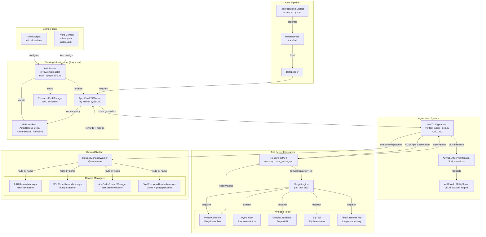
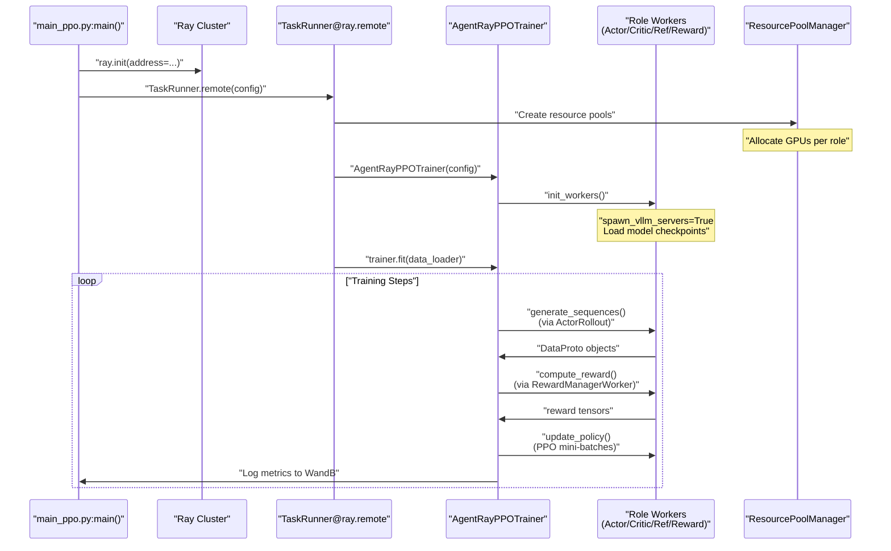
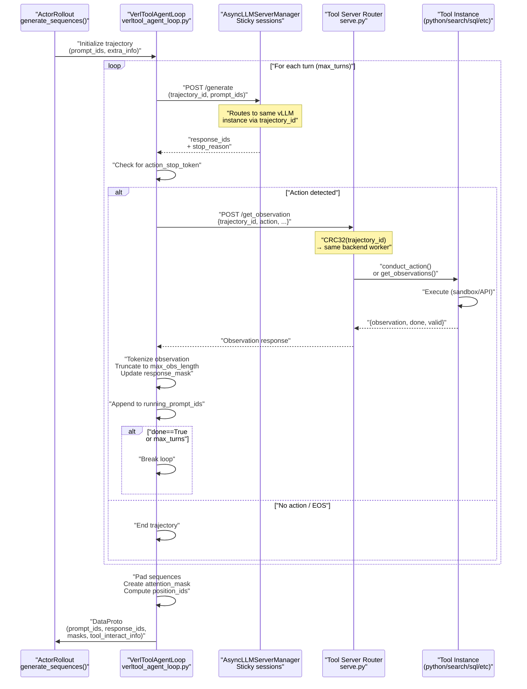
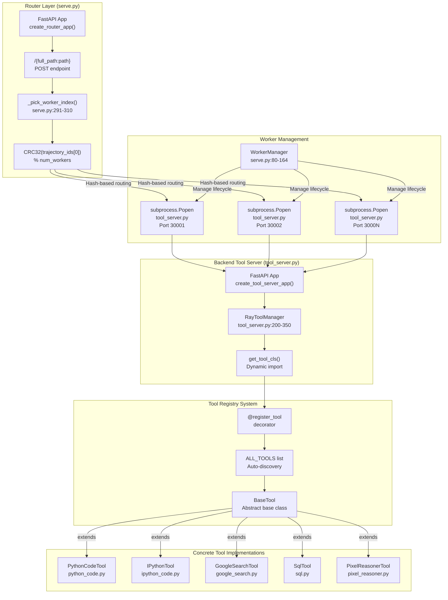

<!-- source: DeepWiki mcp.deepwiki.com · repo TIGER-AI-Lab/verl-tool · page 1 Overview · fetched 2026-10-30 -->

# Overview

<details>
<summary>Relevant source files</summary>

The following files were used as context for generating this wiki page:

- [README.md](README.md)
- [assets/docs/updates/verltool_v0.6.0_upgrade.md](assets/docs/updates/verltool_v0.6.0_upgrade.md)

</details>


## Purpose and Scope

This document provides a high-level introduction to VerlTool, a unified reinforcement learning framework for training tool-using agents. It covers the system's architectural philosophy, core components, and their relationships. For detailed information on specific subsystems, refer to the following pages:

- For training configuration and orchestration: see [Core Training Framework](#2)
- For tool server implementation and routing: see [Tool Server Architecture](#3)
- For specific tool implementations: see [Tool Implementations](#4)
- For training recipes and examples: see [Training Recipes](#5)
- For evaluation and deployment: see [Evaluation and Deployment](#8)

## What is VerlTool

VerlTool is a specialized reinforcement learning training framework for tool-using agents, built as an extension layer on top of the [Verl](https://github.com/volcengine/verl) RL framework (v0.6.0). It enables training language models to interact with external tools through multi-turn interactive reasoning, using Proximal Policy Optimization (PPO) or Group Relative Policy Optimization (GRPO) algorithms.

The framework supports training across diverse domains including mathematical reasoning with code execution, database querying with SQL, web search, and multi-modal visual reasoning. VerlTool's design philosophy emphasizes modularity, security, and scalability while maintaining a remarkably concise implementation—the core agent loop logic is under 200 lines of code.

**Key Repository Information:**

| Property | Value |
|----------|-------|
| Repository | https://github.com/TIGER-AI-Lab/verl-tool |
| Core Submodule | verl v0.6.0 |
| Inference Backend | vLLM v0.11.0 (primary), SGLang (alternative) |
| Main Entry Point | [`verl_tool/trainer/main_ppo.py`](verl_tool/trainer/main_ppo.py:37-44)() |
| Agent Loop | [`verl_tool/agent_loop/verltool_agent_loop.py`](verl_tool/agent_loop/verltool_agent_loop.py:1-200)() |
| Tool Server Router | [`verl_tool/servers/serve.py`](verl_tool/servers/serve.py:1-767)() |

Sources: [README.md:1-161](), [assets/docs/updates/verltool_v0.6.0_upgrade.md:1-11]()

## Core Architectural Principles

VerlTool is built on three foundational design principles:

### 1. Tool-as-Environment Paradigm

Unlike traditional tool-calling systems where tools are treated as stateless functions, VerlTool implements a **tool-as-environment** paradigm. Each tool interaction modifies persistent environment state that is maintained across multiple reasoning turns. This enables:

- Stateful multi-turn interactions (e.g., IPython kernel sessions that preserve variable state)
- Environment state caching per `trajectory_id` for trajectory-level consistency
- Proper cleanup and resource management when trajectories complete

The environment state is managed by the tool server and persists across HTTP requests within the same trajectory.

### 2. Complete Decoupling of Actor Rollout and Environment Interaction

VerlTool achieves a clean separation between the RL training loop and tool execution through:

- **Unified Tool Server API**: All tool interactions go through HTTP POST requests to `/get_observation` endpoint
- **Consistent Hashing**: Requests with the same `trajectory_id` are routed to the same backend worker to maintain statefulness
- **Independent Scaling**: Tool server workers can be scaled independently from training workers
- **Language Agnostic**: Tools can be implemented in any language as long as they expose the HTTP API

This decoupling allows the core agent loop to remain under 200 lines while supporting arbitrary tool types.

### 3. Hybrid Training Mode

VerlTool supports training on mixed datasets where some samples require tool use and others don't. The `use_tool` field in each data sample controls whether the agent loop calls the tool server:

- **Text-only mode**: When `use_tool=False`, the agent generates responses without tool interaction
- **Tool-enabled mode**: When `use_tool=True`, the agent can make tool calls and receive observations
- **Unified training**: Both modes share the same training pipeline, enabling efficient use of diverse datasets

Sources: [README.md:42-47](), [assets/docs/updates/verltool_v0.6.0_upgrade.md:5-10]()

## System Architecture Overview

VerlTool's architecture consists of five major subsystems that work together to enable tool-integrated RL training:

### Complete System Architecture

The following diagram illustrates how all major components interact across the training, inference, tool execution, and reward computation pipelines:



**Key Design Principles:**
- **Modularity**: Tools and reward managers are pluggable via decorators (`@register_tool`, `@register_reward_manager`)
- **Scalability**: Multi-worker tool servers, distributed Ray training, load-balanced LLM serving
- **Decoupling**: Complete separation of actor rollout from environment interaction via HTTP API
- **Statefulness**: Consistent hashing ensures trajectory-specific state persistence across requests

Sources: [verl_tool/trainer/main_ppo.py:37-414](), [verl_tool/trainer/ppo/ray_trainer.py:1-260](), [verl_tool/servers/serve.py:1-767](), [verl_tool/agent_loop/verltool_agent_loop.py:1-200]()

## Core Components

### Training Orchestration

The training process begins with [`main_ppo.py`](verl_tool/trainer/main_ppo.py:37-44)(), which uses Hydra for hierarchical configuration management. The flow proceeds through several key classes:

| Component | File Path | Class/Function | Purpose |
|-----------|-----------|----------------|---------|
| Entry Point | [`verl_tool/trainer/main_ppo.py`](verl_tool/trainer/main_ppo.py:37-44)() | `main()` | Hydra `@hydra.main()` decorator, config composition |
| Task Runner | [`verl_tool/trainer/main_ppo.py`](verl_tool/trainer/main_ppo.py:96-320)() | `TaskRunner` | `@ray.remote` actor for distributed orchestration |
| PPO Trainer | [`verl_tool/trainer/ppo/ray_trainer.py`](verl_tool/trainer/ppo/ray_trainer.py:39-260)() | `AgentRayPPOTrainer` | Extends `verl.trainer.ppo.RayPPOTrainer` |
| Custom Replacements | [`verl_tool/trainer/ppo/ray_trainer.py`](verl_tool/trainer/ppo/ray_trainer.py:24-37)() | `_mapping` dict | Replaces verl components with VerlTool versions |

**Training Orchestration Sequence**



**verl Component Replacements**

VerlTool customizes verl's behavior by replacing key components in the `_mapping` dictionary at [`verl_tool/trainer/ppo/ray_trainer.py:24-37`](verl_tool/trainer/ppo/ray_trainer.py:24-37)(). This enables tool-specific features without modifying verl's core:

| Original Component | VerlTool Replacement | Purpose |
|-------------------|---------------------|---------|
| `verl.trainer.ppo.core_algos.compute_advantage` | `verl_tool.trainer.ppo.compute_advantage` | Custom advantage computation logic |
| `verl.trainer.ppo.compute_data_metrics` | `verl_tool.trainer.ppo.compute_data_metrics` | Tool-specific metric logging |
| `verl.trainer.ppo.compute_reward` | `verl_tool.trainer.ppo.compute_reward` | Reward manager integration |
| `verl.workers.rollout.vllm_rollout.VLLMHttpServer` | `verl_tool.workers.vllm_server.VerlToolvLLMHttpServer` | Async LLM server with sticky sessions |

Sources: [verl_tool/trainer/main_ppo.py:48-94](), [verl_tool/trainer/ppo/ray_trainer.py:24-260](), [README.md:1-161](), [assets/docs/updates/verltool_v0.6.0_upgrade.md:8-9]()

### Agent Loop System

The [`VerlToolAgentLoop`](verl_tool/agent_loop/verltool_agent_loop.py:1-200)() class implements multi-turn interactive reasoning between the language model and tools. The implementation is remarkably concise at under 200 lines of code, leveraging verl's agent loop abstraction.

**Core Agent Loop Interaction Flow**



**Key Agent Loop Methods and Configuration**

The core logic is organized into these key methods in [`VerlToolAgentLoop`](verl_tool/agent_loop/verltool_agent_loop.py:50-180)():

| Method | Lines | Purpose |
|--------|-------|---------|
| `__init__()` | ~50-70 | Initialize config, tokenizer, tool server URL |
| `_generate_sequences()` | ~80-150 | Main multi-turn loop logic |
| `_post_process_observation()` | ~160-180 | Tokenize and truncate observations |

**Configuration Parameters:**

| Parameter | Config Path | Purpose | Default |
|-----------|-------------|---------|---------|
| `max_turns` | `agent.max_turns` | Maximum reasoning turns per trajectory | Task-specific |
| `action_stop_tokens` | `agent.action_stop_tokens` | Tokens signaling tool calls | Task-specific (e.g., `["</tool_call>"]`) |
| `mask_observations` | `agent.mask_observations` | Exclude observations from KL/gradient | `False` |
| `tool_server_url` | `agent.tool_server_url` | Tool server HTTP endpoint | `"http://localhost:5000"` |
| `use_tool` | Data sample field | Enable/disable tool calls per sample | `True` |
| `max_obs_length` | `agent.max_obs_length` | Maximum tokens per observation | `512` |

**Token Management:**
- `running_prompt_ids`: Accumulates tokens across turns (prompt + responses + observations)
- `response_mask`: Binary mask (0 for observations when `mask_observations=True`)
- `available_length = max_response_length - len(running_prompt_ids)`: Prevents context overflow

Sources: [verl_tool/agent_loop/verltool_agent_loop.py:1-200](), [assets/docs/updates/verltool_v0.6.0_upgrade.md:5-6](), [assets/docs/updates/verltool_v0.6.0_upgrade.md:10-10]()

### Tool Server Architecture

The tool server implements a **multi-worker router pattern** with consistent hashing for stateful tool interactions. The architecture separates routing concerns from tool execution logic.

**Tool Server Components and Routing**



**Key Implementation Details:**

| Component | File Location | Key Method/Class | Purpose |
|-----------|---------------|------------------|---------|
| Router | [`verl_tool/servers/serve.py:213-429`](verl_tool/servers/serve.py:213-429)() | `create_router_app()` | FastAPI app with proxy handler |
| Consistent Hashing | [`verl_tool/servers/serve.py:291-310`](verl_tool/servers/serve.py:291-310)() | `_pick_worker_index()` | `crc32(trajectory_ids[0]) % num_workers` |
| Worker Manager | [`verl_tool/servers/serve.py:80-164`](verl_tool/servers/serve.py:80-164)() | `WorkerManager` | Subprocess lifecycle (SIGTERM/SIGKILL) |
| Backend Server | [`verl_tool/servers/tool_server.py:400-600`](verl_tool/servers/tool_server.py:400-600)() | `create_tool_server_app()` | Individual worker FastAPI app |
| Tool Manager | [`verl_tool/servers/tool_server.py:200-350`](verl_tool/servers/tool_server.py:200-350)() | `RayToolManager` | Ray actor pool for tool execution |
| Tool Registry | [`verl_tool/servers/tools/base_tool.py:15-30`](verl_tool/servers/tools/base_tool.py:15-30)() | `@register_tool` | Decorator for auto-discovery |

**Routing Strategies:**
- **Stateful (with trajectory_ids)**: `CRC32(trajectory_ids[0]) % num_workers` → ensures same trajectory → same backend
- **Stateless (no trajectory_ids)**: Round-robin distribution via `current_idx = (current_idx + 1) % num_workers`
- **Health Checks**: Router pings backends every 60s, removes unhealthy workers from pool

Sources: [verl_tool/servers/serve.py:1-767](), [verl_tool/servers/tool_server.py:1-600](), [verl_tool/servers/tools/base_tool.py:1-200]()

### Distributed Training Workers

VerlTool uses Ray for distributed training with multiple worker types:

| Worker Type | Role | Parallelism Strategy |
|-------------|------|---------------------|
| **ActorRollout** | Policy model for generation and training | FSDP/FSDP2 or Megatron (TP/PP/EP) |
| **Critic** | Value function estimation | FSDP/FSDP2 or Megatron |
| **RewardModel** | Model-based reward scoring (optional) | FSDP/FSDP2 or Megatron |
| **RefPolicy** | Reference policy for KL divergence | FSDP/FSDP2 or Megatron |

The `ResourcePoolManager` allocates GPUs into pools, with optional dedicated pool for reward models to prevent resource contention.

Sources: [verl_tool/trainer/main_ppo.py:112-226]()

## Training Workflow Overview

The complete training workflow integrates data preprocessing, multi-turn rollout generation, reward computation, and policy optimization. The process follows a standard RL training loop with tool-specific customizations.

**Complete Training Workflow**

```mermaid
flowchart TB
    subgraph Init["1. Initialization Phase"]
        LoadConfig["Load Hydra Config<br/>main_ppo.py:main()"]
        RayInit["ray.init()<br/>Connect to cluster"]
        SpawnRunner["TaskRunner.remote()<br/>@ray.remote actor"]
        CreateTrainer["AgentRayPPOTrainer<br/>ray_trainer.py:39-260"]
        InitWorkers["init_workers()<br/>Actor/Critic/Ref/Reward"]
        SpawnVLLM["Spawn vLLM servers<br/>spawn_vllm_servers=True"]
    end
    
    subgraph DataLoad["2. Data Loading"]
        LoadParquet["Load Parquet Dataset<br/>train.parquet"]
        CreateBatch["Create DataProto Batch<br/>prompt_ids, extra_info"]
        Sampler["DataLoader.sample()"]
    end
    
    subgraph Rollout["3. Rollout Phase"]
        GenSeq["ActorRollout.generate_sequences()"]
        AgentLoop["VerlToolAgentLoop<br/>Multi-turn execution"]
        LLMGen["vLLM Token Generation<br/>max_action_length tokens"]
        ToolCall["POST /get_observation<br/>Tool server HTTP call"]
        ObsProcess["Tokenize observation<br/>Update response_mask"]
        CheckDone["Check done or max_turns"]
    end
    
    subgraph Reward["4. Reward Computation"]
        RewardWorker["RewardManagerWorker.compute_score()"]
        ExtractAnswer["Extract answer/code<br/>Task-specific parsing"]
        Verify["Verify correctness<br/>Test cases/math_verify"]
        Penalties["Apply behavioral penalties<br/>Format/curiosity/redundancy"]
        RewardTensor["Create reward_tensor<br/>Sparse: at last token"]
    end
    
    subgraph Learn["5. Learning Phase"]
        ComputeAdv["Compute advantages<br/>GAE or GRPO"]
        PPOMiniBatch["PPO mini-batches<br/>Gradient accumulation"]
        UpdateActor["Update ActorRollout<br/>Policy gradient"]
        UpdateCritic["Update Critic<br/>Value loss"]
        KLPenalty["KL penalty vs RefPolicy"]
    end
    
    subgraph Log["6. Logging & Persistence"]
        WandB["WandB logging<br/>Metrics + accuracy"]
        SaveCkpt["Save checkpoint<br/>save_freq intervals"]
        DumpRollout["Dump rollout data<br/>trainer.rollout_data_dir"]
        Validation["Validation pass<br/>test_freq intervals"]
    end
    
    LoadConfig --> RayInit
    RayInit --> SpawnRunner
    SpawnRunner --> CreateTrainer
    CreateTrainer --> InitWorkers
    InitWorkers --> SpawnVLLM
    
    SpawnVLLM --> LoadParquet
    LoadParquet --> CreateBatch
    CreateBatch --> Sampler
    
    Sampler --> GenSeq
    GenSeq --> AgentLoop
    AgentLoop --> LLMGen
    LLMGen --> ToolCall
    ToolCall --> ObsProcess
    ObsProcess --> CheckDone
    CheckDone -->|"Continue"| LLMGen
    CheckDone -->|"Done"| RewardWorker
    
    RewardWorker --> ExtractAnswer
    ExtractAnswer --> Verify
    Verify --> Penalties
    Penalties --> RewardTensor
    
    RewardTensor --> ComputeAdv
    ComputeAdv --> PPOMiniBatch
    PPOMiniBatch --> UpdateActor
    PPOMiniBatch --> UpdateCritic
    UpdateActor --> KLPenalty
    
    KLPenalty --> WandB
    WandB --> SaveCkpt
    SaveCkpt --> DumpRollout
    DumpRollout --> Validation
    Validation -->|"Next epoch"| Sampler
```



**Key Training Loop Customizations:**

VerlTool replaces several verl components with custom implementations via the `_mapping` dictionary in [`verl_tool/trainer/ppo/ray_trainer.py:24-37`](verl_tool/trainer/ppo/ray_trainer.py:24-37)(). These replacements enable tool-specific features:

| Original verl Component | VerlTool Replacement | Key Additions |
|------------------------|----------------------|---------------|
| `verl.workers.rollout.vllm_rollout.VLLMHttpServer` | `verl_tool.workers.vllm_server.VerlToolvLLMHttpServer` | Async server with sticky sessions via `trajectory_id` |
| `verl.trainer.ppo.compute_reward` | `verl_tool.trainer.ppo.compute_reward` | Integration with `RewardManagerWorker` and task-specific managers |
| `verl.trainer.ppo.compute_data_metrics` | `verl_tool.trainer.ppo.compute_data_metrics` | Tool usage metrics: `tool_call_rate`, `verl_tool_metrics` |
| `verl.trainer.ppo.core_algos.compute_advantage` | `verl_tool.trainer.ppo.compute_advantage` | GRPO group-level normalization for n>1 samples |

**Rollout Data Persistence:**

Training trajectories are saved via [`trainer.rollout_data_dir`](verl_tool/trainer/ppo/ray_trainer.py:150-180)() for debugging and analysis:
- Path: Specified in config as `trainer.rollout_data_dir=$(pwd)/verl_step_records/$run_name`
- Format: JSON records with full trajectories, tool interactions, and rewards
- Contents: `prompt_ids`, `response_ids`, `tool_interact_info`, `reward`, `extra_info`

Sources: [verl_tool/trainer/ppo/ray_trainer.py:24-260](), [verl_tool/trainer/main_ppo.py:48-320](), [assets/docs/updates/verltool_v0.6.0_upgrade.md:9-9]()

## Key Capabilities

### Multi-Domain Training Support

VerlTool supports training across diverse domains through its modular tool and reward manager architecture:

| Domain | Tools | Reward Manager | Example Recipe | Key Features |
|--------|-------|----------------|----------------|--------------|
| **Mathematical Reasoning** | `PythonCodeTool` | `ToRLRewardManager` | [`math_tir`](examples/train/math_tir)() | Math verification via `sympy` |
| **Code Generation** | `IPythonTool` | `AceCoderRewardManager` | [`acecoder`](examples/train/acecoder)() | Test case execution |
| **Database Query** | `SqlTool` | `SQLCoderRewardManager` | [`skysql`](examples/train/skysql)() | Query execution comparison |
| **Web Search** | `GoogleSearchTool` | `DeepSearchRewardManager` | [`deepsearch`](examples/train/deepsearch)() | Multi-turn search reasoning |
| **Visual Reasoning** | `PixelReasonerTool` | `PixelReasonerRewardManager` | [`pixel_reasoner`](examples/train/pixel_reasoner)() | Image processing + group penalties |

### Rollout Mode Configuration

VerlTool supports two rollout modes with different performance characteristics:

| Mode | Config Value | Speedup | Use Case |
|------|-------------|---------|----------|
| **Synchronous** | `actor_rollout_ref.rollout.mode: "sync"` | Baseline | Simple tasks, fewer tool calls |
| **Asynchronous** | `actor_rollout_ref.rollout.mode: "async"` | 1.69x-2.06x | Tool-heavy workloads |

Async mode eliminates batching barriers by allowing trajectories to proceed independently. See [Asynchronous Rollout Mode](#2.6) for detailed configuration.

### Security and Sandboxing Layers

VerlTool implements multiple security layers for safe code execution:

| Security Layer | Implementation | File | Purpose |
|---------------|----------------|------|---------|
| **Firejail Sandbox** | `subprocess.Popen` with jail | [`verl_tool/servers/tools/python_code.py`](verl_tool/servers/tools/python_code.py:100-200)() | Isolate `PythonCodeTool` execution |
| **Resource Limits** | `timeout`, `max_memory` | [`verl_tool/servers/tools/python_code.py`](verl_tool/servers/tools/python_code.py:50-80)() | Prevent resource exhaustion |
| **Forbidden Imports** | `FORBIDDEN_IMPORTS` list | [`verl_tool/servers/tools/python_code.py`](verl_tool/servers/tools/python_code.py:30-40)() | Block dangerous modules |
| **Ray Actor Isolation** | `@ray.remote` actors | [`verl_tool/servers/tools/ipython_code.py`](verl_tool/servers/tools/ipython_code.py:50-150)() | Isolate IPython kernels |
| **SQL Transactions** | `BEGIN TRANSACTION`, `ROLLBACK` | [`verl_tool/servers/tools/sql.py`](verl_tool/servers/tools/sql.py:100-200)() | Prevent database modifications |

### Hybrid Training Mode

VerlTool supports training on mixed datasets where some samples use tools and others don't:

**Data Sample Structure:**
```python
{
    "prompt": [...],  # List of conversation turns
    "ability": "math_reasoning",
    "reward_manager": "torl",
    "use_tool": True,  # Controls tool server calls
    "extra_info": {
        "test_cases": [...],
        "ground_truth": "42"
    }
}
```

**Agent Loop Behavior:**
- When `use_tool=True`: Agent can make tool calls via HTTP POST to `/get_observation`
- When `use_tool=False`: Agent generates responses without tool interaction (standard text generation)
- Both modes share the same training pipeline and PPO update logic

This enables efficient training on diverse datasets, including non-tool tasks alongside tool-integrated tasks.

Sources: [README.md:41-47](), [assets/docs/updates/verltool_v0.6.0_upgrade.md:10-10]()

## Getting Started

To begin using VerlTool:

1. **Installation**: Follow the setup guide at [Installation and Setup](#1.4)
2. **Configuration**: Review the configuration system at [Configuration System](#2.4)
3. **Training**: Start with a training recipe at [Training Recipes](#5)
4. **Tool Server**: Launch the tool server as documented in [Tool Server Architecture](#3)

For detailed technical documentation on each subsystem, refer to the linked pages in the table of contents.

Sources: [README.md:50-60]()

---

