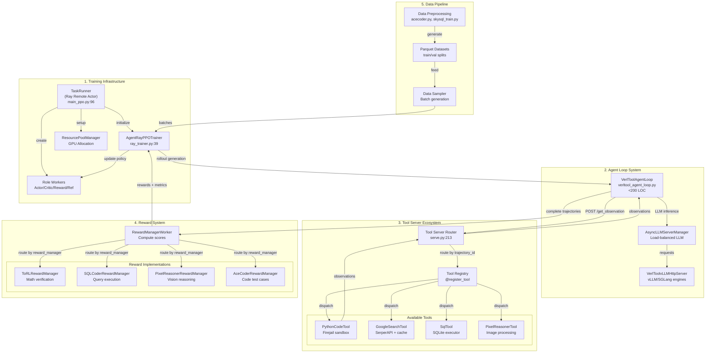
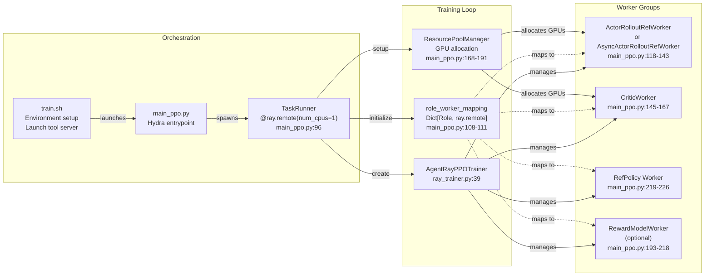
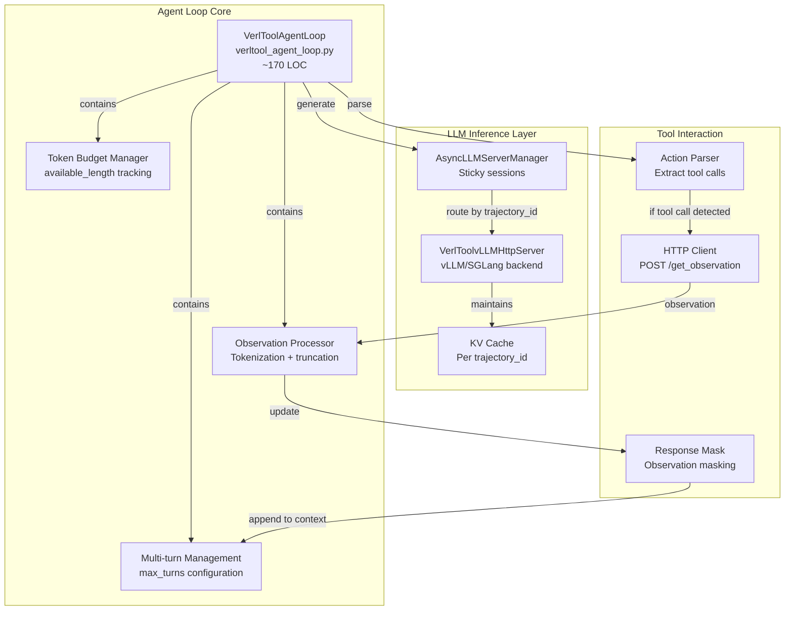
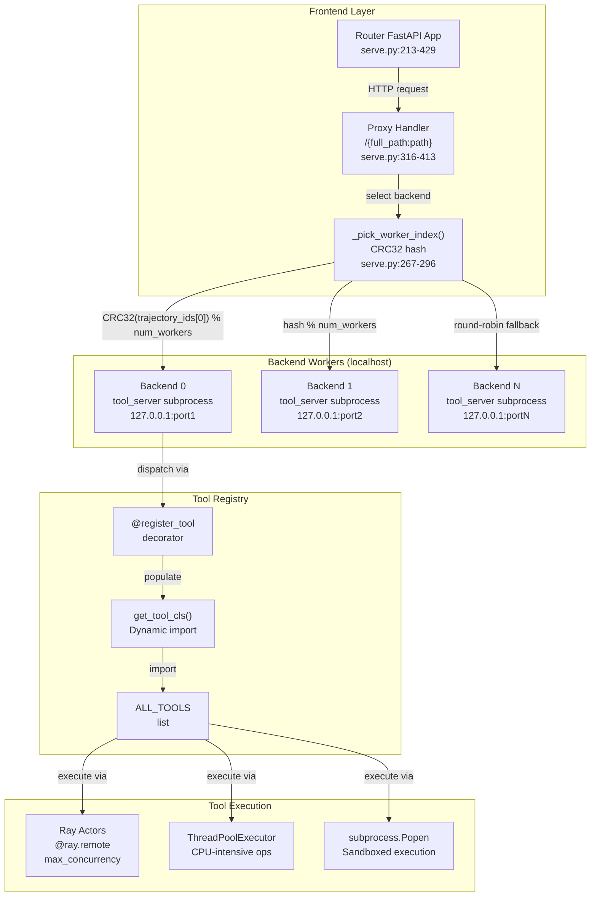
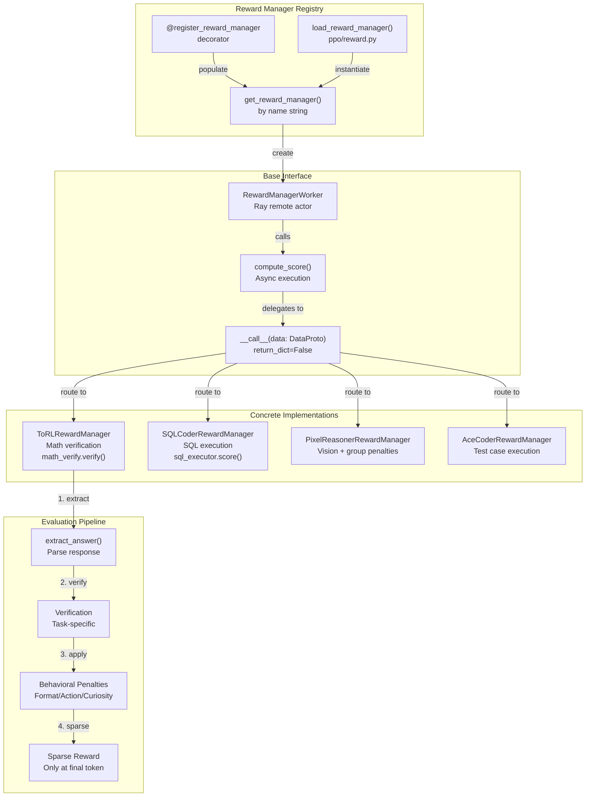
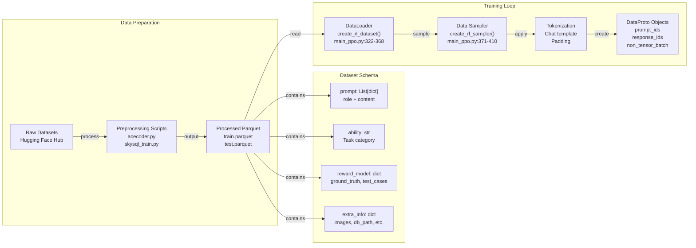
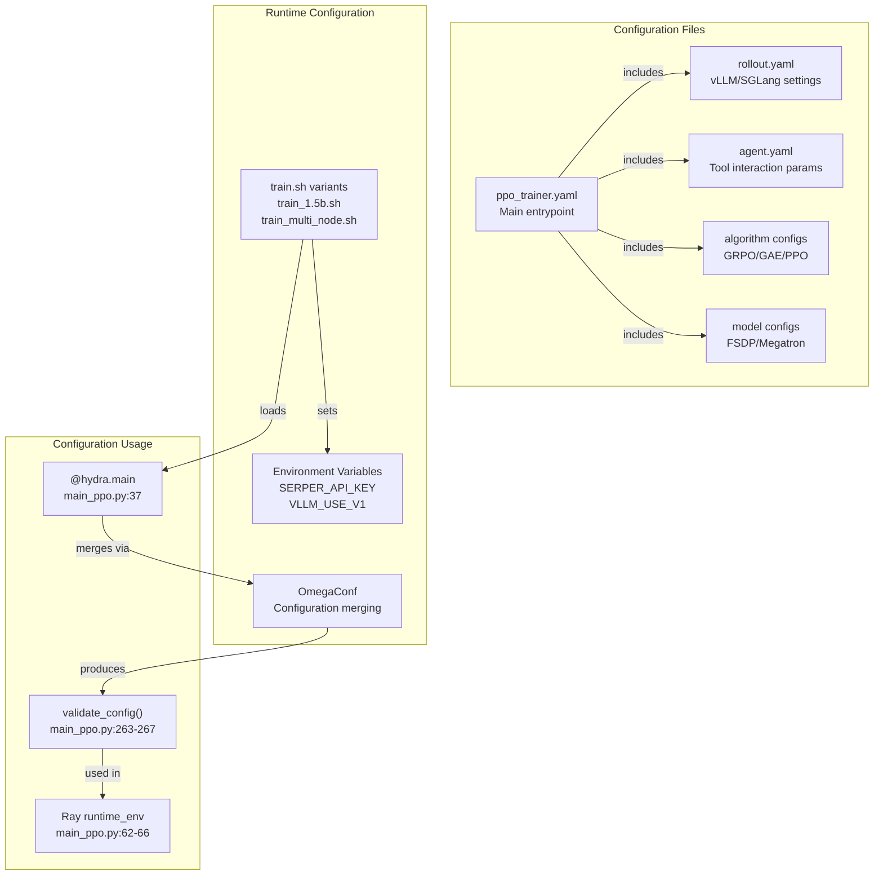
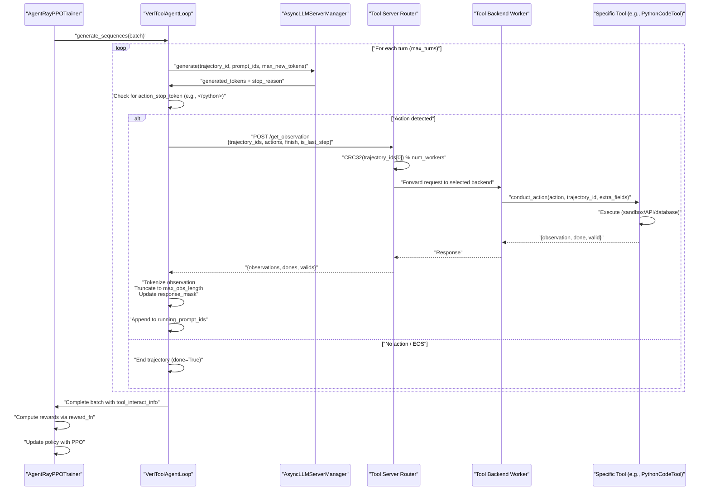

<!-- source: DeepWiki mcp.deepwiki.com · repo TIGER-AI-Lab/verl-tool · page 1.1 System Architecture Overview · fetched 2026-10-30 -->

# System Architecture Overview

<details>
<summary>Relevant source files</summary>

The following files were used as context for generating this wiki page:

- [README.md](README.md)
- [assets/docs/tool_server.md](assets/docs/tool_server.md)
- [assets/docs/updates/verltool_v0.6.0_upgrade.md](assets/docs/updates/verltool_v0.6.0_upgrade.md)
- [pyproject.toml](pyproject.toml)
- [verl_tool/servers/serve.py](verl_tool/servers/serve.py)
- [verl_tool/trainer/main_ppo.py](verl_tool/trainer/main_ppo.py)
- [verl_tool/trainer/ppo/ray_trainer.py](verl_tool/trainer/ppo/ray_trainer.py)

</details>


## Purpose and Scope

This page provides a comprehensive overview of VerlTool's system architecture, explaining how the major subsystems interconnect to enable reinforcement learning training for tool-using language models. VerlTool is built as a unified framework on top of [verl](https://github.com/volcengine/verl), implementing a "tool-as-environment" paradigm where tools are treated as external environments that agents interact with during training.

This document covers:
- The five core subsystems and their interactions
- Key architectural components and their code implementations
- Request/response flows between subsystems
- Resource management and distributed execution patterns

For detailed information about specific subsystems, see:
- Agent loop implementation details: [Agent Loop System (VerlToolAgentLoop)](#2.3)
- Tool server internals and tool implementations: [Tool Server Architecture](#3)
- Reward computation logic: [Reward Management System](#6)
- Configuration and training workflows: [Training Recipes](#5)

---

## High-Level Architecture

VerlTool's architecture consists of five interconnected subsystems that enable distributed reinforcement learning training with tool interaction:



**Core Design Principles:**

1. **Complete Decoupling**: Actor rollout is completely separated from environment (tool) interaction, enabled by the tool-as-environment paradigm
2. **Modularity**: Tools, reward managers, and training components are pluggable via decorators (`@register_tool`, `@register_reward_manager`) and configuration
3. **Scalability**: Multi-worker tool servers, distributed Ray training, load-balanced LLM serving
4. **State Management**: Each trajectory maintains persistent environment state across multi-turn interactions

**Sources:** [README.md:42-48](), [verl_tool/trainer/main_ppo.py:1-100](), [verl_tool/trainer/ppo/ray_trainer.py:22-37]()

---

## Training Infrastructure Layer

### Component Overview

The training infrastructure is built on Ray for distributed execution and implements a customized PPO training loop:



### Key Components

| Component | File Location | Purpose |
|-----------|--------------|---------|
| `TaskRunner` | [verl_tool/trainer/main_ppo.py:96-319]() | Ray remote actor that orchestrates the entire training process |
| `AgentRayPPOTrainer` | [verl_tool/trainer/ppo/ray_trainer.py:39-260]() | Extends `RayPPOTrainer` with custom validation and logging for tool interactions |
| `role_worker_mapping` | [verl_tool/trainer/main_ppo.py:108-111]() | Dictionary mapping `Role` enums to Ray remote worker classes |
| `ResourcePoolManager` | [verl_tool/trainer/main_ppo.py:168-191]() | Manages GPU allocation across different worker pools |

### Initialization Flow

The training process is initialized through the following sequence:

1. **Hydra Configuration Loading**: [verl_tool/trainer/main_ppo.py:37-44]() loads configuration using Hydra
2. **Ray Cluster Initialization**: [verl_tool/trainer/main_ppo.py:56-68]() initializes Ray with runtime environment
3. **TaskRunner Spawning**: [verl_tool/trainer/main_ppo.py:84-87]() creates a Ray remote TaskRunner actor
4. **Worker Registration**: [verl_tool/trainer/main_ppo.py:248-260]() adds workers to `role_worker_mapping`
5. **Resource Pool Setup**: [verl_tool/trainer/main_ppo.py:168-191]() configures GPU allocation
6. **Trainer Initialization**: [verl_tool/trainer/main_ppo.py:301-314]() creates the PPO trainer with all components

### Custom Replacements

VerlTool replaces several verl components with customized versions:

```python
# From verl_tool/trainer/ppo/ray_trainer.py:24-36
import verl.experimental.agent_loop
from verl_tool.agent_loop import AgentLoopManager
import verl.trainer.ppo.ray_trainer
from .reward import compute_reward, compute_reward_async
from verl_tool.workers.rollout.vllm_rollout.vllm_async_server import VerlToolvLLMHttpServer

verl.experimental.agent_loop.AgentLoopManager = AgentLoopManager
verl.trainer.ppo.ray_trainer.compute_reward = compute_reward
verl.trainer.ppo.ray_trainer.compute_reward_async = compute_reward_async
verl.workers.rollout.vllm_rollout.vllm_async_server.vLLMHttpServer = VerlToolvLLMHttpServer
```

**Sources:** [verl_tool/trainer/main_ppo.py:1-319](), [verl_tool/trainer/ppo/ray_trainer.py:1-260]()

---

## Agent Loop System

### Architecture

The agent loop orchestrates multi-turn interactions between the language model and tools:



### Request/Response Protocol

**LLM Generation Request:**
```python
# Sent from AgentLoop to AsyncLLMServerManager
{
    "trajectory_id": str,
    "prompt_ids": List[int],
    "max_new_tokens": int,
    "temperature": float,
    # ... other sampling params
}
```

**Tool Server Request:**
```python
# POST /get_observation
{
    "trajectory_ids": List[str],
    "actions": List[str],
    "finish": List[bool],
    "is_last_step": List[bool],
    "extra_fields": List[dict]
}
```

**Tool Server Response:**
```python
{
    "observations": List[str],
    "dones": List[bool],
    "valids": List[bool],
    "processing_time_ms": float
}
```

### Key Features

| Feature | Implementation | Purpose |
|---------|---------------|---------|
| **Sticky Sessions** | `trajectory_id` routing | Maintains KV cache efficiency across turns |
| **Token Management** | `available_length = max_response_length - len(running_prompt_ids)` | Prevents context overflow |
| **Response Masking** | Observations marked with 0 in `response_mask` | Excludes observations from gradient computation |
| **Action Detection** | Pattern matching on `action_stop_token` | Identifies tool call completion |
| **Multimodal Support** | Processor integration (e.g., Qwen2VL) | Handles image inputs in observations |

**Sources:** [assets/docs/updates/verltool_v0.6.0_upgrade.md:5-6](), [assets/docs/tool_server.md:1-108]()

---

## Tool Server Ecosystem

### Multi-Layer Architecture

The tool server implements a sophisticated routing architecture to handle high concurrency:



### Routing Logic

The tool server uses **consistent hashing** to ensure stateful routing:

```python
# From serve.py:267-296
def _pick_worker_index(body_bytes: bytes) -> int:
    """
    Select a worker index based on request body.
    
    Uses consistent hashing on trajectory_ids[0] if available,
    otherwise falls back to round-robin.
    """
    if not body_bytes:
        return next(app.state.counter) % num_workers
    
    try:
        data = json.loads(body_bytes)
    except (json.JSONDecodeError, UnicodeDecodeError):
        return next(app.state.counter) % num_workers
    
    if isinstance(data, dict):
        trajectory_ids = data.get("trajectory_ids")
        if isinstance(trajectory_ids, list) and len(trajectory_ids) > 0:
            # Use CRC32 for consistent hashing
            tid_str = str(trajectory_ids[0])
            hash_value = zlib.crc32(tid_str.encode("utf-8")) & 0xFFFFFFFF
            return hash_value % num_workers
    
    return next(app.state.counter) % num_workers
```

### Worker Management

The `WorkerManager` class handles the lifecycle of backend worker subprocesses:

| Component | Location | Responsibility |
|-----------|----------|----------------|
| `WorkerManager` | [verl_tool/servers/serve.py:433-547]() | Manages backend worker lifecycle |
| `_start_backend_server()` | [verl_tool/servers/serve.py:83-156]() | Spawns individual backend subprocess |
| `_wait_for_workers_ready()` | [verl_tool/servers/serve.py:159-210]() | Health checks with timeout |
| `shutdown()` | [verl_tool/servers/serve.py:514-540]() | Graceful termination with SIGTERM/SIGKILL |

### Configuration Constants

```python
# From serve.py:30-40
MAX_CONCURRENCY_PER_UVI_WORKER = 256
ROUTER_BACKLOG = 8192
HEALTH_CHECK_TIMEOUT = 60.0
HEALTH_CHECK_INTERVAL = 0.5
SUBPROCESS_TERMINATE_TIMEOUT = 10
MAX_CONNECTIONS_PER_UVI_WORKER = 512
KEEPALIVE_EXPIRY_PER_UVI_WORKER = 300
```

**Sources:** [verl_tool/servers/serve.py:1-767](), [assets/docs/tool_server.md:1-108]()

---

## Reward System

### Registry and Dispatch

The reward system uses a plugin architecture similar to the tool system:



### Reward Tensor Structure

All reward managers return rewards following the same structure:

```python
# Reward tensor is sparse: only placed at valid_response_length - 1
reward_tensor = torch.zeros(batch_size, max_response_length)
for i, valid_length in enumerate(valid_response_lengths):
    reward_tensor[i, valid_length - 1] = computed_reward[i]

# Optional extra info for logging
reward_extra_info = {
    "accuracy": List[float],
    "response_length": List[int],
    "tool_call_rate": List[float],
    "penalties_applied": List[dict],
    # ... task-specific metrics
}
```

### Validation Metrics Processing

The trainer aggregates validation metrics across multiple samples per prompt:

```python
# From ray_trainer.py:186
data_src2var2metric2val = process_validation_metrics(
    data_sources, 
    sample_uids, 
    reward_extra_infos_dict
)

# Produces metrics like:
# val-core/{data_source}/acc/best@16
# val-core/{data_source}/acc/mean@16
# val-core/{data_source}/acc/maj@16
# val-aux/{data_source}/reward/mean@1
```

**Sources:** [verl_tool/trainer/ppo/ray_trainer.py:39-260]()

---

## Data Pipeline

### Data Flow Architecture



### Standard Data Schema

All datasets follow a standardized schema:

| Field | Type | Purpose | Example |
|-------|------|---------|---------|
| `prompt` | `List[dict]` | Conversation history | `[{"role": "user", "content": "..."}]` |
| `ability` | `str` | Task category for routing | `"code_generation"`, `"math_reasoning"` |
| `reward_model` | `dict` | Reward computation config | `{"style": "rule", "ground_truth": "42"}` |
| `extra_info` | `dict` | Task-specific metadata | `{"test_cases": [...], "images": [...]}` |
| `use_tool` | `bool` | Enable tool calling | `true` / `false` |

### DataProto Structure

The `DataProto` class encapsulates both tensor and non-tensor data:

```python
# Tensor batch (on GPU)
batch = {
    "input_ids": torch.Tensor,        # Tokenized prompts
    "attention_mask": torch.Tensor,   # Attention mask
    "prompts": torch.Tensor,          # Prompt-only tokens
    "responses": torch.Tensor,        # Generated responses
    "response_mask": torch.Tensor,    # Mask for gradients
    "token_level_scores": torch.Tensor  # Rewards
}

# Non-tensor batch (CPU)
non_tensor_batch = {
    "uid": np.ndarray,                # Unique identifiers
    "reward_model": np.ndarray,       # Reward config per sample
    "extra_info": np.ndarray,         # Task-specific data
    "tool_interact_info": np.ndarray, # Tool interaction history
    "traj_stop_reason": np.ndarray,   # How trajectory ended
    "verl_tool_metrics": np.ndarray   # Tool usage metrics
}
```

**Sources:** [verl_tool/trainer/main_ppo.py:322-410]()

---

## Configuration System

### Hydra Configuration Hierarchy

VerlTool uses Hydra for hierarchical configuration management:



### Key Configuration Sections

| Section | File Pattern | Key Parameters |
|---------|-------------|----------------|
| **Rollout** | `rollout.yaml` | `mode`, `val_kwargs.n`, `val_kwargs.temperature`, `agent.tool_server_url` |
| **Agent** | `agent.yaml` | `max_turns`, `action_stop_token`, `mask_observations`, `enable_mtrl` |
| **Algorithm** | `algorithm/*.yaml` | `use_kl_in_reward`, `kl_penalty`, `grpo_group_norm` |
| **Model** | `model/*.yaml` | `path`, `strategy` (fsdp/megatron), `fsdp_config` |
| **Trainer** | `trainer/*.yaml` | `n_gpus_per_node`, `nnodes`, `save_freq`, `test_freq` |

### Cross-Reference Example

Configuration sections can reference each other using OmegaConf's `oc.select`:

```yaml
# In rollout.yaml
rollout:
  agent:
    tool_server_url: ${oc.select:data.tool_server_url,null}
    max_turns: ${oc.select:data.max_turns,3}
    
# In data.yaml
data:
  tool_server_url: "http://localhost:5000"
  max_turns: 5
```

**Sources:** [verl_tool/trainer/main_ppo.py:37-68]()

---

## Integration Points

### Training to Tool Server Flow



### Key Integration Points

1. **Agent Loop → Tool Server**: HTTP POST to `/get_observation` with trajectory IDs and actions
2. **Tool Server → Backend**: Consistent hashing routes to same worker per trajectory
3. **Backend → Tool**: Method dispatch via `conduct_action()` or `get_observations()`
4. **Tool → Environment**: State stored in `env_cache[trajectory_id]`
5. **Agent Loop → Reward**: Complete trajectories with `tool_interact_info` passed to reward manager

**Sources:** [verl_tool/servers/serve.py:316-413](), [assets/docs/tool_server.md:8-30]()

---

## File Structure Overview

### Core Module Organization

```
verl_tool/
├── agent_loop/
│   └── verltool_agent_loop.py          # <200 LOC agent loop implementation
├── trainer/
│   ├── main_ppo.py                      # Hydra entrypoint, TaskRunner
│   └── ppo/
│       ├── ray_trainer.py               # AgentRayPPOTrainer, custom replacements
│       └── reward.py                    # load_reward_manager()
├── servers/
│   ├── serve.py                         # Multi-worker router with consistent hashing
│   ├── tool_server.py                   # Backend worker implementation
│   └── tools/
│       ├── base_tool.py                 # BaseTool abstract class
│       ├── python_code_tool.py          # Firejail sandbox execution
│       ├── google_search_tool.py        # SerperAPI + caching
│       ├── sql_tool.py                  # SQLite execution
│       └── pixel_reasoner_tool.py       # Image processing tool
└── workers/
    └── rollout/
        └── vllm_rollout/
            └── vllm_async_server.py     # VerlToolvLLMHttpServer

examples/
└── train/
    ├── math_tir/                        # Math reasoning training
    ├── acecoder/                        # Code generation training
    ├── skysql/                          # SQL training
    └── pixel_reasoner/                  # Vision task training
```

### Key File Purposes

| File | Purpose | Key Classes/Functions |
|------|---------|----------------------|
| `verl_tool/agent_loop/verltool_agent_loop.py` | Multi-turn agent loop logic | `VerlToolAgentLoop`, `AgentLoopManager` |
| `verl_tool/trainer/main_ppo.py` | Training orchestration | `TaskRunner`, `run_ppo()`, `create_rl_dataset()` |
| `verl_tool/trainer/ppo/ray_trainer.py` | Custom PPO trainer | `AgentRayPPOTrainer`, `_validate()`, `_log_rollout_data()` |
| `verl_tool/servers/serve.py` | Tool server router | `create_router_app()`, `WorkerManager`, `_pick_worker_index()` |
| `verl_tool/servers/tool_server.py` | Backend tool server | Tool dispatching and execution |

**Sources:** [README.md:1-162](), [assets/docs/updates/verltool_v0.6.0_upgrade.md:1-11]()

---

## Summary

VerlTool's architecture achieves complete decoupling of reinforcement learning training from tool interaction through:

1. **Tool-as-Environment Paradigm**: Tools are treated as external environments with persistent state
2. **Consistent Hashing**: Ensures trajectory-to-worker affinity for stateful interactions
3. **Modular Plugin System**: Tools and reward managers are independently extensible
4. **Distributed Execution**: Ray-based training infrastructure with multi-GPU support
5. **Unified Data Pipeline**: Standardized schema across diverse task types

This architecture enables training language models to use tools effectively while maintaining scalability, modularity, and ease of extension. The system supports both synchronous and asynchronous rollout modes, with the async mode providing 1.69x-2.06x speedup for tool-intensive workloads.

For deeper dives into specific components:
- Agent loop implementation: [Agent Loop System (VerlToolAgentLoop)](#2.3)
- Tool development: [Tool Implementations](#4)
- Reward computation: [Reward Management System](#6)
- Training workflows: [Training Recipes](#5)

**Sources:** [README.md:42-48](), [assets/docs/updates/verltool_v0.6.0_upgrade.md:1-11](), [pyproject.toml:1-83]()

---

