<!-- source: DeepWiki mcp.deepwiki.com · repo TIGER-AI-Lab/verl-tool · page 1.2 Key Features and Capabilities · fetched 2026-10-30 -->

# Key Features and Capabilities

<details>
<summary>Relevant source files</summary>

The following files were used as context for generating this wiki page:

- [README.md](README.md)
- [assets/docs/updates/verltool_v0.6.0_upgrade.md](assets/docs/updates/verltool_v0.6.0_upgrade.md)

</details>


## Overview

VerlTool is a unified tool-agent training framework built on top of verl (v0.6.0), designed to simplify the development and training of reinforcement learning agents that interact with external tools. The framework provides a complete solution for training agents that can use tools like code execution environments, search APIs, databases, and image processing utilities.

This page documents VerlTool's core features and capabilities, including its architectural innovations, training modes, tool system design, and deployment options. For implementation details of specific components, see the referenced pages throughout this document.

Sources: [README.md:1-47](), [assets/docs/updates/verltool_v0.6.0_upgrade.md:1-12]()

---

## Core Architectural Features

### Complete Decoupling of Rollout and Environment Interaction

VerlTool achieves complete separation between actor rollout (policy generation) and environment interaction (tool execution) through a unified HTTP-based Tool Server API. This design enables:

- **Independent Tool Development**: Tools can be developed, tested, and debugged independently of the training loop
- **Easy Tool Addition**: New tools require only a Python file implementing the `BaseTool` interface
- **Flexible Deployment**: Tool servers can run on different machines than training workers

**Tool Registration Pattern**:
```python
@register_tool(name="python_code")
class PythonCodeTool(BaseTool):
    def conduct_action(self, trajectory_id, action, extra_fields):
        # Tool implementation
        return observation, done, valid
```

**Agent Loop → Tool Server Communication**:
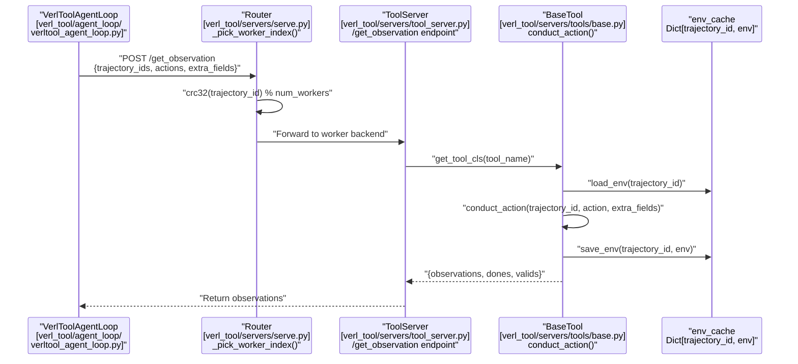

Sources: [README.md:43-46](), [verl_tool/servers/serve.py](), [verl_tool/servers/tool_server.py](), [verl_tool/servers/tools/base.py]()

### Tool-as-Environment Paradigm

VerlTool treats each tool interaction as an environment state transition. Unlike traditional RL environments that reset between episodes, VerlTool's tool environments maintain persistent state across multiple turns within a trajectory.

**State Management**:
- **Environment Cache**: `env_cache: Dict[trajectory_id, env]` stores environment state per trajectory
- **Trajectory ID Routing**: Consistent hashing ensures same trajectory → same worker for state consistency
- **Persistent State**: Tools like `IPythonTool` maintain kernel state across turns
- **Cleanup**: Environments are deleted when `done=True` or on explicit finish signals

**Example: Multi-Turn IPython Execution**
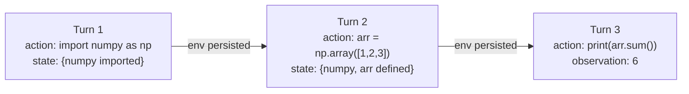

Sources: [README.md:44](), [verl_tool/servers/tool_server.py](), [verl_tool/agent_loop/verltool_agent_loop.py]()

### Compact Agent Loop Implementation

VerlTool consolidates all agent-tool interaction logic into a single file with the main loop under 200 lines of code. This is achieved through careful abstraction and the tool-as-environment design.

**Agent Loop Architecture**:
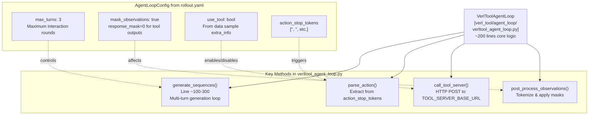

**Core Loop Structure** [verl_tool/agent_loop/verltool_agent_loop.py:100-300]():
1. Generate tokens until action stop token
2. Parse action from generated text
3. Call tool server with action
4. Append observation to prompt
5. Repeat until done or max_turns reached

Sources: [assets/docs/updates/verltool_v0.6.0_upgrade.md:5](), [verl_tool/agent_loop/verltool_agent_loop.py]()

---

## Training Capabilities

### Multi-Modal Support

VerlTool supports both text-only language models and multi-modal vision-language models through flexible data handling and tokenization.

**Supported Model Types**:

| Model Type | Example Models | Training Recipe | Key Configuration |
|------------|---------------|-----------------|-------------------|
| **Text-Only** | Qwen2.5-Math, DeepSeek-Math | `examples/train/math_tir/` | Standard vLLM rollout |
| **Vision-Language** | Qwen2VL, Qwen2.5-Omni | `examples/train/pixel_reasoner/` | Multi-modal data loader, image token handling |

**Multi-Modal Data Flow**:
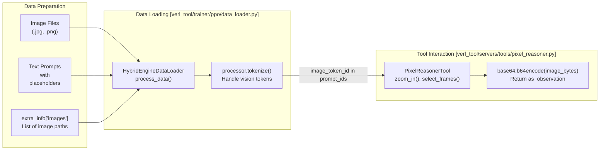

Sources: [assets/docs/updates/verltool_v0.6.0_upgrade.md:6](), [examples/train/pixel_reasoner/](), [examples/train/math_tir/]()

### Hybrid Training with use_tool Field

VerlTool supports training on mixed datasets where only a subset of samples require tool usage. This is controlled through the `use_tool` field in data samples.

**Hybrid Training Behavior**:
```python
# In dataset preparation
data_sample = {
    "prompt": "Solve: 2 + 2 = ?",
    "use_tool": False  # Agent operates in text-only mode
}

data_sample = {
    "prompt": "Write code to compute factorial(10)",
    "use_tool": True   # Agent can call tool server
}
```

**Agent Loop Decision Flow**:
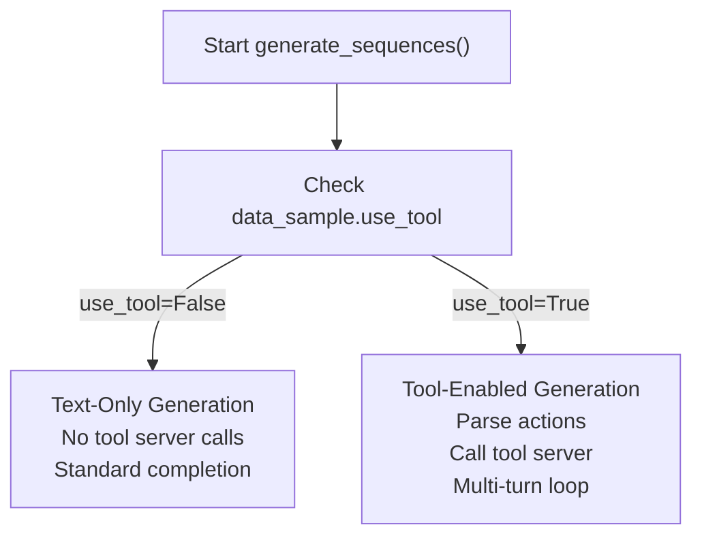

This feature enables:
- Training on datasets where not all problems benefit from tools
- Gradual curriculum from text-only to tool-using behaviors
- Mixed-capability models that adapt based on problem requirements

Sources: [assets/docs/updates/verltool_v0.6.0_upgrade.md:10](), [verl_tool/agent_loop/verltool_agent_loop.py]()

### Asynchronous Rollout Mode

VerlTool provides trajectory-level asynchronous rollout that processes each trajectory independently, enabling tool calls as soon as generation completes rather than waiting for the entire batch.

**Synchronous vs Asynchronous Rollout**:

| Mode | Configuration | Behavior | Performance (3 turns) |
|------|--------------|----------|----------------------|
| **Sync** | `actor_rollout_ref.rollout.mode='sync'` | Wait for all trajectories before tool calls | 194s (baseline) |
| **Async** | `actor_rollout_ref.rollout.mode='async'` | Independent trajectory processing | 94s (**2.06x faster**) |

**Async Rollout Architecture**:
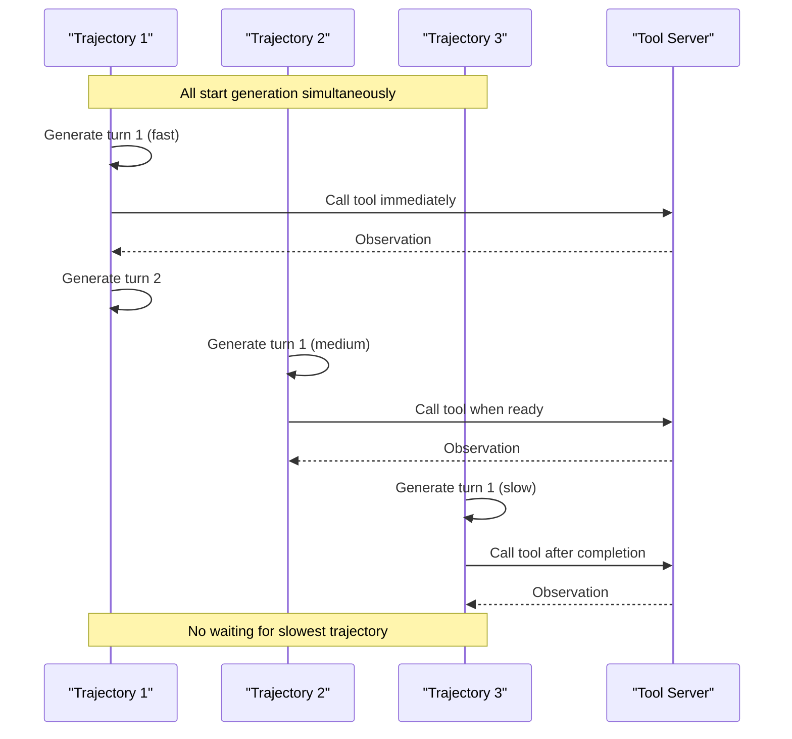

**Performance Benefits**:
- **2x+ speedup** for tool-heavy workloads with multiple turns
- Eliminates idle time waiting for slowest trajectory in batch
- Scales better with heterogeneous problem difficulties

**Note**: Use `use_ray=False` (default) for tool server when using async rollout due to Ray's concurrent request handling overhead.

Sources: [assets/docs/asyncRL.md:1-18](), [README.md:35]()

### Distributed Training Support

VerlTool inherits verl's distributed training capabilities and extends them with tool-specific resource management.

**Supported Parallelism Strategies**:

| Strategy | Configuration | Use Case | Models Supported |
|----------|--------------|----------|------------------|
| **FSDP** | `fsdp_config` in Hydra | Shard parameters across GPUs | 1.5B-7B models |
| **FSDP2** | `fsdp_config.fsdp_type='fsdp2'` | Improved FSDP with better memory | 7B-13B models |
| **Megatron** | `megatron` config section | Tensor/pipeline parallelism | 13B-70B+ models |

**Resource Pool Management**:
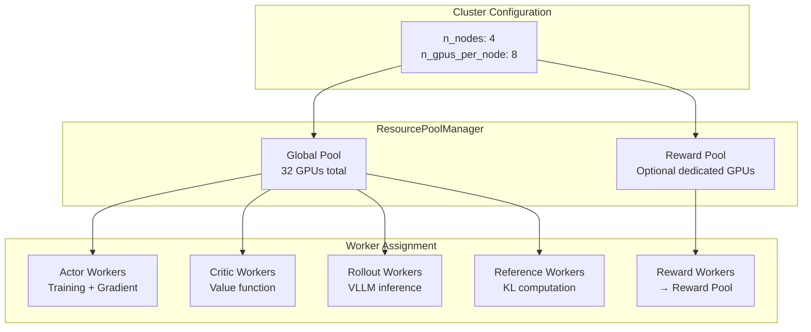

**Memory Optimization Features**:
- **Parameter Offloading**: Move parameters to CPU when not in use
- **Optimizer Offloading**: Offload optimizer states to CPU
- **Gradient Checkpointing**: Recompute activations to save memory
- **Dynamic Batch Sizing**: Adapt to variable sequence lengths

Sources: [README.md:43-46](), [verl_tool/trainer/ppo/ray_trainer.py]()

---

## Tool System Features

### Tool Extensibility via @register_tool

VerlTool provides a decorator-based registration system that makes adding new tools straightforward.

**Tool Registration and Discovery**:
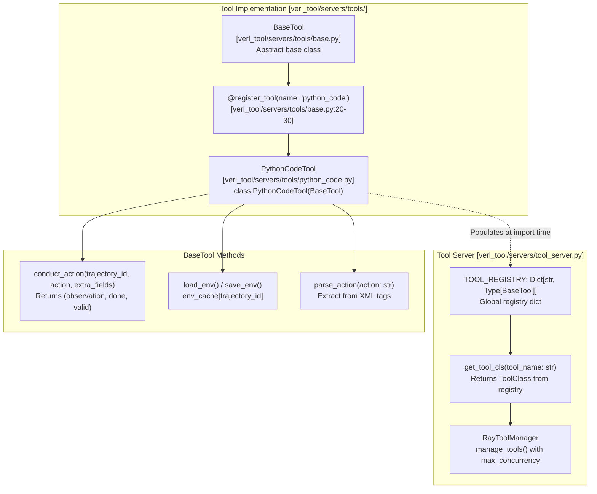

**Example Tool Implementation**:
```python
# verl_tool/servers/tools/example_tool.py
from verl_tool.servers.tools.base import BaseTool, register_tool

@register_tool(name="example_tool")
class ExampleTool(BaseTool):
    def conduct_action(self, trajectory_id: str, action: str, extra_fields: dict):
        # Load environment state
        env = self.load_env(trajectory_id)
        
        # Execute action
        observation = self.execute(action, env)
        
        # Update state
        env['history'].append((action, observation))
        self.save_env(trajectory_id, env)
        
        # Return (observation, done, valid)
        return observation, False, True
```

**Tool Discovery**: Tool server automatically discovers all tools decorated with `@register_tool` through Python's import system.

Sources: [verl_tool/servers/tools/base.py](), [verl_tool/servers/tool_server.py](), [README.md:43]()

### Security and Sandboxing

VerlTool implements defense-in-depth security for code execution tools through multiple isolation layers.

**Security Architecture by Tool Type**:

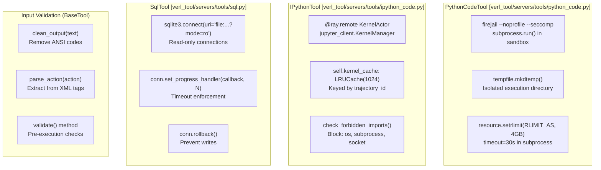

**Security Layers**:

| Layer | PythonCodeTool | IPythonTool | SqlTool |
|-------|---------------|-------------|---------|
| **Process Isolation** | Firejail sandbox | Ray actor isolation | SQLite process |
| **Resource Limits** | 4GB RAM, CPU timeout | Kernel-level limits | Progress handler timeout |
| **Filesystem Access** | Isolated /tmp | Standard Python restrictions | N/A |
| **Network Access** | Blocked by seccomp | Restricted | N/A |
| **Input Validation** | Forbidden imports check | Forbidden imports check | SQL injection prevention |

**Output Sanitization**:
- Clean traceback paths to remove system information
- Truncate observations by `max_obs_length`
- Format with XML-style tags `<result>...</result>`

Sources: [verl_tool/servers/tools/python_code.py](), [verl_tool/servers/tools/ipython_code.py](), [verl_tool/servers/tools/sql.py]()

### Tool Server Multi-Worker Architecture

VerlTool's tool server uses a router + multi-worker pattern for high concurrency and sticky routing.

**Tool Server Components**:
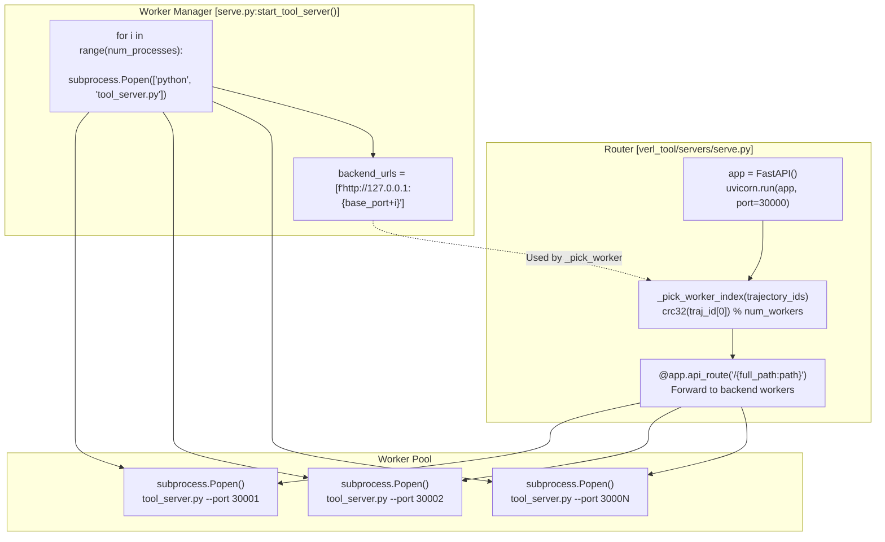

**Routing Strategy**:
- **Sticky Routing**: Same `trajectory_id` → same worker for state consistency
- **Load Balancing**: Different trajectories distributed across workers
- **Fallback**: Round-robin for requests without `trajectory_id` (e.g., cleanup)

**Typical Configuration**: 512 workers per tool server (configurable via `--num_processes`)

Sources: [verl_tool/servers/serve.py](), [scripts/start_tool_server.sh]()

---

## Inference and Deployment Features

### Fast Inference Backends

VerlTool supports multiple high-performance inference backends for policy rollout.

**Supported Backends**:

| Backend | Version | Use Case | Configuration |
|---------|---------|----------|---------------|
| **vLLM** | v0.11.0 | Primary backend, best performance | `rollout.backend='vllm'` |
| **SGLang** | Latest | Alternative backend, RadixAttention | `rollout.backend='sglang'` |

**Inference Engine Integration**:
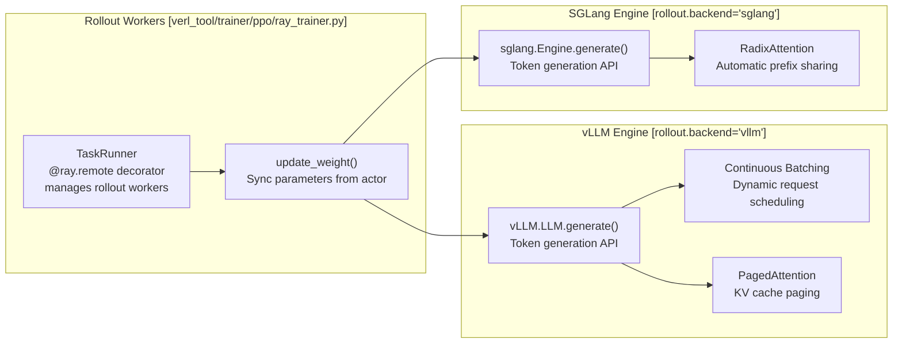

**Performance Optimizations**:
- **Continuous Batching**: Dynamic batch sizing for variable-length sequences
- **PagedAttention** (vLLM): Efficient KV cache management
- **RadixAttention** (SGLang): Automatic prefix sharing
- **Tensor Parallelism**: Split attention computation across GPUs

Sources: [README.md:134](), [verl_tool/trainer/ppo/ray_trainer.py]()

### OpenAI-Compatible Evaluation API

VerlTool provides an OpenAI API-compatible inference service for easy evaluation and deployment.

**API Endpoints**:

| Endpoint | Method | Purpose | Request Key Fields |
|----------|--------|---------|-------------------|
| `/v1/chat/completions` | POST | Chat-style multi-turn inference | `messages`, `model`, `temperature` |
| `/v1/completions` | POST | Single-turn completion | `prompt`, `model`, `max_tokens` |
| `/health` | GET | Service health check | None |

**Evaluation Service Architecture**:
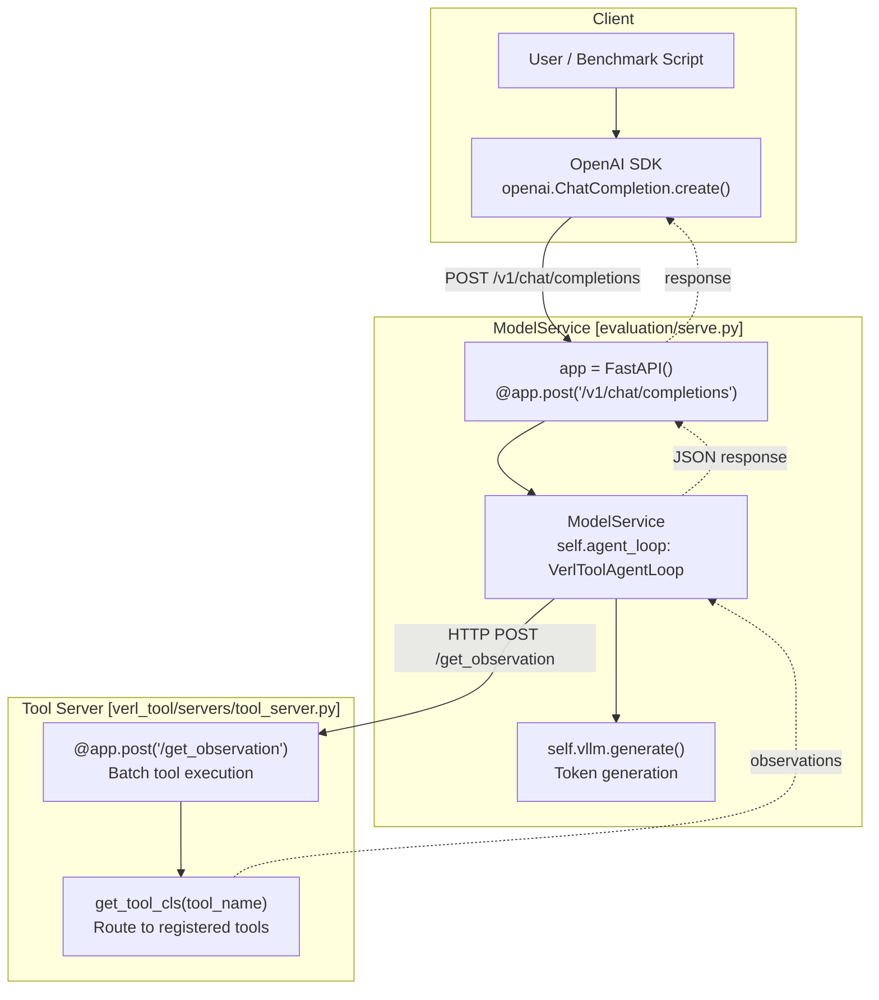

**Request Format**:
```json
{
  "model": "trained-model-path",
  "messages": [
    {"role": "user", "content": "Write code to solve: 2 + 2"}
  ],
  "temperature": 0.7,
  "max_tokens": 2048
}
```

**Response Includes**:
- Generated text with all tool interactions
- Token usage statistics
- Internal tool call logs (if enabled)

Sources: [README.md:46](), [evaluation/serve.py]()

### Multi-Turn Interaction Support

VerlTool natively supports multi-turn interactive loops between the agent and tools, essential for complex reasoning tasks.

**Multi-Turn Configuration**:

| Parameter | Location | Purpose | Example Values |
|-----------|----------|---------|----------------|
| `max_turns` | `config/rollout.yaml` | Maximum interaction rounds | 1-10 turns |
| `action_stop_tokens` | Rollout config | Tokens indicating tool calls | `["</tool_call>", "</action>"]` |
| `mask_observations` | Rollout config | Hide tool outputs during training | `true/false` |

**Multi-Turn Flow Example (Math Problem)**:
```mermaid
sequenceDiagram
    participant Agent as "Policy Model"
    participant Loop as "VerlToolAgentLoop"
    participant Tool as "PythonCodeTool"
    
    Note over Agent,Tool: Turn 1: Generate approach
    Agent->>Loop: "Let me solve 8! using code<br/><tool_call>python_code</tool_call>"
    Loop->>Tool: Execute code
    Tool-->>Loop: "<result>NameError: factorial not defined</result>"
    Loop->>Agent: Append observation to prompt
    
    Note over Agent,Tool: Turn 2: Fix error
    Agent->>Loop: "I need to import math<br/><tool_call>import math; math.factorial(8)</tool_call>"
    Loop->>Tool: Execute code
    Tool-->>Loop: "<result>40320</result>"
    Loop->>Agent: Append observation to prompt
    
    Note over Agent,Tool: Turn 3: Provide answer
    Agent->>Loop: "The answer is 40320<br/><finish></finish>"
    Loop->>Loop: Mark trajectory as done
```

**Turn Management**:
- Agent can terminate early with explicit finish signals
- Observations are tokenized and truncated by `max_obs_length`
- Environment state persists across turns via `trajectory_id`

Sources: [verl_tool/agent_loop/verltool_agent_loop.py](), [README.md:45]()

---

## Data and Configuration Features

### Tokens-In/Tokens-Out Design

VerlTool enforces strict token-level inputs and outputs to prevent off-policy issues caused by tokenization inconsistencies.

**Design Principle**:
- **Never detokenize-retokenize**: Pass token IDs directly between components
- **Avoid string manipulation**: Work with token arrays, not decoded strings
- **Consistent tokenization**: Use same tokenizer throughout pipeline

**Implementation in Agent Loop** [verl_tool/agent_loop/verltool_agent_loop.py]():
```python
# Correct: Pass token IDs
prompt_token_ids = torch.cat([prompt_ids, observation_ids], dim=-1)

# Incorrect: Detokenize and retokenize
# prompt_text = tokenizer.decode(prompt_ids)  # ❌ Causes off-policy
# prompt_text += observation_text
# prompt_token_ids = tokenizer.encode(prompt_text)
```

**Benefits**:
- Prevents off-policy data from tokenization mismatches
- Maintains exact token alignment for PPO updates
- Enables precise masking of observations vs. generations

Sources: [assets/docs/updates/verltool_v0.6.0_upgrade.md:7](), [verl_tool/agent_loop/verltool_agent_loop.py]()

### Rollout Data Logging

VerlTool provides comprehensive logging of all rollout data for debugging, analysis, and offline learning.

**Logged Information**:

| Data Type | Content | Storage Location | Format |
|-----------|---------|-----------------|--------|
| **Step Records** | Prompts, actions, observations, rewards | `trainer.rollout_data_dir` | JSONL |
| **Tool Interactions** | Full tool call history per trajectory | Step records | Nested JSON |
| **Token Sequences** | Generated token IDs and masks | Step records | Arrays |
| **Metadata** | Trajectory IDs, turns, done flags | Step records | JSON fields |

**Configuration** [examples/train/math_tir/train_math_tir.sh]():
```bash
trainer.rollout_data_dir=$(pwd)/verl_step_records/$run_name
```

**Logged Data Structure**:
```json
{
  "trajectory_id": "batch_0_sample_5",
  "turn": 2,
  "prompt_ids": [...],
  "response_ids": [...],
  "action": "<tool_call>python_code</tool_call>...",
  "observation": "<result>42</result>",
  "reward": 1.0,
  "done": true,
  "tool_interact_info": {
    "num_turns": 2,
    "tools_used": ["python_code"]
  }
}
```

**Use Cases**:
- Debugging tool interaction issues
- Analyzing reward distributions
- Offline RL training from logged data
- Performance profiling

Sources: [assets/docs/updates/verltool_v0.6.0_upgrade.md:9](), [verl_tool/trainer/ppo/ray_trainer.py]()

### Hydra-Based Configuration System

VerlTool uses Hydra for hierarchical configuration management with support for command-line overrides and configuration composition.

**Configuration Hierarchy**:
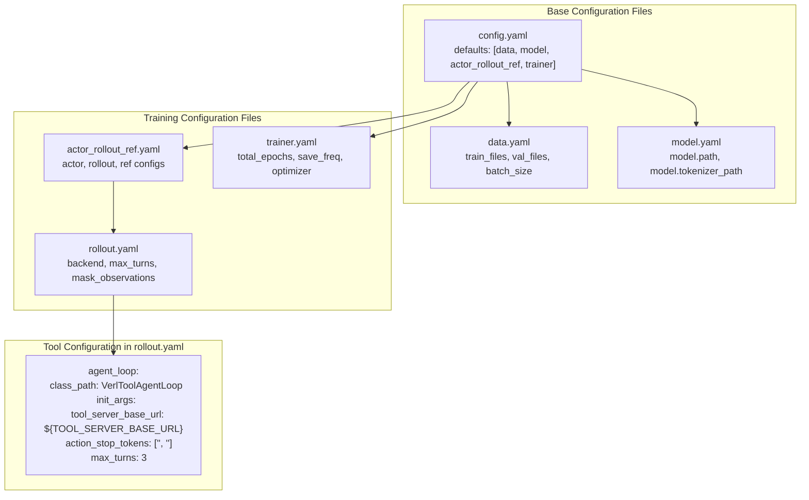

**Key Configuration Files by Component**:

| Component | Config File | Key Settings |
|-----------|------------|--------------|
| **Agent Loop** | `config/rollout.yaml` | `max_turns`, `mask_observations`, `use_tool` |
| **Tool Server** | `agent_config` in rollout | `tool_server_base_url`, `action_stop_tokens` |
| **Distributed Training** | `actor_rollout_ref.yaml` | `n_gpus`, `fsdp_config`, `megatron` |
| **Reward** | `trainer.yaml` | `reward_manager_name`, penalty weights |

**Command-Line Overrides**:
```bash
python main_ppo.py \
    data.train_files=/path/to/train.parquet \
    actor_rollout_ref.rollout.max_turns=5 \
    actor_rollout_ref.rollout.mode=async \
    trainer.total_epochs=10
```

Sources: [verl_tool/trainer/ppo/main_ppo.py](), [examples/train/math_tir/config/]()

---

## Summary of Key Capabilities

VerlTool provides a comprehensive framework for tool-agent RL training with the following key capabilities:

**Architectural Innovations**:
- Complete decoupling of rollout and environment via HTTP-based tool server
- Tool-as-environment paradigm with persistent state management
- Compact agent loop implementation (<200 lines)

**Training Features**:
- Multi-modal support (text-only and vision-language models)
- Hybrid training with per-sample `use_tool` control
- Asynchronous rollout mode (2x+ speedup)
- Distributed training with FSDP/Megatron

**Tool System**:
- Easy tool addition via `@register_tool` decorator
- Defense-in-depth security (Firejail, Ray actors, read-only SQL)
- Multi-worker architecture with sticky routing

**Deployment**:
- Fast inference with vLLM/SGLang backends
- OpenAI-compatible API for evaluation
- Multi-turn interaction support

**Data & Configuration**:
- Tokens-in/tokens-out design for off-policy prevention
- Comprehensive rollout data logging
- Hydra-based hierarchical configuration

For detailed information on specific features, see the referenced pages:
- System Architecture: [System Architecture Overview](#1.1)
- Tool-as-Environment: [Tool-as-Environment Paradigm](#1.3)
- Training Framework: [Core Training Framework](#2)
- Tool Implementations: [Tool Implementations](#4)
- Training Examples: [Training Recipes](#5)

Sources: [README.md:1-47](), [assets/docs/updates/verltool_v0.6.0_upgrade.md:1-12](), [assets/docs/asyncRL.md:1-18]()

### Training Recipe Catalog

| Recipe | Primary Tools | Domain | Recipe Path | Key Features |
|--------|--------------|--------|-------------|--------------|
| **Math Tool-Integrated RL** | `PythonCodeTool` | Mathematical reasoning | `examples/train/math_tir/` | Text-only, code execution with test cases, curriculum learning support |
| **AceCoder** | `IPythonTool` | Competitive programming | `examples/train/acecoder/` | Persistent IPython kernels, multi-problem datasets, LeetCode/CodeForces support |
| **Search R1** | `SearchRetrievalTool` | Web research | `examples/train/search_r1/` | Document retrieval, custom search backend integration |
| **DeepSearch** | `GoogleSearchTool` | Web research with Google | `examples/train/deepsearch/` | Google/Serper API integration, snippet processing, summarization |
| **NL2SQL (SkysSQL)** | `SqlTool` | Database querying | `examples/train/skysql/` | SQL execution, result comparison, Spider/Bird dataset support |
| **Pixel-Reasoner** | `PixelReasonerTool` | Visual reasoning | `examples/train/pixel_reasoner/` | Multi-modal GRPO, image processing, frame selection |
| **SWE** | `SandboxR2ETool` | Software engineering | `examples/train/swe/` | Repository interaction, code modification, SWE-bench tasks |
| **MCP Integration** | MCP protocol tools | External tool ecosystems | `examples/train/mcp_tut/`, `examples/train/mcp_universe/` | Model Context Protocol, extensible tool interfaces |

Sources: [examples/train/README.md:1-13](), [README.md:5-10]()

---

## Recipe Architecture and Tool Dependencies

The following diagram maps each training recipe to its primary tool dependencies and core components:

```mermaid
graph TB
    subgraph "Text-Only Recipes"
        MATH["math_tir<br/>examples/train/math_tir/"]
        ACECODER["acecoder<br/>examples/train/acecoder/"]
        SEARCHR1["search_r1<br/>examples/train/search_r1/"]
        DEEPSEARCH["deepsearch<br/>examples/train/deepsearch/"]
        SQL["skysql<br/>examples/train/skysql/"]
        SWE["swe<br/>examples/train/swe/"]
    end
    
    subgraph "Multi-Modal Recipes"
        PIXEL["pixel_reasoner<br/>examples/train/pixel_reasoner/"]
    end
    
    subgraph "Tool Implementations"
        PYCODE["PythonCodeTool<br/>verl_tool/servers/tools/python_code.py"]
        IPYTHON["IPythonTool<br/>verl_tool/servers/tools/ipython_code.py"]
        SEARCH["SearchRetrievalTool<br/>verl_tool/servers/tools/search_retrieval.py"]
        GOOGLE["GoogleSearchTool<br/>verl_tool/servers/tools/google_search.py"]
        SQLTOOL["SqlTool<br/>verl_tool/servers/tools/sql.py"]
        PIXELTOOL["PixelReasonerTool<br/>verl_tool/servers/tools/pixel_reasoner.py"]
        SANDBOX["SandboxR2ETool<br/>verl_tool/servers/tools/sandbox_r2e.py"]
    end
    
    subgraph "Reward Managers"
        MATHRM["MathCoderRewardManager<br/>verl_tool/reward/mathcoder.py"]
        ACECODERM["AceCoderRewardManager<br/>verl_tool/reward/acecoder.py"]
        TORLRM["ToRLRewardManager<br/>verl_tool/reward/torl.py"]
        SQLRM["SQLCoderRewardManager<br/>verl_tool/reward/sqlcoder.py"]
        PIXELRM["PixelReasonerRewardManager<br/>verl_tool/reward/pixel_reasoner.py"]
    end
    
    MATH -->|uses| PYCODE
    MATH -->|scored by| MATHRM
    MATH -->|variant| TORLRM
    
    ACECODER -->|uses| IPYTHON
    ACECODER -->|scored by| ACECODERM
    
    SEARCHR1 -->|uses| SEARCH
    DEEPSEARCH -->|uses| GOOGLE
    
    SQL -->|uses| SQLTOOL
    SQL -->|scored by| SQLRM
    
    PIXEL -->|uses| PIXELTOOL
    PIXEL -->|scored by| PIXELRM
    
    SWE -->|uses| SANDBOX
```

**Recipe Component Mapping**

Each training recipe consists of three main components that work together:

1. **Training Script**: Orchestrates the training loop, launches tool servers, and configures distributed training
2. **Tool Implementation**: Executes actions and returns observations to the agent
3. **Reward Manager**: Evaluates agent outputs and assigns rewards for RL updates

Sources: [examples/train/README.md:1-13](), [README.md:43-46]()

---

## Recipe Categories

### Text-Only Recipes

Text-only recipes train agents using vLLM or SGLang inference engines without multi-modal data. These recipes are simpler to configure and have lower resource requirements.

#### Code Execution Recipes

**Math Tool-Integrated RL** ([examples/train/math_tir/]())
- **Purpose**: Train models to solve mathematical problems using Python code execution
- **Key Components**:
  - Training entrypoint: `examples/train/math_tir/train_math_tir.sh`
  - Data preprocessing: `examples/train/math_tir/data/preprocess_math.py`
  - Tool: `PythonCodeTool` with Firejail sandboxing
  - Reward Manager: `MathCoderRewardManager` with test case verification
- **Supported Datasets**: GSM8K, MATH, NumGLUE
- **Training Features**: Curriculum learning, test case generation, format penalty system

**AceCoder** ([examples/train/acecoder/]())
- **Purpose**: Train models for competitive programming problems with persistent execution environments
- **Key Components**:
  - Training entrypoint: `examples/train/acecoder/train_acecoder.sh`
  - Data preprocessing: `examples/train/acecoder/data/acecoder.py`
  - Tool: `IPythonTool` with Ray-managed kernel actors
  - Reward Manager: `AceCoderRewardManager` with comprehensive test validation
- **Supported Datasets**: CodeForces, AtCoder, LeetCode problems
- **Training Features**: Multi-test case validation, persistent kernel state, pass@k evaluation

**ToRL Variant**
- **Purpose**: Alternative math training approach with different reward computation
- **Reward Manager**: `ToRLRewardManager` (see [verl_tool/reward/torl.py]())
- **Difference**: Uses alternative test case generation and verification strategies

#### Search and Retrieval Recipes

**Search R1** ([examples/train/search_r1/]())
- **Purpose**: Train models to retrieve and reason over documents from custom search backends
- **Key Components**:
  - Tool: `SearchRetrievalTool` for document retrieval
  - Supports custom document corpora and retrieval backends
- **Use Case**: Domain-specific search where Google is not available or appropriate

**DeepSearch** ([examples/train/deepsearch/]())
- **Purpose**: Train models to use Google Search via Serper API for open-domain question answering
- **Key Components**:
  - Training entrypoint: `examples/train/deepsearch/train_deepsearch.sh`
  - Tool: `GoogleSearchTool` with AsyncLRU caching
  - Supports both snippet-only and full-text retrieval modes
- **Training Features**: Search query optimization, snippet summarization, multi-hop reasoning

#### Database Interaction Recipes

**NL2SQL (SkysSQL)** ([examples/train/skysql/]())
- **Purpose**: Train models to generate SQL queries from natural language questions
- **Key Components**:
  - Training entrypoint: `examples/train/skysql/train_skysql.sh`
  - Data preprocessing: `examples/train/skysql/data/preprocess_skysql.py`
  - Tool: `SqlTool` with database connection management
  - Reward Manager: `SQLCoderRewardManager` with query result comparison
- **Supported Datasets**: Spider, Bird, WikiSQL
- **Training Features**: Query execution validation, result set comparison, read-only enforcement

#### Software Engineering Recipes

**SWE** ([examples/train/swe/]())
- **Purpose**: Train models to solve software engineering tasks with repository interaction
- **Key Components**:
  - Tool: `SandboxR2ETool` for repository manipulation
  - Supports SWE-bench style tasks
- **Training Features**: File editing, test execution, patch generation

### Multi-Modal Recipes

Multi-modal recipes train agents that process images or videos alongside text. These recipes require additional configuration for multi-modal data handling.

**Pixel-Reasoner** ([examples/train/pixel_reasoner/]())
- **Purpose**: Train vision-language models to solve visual reasoning tasks using image processing tools
- **Key Components**:
  - Training entrypoint: `examples/train/pixel_reasoner/train_pixel_reasoner.sh`
  - Tool: `PixelReasonerTool` for image cropping and frame selection
  - Reward Manager: `PixelReasonerRewardManager` with group penalties
- **Supported Models**: Qwen2VL, Qwen2.5Omni
- **Training Features**: GRPO with curiosity and redundancy penalties, multi-frame processing, MTRL configuration

Sources: [examples/train/README.md:3-11](), [assets/docs/updates/verltool_v0.6.0_upgrade.md:6]()

---

## Recipe File Structure Pattern

Each training recipe follows a consistent directory structure:

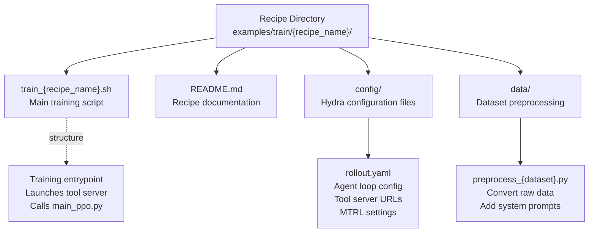

**Common Files Across All Recipes**:

| File/Directory | Purpose | Example Reference |
|---------------|---------|------------------|
| `train_*.sh` | Shell script that launches tool server and starts training | `examples/train/math_tir/train_math_tir.sh` |
| `README.md` | Recipe-specific documentation with setup instructions | `examples/train/math_tir/README.md` |
| `config/rollout.yaml` | Hydra configuration for agent loop and tools | Recipe-specific rollout configs |
| `data/preprocess_*.py` | Dataset preprocessing and formatting scripts | `examples/train/math_tir/data/preprocess_math.py` |
| `data/*.parquet` | Preprocessed training data in Parquet format | Generated by preprocessing scripts |

Sources: [examples/train/README.md:1-13]()

---

## Training Script Execution Pattern

All training recipes follow a common execution pattern that can be understood through their shell scripts:

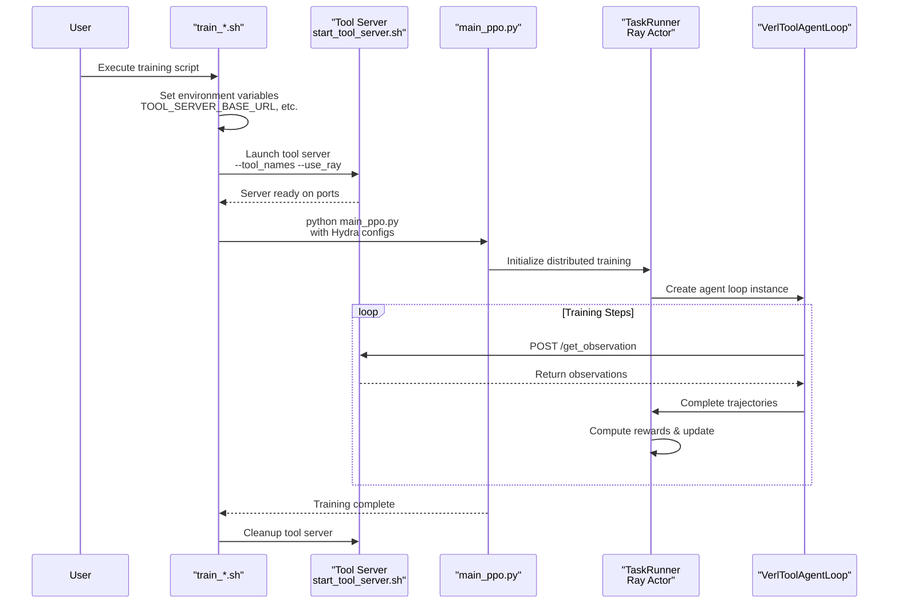

**Key Execution Steps**:

1. **Environment Setup**: Training scripts set environment variables for tool server URLs and configuration paths
2. **Tool Server Launch**: `start_tool_server.sh` initializes tool workers (typically 512 per tool type)
3. **Training Initialization**: `main_ppo.py` sets up Ray cluster and creates `TaskRunner`
4. **Agent Loop Creation**: `VerlToolAgentLoop` is instantiated with tool server URLs
5. **Training Loop**: Multi-turn interactions between agent and tools with reward computation
6. **Cleanup**: Tool server is shut down after training completion

Sources: [examples/train/README.md:1-13]()

---

## Choosing the Right Recipe

### Selection Criteria

| If Your Task Involves... | Recommended Recipe | Key Considerations |
|-------------------------|-------------------|-------------------|
| Mathematical problem solving with code | **Math Tool-Integrated RL** | Use `curriculum_learning=true` for progressive difficulty |
| Competitive programming problems | **AceCoder** | Requires persistent kernel state via `IPythonTool` |
| Web research and fact-finding | **DeepSearch** | Configure Serper API key, choose snippet vs full-text mode |
| Custom document retrieval | **Search R1** | Requires preparing custom document corpus |
| Natural language to SQL queries | **NL2SQL** | Prepare database schemas and ground truth queries |
| Visual reasoning with images/videos | **Pixel-Reasoner** | Requires multi-modal model support (Qwen2VL/Qwen2.5Omni) |
| Software repository manipulation | **SWE** | Still in development, use for SWE-bench style tasks |

### Customization Points

All recipes can be customized through:

1. **Tool Configuration**: Modify tool behavior in `verl_tool/servers/tools/*.py`
2. **Reward Logic**: Implement custom reward managers in `verl_tool/reward/`
3. **Agent Behavior**: Adjust `rollout.yaml` parameters (max_turns, observation masking, etc.)
4. **Dataset Format**: Preprocess data following the pattern in `data/preprocess_*.py`
5. **Training Hyperparameters**: Modify Hydra configs in `config/` directories

Sources: [README.md:43-46]()

---

## Hybrid Training Support

VerlTool supports hybrid training where some samples use tools and others do not. This is configured through the dataset:

**Dataset Field**: `use_tool` (boolean)
- When `use_tool=True`: Agent loop enables tool calling and interacts with tool server
- When `use_tool=False`: Agent loop operates as standard text generation without tool interaction

**Configuration Location**: Set during data preprocessing in `data/preprocess_*.py` scripts

This feature allows training on mixed datasets where only a subset of problems benefit from tool use, improving model flexibility.

Sources: [assets/docs/updates/verltool_v0.6.0_upgrade.md:10]()

---

## MCP Integration Recipes

The Model Context Protocol (MCP) recipes demonstrate integration with external tool ecosystems:

**MCP Tutorial** ([examples/train/mcp_tut/]())
- Provides step-by-step guide for training MCP-compatible agents
- Documentation: `examples/train/mcp_tut/mcp_agent_tutorial.md`
- Demonstrates tool protocol abstraction

**MCP Universe** ([examples/train/mcp_universe/]())
- Evaluation suite for MCP-Universe benchmark
- Uses `MCPInterfaceTool` for protocol-based tool interaction
- Shows how to integrate arbitrary MCP-compliant tools

These recipes demonstrate VerlTool's extensibility beyond built-in tools.

Sources: [examples/train/README.md:12-13]()

---

## Recipe Maintenance and Updates

VerlTool's recipe collection follows modular design principles:

- **Core Agent Logic**: All tool interaction logic consolidated in [verl_tool/agent_loop/verltool_agent_loop.py]() (<200 lines)
- **Tool Independence**: Each tool can be developed and tested independently in `verl_tool/servers/tools/`
- **Reward Modularity**: Reward managers are registered via `@register_reward_manager` decorator
- **Version Compatibility**: Recipes are updated to support verl 0.6.0 and vLLM 0.11.0

When the underlying `verl` submodule is updated, recipes benefit from framework improvements while maintaining backward compatibility through the stable agent loop interface.

Sources: [assets/docs/updates/verltool_v0.6.0_upgrade.md:5]()

---

## Next Steps

- For detailed setup and execution instructions for specific recipes, see [Training Recipes](#5)
- For understanding the training framework that orchestrates these recipes, see [Core Training Framework](#2)
- For implementing custom tools, see [Tool Implementations](#4)
- For creating custom reward logic, see [Reward Management System](#6)
- For installation and environment setup, see [Installation and Setup](#1.4)

---

