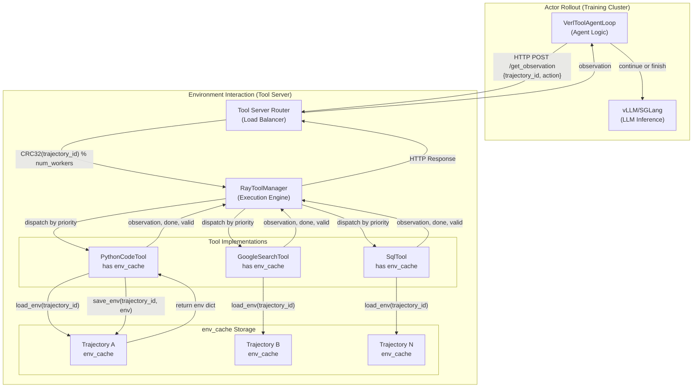
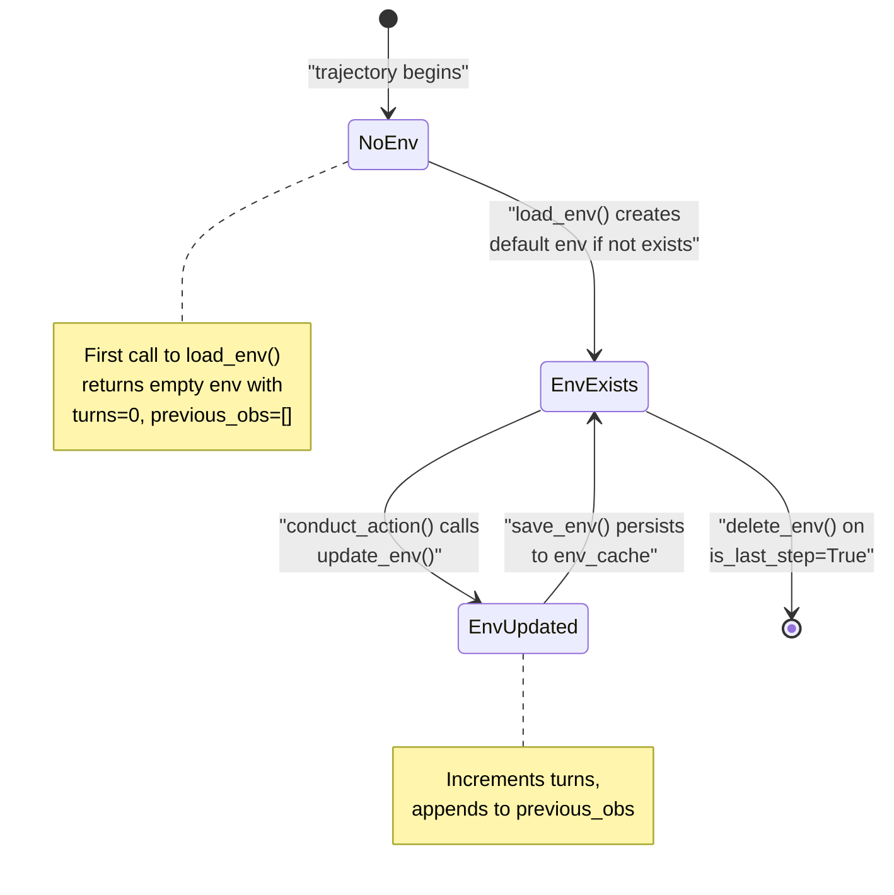
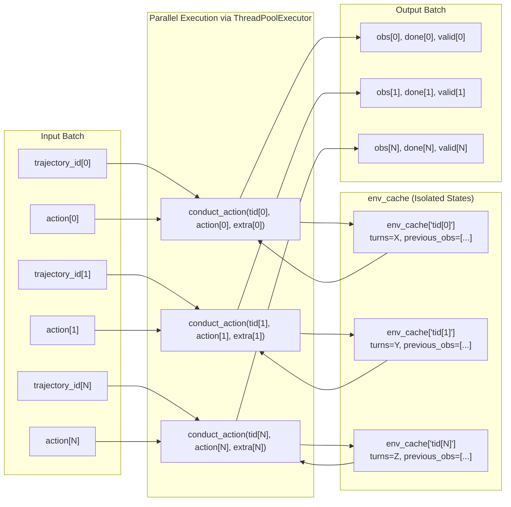
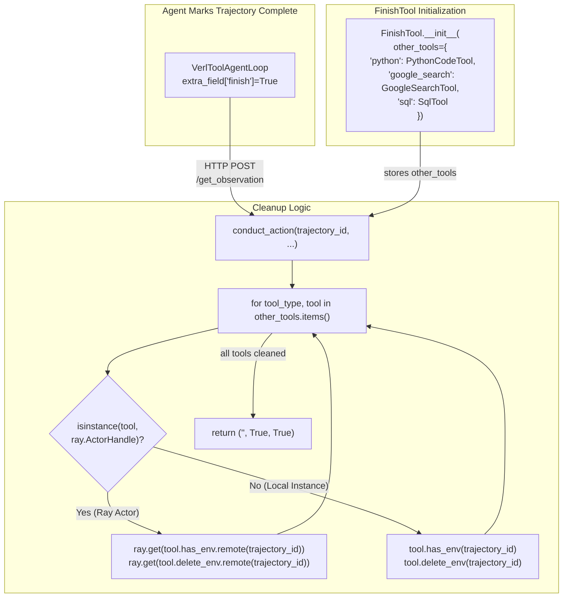
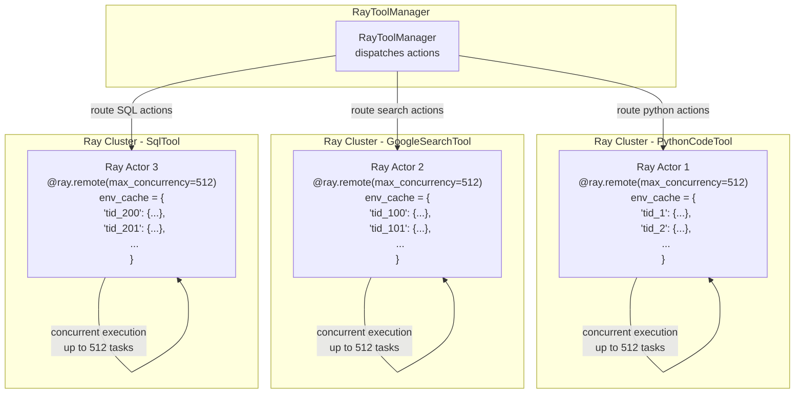

<!-- source: DeepWiki mcp.deepwiki.com · repo TIGER-AI-Lab/verl-tool · page 1.3 Tool-as-Environment Paradigm · fetched 2026-10-30 -->

# Tool-as-Environment Paradigm

<details>
<summary>Relevant source files</summary>

The following files were used as context for generating this wiki page:

- [README.md](README.md)
- [assets/docs/updates/verltool_v0.6.0_upgrade.md](assets/docs/updates/verltool_v0.6.0_upgrade.md)
- [verl_tool/servers/ray_utils.py](verl_tool/servers/ray_utils.py)
- [verl_tool/servers/tools/base.py](verl_tool/servers/tools/base.py)
- [verl_tool/servers/tools/finish.py](verl_tool/servers/tools/finish.py)
- [verl_tool/servers/tools/search_retrieval.py](verl_tool/servers/tools/search_retrieval.py)

</details>


## Purpose and Scope

This document explains VerlTool's **tool-as-environment paradigm**, a fundamental design principle that treats each tool as a stateful environment with persistent state across multi-turn interactions. This page covers:

- The philosophy of complete decoupling between actor rollout and environment interaction
- How environment states are stored, loaded, and managed per trajectory
- The `env_cache` system and its lifecycle operations
- Cross-tool state coordination via `FinishTool`

For the multi-turn agent loop that orchestrates environment interactions, see [Agent Loop System](#2.3). For specific tool implementations, see [Tool Implementations](#4).

---

## Core Design Philosophy

### Environment as Stateful Context

In VerlTool, each tool is treated as an **environment** in the reinforcement learning sense. Unlike stateless function calls, tools maintain persistent state that evolves across multiple turns of interaction:

```
Trajectory 1 (turn 1) → Environment State Updated → saved to env_cache
Trajectory 1 (turn 2) → Load Previous State → Execute → Update → Save
Trajectory 1 (turn 3) → Load Previous State → Execute → Update → Save
...
Trajectory 1 (final)  → FinishTool cleans up all tool states for this trajectory
```

Each trajectory has its own isolated environment state, enabling:
- **State persistence**: Previous observations, execution history, and metadata are preserved
- **Contextual execution**: Tools can access prior interactions to inform current actions
- **Multi-turn reasoning**: Agents can build on previous tool outputs
- **Safe parallelization**: Independent trajectories never interfere with each other

**Sources**: [README.md:44-46](), [verl_tool/servers/tools/base.py:47-103]()

---

## Complete Decoupling Architecture

VerlTool achieves **complete decoupling** between the actor rollout (policy generation) and environment interaction (tool execution). This is a critical design principle that enables:

1. **Independent scaling**: Tool servers can run on different machines from the training cluster
2. **Asynchronous execution**: Rollout generation doesn't block on tool execution
3. **Clean separation of concerns**: Training code never directly calls tool code
4. **Flexible deployment**: Tools can be upgraded without touching training infrastructure



**Key Interface**: The HTTP `/get_observation` endpoint is the **only** communication channel between actor rollout and tool execution. The request payload contains:
- `trajectory_id`: Unique identifier for environment isolation
- `action`: LLM-generated text containing tool invocation
- `extra_field`: Additional metadata (e.g., `is_last_step`)

**Sources**: [README.md:44](), [verl_tool/servers/ray_utils.py:325-383]()

---

## Environment State Structure

Each tool maintains an `env_cache` dictionary mapping `trajectory_id` to environment state. The state structure is defined in `BaseTool`:

### State Schema

| Field | Type | Description |
|-------|------|-------------|
| `trajectory_id` | `str` | Unique identifier for this trajectory |
| `metadata` | `dict` | Contains `turns` (int) - number of interactions so far |
| `previous_obs` | `list[dict]` | History of all interactions in this trajectory |

Each entry in `previous_obs` contains:

| Field | Type | Description |
|-------|------|-------------|
| `action` | `str` | The parsed action that was executed |
| `is_valid` | `bool` | Whether the action was valid |
| `observation` | `str/dict` | The result returned by the tool |
| `extra_field` | `dict` | Additional metadata passed with the action |
| `**kwargs` | `Any` | Tool-specific fields (e.g., `execution_result`, `error`) |

**Example State**:
```python
{
    "trajectory_id": "traj_12345_0",
    "metadata": {
        "turns": 2
    },
    "previous_obs": [
        {
            "action": "print('Hello')",
            "is_valid": True,
            "observation": "Hello\n",
            "extra_field": {"some_metadata": "value"},
            "execution_result": "Hello\n"
        },
        {
            "action": "x = 5 + 3",
            "is_valid": True,
            "observation": "",
            "extra_field": {},
            "execution_result": ""
        }
    ]
}
```

**Sources**: [verl_tool/servers/tools/base.py:62-95]()

---

## Environment Lifecycle Operations

The `BaseTool` class defines four fundamental operations for environment state management:



### 1. `load_env(trajectory_id)`

Retrieves environment state from `env_cache`. If the trajectory doesn't exist, returns a default empty environment:

```python
def load_env(self, trajectory_id):
    env = self.env_cache.get(trajectory_id)
    if env == None:
        env = {
            "trajectory_id": trajectory_id,
            "metadata": {"turns": 0},
            "previous_obs": [],
        }
    return env
```

**When called**: At the start of every `conduct_action()` call.

**Sources**: [verl_tool/servers/tools/base.py:62-75]()

### 2. `save_env(trajectory_id, env)`

Persists the current environment state back to `env_cache`:

```python
def save_env(self, trajectory_id, env):
    self.env_cache[trajectory_id] = env
```

**When called**: After updating the environment in `conduct_action()`.

**Sources**: [verl_tool/servers/tools/base.py:77-81]()

### 3. `update_env(trajectory_id, env, action, is_valid, extra_field, observation, **kwargs)`

Modifies environment state by:
- Incrementing the turn counter
- Appending the current interaction to `previous_obs`

```python
def update_env(self, trajectory_id, env, action, is_valid, extra_field, observation, **kwargs):
    env["metadata"]["turns"] += 1
    env["previous_obs"].append({
        "action": action,
        "is_valid": is_valid,
        "observation": observation,
        "extra_field": extra_field,
        **kwargs
    })
```

**When called**: After executing an action but before saving.

**Sources**: [verl_tool/servers/tools/base.py:83-94]()

### 4. `delete_env(trajectory_id)`

Removes environment state from `env_cache`:

```python
def delete_env(self, trajectory_id):
    self.env_cache.pop(trajectory_id, None)
```

**When called**: 
- When `extra_field['is_last_step'] == True` in `maybe_cleanup_env()`
- By `FinishTool` for cross-tool cleanup

**Sources**: [verl_tool/servers/tools/base.py:96-100](), [verl_tool/servers/tools/base.py:157-169]()

---

## Standard Tool Execution Pattern

Every tool follows this pattern in its `conduct_action()` method:

```mermaid
graph TB
    Start["conduct_action(trajectory_id, action, extra_field)"]
    
    Parse["1. parse_action(action)<br/>→ parsed_action, is_valid"]
    
    Load["2. load_env(trajectory_id)<br/>→ env dict"]
    
    Execute["3. Execute tool-specific logic<br/>(e.g., run code, call API)<br/>→ observation, done, valid"]
    
    Update["4. update_env(trajectory_id, env,<br/>parsed_action, is_valid,<br/>extra_field, observation)"]
    
    Save["5. save_env(trajectory_id, env)"]
    
    Return["6. return (observation, done, valid)"]
    
    Start --> Parse
    Parse --> Load
    Load --> Execute
    Execute --> Update
    Update --> Save
    Save --> Return
    
    note right of Load
        If trajectory_id not in env_cache,
        creates default env with turns=0
    end note
    
    note right of Update
        Increments turns counter,
        appends to previous_obs list
    end note
```

**Example Implementation** (from `SearchRetrievalTool`):

```python
def conduct_action(self, trajectory_id, action, extra_field):
    # Step 1: Parse action
    parsed_query, is_valid = self._parse_search_query(action)
    
    # Step 2: Load environment
    env = self.load_env(trajectory_id)
    
    # Step 3: Execute tool logic
    if is_valid:
        search_results = self._batch_search([parsed_query])
        observation = f'\n\n<information>{formatted_results}</information>\n\n'
        done = False
        valid = True
    else:
        observation = ""
        done = False
        valid = False
    
    # Step 4: Update environment
    self.update_env(trajectory_id, env, parsed_query, is_valid, extra_field, observation)
    
    # Step 5: Save environment
    self.save_env(trajectory_id, env)
    
    # Step 6: Return results
    return observation, done, valid
```

**Sources**: [verl_tool/servers/tools/base.py:132-155](), [verl_tool/servers/tools/search_retrieval.py:116-166]()

---

## Batch Processing with Environment Management

Tools support batch processing via `get_observations()`, which internally calls `conduct_action()` for each trajectory while maintaining independent environment states:



**Implementation Details**:

| Condition | Strategy | Max Workers |
|-----------|----------|-------------|
| `len(trajectory_ids) <= 4` | Sequential execution (for loop) | 1 |
| `len(trajectory_ids) > 4` | Parallel via `ThreadPoolExecutor` | `min(num_workers, len(trajectory_ids))` |

The `maybe_cleanup_env()` method is called after batch processing to delete environments for trajectories marked with `is_last_step=True`:

```python
def maybe_cleanup_env(self, trajectory_ids, actions, extra_fields):
    for i in range(len(trajectory_ids)):
        if extra_fields[i].get('is_last_step', False):
            if self.has_env(trajectory_ids[i]):
                self.delete_env(trajectory_ids[i])
```

**Sources**: [verl_tool/servers/tools/base.py:171-198](), [verl_tool/servers/tools/base.py:157-169]()

---

## Cross-Tool State Management via FinishTool

The `FinishTool` is a special tool that coordinates environment cleanup across **all** registered tools. This is necessary because:

1. A trajectory may interact with multiple tools (e.g., search → code execution → SQL)
2. Each tool maintains its own `env_cache` for that trajectory
3. When a trajectory completes, all tool states must be cleaned up

### FinishTool Architecture



**Key Implementation Details**:

The `FinishTool` is initialized with references to all other tools in the system:

```python
@register_tool
class FinishTool(BaseTool):
    def __init__(self, num_workers=1, other_tools:dict = {}):
        super().__init__(num_workers)
        self.other_tools = other_tools  # Dictionary of tool_type -> tool_instance
```

During cleanup, it handles both Ray actors and local tool instances:

```python
def conduct_action(self, trajectory_id, action, extra_data):
    # Clean up environments for all tools
    for tool_type, tool in self.other_tools.items():
        if isinstance(tool, ray.actor.ActorHandle):
            # Ray actor - use remote calls
            has_env = ray.get(tool.has_env.remote(trajectory_id))
            if has_env:
                ray.get(tool.delete_env.remote(trajectory_id))
        else:
            # Local instance - direct method calls
            if tool.has_env(trajectory_id):
                tool.delete_env(trajectory_id)
    
    return "", True, True  # Empty observation, done=True, valid=True
```

**When FinishTool is invoked**:
- Explicitly when `extra_field['finish'] == True`
- Implicitly when agent loop sets `is_last_step=True`

**Sources**: [verl_tool/servers/tools/finish.py:1-48](), [verl_tool/servers/ray_utils.py:93-98]()

---

## Consistent Hashing for Stateful Routing

To ensure the same trajectory always reaches the same tool worker (and thus accesses the same `env_cache`), VerlTool uses **consistent hashing** on `trajectory_id`:

### Routing Mechanism

```mermaid
graph TB
    subgraph "Frontend Router (serve.py)"
        Request["HTTP POST /get_observation<br/>{trajectory_ids: [tid1, tid2, ...],<br/>actions: [...], extra_fields: [...]}"]
        
        PickWorker["_pick_worker_index(trajectory_ids)<br/>→ worker_index"]
        
        Hash["worker_index =<br/>CRC32(trajectory_ids[0]) % num_workers"]
        
        Proxy["Proxy to Backend Worker<br/>http://127.0.0.1:backend_ports[worker_index]"]
    end
    
    subgraph "Backend Workers"
        B0["Worker 0<br/>Port 10000<br/>RayToolManager<br/>with env_cache"]
        
        B1["Worker 1<br/>Port 10001<br/>RayToolManager<br/>with env_cache"]
        
        BN["Worker N<br/>Port 1000N<br/>RayToolManager<br/>with env_cache"]
    end
    
    Request --> PickWorker
    PickWorker --> Hash
    Hash --> Proxy
    
    Proxy -->|"if worker_index==0"| B0
    Proxy -->|"if worker_index==1"| B1
    Proxy -->|"if worker_index==N"| BN
    
    note right of Hash
        Deterministic mapping:
        Same trajectory_id always
        routes to same worker
    end note
```

**Key Properties**:

| Property | Implementation | Benefit |
|----------|---------------|---------|
| **Determinism** | `CRC32(trajectory_id) % num_workers` | Same trajectory always reaches same worker |
| **Load Balancing** | Hash distributes trajectories evenly | Workers have roughly equal load |
| **State Locality** | Worker maintains `env_cache` in memory | Fast access, no distributed state |
| **Fault Tolerance** | Frontend retries on worker failure | Graceful degradation |

**Why This Matters**:

Without consistent hashing, trajectory turn 2 might route to a different worker than turn 1, resulting in:
- `load_env()` returns empty state (no previous observations)
- Loss of multi-turn context
- Broken agent reasoning

With consistent hashing:
- Turn 1: `tid_123` → Worker 0 → Creates env, saves to Worker 0's `env_cache`
- Turn 2: `tid_123` → Worker 0 → Loads existing env, updates, saves
- Turn 3: `tid_123` → Worker 0 → Loads updated env, continues

**Sources**: [verl_tool/servers/ray_utils.py:176-209](), [verl_tool/servers/ray_utils.py:211-233]()

---

## Environment State in Ray Distributed Execution

When using `RayToolManager`, each tool is instantiated as a **Ray remote actor** with `max_concurrency=workers_per_tool`. This creates multiple worker processes for each tool, but **within** each Ray actor, there is a single `env_cache` dictionary.

### Ray Actor Environment Architecture



**Initialization Code**:

```python
def _initialize_tools(self):
    for tool_type in ordered_tools:
        tool_cls = get_tool_cls(tool_type)
        
        # Create Ray remote actor with max_concurrency
        tool_instance = ray.remote(
            max_concurrency=self.config.workers_per_tool
        )(tool_cls).remote()
        
        self.tools[tool_type] = tool_instance
```

**Concurrency Model**:

- `max_concurrency=512` means the Ray actor can process up to 512 concurrent `conduct_action()` calls
- Each call operates on a different `trajectory_id`, so there's no state contention
- The `env_cache` dictionary is **not** thread-safe, but Python's GIL protects against race conditions for dictionary operations
- For CPU-intensive tools, internal `ThreadPoolExecutor` provides parallelism within a single `conduct_action()` call

**Sources**: [verl_tool/servers/ray_utils.py:68-103](), [verl_tool/servers/ray_utils.py:76-78]()

---

## Design Benefits and Trade-offs

### Benefits

| Benefit | Explanation |
|---------|-------------|
| **Contextual Tool Use** | Tools access previous interactions, enabling stateful behaviors (e.g., IPython history, search refinement) |
| **Clean Abstraction** | Training code never touches tool code; all interaction via HTTP API |
| **Horizontal Scaling** | Add more tool server workers without changing training setup |
| **Isolated Testing** | Each tool can be tested independently with mock trajectories |
| **Fault Isolation** | Tool server crashes don't affect training cluster |
| **Multi-Tool Trajectories** | Single trajectory can use multiple tools; each maintains separate state |

### Trade-offs

| Trade-off | Consideration |
|-----------|---------------|
| **Memory Overhead** | Each active trajectory stores state in RAM; long trajectories accumulate `previous_obs` |
| **Cleanup Required** | Must explicitly delete environments via `FinishTool` or `is_last_step` flag |
| **Network Latency** | HTTP round-trips add overhead compared to in-process calls |
| **State Locality** | Consistent hashing ties trajectories to specific workers; worker failure loses state |
| **No Persistence** | `env_cache` is in-memory only; server restarts lose all trajectory states |

**Mitigation Strategies**:

1. **Memory**: Set reasonable limits on `previous_obs` length in tool implementations
2. **Cleanup**: Agent loop always sets `is_last_step=True` on final turn
3. **Latency**: Use async rollout mode to hide tool execution latency (see [Asynchronous Rollout Mode](#2.6))
4. **Fault Tolerance**: Frontend router retries failed requests; trajectories auto-restart
5. **Persistence**: Not needed for RL training (states are temporary); could add Redis for long-running deployments

**Sources**: [README.md:44-47](), [verl_tool/servers/tools/base.py:1-207]()

---

## Summary

The tool-as-environment paradigm provides a **clean, scalable architecture** for multi-turn tool-agent RL training:

1. **State Management**: `env_cache` dictionary maps `trajectory_id` to environment state
2. **Lifecycle Operations**: `load_env()`, `save_env()`, `update_env()`, `delete_env()`
3. **Stateful Routing**: Consistent hashing ensures trajectory continuity
4. **Cross-Tool Cleanup**: `FinishTool` coordinates environment deletion
5. **Distributed Execution**: Ray actors provide concurrent processing with state isolation

This design enables VerlTool to train agents on complex multi-turn tasks while maintaining **complete separation** between the RL training infrastructure and tool execution environment.

**Sources**: [README.md:44-46](), [verl_tool/servers/tools/base.py:41-207](), [verl_tool/servers/tools/finish.py:9-48](), [verl_tool/servers/ray_utils.py:18-462]()

---

