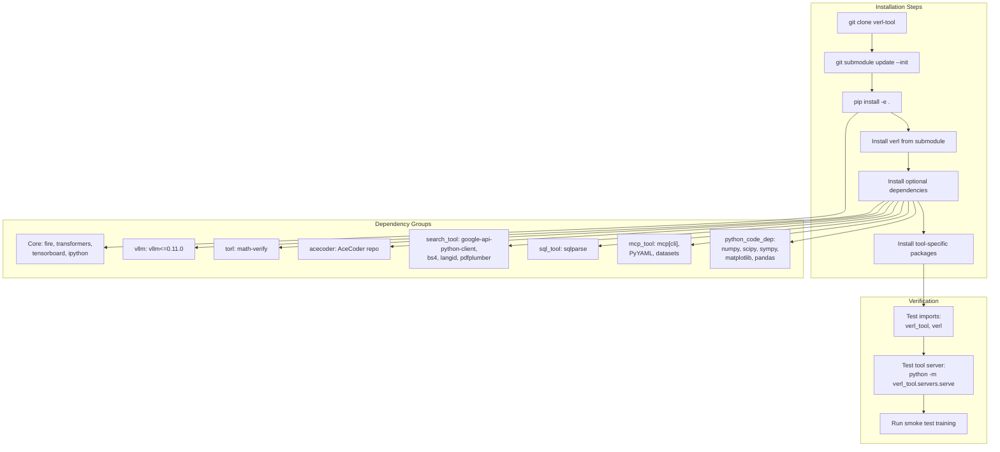
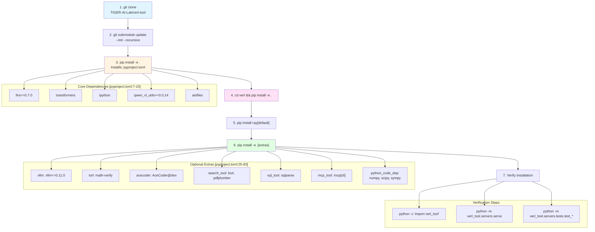
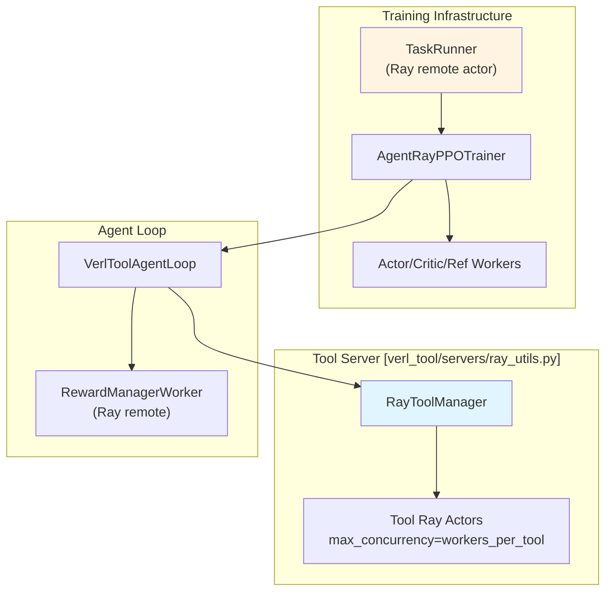
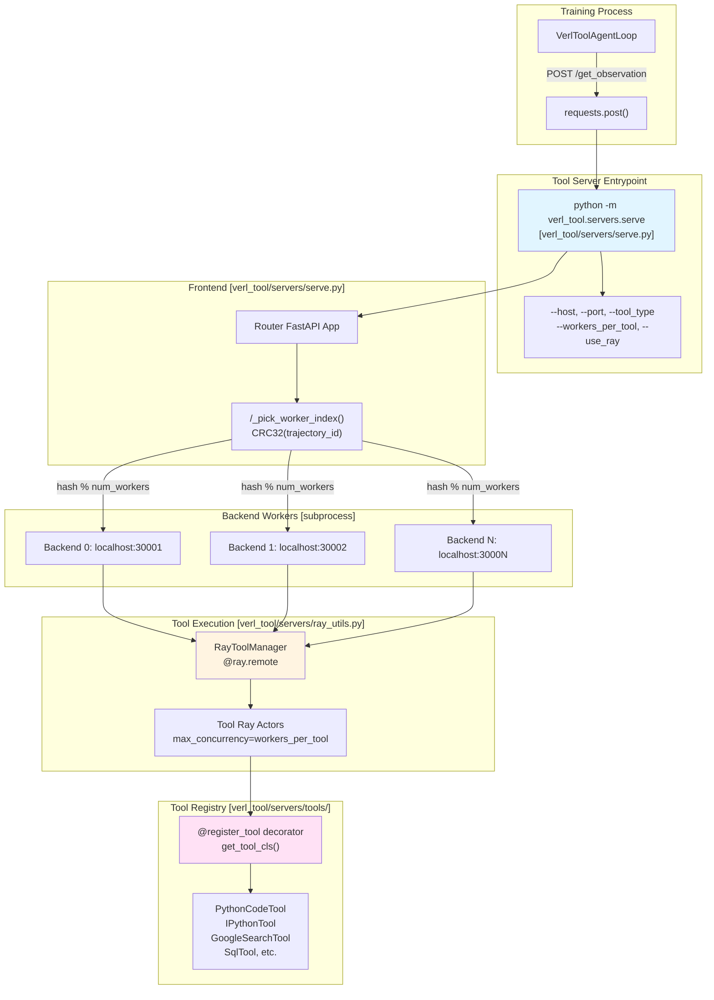

<!-- source: DeepWiki mcp.deepwiki.com · repo TIGER-AI-Lab/verl-tool · page 1.4 Installation and Setup · fetched 2026-10-30 -->

# Installation and Setup

<details>
<summary>Relevant source files</summary>

The following files were used as context for generating this wiki page:

- [README.md](README.md)
- [assets/docs/tool_server.md](assets/docs/tool_server.md)
- [assets/docs/updates/verltool_v0.6.0_upgrade.md](assets/docs/updates/verltool_v0.6.0_upgrade.md)
- [pyproject.toml](pyproject.toml)

</details>


This page provides installation instructions, dependency management, and initial configuration steps for setting up VerlTool. It covers system requirements, installation via `pyproject.toml`, verl submodule initialization, and tool server setup.

For training-specific configuration, see page 2.4 (Configuration System). For detailed training workflows, see pages 5.1-5.6 (Training Recipes).

---

## System Requirements

### Hardware Requirements

| Component | Minimum | Recommended |
|-----------|---------|-------------|
| **GPU** | 1x NVIDIA GPU (40GB+ VRAM) | 8x A100/H100 (80GB) |
| **CPU** | 16 cores | 32+ cores (for tool server) |
| **RAM** | 64 GB | 128+ GB |
| **Disk** | 100 GB | 500+ GB (checkpoints, logs) |
| **Network** | 1 Gbps | 10+ Gbps (multi-node) |

### Software Requirements

| Software | Version | Purpose |
|----------|---------|---------|
| **Python** | ≥3.10 | Core runtime (see [pyproject.toml:6]()) |
| **CUDA** | 11.8+ or 12.1+ | GPU acceleration |
| **PyTorch** | 2.0+ | Deep learning framework |
| **Ray** | Latest | Distributed execution |
| **Firejail** | Latest | Code sandboxing (optional) |
| **Git** | Any | Submodule management |

**Sources**: [README.md:1-61](), [pyproject.toml:6]()
</thinking>

## Installation Overview



**Sources**: [README.md:17](), [pyproject.toml:1-83]()
</old_str>
<new_str>
## Installation Dependency Graph



**Sources**: [README.md:17](), [pyproject.toml:1-83](), [assets/docs/tool_server.md:34-44]()

---

## Installation Overview


**Sources**: [README.md:17](), [pyproject.toml:1-83]()

---

## Step 1: Clone Repository and Initialize Submodules

VerlTool uses the `verl` framework as a Git submodule, currently pinned to version **0.6.0**. The submodule must be initialized before installation.

```bash
# Clone the repository
git clone https://github.com/TIGER-AI-Lab/verl-tool.git
cd verl-tool

# Initialize and update the verl submodule
git submodule update --init --recursive

# Verify submodule is at correct version
cd verl && git log --oneline -1
# Should show commit corresponding to verl v0.6.0
cd ..
```

The `verl` submodule is located at `verl/` and provides the base PPO trainer infrastructure that VerlTool extends via [verl_tool/trainer/ppo/ray_trainer.py]().

**Sources**: [README.md:31](), [assets/docs/updates/verltool_v0.6.0_upgrade.md:3-8]()

---

## Step 2: Install Core Dependencies

Install the base VerlTool package and its core dependencies defined in [pyproject.toml:7-20]().

```bash
# Install verl-tool in editable mode
pip install -e .
```

### Core Dependencies [pyproject.toml:7-20]()

| Package | Version | Used By | Purpose |
|---------|---------|---------|---------|
| `fire` | >=0.7.0 | Training scripts | CLI argument parsing |
| `transformers` | Latest | Model loading | Tokenizers and models |
| `ipython` | Latest | `IPythonTool` | Code execution |
| `qwen_vl_utils` | >=0.0.14 | Multi-modal | Image/audio encoding |
| `func_timeout` | Latest | Tool execution | Timeout enforcement |
| `aiofiles` | Latest | Tool server | Async file I/O |
| `tensorboard` | Latest | Training | Logging |
| `psutils` | >=3.3.9 | System monitoring | Process utilities |

**Sources**: [pyproject.toml:7-20]()

---

## Step 3: Install verl Framework

Install the verl framework from the submodule. This provides the base `RayPPOTrainer` that `AgentRayPPOTrainer` extends.

```bash
# Install verl from submodule
cd verl
pip install -e .
cd ..

# Verify verl installation
python -c "import verl; print(verl.__version__)"
# Should output version >= 0.6.0
```

### VerlTool Customizations [verl_tool/trainer/ppo/ray_trainer.py]()

VerlTool extends verl through `AgentRayPPOTrainer`, which provides:
- Agent loop integration via `VerlToolAgentLoop` (see page 2.3)
- Custom rollout generation with tool interaction support
- Validation logging with tool-specific metrics
- Rollout data dumping via `trainer.rollout_data_dir`

The customizations are implemented through runtime patching in [verl_tool/trainer/ppo/ray_trainer.py](), which replaces specific verl modules with VerlTool implementations.

**Sources**: [README.md:31](), [assets/docs/updates/verltool_v0.6.0_upgrade.md:5-8]()

---

## Step 4: Install Optional Dependencies by Use Case

VerlTool organizes optional dependencies into logical groups defined in [pyproject.toml:25-83](). Install only what you need for your training recipe.

### Dependency Installation Matrix

| Training Recipe | Required Groups | Installation Command | Key Components |
|----------------|-----------------|---------------------|----------------|
| **ToRL (Math)** | `vllm`, `torl`, `python_code_dep` | `pip install -e ".[vllm,torl,python_code_dep]"` | `ToRLRewardManager`, `PythonCodeTool` |
| **AceCoder** | `vllm`, `acecoder`, `python_code_dep` | `pip install -e ".[vllm,acecoder,python_code_dep]"` | `AceCoderRewardManager`, `PythonCodeTool` |
| **DeepSearch** | `vllm`, `search_tool` | `pip install -e ".[vllm,search_tool]"` | `GoogleSearchTool` |
| **SQLCoder** | `vllm`, `sql_tool` | `pip install -e ".[vllm,sql_tool]"` | `SqlTool`, `SQLCoderRewardManager` |
| **Pixel-Reasoner** | `vllm`, `python_code_dep` | `pip install -e ".[vllm,python_code_dep]"` | `PixelReasonerTool`, `PixelReasonerRewardManager` |
| **MCP Tools** | `vllm`, `mcp_tool` | `pip install -e ".[vllm,mcp_tool]"` | `MCPTool` |

### Optional Dependency Groups [pyproject.toml:25-83]()

#### vllm: Fast Inference Engine

```bash
pip install -e ".[vllm]"
# Installs: vllm<=0.11.0
```

Used by `VerlToolvLLMHttpServer` and `AsyncLLMServerManager` for rollout generation. See page 2.5 for details.

#### torl: Math Verification

```bash
pip install -e ".[torl,python_code_dep]"
# torl: math-verify
# python_code_dep: numpy, scipy, sympy, matplotlib, pandas, etc.
```

Used by `ToRLRewardManager` for mathematical answer verification. See page 6.2.

#### acecoder: Code Test Execution

```bash
pip install -e ".[acecoder,python_code_dep]"
# Installs: AceCoder@dev from GitHub
```

Used by `AceCoderRewardManager` for test case evaluation. See page 6.2.

#### search_tool: Web Search

```bash
pip install -e ".[search_tool]"
# Installs: google-api-python-client, bs4, langid, pdfplumber, nltk
```

Used by `GoogleSearchTool` and `SearchRetrievalTool`. See page 4.3.

#### sql_tool: SQL Execution

```bash
pip install -e ".[sql_tool]"
# Installs: sqlparse
```

Used by `SqlTool` and `SQLCoderRewardManager`. See page 4.4.

#### mcp_tool: Model Context Protocol

```bash
pip install -e ".[mcp_tool]"
# Installs: mcp[cli], PyYAML, datasets, pyarrow, mcp-server-fetch
```

Enables MCP-based tool integration. See page 4.5.

**Sources**: [pyproject.toml:25-83]()

---

## Step 5: Install Ray for Distributed Execution

VerlTool uses Ray for distributed tool execution and training orchestration. Ray must be installed separately.

```bash
# Install Ray
pip install ray[default]

# For multi-node training, install Ray cluster utilities
pip install ray[default,tune]

# Verify Ray installation
python -c "import ray; ray.init(); print(ray.cluster_resources()); ray.shutdown()"
```

### Ray Usage in VerlTool



**Sources**: [verl_tool/servers/ray_utils.py:18-463](), [README.md:44-47]()

---

## Step 6: Install Code Sandboxing (Optional but Recommended)

For safe execution of generated code, install Firejail for sandboxing Python code execution.

```bash
# On Ubuntu/Debian
sudo apt-get install firejail

# On CentOS/RHEL
sudo yum install firejail

# Verify installation
firejail --version
```

Firejail is used by `PythonCodeTool` to execute code with resource limits. Without Firejail, code execution will still work but without sandbox protection. See page 4.1 for details on sandbox configuration.

**Sources**: [verl_tool/servers/tools/python_code_tool.py]()

---

## Verification and Testing

### Verify Core Installation

```bash
# Test VerlTool imports
python -c "from verl_tool.agent_loop.verltool_agent_loop import VerlToolAgentLoop; print('✓')"

# Test verl imports
python -c "from verl.trainer.ppo.ray_trainer import RayPPOTrainer; print('✓')"

# Test vLLM (if installed)
python -c "from vllm import LLM; print('✓')"

# Test Ray
python -c "import ray; ray.init(); print('✓'); ray.shutdown()"
```

### Test Tool Server

Start a tool server with the `python_code` tool to verify tool infrastructure:

```bash
# Launch tool server
python -m verl_tool.servers.serve \
    --host localhost \
    --port 5000 \
    --tool_type python_code \
    --workers_per_tool 512 \
    --use_ray True \
    --max_concurrent_requests 1024 \
    --router_workers 8 \
    --log_level info &

# Wait for server startup
sleep 5

# Test the server
python -m verl_tool.servers.tests.test_python_code_tool \
    --url http://localhost:5000/get_observation
```

Expected output:
```
2025-06-05 14:28:24,037 - __main__ - INFO - Available Tools:
2025-06-05 14:28:24,037 - __main__ - INFO -   - python_code: active 🟢
2025-06-05 14:28:24,037 - __main__ - INFO -   - finish: active 🟢
INFO:     Uvicorn running on http://localhost:5000 (Press CTRL+C to quit)
```

**Sources**: [assets/docs/tool_server.md:34-66](), [assets/docs/tool_server.md:68-80]()

---

## Tool Server Architecture

### Component Mapping to Code Entities



### Tool Server Configuration Parameters

| Parameter | Default | Description | Code Reference |
|-----------|---------|-------------|----------------|
| `--host` | `localhost` | Server bind address | [verl_tool/servers/serve.py]() |
| `--port` | `5000` | Server port | [verl_tool/servers/serve.py]() |
| `--tool_type` | Required | Comma-separated tool names | See [verl_tool/servers/tools/]() |
| `--workers_per_tool` | `128` | Ray actor max concurrency | [verl_tool/servers/ray_utils.py]() |
| `--use_ray` | `False` | Enable Ray-based execution | [verl_tool/servers/ray_utils.py:18-463]() |
| `--max_concurrent_requests` | `1024` | Max simultaneous requests | [verl_tool/servers/serve.py]() |
| `--router_workers` | `8` | Backend worker processes | [verl_tool/servers/serve.py]() |
| `--log_level` | `info` | Logging verbosity | Standard Python logging |

### Ray Configuration Warning

From [verl_tool/servers/ray_utils.py:77-78]():

> **Warning**: Set `workers_per_tool` to at least 4× CPU cores for optimal performance.

**Sources**: [assets/docs/tool_server.md:34-44](), [verl_tool/servers/ray_utils.py:77-78]()

---

## Repository Structure

### Directory Organization

```
verl-tool/
├── verl/                      # Submodule (verl v0.6.0)
├── verl_tool/                 # VerlTool codebase
│   ├── agent_loop/            # VerlToolAgentLoop (<200 LOC)
│   ├── servers/               # Tool server infrastructure
│   │   ├── serve.py           # Tool server router
│   │   ├── ray_utils.py       # RayToolManager
│   │   └── tools/             # Tool implementations
│   ├── trainer/               # Training customizations
│   │   └── ppo/               # AgentRayPPOTrainer, reward managers
│   └── data/                  # Data preprocessing scripts
├── examples/train/            # Training recipes
│   ├── math_tir/              # Math + tool reasoning
│   ├── acecoder/              # Code generation
│   ├── search_r1/             # Web search
│   ├── skysql/                # SQL queries
│   └── pixel_reasoner/        # Vision tasks
├── configs/                   # Hydra YAML configs
└── pyproject.toml             # Dependency specification
```

### Environment Variables

Set these environment variables before training:

```bash
# Required
export CUDA_VISIBLE_DEVICES=0,1,2,3,4,5,6,7  # GPUs to use

# Optional (for WandB logging)
export WANDB_API_KEY=your_key_here
export WANDB_PROJECT=verl-tool

# Optional (for Google Search)
export SERPER_API_KEY=your_key_here

# Optional (for multi-node)
export RAY_ADDRESS=auto  # Connect to existing Ray cluster
```

### Minimal Training Example

```bash
# 1. Start tool server
python -m verl_tool.servers.serve \
    --host localhost --port 5000 \
    --tool_type python_code \
    --workers_per_tool 512 \
    --use_ray True &

# 2. Wait for server startup
sleep 10

# 3. Run training
python verl_tool/trainer/main_ppo.py \
    actor_rollout_ref.model.path=meta-llama/Llama-3.1-8B-Instruct \
    data.train_files=[path/to/train.parquet] \
    data.val_files=[path/to/val.parquet] \
    trainer.total_epochs=10 \
    agent.enable_agent=true \
    agent.max_turns=8 \
    agent.tool_server_url=http://localhost:5000 \
    +reward_manager.name=torl
```

For complete training examples, see pages 5.1-5.6 (Training Recipes).

**Sources**: [assets/docs/updates/verltool_v0.6.0_upgrade.md:5-10](), [README.md:51-60]()

---

## Configuration System Preview

VerlTool uses Hydra for configuration management. Key config files are located in `configs/`:

| Config File | Purpose | Key Parameters |
|------------|---------|----------------|
| `actor.yaml` | Actor model config | `model.path`, `learning_rate`, FSDP settings |
| `rollout.yaml` | Inference config | vLLM/SGLang settings, generation params |
| `agent.yaml` | Agent loop config | `enable_agent`, `max_turns`, `tool_server_url` |
| `critic.yaml` | Critic model config | Learning rate, FSDP settings |

Example Hydra override syntax:
```bash
# Override single value
actor_rollout_ref.model.path=meta-llama/Llama-3.1-8B-Instruct

# Override nested config
agent.enable_agent=true agent.max_turns=8

# Add new key (use + prefix)
+reward_manager.name=torl

# Override list
data.train_files=[file1.parquet,file2.parquet]
```

For detailed configuration documentation, see page 2.4 (Configuration System).

**Sources**: [assets/docs/updates/verltool_v0.6.0_upgrade.md:9]()

---

## Troubleshooting

### Submodule Not Initialized

**Symptoms**: `ImportError: No module named 'verl'`

**Solution**:
```bash
git submodule update --init --recursive
cd verl && pip install -e . && cd ..
```

### Ray Not Connecting

**Symptoms**: Training hangs during rollout

**Solution**:
```bash
# Check Ray cluster status
ray status

# Verify tool server
curl http://localhost:5000/health

# Check logs
tail -f tool_server.log

# Increase workers_per_tool (should be 4× CPU cores)
```

### vLLM Version Mismatch

**Symptoms**: `AttributeError` or version conflicts

**Solution**:
```bash
pip uninstall vllm -y
pip install "vllm<=0.11.0"
python -c "import vllm; print(vllm.__version__)"
```

### CUDA Out of Memory

**Symptoms**: `CUDA out of memory` errors

**Solution**:
```bash
# Reduce batch size
actor_rollout_ref.rollout.n_mbs=4

# Enable gradient checkpointing
actor.model.gradient_checkpointing=true

# Reduce vLLM memory usage
actor_rollout_ref.rollout.gpu_memory_utilization=0.85
```

**Sources**: [assets/docs/tool_server.md:34-108](), [verl_tool/servers/ray_utils.py:77-78]()

---

## Next Steps

After completing installation and verification:

1. **Explore Training Recipes**: Review complete training examples in [Training Recipes](#4)
2. **Understand Agent Loop**: Learn how multi-turn tool interaction works in [Agent Loop System](#2.3)
3. **Configure Tool Server**: Deep dive into tool implementations in [Tool Server Framework](#3)
4. **Set Up Data Pipeline**: Prepare datasets using guides in [Data Preprocessing Pipeline](#6)
5. **Launch Training**: Follow training guides starting with [ToRL](#4.2) or [AceCoder](#4.3)

**Sources**: [README.md:50-59]()

---

