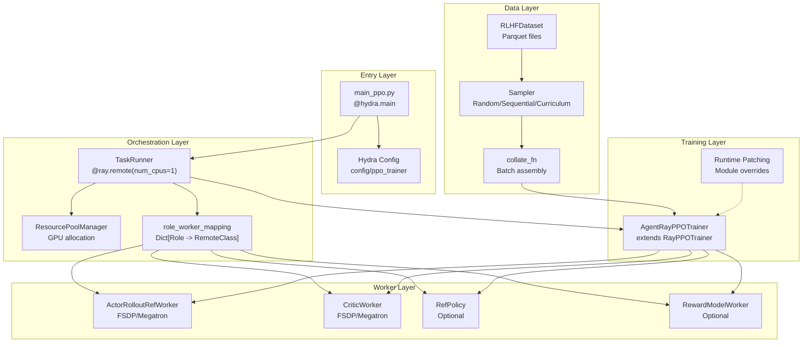
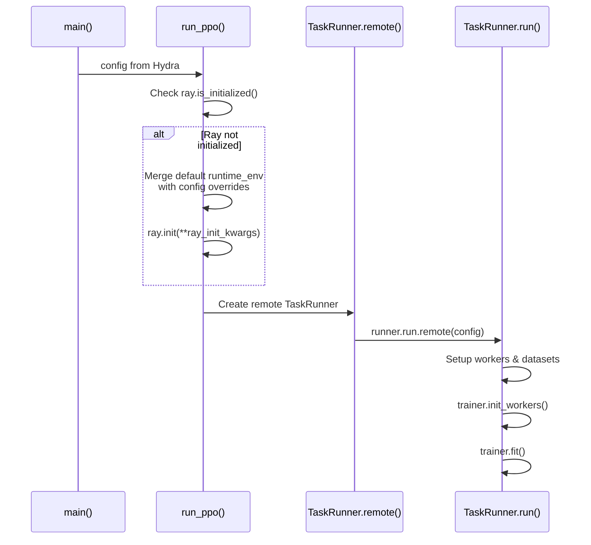
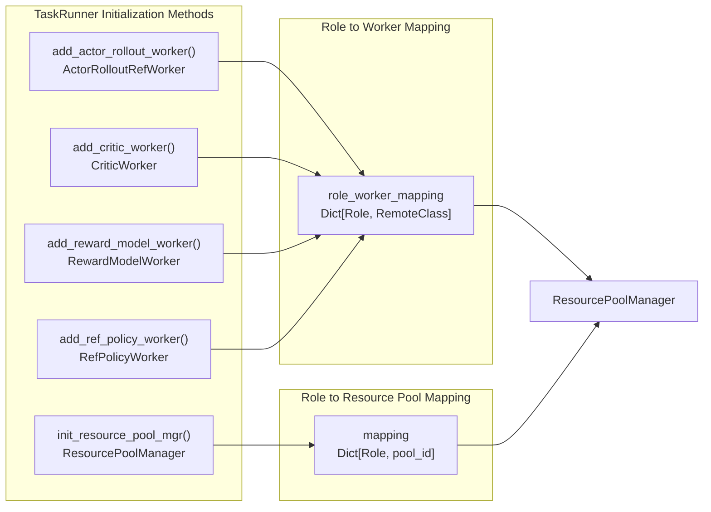
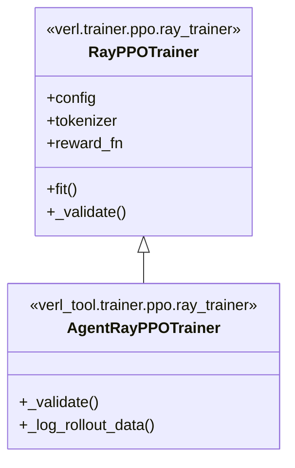
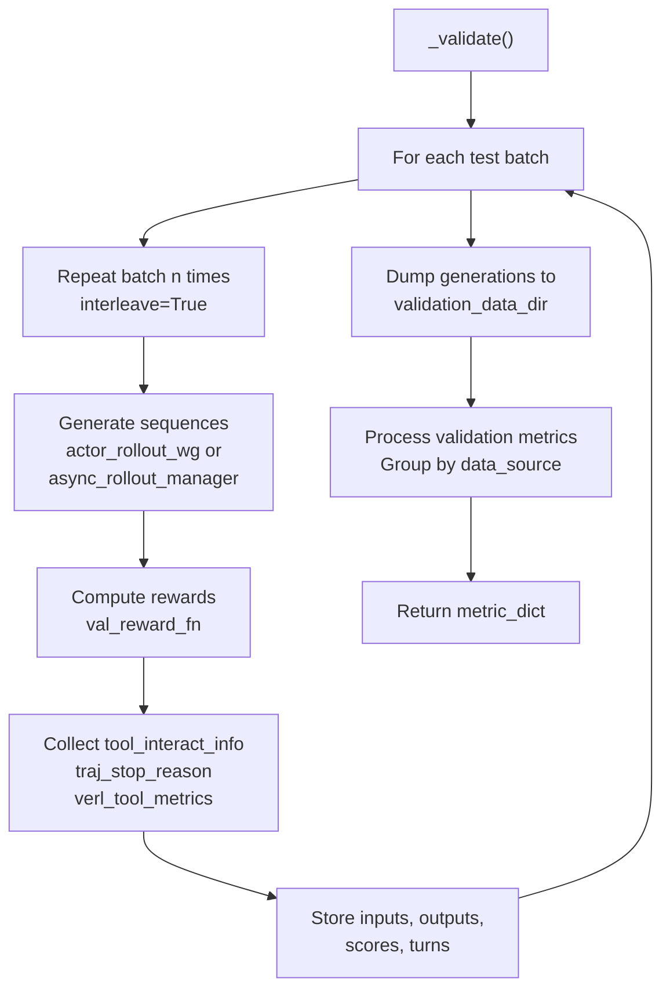
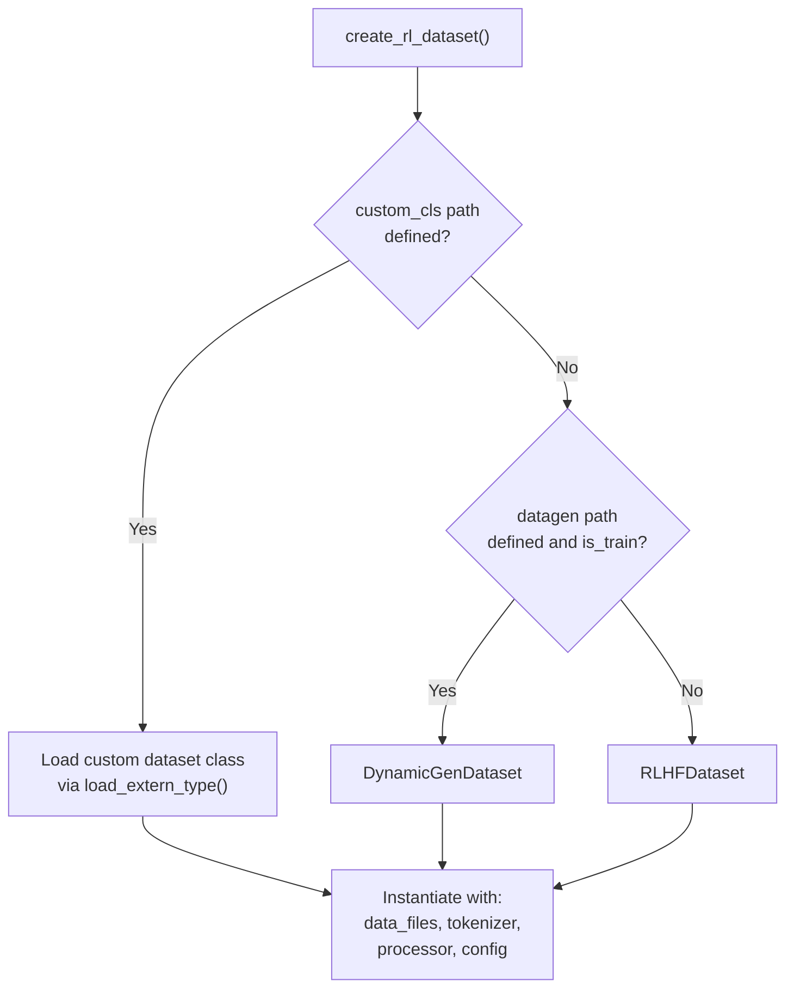
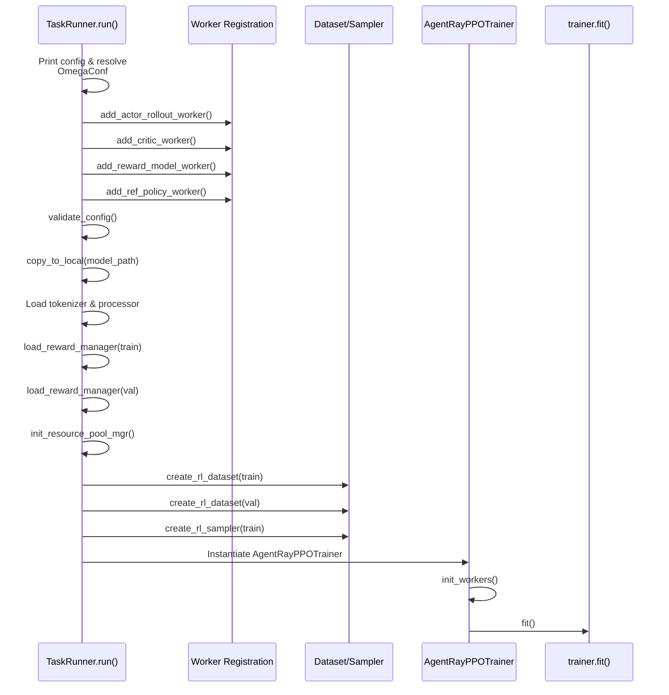

<!-- source: DeepWiki mcp.deepwiki.com · repo TIGER-AI-Lab/verl-tool · page 2 Core Training Framework · fetched 2026-10-30 -->

# Core Training Framework

<details>
<summary>Relevant source files</summary>

The following files were used as context for generating this wiki page:

- [verl_tool/agent_loop/agent_loop.py](verl_tool/agent_loop/agent_loop.py)
- [verl_tool/agent_loop/verltool_agent_loop.py](verl_tool/agent_loop/verltool_agent_loop.py)
- [verl_tool/servers/serve.py](verl_tool/servers/serve.py)
- [verl_tool/servers/tests/test_python_code_tool.py](verl_tool/servers/tests/test_python_code_tool.py)
- [verl_tool/servers/tools/ipython_code.py](verl_tool/servers/tools/ipython_code.py)
- [verl_tool/servers/tools/utils/ipython_tool.py](verl_tool/servers/tools/utils/ipython_tool.py)
- [verl_tool/trainer/config/verltool/agent.yaml](verl_tool/trainer/config/verltool/agent.yaml)
- [verl_tool/trainer/main_ppo.py](verl_tool/trainer/main_ppo.py)
- [verl_tool/trainer/ppo/metric_util.py](verl_tool/trainer/ppo/metric_util.py)
- [verl_tool/trainer/ppo/ray_trainer.py](verl_tool/trainer/ppo/ray_trainer.py)
- [verl_tool/workers/reward_manager/torl.py](verl_tool/workers/reward_manager/torl.py)
- [verl_tool/workers/rollout/vllm_rollout/vllm_async_server.py](verl_tool/workers/rollout/vllm_rollout/vllm_async_server.py)

</details>


This document describes the core PPO training infrastructure in verl-tool, including the orchestration layer, trainer customizations, worker initialization, and distributed execution flow. It covers the entry point ([main_ppo.py]()), the custom `AgentRayPPOTrainer` implementation, and the runtime patching system that extends the base verl framework.

For multi-turn agent interactions and tool calling logic, see [Agent Loop System (page 2.3)](#2.3). For configuration management and YAML structure, see [Configuration System (page 2.4)](#2.4). For rollout generation details, see [Rollout and vLLM Integration (page 2.5)](#2.5). For async rollout specifics, see [Asynchronous Rollout Mode (page 2.6)](#2.6). For resource management, see [Resource Management and Distributed Training (page 2.7)](#2.7). For reward computation specifics, see [Reward Management System (page 6)](#6).

---

## Training Architecture Overview

The training framework is built on three layers: (1) **Entry Point** via `main_ppo.py` with Hydra configuration, (2) **Ray Remote TaskRunner** that initializes workers and coordinates training, and (3) **AgentRayPPOTrainer** that extends verl's `RayPPOTrainer` with tool-augmented RL capabilities.



**Diagram: Training Framework Layered Architecture**

Sources: [verl_tool/trainer/main_ppo.py:1-416](), [verl_tool/trainer/ppo/ray_trainer.py:1-260]()

---

## Entry Point and TaskRunner

The training process begins with `main_ppo.py`, which uses Hydra for configuration management and spawns a Ray remote `TaskRunner` to orchestrate distributed training.

### main() and run_ppo()

The `main()` function is decorated with `@hydra.main` to load configuration from YAML files. It calls `run_ppo()`, which initializes Ray if not already running and spawns a `TaskRunner` remote actor.

| Function | Location | Purpose |
|----------|----------|---------|
| `main()` | [verl_tool/trainer/main_ppo.py:37-44]() | Hydra entry point |
| `run_ppo()` | [verl_tool/trainer/main_ppo.py:48-93]() | Initialize Ray cluster |
| `TaskRunner.run()` | [verl_tool/trainer/main_ppo.py:227-319]() | Main training workflow |

Ray initialization includes setting up runtime environment variables and merging default PPO environment settings:



**Diagram: Entry Point Execution Flow**

Sources: [verl_tool/trainer/main_ppo.py:37-93]()

### TaskRunner Class

`TaskRunner` is a Ray remote actor (`@ray.remote(num_cpus=1)`) that encapsulates the training setup logic. It maintains two key mappings:

1. **`role_worker_mapping`**: Maps `Role` enums to Ray remote worker classes
2. **`mapping`**: Maps `Role` enums to resource pool IDs for GPU allocation



**Diagram: TaskRunner Worker Registration**

The `run()` method orchestrates the complete setup:

1. Add workers based on configuration (actor/rollout, critic, reward model, reference policy)
2. Validate configuration for KL divergence and critic requirements
3. Load tokenizer and processor from model checkpoint
4. Initialize reward managers for training and validation
5. Create datasets and samplers
6. Instantiate `AgentRayPPOTrainer` with all components
7. Call `trainer.init_workers()` and `trainer.fit()`

Sources: [verl_tool/trainer/main_ppo.py:96-320]()

---

## AgentRayPPOTrainer

`AgentRayPPOTrainer` extends verl's `RayPPOTrainer` with custom validation logic and rollout data logging tailored for tool-augmented RL.

### Class Definition and Inheritance



**Diagram: AgentRayPPOTrainer Class Hierarchy**

Sources: [verl_tool/trainer/ppo/ray_trainer.py:39-260]()

### Custom Validation (_validate)

The `_validate()` method implements evaluation logic for tool-augmented RL. It differs from the base implementation by:

1. **Collecting tool interaction data**: Captures `tool_interact_info`, `traj_stop_reason`, and `verl_tool_metrics` from batch metadata
2. **Multi-sample validation**: Repeats each test batch `n` times for statistical robustness
3. **Logging generations**: Optionally dumps inputs, outputs, ground truths, and scores to disk
4. **Processing metrics**: Groups metrics by data source and computes mean/majority/best aggregations

Key workflow:



**Diagram: Validation Workflow**

Tool interaction data handling ([verl_tool/trainer/ppo/ray_trainer.py:132-152]()):
- Extracts `tool_interact_info` from `non_tensor_batch`
- Crops image data to first 50 characters for logging efficiency
- Appends `traj_stop_reason` and `verl_tool_metrics` to extra info dict
- Removes these fields after dumping to avoid bloating metrics

Sources: [verl_tool/trainer/ppo/ray_trainer.py:41-210]()

### Rollout Data Logging (_log_rollout_data)

The `_log_rollout_data()` method dumps rollout trajectories to disk for debugging and analysis. It captures:

| Field | Source | Processing |
|-------|--------|------------|
| `inputs` | `batch["prompts"]` | Decode with tokenizer |
| `outputs` | `batch["responses"]` | Decode with tokenizer |
| `scores` | `batch["token_level_scores"]` | Sum over time dimension |
| `ground_truths` | `non_tensor_batch["reward_model"]["ground_truth"]` | Direct extraction |
| `tool_interact_info` | `non_tensor_batch["tool_interact_info"]` | Crop images to 50 chars |
| `traj_stop_reason` | `non_tensor_batch["traj_stop_reason"]` | Direct extraction |
| `verl_tool_metrics` | `non_tensor_batch["verl_tool_metrics"]` | Direct extraction |

The method uses `marked_timer` for profiling and delegates to `_dump_generations()` helper.

Sources: [verl_tool/trainer/ppo/ray_trainer.py:212-260]()

---

## Runtime Patching System

A critical design pattern in verl-tool is **runtime module patching**, which allows customization of verl's base framework without forking the entire codebase.

### Patch Application

The patching occurs at module import time in [verl_tool/trainer/ppo/ray_trainer.py:22-36]():

```mermaid
graph TB
    subgraph "Import Phase"
        I1["import verl.experimental.agent_loop"]
        I2["import verl.trainer.ppo.ray_trainer"]
        I3["import verl.workers.rollout.vllm_rollout.vllm_async_server"]
    end
    
    subgraph "verl_tool Implementations"
        ALM["AgentLoopManager<br/>verl_tool.agent_loop"]
        CR["compute_reward<br/>compute_reward_async<br/>verl_tool.trainer.ppo.reward"]
        CDM["compute_data_metrics<br/>process_validation_metrics<br/>verl_tool.trainer.ppo.metric_util"]
        VLLM["VerlToolvLLMHttpServer<br/>verl_tool.workers.rollout.vllm_rollout"]
    end
    
    subgraph "Monkey Patching"
        P1["verl.experimental.agent_loop.AgentLoopManager = AgentLoopManager"]
        P2["verl.trainer.ppo.ray_trainer.compute_reward = compute_reward"]
        P3["verl.trainer.ppo.ray_trainer.compute_reward_async = compute_reward_async"]
        P4["verl.trainer.ppo.ray_trainer.compute_data_metrics = compute_data_metrics"]
        P5["verl.trainer.ppo.ray_trainer.process_validation_metrics = process_validation_metrics"]
        P6["verl.workers.rollout.vllm_rollout.vllm_async_server.vLLMHttpServer = VerlToolvLLMHttpServer"]
    end
    
    I1 --> P1
    I2 --> P2
    I2 --> P3
    I2 --> P4
    I2 --> P5
    I3 --> P6
    ALM --> P1
    CR --> P2
    CR --> P3
    CDM --> P4
    CDM --> P5
    VLLM --> P6
```



**Diagram: Runtime Module Patching Flow**

### Patched Components

| Module Path | Original | Replacement | Purpose |
|------------|----------|-------------|---------|
| `verl.experimental.agent_loop` | `AgentLoopManager` | `verl_tool.agent_loop.AgentLoopManager` | Multi-turn tool interaction |
| `verl.trainer.ppo.ray_trainer` | `compute_reward` | `verl_tool.trainer.ppo.reward.compute_reward` | Tool-aware reward computation |
| `verl.trainer.ppo.ray_trainer` | `compute_reward_async` | `verl_tool.trainer.ppo.reward.compute_reward_async` | Async reward computation |
| `verl.trainer.ppo.ray_trainer` | `compute_data_metrics` | `verl_tool.trainer.ppo.metric_util.compute_data_metrics` | Tool interaction metrics |
| `verl.trainer.ppo.ray_trainer` | `process_validation_metrics` | `verl_tool.trainer.ppo.metric_util.process_validation_metrics` | Validation metric processing |
| `verl.workers.rollout.vllm_rollout.vllm_async_server` | `vLLMHttpServer` | `verl_tool.workers.rollout.vllm_rollout.vllm_async_server.VerlToolvLLMHttpServer` | Custom vLLM server with tool support |

This approach enables:
- **Non-invasive customization**: verl framework remains unchanged
- **Modular overrides**: Only specific functions/classes are replaced
- **Transparent integration**: Calling code uses standard verl interfaces

Sources: [verl_tool/trainer/ppo/ray_trainer.py:22-37]()

---

## Worker Role Registration

The `TaskRunner` dynamically registers worker roles based on configuration. Each role is associated with a Ray remote class and a resource pool.

### Worker Addition Methods

#### Actor Rollout Worker
[verl_tool/trainer/main_ppo.py:112-143]()

Supports FSDP and Megatron strategies. Chooses between synchronous (`ActorRolloutRefWorker`) and asynchronous (`AsyncActorRolloutRefWorker`) based on `config.actor_rollout_ref.rollout.mode`.

```python
# Pseudocode representation
if config.actor_rollout_ref.actor.strategy in {"fsdp", "fsdp2"}:
    from verl.workers.fsdp_workers import ActorRolloutRefWorker, AsyncActorRolloutRefWorker
elif config.actor_rollout_ref.actor.strategy == "megatron":
    from verl.workers.megatron_workers import ActorRolloutRefWorker, AsyncActorRolloutRefWorker
    
actor_rollout_cls = AsyncActorRolloutRefWorker if mode == "async" else ActorRolloutRefWorker
role_worker_mapping[Role.ActorRollout] = ray.remote(actor_rollout_cls)
```

#### Critic Worker
[verl_tool/trainer/main_ppo.py:145-166]()

Supports FSDP and Megatron strategies. Configuration flag `use_legacy_worker_impl` controls whether to use old or new worker implementation.

#### Reward Model Worker
[verl_tool/trainer/main_ppo.py:193-218]()

Optional worker enabled via `config.reward_model.enable`. Can use dedicated resource pool (`reward_pool`) if `config.reward_model.enable_resource_pool` is True.

#### Reference Policy Worker
[verl_tool/trainer/main_ppo.py:219-225]()

Added only if KL divergence is used (`config.algorithm.use_kl_in_reward` or `config.actor_rollout_ref.actor.use_kl_loss`).

Sources: [verl_tool/trainer/main_ppo.py:112-225]()

---

## Dataset and Sampler Creation

The training framework supports flexible dataset and sampler creation through factory functions.

### create_rl_dataset()

[verl_tool/trainer/main_ppo.py:322-368]()

Supports three dataset types:

1. **Custom Dataset**: Load via `load_extern_type()` if `config.data.custom_cls.path` is set
2. **DynamicGenDataset**: Use for on-the-fly data generation if `config.data.datagen.path` is set
3. **RLHFDataset**: Default dataset implementation for parquet files



**Diagram: Dataset Selection Logic**

### create_rl_sampler()

[verl_tool/trainer/main_ppo.py:371-410]()

Supports three sampler types:

1. **Curriculum Sampler**: Custom sampler loaded via `load_extern_type()` if `config.data.sampler.class_path` is set
   - **Constraint**: Requires `dataloader_num_workers=0` to prevent data caching
2. **RandomSampler**: Used if `config.data.shuffle=True`
3. **SequentialSampler**: Used if `config.data.shuffle=False`

| Sampler Type | Condition | Requirement |
|--------------|-----------|-------------|
| Custom/Curriculum | `sampler.class_path != None` | `dataloader_num_workers=0` |
| RandomSampler | `shuffle=True` | Generator with fixed seed |
| SequentialSampler | `shuffle=False` | Default behavior |

Sources: [verl_tool/trainer/main_ppo.py:322-410]()

---

## Reward Function Initialization

Reward functions are initialized via `load_reward_manager()` from `verl_tool.trainer.ppo.reward`:

```python
# Training reward function
reward_fn = load_reward_manager(
    config, tokenizer, num_examine=0, **config.reward_model.get("reward_kwargs", {})
)

# Validation reward function (examines 1 sample for debugging)
val_reward_fn = load_reward_manager(
    config, tokenizer, num_examine=1, **config.reward_model.get("reward_kwargs", {})
)
```

The `num_examine` parameter controls how many samples to print for debugging. Training uses 0, validation uses 1.

Sources: [verl_tool/trainer/main_ppo.py:284-289]()

---

## Training Initialization Sequence

The complete initialization sequence executed by `TaskRunner.run()`:



**Diagram: Complete Training Initialization Sequence**

Sources: [verl_tool/trainer/main_ppo.py:227-319]()

---

## Key Configuration Domains

The training framework accepts configuration through multiple domains:

| Domain | Config Section | Key Parameters |
|--------|----------------|----------------|
| Ray | `ray_kwargs.ray_init` | `num_cpus`, `runtime_env` |
| Trainer | `trainer` | `n_gpus_per_node`, `nnodes`, `total_epochs` |
| Actor | `actor_rollout_ref.actor` | `strategy`, `learning_rate`, `use_kl_loss` |
| Rollout | `actor_rollout_ref.rollout` | `mode`, `name`, `val_kwargs` |
| Critic | `critic` | `strategy`, `learning_rate` |
| Reward Model | `reward_model` | `enable`, `strategy`, `enable_resource_pool` |
| Data | `data` | `train_files`, `val_files`, `shuffle`, `sampler` |
| Algorithm | `algorithm` | `use_kl_in_reward`, `kl_coef` |

For detailed configuration structure and YAML examples, see [Configuration System](#2.4).

Sources: [verl_tool/trainer/main_ppo.py:37-319]()

---

## Next Steps

This document covered the core training framework entry point and orchestration. For deeper understanding of specific components:

- **Agent Loop Implementation**: See [Agent Loop System](#2.3) for multi-turn tool interaction
- **Configuration Management**: See [Configuration System](#2.4) for YAML structure and Hydra overrides
- **Distributed Training**: See [Distributed Training with FSDP](#2.5) for parallelism strategies
- **Rollout Engines**: See [vLLM Integration and Rollout](#2.6) for inference optimization
- **Async Execution**: See [Asynchronous Rollout Mode](#2.7) for trajectory-level async RL
- **Resource Management**: See [Resource Pool Management](#2.9) for GPU allocation strategies

---

