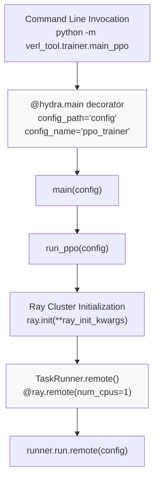
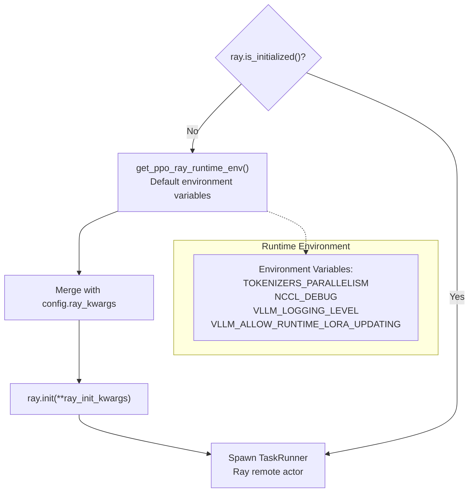
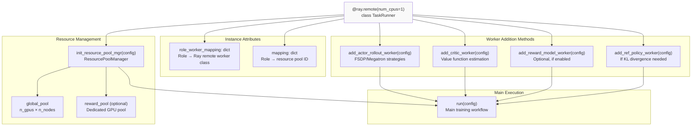
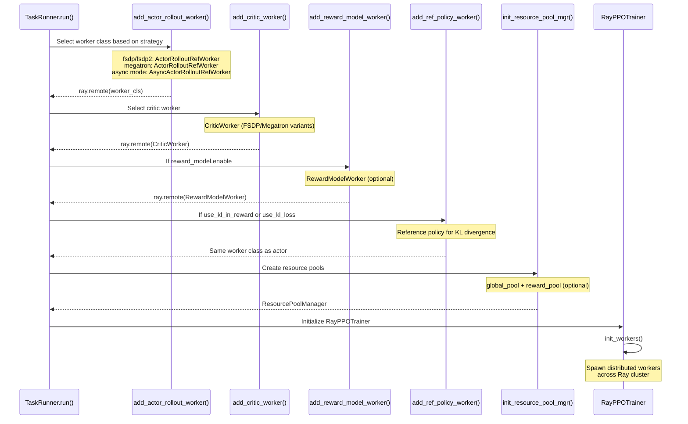
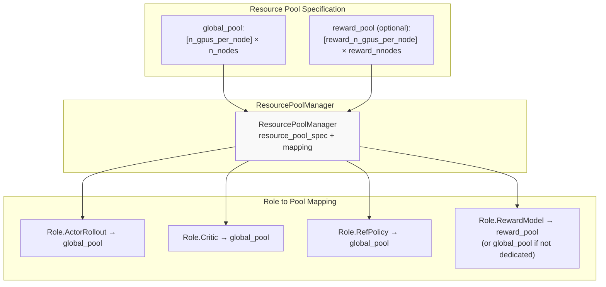
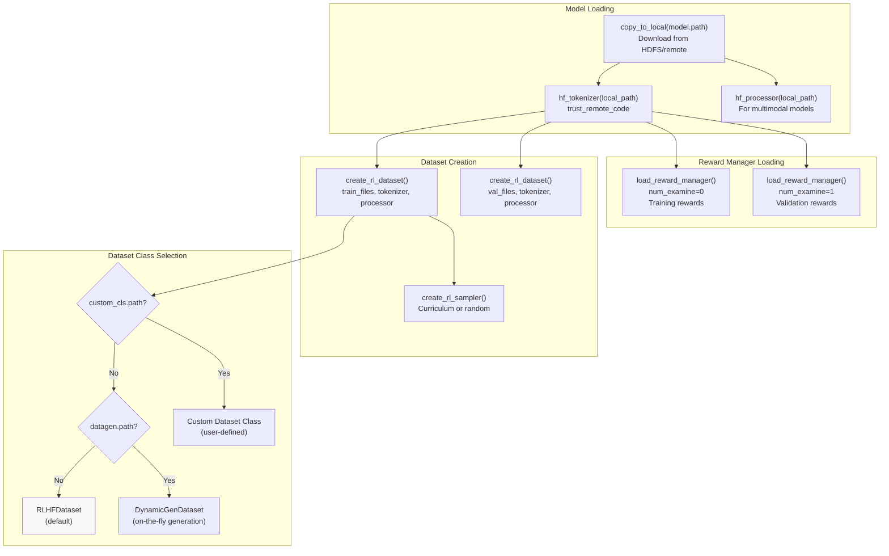
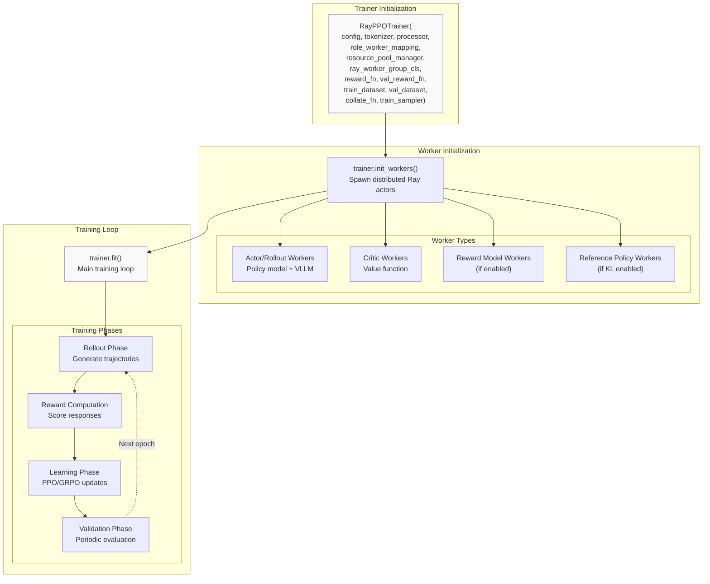
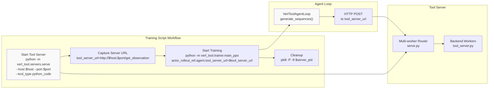
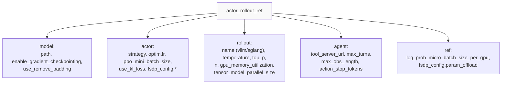

<!-- source: DeepWiki mcp.deepwiki.com · repo TIGER-AI-Lab/verl-tool · page 2.1 PPO Training Orchestration (main_ppo.py) · fetched 2026-10-30 -->

# PPO Training Orchestration (main_ppo.py)

<details>
<summary>Relevant source files</summary>

The following files were used as context for generating this wiki page:

- [examples/data_preprocess/acecoder.py](examples/data_preprocess/acecoder.py)
- [examples/train/mathcoder/train.sh](examples/train/mathcoder/train.sh)
- [examples/train/mathcoder/train_1.5b.sh](examples/train/mathcoder/train_1.5b.sh)
- [verl_tool/servers/serve.py](verl_tool/servers/serve.py)
- [verl_tool/trainer/main_ppo.py](verl_tool/trainer/main_ppo.py)
- [verl_tool/trainer/ppo/ray_trainer.py](verl_tool/trainer/ppo/ray_trainer.py)

</details>


## Purpose and Scope

This document covers the main entry point for PPO/GRPO training in VerlTool, specifically the `main_ppo.py` module. This orchestration layer handles:

- Hydra-based configuration management and command-line overrides
- Ray cluster initialization and distributed resource allocation
- Worker initialization for actor, critic, reward model, and reference policy
- Dataset loading and reward manager instantiation
- Integration with the tool server for agent-based training

For details on the custom PPO trainer implementation with validation and rollout logging, see [2.2](#2.2). For agent loop and multi-turn interaction mechanics, see [2.3](#2.3). For configuration structure details, see [2.4](#2.4).

---

## Entry Point and Configuration Flow

The `main_ppo.py` module serves as the primary entry point for training, using Hydra for configuration management.



**Configuration Resolution Process:**

| Step | Action | Location |
|------|--------|----------|
| 1 | Load base config from YAML | `config_path="config"`, `config_name="ppo_trainer"` |
| 2 | Apply command-line overrides | Shell script parameters (e.g., `data.train_files=$train_data`) |
| 3 | Resolve symbolic values | `OmegaConf.resolve(config)` |
| 4 | Validate configuration | `validate_config()` checks for consistency |

The `@hydra.main` decorator at [verl_tool/trainer/main_ppo.py:37]() provides automatic configuration composition and command-line override capabilities. Training scripts like [examples/train/mathcoder/train.sh:59-126]() demonstrate extensive parameter overrides.

**Sources:** [verl_tool/trainer/main_ppo.py:1-44](), [examples/train/mathcoder/train.sh:59-126]()

---

## Ray Cluster Initialization

The `run_ppo()` function initializes the Ray cluster with custom runtime environment settings.



**Key initialization parameters:**

- **`runtime_env`**: Environment variables for tokenizers, NCCL, and vLLM settings
- **`num_cpus`**: Obtained from `config.ray_kwargs.ray_init` 
- **Ray dashboard**: Automatically available for monitoring distributed execution

The runtime environment is merged at [verl_tool/trainer/main_ppo.py:62-68](), combining default settings from `get_ppo_ray_runtime_env()` with user-provided overrides.

**Sources:** [verl_tool/trainer/main_ppo.py:47-94]()

---

## TaskRunner Architecture

The `TaskRunner` is a Ray remote actor that encapsulates the entire training workflow. It runs on a single CPU core (not the head node) to avoid resource contention.



**Worker Role Mapping Table:**

| Role | Worker Class | Strategy Options | Resource Pool |
|------|-------------|------------------|---------------|
| `Role.ActorRollout` | `ActorRolloutRefWorker` or `AsyncActorRolloutRefWorker` | `fsdp`, `fsdp2`, `megatron` | `global_pool` |
| `Role.Critic` | `CriticWorker` | `fsdp`, `fsdp2`, `megatron` | `global_pool` |
| `Role.RewardModel` | `RewardModelWorker` | `fsdp`, `fsdp2`, `megatron` | `reward_pool` or `global_pool` |
| `Role.RefPolicy` | Same as actor worker class | Same as actor | `global_pool` |

The `TaskRunner` class is defined at [verl_tool/trainer/main_ppo.py:96-111]() and acts as the central coordinator for distributed training.

**Sources:** [verl_tool/trainer/main_ppo.py:96-320]()

---

## Worker Initialization Flow

The `TaskRunner.run()` method orchestrates worker initialization in a specific sequence:



**Actor Rollout Worker Selection:**

The actor worker class depends on two configuration parameters:

1. **Strategy** (`config.actor_rollout_ref.actor.strategy`):
   - `fsdp` or `fsdp2`: Uses FSDP-based workers from [verl.workers.fsdp_workers]()
   - `megatron`: Uses Megatron-based workers from [verl.workers.megatron_workers]()

2. **Rollout Mode** (`config.actor_rollout_ref.rollout.mode`):
   - `async`: Uses `AsyncActorRolloutRefWorker` for trajectory-level async rollout
   - Default: Uses synchronous `ActorRolloutRefWorker`

The logic at [verl_tool/trainer/main_ppo.py:112-143]() implements this selection.

**Sources:** [verl_tool/trainer/main_ppo.py:112-260]()

---

## Resource Pool Management

The `ResourcePoolManager` allocates GPUs into pools and maps worker roles to pools.



**Resource Pool Configuration:**

| Pool ID | GPU Allocation | When Used | Config Parameters |
|---------|---------------|-----------|-------------------|
| `global_pool` | `trainer.n_gpus_per_node × trainer.nnodes` | Always | Required for all training |
| `reward_pool` | `reward_model.n_gpus_per_node × reward_model.nnodes` | If `reward_model.enable_resource_pool=True` | Prevents reward model from competing with actor/critic |

The dedicated reward pool at [verl_tool/trainer/main_ppo.py:177-217]() prevents resource contention when using model-based reward functions. If disabled, the reward model shares the global pool.

**Example from training script:**

```bash
# Global pool: 8 GPUs per node × 1 node = 8 GPUs total
trainer.n_gpus_per_node=8
trainer.nnodes=1

# No dedicated reward pool (uses rule-based rewards)
# reward_model.enable_resource_pool not set
```

**Sources:** [verl_tool/trainer/main_ppo.py:168-191]()

---

## Dataset and Reward Manager Loading

The `TaskRunner.run()` method loads datasets and reward managers before initializing the trainer.



**Dataset Creation Logic:**

The `create_rl_dataset()` function at [verl_tool/trainer/main_ppo.py:322-368]() implements a flexible dataset loading system:

1. **Custom Dataset Class**: If `data.custom_cls.path` is specified, loads a user-defined dataset class
2. **Dynamic Generation**: If `data.datagen.path` is specified and `is_train=True`, uses `DynamicGenDataset` for on-the-fly data generation
3. **Default**: Uses `RLHFDataset` for standard parquet file loading

**Reward Manager Loading:**

The reward manager is loaded twice at [verl_tool/trainer/main_ppo.py:284-289]():
- **Training**: `num_examine=0` (no detailed logging during training)
- **Validation**: `num_examine=1` (logs first sample for inspection)

Reward manager types (e.g., `mathcoder`, `acecoder`, `sqlcoder`) are specified via `reward_model.reward_manager` config parameter and loaded by the `load_reward_manager()` function (see [6.1](#6.1) for details).

**Sources:** [verl_tool/trainer/main_ppo.py:269-320](), [verl_tool/trainer/main_ppo.py:322-410]()

---

## Training Invocation

After all components are initialized, the training process begins:



**Trainer Initialization Parameters:**

| Parameter | Type | Description |
|-----------|------|-------------|
| `config` | OmegaConf | Complete training configuration |
| `tokenizer` | Tokenizer | HuggingFace tokenizer |
| `processor` | Processor | Multimodal processor (or None) |
| `role_worker_mapping` | dict | Role → Ray remote worker class |
| `resource_pool_manager` | ResourcePoolManager | GPU pool allocator |
| `ray_worker_group_cls` | class | RayWorkerGroup class |
| `reward_fn` | callable | Training reward function |
| `val_reward_fn` | callable | Validation reward function |
| `train_dataset` | Dataset | Training data |
| `val_dataset` | Dataset | Validation data |
| `collate_fn` | callable | Batch collation function |
| `train_sampler` | Sampler | Training data sampler |

The trainer is instantiated at [verl_tool/trainer/main_ppo.py:301-314]() and training begins with `trainer.fit()` at [verl_tool/trainer/main_ppo.py:319]().

**Sources:** [verl_tool/trainer/main_ppo.py:301-320]()

---

## Integration with Tool Server

Training scripts launch the tool server in the background before starting training, passing the server URL to the agent configuration.



**Tool Server Launch Pattern** (from [examples/train/mathcoder/train.sh:48-57]()):

```bash
# 1. Determine host and port
host=$(hostname -I | awk '{print $1}')
port=$(shuf -i 30000-31000 -n 1)
tool_server_url=http://$host:$port/get_observation

# 2. Launch tool server in background
python -m verl_tool.servers.serve \
    --host $host --port $port \
    --tool_type "python_code" \
    --workers_per_tool 32 &
server_pid=$!

# 3. Pass URL to training
python3 -m verl_tool.trainer.main_ppo \
    actor_rollout_ref.agent.tool_server_url=$tool_server_url \
    # ... other parameters ...
```

**Agent Configuration Parameters:**

| Parameter | Type | Description | Example Value |
|-----------|------|-------------|---------------|
| `tool_server_url` | str | HTTP endpoint for tool execution | `http://10.0.0.1:30001/get_observation` |
| `max_prompt_length` | int | Maximum input token length | `1024` |
| `max_response_length` | int | Maximum generation length per turn | `3072` |
| `max_obs_length` | int | Maximum observation token length | `512` |
| `max_turns` | int | Maximum interaction turns | `1` or `5` |
| `action_stop_tokens` | str | Path to file with stop token strings | `/tmp/action_stop_tokens.txt` |

The agent configuration is passed to the `VerlToolAgentLoop` which uses it to control multi-turn generation and tool interaction. See [2.3](#2.3) for details on agent loop mechanics.

**Sources:** [examples/train/mathcoder/train.sh:48-92](), [examples/train/mathcoder/train_1.5b.sh:48-92]()

---

## Configuration Structure

The main configuration is organized into several top-level sections, all managed through Hydra.

**Primary Configuration Sections:**

| Section | Purpose | Key Parameters |
|---------|---------|----------------|
| `data` | Dataset configuration | `train_files`, `val_files`, `train_batch_size`, `max_prompt_length`, `max_response_length` |
| `algorithm` | RL algorithm settings | `adv_estimator` (gae/grpo), `kl_ctrl.kl_coef` |
| `actor_rollout_ref` | Actor, rollout, and reference policy | `model.path`, `actor.strategy`, `rollout.name` (vllm/sglang), `agent.*` |
| `critic` | Value function model | `strategy`, `model.path`, `optim.lr` |
| `reward_model` | Reward computation | `reward_manager`, `enable`, `enable_resource_pool` |
| `trainer` | Training loop control | `n_gpus_per_node`, `nnodes`, `total_epochs`, `save_freq`, `test_freq` |

**Actor Rollout Ref Subsections:**



**FSDP Configuration Parameters:**

| Parameter | Purpose | Typical Value |
|-----------|---------|---------------|
| `fsdp_config.param_offload` | Offload parameters to CPU | `True` (for memory savings) |
| `fsdp_config.optimizer_offload` | Offload optimizer states to CPU | `True` (for memory savings) |
| `fsdp_config.fsdp_size` | FSDP shard size | `-1` (auto-detect) |
| `ulysses_sequence_parallel_size` | Sequence parallelism degree | `1` (disabled) or `2`/`4` |

**Memory Optimization Settings:**

Training scripts typically set:
- `gpu_memory_utilization=0.5` to `0.8`: Controls VLLM memory allocation
- `do_offload=True`: Enables parameter/optimizer CPU offloading
- `use_dynamic_bsz=True`: Adaptive batch sizing for variable sequence lengths

**Example Configuration Override Pattern:**

```bash
python3 -m verl_tool.trainer.main_ppo \
    algorithm.adv_estimator=grpo \
    data.train_files=[file1.parquet,file2.parquet] \
    actor_rollout_ref.model.path=Qwen/Qwen2.5-Math-7B \
    actor_rollout_ref.actor.strategy=fsdp \
    actor_rollout_ref.rollout.name=vllm \
    actor_rollout_ref.agent.tool_server_url=$tool_server_url \
    trainer.n_gpus_per_node=8 \
    trainer.total_epochs=10
```

For detailed configuration schema, see [2.4](#2.4).

**Sources:** [examples/train/mathcoder/train.sh:55-126](), [examples/train/mathcoder/train_1.5b.sh:59-126]()

---

## Execution Flow Summary

```mermaid
flowchart TB
    Start["Training Script Invocation<br/>(train.sh)"]
    LaunchServer["Launch Tool Server<br/>(background process)"]
    MainPPO["python -m verl_tool.trainer.main_ppo<br/>(with Hydra config overrides)"]
    
    subgraph "main_ppo.py Entry"
        Hydra["@hydra.main<br/>Load and merge config"]
        RunPPO["run_ppo(config)"]
        RayInit["Initialize Ray cluster<br/>(if not already initialized)"]
        SpawnTask["Spawn TaskRunner.remote()"]
    end
    
    subgraph "TaskRunner.run()"
        AddWorkers["Add worker classes:<br/>ActorRollout, Critic,<br/>RewardModel, RefPolicy"]
        InitResources["Initialize ResourcePoolManager"]
        LoadModel["Load model, tokenizer, processor"]
        LoadData["Load train/val datasets"]
        LoadReward["Load reward managers"]
        CreateTrainer["Create RayPPOTrainer instance"]
        InitWorkerActors["trainer.init_workers()<br/>Spawn Ray actors"]
        StartFit["trainer.fit()<br/>Begin training loop"]
    end
    
    subgraph "Training Loop (RayPPOTrainer)"
        TrainEpoch["For each epoch..."]
        RolloutPhase["Rollout: Generate trajectories<br/>(with tool interactions)"]
        RewardPhase["Compute rewards<br/>(using reward manager)"]
        LearnPhase["Update policy & value<br/>(PPO/GRPO algorithm)"]
        ValPhase["Validation<br/>(periodic)"]
        SaveCkpt["Save checkpoint<br/>(periodic)"]
    end
    
    Cleanup["Cleanup:<br/>Kill tool server process"]
    
    Start --> LaunchServer
    LaunchServer --> MainPPO
    MainPPO --> Hydra
    Hydra --> RunPPO
    RunPPO --> RayInit
    RayInit --> SpawnTask
    SpawnTask --> AddWorkers
    
    AddWorkers --> InitResources
    InitResources --> LoadModel
    LoadModel --> LoadData
    LoadData --> LoadReward
    LoadReward --> CreateTrainer
    CreateTrainer --> InitWorkerActors
    InitWorkerActors --> StartFit
    
    StartFit --> TrainEpoch
    TrainEpoch --> RolloutPhase
    RolloutPhase --> RewardPhase
    RewardPhase --> LearnPhase
    LearnPhase --> ValPhase
    ValPhase --> SaveCkpt
    SaveCkpt -.->|Next epoch| TrainEpoch
    
    SaveCkpt --> Cleanup
    
    style MainPPO fill:#f9f9f9
    style CreateTrainer fill:#f9f9f9
    style StartFit fill:#f9f9f9
```



**Key Orchestration Points:**

1. **Tool Server Launch**: Must be running before training starts, URL passed via config
2. **Ray Initialization**: Only happens once, subsequent calls detect existing cluster
3. **TaskRunner Isolation**: Runs on single CPU to avoid head node scheduling
4. **Worker Initialization**: Deferred until `init_workers()` call to allow configuration validation
5. **Training Loop**: Controlled by `RayPPOTrainer.fit()`, see [2.2](#2.2) for details

**Sources:** [verl_tool/trainer/main_ppo.py:1-415](), [examples/train/mathcoder/train.sh:1-131]()

---

