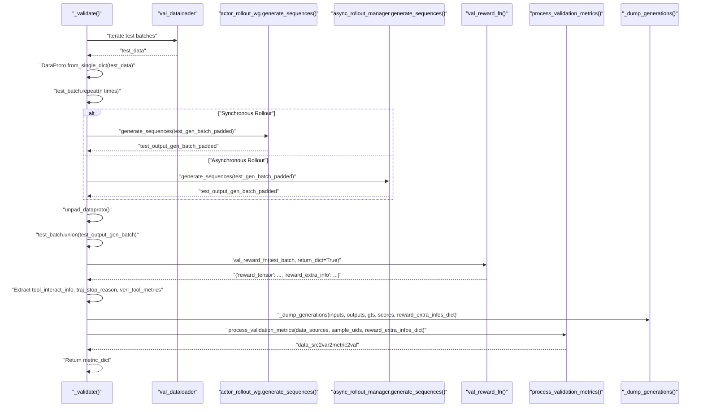
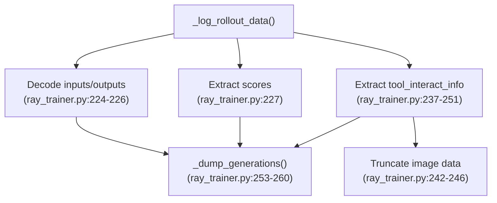
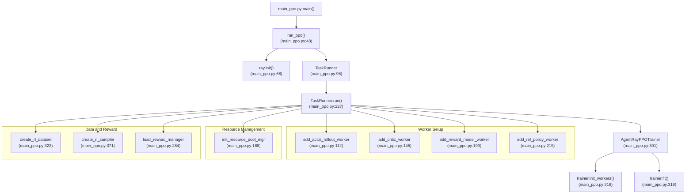

<!-- source: DeepWiki mcp.deepwiki.com · repo TIGER-AI-Lab/verl-tool · page 2.2 AgentRayPPOTrainer and Custom Training Loop · fetched 2026-10-30 -->

# AgentRayPPOTrainer and Custom Training Loop

<details>
<summary>Relevant source files</summary>

The following files were used as context for generating this wiki page:

- [verl_tool/agent_loop/agent_loop.py](verl_tool/agent_loop/agent_loop.py)
- [verl_tool/agent_loop/verltool_agent_loop.py](verl_tool/agent_loop/verltool_agent_loop.py)
- [verl_tool/servers/serve.py](verl_tool/servers/serve.py)
- [verl_tool/servers/tests/test_python_code_tool.py](verl_tool/servers/tests/test_python_code_tool.py)
- [verl_tool/servers/tools/ipython_code.py](verl_tool/servers/tools/ipython_code.py)
- [verl_tool/servers/tools/utils/ipython_tool.py](verl_tool/servers/tools/utils/ipython_tool.py)
- [verl_tool/trainer/config/verltool/agent.yaml](verl_tool/trainer/config/verltool/agent.yaml)
- [verl_tool/trainer/main_ppo.py](verl_tool/trainer/main_ppo.py)
- [verl_tool/trainer/ppo/metric_util.py](verl_tool/trainer/ppo/metric_util.py)
- [verl_tool/trainer/ppo/ray_trainer.py](verl_tool/trainer/ppo/ray_trainer.py)
- [verl_tool/workers/reward_manager/torl.py](verl_tool/workers/reward_manager/torl.py)
- [verl_tool/workers/rollout/vllm_rollout/vllm_async_server.py](verl_tool/workers/rollout/vllm_rollout/vllm_async_server.py)

</details>


This document details the `AgentRayPPOTrainer` class, which extends verl's `RayPPOTrainer` to support tool-agent training workflows. This page focuses on the custom validation logic, reward computation, and data logging mechanisms that enable multi-turn tool interactions during PPO training.

For information about the overall training orchestration and Ray cluster setup, see [PPO Training Orchestration](#2.1). For details about the multi-turn agent loop implementation, see [Agent Loop System](#2.3).

---

## Overview and Component Replacement Strategy

`AgentRayPPOTrainer` is defined in [verl_tool/trainer/ppo/ray_trainer.py:39]() and serves as the main training coordinator for tool-agent RL. Rather than subclassing every verl component, VerlTool uses a **monkey-patching strategy** to replace specific verl implementations at module import time.

The replacement logic occurs in [verl_tool/trainer/ppo/ray_trainer.py:24-36]():

```python
import verl.experimental.agent_loop
from verl_tool.agent_loop import AgentLoopManager
import verl.trainer.ppo.ray_trainer
from .reward import compute_reward, compute_reward_async
from verl_tool.workers.rollout.vllm_rollout.vllm_async_server import VerlToolvLLMHttpServer
import verl.workers.rollout.vllm_rollout.vllm_async_server
from .metric_util import compute_data_metrics, process_validation_metrics

verl.experimental.agent_loop.AgentLoopManager = AgentLoopManager
verl.trainer.ppo.ray_trainer.compute_reward = compute_reward
verl.trainer.ppo.ray_trainer.compute_reward_async = compute_reward_async
verl.trainer.ppo.ray_trainer.compute_data_metrics = compute_data_metrics
verl.trainer.ppo.ray_trainer.process_validation_metrics = process_validation_metrics
verl.workers.rollout.vllm_rollout.vllm_async_server.vLLMHttpServer = VerlToolvLLMHttpServer
```

This approach allows VerlTool to inject tool-specific logic while maintaining compatibility with verl's distributed training infrastructure.

### Component Replacement Diagram

```mermaid
graph TB
    subgraph "VerlTool Custom Components"
        ART["AgentRayPPOTrainer<br/>(ray_trainer.py:39)"]
        ALM["AgentLoopManager<br/>(agent_loop/)"]
        CR["compute_reward<br/>(reward.py)"]
        CRA["compute_reward_async<br/>(reward.py)"]
        CDM["compute_data_metrics<br/>(metric_util.py)"]
        PVM["process_validation_metrics<br/>(metric_util.py)"]
        VTHS["VerlToolvLLMHttpServer<br/>(vllm_async_server.py)"]
    end
    
    subgraph "Verl Base Components"
        RPT["RayPPOTrainer<br/>(verl.trainer.ppo.ray_trainer)"]
        VALM["verl.experimental.agent_loop.AgentLoopManager"]
        VCR["verl.trainer.ppo.ray_trainer.compute_reward"]
        VCRA["verl.trainer.ppo.ray_trainer.compute_reward_async"]
        VCDM["verl.trainer.ppo.ray_trainer.compute_data_metrics"]
        VPVM["verl.trainer.ppo.ray_trainer.process_validation_metrics"]
        VHS["verl.workers.rollout.vllm_rollout.vllm_async_server.vLLMHttpServer"]
    end
    
    ART -->|"extends"| RPT
    ALM -->|"replaces"| VALM
    CR -->|"replaces"| VCR
    CRA -->|"replaces"| VCRA
    CDM -->|"replaces"| VCDM
    PVM -->|"replaces"| VPVM
    VTHS -->|"replaces"| VHS
```



**Sources:** [verl_tool/trainer/ppo/ray_trainer.py:1-37]()

---

## AgentRayPPOTrainer Class Structure

The `AgentRayPPOTrainer` class inherits from `RayPPOTrainer` and overrides two key methods:

| Method | Purpose | Lines |
|--------|---------|-------|
| `_validate()` | Executes validation loops, computes metrics, and logs tool interactions | [41-210]() |
| `_log_rollout_data()` | Logs training rollout data including tool interactions to disk | [212-260]() |

Both methods handle **tool interaction metadata** (`tool_interact_info`, `traj_stop_reason`, `verl_tool_metrics`) which are not present in standard verl training.

### Instantiation in Training Pipeline

The trainer is instantiated in [verl_tool/trainer/main_ppo.py:301-314]() within the `TaskRunner.run()` method:

```python
trainer = RayPPOTrainer(  # Actually AgentRayPPOTrainer due to import alias
    config=config,
    tokenizer=tokenizer,
    processor=processor,
    role_worker_mapping=self.role_worker_mapping,
    resource_pool_manager=resource_pool_manager,
    ray_worker_group_cls=ray_worker_group_cls,
    reward_fn=reward_fn,
    val_reward_fn=val_reward_fn,
    train_dataset=train_dataset,
    val_dataset=val_dataset,
    collate_fn=collate_fn,
    train_sampler=train_sampler,
)
```

Note that the import alias is set in [verl_tool/trainer/main_ppo.py:29]():
```python
from verl_tool.trainer.ppo.ray_trainer import AgentRayPPOTrainer as RayPPOTrainer
```

**Sources:** [verl_tool/trainer/ppo/ray_trainer.py:39](), [verl_tool/trainer/main_ppo.py:29](), [verl_tool/trainer/main_ppo.py:301-314]()

---

## Custom Validation Logic

The `_validate()` method implements a comprehensive validation workflow that differs from standard RL validation in several ways:

1. **Repeated Sampling**: Each validation batch is repeated `n` times (configured via `config.actor_rollout_ref.rollout.val_kwargs.n`) to compute statistical metrics like pass@k
2. **Tool Interaction Tracking**: Captures and logs all tool calls, observations, and trajectory termination reasons
3. **Multi-Source Metrics**: Aggregates metrics across different data sources and computes pass@1, pass@8, majority vote, and best-of-n statistics

### Validation Workflow Diagram



**Sources:** [verl_tool/trainer/ppo/ray_trainer.py:41-210]()

### Validation Method Key Steps

#### 1. Batch Preparation and Repetition

[verl_tool/trainer/ppo/ray_trainer.py:53-64]() handles batch preparation:

- Converts test data to `DataProto` format
- Assigns unique IDs (`uid`) if not present
- Repeats each sample `n` times with `interleave=True` to ensure statistical robustness

#### 2. Generation with Mode Detection

[verl_tool/trainer/ppo/ray_trainer.py:95-106]() supports both synchronous and asynchronous rollout modes:

```python
size_divisor = (
    self.actor_rollout_wg.world_size
    if not self.async_rollout_mode
    else self.config.actor_rollout_ref.rollout.agent.num_workers
)
test_gen_batch_padded, pad_size = pad_dataproto_to_divisor(test_gen_batch, size_divisor)
if not self.async_rollout_mode:
    test_output_gen_batch_padded = self.actor_rollout_wg.generate_sequences(test_gen_batch_padded)
else:
    test_output_gen_batch_padded = self.async_rollout_manager.generate_sequences(test_gen_batch_padded)
```

The `size_divisor` ensures batch size is divisible by the number of parallel workers for efficient distributed generation.

#### 3. Reward Computation with Extra Info

[verl_tool/trainer/ppo/ray_trainer.py:119-152]() computes rewards and extracts tool-specific metadata:

- Calls `val_reward_fn(test_batch, return_dict=True)` to get reward tensor and extra info
- Extracts `tool_interact_info` containing all tool calls and observations
- Collects `traj_stop_reason` indicating why each trajectory terminated
- Gathers `verl_tool_metrics` with custom metrics like action counts

The `tool_interact_info` is truncated for logging ([verl_tool/trainer/ppo/ray_trainer.py:137-142]()):

```python
for tool_interact in tool_interact_info:
    if "image" in tool_interact:
        if isinstance(tool_interact['image'], list):
            tool_interact['image'] = [x[:50] for x in tool_interact['image']]
        elif isinstance(tool_interact['image'], str):
            tool_interact['image'] = tool_interact['image'][:50]
```

#### 4. Metric Processing and Aggregation

[verl_tool/trainer/ppo/ray_trainer.py:186-208]() processes validation metrics:

- Groups metrics by `data_source` (e.g., "gsm8k", "MATH")
- Computes pass@k metrics for different k values
- Separates core metrics (e.g., accuracy) from auxiliary metrics
- Calculates turn statistics (min/max/mean) if available

The metric aggregation produces a nested dictionary structure:
```
data_src2var2metric2val = {
    "gsm8k": {
        "acc": {
            "mean@1": 0.85,
            "mean@8": 0.92,
            "maj@8": 0.88,
            "best@8": 0.95
        }
    }
}
```

**Sources:** [verl_tool/trainer/ppo/ray_trainer.py:41-210]()

---

## Custom Rollout Data Logging

The `_log_rollout_data()` method extends the base class logging to handle tool-specific metadata during training rollouts.

### Logging Workflow



**Sources:** [verl_tool/trainer/ppo/ray_trainer.py:212-260]()

### Key Logging Features

#### 1. Attention Mask-Based Decoding

[verl_tool/trainer/ppo/ray_trainer.py:223-226]() uses attention masks to properly decode inputs and outputs:

```python
inputs_attention_masks = batch.batch['attention_mask'][:, :batch.batch['prompts'].shape[1]]
outputs_attention_masks = batch.batch['attention_mask'][:, batch.batch['prompts'].shape[1]:]
inputs = [self.tokenizer.decode(batch.batch["prompts"][i][inputs_attention_masks[i]==1], skip_special_tokens=False) for i in range(batch.batch["prompts"].shape[0])]
outputs = [self.tokenizer.decode(batch.batch["responses"][i][outputs_attention_masks[i]==1], skip_special_tokens=False) for i in range(batch.batch["responses"].shape[0])]
```

This ensures that padding tokens are excluded from the decoded text.

#### 2. Tool Interaction Metadata Handling

[verl_tool/trainer/ppo/ray_trainer.py:237-251]() extracts and prepares tool interaction info:

- Converts numpy arrays to lists for JSON serialization
- Truncates image data to prevent excessive log file sizes
- Includes trajectory stop reasons and custom metrics

The truncation logic prevents multi-modal data from bloating log files while preserving enough information for debugging.

#### 3. Request ID Tracking

[verl_tool/trainer/ppo/ray_trainer.py:231-235]() includes request IDs if available, which enables tracing specific trajectories through the distributed system:

```python
if "request_id" in batch.non_tensor_batch:
    reward_extra_infos_dict.setdefault(
        "request_id",
        batch.non_tensor_batch["request_id"].tolist(),
    )
```

**Sources:** [verl_tool/trainer/ppo/ray_trainer.py:212-260]()

---

## Integration with Training Pipeline

The following diagram shows how `AgentRayPPOTrainer` integrates with the overall training workflow:



**Sources:** [verl_tool/trainer/main_ppo.py:37-320]()

### Trainer Initialization Parameters

The `AgentRayPPOTrainer` is initialized with the following key parameters ([verl_tool/trainer/main_ppo.py:301-314]()):

| Parameter | Type | Description |
|-----------|------|-------------|
| `config` | OmegaConf | Hydra configuration object |
| `tokenizer` | Tokenizer | HuggingFace tokenizer for text processing |
| `processor` | Processor | Optional processor for multi-modal models |
| `role_worker_mapping` | dict | Maps Role enums to Ray remote worker classes |
| `resource_pool_manager` | ResourcePoolManager | Manages GPU resource allocation across workers |
| `ray_worker_group_cls` | type | Ray worker group class for distributed execution |
| `reward_fn` | callable | Training reward function |
| `val_reward_fn` | callable | Validation reward function |
| `train_dataset` | Dataset | Training dataset |
| `val_dataset` | Dataset | Validation dataset |
| `collate_fn` | callable | Batch collation function |
| `train_sampler` | Sampler | Training data sampler |

---

## Reward Function Integration

The reward computation is handled by replaced functions that integrate with VerlTool's reward manager system. The replacement occurs in [verl_tool/trainer/ppo/ray_trainer.py:32-33]():

```python
verl.trainer.ppo.ray_trainer.compute_reward = compute_reward
verl.trainer.ppo.ray_trainer.compute_reward_async = compute_reward_async
```

These custom reward functions are defined in separate reward module files and support:

- **Domain-specific reward managers** (registered via `@register_reward_manager` decorator)
- **Asynchronous reward computation** for better parallelization
- **Extra reward information** returned as dictionaries for logging

During validation, the reward function is called with `return_dict=True` ([verl_tool/trainer/ppo/ray_trainer.py:122]()):

```python
result = self.val_reward_fn(test_batch, return_dict=True)
reward_tensor = result["reward_tensor"]
```

This returns both the reward tensor and additional metadata like format errors, curiosity penalties, and action redundancy metrics. For detailed information about reward computation, see [Reward Management System](#6).

**Sources:** [verl_tool/trainer/ppo/ray_trainer.py:27-33]()

---

## Validation Data Directory Structure

When `config.trainer.validation_data_dir` is set, validation generations are saved to disk with the following structure:

```
validation_data_dir/
├── step_0000/
│   ├── generations.jsonl
│   └── metadata.json
├── step_0100/
│   ├── generations.jsonl
│   └── metadata.json
└── ...
```

Each `generations.jsonl` file contains entries with:

```json
{
  "input": "Question: ...",
  "output": "Solution: ...",
  "ground_truth": "42",
  "score": 1.0,
  "uid": "abc-123",
  "tool_interact_info": [...],
  "traj_stop_reason": "done",
  "verl_tool_metrics": {...}
}
```

The presence of `tool_interact_info` makes it possible to replay and analyze tool-agent interactions for debugging and visualization purposes.

**Sources:** [verl_tool/trainer/ppo/ray_trainer.py:163-172]()

---

## Summary

`AgentRayPPOTrainer` serves as the central training coordinator that:

1. **Extends verl's `RayPPOTrainer`** while maintaining compatibility with distributed training infrastructure
2. **Uses monkey-patching** to inject tool-specific logic into verl modules
3. **Implements custom validation** with repeated sampling, tool interaction tracking, and comprehensive metrics
4. **Handles tool metadata** throughout the training and validation loops
5. **Logs rollout data** with attention to multi-modal data and tool interactions

The class is designed to be minimal (only 2 method overrides) while achieving maximum integration with the VerlTool ecosystem. The majority of the tool-agent logic is handled by the `AgentLoopManager` (see [Agent Loop System](#2.3)) and domain-specific reward managers (see [Reward Management System](#6)).

**Sources:** [verl_tool/trainer/ppo/ray_trainer.py:1-260](), [verl_tool/trainer/main_ppo.py:1-415]()

---

