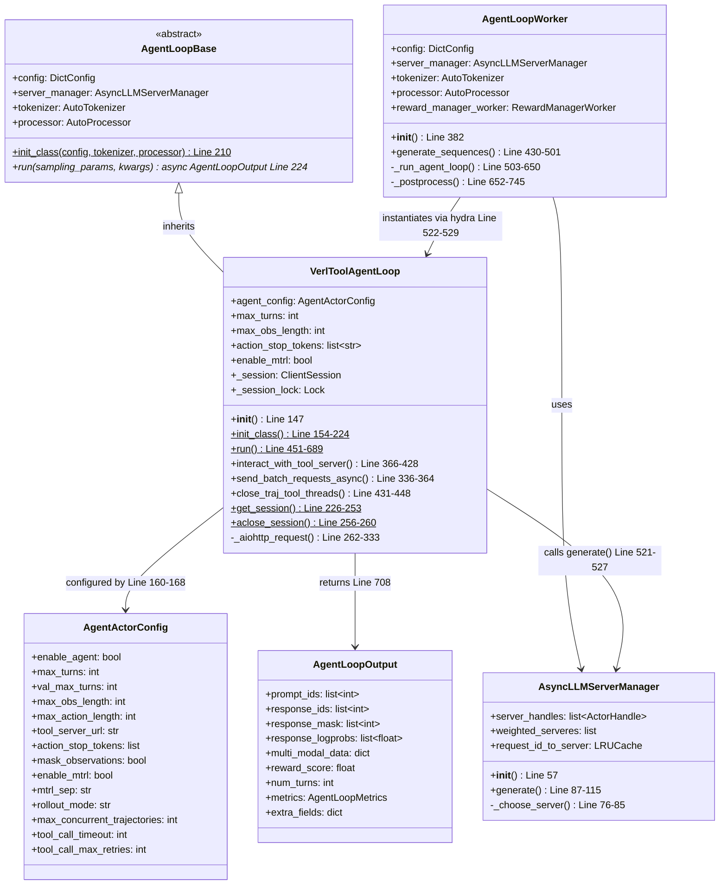
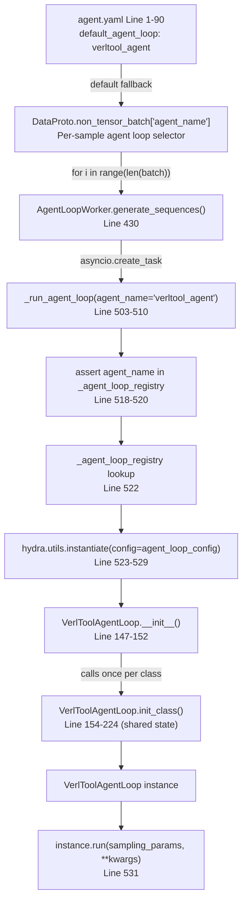
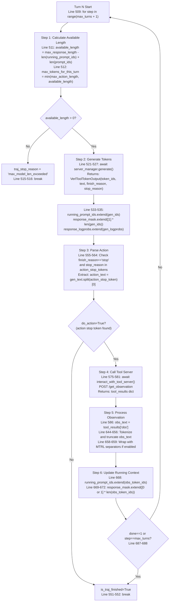
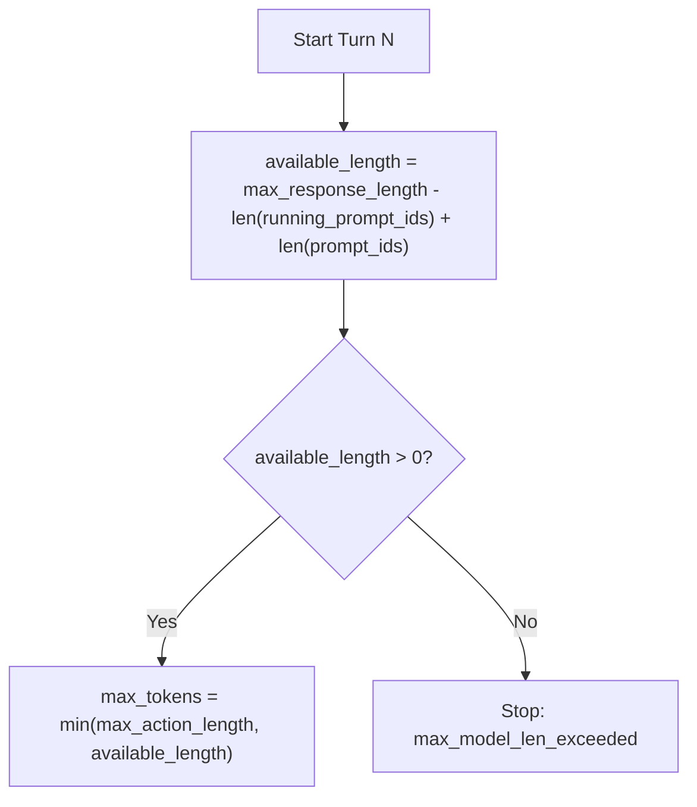
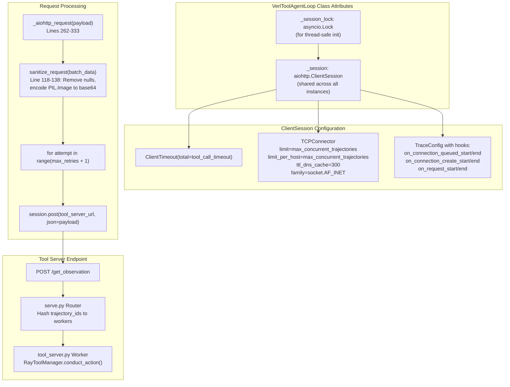

<!-- source: DeepWiki mcp.deepwiki.com · repo TIGER-AI-Lab/verl-tool · page 2.3 Agent Loop System (VerlToolAgentLoop) · fetched 2026-10-30 -->

# Agent Loop System (VerlToolAgentLoop)

<details>
<summary>Relevant source files</summary>

The following files were used as context for generating this wiki page:

- [README.md](README.md)
- [assets/docs/updates/verltool_v0.6.0_upgrade.md](assets/docs/updates/verltool_v0.6.0_upgrade.md)
- [verl_tool/agent_loop/agent_loop.py](verl_tool/agent_loop/agent_loop.py)
- [verl_tool/agent_loop/verltool_agent_loop.py](verl_tool/agent_loop/verltool_agent_loop.py)
- [verl_tool/servers/tests/test_python_code_tool.py](verl_tool/servers/tests/test_python_code_tool.py)
- [verl_tool/servers/tools/ipython_code.py](verl_tool/servers/tools/ipython_code.py)
- [verl_tool/servers/tools/utils/ipython_tool.py](verl_tool/servers/tools/utils/ipython_tool.py)
- [verl_tool/trainer/config/verltool/agent.yaml](verl_tool/trainer/config/verltool/agent.yaml)
- [verl_tool/trainer/ppo/metric_util.py](verl_tool/trainer/ppo/metric_util.py)
- [verl_tool/workers/reward_manager/torl.py](verl_tool/workers/reward_manager/torl.py)
- [verl_tool/workers/rollout/vllm_rollout/vllm_async_server.py](verl_tool/workers/rollout/vllm_rollout/vllm_async_server.py)

</details>


## Purpose and Scope

The `VerlToolAgentLoop` class [verl_tool/agent_loop/verltool_agent_loop.py:140-141]() orchestrates multi-turn interactions between language models and tool environments during RL training. Following verl's agent loop abstraction design, the entire agentic logic is concentrated in a single file with the core `run()` method [verl_tool/agent_loop/verltool_agent_loop.py:451-689]() implementing the main loop in approximately 238 lines.

**Core Responsibilities:**

| Component | Method | Description |
|-----------|--------|-------------|
| LLM Generation | `AsyncLLMServerManager.generate()` | Request tokens from vLLM servers with sticky sessions |
| Action Detection | Lines 555-564 | Parse `action_stop_tokens` (e.g., `</python>`, `</tool_call>`) |
| Tool Communication | `interact_with_tool_server()` | HTTP POST to tool server with retry logic |
| Observation Processing | Lines 585-673 | Tokenize, truncate, and wrap observations with MTRL separators |
| Context Tracking | Lines 511-516 | Calculate `available_length` to prevent context overflow |
| Mask Management | Lines 669-672 | Mark observation tokens with `response_mask=0` for loss exclusion |

**Key Design Principle:** The agent loop maintains strict token-level consistency ("tokens-in, tokens-out") to avoid off-policy issues from retokenization [assets/docs/updates/verltool_v0.6.0_upgrade.md:7]().

**Related Pages:**
- AgentRayPPOTrainer integration: [2.2](#2.2)
- Tool server routing: [3.1](#3.1)
- Reward computation flow: [6](#6)
- Multi-modal processing: [9.1](#9.1)

**Sources:** [verl_tool/agent_loop/verltool_agent_loop.py:140-689](), [assets/docs/updates/verltool_v0.6.0_upgrade.md:1-11]()

---

## Architecture Overview

The agent loop system consists of three main components: the base infrastructure, the VerlTool implementation, and supporting managers.

### Class Hierarchy

**Agent Loop Class Structure with Key Methods**



**Sources:** [verl_tool/agent_loop/verltool_agent_loop.py:74-113](), [verl_tool/agent_loop/verltool_agent_loop.py:140-689](), [verl_tool/agent_loop/agent_loop.py:50-115](), [verl_tool/agent_loop/agent_loop.py:180-234](), [verl_tool/agent_loop/agent_loop.py:378-501]()

### Registration and Instantiation

**Agent Loop Registry and Hydra Instantiation Flow**

The `@register("verltool_agent")` decorator [verl_tool/agent_loop/verltool_agent_loop.py:140]() populates the global `_agent_loop_registry` dict [verl_tool/agent_loop/agent_loop.py:242]():

```python
# Registration decorator at agent_loop.py:245-252
def register(agent_name: str):
    def decorator(subclass: type[AgentLoopBase]) -> type[AgentLoopBase]:
        fqdn = f"{subclass.__module__}.{subclass.__qualname__}"
        _agent_loop_registry[agent_name] = {"_target_": fqdn}
        return subclass
    return decorator

# Applied as: @register("verltool_agent")
# Results in: _agent_loop_registry["verltool_agent"] = {
#     "_target_": "verl_tool.agent_loop.verltool_agent_loop.VerlToolAgentLoop"
# }
```

**Instantiation Flow During Rollout**



**Constructor Arguments Passed by Hydra**

```python
# AgentLoopWorker._run_agent_loop() at agent_loop.py:522-529
agent_loop = hydra.utils.instantiate(
    config=agent_loop_config,  # {"_target_": "verl_tool...VerlToolAgentLoop"}
    trainer_config=_DummyConfig(config=self.config),  # Full trainer config
    server_manager=self.server_manager,  # AsyncLLMServerManager instance
    tokenizer=self.tokenizer,  # AutoTokenizer
    processor=self.processor,  # AutoProcessor (or None)
)
```

This registry pattern enables flexible agent loop selection per sample, allowing mixed-mode training (e.g., some samples with tools, others without) by setting different `agent_name` values in the dataset.

**Sources:** [verl_tool/agent_loop/agent_loop.py:245-253](), [verl_tool/agent_loop/agent_loop.py:503-531](), [verl_tool/agent_loop/verltool_agent_loop.py:140](), [verl_tool/agent_loop/verltool_agent_loop.py:147-152]()

---

## Configuration System

The `AgentActorConfig` dataclass [verl_tool/agent_loop/verltool_agent_loop.py:74-113]() centralizes all agent loop parameters:

| Parameter | Type | Description |
|-----------|------|-------------|
| `enable_agent` | bool | Whether to use tools (False = single-turn generation) |
| `max_turns` | int | Maximum tool interaction turns |
| `val_max_turns` | int | Maximum turns during validation |
| `max_obs_length` | int | Token limit for observations (default: 512) |
| `max_action_length` | int | Token limit for actions |
| `tool_server_url` | str | HTTP endpoint for tool execution |
| `action_stop_tokens` | list | Tokens that signal end of action (e.g., `</tool_call>`) |
| `mask_observations` | bool | Whether to exclude observations from loss computation |
| `enable_mtrl` | bool | Enable Multi-Turn RL with special formatting |
| `mtrl_sep` | str | Separator template for observation wrapping |
| `truncate_obs_side` | str | Which side to truncate (`left`/`right`/`middle`) |
| `max_concurrent_trajectories` | int | Global concurrency limit for async rollout |
| `tool_call_timeout` | int | Timeout in seconds for tool calls |

Configuration is initialized in `init_class()` [verl_tool/agent_loop/verltool_agent_loop.py:154-224](), which merges YAML settings with runtime parameters:

```python
# Example initialization flow
agent_config = AgentActorConfig()
for key in rollout_config.agent.keys():
    if key in agent_config.__dict__.keys():
        setattr(agent_config, key, rollout_config.agent[key])
```

**Sources:** [verl_tool/agent_loop/verltool_agent_loop.py:74-113](), [verl_tool/agent_loop/verltool_agent_loop.py:154-224](), [verl_tool/trainer/config/verltool/agent.yaml:1-90]()

---

## Multi-Turn Execution Flow

The core execution logic resides in the `run()` method [verl_tool/agent_loop/verltool_agent_loop.py:451-689](). Each trajectory executes up to `max_turns` iterations of: generate → parse → call tool → append observation → repeat.

### High-Level Sequence Diagram

**Multi-Turn Execution in `VerlToolAgentLoop.run()`**

```mermaid
sequenceDiagram
    participant Worker as "AgentLoopWorker"
    participant Loop as "VerlToolAgentLoop.run()"
    participant Mgr as "AsyncLLMServerManager.generate()"
    participant VLLM as "VerlToolvLLMHttpServer"
    participant ToolSrv as "Tool Server POST /get_observation"
    
    Worker->>Loop: "run(sampling_params, raw_prompt_ids, use_tool, ...)"
    Loop->>Loop: "Initialize running_prompt_ids = prompt_ids.copy()"
    
    loop "for step in range(max_turns + 1)"
        Note over Loop: "Line 511: available_length = max_response_length - len(running_prompt_ids) + len(prompt_ids)"
        Loop->>Loop: "Line 512: max_tokens_for_this_turn = min(max_action_length, available_length)"
        
        Loop->>Mgr: "generate(request_id, running_prompt_ids, agent_sampling_params)"
        Mgr->>VLLM: "generate(prompt_ids, sampling_params)"
        VLLM-->>Mgr: "VerlToolTokenOutput(token_ids, text, finish_reason, stop_reason)"
        Mgr-->>Loop: "TokenOutput"
        
        Loop->>Loop: "Lines 533-535: running_prompt_ids.extend(gen_ids), response_mask.extend([1]*len(gen_ids))"
        
        alt "finish_reason==stop and action_stop_token in stop_reason"
            Loop->>Loop: "Line 563: action_text = gen_text.split(action_stop_token)[0] + action_stop_token"
            Loop->>ToolSrv: "interact_with_tool_server(trajectory_id, action_text, do_action=True, extra_fields)"
            ToolSrv-->>Loop: "tool_results: {obs, reward, done, valid, ...}"
            
            Loop->>Loop: "Lines 644-656: Tokenize obs_text, truncate if > max_obs_length"
            Loop->>Loop: "Line 668: running_prompt_ids.extend(obs_token_ids)"
            Loop->>Loop: "Lines 669-672: response_mask.extend([0]*len(obs_token_ids)) if mask_observations"
            
            alt "done==1 or step==max_turns"
                Loop->>Loop: "Break loop"
            end
        else "No action stop token detected"
            Loop->>Loop: "Line 552: is_traj_finished = True, break"
        end
    end
    
    Loop-->>Worker: "AgentLoopOutput(prompt_ids, response_ids, response_mask, metrics, extra_fields)"
```

**Sources:** [verl_tool/agent_loop/verltool_agent_loop.py:451-689](), [verl_tool/agent_loop/verltool_agent_loop.py:509-689]()

### Detailed Turn-Level Logic

Each turn in the `run()` method follows this six-step pattern [verl_tool/agent_loop/verltool_agent_loop.py:509-689]():

**Step-by-Step Turn Execution**



**Code Examples for Each Step**

1. **Available Length Calculation** (prevents context overflow)
   ```python
   # Line 511-516
   available_length = max(max_response_length - len(running_prompt_ids) + len(prompt_ids), 0)
   max_tokens_for_this_turn = min(max_action_length, available_length)
   if max_tokens_for_this_turn <= 0:
       traj_stop_reason = "max_model_len_exceeded"
       break
   ```

2. **Token Generation** (with sticky session for prefix caching)
   ```python
   # Line 521-527
   output = await self.server_manager.generate(
       request_id=request_id,  # Same across turns for sticky session
       prompt_ids=running_prompt_ids,
       sampling_params=agent_sampling_params,
       image_data=running_image_data,
       audio_data=running_audio_data,
   )
   ```

3. **Action Parsing** (detect action stop tokens)
   ```python
   # Line 558-564
   if finish_reason == "stop" and stop_reason:
       for action_stop_token in self.action_stop_tokens:
           if action_stop_token in stop_reason:
               do_action = True
               action_text = gen_text.split(action_stop_token)[0] + action_stop_token
               break
   ```

4. **Tool Server Call** (HTTP POST with trajectory_id for state tracking)
   ```python
   # Line 575-581
   tool_results = await self.interact_with_tool_server(
       traj_id=request_id,
       action=action_text,
       do_action=do_action,
       extra_fields=extra_fields,
       is_last_step=is_last_step,
   )
   # Returns: {obs, reward, done, valid, processing_time_ms, ...}
   ```

5. **Observation Processing** (tokenize, truncate, wrap)
   ```python
   # Line 644-659
   obs_token_ids = self.tokenizer.encode(obs_text)
   if max_obs_length < len(obs_token_ids):
       # Truncate based on truncate_obs_side setting
       obs_token_ids = obs_token_ids[-max_obs_length:]
   if self.enable_mtrl:
       obs_token_ids = self.mtrl_sep_prefix_ids + obs_token_ids + self.mtrl_sep_suffix_ids
   ```

6. **Context Update** (append with loss masking)
   ```python
   # Line 668-672
   running_prompt_ids.extend(obs_token_ids)
   if self.agent_config.mask_observations:
       response_mask.extend([0] * len(obs_token_ids))  # Exclude from loss
   else:
       response_mask.extend([1] * len(obs_token_ids))
   ```

**Sources:** [verl_tool/agent_loop/verltool_agent_loop.py:509-689]()

---

## Token Management and Context Window

The agent loop implements sophisticated token management to prevent exceeding model context limits while maintaining multi-turn coherence.

### Dynamic Context Window Calculation



The key insight [verl_tool/agent_loop/verltool_agent_loop.py:511-516]() is tracking the total length relative to the original prompt:

```python
previous_length = len(running_prompt_ids)
available_length = max(max_response_length - len(running_prompt_ids) + len(prompt_ids), 0)
max_tokens_for_this_turn = min(max_action_length, available_length)
if max_tokens_for_this_turn <= 0:
    traj_stop_reason = "max_model_len_exceeded"
    break
```

This ensures:
- Total sequence length never exceeds `prompt_length + response_length` (configured in rollout config)
- Each turn gets at most `max_action_length` tokens
- Graceful termination when context is exhausted

**Sources:** [verl_tool/agent_loop/verltool_agent_loop.py:509-518]()

### Observation Truncation Strategies

When observations exceed `max_obs_length`, the agent loop supports three truncation modes [verl_tool/agent_loop/verltool_agent_loop.py:645-656]():

| Mode | Behavior | Use Case |
|------|----------|----------|
| `left` | Keep last N tokens + `...(truncated)` suffix | Recent output most relevant |
| `right` | Keep first N tokens + `(truncated)...` prefix | Early output most relevant |
| `middle` | Keep first N/2 + `...(truncated)...` + last N/2 | Both ends important |

```python
if self.agent_config.truncate_obs_side == 'left':
    obs_token_ids = obs_token_ids[-max_obs_length:]
    obs_token_ids.extend(self.tokenizer.encode("...(truncated)"))
elif self.agent_config.truncate_obs_side == 'middle':
    half_len = max_obs_length // 2
    obs_token_ids = (
        obs_token_ids[:half_len] + 
        self.tokenizer.encode("...(truncated)...") + 
        obs_token_ids[-half_len:]
    )
```

**Multi-modal Protection:** For Qwen2VL/Omni models, truncation avoids splitting image/audio placeholder tokens [verl_tool/agent_loop/verltool_agent_loop.py:602-612]():

```python
if obs_token_ids[max_obs_length] in self.non_truncate_token_ids:
    truncation_index = max_obs_length - 1
    while truncation_index > 0 and obs_token_ids[truncation_index] in self.non_truncate_token_ids:
        truncation_index -= 1
    obs_token_ids = obs_token_ids[:truncation_index]
```

**Sources:** [verl_tool/agent_loop/verltool_agent_loop.py:601-656](), [verl_tool/agent_loop/verltool_agent_loop.py:206-219]()

---

## Tool Server Communication

The agent loop communicates with the tool server via HTTP POST requests using `aiohttp` with connection pooling and retry logic.

### HTTP Client Architecture

**Tool Server Communication Stack**



**Sources:** [verl_tool/agent_loop/verltool_agent_loop.py:143-145](), [verl_tool/agent_loop/verltool_agent_loop.py:226-260](), [verl_tool/agent_loop/verltool_agent_loop.py:262-333](), [verl_tool/agent_loop/verltool_agent_loop.py:118-138]()

### Session Management

A single shared `ClientSession` is created lazily and reused across all trajectories [verl_tool/agent_loop/verltool_agent_loop.py:226-253]():

```python
@classmethod
async def get_session(cls, timeout_seconds: float) -> aiohttp.ClientSession:
    if cls._session is None or cls._session.closed:
        async with cls._session_lock:
            if cls._session is None or cls._session.closed:
                timeout = aiohttp.ClientTimeout(total=timeout_seconds)
                cls._session = aiohttp.ClientSession(
                    timeout=timeout,
                    connector=aiohttp.TCPConnector(
                        limit=cls.session_limit,  # max_concurrent_trajectories
                        limit_per_host=cls.session_limit,
                        ttl_dns_cache=300,
                        family=socket.AF_INET,
                    ),
                    trace_configs=[trace_config]
                )
    return cls._session
```

**Key Features:**
- **Double-checked locking** for thread-safe lazy initialization
- **Connection pooling** with configurable limits (`max_concurrent_trajectories`)
- **DNS caching** (300s TTL) to reduce latency
- **Request tracing** for performance profiling

**Sources:** [verl_tool/agent_loop/verltool_agent_loop.py:226-260]()

### Request/Response Format

The `interact_with_tool_server()` method [verl_tool/agent_loop/verltool_agent_loop.py:366-428]() constructs the payload:

```python
# Lines 374-381
batch_data = {
    "trajectory_ids": [traj_id],
    "actions": [action],
    "finish": [not do_action],  # True = cleanup only, no tool execution
    "is_last_step": [is_last_step],
}
if extra_fields is not None:
    batch_data['extra_fields'] = [extra_fields]  # Contains images, audio, stdin
```

**Tool Server Response Structure** [verl_tool/agent_loop/verltool_agent_loop.py:384-428]():

| Field | Type | Description |
|-------|------|-------------|
| `observations` | list[str \| dict] | Tool output (string or `{obs, reward, image, audio}`) |
| `dones` | list[int] | 1 if trajectory should terminate, 0 otherwise |
| `valids` | list[int] | 1 if action was valid, 0 if parsing/execution failed |
| `processing_time_ms` | float | Server-side processing time |
| `success` | bool | Whether request succeeded (False for timeouts/errors) |
| `X-Process-Time` | float | Header timing from tool server |
| `client_queued_ms` | float | Client-side queue time (from trace hooks) |
| `client_conn_create_ms` | float | Connection establishment time |
| `response_read_ms` | float | Time to read response JSON |
| `response_size_mb` | float | Response payload size |

**Observation Formats:**

```python
# String observation (Lines 396-401)
obs = "Execution completed successfully"
tool_interact_info = {
    'obs': obs,
    'reward': None,
}

# Dict observation (Lines 402-410)
obs = {
    'obs': "Output: 42",
    'reward': 1.0,
    'image': ["data:image/png;base64,..."],
    'metrics': {'code_success': True}
}
tool_interact_info = {
    'obs': obs['obs'],
    'reward': obs['reward'],
    # Additional fields copied from obs dict
}
```

**Sources:** [verl_tool/agent_loop/verltool_agent_loop.py:366-428]()

### Retry and Error Handling

The `_aiohttp_request()` method [verl_tool/agent_loop/verltool_agent_loop.py:262-333]() implements robust retry logic:

```python
for attempt in range(max_retries + 1):
    try:
        async with session.post(url, json=payload) as resp:
            resp.raise_for_status()
            resp_data = await resp.json()
            break
    except asyncio.TimeoutError:
        resp_data = {
            "observations": [f"Tool call timeout after {timeout_seconds} seconds."],
            "dones": [1],
            "valids": [0],
            "success": False
        }
    except aiohttp.ClientConnectorError as e:
        resp_data = {
            "observations": [f"Tool server connection error: {e}."],
            "dones": [1],
            "valids": [0],
            "success": False
        }
    await asyncio.sleep(1)  # Backoff between retries
```

Failed requests return synthetic observations marked as `valid=0` and `done=1` to terminate the trajectory gracefully.

**Sources:** [verl_tool/agent_loop/verltool_agent_loop.py:262-333]()

---

## Observation Processing and Masking

### Response Mask Structure

The `response_mask` list tracks which tokens contribute to PPO loss computation:

```python
# Line 504: Initialize
response_mask = []

# Lines 533-535: During LLM generation
gen_ids = output.token_ids
running_prompt_ids.extend(gen_ids)
response_mask.extend([1] * len(gen_ids))  # Train on all generated tokens

# Lines 668-673: During observation appending
running_prompt_ids.extend(obs_token_ids)
if self.agent_config.mask_observations:
    response_mask.extend([0] * len(obs_token_ids))  # Exclude from loss
else:
    response_mask.extend([1] * len(obs_token_ids))  # Include in loss (rare)
```

**Example Multi-Turn Token Sequence:**

```
Sequence:     [LLM action 1] [obs 1] [LLM action 2] [obs 2] [padding]
Token IDs:    [1523, 42, 89] [  10 ] [67, 88, 102 ] [ 201 ] [0, 0, 0]
response_mask:[   1,  1,  1] [  0  ] [ 1,  1,   1 ] [  0  ] [0, 0, 0]
              └─── train ───┘ └─ 0 ─┘ └──── train ──┘ └─ 0 ─┘ └─ pad ─┘
```

The mask prevents training on deterministic tool outputs, focusing gradients only on policy actions. This improves sample efficiency by avoiding overfitting to tool behavior.

**Sources:** [verl_tool/agent_loop/verltool_agent_loop.py:504](), [verl_tool/agent_loop/verltool_agent_loop.py:533-535](), [verl_tool/agent_loop/verltool_agent_loop.py:668-673]()

### Multi-Turn RL (MTRL) Mode

When `enable_mtrl=True`, observations are wrapped in special role separators [verl_tool/agent_loop/verltool_agent_loop.py:180-186]():

```python
# Default MTRL separator (user role)
messages = [{"role": "system", "content": "{obs}"}]
mtrl_sep = turn_end_token + "\n" + tokenizer.apply_chat_template(messages, ...)
mtrl_sep = mtrl_sep.replace("system", mtrl_role)  # e.g., "user"

# Split into prefix and suffix
mtrl_sep_prefix, mtrl_sep_suffix = mtrl_sep.split("{obs}")
# Result: "<|im_end|>\n<|im_start|>user\n{obs}<|im_end|>\n<|im_start|>assistant\n"
```

Observations are then tokenized with this wrapper [verl_tool/agent_loop/verltool_agent_loop.py:658-659]():

```python
if self.enable_mtrl:
    obs_token_ids = self.mtrl_sep_prefix_ids + obs_token_ids + self.mtrl_sep_suffix_ids
```

This maintains proper role structure in the conversation history, ensuring the model sees observations as coming from a user/system role rather than being part of its own generation.

**Sources:** [verl_tool/agent_loop/verltool_agent_loop.py:180-188](), [verl_tool/agent_loop/verltool_agent_loop.py:658-659]()

---

## Multi-Modal Data Handling

The agent loop supports images and audio through processor-based encoding. Multi-modal data flows through three stages: input encoding, observation augmentation, and output construction.

### Image Processing Pipeline

**Multi-Modal Image Token Flow**

```mermaid
graph LR
    INPUT["Dataset image_data:<br/>list[PIL.Image]"]
    ENCODE["encode_image_url(img)<br/>Lines 455, 568:<br/>PIL.Image → base64 data URL"]
    TOOL["Tool returns:<br/>{'image': [base64_url, ...]}"]
    DECODE["decode_image_url(img_url)<br/>Line 589:<br/>base64 → PIL.Image"]
    ACCUMULATE["running_image_data.extend()<br/>Line 590"]
    PLACEHOLDER["obs_text.replace(&lt;image&gt;,<br/>self.qwen_image_placeholder)<br/>Line 599"]
    PROCESSOR["self.processor(text=[obs_text],<br/>images=decoded_images)<br/>Line 600"]
    TOKENS["obs_token_ids"]
    TRUNCATE["Protected truncation:<br/>avoid splitting non_truncate_token_ids<br/>Lines 602-610"]
    
    INPUT --> ENCODE
    ENCODE --> TOOL
    TOOL --> DECODE
    DECODE --> ACCUMULATE
    ACCUMULATE --> PLACEHOLDER
    PLACEHOLDER --> PROCESSOR
    PROCESSOR --> TOKENS
    TOKENS --> TRUNCATE
```



**Qwen Image Placeholder Tokens:**

```python
# Lines 207-208: Class attribute initialization
self.qwen_image_placeholder = "<|vision_start|><|image_pad|><|vision_end|>"
self.non_truncate_token_ids = [
    self.tokenizer.convert_tokens_to_ids(tok) 
    for tok in ["<|vision_start|>", "<|image_pad|>", "<|vision_end|>", ...]
]
```

**Sources:** [verl_tool/agent_loop/verltool_agent_loop.py:454-456](), [verl_tool/agent_loop/verltool_agent_loop.py:568-570](), [verl_tool/agent_loop/verltool_agent_loop.py:587-612](), [verl_tool/agent_loop/verltool_agent_loop.py:207-219]()

### Handling Tool-Returned Images

When tools return images in observations [verl_tool/agent_loop/verltool_agent_loop.py:587-612]():

1. **Extract Images:** `tool_results['image']` contains base64-encoded image URLs
2. **Decode:** `decode_image_url()` converts to PIL.Image objects
3. **Accumulate:** `running_image_data.extend(decoded_images)`
4. **Insert Placeholders:** Replace `<image>` tags with Qwen-specific tokens:
   ```python
   obs_text = obs_text.replace("<image>", self.qwen_image_placeholder)
   # qwen_image_placeholder = "<|vision_start|><|image_pad|><|vision_end|>"
   ```
5. **Process:** `processor(text=[obs_text], images=decoded_images)` handles tokenization

### Audio Processing (Qwen2.5-Omni)

Audio processing follows the image pipeline with Qwen-specific placeholders [verl_tool/agent_loop/verltool_agent_loop.py:613-642]():

```python
# Lines 613-625: Audio observation handling
if tool_results.get('audio', None):
    audios = tool_results['audio'] if isinstance(tool_results['audio'], list) else [tool_results['audio']]
    decoded_audios = [decode_image_url(audio_url) for audio_url in audios]
    running_audio_data.extend(decoded_audios)
    
    # Count and insert <audio> tags if missing
    num_audio_tags = obs_text.count("<audio>")
    if num_audio_tags < len(decoded_audios):
        obs_text += "<audio>" * (len(decoded_audios) - num_audio_tags)
    
    # Replace with Qwen2.5-Omni placeholder
    obs_text = obs_text.replace("<audio>", self.qwen_audio_placeholder)
    # qwen_audio_placeholder = "<|audio_bos|><|AUDIO|><|audio_eos|>" (Line 209)
    
    # Apply MTRL wrapping if enabled
    if self.enable_mtrl:
        obs_text = self.mtrl_sep.format(obs=obs_text)
    
    # Tokenize with audio
    obs_token_ids = self.processor(
        text=[obs_text], 
        audio=decoded_audios, 
        return_tensors="pt"
    )["input_ids"].squeeze(0).tolist()
    
    # Lines 631-642: Protected truncation (same as image handling)
```

**Qwen2.5-Omni Processor Detection:**

The agent loop detects the processor type in `AgentLoopWorker._run_agent_loop()` [verl_tool/agent_loop/agent_loop.py:602-615]():

```python
if (self.processor is not None 
    and "Qwen2_5OmniProcessor" in self.processor.__class__.__name__):
    # Handle audio inputs
    multi_modal_inputs = self.processor(text=[current_text], audio=audios, return_tensors="pt")
```

### Token Deduplication for vLLM

The vLLM engine replicates image/audio placeholder tokens based on multi-modal input dimensions. The `_qwen2_5_dedup_multimodal_tokens()` function [verl_tool/workers/rollout/vllm_rollout/vllm_async_server.py:106-155]() prevents double replication:

```python
# Line 63: Called before vLLM generation
prompt_ids = _qwen2_5_dedup_multimodal_tokens(prompt_ids, self.model_config.processor)

# Lines 106-155: Deduplication logic
def _qwen2_5_dedup_multimodal_tokens(prompt_ids: list[int], processor):
    """
    Transform:
      <|vision_start|><|image_pad|><|image_pad|>...<|vision_end|>
    To:
      <|vision_start|><|image_pad|><|vision_end|>
    
    vLLM will replicate <|image_pad|> based on pixel_values dimensions.
    Same for <|AUDIO|> tokens with audio_data.
    """
    if processor is None:
        return prompt_ids
    
    # Detect processor type
    is_qwen2vl = "Qwen2VLImageProcessor" in processor.image_processor.__class__.__name__
    is_qwen2_5_omni = "Qwen2_5OmniProcessor" in processor.__class__.__name__
    
    if is_qwen2vl or is_qwen2_5_omni:
        prompt_ids = np.array(prompt_ids)
        mask = np.ones(len(prompt_ids), dtype=bool)
        
        # Get image_token_id
        if is_qwen2vl:
            image_token_id = processor.image_token_id
        else:
            image_token_id = processor.tokenizer.image_token_id
        
        # Deduplicate consecutive image tokens
        is_image_token = prompt_ids == image_token_id
        mask[1:] &= ~(is_image_token[1:] & is_image_token[:-1])
        
        # For Qwen2.5-Omni, also deduplicate audio tokens
        if is_qwen2_5_omni:
            audio_token_id = processor.tokenizer.audio_token_id
            is_audio_token = prompt_ids == audio_token_id
            mask[1:] &= ~(is_audio_token[1:] & is_audio_token[:-1])
        
        return prompt_ids[mask].tolist()
    else:
        return prompt_ids
```

**Sources:** [verl_tool/workers/rollout/vllm_rollout/vllm_async_server.py:63](), [verl_tool/workers/rollout/vllm_rollout/vllm_async_server.py:106-155]()

---

## Output Format and Post-Processing

The agent loop returns an `AgentLoopOutput` dataclass [verl_tool/agent_loop/agent_loop.py:126-147]() containing:

| Field | Type | Description |
|-------|------|-------------|
| `prompt_ids` | list[int] | Original prompt tokens (unpadded) |
| `response_ids` | list[int] | Generated + observation tokens (unpadded) |
| `response_mask` | list[int] | 1 for LLM tokens, 0 for obs/padding |
| `response_logprobs` | list[float] | Log probabilities for each response token |
| `multi_modal_data` | dict | Images/audio accumulated during execution |
| `reward_score` | float | Optional pre-computed reward |
| `num_turns` | int | Number of tool interaction turns |
| `metrics` | AgentLoopMetrics | Timing metrics (generate_sequences, tool_calls) |
| `extra_fields` | dict | Extensible metadata (stats, trajectories) |

### Padding and Tensor Conversion

The `AgentLoopWorker._postprocess()` method [verl_tool/agent_loop/agent_loop.py:552-594]() converts raw outputs to padded tensors:

```python
# Left-pad prompts
self.tokenizer.padding_side = "left"
prompt_output = self.tokenizer.pad(
    {"input_ids": output.prompt_ids},
    padding="max_length",
    max_length=config.rollout.prompt_length,
    return_tensors="pt",
)

# Right-pad responses
self.tokenizer.padding_side = "right"
response_output = self.tokenizer.pad(
    {"input_ids": output.response_ids},
    padding="max_length",
    max_length=config.rollout.response_length,
    return_tensors="pt",
)

# Compute position IDs
position_ids = compute_position_id_with_mask(attention_mask)
```

### Statistics Tracking

The `run()` method initializes `stats_dict` [verl_tool/agent_loop/verltool_agent_loop.py:463-475]() to track trajectory metrics:

```python
# Lines 463-475
stats_dict = {
    "num_turns": 0,                  # Incremented at line 537
    "empty_responses": 0,            # Incremented at line 541 if gen_text.strip() == ""
    "valid_action": 0,               # Incremented at line 664 from tool_results['valid_action']
    "action_lengths": [],            # Appended at line 538 with len(gen_ids)
    "action_logps": [],              # Appended at line 539 with np.mean(gen_logprobs)
    "obs_lengths": [],               # Appended at line 661 with len(obs_token_ids)
    "rewards": [],                   # Appended at line 663 from tool_results['reward']
    "tool_interact_info": [],        # Appended at line 665 with full tool_results dict
    "is_traj_finished": False,       # Set at line 551, 682, 692
    "valid_traj": 1,                 # Modified at line 698-704 for overlong trajs
    "retokenization_diff": []        # Appended at line 680 if retokenization enabled
}
```

These stats are inserted into `AgentLoopOutput.extra_fields["verl_tool_metrics"]` [verl_tool/agent_loop/verltool_agent_loop.py:708]() and aggregated by `compute_data_metrics()` [verl_tool/trainer/ppo/metric_util.py:36-46]():

```python
# Lines 36-46 in metric_util.py
verl_tool_metrics = batch.non_tensor_batch.get("verl_tool_metrics", [])
all_keys = []
for x in verl_tool_metrics:
    all_keys.extend(list(x.keys()))
all_keys = set(all_keys)
for key in all_keys:
    values = np.array([float(m[key]) for m in verl_tool_metrics if key in m])
    result[f"verl_tool/{key}/mean"] = values.mean()
    result[f"verl_tool/{key}/max"] = values.max()
    result[f"verl_tool/{key}/min"] = values.min()
```

**Logged Metrics Examples:**
- `verl_tool/num_turns/mean`: Average tool interactions per trajectory
- `verl_tool/action_lengths/max`: Longest action in batch
- `verl_tool/valid_action/mean`: Fraction of valid tool calls
- `verl_tool/rewards/mean`: Average per-turn rewards from tools

**Sources:** [verl_tool/agent_loop/verltool_agent_loop.py:463-475](), [verl_tool/agent_loop/verltool_agent_loop.py:537-665](), [verl_tool/agent_loop/verltool_agent_loop.py:708](), [verl_tool/trainer/ppo/metric_util.py:36-46]()

---

## Key Design Decisions

### 1. Asynchronous-First Architecture

All tool calls use `async`/`await` [verl_tool/agent_loop/verltool_agent_loop.py:451](), enabling trajectory-level parallelism (see [2.6](#2.6)). This achieves 1.69x-2.06x speedup over synchronous execution.

### 2. Sticky Session for Prefix Caching

The `AsyncLLMServerManager` uses LRU caching to route requests from the same `trajectory_id` to the same vLLM server [verl_tool/agent_loop/agent_loop.py:74-85](), enabling automatic prefix caching:

```python
if request_id in self.request_id_to_server:
    return self.request_id_to_server[request_id]  # Cache hit
```

### 3. Observation Masking by Default

`mask_observations=True` (default) prevents training on deterministic tool outputs [verl_tool/agent_loop/verltool_agent_loop.py:669-672](), focusing gradients only on the policy's actions. This improves sample efficiency.

### 4. Token-In Token-Out Consistency

The agent loop strictly maintains token-level consistency [assets/docs/updates/verltool_v0.6.0_upgrade.md:7]() to avoid off-policy issues from retokenization. All tokens are tracked from generation through observation processing.

### 5. Graceful Degradation on Tool Failures

Failed tool calls return synthetic observations with `valid=0` and `done=1` [verl_tool/agent_loop/verltool_agent_loop.py:312-326](), allowing training to continue rather than crashing on transient errors.

**Sources:** [verl_tool/agent_loop/verltool_agent_loop.py:451](), [verl_tool/agent_loop/agent_loop.py:74-85](), [verl_tool/agent_loop/verltool_agent_loop.py:669-672](), [assets/docs/updates/verltool_v0.6.0_upgrade.md:1-11]()

---

