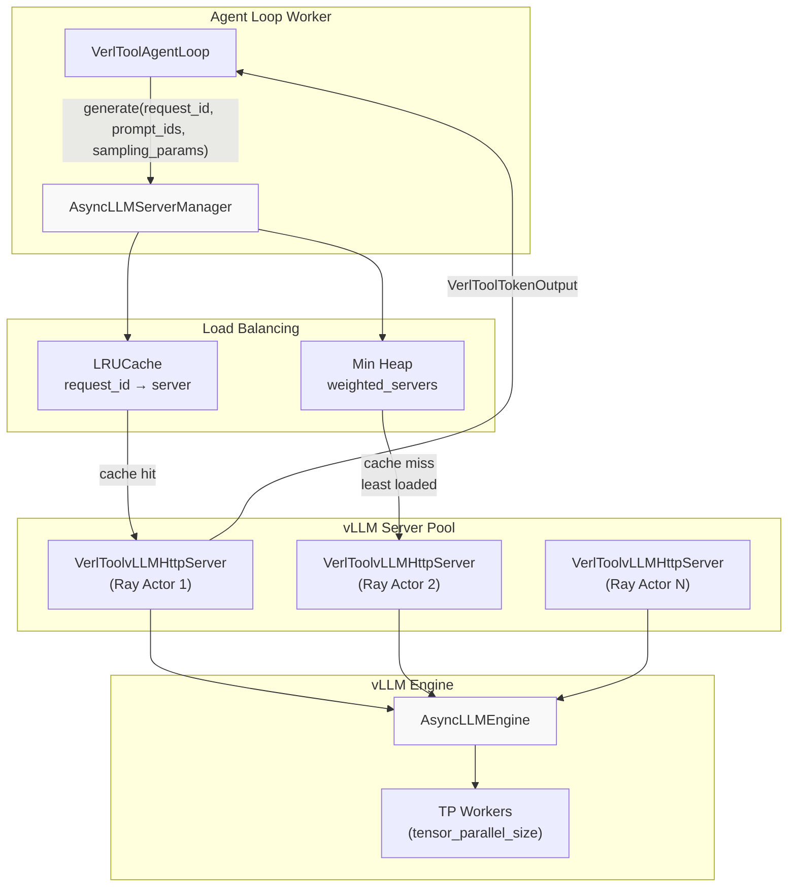
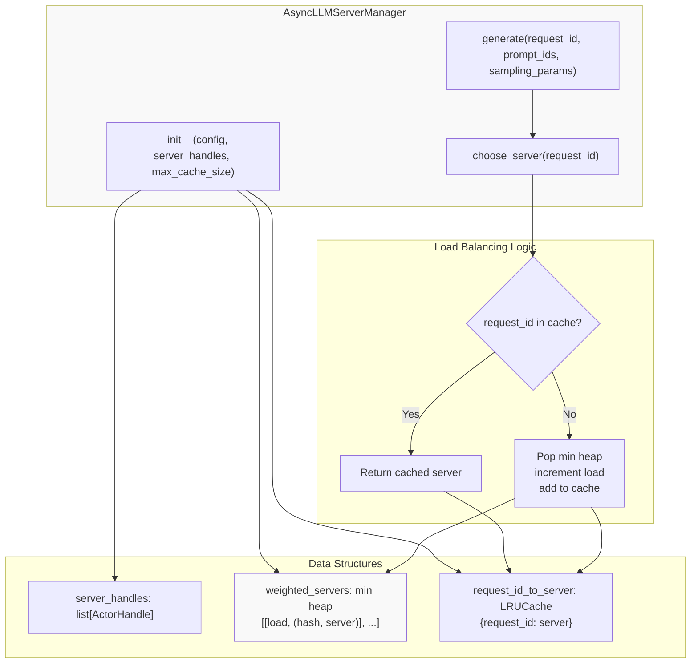
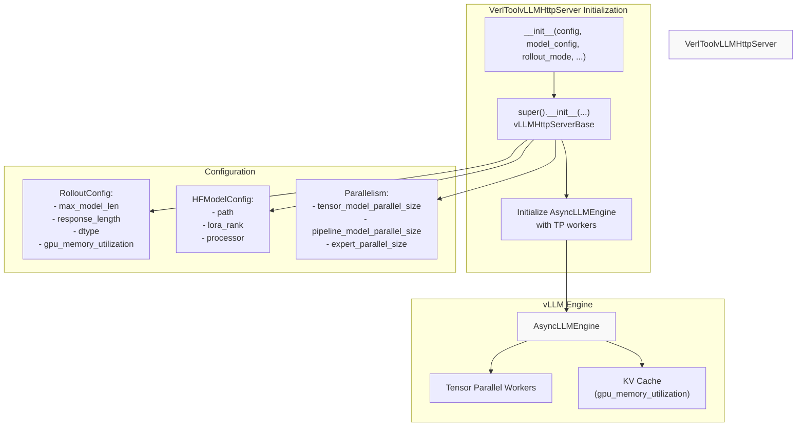
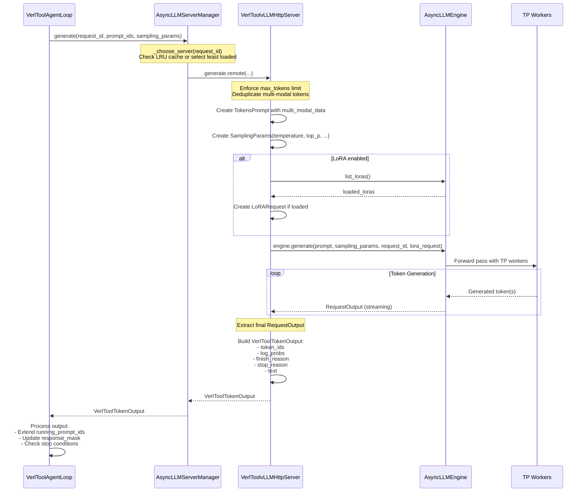
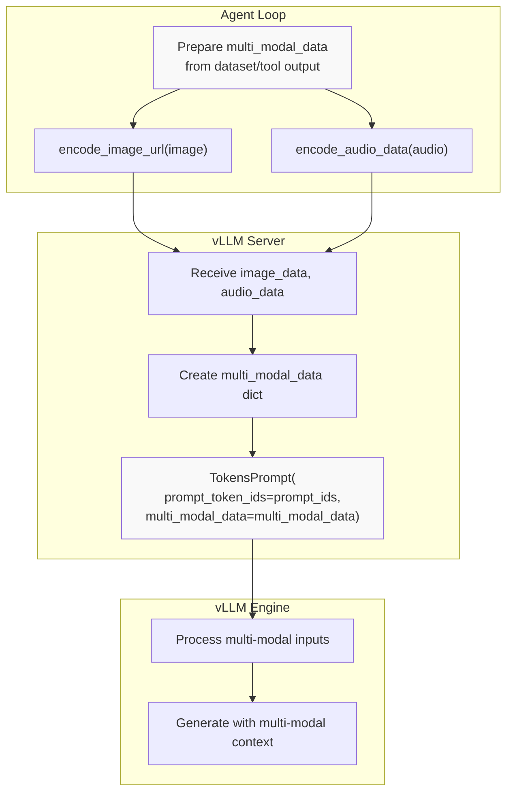
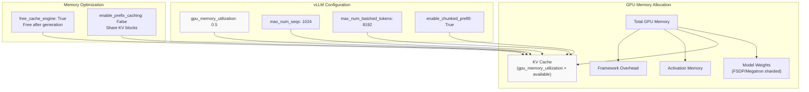

<!-- source: DeepWiki mcp.deepwiki.com · repo TIGER-AI-Lab/verl-tool · page 2.5 Rollout and vLLM Integration · fetched 2026-10-30 -->

# Rollout and vLLM Integration

<details>
<summary>Relevant source files</summary>

The following files were used as context for generating this wiki page:

- [verl_tool/agent_loop/agent_loop.py](verl_tool/agent_loop/agent_loop.py)
- [verl_tool/agent_loop/verltool_agent_loop.py](verl_tool/agent_loop/verltool_agent_loop.py)
- [verl_tool/servers/serve.py](verl_tool/servers/serve.py)
- [verl_tool/servers/tests/test_python_code_tool.py](verl_tool/servers/tests/test_python_code_tool.py)
- [verl_tool/servers/tools/ipython_code.py](verl_tool/servers/tools/ipython_code.py)
- [verl_tool/servers/tools/utils/ipython_tool.py](verl_tool/servers/tools/utils/ipython_tool.py)
- [verl_tool/trainer/config/rollout/rollout.yaml](verl_tool/trainer/config/rollout/rollout.yaml)
- [verl_tool/trainer/config/verltool/agent.yaml](verl_tool/trainer/config/verltool/agent.yaml)
- [verl_tool/trainer/main_ppo.py](verl_tool/trainer/main_ppo.py)
- [verl_tool/trainer/ppo/metric_util.py](verl_tool/trainer/ppo/metric_util.py)
- [verl_tool/trainer/ppo/ray_trainer.py](verl_tool/trainer/ppo/ray_trainer.py)
- [verl_tool/workers/reward_manager/torl.py](verl_tool/workers/reward_manager/torl.py)
- [verl_tool/workers/rollout/vllm_rollout/vllm_async_server.py](verl_tool/workers/rollout/vllm_rollout/vllm_async_server.py)

</details>


This page documents the vLLM rollout engine integration in VerlTool, which provides fast inference for token generation during agent loop execution. The rollout system manages multiple vLLM server instances, handles load balancing with sticky sessions, and supports both text-only and multi-modal generation.

For information about the agent loop that calls the rollout engine, see [Agent Loop System (VerlToolAgentLoop)](#2.3). For details on asynchronous rollout optimization, see [Asynchronous Rollout Mode](#2.6).

## System Overview

The rollout system consists of three main components:

1. **AsyncLLMServerManager** - Manages multiple vLLM server instances with load balancing and sticky session support
2. **VerlToolvLLMHttpServer** - Ray actor wrapping vLLM's AsyncEngine for token generation
3. **Agent Loop Integration** - Interface between agent loop and vLLM servers for multi-turn generation



**Sources:** [verl_tool/agent_loop/agent_loop.py:50-116](), [verl_tool/workers/rollout/vllm_rollout/vllm_async_server.py:25-103]()

## AsyncLLMServerManager - Server Management and Load Balancing

The `AsyncLLMServerManager` class manages multiple vLLM server instances and implements load balancing with sticky session support for multi-turn conversations.

### Architecture



### Key Implementation Details

**Sticky Session Support:**
The manager uses an LRU cache to map `request_id` to server handles, ensuring that all turns of a multi-turn conversation are routed to the same server. This enables vLLM's automatic prefix caching to work effectively.

[verl_tool/agent_loop/agent_loop.py:74-85]()

```python
def _choose_server(self, request_id: str) -> ray.actor.ActorHandle:
    if request_id in self.request_id_to_server:
        return self.request_id_to_server[request_id]
    
    # Least requests load balancing using min heap
    server = self.weighted_serveres[0][1][1]
    self.weighted_serveres[0][0] += 1
    heapq.heapreplace(self.weighted_serveres, self.weighted_serveres[0])
    self.request_id_to_server[request_id] = server
    return server
```

**Load Balancing:**
A min heap tracks the load on each server (number of active requests). When a new `request_id` is encountered, the server with the least load is selected.

[verl_tool/agent_loop/agent_loop.py:69-71]()

### Generate Method

The `generate` method is the primary interface for token generation:

```python
async def generate(
    self,
    request_id: str,
    *,
    prompt_ids: list[int],
    sampling_params: dict[str, Any],
    image_data: Optional[list[Any]] = None,
    audio_data: Optional[list[Any]] = None,
) -> TokenOutput
```

**Sources:** [verl_tool/agent_loop/agent_loop.py:50-116]()

## VerlToolvLLMHttpServer - vLLM Server Implementation

The `VerlToolvLLMHttpServer` is a Ray actor that wraps vLLM's `AsyncLLMEngine` and provides token-in-token-out generation.

### Server Initialization



### Generate Method

The `generate` method implements token-in-token-out generation with support for multi-modal data:

[verl_tool/workers/rollout/vllm_rollout/vllm_async_server.py:48-103]()

**Key Steps:**

1. **Token Limit Enforcement:** Ensures `max_tokens` does not exceed `max_model_len - len(prompt_ids)`
2. **Multi-modal Token Deduplication:** Processes Qwen2.5-VL/Omni tokens to avoid duplication
3. **LoRA Support:** Checks if LoRA is loaded and adds `LoRARequest` if applicable
4. **Async Generation:** Streams tokens from vLLM engine
5. **Response Assembly:** Extracts token_ids, log_probs, finish_reason, stop_reason

```python
async def generate(
    self,
    prompt_ids: list[int],
    sampling_params: dict[str, Any],
    request_id: str,
    image_data: Optional[list[Any]] = None,
    audio_data: Optional[list[Any]] = None,
) -> VerlToolTokenOutput:
    # Enforce token limit
    max_tokens = min(
        self.config.max_model_len - len(prompt_ids),
        sampling_params.get("max_tokens", self.config.response_length)
    )
    
    # Deduplicate multi-modal tokens for Qwen models
    prompt_ids = _qwen2_5_dedup_multimodal_tokens(prompt_ids, self.model_config.processor)
    
    # Create prompt with multi-modal data
    multi_modal_data = {}
    if image_data:
        multi_modal_data["image"] = image_data
    if audio_data:
        multi_modal_data["audio"] = audio_data
    
    # Generate
    generator = self.engine.generate(
        prompt=prompt, sampling_params=sampling_params, request_id=request_id
    )
    
    # Stream and return final output
    async for output in generator:
        final_res = output
    
    return VerlToolTokenOutput(...)
```

**Sources:** [verl_tool/workers/rollout/vllm_rollout/vllm_async_server.py:25-156]()

## Token Generation Flow

The following diagram shows the complete flow from agent loop through vLLM to token output:



**Sources:** [verl_tool/agent_loop/verltool_agent_loop.py:520-548](), [verl_tool/workers/rollout/vllm_rollout/vllm_async_server.py:48-103](), [verl_tool/agent_loop/agent_loop.py:87-115]()

## Sampling Parameters and Configuration

### Agent Sampling Parameters

The agent loop constructs sampling parameters for each generation turn:

[verl_tool/agent_loop/verltool_agent_loop.py:492-498]()

| Parameter | Default | Description |
|-----------|---------|-------------|
| `n` | 1 | Number of completions (already handled by input replication) |
| `stop` | `action_stop_tokens` | Stop tokens for action boundaries (e.g., `</tool_call>`) |
| `include_stop_str_in_output` | `True` | Include stop string in output for action parsing |
| `logprobs` | `False` | Whether to return log probabilities per token |
| `max_tokens` | Dynamic | Computed based on available length and turn constraints |

**Dynamic Token Limit:**
The `max_tokens` for each turn is computed to respect both the action length limit and the overall response length budget:

[verl_tool/agent_loop/verltool_agent_loop.py:510-517]()

```python
available_length = max(max_response_length - len(running_prompt_ids) + len(prompt_ids), 0)
max_tokens_for_this_turn = min(max_action_length, available_length)

if max_tokens_for_this_turn <= 0:
    traj_stop_reason = "max_model_len_exceeded"
    break

agent_sampling_params["max_tokens"] = max_tokens_for_this_turn
```

### vLLM Sampling Parameters

The vLLM server converts agent sampling parameters to vLLM's `SamplingParams`:

[verl_tool/workers/rollout/vllm_rollout/vllm_async_server.py:58-62]()

| Parameter | Default | Source | Description |
|-----------|---------|--------|-------------|
| `max_tokens` | `response_length` | Computed dynamically | Maximum tokens to generate |
| `logprobs` | `None` | `agent_config.logprobs` | Number of log probabilities to return (0 or None) |
| `repetition_penalty` | 1.0 | `config.repetition_penalty` | Penalty for token repetition |
| `temperature` | 1.0 | `rollout.temperature` | Sampling temperature |
| `top_p` | 1.0 | `rollout.top_p` | Nucleus sampling threshold |
| `stop` | `[]` | `action_stop_tokens` | Stop sequences |

**Sources:** [verl_tool/agent_loop/verltool_agent_loop.py:492-498](), [verl_tool/workers/rollout/vllm_rollout/vllm_async_server.py:48-62](), [verl_tool/trainer/config/rollout/rollout.yaml:10-17]()

## Multi-modal Data Support

The vLLM integration supports multi-modal inputs (images and audio) through vLLM's multi-modal API.

### Multi-modal Token Deduplication

For Qwen2.5-VL and Qwen2.5-Omni models, the system deduplicates consecutive multi-modal tokens because vLLM will replicate them based on the actual data:

[verl_tool/workers/rollout/vllm_rollout/vllm_async_server.py:106-156]()

**Image Token Deduplication:**
```
<|vision_start|><|image_pad|><|image_pad|>...<|image_pad|><|vision_end|>
=>
<|vision_start|><|image_pad|><|vision_end|>
```

**Audio Token Deduplication:**
```
<|audio_bos|><|AUDIO|><|AUDIO|>...<|AUDIO|><|audio_eos|>
=>
<|audio_bos|><|AUDIO|><|audio_eos|>
```

### Multi-modal Data Flow



**Agent Loop Integration:**
The agent loop encodes images and audio before sending to vLLM:

[verl_tool/agent_loop/verltool_agent_loop.py:454-458]()

```python
image_data = multi_modal_data.get("image")
encoded_image_data = [encode_image_url(img) for img in image_data] if image_data is not None else None
audio_data = multi_modal_data.get("audio")
encoded_audio_data = [encode_audio_data(audio) for audio in audio_data] if audio_data is not None else None
```

**vLLM Server Processing:**
The server constructs the prompt with multi-modal data:

[verl_tool/workers/rollout/vllm_rollout/vllm_async_server.py:65-72]()

```python
multi_modal_data: dict[str, Any] = {}
if image_data:
    multi_modal_data["image"] = image_data
if audio_data:
    multi_modal_data["audio"] = audio_data

prompt = TokensPrompt(
    prompt_token_ids=prompt_ids, multi_modal_data=multi_modal_data or None
)
```

**Sources:** [verl_tool/workers/rollout/vllm_rollout/vllm_async_server.py:48-156](), [verl_tool/agent_loop/verltool_agent_loop.py:454-458]()

## vLLM Configuration Options

The following table summarizes key vLLM configuration parameters from the rollout config:

| Parameter | Default | Location | Description |
|-----------|---------|----------|-------------|
| `max_model_len` | `null` | `rollout.max_model_len` | Maximum sequence length for vLLM engine |
| `response_length` | 512 | `rollout.response_length` | Default max tokens per response |
| `prompt_length` | 512 | `rollout.prompt_length` | Expected prompt length for padding |
| `dtype` | `bfloat16` | `rollout.dtype` | Model parameter data type |
| `gpu_memory_utilization` | 0.5 | `rollout.gpu_memory_utilization` | Fraction of GPU memory for KV cache |
| `tensor_model_parallel_size` | 2 | `rollout.tensor_model_parallel_size` | Tensor parallelism size |
| `pipeline_model_parallel_size` | 1 | `rollout.pipeline_model_parallel_size` | Pipeline parallelism size |
| `expert_parallel_size` | 1 | `rollout.expert_parallel_size` | Expert parallelism size (MoE models) |
| `max_num_batched_tokens` | 8192 | `rollout.max_num_batched_tokens` | Maximum tokens in a batch |
| `max_num_seqs` | 1024 | `rollout.max_num_seqs` | Maximum concurrent sequences |
| `enable_chunked_prefill` | `True` | `rollout.enable_chunked_prefill` | Enable chunked prefill for higher throughput |
| `enable_prefix_caching` | `False` | `rollout.enable_prefix_caching` | Enable KV cache prefix sharing |
| `enforce_eager` | `False` | `rollout.enforce_eager` | Disable CUDA graph (degrades performance) |
| `free_cache_engine` | `True` | `rollout.free_cache_engine` | Free KV cache after generation |
| `temperature` | 1.0 | `rollout.temperature` | Sampling temperature |
| `top_p` | 1.0 | `rollout.top_p` | Nucleus sampling threshold |

### Agent-Specific Configuration

Agent loop configuration parameters that affect vLLM usage:

| Parameter | Default | Location | Description |
|-----------|---------|----------|-------------|
| `max_response_length` | Same as `data.max_response_length` | `agent.max_response_length` | Maximum response length for agent |
| `train_max_response_length` | Same as `max_response_length` | `agent.train_max_response_length` | Training max response length |
| `val_max_response_length` | Same as `max_response_length` | `agent.val_max_response_length` | Validation max response length |
| `max_action_length` | `null` | `agent.max_action_length` | Maximum tokens per action (defaults to max_response_length) |
| `max_turns` | 1 | `agent.max_turns` | Maximum conversation turns |
| `val_max_turns` | 0 | `agent.val_max_turns` | Validation max turns (0 = same as max_turns) |
| `action_stop_tokens` | `null` | `agent.action_stop_tokens` | File path containing stop tokens for actions |
| `logprobs` | `False` | `agent.logprobs` | Whether to compute log probabilities |

**Sources:** [verl_tool/trainer/config/rollout/rollout.yaml:1-299](), [verl_tool/trainer/config/verltool/agent.yaml:1-90](), [verl_tool/agent_loop/verltool_agent_loop.py:155-204]()

## vLLM Engine Memory Management

The vLLM engine manages GPU memory for KV cache and model weights:



**Key Considerations:**

1. **gpu_memory_utilization:** Controls the fraction of available GPU memory (after model weights) allocated to KV cache. Lower values leave more room for activation memory during training updates.

2. **free_cache_engine:** When `True`, the KV cache is freed after each rollout phase to make room for training. This is essential for memory-efficient training.

3. **enable_chunked_prefill:** Allows processing prompts in chunks, improving throughput by better utilizing KV cache space when processing variable-length sequences.

4. **max_num_seqs and max_num_batched_tokens:** Control batch size limits. Higher values increase throughput but require more KV cache memory.

**Sources:** [verl_tool/trainer/config/rollout/rollout.yaml:29-72](), [verl_tool/workers/rollout/vllm_rollout/vllm_async_server.py:44-46]()

---

