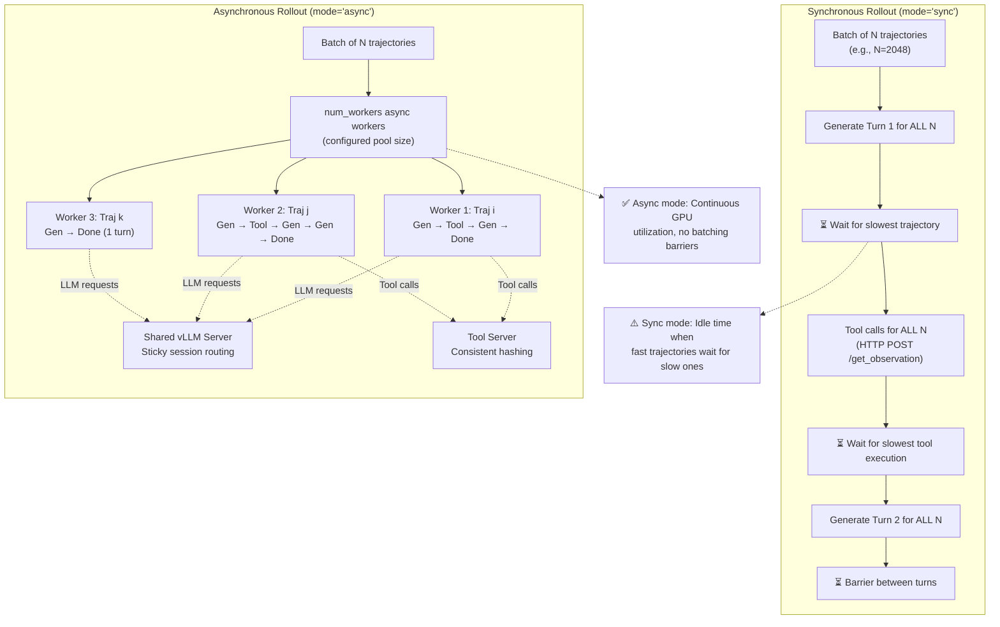
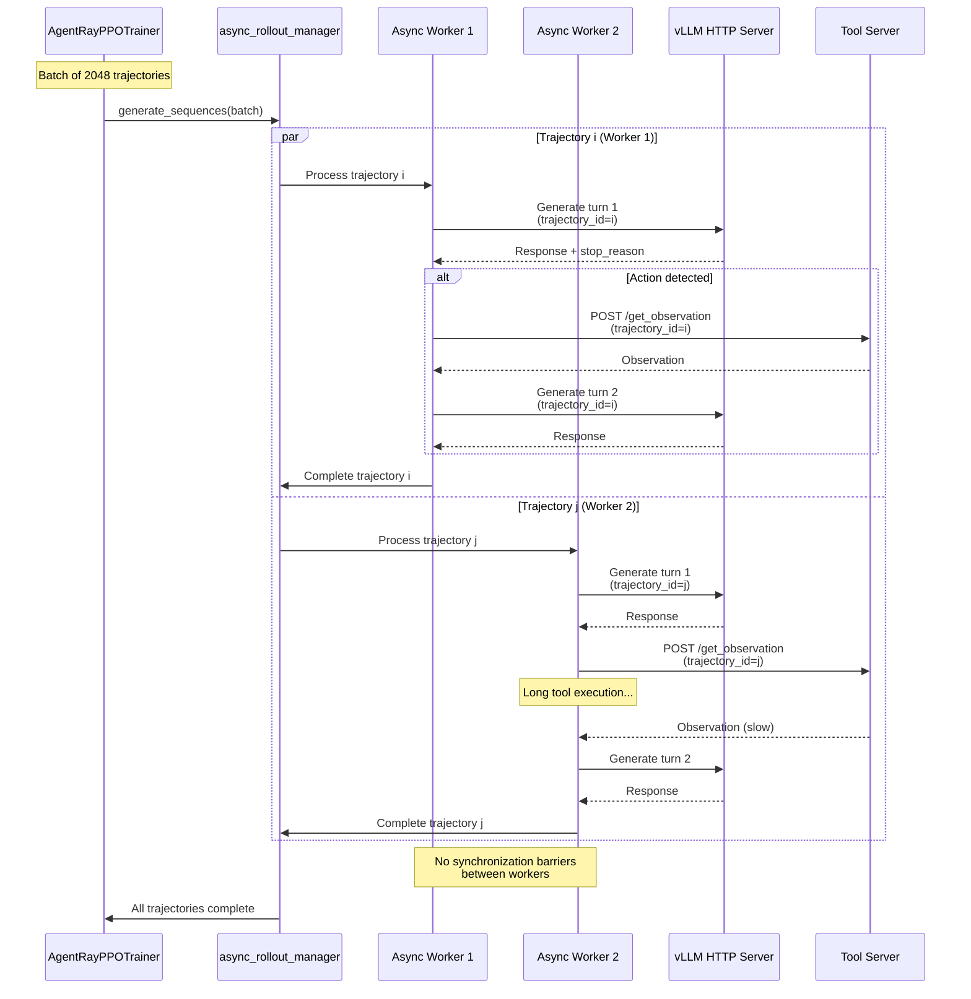

<!-- source: DeepWiki mcp.deepwiki.com · repo TIGER-AI-Lab/verl-tool · page 2.6 Asynchronous Rollout Mode · fetched 2026-10-30 -->

# Asynchronous Rollout Mode

<details>
<summary>Relevant source files</summary>

The following files were used as context for generating this wiki page:

- [assets/docs/asyncRL.md](assets/docs/asyncRL.md)
- [assets/imgs/wechat_group.jpg](assets/imgs/wechat_group.jpg)
- [verl_tool/servers/serve.py](verl_tool/servers/serve.py)
- [verl_tool/trainer/main_ppo.py](verl_tool/trainer/main_ppo.py)
- [verl_tool/trainer/ppo/ray_trainer.py](verl_tool/trainer/ppo/ray_trainer.py)

</details>


## Overview

This page documents VerlTool's asynchronous rollout mode, a trajectory-level parallelization strategy that significantly accelerates multi-turn agent interactions during policy optimization. Asynchronous rollout mode achieves 1.69x-2.06x speedup over synchronous rollout by eliminating batching barriers between turn generations and tool executions.

For general training infrastructure, see [Core Training Framework](#2). For the agent loop implementation that handles multi-turn interactions, see [Agent Loop System (VerlToolAgentLoop)](#2.3). For rollout generation mechanics, see [Rollout and vLLM Integration](#2.5).

**Scope**: This page covers the configuration, architecture, performance characteristics, and implementation details of asynchronous rollout mode for PPO training with tool-integrated agents.

---

## Synchronous vs Asynchronous Rollout Modes

VerlTool supports two rollout execution modes controlled by the configuration parameter `actor_rollout_ref.rollout.mode`:

### Synchronous Rollout (`mode='sync'`)

In synchronous mode (default), the rollout engine processes the entire batch in lockstep:

1. Generate first turn for **all** trajectories in the batch
2. Wait for all generations to complete
3. Make tool calls for all trajectories that produced actions
4. Wait for all tool observations to return
5. Generate second turn for all trajectories
6. Repeat until max turns reached

This creates significant idle time: fast trajectories (e.g., those that finish in 1 turn) must wait for slow trajectories (e.g., those requiring 3 turns with complex tool executions) before the batch can proceed.

### Asynchronous Rollout (`mode='async'`)

In asynchronous mode, each trajectory is processed independently:

1. Generate first turn for trajectory `i`
2. Immediately make tool call for trajectory `i` if action is produced
3. While waiting for observation, start generating for trajectory `i+1`
4. When observation returns for trajectory `i`, immediately continue generation
5. No synchronization barriers between trajectories

This eliminates batching barriers and allows the system to maximize GPU utilization by keeping the vLLM engine continuously busy.

**Sources**: [assets/docs/asyncRL.md:1-19]()

---

## Architecture Comparison

The following diagram illustrates the execution flow differences between sync and async modes:



**Key Architectural Differences**:

| Aspect | Synchronous Mode | Asynchronous Mode |
|--------|------------------|-------------------|
| **Batching** | Entire batch processed together | Per-trajectory independent processing |
| **Barrier Points** | After each turn generation and tool execution | No barriers |
| **Worker Model** | Single worker group processes batch | Worker pool with configurable concurrency |
| **GPU Utilization** | Bursty (idle during tool calls) | Continuous (overlaps generation & tools) |
| **vLLM Engine** | Batch inference | Individual inference with sticky sessions |

**Sources**: [assets/docs/asyncRL.md:1-19](), [verl_tool/trainer/ppo/ray_trainer.py:95-106]()

---

## Performance Characteristics

### Benchmark Results

For a 1.5B parameter Qwen-Math model training on 4 H100 GPUs with a batch size of 2048 trajectories:

| Max Turns | Async Rollout Time (s) | Sync Rollout Time (s) | Speedup Factor |
|-----------|------------------------|----------------------|----------------|
| 1         | **75**                 | 127                  | **1.69x**      |
| 3         | **94**                 | 194                  | **2.06x**      |

**Observations**:
- Speedup increases with the number of turns (1.69x → 2.06x)
- Greater benefit for multi-turn scenarios where tool execution latency compounds
- Rollout time includes only generation and tool interaction, excluding PPO update steps

### Why Speedup Increases with Turns

The speedup factor grows with `max_turns` because:

1. **Compounding Idle Time**: In sync mode, each turn adds a synchronization barrier. With 3 turns, there are 6 barriers (3 generation + 3 tool execution), amplifying idle time.

2. **Trajectory Length Variance**: Different trajectories finish at different turns:
   - Some complete in 1 turn (e.g., simple math problems)
   - Others require 3 turns (e.g., complex code generation with debugging)
   - Sync mode forces all to wait for the longest trajectory at each turn

3. **Tool Execution Variability**: Tool execution times vary significantly:
   - Code execution: 0.5-10 seconds depending on complexity
   - Search queries: 1-3 seconds depending on network and caching
   - Async mode allows fast tools to complete while slow ones execute

**Sources**: [assets/docs/asyncRL.md:7-15]()

---

## Configuration

### Enabling Asynchronous Rollout

Set the rollout mode in your Hydra configuration file or via command-line override:

```yaml
# config/rollout.yaml
actor_rollout_ref:
  rollout:
    mode: 'async'  # 'sync' (default) or 'async'
    
    # Async-specific configuration
    agent:
      num_workers: 16  # Number of concurrent async workers
                       # Higher = more parallelism, but more memory
```

**Command-line override**:
```bash
python -m verl_tool.trainer.main_ppo \
    actor_rollout_ref.rollout.mode=async \
    actor_rollout_ref.rollout.agent.num_workers=16
```

### Worker Configuration

The `num_workers` parameter controls the degree of parallelism:

- **Too low** (e.g., 4): Underutilizes GPU, limits concurrency
- **Optimal** (e.g., 16-32): Balances throughput and memory
- **Too high** (e.g., 128): Excessive memory overhead, context switches

**Recommended formula**:
```
num_workers = min(batch_size / 128, num_gpus * 8)
```

For batch_size=2048 on 4 GPUs: `num_workers = min(2048/128, 4*8) = min(16, 32) = 16`

**Sources**: [verl_tool/trainer/ppo/ray_trainer.py:95-98]()

---

## Implementation Details

### Worker Class Selection

The training script dynamically selects the appropriate worker class based on the configured mode:

```
verl_tool/trainer/main_ppo.py:
- Lines 112-143: add_actor_rollout_worker() method
  - For FSDP strategy:
    - Sync: ActorRolloutRefWorker
    - Async: AsyncActorRolloutRefWorker
  - For Megatron strategy:
    - Sync: ActorRolloutRefWorker  
    - Async: AsyncActorRolloutRefWorker
```

The selection logic:

```python
# Simplified from main_ppo.py:119-122
actor_rollout_cls = (
    AsyncActorRolloutRefWorker 
    if config.actor_rollout_ref.rollout.mode == "async"
    else ActorRolloutRefWorker
)
```

### Generation Flow in Async Mode

The following sequence diagram shows how async rollout processes trajectories:



**Key Implementation Points**:

1. **Sticky Sessions**: Each worker maintains the same `trajectory_id` across LLM requests, enabling vLLM's KV cache reuse via `AsyncLLMServerManager` routing.

2. **Consistent Hashing**: Tool server routes requests by `trajectory_id` using CRC32 hash to ensure stateful tool environments are preserved across turns.

3. **Worker Independence**: Workers do not communicate with each other; coordination happens only at the manager level for batch completion.

**Sources**: [verl_tool/trainer/ppo/ray_trainer.py:95-106]()

---

## Trainer Integration

### Generation Method Selection

The `AgentRayPPOTrainer` class conditionally invokes different generation methods based on the rollout mode:

```
verl_tool/trainer/ppo/ray_trainer.py:
- Lines 95-98: Training generation logic
  - If self.async_rollout_mode: self.async_rollout_manager.generate_sequences()
  - Else: self.actor_rollout_wg.generate_sequences()
  
- Lines 100-103: Validation generation logic  
  - Same conditional logic for validation batches
```

### Batch Size Considerations

The batch is divided among workers differently in each mode:

**Synchronous Mode**:
```
size_divisor = self.actor_rollout_wg.world_size
# Example: world_size=4 GPUs, batch must be divisible by 4
```

**Asynchronous Mode**:
```
size_divisor = self.config.actor_rollout_ref.rollout.agent.num_workers
# Example: num_workers=16, batch must be divisible by 16
```

The trainer handles padding automatically via `pad_dataproto_to_divisor()` to ensure divisibility.

**Sources**: [verl_tool/trainer/ppo/ray_trainer.py:95-106]()

---

## Best Practices

### When to Use Async Mode

✅ **Use async rollout when**:
- Multi-turn interactions (max_turns ≥ 2)
- Tools have variable execution times (e.g., code execution with timeouts)
- Large batch sizes (≥ 1024 trajectories)
- Tool execution time is comparable to generation time

❌ **Avoid async rollout when**:
- Single-turn generation only (max_turns = 1, minimal benefit)
- Very small batches (< 128, overhead dominates)
- Debugging (sync mode is easier to trace)

### Tool Server Configuration

**Critical**: Set `use_ray=False` when launching the tool server for async rollout:

```bash
python -m verl_tool.servers.serve \
    --use_ray False \
    --max_concurrent_requests 1024 \
    --uvi_workers 4
```

**Rationale**: Ray's actor model introduces serialization overhead and queue contention under high concurrency, degrading performance with multiple simultaneous requests from async workers.

**Sources**: [assets/docs/asyncRL.md:18-19]()

---

## Limitations and Known Issues

### Ray-Based Tool Server Performance

The current Ray-based tool server implementation (`RayToolManager`) exhibits performance degradation with async rollout due to:

1. **Serialization Overhead**: Ray uses pickle for inter-actor communication, adding latency for each tool call
2. **Queue Contention**: Multiple async workers hitting the same Ray actor create head-of-line blocking
3. **Actor Scheduling**: Ray's scheduling decisions may not align with the urgency of tool requests

**Workaround**: Use the HTTP-based tool server (`serve.py`) with `use_ray=False`, which uses FastAPI + uvicorn workers for better concurrency handling.

### Memory Considerations

Async mode requires additional memory:
- Each worker maintains its own trajectory state
- KV cache entries for concurrent trajectories in vLLM
- Tool server environments for concurrent executions

**Estimate**: ~10-20% more memory than sync mode for typical workloads.

### Debugging Complexity

Async mode complicates debugging because:
- Trajectory execution is interleaved and non-deterministic
- Logs from different trajectories are mixed
- Reproducing specific failure scenarios requires trajectory ID filtering

**Tip**: Use `trainer.rollout_data_dir` to dump per-trajectory logs with `trajectory_id` metadata for post-hoc analysis.

**Sources**: [assets/docs/asyncRL.md:18-19](), [verl_tool/servers/serve.py:1-767]()

---

## Monitoring and Profiling

### Key Metrics to Track

When evaluating async rollout performance, monitor:

| Metric | Description | Target |
|--------|-------------|--------|
| `rollout_time` | Total time for batch generation | < 100s for 2048 traj |
| `tool_call_rate` | % of trajectories using tools | Domain-dependent |
| `avg_turns_per_traj` | Average turns before completion | Match expected for task |
| `vllm_utilization` | GPU utilization during rollout | > 80% in async mode |
| `worker_idle_time` | Time workers spend waiting | < 10% in async mode |

### Profiling Async Rollout

Enable profiling in the configuration:

```yaml
global_profiler:
  tool: 'nsys'  # or 'torch_profiler'
  steps: [5, 10]  # Profile these training steps
```

This generates timeline traces showing:
- Worker concurrency patterns
- vLLM request queueing
- Tool server request handling
- Idle time vs active time per worker

**Sources**: [verl_tool/trainer/ppo/ray_trainer.py:95-106]()

---

## Summary

Asynchronous rollout mode is a trajectory-level parallelization strategy that delivers significant speedups (1.69x-2.06x) for multi-turn agent training by eliminating synchronization barriers between generation and tool execution. The architecture uses independent worker pools with sticky vLLM sessions and consistent tool server hashing to maintain trajectory state while maximizing GPU utilization. Enable async mode by setting `actor_rollout_ref.rollout.mode='async'` and configuring `num_workers` appropriately for your batch size and hardware.

**Sources**: [assets/docs/asyncRL.md:1-19](), [verl_tool/trainer/main_ppo.py:112-143](), [verl_tool/trainer/ppo/ray_trainer.py:95-106]()

---

