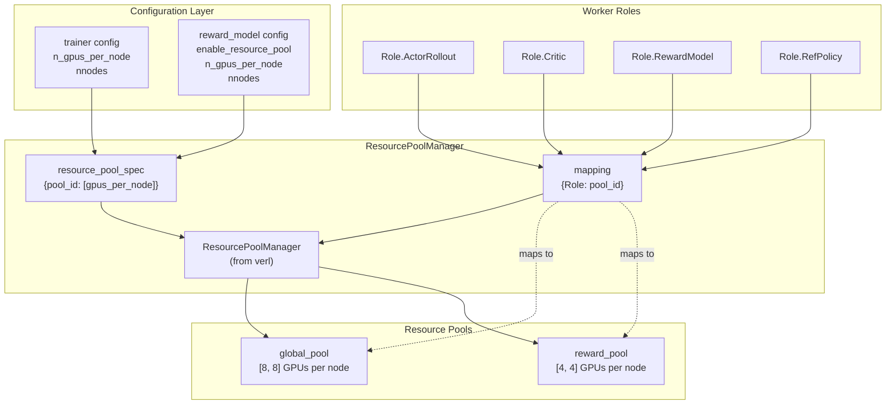
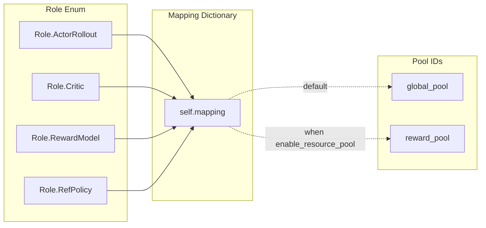
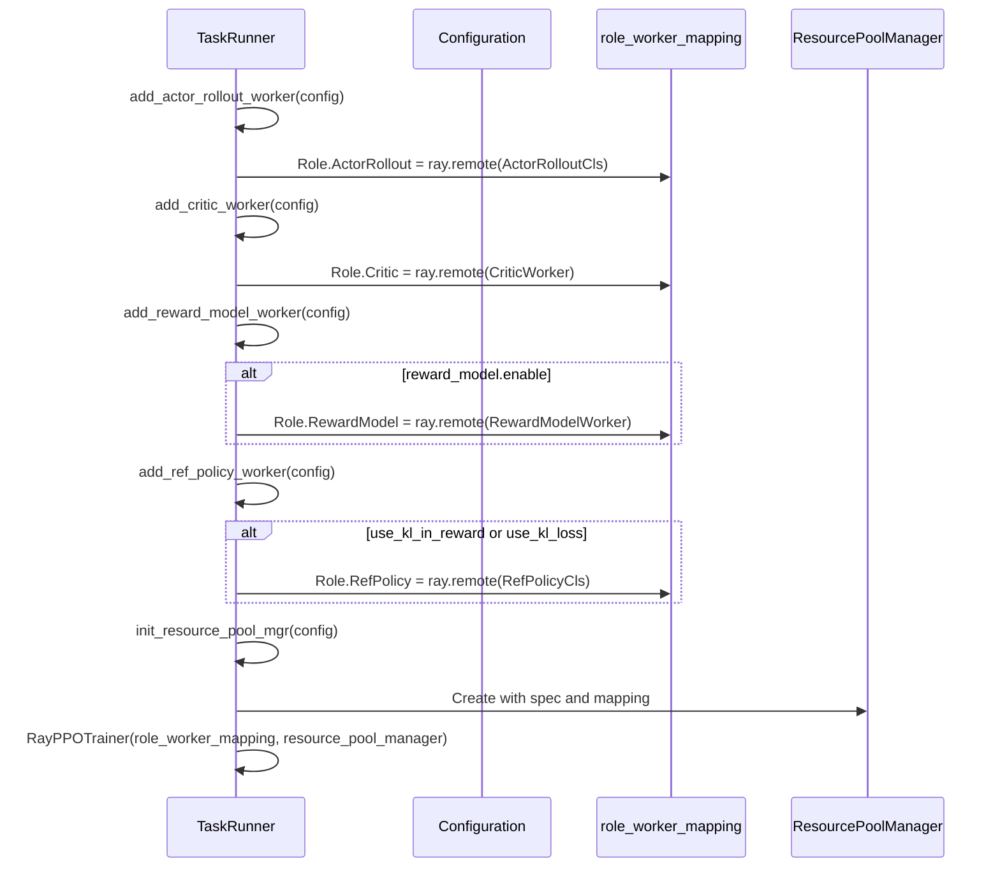
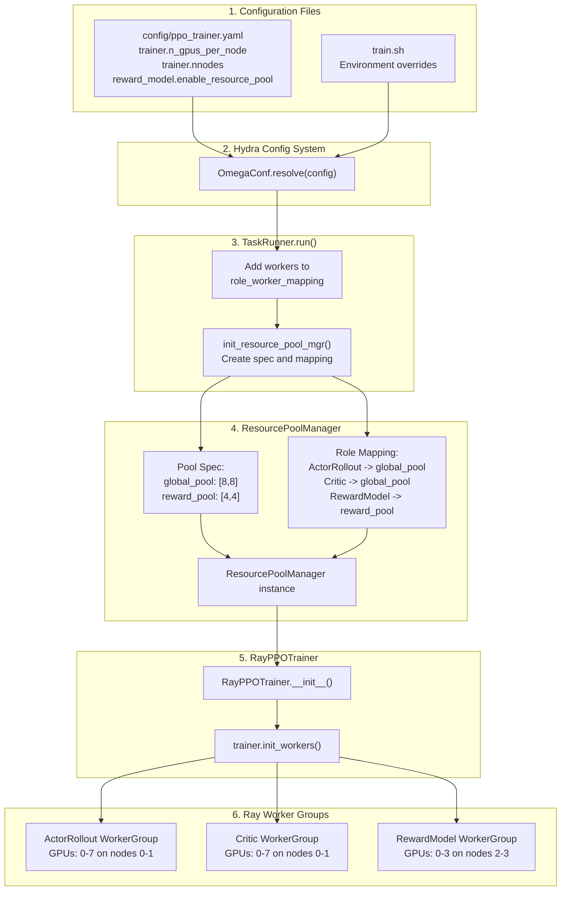

<!-- source: DeepWiki mcp.deepwiki.com · repo TIGER-AI-Lab/verl-tool · page 2.7 Resource Management and Distributed Training · fetched 2026-10-30 -->

# Resource Pool Management

<details>
<summary>Relevant source files</summary>

The following files were used as context for generating this wiki page:

- [verl_tool/servers/serve.py](verl_tool/servers/serve.py)
- [verl_tool/trainer/config/rollout/rollout.yaml](verl_tool/trainer/config/rollout/rollout.yaml)
- [verl_tool/trainer/main_ppo.py](verl_tool/trainer/main_ppo.py)
- [verl_tool/trainer/ppo/ray_trainer.py](verl_tool/trainer/ppo/ray_trainer.py)

</details>


The Resource Pool Management system controls GPU allocation and distribution across different worker roles in distributed PPO training. It enables flexible resource partitioning, including support for dedicated reward model pools that run on separate hardware from the main training workers.

For information about how workers are initialized and executed, see [Core Training Framework](#2). For details on reward model workers specifically, see [Reward Management System](#5).

## Purpose and Scope

The ResourcePoolManager system addresses the challenge of efficiently allocating limited GPU resources across multiple worker types in distributed RL training. Key responsibilities include:

- **GPU allocation per role**: Mapping worker roles (actor, critic, reward model, reference policy) to GPU pools
- **Multi-node resource specification**: Defining GPU counts per node across multiple machines
- **Dedicated resource pools**: Supporting separate hardware pools for computationally expensive components (e.g., reward models)
- **Dynamic role registration**: Allowing conditional worker instantiation based on configuration

This system operates at the cluster initialization phase and defines the resource constraints under which all training workers execute.

Sources: [verl_tool/trainer/main_ppo.py:168-191]()

## Architecture Overview

The resource pool system consists of three core components that work together during trainer initialization:



**Diagram: Resource Pool Management Architecture**

The `ResourcePoolManager` is instantiated in the `init_resource_pool_mgr` method and passed to the `RayPPOTrainer` constructor, where it controls GPU allocation for all worker groups.

Sources: [verl_tool/trainer/main_ppo.py:168-191](), [verl_tool/trainer/main_ppo.py:301-319]()

## Resource Pool Specification

Resource pools are defined using a dictionary structure where each pool ID maps to a list of GPU counts per node:

```python
resource_pool_spec = {
    "global_pool": [n_gpus_per_node] * nnodes,
    "reward_pool": [reward_gpus_per_node] * reward_nnodes,  # optional
}
```

### Global Pool Configuration

The global pool is always created and contains the primary training resources:

| Configuration Parameter | Source | Description |
|------------------------|--------|-------------|
| `n_gpus_per_node` | `config.trainer.n_gpus_per_node` | GPUs available per node for training |
| `nnodes` | `config.trainer.nnodes` | Number of nodes in the cluster |

**Example**: With `n_gpus_per_node=8` and `nnodes=2`, the global pool spec is `[8, 8]`, indicating 8 GPUs on each of 2 nodes.

Sources: [verl_tool/trainer/main_ppo.py:173-175]()

### Optional Reward Pool Configuration

When `config.reward_model.enable_resource_pool=True`, a separate reward pool is created:

| Configuration Parameter | Source | Description |
|------------------------|--------|-------------|
| `enable_resource_pool` | `config.reward_model.enable_resource_pool` | Enable dedicated reward model pool |
| `n_gpus_per_node` | `config.reward_model.n_gpus_per_node` | GPUs per node for reward models |
| `nnodes` | `config.reward_model.nnodes` | Number of nodes for reward models |

**Validation**: The system enforces that `n_gpus_per_node > 0` and `nnodes > 0` when the reward pool is enabled, raising `ValueError` otherwise.

Sources: [verl_tool/trainer/main_ppo.py:177-184]()

## Role-to-Pool Mapping

The `mapping` dictionary associates each `Role` enum value with a pool ID string. This mapping is constructed during worker initialization:



**Diagram: Role-to-Pool Mapping Flow**

### Default Mappings

All roles default to `global_pool`:

```python
self.mapping[Role.ActorRollout] = "global_pool"
self.mapping[Role.Critic] = "global_pool"
```

Sources: [verl_tool/trainer/main_ppo.py:186-187]()

### Conditional Reward Model Mapping

The reward model role mapping depends on the `enable_resource_pool` configuration:

```python
if config.reward_model.enable_resource_pool:
    self.mapping[Role.RewardModel] = "reward_pool"
else:
    self.mapping[Role.RewardModel] = "global_pool"
```

This allows reward models to either share the global pool (when disabled) or use dedicated hardware (when enabled).

Sources: [verl_tool/trainer/main_ppo.py:214-217]()

### Reference Policy Mapping

When KL divergence is used (either in rewards or actor loss), the reference policy is registered:

```python
if config.algorithm.use_kl_in_reward or config.actor_rollout_ref.actor.use_kl_loss:
    self.role_worker_mapping[Role.RefPolicy] = ray.remote(ref_policy_cls)
    self.mapping[Role.RefPolicy] = "global_pool"
```

Reference policies always use the global pool since they are read-only and typically loaded on the same nodes as the actor.

Sources: [verl_tool/trainer/main_ppo.py:223-225]()

## Worker Role Registration

Before the resource pool manager is initialized, worker classes are registered in `role_worker_mapping`. This dictionary maps `Role` enums to Ray remote actor classes:



**Diagram: Worker Registration and Resource Pool Initialization Sequence**

### Worker Class Selection

Different worker implementations are selected based on the parallelism strategy:

| Role | FSDP Strategy | Megatron Strategy |
|------|--------------|-------------------|
| ActorRollout | `ActorRolloutRefWorker` or `AsyncActorRolloutRefWorker` | `ActorRolloutRefWorker` or `AsyncActorRolloutRefWorker` |
| Critic | `CriticWorker` (fsdp_workers) | `CriticWorker` (megatron_workers) |
| RewardModel | `RewardModelWorker` (fsdp_workers) | `RewardModelWorker` (megatron_workers) |

The async variant of actor rollout workers is selected when `config.actor_rollout_ref.rollout.mode == "async"`.

Sources: [verl_tool/trainer/main_ppo.py:112-143](), [verl_tool/trainer/main_ppo.py:145-166](), [verl_tool/trainer/main_ppo.py:193-217]()

## Dedicated Reward Model Pools

Dedicated reward model pools enable running reward computation on separate hardware from the main training loop. This is critical when:

- Reward models are large and would compete for GPU memory with actors/critics
- Reward computation is slow and would bottleneck training if sharing resources
- Multi-node setups want to dedicate specific nodes to reward computation

### Configuration Example

To enable a dedicated reward pool with 2 nodes, each with 4 GPUs:

```yaml
reward_model:
  enable: true
  enable_resource_pool: true
  n_gpus_per_node: 4
  nnodes: 2
  strategy: fsdp  # or megatron
```

This creates a resource pool spec:

```python
resource_pool_spec = {
    "global_pool": [8, 8, 8, 8],      # 4 nodes × 8 GPUs for training
    "reward_pool": [4, 4],             # 2 nodes × 4 GPUs for rewards
}
```

### GPU Allocation Strategy

The resource pool manager ensures that:

1. **No GPU overlap**: Reward pool nodes are physically separate from global pool nodes
2. **Independent scaling**: Reward pool can scale independently of training pool
3. **Dedicated memory**: Each pool has isolated GPU memory, preventing OOM errors from cross-contamination

This separation is particularly important for training recipes like AceCoder and SQLCoder where reward computation involves executing code or SQL queries in addition to model inference.

Sources: [verl_tool/trainer/main_ppo.py:177-184]()

## Integration with RayPPOTrainer

The `ResourcePoolManager` is passed to the `RayPPOTrainer` constructor where it controls worker group initialization:

```python
trainer = RayPPOTrainer(
    config=config,
    tokenizer=tokenizer,
    processor=processor,
    role_worker_mapping=self.role_worker_mapping,
    resource_pool_manager=resource_pool_manager,  # GPU allocation
    ray_worker_group_cls=ray_worker_group_cls,
    reward_fn=reward_fn,
    val_reward_fn=val_reward_fn,
    train_dataset=train_dataset,
    val_dataset=val_dataset,
    collate_fn=collate_fn,
    train_sampler=train_sampler,
)
```

### Worker Group Creation

When `trainer.init_workers()` is called, the resource pool manager is used to:

1. **Allocate GPUs**: Assign specific GPU IDs to each worker based on role and pool
2. **Create Ray actors**: Instantiate remote workers with proper resource constraints
3. **Set placement groups**: Ensure workers are placed on correct nodes based on pool specs

The base `verl` framework's `ResourcePoolManager` class handles the low-level Ray placement group creation and GPU assignment logic.

Sources: [verl_tool/trainer/main_ppo.py:301-319]()

## Configuration Flow

The complete flow from configuration to GPU allocation:



**Diagram: End-to-End Configuration and GPU Allocation Flow**

Sources: [verl_tool/trainer/main_ppo.py:227-319]()

## Multi-Node Resource Specifications

In multi-node setups, the resource pool spec defines GPU availability per node as a list:

### Example 1: Homogeneous Cluster

4 nodes, each with 8 GPUs:
```python
resource_pool_spec = {
    "global_pool": [8, 8, 8, 8],
}
```

### Example 2: Heterogeneous Cluster

Mixed GPU counts across nodes:
```python
resource_pool_spec = {
    "global_pool": [8, 8, 4, 4],  # 2 nodes with 8 GPUs, 2 nodes with 4 GPUs
}
```

### Example 3: Separate Training and Reward Nodes

6 nodes total: 4 for training, 2 for rewards:
```python
resource_pool_spec = {
    "global_pool": [8, 8, 8, 8],      # Nodes 0-3: training
    "reward_pool": [8, 8],             # Nodes 4-5: rewards
}
```

The list length must match the `nnodes` configuration parameter for each pool. Ray uses this information to create placement groups that ensure workers are scheduled on the correct physical nodes.

Sources: [verl_tool/trainer/main_ppo.py:173-184]()

## Validation and Error Handling

The resource pool initialization includes validation to prevent misconfiguration:

### Required Validations

```python
if config.reward_model.enable_resource_pool:
    if config.reward_model.n_gpus_per_node <= 0:
        raise ValueError("config.reward_model.n_gpus_per_node must be greater than 0")
    if config.reward_model.nnodes <= 0:
        raise ValueError("config.reward_model.nnodes must be greater than 0")
```

### Common Configuration Errors

| Error | Cause | Solution |
|-------|-------|----------|
| `ValueError: n_gpus_per_node must be greater than 0` | Invalid GPU count | Set `reward_model.n_gpus_per_node > 0` |
| `ValueError: nnodes must be greater than 0` | Invalid node count | Set `reward_model.nnodes > 0` |
| Ray scheduling failure | Insufficient physical GPUs | Ensure cluster has enough GPUs to satisfy all pool specs |

Sources: [verl_tool/trainer/main_ppo.py:178-181]()

## Usage in Training Scripts

Training scripts configure resource pools through Hydra command-line overrides:

### Basic Setup (Single Pool)

```bash
python3 -m verl_tool.trainer.main_ppo \
    trainer.n_gpus_per_node=8 \
    trainer.nnodes=2
```

This creates a global pool with 16 total GPUs (2 nodes × 8 GPUs).

### Advanced Setup (Dedicated Reward Pool)

```bash
python3 -m verl_tool.trainer.main_ppo \
    trainer.n_gpus_per_node=8 \
    trainer.nnodes=4 \
    reward_model.enable=true \
    reward_model.enable_resource_pool=true \
    reward_model.n_gpus_per_node=4 \
    reward_model.nnodes=2
```

This creates:
- Global pool: 32 GPUs (4 nodes × 8 GPUs) for actor, critic, and reference policy
- Reward pool: 8 GPUs (2 nodes × 4 GPUs) for reward model inference

Sources: [verl_tool/trainer/main_ppo.py:168-191]()

## Summary

The Resource Pool Management system provides fine-grained control over GPU allocation in distributed PPO training. Key features include:

- **Flexible pool definitions**: Support for arbitrary GPU counts per node across multiple nodes
- **Role-based allocation**: Automatic mapping of worker roles to appropriate resource pools
- **Dedicated reward pools**: Optional isolation of reward model computation on separate hardware
- **Validation and safety**: Error checking to prevent misconfiguration before training starts
- **Ray integration**: Seamless interaction with Ray's placement group system for distributed execution

This system is initialized once during trainer setup and remains constant throughout training, ensuring predictable resource allocation and preventing GPU contention between different worker types.

Sources: [verl_tool/trainer/main_ppo.py:168-191](), [verl_tool/trainer/main_ppo.py:227-319]()

---

